This guide splits London's hidden places in two: those most Londoners have not been to, and the ones that are simply quieter than the big attractions, where the useful information is what time to turn up. Almost all of it is free, and most of it takes ten minutes.

> 💡 **The Short Version:** **Postman's Park** is a wall of hand-painted tablets to ordinary people who died saving others, and it is free. **The Silver Vaults** are two floors under Chancery Lane, free, and shut at lunchtime on Saturday. **The Fitzrovia Chapel** opens three days a week and no more. **The Rolling Bridge and the Fan Bridge in Paddington are both out of action.** And **St Dunstan in the East, Neal's Yard and Leadenhall Market are not hidden**: they are famous and small, so go early.

## Where they are

| If you are near… | What to find |
| --- | --- |
| **The City** | Postman's Park, the Roman Amphitheatre, St Dunstan in the East, Leadenhall Market |
| **Holborn** | The Silver Vaults, Sir John Soane's, the Kingsway tram tunnel |
| **Covent Garden** | Cecil Court, Neal's Yard |
| **Fitzrovia** | The Fitzrovia Chapel, Colville Place, All Saints Margaret Street |
| **King's Cross** | Camley Street Natural Park, the Light Tunnel, Word on the Water |
| **Greenwich** | The foot tunnel |
| **Paddington** | The Rolling Bridge and Fan Bridge — both out of action |
| **Clapham** | The deep shelter tour |

---

## Obscure

### Postman's Park, the City

A small churchyard garden behind St Botolph Aldersgate, and along one side a wooden loggia holding the Watts Memorial to Heroic Self-Sacrifice: **54 hand-painted ceramic tablets naming 62 ordinary people who died saving somebody else.** Alice Ayres, a builder's daughter, who saved three children from a burning house and died of her injuries. Leigh Pitt, a print technician who drowned pulling a nine-year-old out of a canal in Thamesmead in 2007 — his tablet went up in 2009, the first added in 78 years. Reading the wall takes ten minutes. Free, nothing to book, and open in daylight. St Paul's, exit 1.

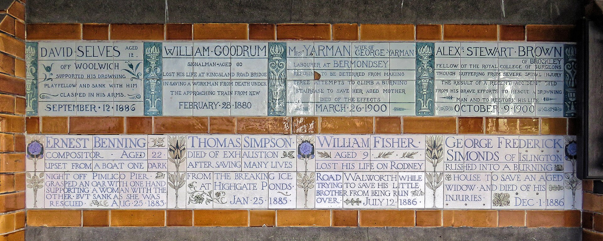

*The Watts Memorial. Photo: [Acabashi](https://commons.wikimedia.org/wiki/File:George_Frederic_Watts_Postman%27s_Park_memorial,_City_of_London,_England.jpg), [CC BY-SA 4.0](https://creativecommons.org/licenses/by-sa/4.0/).*

### London's Roman Amphitheatre, Guildhall

The eastern entrance, drain and wall stubs of Londinium's amphitheatre, found in 1988 while the Guildhall Art Gallery was being built above them and opened to the public in 2002. What survives is a few metres of dark stone and timber; the missing bowl is drawn around it in green light on a black floor, with the silhouettes of a crowd projected on the walls. It held six to seven thousand people, roughly a quarter of Roman London. It sits twenty feet below the pavement. **Free, open daily 10am to 5pm with last admission at 4.45pm.** You can book a general admission slot or simply walk in. Free introductory tours run Tuesday to Sunday at 12.15pm and 1.15pm, no booking.

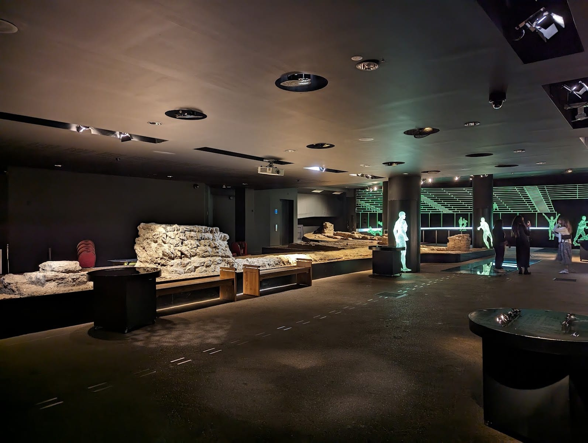

*The Roman amphitheatre at the Guildhall.*

### The London Silver Vaults, Holborn

Two floors below Chancery Lane, behind a steel vault door three feet thick, a corridor of **30 independent dealers** selling antique and modern silver — cutlery, candelabra, christening mugs, vintage jewellery and watches. It opened in 1882 as the Chancery Lane Safe Deposit Company, and dealers moved into the rooms in the 1930s. A bomb destroyed the building above in the Blitz; the vaults underneath survived. **Free, no appointment: Monday to Friday 9am to 5.20pm, Saturday 9am to 12.50pm, closed Sunday and bank holidays.** The entrance is on Southampton Buildings, not Chancery Lane.

*A dealer's shop in the Silver Vaults.*

### The Fitzrovia Chapel

The last surviving fragment of the Middlesex Hospital, which was demolished around it — the chapel now stands alone in Pearson Square inside the Fitzroy Place development. John Loughborough Pearson began it in 1891, his son Frank finished it, and between them it took over forty years and more than forty kinds of marble. The first service was held on Christmas Day 1891. From outside it is plain red brick; inside is a gold mosaic ceiling. **Free and no booking, but it only opens most Mondays, Tuesdays and Wednesdays 11am to 5pm, plus at least one Sunday a month from noon.** During exhibitions it usually opens daily; the What's On page lists the dates.

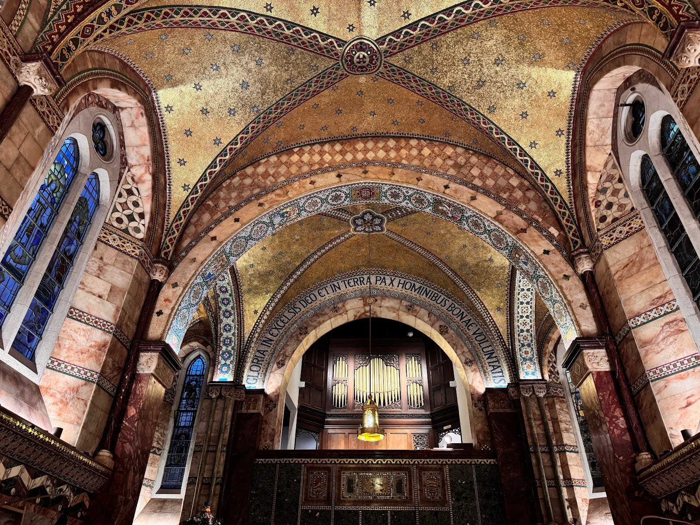

*The Fitzrovia Chapel.*

### All Saints, Margaret Street

Butterfield's 1859 High Victorian Gothic church, one street back from Oxford Circus and invisible from it. The pattern is structural, not painted: every surface is banded brick, inlaid tile or coloured marble. **Open every day from 11am to 7pm for visiting and private prayer, free.** Mass is said at noon and 6.30pm Monday to Saturday and 11am on Sundays. Arriving during a service is fine, but you will be joining it, not wandering. The entrance is through a small brick courtyard off Margaret Street.

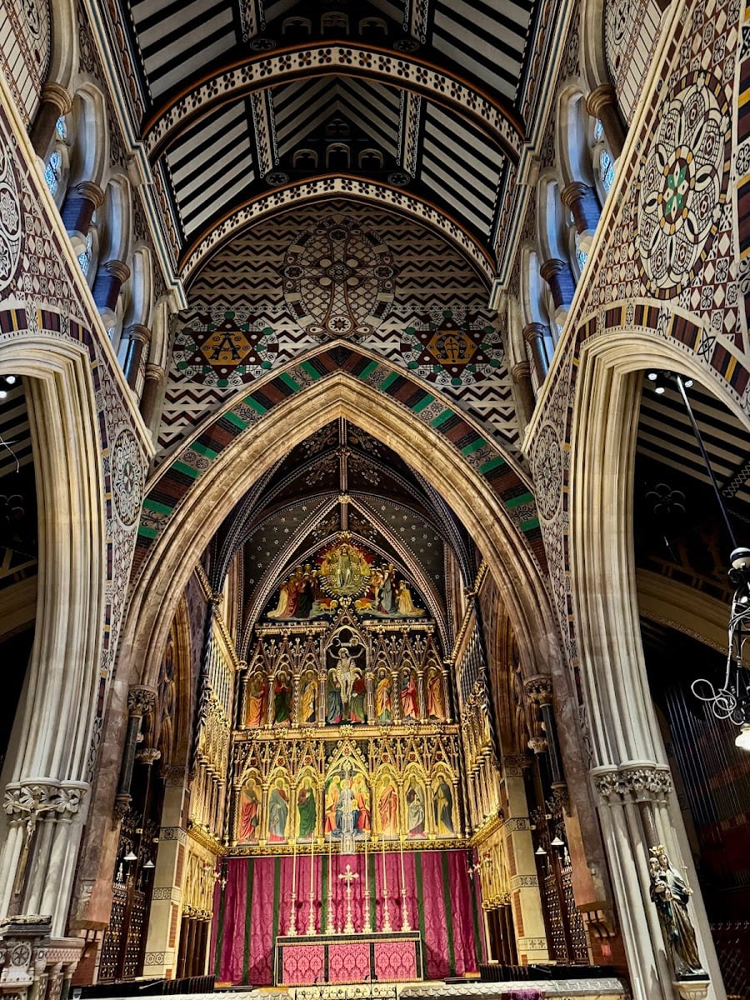

*All Saints, Margaret Street.*

### Colville Place, Fitzrovia

A pedestrian lane about a hundred metres long running between Charlotte Street and Whitfield Street, built from 1766 by John Colvill. Air raids took the eastern end of both terraces, and the gap is now Crabtree Fields, a small public garden. What is left is a double row of narrow three-storey brick houses, painted doors, pot plants on every step, and old lamp standards down the centre line where the two sloping pavements meet. There are no cars because there is no way in for one. **It is free, always open and a public right of way.** These are people's homes, so keep the noise down. Two minutes from Goodge Street.

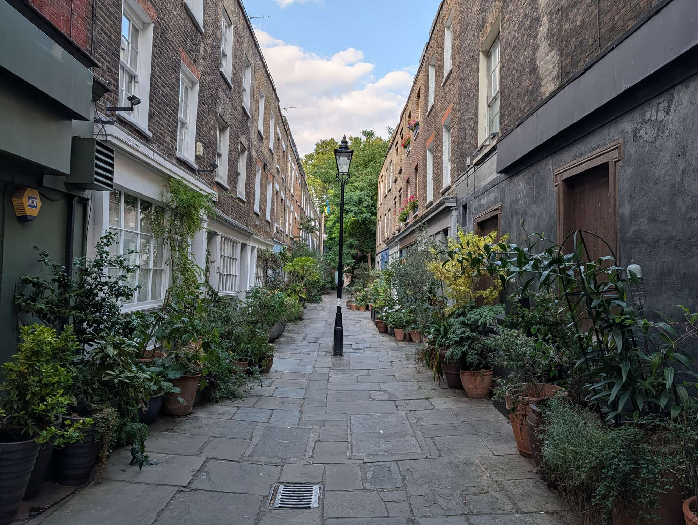

*Colville Place.*

### Camley Street Natural Park, King's Cross

Two acres of woodland, marsh and pond wedged between the Regent's Canal and the railway lines into St Pancras. It was a coal drop for King's Cross, and London Wildlife Trust opened it as a nature reserve in 1985. There are boardwalks over the water, a visitor centre and the Kingfisher Café, and kingfishers, reed warblers, Cetti's warbler, common toads and emperor dragonflies have all been recorded. Entry is free and it opens daily, but on much shorter hours than a park: **10am to 5pm April to September, and only 10am to 4pm October to March.** Assistance dogs only.

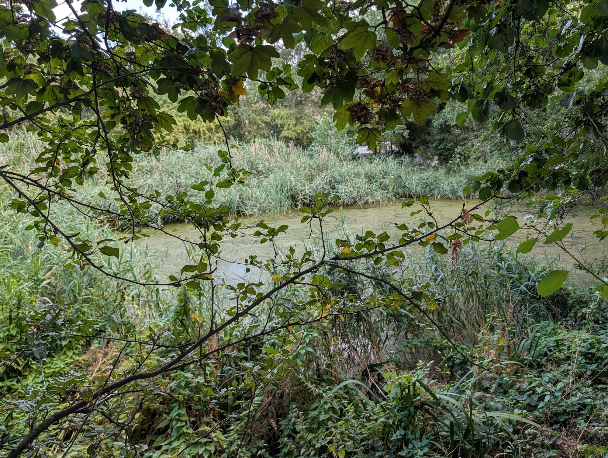

*The pond at Camley Street.*

### The Ornamental Canal, Wapping

A **narrow channel of water running through Wapping between Tobacco Dock and Shadwell Basin**, with brick warehouse-style housing on both banks, a towpath the whole way, and almost nobody on it. It is not a working canal: it was laid out in the 1980s along the line of the filled-in London Docks, and stops at each end.

**Wapping Wood** runs alongside it, planted on the filled dock itself, and the tower on the skyline as you look north-west is **Hawksmoor's St George in the East**. The whole stretch takes about fifteen minutes end to end.

**Free and open at all times.** It is a residential backwater, so there is nothing to buy or book. Wapping station is at the southern end and Shadwell at the northern. The trees along the water turn in October.

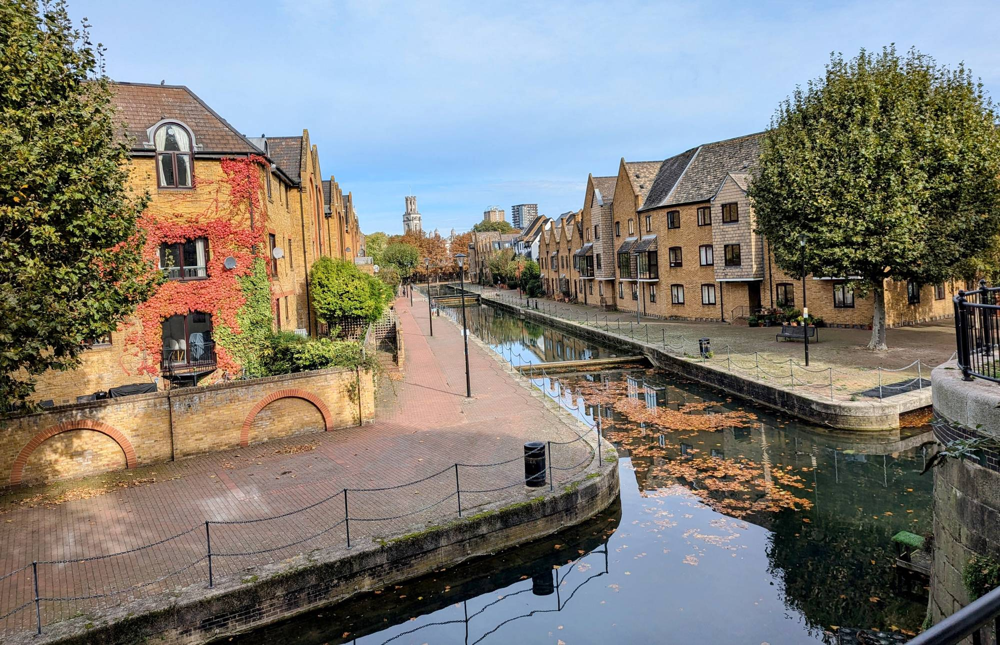

*The Ornamental Canal, looking towards St George in the East.*

### The Rolling Bridge and Fan Bridge, Paddington

Two kinetic bridges over Paddington Basin. Thomas Heatherwick's Rolling Bridge, installed in 2004, is twelve metres of eight hinged triangular segments that curl up into an octagon on the towpath. The Fan Bridge, by Knight Architects and finished in 2014, is twenty metres long and lifts in five separate fins like a hand fan. **Both are out of action.** The basin walkways are free and open at all hours, and there is nothing to book. Come for the water, the floating pocket park and the food.

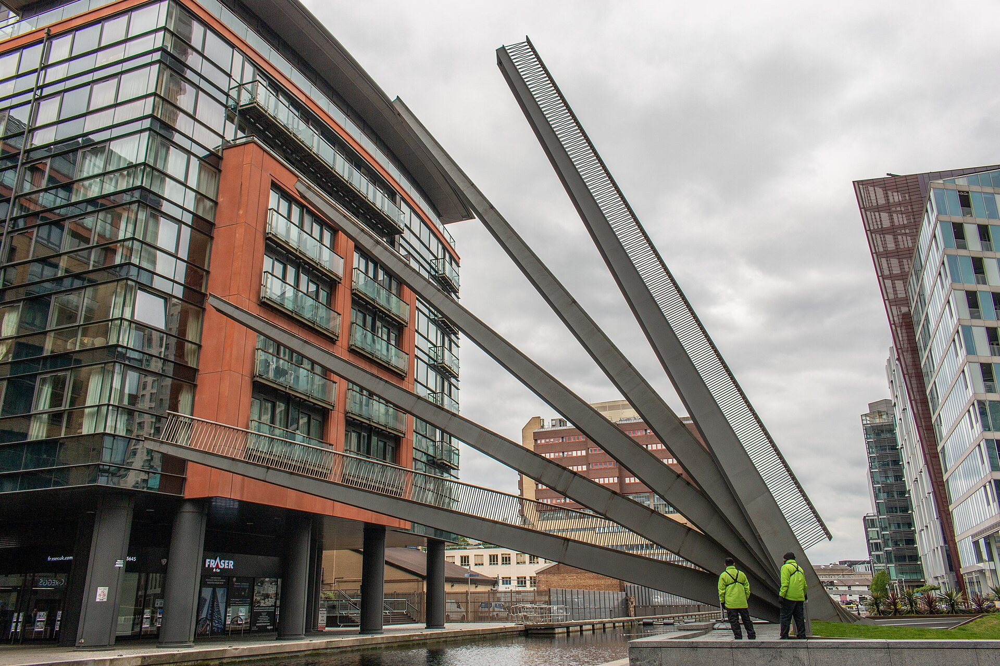

*The Fan Bridge, Paddington Basin. Photo: [-JvL-](https://commons.wikimedia.org/wiki/File:The_Fan_Bridge_in_London.jpg), [CC BY 2.0](https://creativecommons.org/licenses/by/2.0/).*

### Alexandra Road Estate, South Hampstead

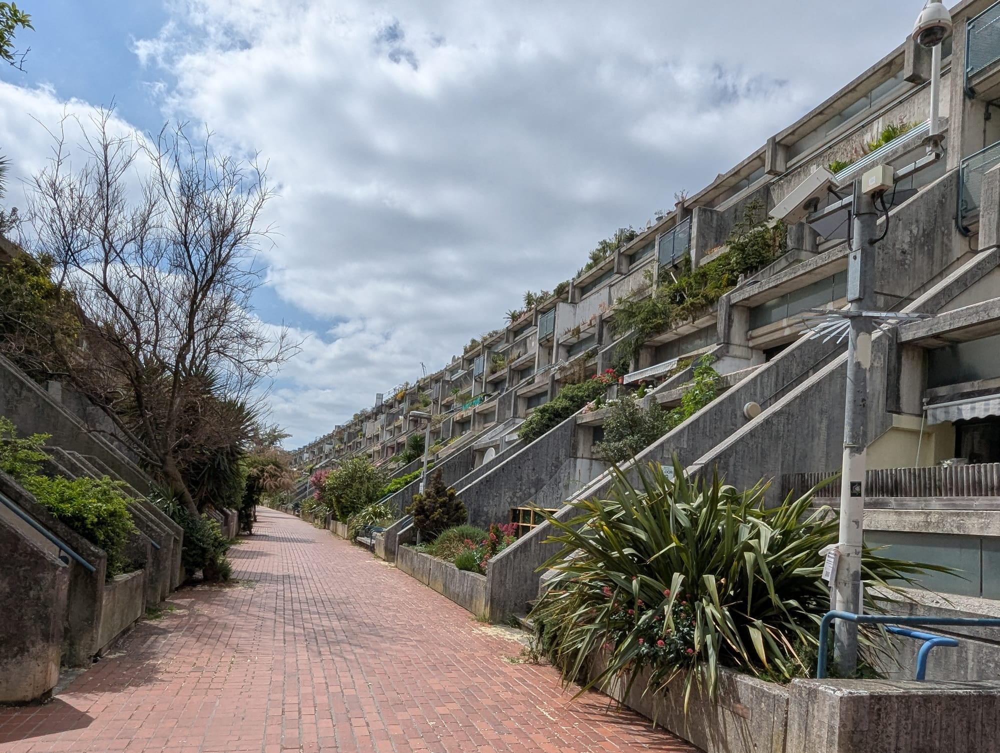

*Rowley Way, the Alexandra Road Estate.*

Officially the Alexandra and Ainsworth Estate, and known to almost everyone as Rowley Way. Two long terraces of white concrete step back as they rise, facing each other across a pedestrian street with no road and no parking - 1970s social housing that is **Grade II&ast; listed**.

Eggsy lives here in *Kingsman: The Secret Service*, and the terraces turn up repeatedly on television as shorthand for London brutalism. The residents run their own Film Group, and the estate publishes filming guidelines that describe it as a popular filming location.

The walkway is a public right of way, but this is housing, not an attraction: organised filming and photography need a licence through Camden&rsquo;s FilmFixer unit, with the estate&rsquo;s Film Group signing it off. The rules are aimed at tripods and crews, not a phone snapshot. Free, open at all hours, nothing to book.

---

Powered by <a target="_blank" rel="sponsored" href="https://www.getyourguide.com/london-l57/">GetYourGuide</a>

## Obscure, but you have to book

Both are run by the London Transport Museum, release tickets in batches and sell out.

### Kingsway Tram Tunnel, Holborn

Opened in 1906 by the London County Council, this ran trams under Kingsway from Holborn down to the Embankment, linking the north and south London tram networks, and closed in 1952. More than half of it survives, along with the remains of a subterranean tram station. The tour takes you down through the gate on the street into a wet, uneven, sixty-minute walk under the road. **Tickets are £49 adult and £45 concession plus a £1.50 booking fee.** Dates are released in batches rather than to a timetable, and the museum runs a notification list for each release. **Age 14 and over, photo ID required at the gate, and flat sturdy shoes** — sandals and heels are refused. No toilets, no cloakroom. Meet at Theobalds Road and Southampton Row, WC1B 4AP.

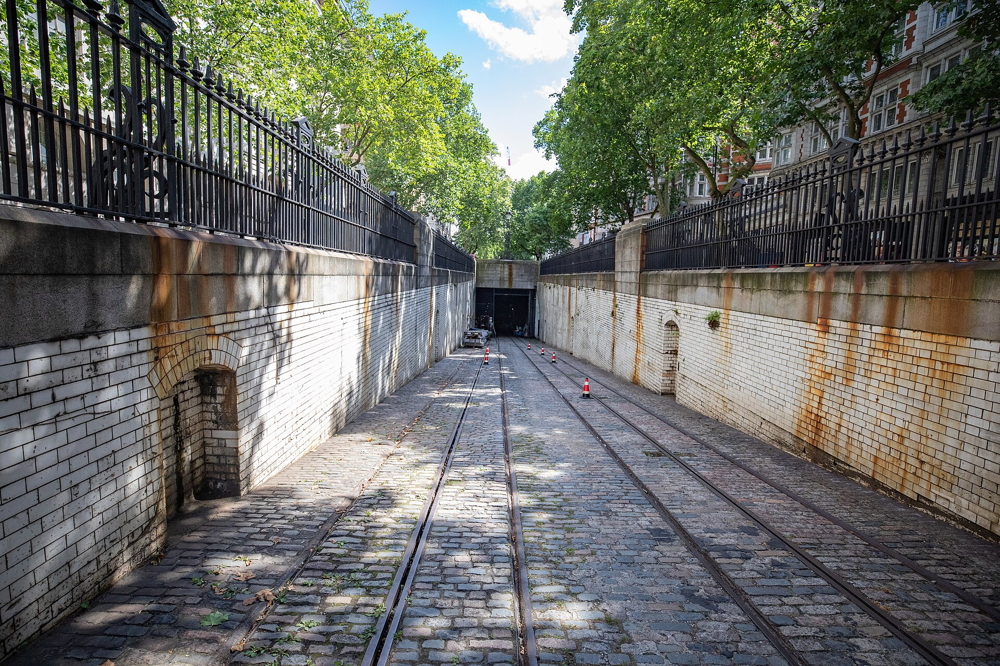

*The Kingsway Tram Subway. Photo: [steve_w](https://commons.wikimedia.org/wiki/File:Kingsway_Tram_Subway_2021.jpg), [CC BY 2.0](https://creativecommons.org/licenses/by/2.0/).*

### Clapham South Deep Shelter

One of eight deep-level shelters dug beneath Underground stations during the Second World War, opened in 1944 with bunks for 8,000 people, complete with canteen, medical posts and a warden's cabin. After the war it housed Caribbean arrivals off the *Empire Windrush* in 1948 and visitors to the Festival of Britain in 1951, and their graffiti is still on the walls. You descend eleven storeys and walk over a mile of tunnel with Northern line trains audible overhead; the canteen and cabin have been restored to their 1940s state. **£39 adult, £36 concessions and children, 75 minutes, age 10 and over with 10 to 16s accompanied.** Tours run at 11am, 1pm and 3pm on selected dates. **Meet at the Marks & Spencer Food Hall on Balham Hill, SW12 9EA**, not at the station.

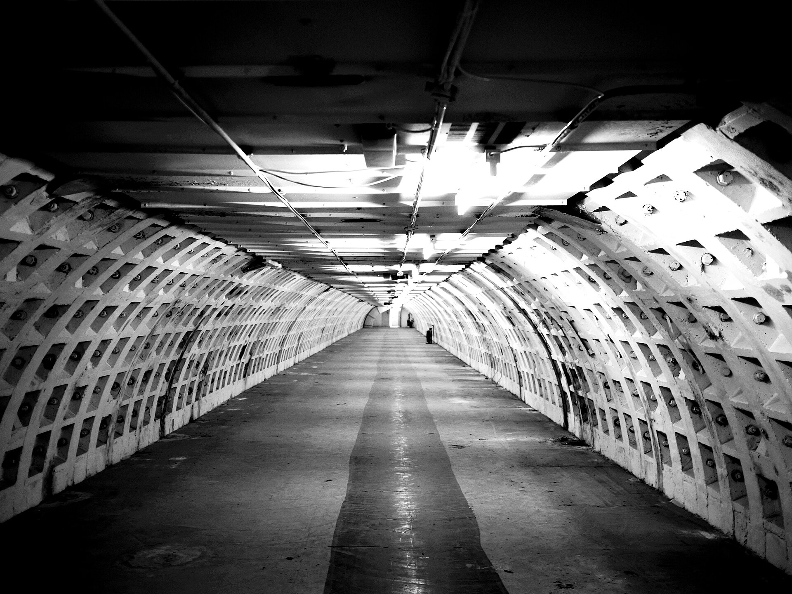

*Inside the Clapham South deep shelter. Photo: [Sam Town](https://commons.wikimedia.org/wiki/File:Top_level_Clapham_South_Deep_Level_Shelter_2019-03-22.jpg), [CC BY-SA 2.0](https://creativecommons.org/licenses/by-sa/2.0/).*

---

## Not hidden any more — just quieter than the big attractions

All of these are worth an hour, and none is a secret. The issue is timing.

### St Dunstan in the East

A church stood here from about 1100. Wren rebuilt it after the Great Fire, the Blitz gutted it in 1941, and the shell became a garden in 1970. The tower and steeple still stand. Inside the roofless nave there are climbing plants through the window tracery, a small fountain, benches and a canopy of trees where the ceiling was. It is free and needs no ticket. The City of London Corporation runs the garden, and the gates are open in daylight. **Come before 9am, or on a Sunday.**

### Leadenhall Market

A covered market in cream, maroon and green wrought iron, built by Horace Jones in 1881 and Grade II listed, standing directly on the site of the Roman forum and basilica. There has been a market here since 1321. Today it holds boutiques, wine bars, restaurants and a pub, and it was filmed as the street leading to the Leaky Cauldron in the first Harry Potter film. **The arcade itself is a public thoroughfare and never closes; the shops and bars inside keep City hours.** On a Sunday you get the ironwork, the cobbles and nobody at all, but nothing open; on a weekday lunchtime you get the market working and no room to photograph it. Free either way.

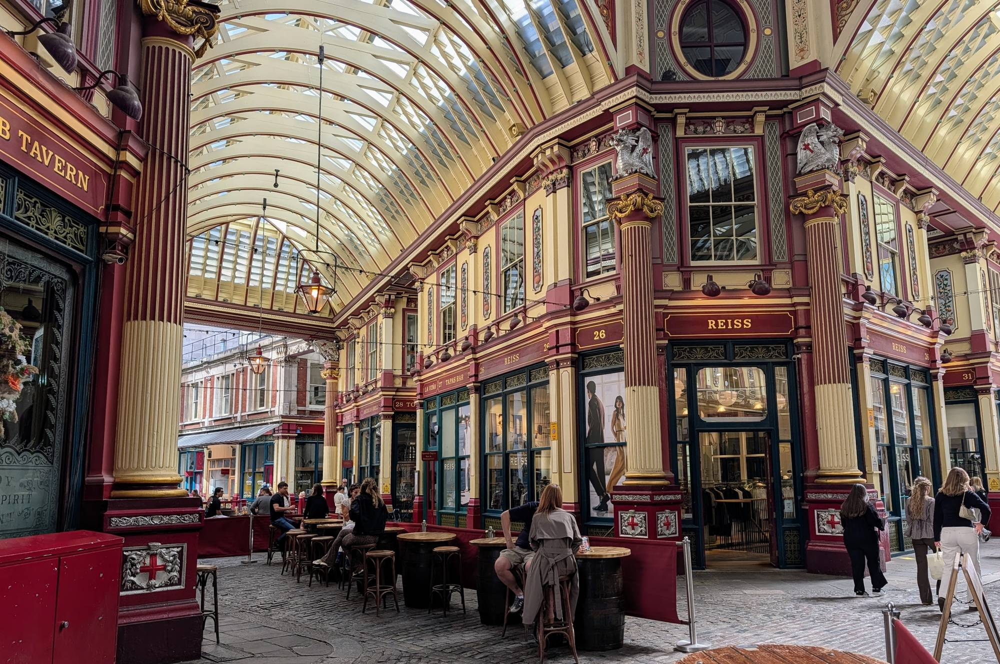

*Leadenhall Market on a weekday afternoon.*

### Sir John Soane's Museum, Holborn

The architect's own house at 13 Lincoln's Inn Fields, preserved by an Act of Parliament of 1833 exactly as he left it at his death in 1837 — the sarcophagus of Seti I in the basement crypt, casts stacked to the ceiling, mirrors angled to steal daylight, and rooms so tightly packed you move through them sideways. **Entry is free and there is no need to book: walk in.** It opens **Wednesday to Sunday, 10am to 5pm, with last admission usually 4.30pm, and is closed Monday and Tuesday** though it opens on bank holidays. Capacity is small, so expect to queue. **Time your visit for the Picture Room panels, which are swung open at set hours — 2pm for the Rake's Progress on the north wall, and 11am, 3pm and 4pm for the south recess.** No café, no seating, no air conditioning.

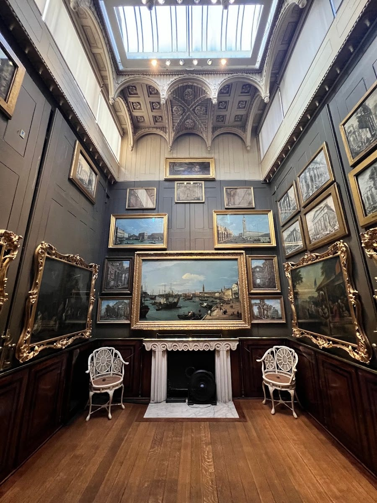

*The Picture Room.*

### Cecil Court, Covent Garden

A short Victorian shopping street between Charing Cross Road and St Martin's Lane, with bow windows, lamp standards and around two dozen shops, all independent and most of them dealers: Goldsboro Books for signed first editions, Marchpane for children's books, Watkins for the occult, Travis & Emery for sheet music, plus coin, medal, map, print and antiques specialists. It is free to walk down at any hour, **but the shops set their own hours — most keep roughly 10.30am to 5.30pm, Monday to Saturday, and a good many are closed on Sunday**, so a Sunday visit gets you an empty alley and locked doors.

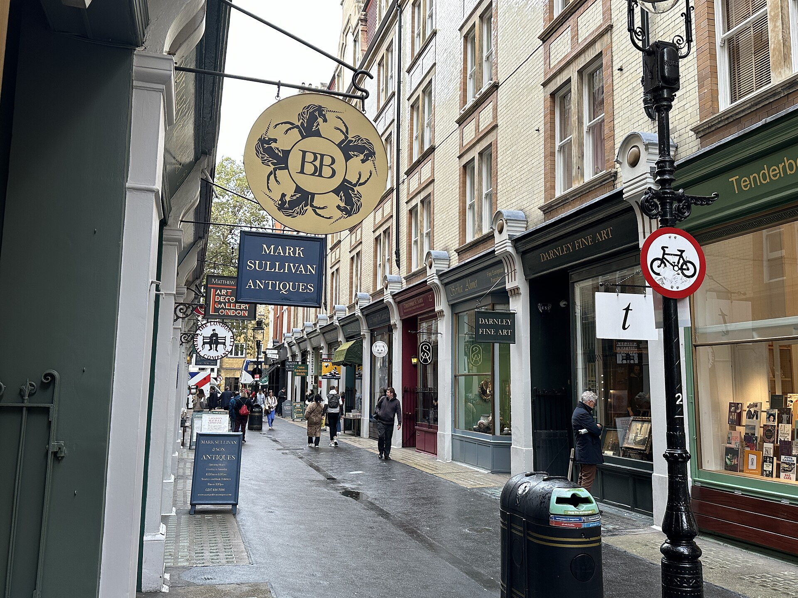

*Cecil Court. Photo: [Matt Brown](https://commons.wikimedia.org/wiki/File:Cecil_Court_2024-10-10.jpg), [CC BY 2.0](https://creativecommons.org/licenses/by/2.0/).*

### Neal's Yard, Covent Garden

A courtyard about twenty metres across, reached through narrow alleys off Monmouth Street and Short's Gardens. Nicholas Saunders filled the former warehouse yard with wholefood and natural-remedy businesses from 1976, and Neal's Yard Dairy arrived in 1979. Every wall is a different colour, plants hang off every ledge, and there are cafés, wine bars and restaurants around the edges. **It is free and always open; a dozen people with cameras fill it, so come before 10am.**

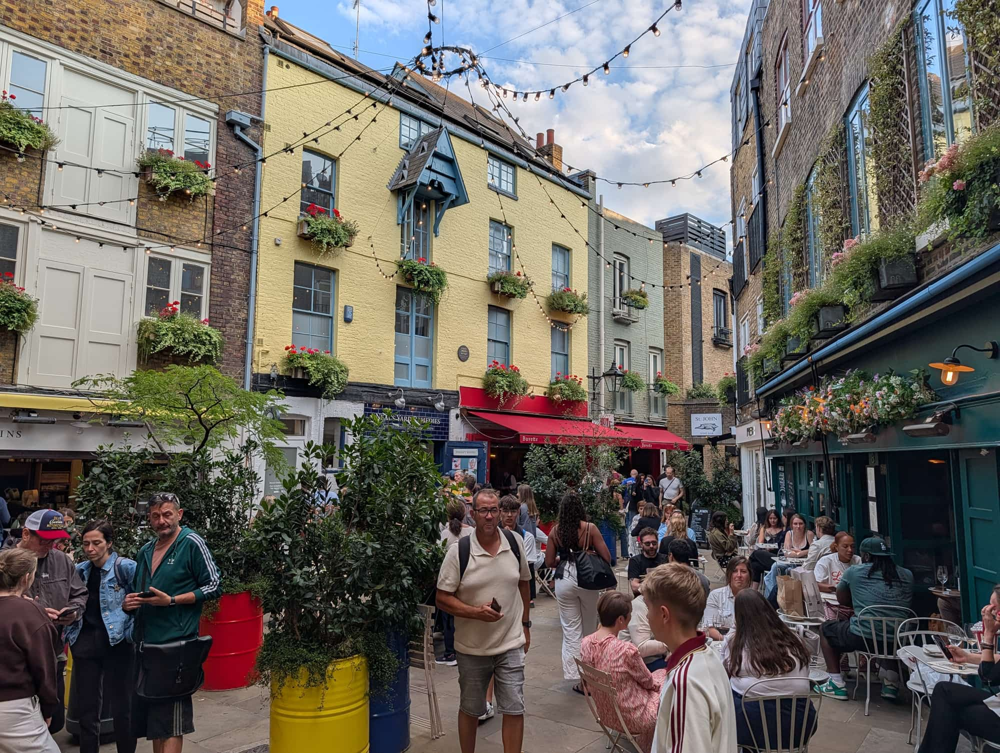

*Neal's Yard.*

### Greenwich Foot Tunnel

A white-tiled pedestrian tunnel under the Thames, opened in 1902 so that workers living in Greenwich could reach the docks and shipyards on the Isle of Dogs. You enter through a glazed brick rotunda by the *Cutty Sark*, go down a spiral staircase or a lift, and come up at Island Gardens with the whole Greenwich waterfront laid out behind you across the river. It is entirely free and **open 24 hours, and since the refurbishment the lifts run around the clock too**. **You must not cycle through — dismount and walk, and e-bikes are barred altogether.** It is free; most visitors pay for the DLR instead.

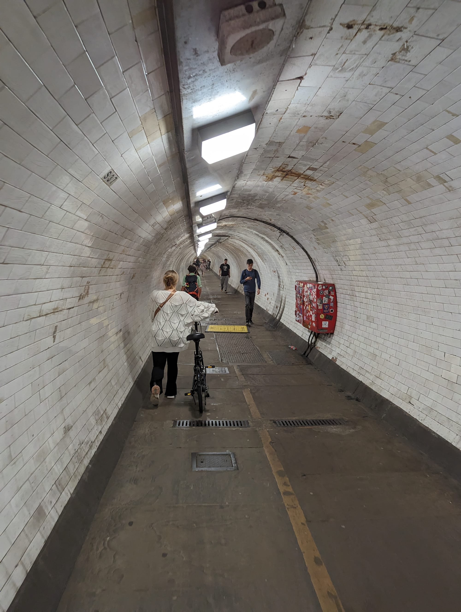

*The Greenwich Foot Tunnel.*

### Word on the Water, King's Cross

A 1920s Dutch barge, the *Dianti*, moored on the Regent's Canal towpath between Granary Square and the York Way bridge, trading as a bookshop. There is a wood-burning stove in the cabin, secondhand and new stock crammed floor to ceiling, and a roof deck that hosts jazz and poetry on summer weekends. The cabin holds about six people comfortably. **It is free to browse and opens midday to 7pm every day except Christmas Day**, so it is shut all morning.

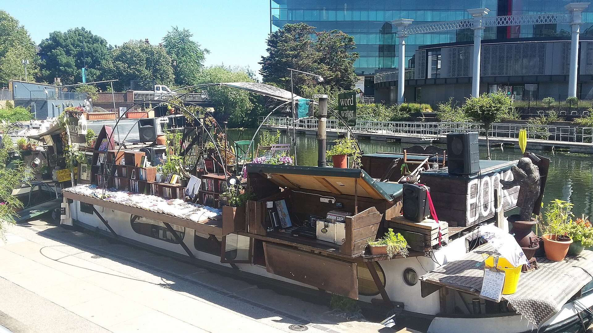

*Word on the Water. Photo: [Luke McKernan](https://commons.wikimedia.org/wiki/File:Word_on_the_Water,_Kings_Cross.jpg), [CC BY-SA 2.0](https://creativecommons.org/licenses/by-sa/2.0/).*

### The King's Cross Light Tunnel

The pedestrian subway running from King's Cross and St Pancras under the road to King's Boulevard, Granary Square and Coal Drops Yard. It is 90 metres long and gently curved, and one whole wall is a light installation — 190 individually controllable vertical pixels behind 12mm toughened glass, designed by Allies and Morrison with Speirs Major and The Light Lab. The colour shifts as you walk through it. **It is free and open 7am to 8pm daily**, so it is not a route home from a late train. It is a 30-second walk, not a destination.

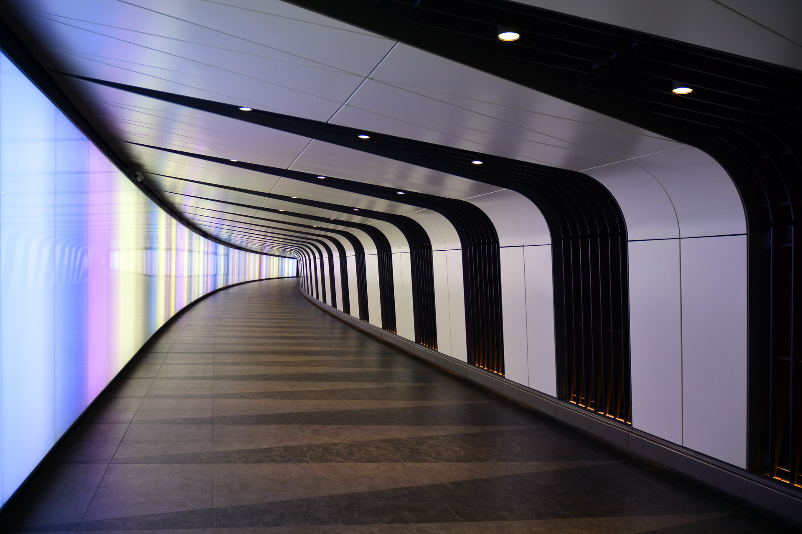

*The King's Cross Light Tunnel. Photo: [Images George Rex](https://commons.wikimedia.org/wiki/File:Lightwall_King%27s_Cross_%2814824061320%29.jpg), [CC BY-SA 2.0](https://creativecommons.org/licenses/by-sa/2.0/).*

---

Powered by <a target="_blank" rel="sponsored" href="https://www.getyourguide.com/london-l57/">GetYourGuide</a>

## What it costs

Most of this guide is free.

**Free, walk in, no ticket:**
Postman's Park, St Dunstan in the East, Leadenhall Market, Colville Place, Neal's Yard, Cecil Court, the Greenwich foot tunnel, the King's Cross light tunnel, the London Silver Vaults, All Saints Margaret Street, the Fitzrovia Chapel, the Roman Amphitheatre and **Sir John Soane's Museum**. Camley Street Natural Park is free too, on shorter hours.

**Ticketed, and worth booking early:**

* **London Transport Museum's Hidden London tours** of disused stations and tunnels. **Clapham South is £39 adult and £36 concession; the Kingsway tram tunnel is £49 and £45.** Both carry a £1.50 booking fee, and tickets are released in batches.
* **Dennis Severs' House**, Spitalfields — **£16 plus a £1.50 booking fee for a day visit, Friday to Sunday** (Friday and Saturday relaxed, Sunday silent), and **£25 for the candlelit Silent Night Visit**. Walk-up tickets depend on availability.
* **Leighton House**, Kensington — **£14 adult, £9 concession, £5 for ages 6 to 18**, closed Tuesdays. Some ground-floor areas are free.

**Walking costs nothing.** The alleys, ghost signs, parish boundary markers and buried rivers are not signposted.

---

## What to know

* **Do not plan a morning around the Rolling Bridge or the Fan Bridge**; both are out of action.
* **The tunnel tours release tickets in batches**, so check whether anything is on sale before you plan around them.
* **For a drink behind a hidden door,** London's speakeasies are a guide of their own: a fridge in Spitalfields, a bookcase in Soho, a repair shop on Hackney Road. [The Best Speakeasy Bars in London](/articles/best-speakeasy-bars-london/) has the directions.
* **Neal's Yard, St Dunstan and Leadenhall are not hidden.** They are famous and small; go early morning or on a Sunday.

---

## Continue planning your London trip

- 🎪 **[Free Things to Do in London](/free/)**
- 🗝️ **[The Best Speakeasy Bars in London](/articles/best-speakeasy-bars-london/)** — bars behind fridges, bookcases and unmarked doors
- 🎨 **[London's Street Art and Banksys](/articles/london-street-art/)**
- 🎬 **[London Filming Locations](/articles/london-filming-locations/)**
- 🏰 **[Historic Houses in London](/articles/historic-houses-london/)**
- 🏙️ **[City of London Area Guide](/articles/city-of-london-area-guide/)**
- 🚂 **[King's Cross Area Guide](/articles/kings-cross-area-guide/)**
