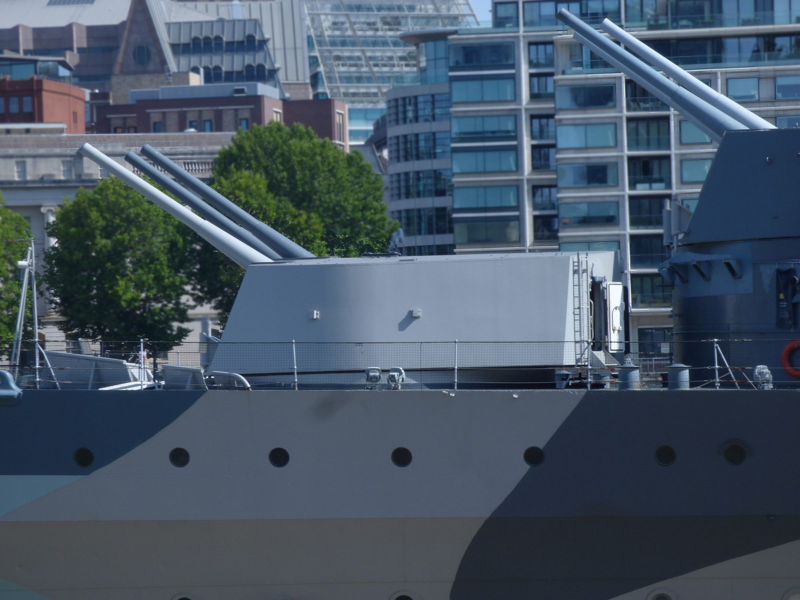
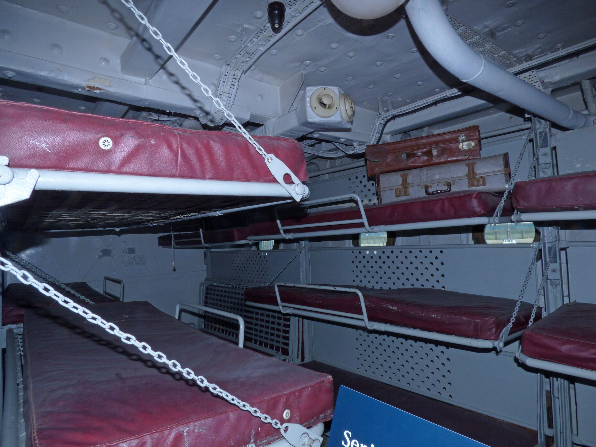
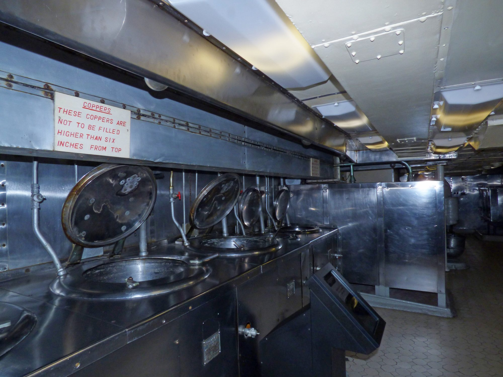
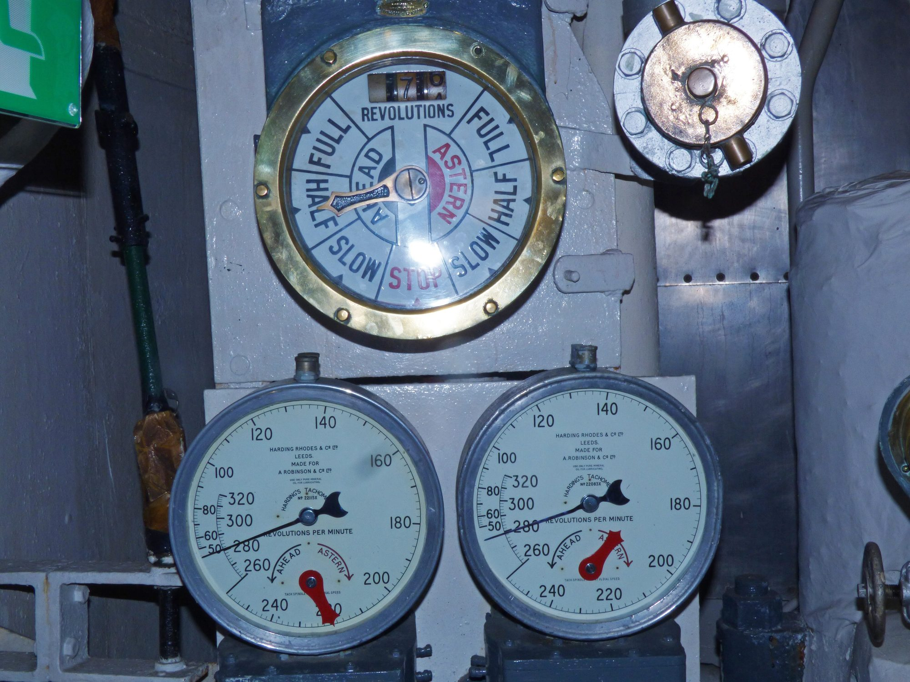
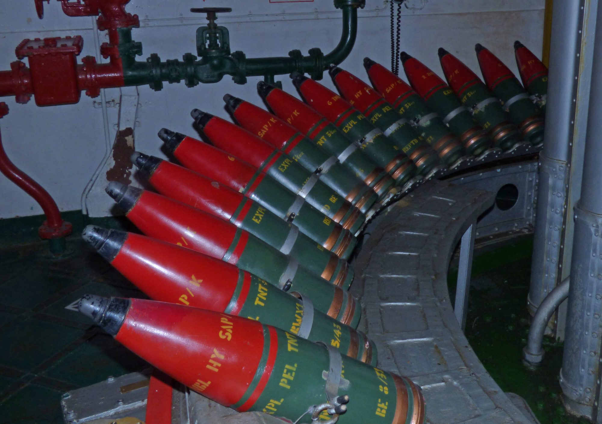

> 💡 **The Short Version:**
> - **Tickets:** an adult ticket is **£26.80** (£29.50 with the 10% Gift Aid donation); a child aged 5 to 15 is **£13.40**; under-5s and IWM members go free. Prices run to 31 March 2027. Booking online is advised but you can buy on the day.
> - **Open 10am to 5pm daily, last entry 4pm.** Closed 24 to 26 December.
> - **Allow at least three hours.** The ship has nine decks, and IWM says many visitors stay half a day.
> - **Cheaper ways in:** £3 tickets for people on Universal Credit and other named benefits, free entry with IWM membership, and the London Pass or Go City Explorer pass. <a href="https://www.getyourguide.com/activity/-t1499219?partner_id=WWP7I0R&amp;cmp=hms-belfast-guide" target="_blank" rel="sponsored nofollow noopener" data-affiliate="gyg">A GetYourGuide ticket</a> is the same price as IWM's.
> - **Not 2FOR1:** HMS Belfast is outside the National Rail scheme.
> - **Ladders, not lifts:** only the Main Deck, Quarterdeck, Boat Deck and café are step-free. The rest is steep ladders and hatches.
> - **On until 11 April 2027:** *Pressure: The D-Day Decision*, a temporary display on the weather forecast behind the 1944 landings, included in your ticket.

> ⚠️ **Most of the ship is reached by ladder, and wheelchair users cannot get below the Main Deck.** IWM warns that seeing every deck means climbing several ladders, and advises people with restricted mobility, and children under four feet tall, to skip the engine room because of its vertical ladders and narrow walkways. Pushchairs stay on the outside decks. Wear trousers or shorts rather than a skirt, and flat shoes.

---

HMS Belfast is a Second World War cruiser moored permanently on the Thames between London Bridge and Tower Bridge, run by Imperial War Museums (IWM). About 950 people lived and served aboard her at a time. Visitors go in at the quayside pavilion, cross a gangway and explore from the Flag Deck at the top to the engine and boiler rooms below sea level.

*Ticket prices on this page apply from 2 September 2026 to 31 March 2027.*

*A triple six-inch gun turret on HMS Belfast's foredeck. Photo: [jeremySO](https://commons.wikimedia.org/wiki/File:2026-08-03_-_HMS_Belfast_-_04.jpg), [CC BY 4.0](https://creativecommons.org/licenses/by/4.0/).*

---

## Tickets and prices

IWM sells two price lines: one with a 10% voluntary donation, which lets it reclaim tax on the whole ticket under Gift Aid, and a standard price without it.

| Ticket | With donation | Standard price |
| :--- | :--- | :--- |
| **Adult (16 to 64)** | £29.50 | **£26.80** |
| **Child (5 to 15)** | £14.75 | **£13.40** |
| **Senior (65+), student or disabled** | £26.55 | **£24.10** |
| **Child under 5** | Free | **Free** |
| **Carer** (one per disabled visitor) | Free | **Free** |
| **IWM member** | Free | **Free** |
| **£3 benefits ticket** | n/a | **£3** (adult or child 5 to 15; online only) |

Children under 16 must be accompanied by an adult. Concessions need proof at the door: a valid student card, or evidence of a disability allowance such as PIP, DLA, ESA or Attendance Allowance.

**Booking.** IWM recommends booking online in advance to minimise your wait, but anyone, members included, can buy general admission on the day. Online tickets have no booking fee and arrive by email; show them on a phone or print them. Your slot is the time to arrive: you can come up to 30 minutes after it starts, but entry before it is not guaranteed. Tickets are non-refundable and non-transferable, and only work for the date bought. You can book online for up to 14 people; groups of 15 or more must arrange their visit in advance. [Book on the IWM site](https://www.iwm.org.uk/visits/hms-belfast/booking).

An audio guide is included with a general ticket and is collected at the admissions desk before boarding. It comes in English, French, Spanish, German, Italian, Russian, Dutch, Polish, Portuguese, Mandarin, Swedish and Ukrainian, with a family version for ages 7 and over (English only) and a British Sign Language option with English captions.

Current dates and slots:

Powered by <a target="_blank" rel="sponsored" href="https://www.getyourguide.com/london-l57/">GetYourGuide</a>

---

## Discounts that apply

- **£3 benefits tickets.** UK residents on Universal Credit, Pension Credit and other named benefits can buy up to five £3 tickets per household. They are sold online only, cannot be bought at the door, and you must bring the supporting documents or you will not be admitted. Under-5s and carers still go free without booking. Details are on IWM's [£3 tickets page](https://www.iwm.org.uk/visits/hms-belfast/booking/universal-credit).
- **IWM membership.** Members get free entry to HMS Belfast, Churchill War Rooms and IWM Duxford, and need to pre-book only for special event days. See IWM's [membership page](https://www.iwm.org.uk/membership).
- **London Pass and Go City Explorer.** HMS Belfast is included on the London Pass and on Go City's Explorer pass, where you pick 2 to 7 attractions. No reservation is needed, so you can turn up. The pass lists it at £26.80 for an adult and £13.40 for a child. Whether a pass pays depends on how many paid sights you do; the [London Pass guide](/articles/london-pass-guide/) does the sums.
- **National Rail 2FOR1.** Not available. HMS Belfast is not in the scheme; see our [2FOR1 guide](/articles/national-rail-2for1-london-attractions/) for the sights that are.
- **Military discount.** None for serving personnel or veterans, except free entry on Armed Forces Day and Remembrance Sunday.
- **GetYourGuide.** The <a href="https://www.getyourguide.com/activity/-t1499219?partner_id=WWP7I0R&amp;cmp=hms-belfast-guide" target="_blank" rel="sponsored nofollow noopener" data-affiliate="gyg">HMS Belfast ticket on GetYourGuide</a> starts at £26.80, the same as the standard adult price at IWM, so it is a convenience rather than a saving.

---

## Opening hours and when to go

HMS Belfast opens **10am to 5pm every day, with last entry at 4pm**, and is **closed from 24 to 26 December**.

IWM says the quietest time is the afternoon after 3pm, though large groups can be aboard all day, and that weekends and peak tourist seasons are busier, warmer and noisier. Last entry is at 4pm, so an afternoon arrival leaves you less than the three hours IWM recommends. If you want to see everything, arrive in the morning on a weekday and accept the crowds.

**How long.** Plan for three hours at the least. Add time for a meal, the ladders and the audio guide.

---

## What to see on board

IWM's floor plan covers nine decks, from the Flag Deck at the top down to the engine and boiler rooms below the waterline. The highlights it names:

*Bunks on one of the mess decks. Photo: [jeremySO](https://commons.wikimedia.org/wiki/File:2026-08-03_-_HMS_Belfast_-_13.jpg), [CC BY 4.0](https://creativecommons.org/licenses/by/4.0/).*

- **Gun turrets and the D-Day Experience.** Step inside one of the six-inch gun turrets for a sound installation set at 05:27am on 6 June 1944, when Belfast's guns opened fire on the Normandy beaches. A turret held 26 crew. It is loud, with sounds that simulate gunfire.
- **The Compass Platform.** Where Captain Frederick Parham directed the ship on D-Day. You can see the ship's log for 6 June 1944 and sit in the Captain's chair for a photo.
- **The Operations Rooms ("the Nerve Centre").** Radar, radio and intelligence systems, and how the crew used them to coordinate the ship.
- **The Shell Rooms.** Teams hand-loaded cordite and shells here, letting the six-inch guns fire up to 96 times a minute, according to IWM.
- **The Lower Steering Position.** An interactive display: follow the Captain's orders and steer towards Normandy in time for D-Day.
- **Engine and Boiler Rooms.** The machinery that could drive the ship at about 32.5 knots, with an engine-noise soundscape. This is the section with vertical ladders and narrow walkways.
- **Mess decks and living spaces.** The Main Deck holds the ship's laundry, chapel, bakery, galley, sick bay, mess decks and a dental surgery; the ship also has Arctic and East Asia mess decks. The galley is where the "Action Stations" alarm sounds.
- **The Fo'c'sle and the quarterdeck.** The open decks give views along the Thames. IWM notes that the tide can move the deck by about six metres up or down over a day.

*The galley's cooking coppers. Photo: [jeremySO](https://commons.wikimedia.org/wiki/File:2026-08-03_-_HMS_Belfast_-_14.jpg), [CC BY 4.0](https://creativecommons.org/licenses/by/4.0/).*

*A telegraph and revolution gauges below decks. Photo: [jeremySO](https://commons.wikimedia.org/wiki/File:2026-08-03_-_HMS_Belfast_-_34.jpg), [CC BY 4.0](https://creativecommons.org/licenses/by/4.0/).*

*Shells racked in a shell room. Photo: [jeremySO](https://commons.wikimedia.org/wiki/File:2026-08-03_-_HMS_Belfast_-_37.jpg), [CC BY 4.0](https://creativecommons.org/licenses/by/4.0/).*

---

## The ship's history in brief

All of this is from IWM.

- **1938 to 1939.** Built by Harland & Wolff, HMS Belfast was launched on St Patrick's Day, 17 March 1938, by Anne Chamberlain, wife of the prime minister, and commissioned on 5 August 1939.
- **1939.** After two months of patrolling she hit a magnetic mine. The damage kept her out of action for three years.
- **1942 to 1943.** Back with the Home Fleet, she spent 18 months escorting the Arctic Convoys that carried supplies to the Soviet Union.
- **Battle of North Cape, 26 December 1943.** Belfast detected the German battlecruiser *Scharnhorst* by radar 30 miles away. That evening, at 4.50pm, she lit the target with star shell, and *Scharnhorst* was sunk, with 36 survivors from a crew of 1,963 and 1,927 dead.
- **D-Day, 6 June 1944.** Belfast was flagship of Bombardment Force E and one of the first ships to fire on the German defences. Over more than 33 days off Normandy she fired over 5,000 shells.
- **1950 to 1952.** She served in the Korean War, where IWM says she saw more action than at any point in the Second World War.
- **After the Navy.** She was retired in 1963 and opened to the public in London on Trafalgar Day, 21 October 1971. IWM describes her as the last remaining vessel of her type.

---

## Accessibility

The ship is a warship, and IWM is clear about the limits.

- **Step-free:** the Main Deck, Quarterdeck, Boat Deck and Stokers' Café, and the roof bar via a lift in the admissions building. The Main Deck includes the laundry, chapel, bakery, galley, sick bay, mess decks and dental surgery.
- **Not accessible:** the upper and lower decks beyond those areas, which need ladders. IWM calls them unsuitable for people with restricted mobility.
- **Getting in:** six steps or a ramp lead to the pavilion where your visit starts. A lift serves the Quarterdeck; the combined weight limit for wheelchair and user is 275kg.
- **Moving about:** some floors are uneven, and some doorways and hatchways have lips to step over.
- **Loans:** three manual wheelchairs are free to borrow, first come, first served. Staff cannot push them, so the user or someone in the party must. Sensory backpacks and ear defenders are free to borrow from the pavilion ticket counter.
- **Sound and light:** loud noises simulate gunfire in the gun turret experience, machinery in the boiler room and alarms in the galley. Some areas are dimly lit, and some are cold.
- **Toilets and parking:** an accessible, gender-neutral toilet with baby changing is in the shop before you board. There is no blue badge parking for visitors.
- **Assistance dogs** are welcome. Water bowls are at security on the Quarterdeck.

The AccessAble guide and IWM's visual story are linked from the [accessibility page](https://www.iwm.org.uk/visits/hms-belfast/accessibility). For wider planning, see [Step-Free London](/articles/step-free-london/).

---

## With children

- **Free family activities** run every weekend and every day in school holidays, 10am to 4pm, for ages 5 to 12. The Lost Laundry Challenge trail runs daily: find a sailor's missing kit and claim a sticker. At weekends through November 2026 children can make a mini kit bag.
- **Ladders and hatches.** Children should be able to climb, and IWM suggests children under four feet skip the engine room.
- **Pushchairs** stay on the outer decks; leave them in the Quarterdeck parking area, at your own risk.
- **Under-5s are free.** An adult must accompany every child under 16.
- **Birthday parties** can be booked aboard.
- **What to wear:** comfortable shoes, trousers or shorts, and layers, as it can be cold below deck.

More ideas are in [London with children](/articles/london-with-children/).

---

## Food, toilets and facilities

- **Stokers' Café** serves sandwiches, soups, cakes and hot drinks, daily 10am to 5pm. IWM cafés are cashless.
- **The Bar at HMS Belfast** is a riverside roof bar with views of Tower Bridge, reached by the lift.
- **Packed lunches** can be eaten in seated areas around the ship, and water fountains are dotted about.
- **Toilets:** two sets aboard (front and back of the ship) and others in the pavilion.
- **Luggage:** there are no lockers or cloakroom, and suitcases, wheeled luggage and large holdalls are not admitted. Bag searches may take place before entry. See our [luggage storage guide](/articles/luggage-storage-london/).
- **Nearby:** [Hay's Galleria](/articles/south-bank-area-guide/) is beside the ship, and [Borough Market](/articles/bankside-borough-walk/) is a walk west along the river.

---

## Events and displays, winter 2026/27

- **Pressure: The D-Day Decision** (21 August 2026 to 11 April 2027). A temporary display with STUDIOCANAL and the Met Office on the 72 hours before D-Day. It includes Group Captain James Stagg's personal diary, shown in public for the first time, and an Eisenhower memo. It is included in your ticket.
- **Guided Tour: The Second World War** (Wednesdays). Adults from £36.80 including admission, members £10. It follows the ship's wartime story from the oral histories of her crew, starting on the Quarterdeck. It is recommended for over-16s, and uses ladders only, so wheelchair users cannot join.
- **Guided Tour: Sailors' Stories** runs every other Friday.
- **We Were There** (Friday 19 February 2027, 11am to 3pm). Veterans and eyewitnesses share their memories at points around the ship.

The [what's on page](https://www.iwm.org.uk/visits/hms-belfast/whats-on) lists the schedule.

---

## Getting there

HMS Belfast is on The Queen's Walk, London SE1 2JH.

- **London Bridge** (Jubilee and Northern lines, and Thameslink, Southern and Southeastern trains) is under half a mile away.
- **Tower Hill** (District and Circle lines) is on the north bank; cross [Tower Bridge](/articles/tower-bridge-guide/) on foot.
- **Thames Clippers:** London Bridge City Pier is 0.2 miles away. See [how to use London river boats](/articles/how-to-use-london-river-boats/).
- **Bus:** routes 47, 343 and 381 stop at Abbots Lane and Hay's Galleria.
- **By bike:** Santander Cycles dock on Tooley Street, 0.3 miles away.
- **By car:** there is no car park, and the ship is in the Congestion Charge zone.

---

## Continue planning your London trip

- 🏰 **[Tower of London](/articles/tower-of-london-guide/)** — the Crown Jewels and the Yeoman Warder tour across Tower Bridge.
- 🌉 **[Tower Bridge](/articles/tower-bridge-guide/)** — the glass floor and Victorian engine rooms, a few minutes east.
- 🚶 **[South Bank Walk](/articles/south-bank-walk/)** — Westminster to Tower Bridge, with HMS Belfast at stop ten.
- 🚶 **[Bankside to Borough Walk](/articles/bankside-borough-walk/)** — Tate Modern, the Globe and the cathedral, ending near here.
- 🚶 **[City of London Walk](/articles/city-of-london-walk/)** — ends at the Tower and the bridge.
- 🏛️ **[South Bank Area Guide](/articles/south-bank-area-guide/)** and **[Bermondsey Area Guide](/articles/bermondsey-area-guide/)** — what is around the ship.
- 🎖️ **[Churchill War Rooms](/articles/churchill-war-rooms-guide/)** — IWM's other paid London site.
- 🎟️ **[The London Pass Guide](/articles/london-pass-guide/)** and **[National Rail 2FOR1](/articles/national-rail-2for1-london-attractions/)** — the ways to pay less for London sights.
