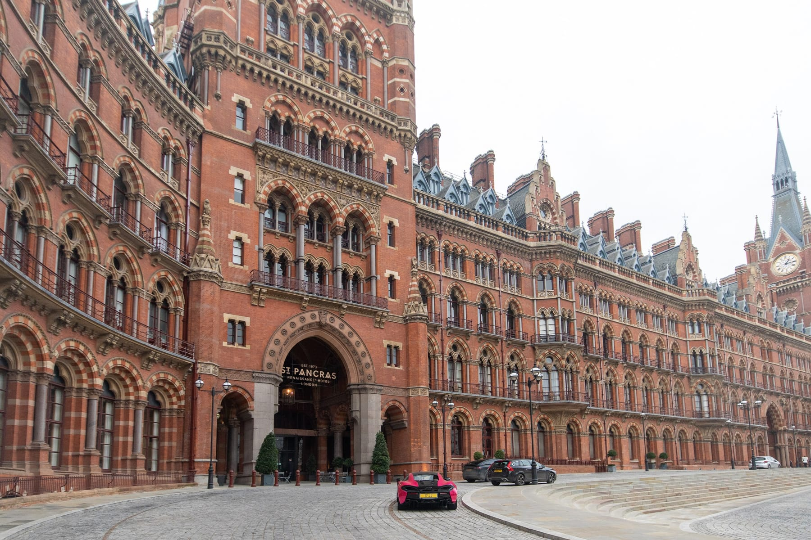
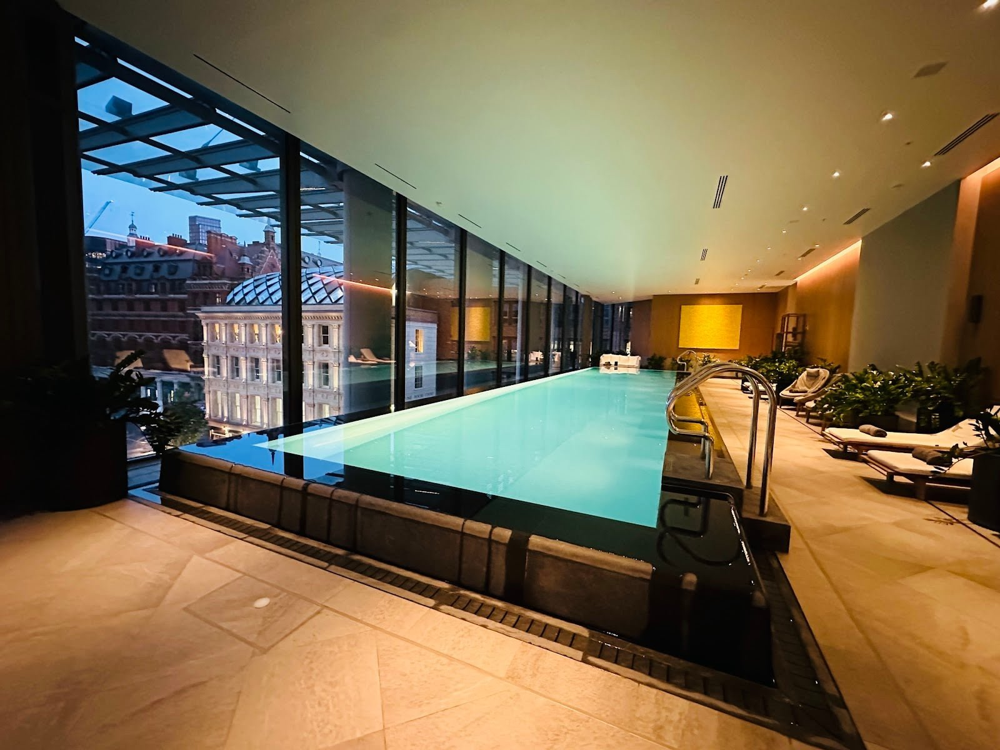
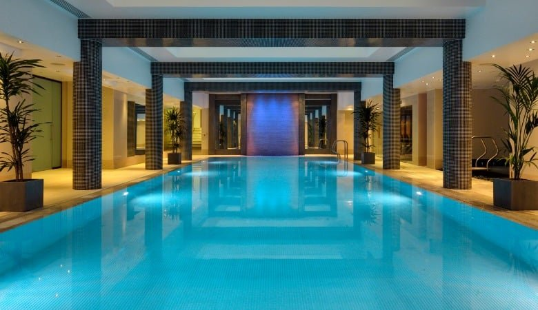

Of the seven hotel spas below, four sell access on its own, two bundle it with a treatment, and one lets you in only with a treatment of two hours or longer. Pan Pacific London also sells a pass with a Sunday roast. Each entry gives the price, how long you get and what the pass includes.

> 💡 **The Short Version:** The cheapest way into a hotel pool is the **[St Pancras London](#st-pancras-london) Spa Day Pass at £80 for four hours**, with no treatment: £20 an hour against £75 at **[The Landmark](#the-landmark-london)** (£150 for two). **[Corinthia](#corinthia-london)** charges **£175 on weekdays and £200 at weekends** for its thermal circuit. **[Pan Pacific London](#pan-pacific-london)** works out the same per hour: **£120 for six hours** with its 18.5m infinity pool, or £157.50 for a Sunday roast and four hours. If you want a treatment anyway, **[Rena Spa at Leonardo Royal St Paul's](#rena-spa-leonardo-royal-london-st-pauls)** has spa days from **£125**. Book ahead: The Landmark requires it, and the Pan Pacific voucher takes 7 days to activate.

📍 **[Deals near me](/articles/london-deals-near-me/)**: pick a station or share your location and see the offers nearby, nearest first.

| Hotel | Area | From | Time | Pool and facilities |
| --- | --- | --- | --- | --- |
| **St Pancras London** | King's Cross | £80 | 4 hours | Relaxation pool, sauna, steam room, gym |
| **The Landmark London** | Marylebone | £150 | 2 hours | Vitality pool, sauna, steam room |
| **Pan Pacific London** | City | £120 | 6 hours | 18.5m infinity pool, steam room, sauna, gym; £157.50 with a Sunday roast |
| **Corinthia London** | Whitehall | £175 weekdays, £200 weekends | – | Pools, amphitheatre sauna, steam room, cold plunge |
| **Hotel Café Royal** | Regent Street | £229, Monday to Thursday | 90 minutes | 18m lap pool, hammam, sauna, jacuzzi; includes a treatment |
| **Rena Spa, Leonardo Royal St Paul's** | St Paul's | £125 weekdays | 3 hours | Heated pool, spa pool, steam room, sauna; includes a treatment |

## Spas that sell access without a treatment

### St Pancras London

*King's Cross · Station: King's Cross St Pancras · [Hotels.com](hotelscom:360456)*

*The St Pancras hotel frontage. Photo: [www.mgaylard.co.uk](https://commons.wikimedia.org/wiki/File:St_Pancras_Renaissance_Hotel_and_Station_Facade-6333.jpg), [CC BY 2.0](https://creativecommons.org/licenses/by/2.0/).*

**The Spa Day Pass costs £80 and runs four hours**, with a personal welcome, a tour of the spa and a robe. It covers the relaxation pool with hydro loungers, the sauna, the steam room, the relaxation lounge and the gym. The spa occupies the hotel's original Victorian kitchens below ground, with a salt-wall sauna, and is open 7am to 9pm daily. Treatments are booked separately, and some include two hours of spa access. [St Pancras London's wellness page](https://stpancraslondon.com/wellness/) sells the pass online.

**The one thing that decides a visit:** the spa's children's swimming hours are for in-house guests only, and the spa takes cards and phone payments, not cash.

### The Landmark London

*Marylebone · Station: Marylebone · [Hotels.com](hotel:the-landmark-london)*

**The Thermal Journey is £150 for two hours**: entry to the wellness facilities, a reserved lounger, a heated neck and shoulder bag and a Yin tea. The spa has a vitality pool, a sauna and an aromatic steam room. It runs Monday to Sunday except bank holidays.

**The one thing that decides a visit:** for non-residents, a spa day or a treatment is the only way in, and advance booking is required. The longer Wellness Reset Journey, with a 90-minute massage, two hours of access and a detox lunch at the Champagne Bar, is £340 Monday to Thursday and £360 Friday to Sunday, booked at least 24 hours ahead. [Book the Thermal Journey on The Landmark's site](https://www.landmarklondon.co.uk/promotions/thermal-journey/).

### Corinthia London

*Whitehall · Station: Embankment · [Hotels.com](hotel:corinthia-london)*

The Biome spa is on a black-marble thermal floor, with the heat and water circuit built around an indoor swimming pool, a vitality pool, an amphitheatre sauna, an ice fountain, heated marble loungers and sleep pods. **The Spa Experience Pass includes the vitality pool, sauna, steam room, cold plunge, heated lounger, sleep pod and relaxation areas: £175 Monday to Friday and £200 Saturday and Sunday.** The spa is open 7am to 9pm.

**The one thing that decides a visit:** the price is for one person and the pass is for access only; non-residents also get in with a treatment of 60 minutes or longer. Day spa experiences, which add treatments and a light lunch with a glass of Bollinger, start at £375. [Corinthia's spa page](https://www.corinthia.com/en-gb/london/spa-at-corinthia-london/) books the pass.

## Spa days that include a treatment or a meal

### Pan Pacific London

*City · Station: Liverpool Street · [Hotels.com](hotelscom:2162317984)*

*The pool at Pan Pacific London.*

**The SENSORY Wellbeing Day Pass is £120 for six hours** with the 18.5m infinity pool, sauna, steam room and gym, plus a glass of Champagne or a soft drink and 10% off treatments; it is £240 for two. [Buy it from Pan Pacific London's voucher page](https://panpacificlondon.wearegifted.co.uk/sensory-wellbeing-day-pass), and use it within 12 months.

**The Sunday Roast and Wellbeing Day Pass is £157.50**: a roast at Straits Kitchen (Hereford sirloin, pork belly, chicken ballotine, sea bass or roasted cauliflower), then four hours in the spa before or after, with the gym, steam rooms, saunas and the 18.5m infinity pool overlooking Bishopsgate Plaza. The roast is served 1pm to 4pm. Robes, slippers and wet clothing are not allowed in the restaurant.

**The one thing that decides a visit:** the Sunday pass is sold as a voucher that cannot be used until 7 days after purchase, and bookings are made by emailing the hotel's dining team. [Buy it from Pan Pacific London's voucher page](https://panpacificlondon.wearegifted.co.uk/sunday-roast-wellbeing-day-pass). On weekdays, the hotel also opens its wellbeing floor to external guests who book a treatment.

### Hotel Café Royal

*Regent Street · Station: Piccadilly Circus · [Hotels.com](hotel:hotel-cafe-royal)*

**Two packages for non-guests.** The **Weekday Escape** (Monday to Thursday, £229) is a 60-minute massage or facial with 90 minutes in the Akasha spa and a cold-pressed juice. The **Indulgent Spa Day** (Monday to Friday, £295) adds three hours of spa access and a three-course lunch at Akasha. Both include the 18m lap pool, sauna and jacuzzi. Akasha is open 7.15am to 9pm, and the fitness centre and massages are for ages 16 and over.

**The one thing that decides a visit:** the price includes a treatment, and the Weekday Escape runs Monday to Thursday only. [Book the Weekday Escape](https://www.hotelcaferoyal.com/offers/weekday-escape/).

### Rena Spa at Leonardo Royal London St Paul's

*St Paul's · 10 Godliman Street, EC4V 5AJ · Station: St Paul's · [Hotels.com](hotelscom:275564)*

*The pool at Leonardo Royal London St Paul's.*

**The Indulgence Spa Day and the Wellness Spa Day are £125 Monday to Thursday and £135 Friday to Sunday**: a 50-minute treatment, three hours of spa access, a robe and slippers and a £10 skincare voucher. Time For You (£179 to £190) adds a 25-minute treatment, afternoon tea or a light lunch and a glass of Prosecco, and the Ultimate Tranquil Spa Day (£195 to £209) has two 50-minute treatments with lunch or tea. The hotel's pool is 16.6m, heated, with a spa pool, steam room and sauna beside it.

**The one thing that decides a visit:** the spa is for over-18s (16 and 17 under conditions you arrange with the spa), and cancelling within 48 hours costs the full price. Rena also runs spas at Leonardo Royal London Tower Bridge, which has a 25m heated indoor pool, at Leonardo London City and at NYX London Holborn, which has a 13m pool; [renaspa.co.uk](https://renaspa.co.uk/st-pauls/) has a page for each club.

## Where a treatment buys the swim

**Mandarin Oriental Hyde Park** welcomes external guests to book treatments in advance, and a treatment of two hours or longer includes the heat and water facilities. The minimum age is 18. See [the Mandarin Oriental Hyde Park spa page](https://www.mandarinoriental.com/en/london/hyde-park/wellness).

## Before you book

**Count the hours, not just the price.** Passes are fixed blocks: six hours at Pan Pacific (four with the roast), four at St Pancras, two at The Landmark, three with the Rena and Café Royal spa days.

**Ask what the price includes.** Café Royal and Rena include a treatment; St Pancras, Pan Pacific's Wellbeing Day Pass, The Landmark and Corinthia sell access alone, and those are the prices to compare per hour.

**Bring a swimsuit.** St Pancras provides a robe with its pass, and Rena a robe and slippers with its spa days.

**Read the cancellation terms.** Rena charges in full inside 48 hours, and the Pan Pacific Sunday roast voucher is non-refundable.

For a pool you can swim lengths in without a spa fee, our [hotels with a pool guide](/articles/hotels-with-pool-london/) covers the lengths, the children's hours and which pools are guests only, and our [gyms guide](/articles/best-gyms-london/#where-to-swim) prices the council pools and lidos. If you only want a bed and a shower for the afternoon, [a day room](/articles/day-rooms-london/) is cheaper, and a few include pool access.

If you only want a sauna and a cold plunge, by the hour and from about £11, see our [guide to saunas and cold plunges in London](/articles/saunas-cold-plunge-london/).
