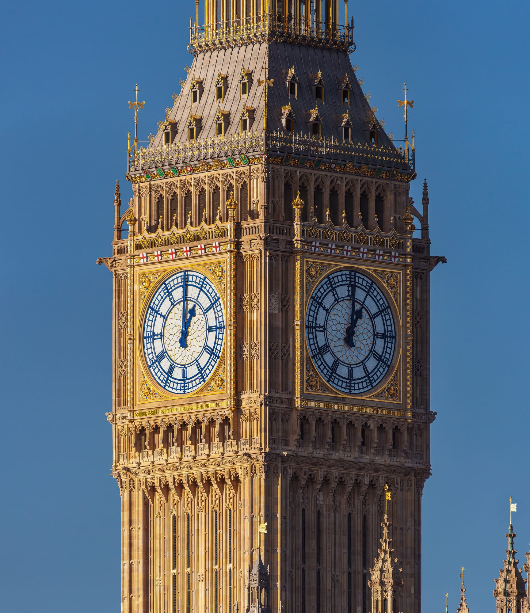
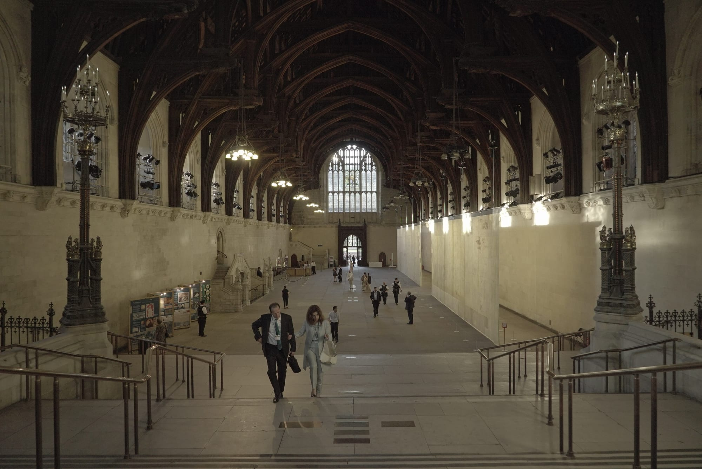
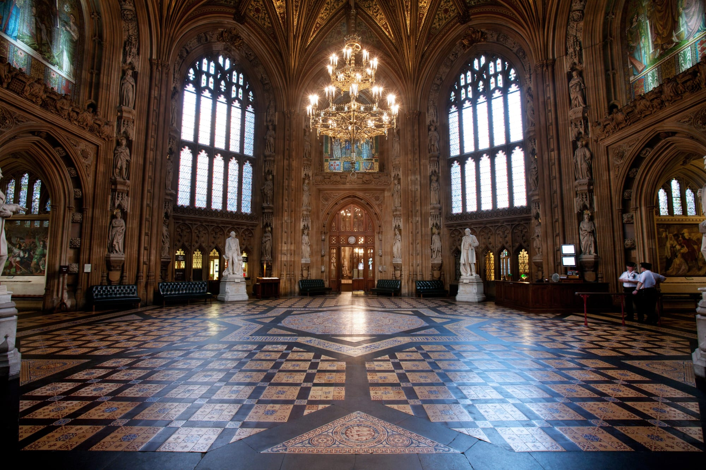
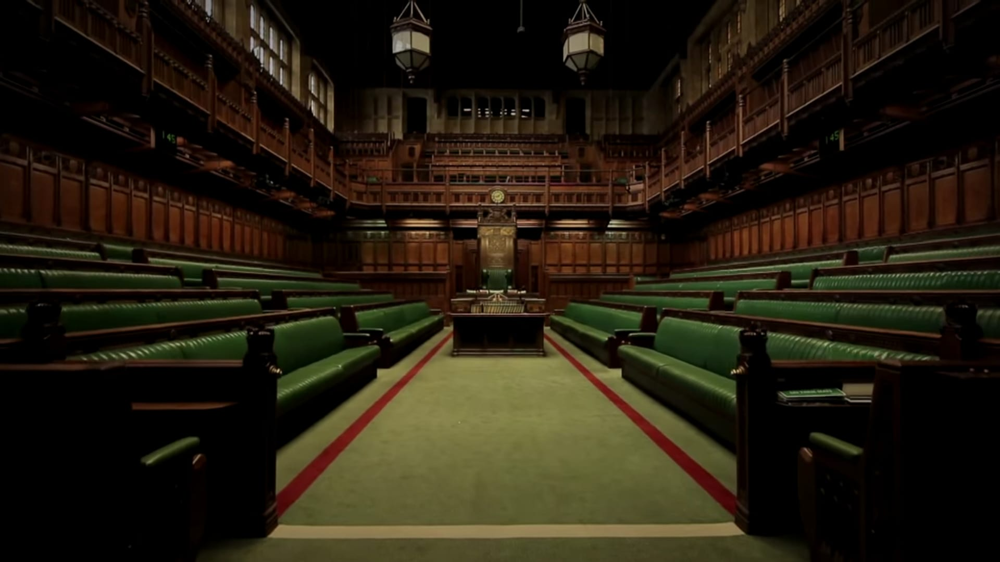
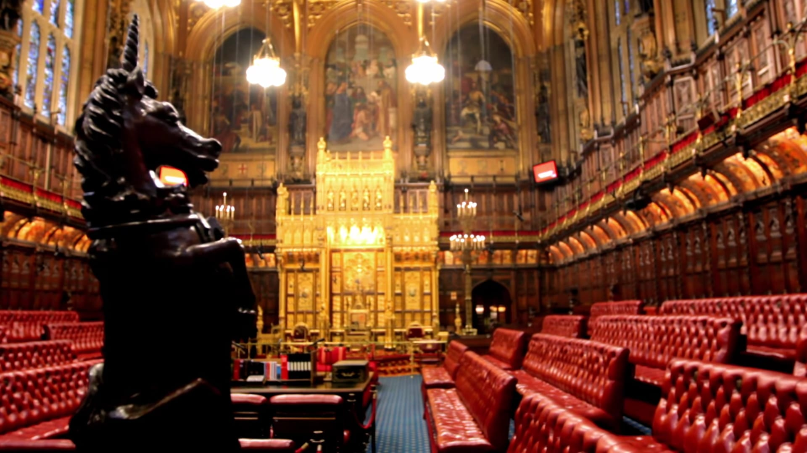

> 💡 **The Short Version:**
> - **Paid tours run on Saturdays all year, and Monday to Saturday when Parliament is in recess.** The guided tour is **£40** adult and the self-guided audio tour **£31**, both about 90 minutes and open to everyone. The Commons recesses are **17 December to 5 January** and **11 to 22 February**.
> - **The Big Ben tour is £55** (£35 aged 11 to 17), **334 steps** up the Elizabeth Tower, and tickets are released **three months ahead on the second Wednesday of each month at 10:00**: next on **9 December 2026**, then **13 January 2027**.
> - **Watching debates and committees is free for everyone**, UK or overseas, from the public galleries (Monday to Thursday and some Fridays). Queue at **Cromwell Green**. **Prime Minister's Questions** (Wednesday, 12 noon) needs a ticket from an MP, which only UK residents can get; others queue and are admitted if there is space.
> - **UK residents can take a free 75-minute tour** by asking their MP.
> - **Allow for security.** Airport-style screening takes up to 30 minutes on average and 45 on Monday to Wednesday afternoons. Bags must be no bigger than **60cm x 40cm**, and there is no cloakroom.
> - **Book direct on [Parliament's ticket site](https://tickets.parliament.uk/content/ticket-options)**, or check a <a href="https://www.getyourguide.com/activity/-t1044178?partner_id=WWP7I0R&amp;cmp=houses-of-parliament-tour-guide" target="_blank" rel="sponsored nofollow noopener" data-affiliate="gyg">Houses of Parliament ticket on GetYourGuide</a>.

> ⚠️ **Outside recess, guided and audio tours run on Saturdays only.** On a Tuesday in a sitting week you can watch a debate for free, or climb Big Ben if you hold a ticket, but there is no paid tour of the chambers. Big Ben tickets are released one month at a time on a fixed date, so plan around that date rather than the week before.

*Prices and dates as of 15 November 2026. Tour prices are for tickets bought from 1 September 2026.*

---

## Tours and prices

| Tour | Runs | Length | Adult | Child | Details |
| --- | --- | ---: | ---: | ---: | --- |
| **Guided tour** | Saturdays; Monday to Saturday in recess | 90 min | **£40** | **£20** (5 to 15) | English only. £30 aged 16 to 24 and UK Armed Forces. Recommended for ages 5 and over. |
| **Audio tour** | Saturdays; Monday to Saturday in recess | 90 min | **£31** | **£12** (5 to 15) | One child free per full-paying adult. £24 aged 16 to 24 and UK Armed Forces. Includes a children's version. |
| **Big Ben tour** | Monday to Saturday, with some days removed for maintenance | Up to 90 min (visit 1 hr 45) | **£55** | **£35** (11 to 17) | 334 steps. No young person or concession rate. |
| **Speaker's House tour** | Some recess weeks, including Easter and summer | 75 min | **£23** | None | The Speaker's State Apartments; best suited to ages 16 and over. £16 for UK Armed Forces. |
| **Inside UK Parliament** | Weekdays when Parliament is sitting | 75 min | **Free** | **Free** | UK residents only, booked through an MP. |

Buying on the day adds £3 to guided and audio tickets (£43 and £34 adult), so book ahead. Children under 5 go free but still need a ticket. Disabled visitors pay standard prices and a carer goes free with a ticket. Groups of ten or more booking the audio tour pay £27 adult and £9 child.

Most tours can be booked on [tickets.parliament.uk](https://tickets.parliament.uk/content/ticket-options) or at the ticket office at the front of Portcullis House on Victoria Embankment (SW1A 2LW). The Big Ben tour is sold online only.

**What the two main tours are like.** The guided tour is led by one of Parliament's own guides, in a group of about 25 or fewer. The audio tour is a multimedia handset, or a download for your own device, with more than 15 stops and versions in 12 languages including British Sign Language, plus an English audio-description version and a children's version in English. Both are cancelled on rare occasions at short notice for parliamentary business, and neither includes the Elizabeth Tower.

---

## When the paid tours run

Parliament sells guided and audio tours on Saturdays throughout the year and Monday to Saturday during recess, when neither House is sitting. The ticket calendar is the only reliable guide to a given date.

**Winter 2026 to 2027, as on sale at 15 November 2026:**

- **Saturdays:** 21 and 28 November; 5, 12 and 19 December; 2, 9, 16, 23 and 30 January; 6 and 27 February; 6, 13, 20 and 27 March.
- **Christmas recess (Commons: 17 December to 5 January):** guided and audio tours on Friday 18, Saturday 19, Monday 21, Tuesday 22, Wednesday 23, Tuesday 29 and Wednesday 30 December, and Saturday 2 January. Nothing is on sale for 24 to 28 December, 31 December or 1 January.
- **February half-term (Commons recess: 11 to 22 February):** Friday 12 and Monday 15 to Saturday 20 February (the guided tour skips Thursday 18).
- **Big Ben:** Monday to Saturday on most dates, with no tours from 24 December to 3 January. Every day from Monday 15 to Saturday 20 February was on sale.
- **Family Day:** Saturday 13 February 2027, 09:30 to 18:00, with a relaxed start from 09:30 to 10:30. Adults £27, concessions £20, children up to 15 free, with a family audio guide, a trail and craft activities.

Parliament says the pattern of recesses can change and is slightly different for the two Houses, so check the [Commons recess dates](https://www.parliament.uk/about/faqs/house-of-commons-faqs/business-faq-page/recess-dates/) as well. The other Commons recesses this session are Easter (25 March to 12 April 2027) and May (29 April to 4 May).

Check live availability for a Houses of Parliament ticket below:

Powered by <a target="_blank" rel="sponsored" href="https://www.getyourguide.com/london-l57/">GetYourGuide</a>

---

## The Big Ben tour

Big Ben is the 13.7-tonne Great Bell, and the tower around it is the **Elizabeth Tower**: 96 metres, 11 floors. The tour climbs **334 steps** of a narrow stone spiral staircase, to a height of 62 metres, to the belfry where the bell hangs.

*The Elizabeth Tower's clock dials. Photo: [Julian Herzog](https://commons.wikimedia.org/wiki/File:Big_Ben_Elizabeth_Tower_London_2023_01.jpg), [CC BY 4.0](https://creativecommons.org/licenses/by/4.0/).*

### What you see

A guide takes you through the exhibition spaces, the clock mechanism room, behind one of the four clock dials (each 6.9m across) and into the belfry, where you stand next to Big Ben as it strikes the hour. The route also covers the 2017 to 2022 conservation project, which involved more than 500 people. You can visit Westminster Hall before and after the tour.

### Who can book, and how

- **Age:** 11 and over by the date of the visit. Ages 11 to 17 need adult supervision, and Parliament may ask for proof of age and refuse entry without a refund.
- **Price:** £55 adult, £35 aged 11 to 17.
- **Tickets:** up to eight per person, online only at [tickets.parliament.uk](https://tickets.parliament.uk/timeslot/big-ben-tour). They are released three months ahead on the second Wednesday of every month at 10:00. The calendar at 15 November 2026 runs to 27 February 2027, and the next releases are on **9 December 2026** and **13 January 2027**.
- **Refunds:** tickets are non-refundable, except in full if Parliament cancels for parliamentary business, security or safety.
- **Free tickets:** UK residents can ask their MP for a free Big Ben tour, in limited numbers.

### Before you go

- **Be at Cromwell Green no later than 30 minutes before your start time.** The start time is strictly kept: you cannot join late, and there is no refund or exchange.
- **The visit takes 1 hour 45 minutes**, including the 90-minute tour and time to lock away and collect your belongings.
- **Footwear must fully enclose the foot and be flat-soled**, ideally with a rubber sole. Sandals, flip-flops, backless shoes, heels and bare feet are not allowed. It can be windy at the top, so bring a windproof layer.
- **Phones, cameras and bags go in a locker** in Westminster Hall. No photography is allowed inside the tower, and no food or drink. There are toilets only at the start and end, so use the ones in Westminster Hall first.
- **Ear defenders are provided** for the mechanism room and belfry, where the clock and bells are loud.
- **Who should think twice:** the tour is not step-free and is strenuous. Parliament lists heart conditions, high blood pressure, asthma, back or joint problems, vertigo and recent major surgery as reasons to ask a doctor first, and it asks anyone with mobility difficulties or a fear of heights or confined spaces not to book. Walking aids (sticks, frames, crutches) are not allowed, and assistance dogs cannot go up the tower.
- **An accessible tour** can be requested through [Parliament's online form](https://www.parliament.uk/visiting/access/disabled-access/take-an-accessible-tour/). It is limited, it does not use the lift, and Parliament replies within two weeks.

---

## What you see on the guided and audio tours

Parliament lists five places as the core of the standard route. The Elizabeth Tower is not one of them.

*Westminster Hall in the Palace of Westminster. Photo: [Jwslubbock](https://commons.wikimedia.org/wiki/File:Westminster_Hall_in_the_Palace_of_Westminster.jpg), [CC BY-SA 4.0](https://creativecommons.org/licenses/by-sa/4.0/).*

- **Westminster Hall.** The oldest building on the parliamentary estate, dating from 1097, with a vast stone floor and a tall timber roof. Photography is allowed here.
- **St Stephen's Hall.** A long hall lined with statues of famous parliamentarians. Photography is allowed here too, and there are places to sit. There are steps at both ends, with a lift as the alternative route.
- **Central Lobby.** A busy meeting space where people meet their MPs, and one Parliament says you have likely seen on the evening news.

*The Central Lobby. Photo: [Jorge Royan](https://commons.wikimedia.org/wiki/File:London_-_The_Parliament_-_2773.jpg), [CC BY-SA 3.0](https://creativecommons.org/licenses/by-sa/3.0/).*

- **The House of Commons Chamber**, with its green benches.
- **The House of Lords Chamber**, with red benches and an ornate gold throne.

*The House of Commons Chamber. Photo: [UK Parliament](https://commons.wikimedia.org/wiki/File:House_of_Commons_Chamber.png), [CC BY 3.0](https://creativecommons.org/licenses/by/3.0/).*

*The House of Lords Chamber. Photo: [UK Parliament](https://commons.wikimedia.org/wiki/File:House_of_Lords_Chamber.png), [CC BY 3.0](https://creativecommons.org/licenses/by/3.0/).*

Parliament is a working building, so you may not see everything on a given day. Most of the route is step-free.

---

## Free ways in

### Watch a debate or a committee

Visitors from the UK and overseas can watch debates and committee hearings in both Houses for free from the public galleries. The galleries are open **Monday to Thursday and some Fridays**, at times that differ by House and day. Neither House has chamber business in recess, so check the [parliamentary calendar](https://calendar.parliament.uk/) for what is on.

- **Entrance:** Cromwell Green, for debates, Westminster Hall debates and committees meeting in the Palace. For committees meeting in Portcullis House, use its main entrance on Victoria Embankment.
- **No ticket is needed for ordinary debates.** On most days you turn up and queue, and the Visitor Assistants can tell you how long the wait is likely to be.
- **The Lords:** the queue opens an hour before business starts. The first 40 minutes Monday to Thursday are Lords question time, when ministers answer questions on government policy. Lords members each have a small ticket allocation if you want to book ahead.
- **Select committees** usually meet on Monday afternoons, all day Tuesday and Wednesday and Thursday mornings. Entry is first come, first served and places are limited. Arrive one hour early for Lords committees.
- **Westminster Hall debates** take place in the Grand Committee Room off Westminster Hall, with step-free access: Monday (if sitting) 16:30 to 19:30, Tuesday and Wednesday 09:30 to 11:30 and 14:30 to 17:30, Thursday 13:30 to 16:30.

### Prime Minister's Questions

PMQs is on **Wednesdays at 12 noon** in the Commons Chamber. Tickets are free and **only UK residents can request them, through their MP**, who has a limited number: ask as far ahead as you can. Overseas visitors and anyone without a ticket can queue at Cromwell Green and are admitted if there is space in the gallery. Parliament warns of a wait and no guarantee of entry. Another MP sometimes stands in for the Prime Minister or the Leader of the Opposition.

### The free tour for UK residents

UK residents can request a free 75-minute **Inside UK Parliament** guided tour from their MP, up to three months ahead. You do not have to know your MP or support them. Tours run in sitting weeks, not on Saturdays, Sundays or bank holidays, and can be cancelled at short notice for parliamentary business.

| Day (when Parliament is sitting) | Tour times |
| --- | --- |
| Monday to Wednesday | 09:00 to 12:00 |
| Thursday | 19:00 or 19:10 only |
| Friday | 15:30 to 17:00 |

Use [Parliament's MP search](https://members.parliament.uk/members/commons) to find yours. You can also ask a member of the House of Lords.

---

## Security, bags and photography

All visitors go through airport-style screening, which can include a hand search and removing a belt or coat. The queue starts outside, so dress for the weather. Parliament gives the average wait as **up to 30 minutes**, and **45 on Monday, Tuesday and Wednesday afternoons**. Protests in Westminster can lengthen it.

- **Bags:** luggage larger than 60cm x 40cm is not allowed, and there is no cloakroom or locker for ordinary visitors. Keep everything with you.
- **Hand in at the entrance, collect on leaving:** knives (Swiss army knives included), scissors and cutlery, screwdrivers and tools, padlocks, chains and climbing gear, whistles and noisemakers, banners, placards and flags, political or offensive slogan items including clothing, and open liquids or semi-liquid foods other than water, baby milk or baby food.
- **Illegal to carry in the UK:** guns, knives with a blade over 7.7cm, flick knives, butterfly knives and personal defence sprays. You will be arrested if you carry them.
- **Bikes:** fold-up bicycles only, kept with you. E-bikes and battery packs are not allowed. Racks are outside 7 Millbank.
- **Photography:** for personal use, allowed in Westminster Hall, St Stephen's Hall and the visitor area of New Palace Yard, which has views of the Elizabeth Tower. Not allowed in other parts of the tour route or the public galleries, and tripods never. Switch phones off during tours.
- **Armed police** are a visible presence inside and outside, which is worth telling children.

---

## How long to allow

- **Guided or audio tour:** arrive at least 20 minutes before your ticket time. With security and the 90-minute tour, plan for about two and a half hours. Add time for the café and the shop.
- **Big Ben tour:** be at Cromwell Green 30 minutes before your slot and allow 1 hour 45 minutes for the visit itself.
- **Watching a debate:** the queue sets the time. Lords business has no set end time and can run late into the evening.

---

## Accessibility

Parliament's own accessibility pages and a 10-minute video, with subtitles and British Sign Language, are the place to plan in detail.

- **Step-free:** most of the tour route is step-free. The two ends of St Stephen's Hall have steps, with a lift route as the alternative. Westminster station is step-free.
- **Wheelchairs:** a limited number are available if you ask in advance.
- **Hearing loops:** induction loops are at the Information Desk in Westminster Hall. Tell Parliament in advance if several people in your group will use them.
- **Audio tour:** a British Sign Language version and an audio-description version for blind and partially sighted visitors.
- **Assistance dogs** are welcome on the Palace tours and can stay with you, on a lead. They cannot go up the Elizabeth Tower. Email the visitor services team beforehand to avoid delays at the gate.
- **Neurodivergent visitors:** Parliament offers resources for visitors aged 14 and over, including a sensory map and sensory bags, and recognises the Access Card for faster entry and the Hidden Disabilities Sunflower.
- **Toilets:** there is a Changing Places toilet. Toilets are at the start and end of the tours, so tell your guide if you need one mid-tour.

---

## Visiting with children

- **Under 5s** go free but need a ticket. Parliament does not recommend the guided tour for that age group.
- **Audio tour:** the family option, with a children's version in English. It has quizzes and games, and one child aged 5 to 15 is free per full-paying adult. You can download the children's programme to your own phone and bring headphones.
- **Family Trail:** a booklet of missions and clues for ages 5 to 7, picked up from a guide on arrival.
- **Guided tour:** better for families with children aged 12 and over, who can ask the guide questions.
- **Buggies:** there is no buggy park or cloakroom, so a buggy stays with you throughout, and it goes through security with you.
- **Nearby picnic space:** Victoria Tower Gardens and St James's Park.

---

## Food at the Jubilee Café

The **Jubilee Café** is in the converted stable block just off Westminster Hall, next to the Jubilee Shop, and is open to all visitors. It is self-service, with a small self-operated lift for step-free access, and the seating is for people eating its own food and drink.

- **Hours:** when Parliament is sitting, Monday to Wednesday 09:00 to 17:45, Thursday 10:00 to 17:30, Friday and Saturday 10:00 to 17:00. In recess, Monday to Saturday 10:00 to 17:00. These can change.
- **What to order:** the **Jubilee Cream Tea** is a fruit scone with butter or clotted cream, fruit preserve and a pot of Twinings tea or a cup of coffee, £7.00. A Children's Meal Deal (a ham or cheese sandwich with fruit or juice) is £5.75, and a Lunch Meal Deal is £8.25.
- **Portcullis House** has no refreshments for unescorted visitors.
- **You cannot eat or drink inside the Elizabeth Tower.** Hydrate before the Big Ben tour.

---

## Getting there

- **Tube:** **Westminster** (Jubilee, District and Circle lines) is about a five-minute walk and step-free.
- **Rail:** Victoria, Charing Cross and Waterloo are about 20 minutes away on foot.
- **River:** boats stop at Westminster Pier on Victoria Embankment, where the ramps are steep for a manual wheelchair.
- **Entrances:** the main visitor entrance, **Cromwell Green**, is at the Palace of Westminster (SW1A 0AA). Portcullis House (SW1A 2LW) on Victoria Embankment has the ticket office and the entrance for committees held there.
- **Driving:** the congestion charge often applies and meter parking is limited. A few disabled spaces in Star Chamber Court must be booked at least 48 hours ahead.

---

## Common mistakes to avoid

1. **Planning a paid tour for an ordinary weekday.** Guided and audio tours are for Saturdays and recess. Check the date against the ticket calendar before you book flights or hotels.
2. **Leaving the Big Ben booking to the week before.** Tickets are released three months ahead on the second Wednesday of the month at 10:00.
3. **Arriving late for the tower.** Be at Cromwell Green 30 minutes early. Latecomers cannot join and get no refund.
4. **Wearing sandals, heels or open-toed shoes for the climb.** They are not allowed in the Elizabeth Tower.
5. **Bringing a large bag or a banned item.** There is no cloakroom, and sharp items, banners and flags are handed in at the entrance.
6. **Assuming PMQs is closed to overseas visitors.** Free tickets are UK-only, but anyone can queue and is admitted if there is space.
7. **Taking photos in the chambers or the galleries.** Photography is limited to Westminster Hall, St Stephen's Hall and New Palace Yard.

---

## Continue planning your London trip

- ⛪ **[Westminster Abbey Guide](/articles/westminster-abbey-guide/)**: tickets, Evensong and the verger tour, across Parliament Square.
- 🚶 **[A Walk Through Westminster](/articles/westminster-walk/)**: Parliament Square, the Supreme Court, the Cenotaph and St James's Park in one route.
- 🏛️ **[Westminster Area Guide](/articles/westminster-area-guide/)**: Whitehall, Millbank, Tate Britain and where to eat.
- 🎖️ **[Churchill War Rooms Guide](/articles/churchill-war-rooms-guide/)**: the wartime bunker a few minutes up Whitehall.
- 👑 **[Buckingham Palace and the Changing of the Guard](/articles/buckingham-palace-changing-of-the-guard-guide/)**: when the guard changes and what the palace costs.
- 🎡 **[London Eye Guide](/articles/london-eye-guide/)**: across Westminster Bridge, with the best view of the Palace from above.
- 🚶 **[South Bank Walk](/articles/south-bank-walk/)**: starts across the bridge and runs east to Tower Bridge.
- 👨‍👩‍👧 **[London with Children](/articles/london-with-children/)**: more family days out in the capital.
- ♿ **[Step-Free London](/articles/step-free-london/)**: accessible routes to the major sights.
- 💷 **[London on a Budget](/articles/london-on-a-budget/)**: free sights across central London.
- 🛏️ **[Where to Stay in Westminster](/articles/where-to-stay-westminster/)**: hotels within walking distance of Parliament.
