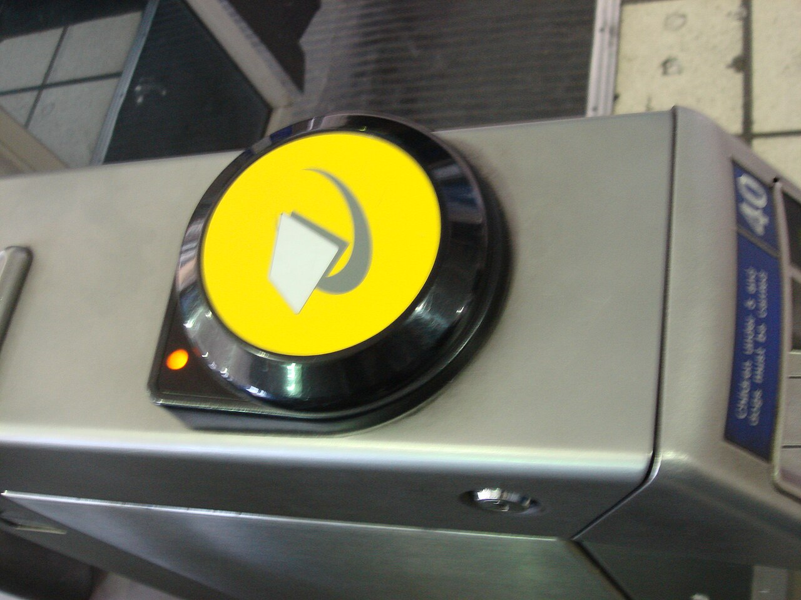
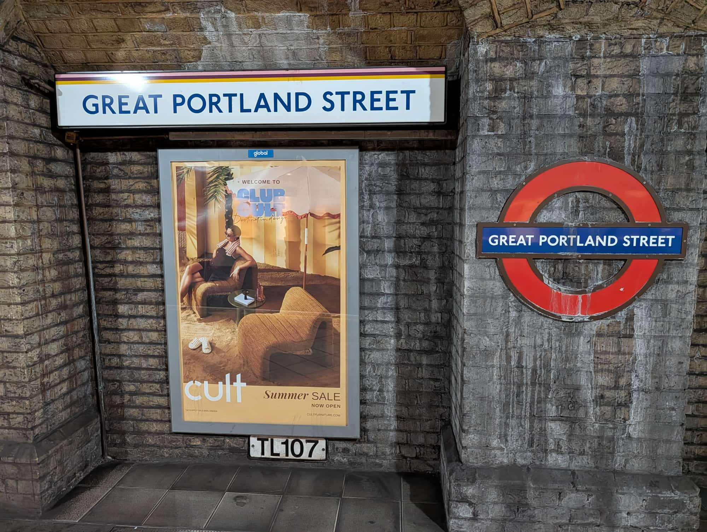
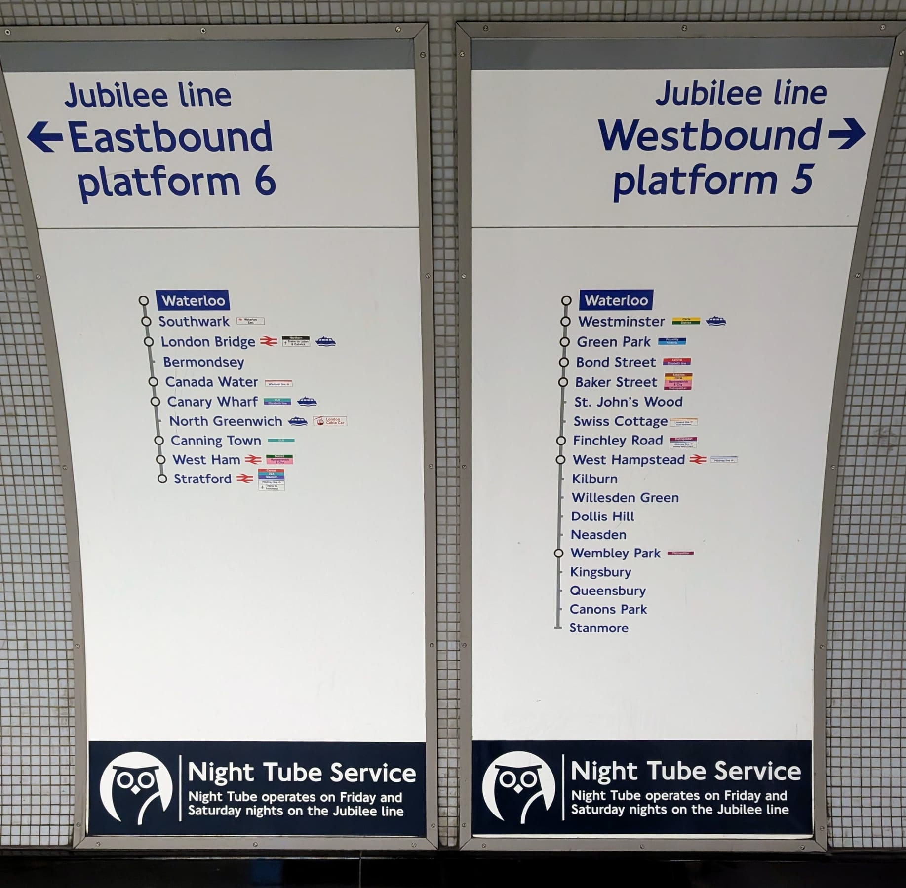
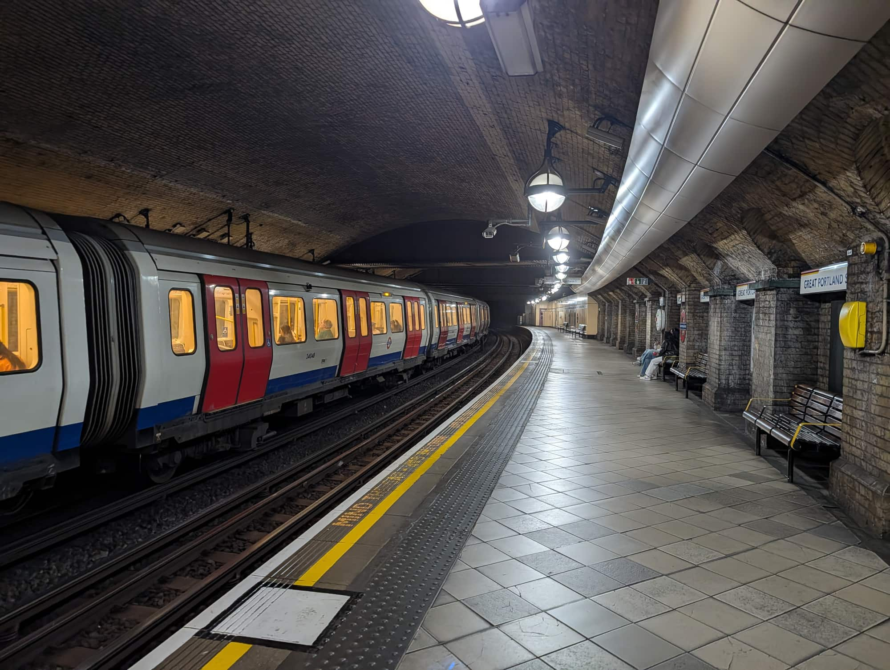
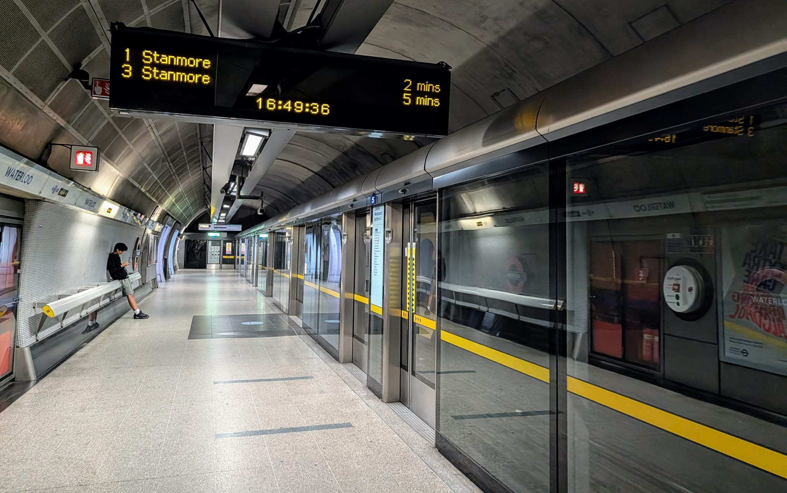
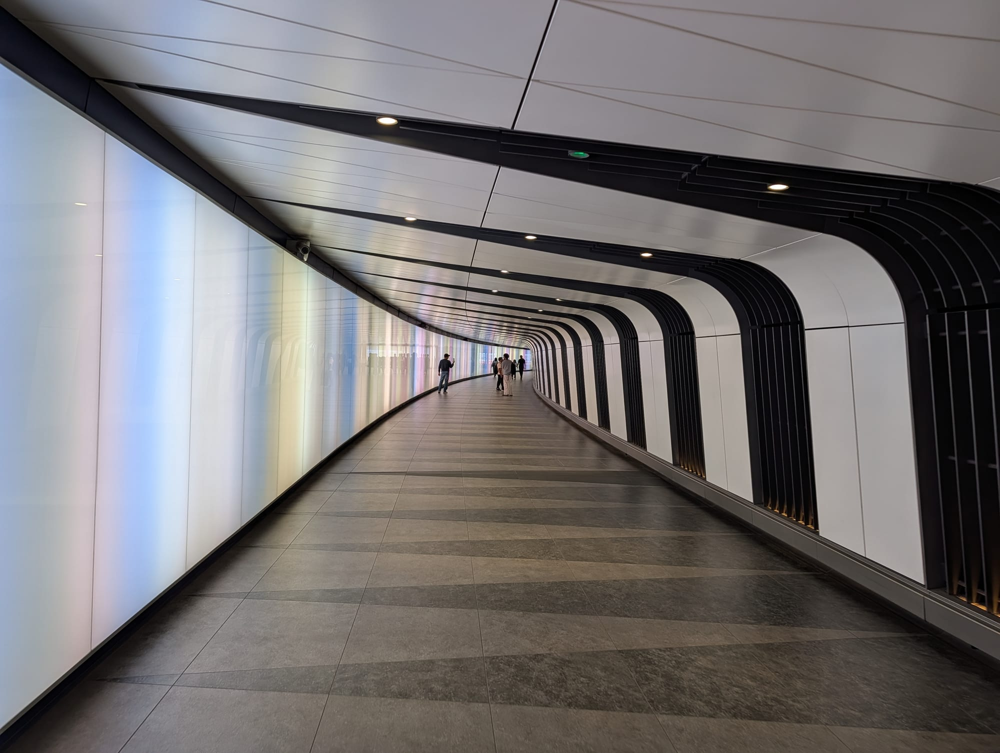

The London Underground—**the Tube**—is the world's oldest underground railway network. It runs 11 colour-coded lines serving 272 stations.

> 💡 **First-Time Tube Snapshot:**  
> - **How to Pay:** Tap in and tap out at ticket barriers using the exact same contactless bank card, phone (Apple/Google Pay), or Oyster card.  
> - **Navigating:** Look for line names (e.g., *Piccadilly line*) and cardinal directions (*Northbound / Southbound / Eastbound / Westbound*), not just individual station names.  
> - **Fares:** Automatic daily capping ensures you never pay more than the daily maximum (£8.90 for Zones 1–2).
> - **Weekend Closures:** TfL regularly conducts track maintenance on weekends. Always check line status on the TfL Go app before travelling on Saturday or Sunday.

---

## Which line to take

**[The Tube and rail lines guide](/articles/london-tube-and-rail-lines-guide/)** rates all eleven lines on crowding, comfort, air-conditioning, Night Tube and ease of use, and lists the attractions each one serves with the station and the best exit.

## How to pay: Contactless vs. Oyster

For almost all adult visitors, tapping a **contactless bank card or mobile wallet (Apple Pay / Google Pay)** is the cheapest way to pay.

| Payment Method | Adult Single (Zone 1) | Daily Cap (Zones 1–2) | Setup Required |
| --- | ---: | ---: | --- |
| **Contactless Card / Phone** | **£3.10** *(Peak)* / **£3.00** *(Off-peak)* | **£8.90** | None—just tap at the gate |
| **Oyster Card** | **£3.10** *(Peak)* / **£3.00** *(Off-peak)* | **£8.90** | Buy for £10.50 fee & load credit |
| **Paper Single Ticket** | **£7.00** | None *(No capping)* | Must buy at machine *(Avoid!)* |

> ⚠️ **Critical Payment Rules:**  
> 1. **Use the exact same device:** Tapping in with a physical bank card and tapping out with Apple Pay on your phone counts as two separate cards. You will be charged two incomplete maximum fares (£9.40 each)!  
> 2. **One card per person:** Every traveller over 11 must tap their own separate card or phone. Two people cannot share one card.  
> 3. **Avoid Card Clash:** Keep your payment card separate from other contactless cards so the yellow reader doesn't charge the wrong card.

For full pricing details, peak hours, and Travelcard comparisons, read our complete guide to [London Transport Fares and Costs 2026](/articles/london-public-transport-costs-and-fares/).

---

## Taking a Tube journey: Step by step

### Step 1: Find the station & touch in

*The roundel at Great Portland Street.*

Look for the red-and-blue Underground roundel outside; platform walls repeat the station name inside it. Touch your card or device flat against the **yellow reader** on the right side of the ticket barrier. Wait for the green light and a single chime before walking through. Use the wider gates if carrying large luggage or a stroller.

### Step 2: Follow the colour-coded line signs
Inside the station, follow the overhead signs matching your line's colour. Directional signs indicate the compass heading and final destination (e.g. *"Piccadilly line Eastbound towards Cockfosters"*). The sign lists every station in that direction, so find your stop in one of the two lists and take that platform.

*Jubilee line signs, Waterloo.*

### Step 3: Check the platform display

*Great Portland Street station.*

Electronic digital displays on the platform show the destination and arrival time of upcoming trains. 

*A platform display at Waterloo.*
> 🛑 **Check the Branch:** Lines like the Northern, District, and Piccadilly lines split into multiple branches. Always verify the train's destination on the platform display screen before boarding!

### Step 4: Boarding & train etiquette
* **Stand to the sides:** Stand behind the yellow platform safety line and allow passengers to exit the train completely before stepping aboard.
* **Move inside:** Walk down the aisle inside the carriage to make space for others near the doors.

### Step 5: Interchanging between lines
If your route requires changing lines (e.g., from the Victoria line to the District line), follow the coloured transfer signs (*"Way Out & Line Transfers"*). You remain inside the ticketed area and **do not touch out** during an interchange.

### Step 6: Touch out at your final station
Touch the exact same card or device to the yellow reader at your exit station barrier to complete your journey and calculate your fare.

---

Powered by <a target="_blank" rel="sponsored" href="https://www.getyourguide.com/london-l57/">GetYourGuide</a>

## Essential Tube etiquette & golden rules

> 🌟 **Golden Rules of Tube Etiquette:**  
> 1. **Stand on the Right on Escalators:** Always stand on the right side of escalators. The left side is strictly reserved for people walking up or down!  
> 2. **Have your card ready:** Have your phone or card out and ready BEFORE reaching the ticket barrier. Stopping directly in front of the gate blocks moving crowds behind you.  
> 3. **Give up priority seats:** Offer designated priority seats to elderly passengers, pregnant women, or travellers with disabilities.  
> 4. **Keep bags off seats:** Keep backpacks and luggage on the floor between your feet or on your lap during busy hours.

---

## When does the Underground run? (Operating Hours)

Hours vary by line and day:

| Day of the Week | First Trains (Start Time) | Last Trains (End Time) | Operating Notes |
| --- | --- | --- | --- |
| **Monday – Thursday** | **05:00 – 05:30 AM** | **00:30 – 01:00 AM** | First trains leave outer terminals around 05:00; last central trains depart around 00:30–01:00 AM. |
| **Friday** | **05:00 – 05:30** | **00:30 – 01:00** *(or 24 hours on Night Tube lines)* | Night Tube lines run 24 hours; standard lines close ~01:00. |
| **Saturday** | **05:00 – 05:30** *(or 24 hours on Night Tube lines)* | **00:30 – 01:00** *(or 24 hours on Night Tube lines)* | Night Tube lines run 24 hours; standard lines close ~01:00. |
| **Sunday** | **06:30 – 07:00** | **23:30 – 23:45** | Starts ~1.5 hours later; last trains leave earlier before midnight across all lines. |

> 🌙 **Important Night Tube Exception:**  
> 24-hour weekend service operates **on six lines only** (listed below). Standard Tube lines close at their regular times (~00:30–01:00) on Friday and Saturday nights. The **Waterloo & City line** is closed entirely on Saturdays, Sundays and Bank Holidays.

> 💡 **TfL Fare Day Definition:**  
> TfL's fare day runs from **04:30 to 04:29**. Any journey made before 04:29 counts towards the previous day's daily cap.

---

## Night Tube & weekend closures

### Night Tube (24-Hour Weekend Travel)
On **Friday and Saturday nights**, 24-hour service operates across six lines:
* **Central Line**
* **Jubilee Line**
* **Northern Line** *(Charing Cross branch)*
* **Piccadilly Line**
* **Victoria Line**
* **Windrush Line** *(the former East London Overground route, which TfL now counts as Night Tube)*

Standard off-peak fares apply.

### Weekend Engineering Work
TfL does track maintenance and signalling upgrades over weekends. Before heading out on Saturday or Sunday, especially for airport flights or theatre shows, check the [TfL Planned Closures Page](https://tfl.gov.uk/status-updates/planned-track-closures) or use the **TfL Go App**. **The whole Piccadilly line is closed on 31 October and 1 November 2026.**

**Changing between King's Cross St Pancras and the main line stations** is via the King's Cross Lightwall pedestrian tunnel. Follow signs for St Pancras International rather than heading up to street level.

*The King's Cross Lightwall.*

---

## Travelling with luggage

**The line counts for more than the station.** The **Elizabeth line** and **District line** run walk-through carriages with room for a case. The deep-level lines — Central, Piccadilly, Northern, Victoria — have narrow doorways, no racks, and a step up from the platform.

Use the **wide gate** at the ticket barrier rather than wrestling a case through a standard one. Every station has at least one, beside the staffed gate.

[Step-free London](/articles/step-free-london/) covers which stations qualify, the two wheelchair symbols on the map and what to do when a lift is out.

---

## WiFi and phone signal underground

**Free WiFi is at stations, not on trains.** Platforms and ticket halls on every line have it, and it drops when the train leaves the station.

**Mobile signal in the tunnels is being fitted section by section** by TfL and Boldyn Networks, with all four UK networks (EE, O2, Three and Vodafone).

### What to expect

* **The Elizabeth line is the one to take if you need to work.** TfL lists the whole line as covered, with 4G in every station and 4G and 5G in the tunnel sections. It also has air conditioning and room for luggage.
* **Everywhere else, assume you are offline between stations.** Download your map, your tickets and anything you want to read before you go down. The TfL Go app plans journeys offline; a browser tab does not.
* **Coverage arrives by tunnel section, not by line.** The Piccadilly line, for example, has continuous coverage between Knightsbridge and Holloway Road, but not beyond.
* **A dropped call is not a fault.** If a call drops between two stations on a covered line, you have crossed into a section that is not finished.

> 📶 **Mobile coverage.** Sections of the Circle, District, Central, Jubilee, Piccadilly, Bakerloo, Victoria and Northern lines have 4G and 5G in stations and tunnels, and the whole Elizabeth line is covered. Further sections of the Northern, Piccadilly, Victoria and Bakerloo lines are next.
>
> [TfL's connectivity page](https://tfl.gov.uk/travel-information/improvements-and-projects/improving-digital-connectivity-on-our-network) lists coverage line by line.

**If you need to be reachable underground**, route the journey on the Elizabeth line where you can.

---

Powered by <a target="_blank" rel="sponsored" href="https://www.getyourguide.com/london-l57/">GetYourGuide</a>

## 7 Common Tube mistakes to avoid

1. **Using different devices:** Tapping in with your physical bank card and out with Apple Pay triggers two incomplete maximum fares.
2. **Forgetting to tap out:** Triggers an automatic maximum fare charge (up to £9.40 in Zone 1–6).
3. **Standing on the left on escalators:** Always stand on the right!
4. **Boarding the wrong train branch:** Check the electronic platform sign destination before boarding split lines (District/Northern/Piccadilly).
5. **Buying paper single tickets:** Single paper tickets cost **£7.00** in Zone 1 vs. **£3.00** off-peak (£3.10 peak) with contactless!
6. **Treating the Tube map as a street map:** Many central stations (e.g. Covent Garden to Leicester Square) are just a 4-minute walk apart at street level.
7. **Not checking lift status:** If travelling with heavy bags or a wheelchair, verify lift operating status on the TfL Go app beforehand.

---

## Related London Transport Guides

* 🛡️ [Is London Safe?](/articles/is-london-safe/) – Crime data, common scams, and who to call.
* 🚊 [Getting Around London: Complete Transport Overview](/articles/getting-around-london-transport-guide/)
* 💷 [London Transport Fares & Costs 2026](/articles/london-public-transport-costs-and-fares/)
* 💳 [Oyster Card vs. Contactless Guide](/articles/oyster-card-guide-london/)
* 🗺️ [London Tube and Rail Lines Guide](/articles/london-tube-and-rail-lines-guide/)
* ♿ [Step-Free London](/articles/step-free-london/) – Which stations work, turn up and go, and attraction access
* ✈️ [Heathrow Airport to London Transport Guide](/articles/heathrow-airport-to-london/)

---

*Live travel status: [Transport for London](https://tfl.gov.uk/).*
