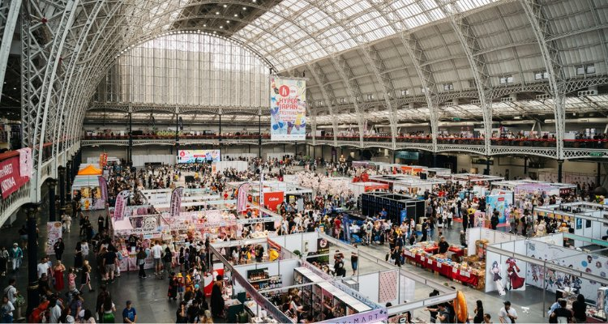

HYPER JAPAN calls itself the UK's biggest Japanese culture event. For three days a year it takes over Olympia's Grand Hall with a food market, a stage running idol pop to taiko drumming, and a lot of cosplay. The 2026 festival ran Friday 24 to Sunday 26 July; 2027 dates haven't been announced.

> 💡 **The Short Version:** A single day starts at **£28.35** for Friday, rising to **£41.55** for Saturday and **£31.50** for Sunday, all including booking fees. A **3 Day Pass** covering the whole run is **£78.75**. **Friday**, the shortest and cheapest day, is the likeliest to be quiet; **Saturday** carries the Cosplay Masquerade, most of the headline music and the highest price. Cosplay is welcome, but metal blades, gun-shaped props and anything over 1.5m wide are banned. The nearest station is **Kensington (Olympia)**, on the Overground's Mildmay line every day; the District line's direct shuttle from Earl's Court only runs at weekends.

## Tickets: what each one gets you

Every ticket is for a specific day and time slot. Prices below are the 2026 festival's, including Gigantic's booking fee.

| Ticket | Price | What it gets you |
| --- | --- | --- |
| **Friday General Admission** | £28.35 | Entry Friday 12:00–20:00 only |
| **Saturday General Admission** | £41.55 | Entry Saturday 10:00–20:00, with the Cosplay Masquerade and most headline stage slots |
| **Sunday General Admission** | £31.50 | Entry Sunday 10:00–17:00, including the Hyper Fashion Show |
| **2 Day Pass** | £69.30 | Saturday 10:00 through Sunday 17:00 |
| **3 Day Pass** | £78.75 | All three days, Friday 12:00 through Sunday 17:00 |
| **Tomodachi Bundle** | From about £110 (5 tickets, Sunday early bird) to about £173 (Saturday) | Five General Admission tickets for one day, bought in multiples of five |
| **Children 10 and under** | Free | Up to three per full-price adult ticket, but still needs reserving |
| **Carer ticket** | Free | Alongside a full-price adult ticket, with proof of disability (PIP, DLA, Blue Badge or Access Card) |

Workshops and meet-and-greets sit on top of a day ticket: the Awaodori dance workshop was £17.81 and Japanese mask-making £38.16 in 2026, each bookable only alongside an entry ticket for the same date, and the smaller sessions (mask-making in particular) sold out days ahead. A day ticket does not include re-entry by default: leave the hall and you queue again at the main entrance.

## Which day to pick

**Friday is the one to book if you want space to look at the market.** It's the only weekday of the three, it runs eight hours against Saturday's ten, and it costs a third less than Saturday. The stage still runs a full programme (rock band The Sixth Lie, taiko soloist Takuya Taniguchi and singer-songwriter UPIKO among 2026's line-up), without the Saturday-only Cosplay Masquerade.

**Saturday is the one to avoid if you dislike queuing.** It's the longest day and the highest priced, and it carries the Cosplay Masquerade, the headline anisong sets and the day most families attend. Popular shows can hit capacity and hold visitors at the door until space frees up, so arrive early for anything you don't want to miss.

## What's inside: the market

The market runs food, drink and craft stalls. The 2026 festival dropped its dedicated Sake Experience area, but sake was still poured everywhere: **KANPAI**, a London sake brewery, alongside umeshu and sake imported from four producers in Wakayama Prefecture, plus Suntory Toki whisky and Ozeki and MIO sparkling sake. On the food side, **Dragonfly Foods** brought UK-handmade organic tofu, **Kewpie** its mayonnaise, and **Japan Centre**, the Panton Street shop (see our [Japanese restaurants guide](/articles/best-japanese-restaurants-london/)), ran its own stall alongside importers like Taste of Japan and Unisnacks.

*The market floor at Olympia.*

**Bring cash as a backup.** There are no cash machines inside the venue and some traders still only take cash.

## Cosplay: what's allowed and what isn't

Cosplay is encouraged, with a dedicated Cosplay Masquerade on the Saturday stage, but the rules are checked at the door:

- **No metal blades of any kind**, sharp or blunt: swords, axes, kunai, or costume weapons with metal parts.
- **No gun-shaped props**, whatever they're made from, including airsoft and BB guns.
- **No bokken, nunchucks or knuckledusters**, and no hard bats, clubs or golf clubs.
- **No laser pointers, drones, vuvuzelas or silly string.**
- **Nothing over 1.5m wide or 2m tall**, large wings, banners and puppets included.
- **No flame, smoke, or exposed electrical arcs** built into a costume or prop.
- **No fetish wear or nudity** as general attire.

Staff can search bags and props on entry and turn away anything that doesn't meet the rules, so check a specific prop against the list before building a costume around it.

## The stage

The stage moves between genres inside a single hour. 2026 ran J-rock bands (**The Sixth Lie**, **QUEEN BEE**, **Re:O**), anisong vocalists (**Eir Aoi**), idol acts (**UPIKO**, **Sacred Fleramo**), a dance troupe (**avantgardey**), and traditional performance alongside it: **Gagaku** court music, **Awa Odori** festival dance, a **Shorinji Kempo** martial arts demonstration and taiko soloist Takuya Taniguchi. Sunday closed with the **Hyper Fashion Show**, and Sunday afternoon carried a voice actor conversation with **Chiaki Kobayashi** (Frieren, Hell's Paradise). The stage programme is included in day entry; only the smaller hands-on workshops cost extra.

## Getting to Olympia

**Kensington (Olympia)** station sits at the venue's own entrance, on Olympia Way. It is a different station from High Street Kensington, a 15-minute walk away, so check which one a map app is sending you to.

> ⚠️ **The District line doesn't reliably reach Olympia on a Friday.** Its shuttle from Earl's Court is a weekend-and-public-holiday service, so for the Friday session plan on the Overground.

- **London Overground's Mildmay line** runs every day, roughly every 15 minutes off-peak, one way to **Clapham Junction** and the other via Willesden Junction to **Stratford**.
- **Southern services** call roughly hourly, to **East Croydon** and **Watford Junction**.
- **The District line** runs a direct shuttle to Kensington (Olympia) from Earl's Court at weekends and on public holidays, and sometimes when Olympia has an event on. On a weekday, change at **West Brompton** from the District line onto the Overground.
- **Parking** has to be pre-booked through the venue, ideally more than 24 hours ahead, with cost depending on length of stay.

Olympia is step-free, with lifts to the accessible entrance, which shares the main entrance.

## Where to stay

For the shortest walk, **[Hyatt Regency London Olympia](hotel:hyatt-regency-london-olympia)** sits inside the redeveloped Olympia site, about a minute from the station, at roughly £220 a night. For less money, **[Premier Inn London Kensington (Olympia)](https://www.premierinn.com/gb/en/hotels/england/greater-london/london/london-kensington-olympia.html)** on West Cromwell Road has air conditioning in every room and is a short walk from Earl's Court station. Our [where to stay in Kensington guide](/articles/where-to-stay-kensington/) covers both, along with cheaper options in Earl's Court, and our [Kensington area guide](/articles/kensington-area-guide/) covers the neighbourhood, including Holland Park's Kyoto Garden.

## Other anime and J-culture events in London

- **AnimeCon London**, also at Olympia: a two-day anime and manga convention with a Cosplay Catwalk and Artist Alley. The 2026 edition ran on 3–4 October and the organiser says it returns in 2027.
- **[MCM Comic Con London](/articles/mcm-comic-con-london/)**, 28–30 May 2027 at ExCeL: wider than anime alone, spanning comics, gaming and film and TV guests.

Our [exhibitions and conventions calendar](/articles/exhibitions-conventions-london/) tracks these and the rest of London's convention year. **[The Ideal Home Show](/articles/ideal-home-show-london/)** takes over the same halls at Olympia 2–11 April 2027.

## 2027 dates and a winter edition

HYPER JAPAN hasn't announced 2027 dates. The 2026 festival ran Friday 24 to Sunday 26 July. There is no HYPER JAPAN Christmas market or winter edition in London in 2026: Olympia's own festive events, the Spirit of Christmas Fair and the Ideal Christmas Show, run independently of HYPER JAPAN.
