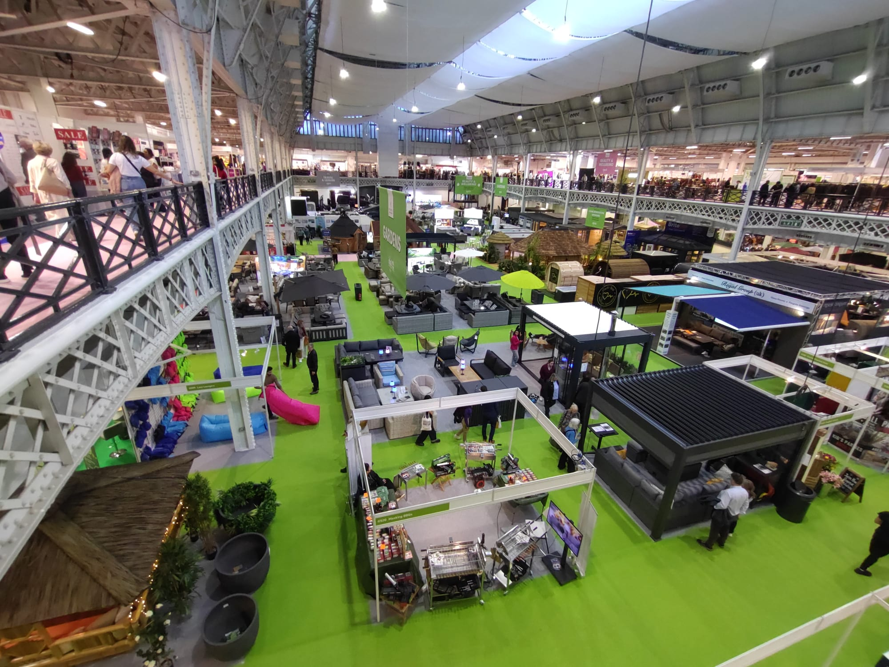
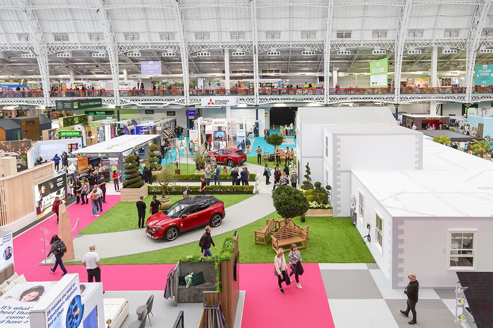
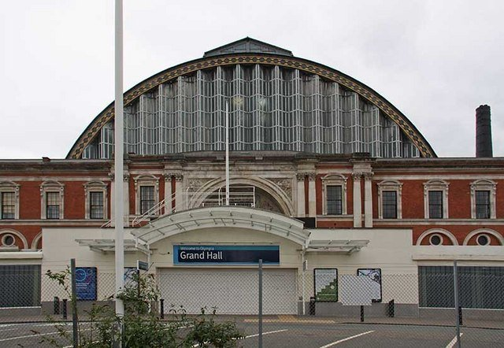

**The Ideal Home Show returns to Olympia London from Friday 2 to Sunday 11 April 2027**, ten days and two full weekends of show homes, gardens, kitchens and an Eat & Drink Festival included in every ticket. The show has run since 1908; the organiser reports more than 136,000 visitors a year and over 600 brands.

The show itself does not sell weekday and weekend tickets at different prices for 2027, at least not yet. What it does have, already, is a real gap between the cheapest way in and the one with a goody bag and a glass of prosecco attached.

> 💡 **The Short Version:** **2–11 April 2027, Olympia London.** General Admission from **£12** in advance; **VIP is £50** with a lounge, prosecco and a goody bag worth up to £75; a **Tipsy Workshop ticket is from £40**. **Children under 15 go free** with a paying adult. No weekday/weekend price split announced for 2027 yet — the 2026 show charged £14 midweek and £16 at the weekend. Aim for a **weekday morning in the second week** for the calmest visit. Get there on **London Overground or Southern Rail to Kensington (Olympia)** — the District line Tube only runs there at weekends. Olympia offers parking to **blue badge holders only**, and sits inside the ULEZ.

## Tickets and prices

| Ticket | Price | What you get | Sells out? |
| --- | --- | --- | --- |
| **General Admission (advance)** | **From £12** | Full-day entry to every hall — the Show Home, Ideal Gardens, Smart Home, DIY Live, Stage Talks and the co-located Eat & Drink Festival | Popular weekend afternoons book up closest to the date |
| **VIP** | **£50** | Everything above, plus the private VIP Lounge, a goody bag worth up to £75, a complimentary glass of prosecco, unlimited tea, coffee and water, and free cloakroom | Yes — VIP is a limited daily allocation |
| **Tipsy Workshop** | **From £40** | Full show entry plus a hosted, hands-on craft, floral, décor or chocolate-making session with a glass of fizz and a keepsake to take home | Sessions run at fixed times through the day and are capped |
| **Group (10 or more)** | On enquiry | A discounted rate for parties, clubs, schools or tour groups, booked as one reservation | — |
| **Children under 15** | Free | Free entry with a paying adult ticket | — |

Tickets are sold through See Tickets as e-tickets, to print or show on your phone. They are non-refundable, but you can change day for the price difference between a weekday and a weekend ticket.

Walk-up tickets are sold on site, but book ahead.

## What's actually in the show

The **Show Home** is the anchor exhibit; for 2027 its theme is **Global Living**, a run of rooms each styled after a different corner of the world. The other sections:

- **Ideal Gardens** — outdoor living, planting and garden buildings on artificial turf, with a lean towards sustainability and pet-friendly design.
- **The Design Studio** — free one-to-one consultations with professional interior designers; bring photos or plans of your own room and book a slot in advance closer to the show.
- **Smart Home**, presented by TV technologist Jason Bradbury — connected appliances and home tech, demonstrated.
- **DIY Live** and the **BBQ Academy**, sponsored by La Española — live demonstrations.
- **Tipsy Workshops** — the hands-on paid sessions in crafts, florals, home décor and chocolate-making, each with a complimentary glass of fizz.
- **Stage Talks** — celebrity guests and industry experts. Past years have featured Martin Lewis, George Clarke, Nick Knowles and Alice Beer.

*Ideal Gardens, seen from the mezzanine.*

*The show floor at Olympia.*

### The Eat & Drink Festival is included, not an add-on

Every ticket also covers the **Eat & Drink Festival**, held in the same halls. Expect chef demonstrations, street food and cocktail stalls under the banner "The Great Eat", and the **Artisan Producer's Market** for food and drink to take home. Ordinary food stalls and seating are dotted through the venue.

## Which day to go

**Weekday hours are shorter**: 10am to 5pm against 10am to 6pm at the weekend.

A **weekday morning in the second week**, once the opening weekend has passed, is the best bet for a seat at a Stage Talk or a Design Studio slot. The two weekends, 3–4 and 10–11 April 2027, are the busiest.

## Getting to Olympia

The venue is **Olympia London, Hammersmith Road, London W14 8UX**, and its own station, **Kensington (Olympia)**, is next to it in Zone 2 but is not served by the Tube on weekdays.

*Olympia's Grand Hall entrance.*

**By Overground and rail, every day:** Kensington (Olympia) is served by London Overground's Mildmay line, with direct trains from Clapham Junction, Shepherd's Bush, Willesden Junction, West Hampstead and Stratford, plus Southern Rail services to and from Watford Junction. If you're coming from Clapham Junction, a train towards Milton Keynes from Platform 16 does the trip in about 10 minutes; the Overground from Platform 2 runs more often. Three or more people travelling together can use **GroupSave** for a third off rail fares.

**By District line, weekends only:** the District line runs directly between Earl's Court and Kensington (Olympia) on Saturdays and Sundays — check before you travel, as it isn't guaranteed. **Monday to Friday**, change at West Brompton for a two-minute Overground hop, or walk from **West Kensington** (8 minutes) or **Barons Court** (9 minutes).

**By Central, Piccadilly or Circle line:** change at **Shepherd's Bush** for a two-minute Overground link on the Central line; from the Piccadilly line, Barons Court is a 9-minute walk; from the Circle line, High Street Kensington is a 12-minute walk or a 4-minute bus ride.

**By bus:** routes 9, 23, 27, 28, 49 and 391 all stop a short walk from the venue, with N9, N23, N27 and N28 running through the night.

**By coach:** National Express services arrive at Victoria Coach Station; from there it's the District line one stop to West Brompton, then a one-stop Overground hop to Kensington (Olympia).

## Parking

Olympia offers parking **only to blue badge holders** attending events in the Grand Hall, National Hall, West Hall or ICC, and asks them to book ahead. Parking restrictions on the surrounding streets are stringent. Olympia sits inside the **Ultra Low Emission Zone**, so check your vehicle is compliant before you drive in.

## Where to stay

Two hotels sit inside the Olympia complex, a minute's walk from the show's doors: **[Hyatt Regency London Olympia](hotel:hyatt-regency-london-olympia)**, a full-service hotel from about £220 a night, and the cheaper **[citizenM London Olympia](hotel:citizenm-london-olympia)**, from about £150, with its compact design rooms just across the site. Our **[where to stay in Kensington, Earl's Court and Olympia](/articles/where-to-stay-kensington/)** guide covers both in more detail, along with cheaper options a short Overground or bus ride away in Earl's Court.

## The Ideal Christmas Show

**The Ideal Christmas Show** is a separate event from the same organiser, Media 10, in Olympia's Grand Hall on **26–29 November 2026**: Thursday 10am–8pm, Friday to Sunday 10am–6pm. Tickets are from £16, with a VIP upgrade. It is a Christmas shopping and entertainment day with over 400 brands, festive workshops, live music and a Santa's Grotto, not a home-improvement show.

## Continue planning your visit

- 🏛️ **[Kensington Area Guide](/articles/kensington-area-guide/)** — Kensington Palace, Holland Park and the Kyoto Garden, on Olympia's doorstep.
- 🛏️ **[Where to Stay in Kensington, Earl's Court and Olympia](/articles/where-to-stay-kensington/)** — hotels near the show.
- 🎪 **[Exhibitions and Conventions in London](/articles/exhibitions-conventions-london/)** — shows at Olympia, ExCeL and elsewhere.
- 🚇 **[Getting Around London](/articles/getting-around-london-transport-guide/)** — how contactless capping and the Overground work if this is your first stop in the city.
