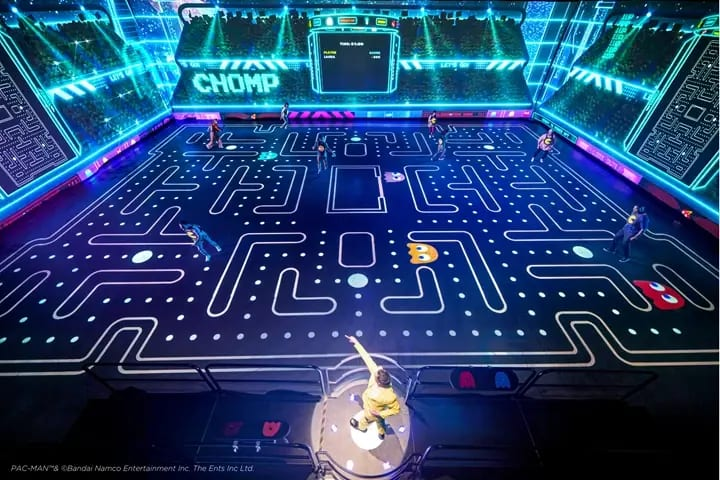
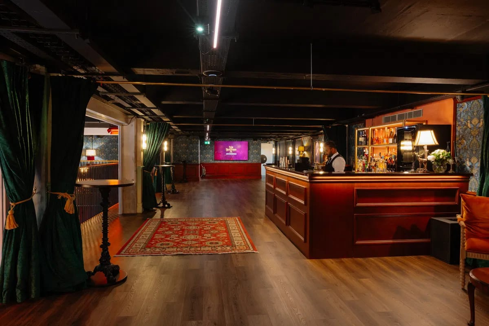
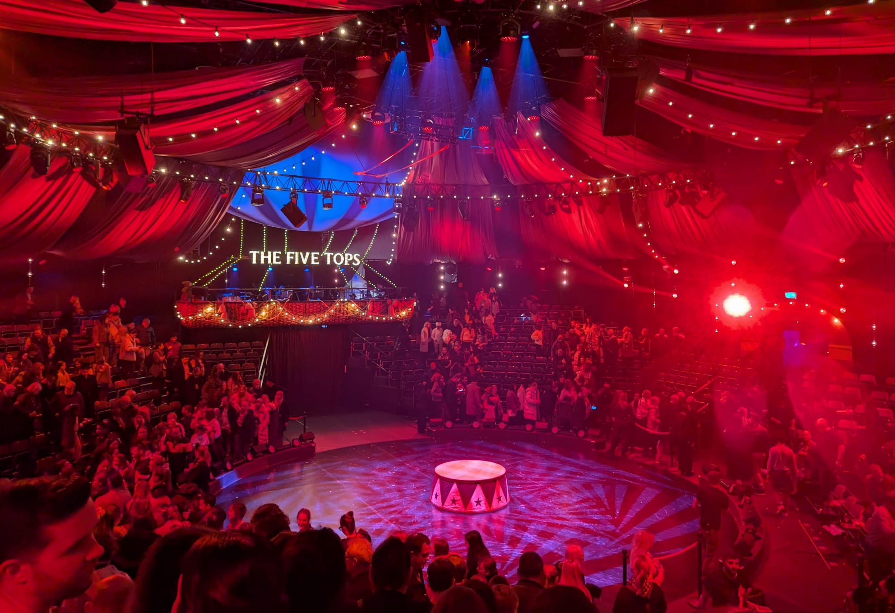
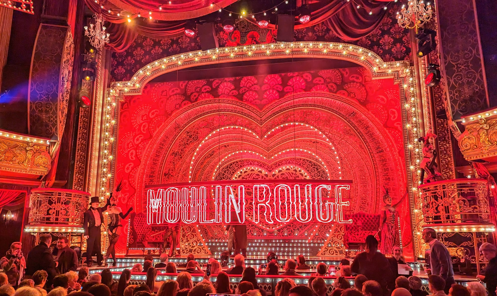
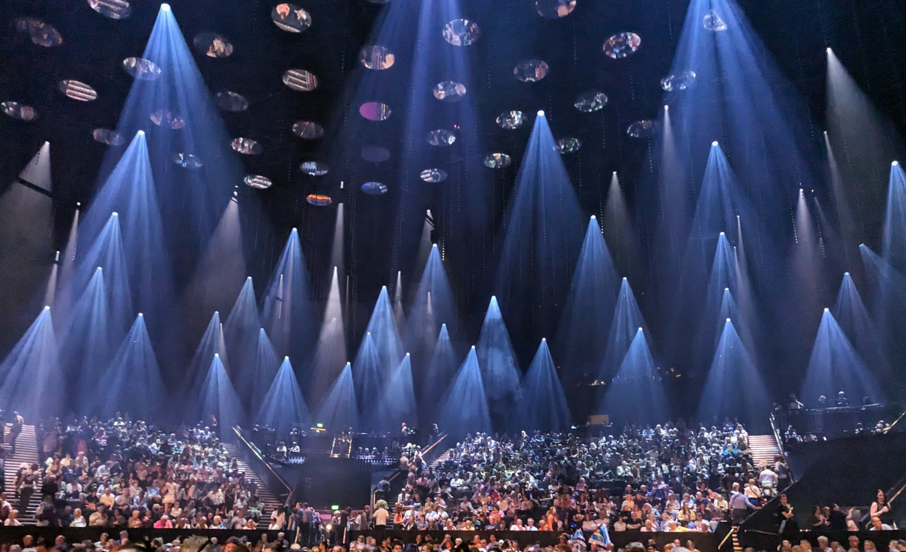
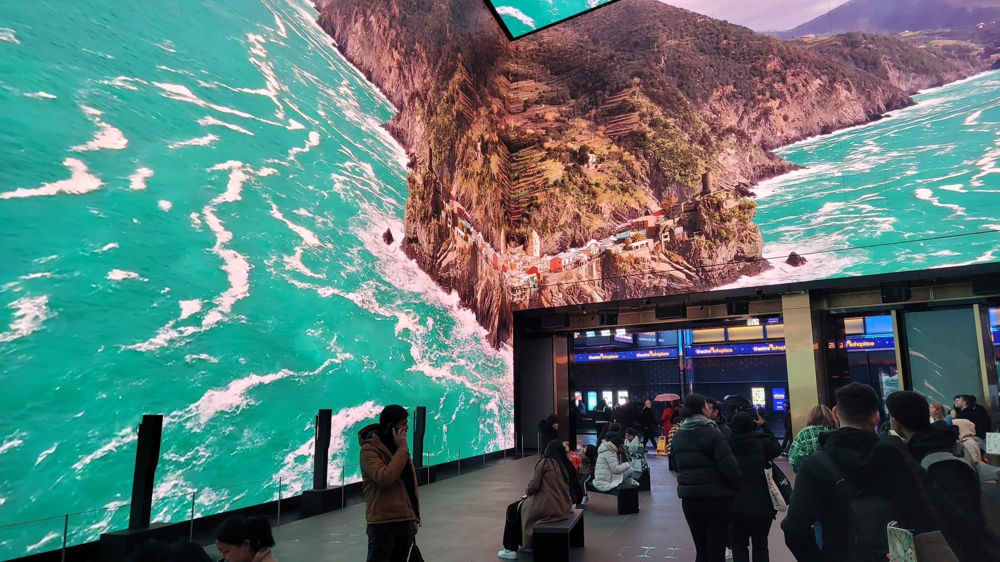

> 💡 **The Short Version:** **Bridge Command** is the most interactive: you crew a starship with a real job. **Mamma Mia! The Party** is the big night out. **Faulty Towers** is the funniest, and you cannot hide from it. **Frameless** is for people who hate being spoken to. **Outernet is free.** Opening next: Alice Immersive Wonderland and Wundrful World of Christmas (13 November), Phantom Peak (4 December) and Secret Cinema's Pirates of the Caribbean (16 February). Closed: Jeff Wayne's War of the Worlds, Vikings, the Gunpowder Plot and LUMINISCENCE.

*Prices and dates as of October 2026.*

---

## Still open, at a glance

Prices are adult starting prices. Several use dynamic pricing, so treat them as a floor.

| Experience | Area | From | Do you have to join in? |
| --- | --- | --- | --- |
| **Bridge Command** | Vauxhall | £49 | **Yes — you have a job** |
| **The Traitors: Live Experience** | Covent Garden | £29.50 | **Yes — you are a player** |
| **Faulty Towers** | Bloomsbury | £65.50 | **Yes — there is no back row** |
| **Alcotraz** | Shoreditch | £51 | **Yes — you smuggle** |
| **Moonshine Saloon** | Aldgate | £39.99 | Yes |
| **Hexmoor** | Shoreditch | £48 | Yes |
| **Avora** | Shoreditch | £44.50 | Yes |
| **The Murdér Express** | Bethnal Green | £74.50 | Encouraged |
| **Mamma Mia! The Party** | North Greenwich | £120 off-peak | Dancing, not acting |
| **Peaky Blinders: Underworld** | London Bridge | **£19.95 online** | Free-roam, some |
| **The Crystal Maze** | Piccadilly Circus | £47 | **Yes — constantly** |
| **Monopoly Lifesized** | Fitzrovia | £54 · **closes January 2027** | **Yes** |
| **COLAB Theatre** | Borough | not published | Yes |
| **Moulin Rouge! The Musical** | Piccadilly Circus | see below | **Only at the Can Can tables** |
| **Witness for the Prosecution** | Waterloo | £29.50 under-26 | Only if you have a jury seat |
| **ABBA Voyage** | Pudding Mill Lane | £40.50 | No |
| **Frameless** | Marble Arch | £29.50 | No |
| **Absurd City** | White City | see below | Optional |
| **Lightroom: Wallace & Gromit** | King's Cross | £25 · **to 4 Jan** | No |
| **Lightroom: David Bowie** | King's Cross | £25 · **to 10 Jan** | No |
| **Euphoria, Balloon Museum** | Custom House | see below | Hands-on |
| **House of Dreamers** | Custom House | see below | No · **to November** |
| **Timewalk** | Custom House | see below | No |
| **Outernet** | Tottenham Court Rd | **Free** | No |
| **The London Dungeon** | Waterloo | £27 | You may be picked on |
| **Shrek's Adventure!** | Waterloo | £21 | Gently |
| **Bubble Planet** | Wembley | £19.90 | Yes — bring socks |
| **Paddington Bear Experience** | Waterloo | £34 | Gently |
| **COME ALIVE!** | Earls Court | £58 | **In the pre-show, yes** |
| **Twist Museum** | Oxford Circus | £24.50 + £2.50 fee | **Yes — all 80+ exhibits** |
| **Arcade Arena** | Lambeth | £30 | **Yes — three games** |
| **Immersive Gamebox** | Several sites | £37 | Yes |
| **Sandbox VR** | Holborn, White City, Wandsworth | £35 | Yes |

---

## Opening soon

### Alice Immersive Wonderland, Dock X, Canada Water — 13 November 2026 to 21 March 2027

*From £26 (child £19, family bundle £20 a head, seniors, students and NHS £22.50) · about 2 hours · all ages · Canada Water*

Ten themed spaces follow Alice from the rabbit hole to the Queen's court, with live performers at key moments and a 20-minute projection-mapped finale. Entry is in 15-minute slots. Pushchairs cannot go in and children who cannot walk must be carried. Strobe lighting is used. Under-4s need a £1.50 ticket, and under-16s need a ticket-holding adult. [Tickets](https://www.aliceimmersivewonderland.com).

### Wundrful World of Christmas, Immerse LDN at ExCeL — 13 November to 24 December 2026

*Adults £29.90 off-peak, £34.90 peak; children £24.90 and £29.90 · about 50 minutes, plus the Elves' Playground · ages 3 to 8 · Custom House*

A timed walk-through to the North Pole: a lift ride, a snow-covered Enchanted Forest, the Elves' Workshop, Mrs Claus's kitchen and Santa's Grotto, where each group has its photo taken. Every child leaves with a small gift and a letter to post to Santa.

It runs on selected days only, and every child needs a ticket, babies included (under-12-months tickets are free). Arrive 15 minutes before your slot. The Elves' Playground afterwards has light installations, gentle fairground rides and food stalls, which cost extra; cards only. [Dates and tickets](https://wundr.seetickets.com/timeslot/wundrful-world-of-christmas).

### Phantom Peak, Westfield Stratford City — 4 December 2026

*Adults £39.90–£65.10, 18–25 £34.65–£59.85, under-18s £29.40–£53.55, plus 5% booking fee*

An open-world game played in a town. You roam three districts (Old Town, the Town Square and Black Lake), pick up story threads from the characters and follow whichever you like. The Canada Water original closed on 28 February 2026 after 625 performances; this rebuild is bigger, on several levels and accessible.

Two add-ons are bought with the ticket: a 30-minute Puzzle Hunt across the town (£7.88) and a VIP Tourist Experience (£20) that opens with a 30-minute pre-show where you arrive by train carriage. Prices rise as slots fill, so dates further ahead are cheaper. The themed bar is open seven days a week without a ticket.

### Lightroom: Matisse: Joy, King's Cross — 27 January to 8 May 2027

*Adults from £25, students and under-18s from £15 · about 1 hour · all ages*

Matisse's paintings and paper cut-outs projected across four 11-metre walls and the floor, with new artwork by Yinka Ilori. BSL and relaxed showings run in March and April. A £2 transaction fee applies per order. [Tickets](https://lightroom.uk/whats-on/matisse-joy/).

### Secret Cinema: Disney's Pirates of the Caribbean, Greenwich Peninsula — 16 February to 6 June 2027

*Standing and seated Roam and Return both from £49 · doors open an hour before your slot · North Greenwich*

*The Curse of the Black Pearl* staged with actors, stunts, a live band and projection mapping, with food and drink to order throughout. It is the first show at Secret Cinema's riverside venue, five minutes' walk from North Greenwich station, and the run has been extended. Dress as a pirate, smuggler or member of high society. Standing tickets let you roam; Roam and Return seats let you roam too and give you a seat to come back to. [Tickets](https://piratesofthecaribbeanimmersive.com).

### Punchdrunk: Ghostlight, National Theatre — summer or autumn 2027

A new Punchdrunk production marking 50 years of the National's South Bank building. It is conceived and directed by Felix Barrett and curated by the writer Lucy Kirkwood. Dates and prices have not been announced.

---

## The ones where you actually do something

### Arcade Arena, Lambeth

*From £30 one game, £45 two, £50 all three · 26 Lambeth High Street, SE1 7SJ · Vauxhall or Lambeth North, not Waterloo*

**Chaos Karts:** real electric karts on a track with projected floor and walls, with weapons and a leaderboard. A session is six races.

**PAC-MAN LIVE EXPERIENCE:** you play PAC-MAN in an illuminated maze, in teams against the clock.

*PAC-MAN LIVE EXPERIENCE. Photo: PAC-MAN™ &amp; © Bandai Namco Entertainment Inc. / The Ents Inc Ltd.*

**Alien Invasion:** with a laser gun and armour, you fight alien drones as one of the Cosmic Cadets. It is exclusive to London.

Buy the £50 three-game ticket: £30 for one game is poor value.

### Bridge Command, Vauxhall

*From £49 · 16+ · allow 2 hours · 63-64 Albert Embankment, two minutes from Vauxhall*

You crew a full-scale starship bridge with a job of your own (Comms, Weapons, Helm or Science) at a console that works, alongside live actors playing your senior officers. There are no VR headsets. The mission responds to what you decide, so the ending is not fixed.

Every station needs someone on it, so you cannot hide. Under-16s can book a private Cadet Mission from age 11. The venue and set are wheelchair-accessible throughout, and the bar is open before and after your slot.

### The Traitors: Live Experience, Covent Garden

*From £29.50 · mostly 18+ · allow 3 hours · booking to 11 April 2027*

The Round Table format from the television series, with you as a player: Traitors, Faithfuls, murders and banishments. It is two hours of game plus onboarding and a bar either side. You are mixed in with strangers unless you book a private table.

Most sessions are 18+. Family Friendly slots are recommended for 14+ and open from 12, with identical gameplay, murders included. £29.50 tickets are available in every time slot, first come first served, and doors open 45 minutes early.

*The bar at The Traitors: Live Experience.*

### COME ALIVE! The Greatest Showman Circus Spectacular, Earls Court

*From £58 · 5+ · show about 100 minutes · booking to August 2027 · West Brompton*

A circus spectacular inspired by the film, with the Pasek and Paul songs (*This Is Me*, *Rewrite the Stars*, *A Million Dreams*) performed live around aerial and acrobatic work in the round, in a Big Top inside the Empress Space.

Doors open an hour before the show for an interactive pre-show: close-up performers, characters in role, and bars and a diner built into the theming. Arrive at 6.30pm for evening performances (7.30pm start) and 1.30pm for matinees (2.30pm), or you pay full price for half of what you bought. Evening shows run Wednesday to Saturday, matinees Friday to Sunday. Under-5s are not admitted, babes in arms included.

*The Big Top at COME ALIVE!*

### Faulty Towers The Dining Experience, Bloomsbury

*From £65.50 Wednesday, up to £88.50 Saturday evening · about 2 hours · President Hotel, Russell Square · booking to December 2027*

Basil, Sybil and Manuel serve a three-course 1970s-style dinner, and most of it is improvised. You are a hotel guest, so being spoken to, argued with and roped in is the product. There is no back row. If a waiter making you part of the joke fills you with dread, book Frameless instead. [Book on Ticketmaster](https://theatre.ticketmaster.co.uk/book/1GLTR-faulty-towers-the-dining-experience-in-londons-west-end-2024/).

### Alcotraz, Shoreditch and Moonshine Saloon, Aldgate

*From £51 and £39.99 · both 18+ with ID · 1 hour 45*

In both, you smuggle your own spirits past someone paid to catch you, and the cast turn them into cocktails. **Alcotraz** (127 Hackney Road) puts you in an orange jumpsuit in Cell Block 212 under the Warden's eye. **Moonshine Saloon** (28-30 Houndsditch) is a Wild West saloon with a Sheriff to avoid. Non-drinkers get mocktails and smuggle nothing.

Both let you pay extra to play a named character, first come first served (£11 at Alcotraz). Moonshine Saloon is fully accessible. At Alcotraz, book the 11:30, 13:45, 16:10, 18:35 or 21:00 sentence for guaranteed step-free entry.

### Avora, Shoreditch

*£44.50, £49.50 or £54.50 · 1 hour 45 · Tuesday to Sunday · 127 Hackney Road*

From the producers of Alcotraz and Moonshine Saloon, set on a bioluminescent alien planet beneath Shoreditch. You wear a Roscorp jumpsuit, collect your cocktail ingredients and follow a story with live actors. Every ticket includes three cocktails or mocktails; the higher tiers add a take-home tea and a fourth cocktail.

### Peaky Blinders: Underworld, London Bridge

*From £19.95 online; £29.95 on the door Wednesday and Thursday, £34.95 Friday to Sunday · about 90 minutes · 16+ · Arches London Bridge, 8 Bermondsey Street*

You start in a recreation of the Garrison pub, which is free to enter. Then you go down into the Underworld proper: Garrison Lane, the Bookies, Chinatown and the Small Heath Fairground, each with its own actors and puzzles. It is free-roam, so you explore at your own pace, with actors in among the set.

Entry is a 30-minute window and late arrivals may be refused. It is closed on Mondays and Tuesdays. Book online: it is the cheapest way in.

### The Crystal Maze LIVE Experience, Piccadilly Circus

*From £47 · 9+ · over 60 minutes on your feet*

Teams of up to eight work through the Aztec, Medieval, Industrial and Futuristic zones, then the Crystal Dome. In school holidays, family tickets start at £39.50 per adult, with one adult (18+) per team that includes children aged 9 to 16.

Participation is not allowed at any stage of pregnancy. Full wheelchair access is not available because of the building; some adapted routes and games exist, so contact the venue before booking.

### Monopoly Lifesized, Fitzrovia

*From £54 · 9+ recommended · closes January 2027 · 213-215 Tottenham Court Road*

You are the token. Four boards, 52 escape-room-style challenge rooms and a lot of running about, on your feet throughout. Latecomers are not admitted, so arrive 15 minutes early. Babes in arms and pushchairs are not permitted. Lifts reach all four boards and all four are wheelchair accessible, though some games cannot be played from a wheelchair.

### Twist Museum, Oxford Circus

*From £24.50 adult, £20 child, plus £2.50 booking fee per ticket · 60–90 minutes · all ages*

More than 80 hands-on exhibits about how perception fails: illusions, mirrors and distorted rooms. It is at 248 Oxford Street, next to Oxford Circus station, all on one level and wheelchair accessible. A family of four pays £10 in fees. Entry is by timed slot, so arrive 15 minutes early. Under-15s must be accompanied, and lockers are free.

---

Powered by <a target="_blank" rel="sponsored" href="https://www.getyourguide.com/london-l57/">GetYourGuide</a>

## Immersive dining and cabaret

[Dinner and a Show in London](/articles/dinner-and-a-show-london/) sets these beside the jazz clubs, cabaret dinners and drag brunches.

### Mamma Mia! The Party, North Greenwich

*£120 off-peak to £246 · 5+ · about 4 hours · prices to 4 April 2027*

A four-course Greek meal in a taverna on the island of Skopelos while the story plays out around, above and below you. Then the tables clear and it becomes an ABBA disco.

The cheap way in is Tier C, £154 peak or £120 off-peak, with restricted views behind pillars. Prices are dynamic and are not held while you decide. Nothing is demanded of you except dancing. Tables are pre-allocated and you may be seated with strangers. It is step-free with wheelchair spaces, and BSL-signed and captioned performances run. Haze, flames and flashing lights are used throughout.

### The Murdér Express, Bethnal Green

*From £74.50 · 5+ at shows before 8pm · 2 hours · Pedley Street Station, Arch 63*

A 1937 dining car that never leaves the station: three courses and a murder, in the current show *Jewel of the Empire*. The producers want you in character. Children from 5 are allowed only at shows before 8pm and pay the full adult price. There is no formal dress code, but 1930s dress is welcome. There are three steps up into the train, with a ramp for most wheelchairs; tell them in advance.

### Hexmoor, Shoreditch

*£48–£88.50 · 1 hour 45 · 127 Hackney Road*

A fantasy prison for dark magic. You are issued a uniform and put in a cell with strangers, and working out which guards, inmates and allies to trust is the game. Three potions are built into the story, with clues between them. Tiers run £56.50, £65.50 and £88.50 including the booking fee; the top tier adds a fourth cocktail.

---

## Art, light and spectacle

### Absurd City, Westfield London

*80,000 sq ft · 3+ hours · all ages, under-13s with an adult · White City · opened 15 October 2026*

A parallel city called Meridia, run by a digital mascot named REX. You wander five districts across two floors of surreal installations and hidden rooms, or follow the story of an underground resistance. It is self-guided and non-linear, so there is no start time to miss.

The Wunderground Bar & Kitchen is open without a ticket. Adult-only After Hours evenings need a separate ticket: arrive between 7pm and 9pm, with last drinks at 11pm. Booking early saves up to 40%. The venue is cashless. [Tickets](https://london.wakethetiger.com/tickets).

### Euphoria, House of Dreamers and Timewalk, Immerse LDN at ExCeL

*All ages · three minutes from Custom House station (Elizabeth line, DLR) · Immerse LDN ticket holders ride the Cable Car for £3 single*

**[Euphoria: Art is in the Air](https://london.balloonmuseum.world/en/shop/tickets)** (Balloon Museum, from 24 October 2026) has 13 giant artworks that react to you: an inflatable maze, a vortex, a room of hundreds of balloons. It spans two floors with lift access and takes 1 to 1.5 hours.

**[House of Dreamers](https://www.immerseldn.com/events/house-dreamers-london)** (to November 2026) is 16 installations by the designers Elena and Giulia Sella.

**[Timewalk](https://www.immerseldn.com/events/timewalk-immersive-experience-museum)** (to October 2027) tells the story of ancient civilisations, from Babylon and Egypt to the Maya and Rapa Nui, in projection and sound. It has narration in 25 languages and a separate children's version.

### Frameless, Marble Arch

*Adults from £29.50, children £20, families £86 · all ages by day, 18+ at Lates · allow 90–120 minutes*

Four galleries and more than forty works by Van Gogh, Monet, Klimt, Dalí, Kandinsky and Canaletto, projected floor to ceiling with an original score. Booking online in advance is 20% cheaper than buying at the door.

Last entry is two hours before closing (Friday and Saturday close at 10pm, Sunday at 6pm). Friday and Saturday evening Lates are 18+, and under-18s have to be out by 4pm those days. Chilled sessions and deaf and hard-of-hearing support run, and carers get a free ticket.

*Van Gogh's Starry Night at Frameless.*

### Larger Than Life: Wallace & Gromit, Lightroom — to 4 January 2027

*Adults from £25, students and under-18s from £15, under-3s free in selected slots · 50 minutes · King's Cross*

Aardman's 50th anniversary on four eleven-metre walls and the floor, from the kitchen table where Peter Lord and David Sproxton started to the train chase in *The Wrong Trousers*, with new animation made for the space. It runs on a loop with no fixed start, tickets are sold in half-hour slots, and you can stay for more than one loop if there is room.

BSL showings are on 29 November, 4, 7, 12 and 22 December, and relaxed showings on 6, 8, 15 and 21 December and 2 January. A £2 transaction fee applies per order. Book on [Lightroom](https://lightroom.uk/whats-on/larger-than-life/) or [Ticketmaster](https://attractions.ticketmaster.co.uk/book/1JAP4-TICKETMASTER/).

### Lightroom: David Bowie — You're Not Alone, King's Cross

*Adults from £25, students and under-18s from £15 · to 10 January 2027 · about 1 hour*

360-degree projection built from performance footage, interviews and archive material not shown before. It is a single hour-long show, not a loop, and you sit or stand as you like. A £2 transaction fee applies per order. Book on [Lightroom](https://lightroom.uk/whats-on/david-bowie-youre-not-alone/) or [Ticketmaster](https://attractions.ticketmaster.co.uk/book/1HUYG-TICKETMASTER/).

### Moulin Rouge! The Musical, Piccadilly Theatre

*Can Can tables · Piccadilly Circus · book months ahead*

A West End musical, not an immersive show, though the Piccadilly Theatre is dressed as the Moulin Rouge, with an elephant on one side of the auditorium and a windmill on the other. The seats to want are the Can Can tables at the front of the stalls, level with the stage, with the action on all sides. You still only watch. Only a handful of tables exist, so book months ahead. Day seats at £45 go on sale at the Piccadilly Theatre box office from 10.30am, and £30 seats appear on TodayTix at 10am.

*The Piccadilly Theatre, dressed as the Moulin Rouge.*

### ABBA Voyage, Pudding Mill Lane

*From £40.50 seated, £57 dance floor · about 100 minutes*

Digital ABBA performers, made with motion capture, and a ten-piece live band in a purpose-built arena opposite the DLR station. The dance floor is general admission and the place to be. 16–25s can get £35 dance floor tickets, and half-price child tickets are on offer for a limited time. Wheelchair spaces, ambulant seating and transfer-friendly seats are available, and ear defenders are free but limited.

*Inside the ABBA Arena before the show.*

### Outernet, Tottenham Court Road

*Free · permanent · no booking*

Wraparound 4K screens in the Now Building beside Tottenham Court Road station, showing a rotating programme of digital art, some of it responding to your movement. Allow twenty minutes. The app tells you when a particular piece is on.

*The Now Building at Outernet.*

---

Powered by <a target="_blank" rel="sponsored" href="https://www.getyourguide.com/london-l57/">GetYourGuide</a>

## For children

Three of these are on the same block at County Hall in Waterloo. Bubble Planet is in Wembley. Alice Immersive Wonderland, Wundrful World of Christmas and Euphoria are covered above.

### Shrek's Adventure! and the Paddington Bear Experience, Waterloo

*Shrek's Adventure from £21 · Paddington Bear Experience from £34*

**Shrek's Adventure** has live actors and a DreamWorks 4D flying-bus ride. **The Paddington Bear Experience** puts you on the train to 32 Windsor Gardens to help the Browns prepare for the Marmalade Day Festival, with themed rooms, puzzles and character meets for under-10s. Paddington takes only one wheelchair user per hour, on quarter-past slots, so book well ahead.

### Bubble Planet, Wembley

*£19.90 · 60–90 minutes · all ages · Fulton Road, Wembley Park*

More than ten themed rooms built around bubbles, with VR, illusions, projection and a hot air balloon flight simulator, sold through Fever. There is no story or performer: the rooms are made to be stood in and photographed.

> 💡 **Bring socks.** They are mandatory for the Bubble Bath room, and bare feet and tights are refused.

Under-2s go free and need no ticket, and every visitor under 17 must be with an adult. The venue is wheelchair accessible and has a cloakroom.

> ⚠️ **The VR is not in a standard ticket.** It costs extra on site.

### The London Dungeon, Waterloo

*From £27*

Live actors who single people out, a drop ride, and London's grimmest history played for laughs, with Jack the Ripper and Sweeney Todd as set pieces. Expect to be picked on. Younger or shy children find it frightening rather than fun, unlike the two attractions beside it. There is an adults-only after-hours strand, and combined tickets with other County Hall attractions are cheaper per venue. Wheelchair timeslots and BSL tours are bookable.

---

## Closed

* **Jeff Wayne's The War of the Worlds:** closed 30 April 2026, after seven years, when the company licensed to operate it ceased trading. The producers say they are exploring ways to bring it back, with no timeline.
* **Elvis Evolution:** closed in the same collapse, in April 2026, after nine months.
* **LUMINISCENCE at Westminster Cathedral:** ended in 2026.
* **Vikings: The Immersive Experience:** a limited run that ended 29 June 2026.
* **Squid Game: The Experience:** closed 4 January 2026.
* **The FRIENDS Experience:** closed 4 January 2026.
* **The Gunpowder Plot Immersive Experience:** closed 28 February 2025.
* **Otherworld VR:** both London sites closed in 2024.
* **Tomb Raider: The LIVE Experience:** closed 30 December 2023.
* **The Great Gatsby immersive:** closed in London in January 2023.
* **Punchdrunk's The Burnt City:** closed September 2023. Ghostlight is the next London walkthrough.

**Not running:** **You Me Bum Bum Train** has no ballot open and no announced return. The mailing list is the only route in; the gap before the previous run was eight years.

---

Powered by <a target="_blank" rel="sponsored" href="https://www.getyourguide.com/london-l57/">GetYourGuide</a>

## Continue planning your London trip

- 🎷 **[Dinner and a Show in London](/articles/dinner-and-a-show-london/)**
- 🎭 **[The Best Live Music Venues in London](/articles/best-live-music-venues-london/)**
- 🎬 **[The Best Independent Cinemas in London](/articles/best-cinemas-london/)**
- 🍸 **[The Best Cocktail Bars in London](/articles/best-cocktail-bars-london/)**
- 🎲 **[Competitive Socialising in London](/articles/competitive-socialising-london/)**
- 🗺️ **[Unusual Restaurants in London](/articles/unusual-restaurants-london/)**

---

*This guide is independent and contains no paid placements.*
