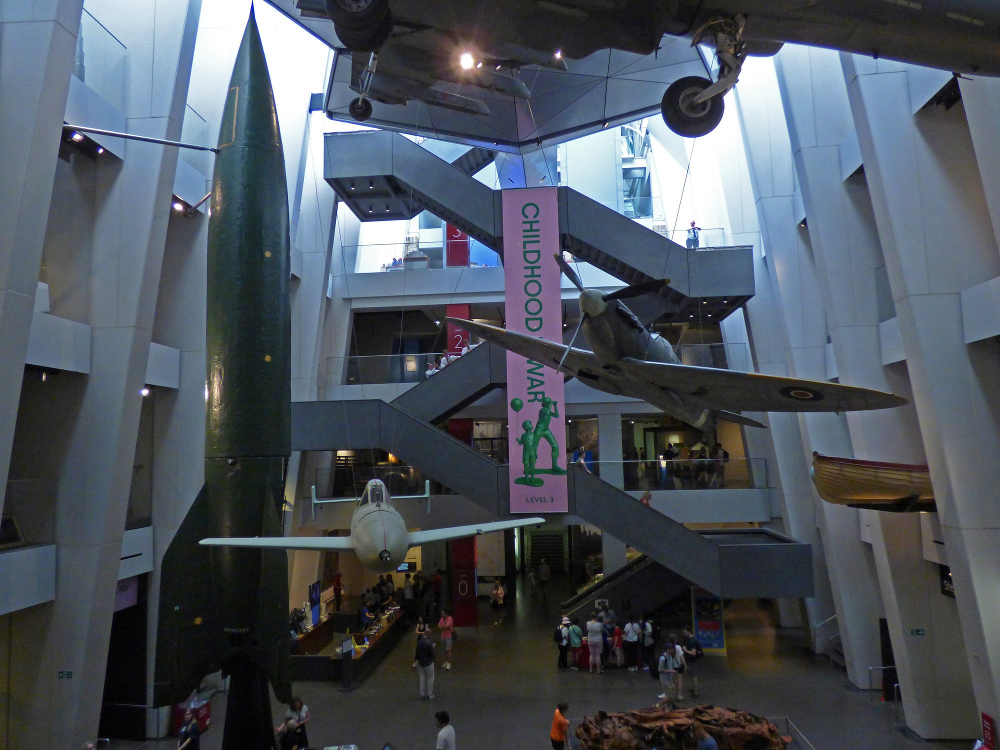
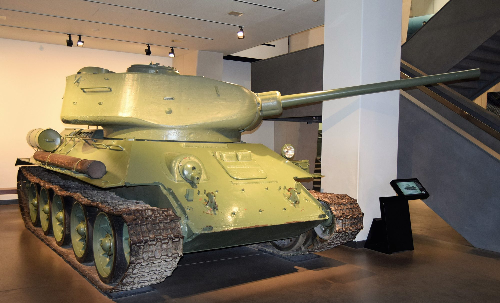
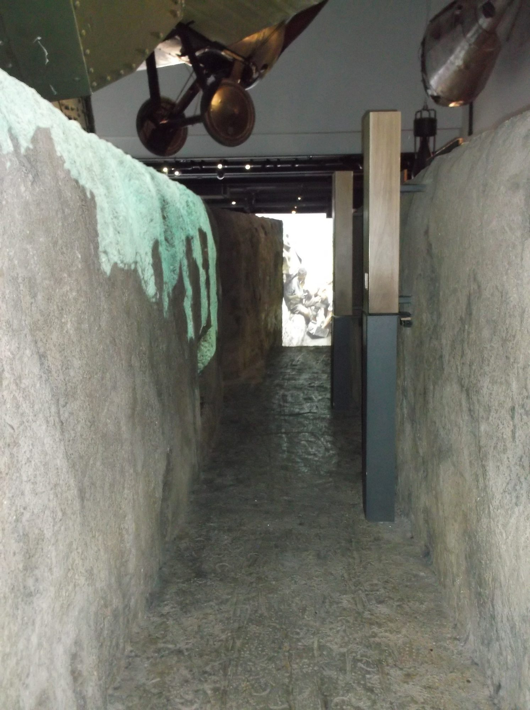
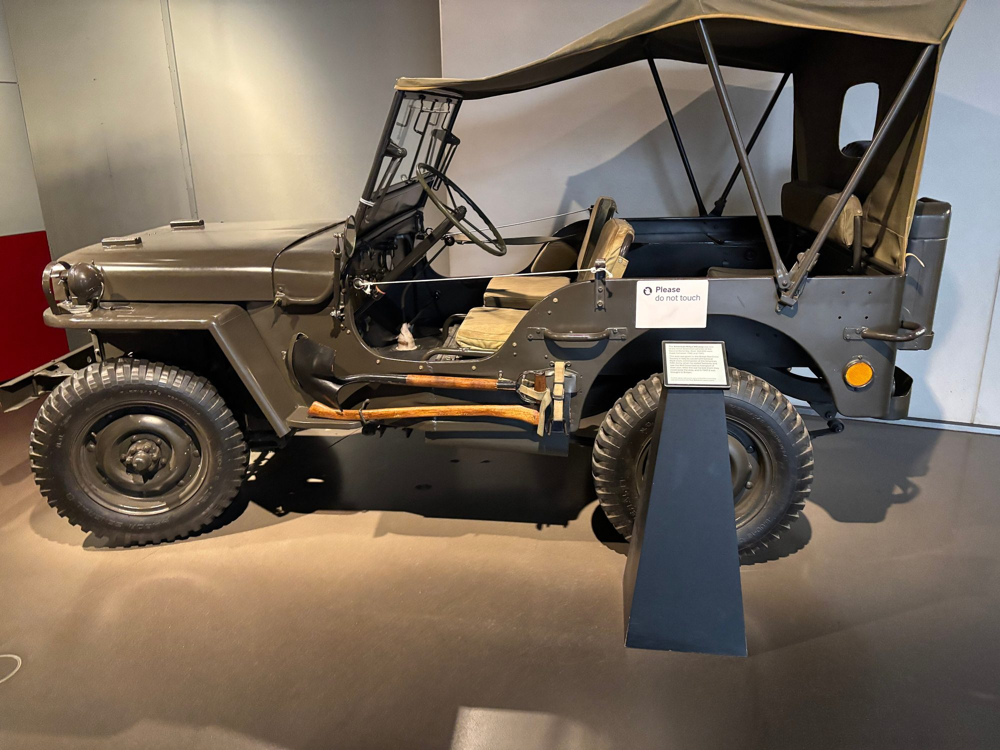
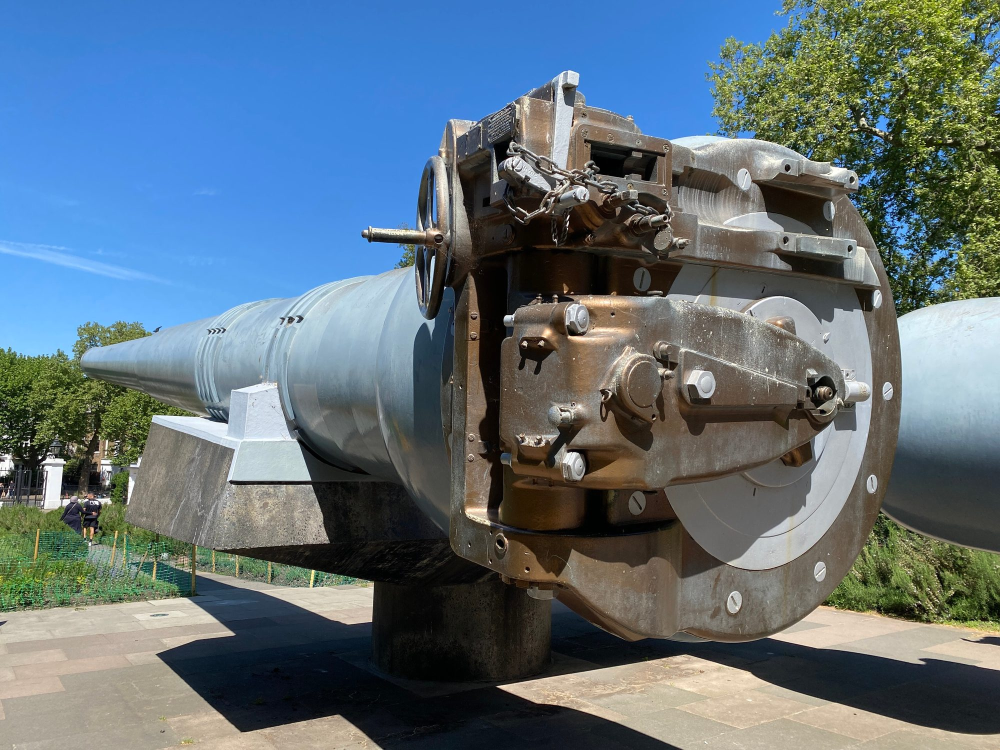

Imperial War Museum London, in Lambeth just south of the river, covers conflict from the First World War to the present across six floors, and costs nothing to enter.

IWM says its subject is the experience of ordinary people caught up in war. The galleries are built from diaries, uniforms, art and film as much as from weapons, and the atrium is hung with aircraft and rockets.

> 💡 **The Short Version:**
> - **Entry is free and you do not need to book.** Open **10am to 6pm every day except 24 to 26 December**; it closes at 5.30pm on Thursday 19 November 2026.
> - **Allow at least three hours**, IWM's own advice, for the First World War, Second World War and Holocaust galleries plus the art and film galleries on Level 3.
> - **The Holocaust Galleries are not recommended for under-14s** and some sections are highly graphic. Everything else suits all ages.
> - **With children:** the free **Childhood in War** exhibition runs to 28 February 2027 and is designed for ages 8 and over. Free family activities run every weekend.
> - **Nearest stations:** Lambeth North (7 minutes), Elephant and Castle (10) and Waterloo (14).
> - **Bags:** no suitcases or wheeled cases. Small lockers take a carry-on-sized bag for a refundable £1 coin.

> ⚠️ **The Holocaust Galleries are not recommended for children under 14.** IWM says sections feature highly graphic content that some visitors may find distressing. If you are bringing a family, plan the visit around them: the rest of the museum, including Childhood in War, is open to every age.

---

## Free entry, and what that means

General admission is free for everyone, with no ticket and no timed slot. You walk in, and your bag may be searched on the way. IWM is a charity and asks for donations, which you can make by tapping a card at points around the museum.

Photography and video are welcome for personal, non-commercial use. Flash and tripods are not allowed, and IWM asks you not to film people without their permission.

IWM says the quietest time is the afternoon after 3pm, though school and large groups can fill the galleries at any hour.

---

## The atrium

The atrium on Level 0 is the best first stop, and it is free to look at even if you only have ten minutes. Large objects hang above and stand around the entrance hall: IWM's own list for the space includes:

- a **Supermarine Spitfire Mk Ia**, R6915, which flew 57 combat missions in the Battle of Britain with 609 Squadron
- a **V-2 rocket**; a rocket of this type hit the nearby Kennington Road and Lambeth Road crossroads on 4 January 1945 and killed 43 people
- the **13-pounder Néry Gun** from the First World War, whose crew won three Victoria Crosses in the defence of the gun on 1 September 1914
- a **Soviet-designed T-34 tank**, a **Harrier jump jet** and a Japanese **Ohka** kamikaze aircraft
- the wreck of a **Reuters Land Rover** hit by a rocket near the Karni Crossing, Gaza Strip, on 26 August 2006
- a **car destroyed by a suicide bomb at a book market in Baghdad** in March 2007

*The atrium, with a V-2 rocket, a Spitfire and an Ohka kamikaze aircraft. Photo: [jeremySO](https://commons.wikimedia.org/wiki/File:2026-08-04_-_Imperial_War_Museum_-_05.jpg), [CC BY 4.0](https://creativecommons.org/licenses/by/4.0/).*

*A T-34 tank in the atrium. Photo: [Anne and David](https://commons.wikimedia.org/wiki/File:2018-10-25_Imperial_War_Museum_London._Lambeth_Road,_SE1_6HZ.jpg), public domain.*

---

## The galleries worth the walk

IWM lists four permanent gallery spaces beyond the atrium. Lifts and ramps serve every level.

### First World War Galleries

IWM puts more than 1,300 objects on display here, including weapons, uniforms, diaries, keepsakes, film and art. The route runs from the lead-up to the war through the Battle of the Somme to the Treaty of Versailles.

The set piece is the **trench**: a sandbag-lined walk-through with periscopes, the sound of exploding shells, a Mark V tank and a Sopwith Camel overhead. Some of the galleries are lit low for effect, so watch your step.

*The First World War trench. Photo: [Harry Mitchell](https://commons.wikimedia.org/wiki/File:Trench,_Imperial_War_Museum.JPG), [CC BY 4.0](https://creativecommons.org/licenses/by/4.0/).*

### Second World War Galleries (from Level 1)

More than 1,500 items across two floors, from London to Russia, New Zealand, China and the Philippines. They include the first piece of wreckage from the USS Arizona, sunk at Pearl Harbor in 1941, ever displayed outside the United States. The galleries won the 2022 Museum + Heritage award for Permanent Exhibition of the Year.

For children, IWM points to the Anderson shelter display, which shows how families protected themselves during air raids.

*A Willys MB jeep. Photo: [epasatuspcollege](https://commons.wikimedia.org/wiki/File:29_April_2025_Imperial_War_Museum_London_-_30.jpg), [CC BY 2.0](https://creativecommons.org/licenses/by/2.0/).*

### The Holocaust Galleries (Level 2)

Over 2,000 photographs, books, artworks, letters and personal objects, from jewellery and clothing to toys and musical instruments, tell the stories of individuals among the six million Jewish people murdered in the Holocaust. IWM calls the museum the first in the world to house Second World War and Holocaust galleries under one roof.

**IWM's content guidance:** not recommended for children under 14, with sections of highly graphic content. School groups must pre-book a Holocaust Learning Session to enter. A Quiet Room on Level 1 is open to anyone affected by what they see in the galleries.

### Blavatnik Art, Film and Photography Galleries (Level 3)

More than 500 works by artists, filmmakers and photographers from the twentieth and twenty-first centuries. The headline is John Singer Sargent's *Gassed* (1919), six metres long, shown after significant conservation work. Also here is Olive Edis, one of the first women in Britain to build a career as a freelance photographer.

The **Screening Space**, in the Mind and Body gallery, shows feature-length films and documentaries from IWM's collection on a daily schedule starting at 10.30am, from a 104-minute First World War film to a 20-minute Cold War one. The **Art Box** in the Perspectives and Frontiers gallery shows contemporary moving-image art.

---

## Childhood in War and family days

**Childhood in War** is a free exhibition on Level 3 running **31 July 2026 to 28 February 2027**. It looks at how children have experienced conflict from 1914 to the present, with a recreated evacuee train carriage you can sit in, a Cold War kitchen, a games room with a giant board game, and a literary trail where children collect six stamps (daily, 10am to 5pm). IWM designs it for ages 8 and over and welcomes younger children.

Separate free family activities, with self-guided trails for ages 5 to 12, run every weekend and in school holidays; confirm the day's schedule at the Information Desk on Level 0. Baby changing facilities are on every floor, and sensory backpacks with ear defenders can be borrowed from the Information Desk. More ideas for the day are in our [London with Children](/articles/london-with-children/) guide.

---

## Talks and events

The ticketed event on IWM London's programme is the **IWM Institute Future of War** talk, *The Information Battlefield: Truth, Trust and Conflict in the Age of AI*, on the Roof Terrace on **Wednesday 25 November 2026**, 7pm to 8.15pm (doors 6.30pm). Tickets are £25, or £15 for students and over-65s, booked through [IWM's event page](https://www.iwm.org.uk/events/the-information-battlefield-truth-trust-and-conflict-in-the-age-of-ai-iwm-institute-future-of-war).

---

## Eating, bags and the shop

- **Cafe:** off the main atrium, open 10am to 5.30pm daily, serving hot and cold seasonal dishes, cakes and drinks.
- **Bringing your own food:** a lunchroom on Level 1, past the exit of the Second World War Galleries, is open to all visitors at weekends from 10am.
- **Lockers:** small lockers by the North and West Entrances, the largest 55 x 33 x 43cm, take a £1 coin returned after use. Keyring tokens cost £2 from the shop.
- **Not allowed:** wheeled cases, sports equipment and large luggage. IWM cannot store them.
- **Shop:** books, prints, posters and gifts; IWM accepts cash and card.

---

## Getting there

IWM London is at **Lambeth Road, SE1 6HZ**, inside Geraldine Mary Harmsworth Park, with two naval guns on the lawn in front.

- **Underground:** Lambeth North is a 7-minute walk, Elephant and Castle 10 minutes.
- **Rail:** Waterloo is a 14-minute walk.
- **Bus:** routes 344 and 360 stop on Lambeth Road; routes 3, 59 and 159 stop on Kennington Road.
- **Bike:** Cycleway 6 runs past the museum from Elephant and Castle, and there are cycle docking stations on Geraldine Street and Kennington Road.
- **Car:** there is no general parking. Blue Badge holders can reserve one of a limited number of bays off Brook Drive by phoning IWM on 020 7416 5000, Monday to Friday 9am to 5pm.

*One of the naval guns outside the museum. Photo: [Alan Hughes](https://commons.wikimedia.org/wiki/File:15%E2%80%9D_Mk_1_Naval_Gun_-_geograph.org.uk_-_8036264.jpg), [CC BY-SA 2.0](https://creativecommons.org/licenses/by-sa/2.0/).*

### Accessibility

- **Step-free entrance:** the **West Entrance**, on the right as you face the front, past the cafe entrance. The visit starts on Level 0. The North Entrance has nine steps up to the door and three more inside.
- **Inside:** every level is reached by lift or ramp, and all galleries have level access with some gentle slopes.
- **Wheelchairs:** free manual loans from the West Entrance, first come, first served. Reserve one by phone ahead of your visit on 020 7416 5000.
- **Toilets:** a Changing Places toilet on Level 0 (a radar key from the Information Desk opens it) and gender-neutral accessible toilets on Levels 0 to 3.
- **Seating and quiet:** bench seating throughout and folding stools to borrow. IWM publishes an access guide with a sensory map, with printed copies at the Information Desk.
- **Subtitles and BSL:** English subtitles on videos throughout, and British Sign Language introductions in each permanent gallery.

---

## Other IWM sites in London

- **[Churchill War Rooms](/articles/churchill-war-rooms-guide/):** the underground Cabinet bunker off Whitehall. It is ticketed, and IWM members go free.
- **HMS Belfast:** a Second World War cruiser moored on the Thames by Tower Bridge, also ticketed.

---

## Continue planning your London trip

- 🖼️ **[Best Museums in London](/articles/best-museums-london/)** — the other national museums, most of them free.
- 🎖️ **[Churchill War Rooms Guide](/articles/churchill-war-rooms-guide/)** — tickets and what to see in the Cabinet bunker.
- 🏙️ **[South Bank Area Guide](/articles/south-bank-area-guide/)** — the river walk, the markets and where to eat nearby.
- 🛏️ **[Where to Stay on the South Bank](/articles/where-to-stay-south-bank/)** — hotels within reach of Lambeth and Waterloo.
- 💷 **[London on a Budget](/articles/london-on-a-budget/)** — free museums and money-saving rules.
- 👨‍👩‍👧 **[London with Children](/articles/london-with-children/)** — the museum as part of a family day.
- 🌧️ **[London in the Rain](/articles/london-in-the-rain/)** — indoor plans for a wet day.
- ♿ **[Step-Free London](/articles/step-free-london/)** — step-free entrances and lifts across the big sights.

*Hours, early closures and exhibition dates as at 15 November 2026.*
