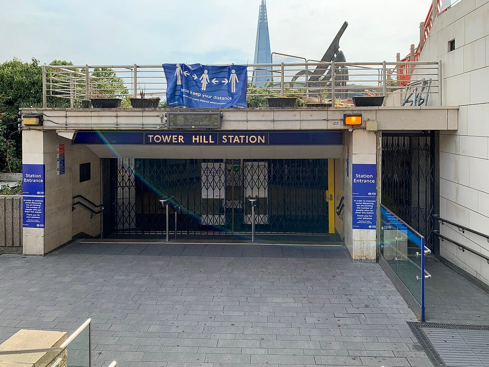
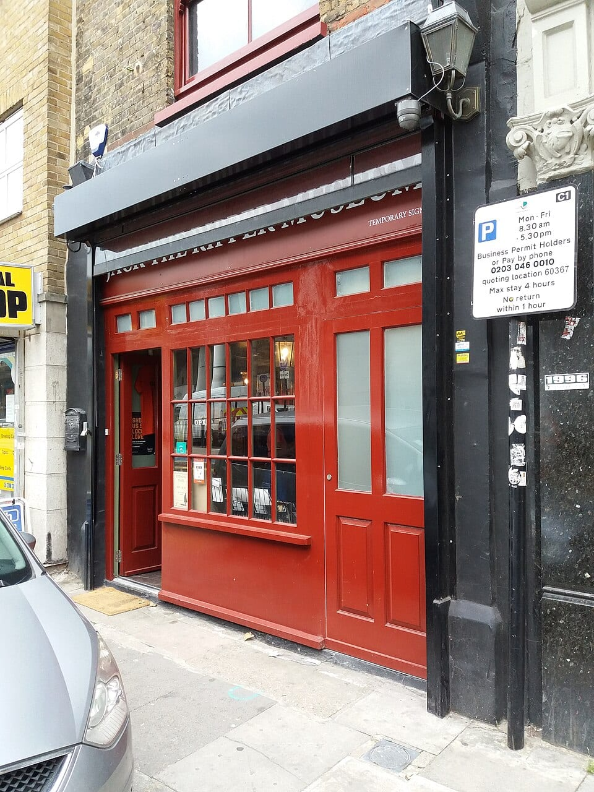
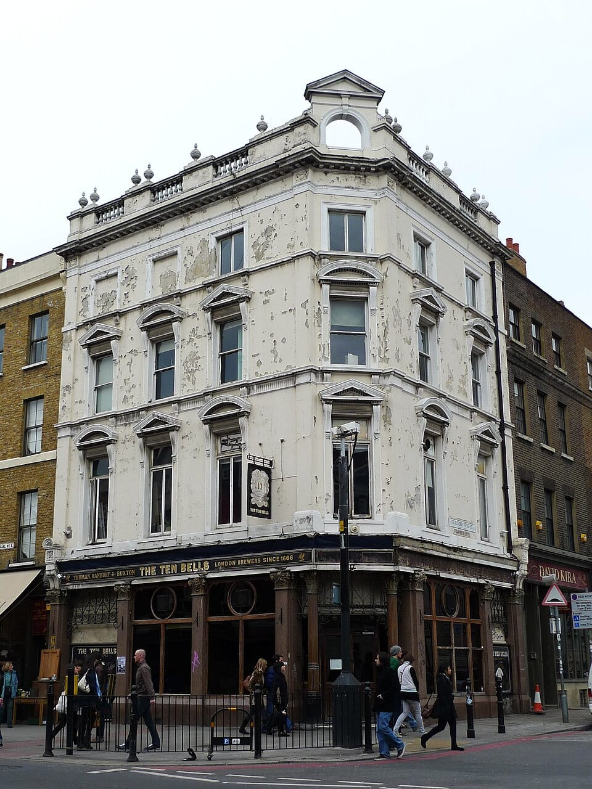

**London offers Jack the Ripper walks through Whitechapel and Spitalfields, a museum on Cable Street, ghost walks through the City and a ghost tour on a vintage bus.** The Ripper tours tell the story of five real women killed in the East End in 1888. The ghost tours are shows: the Ghost Bus is billed as comedy-horror.

> 💡 **The Short Version:** For the standard Ripper walk, take **London Walks** from Tower Hill station (**£20**, 7.30pm every day, 2 hours) or the **Meet The Street Tours evening walk** on GetYourGuide (**£20**, 4.9 from 1,557 reviews, starts at Aldgate). For a ghost tour with an actor and special effects, take the **Ghost Bus** (**£25**, 75 minutes, children 5 and over welcome). For a ghost walk on foot, **Ghastly Ghosts** (**£25**, 2 hours, 4.9 from 819 reviews) starts at All Hallows by the Tower. The **Jack the Ripper Museum** is **£12** online and open 9.30am to 6pm every day. Children's tickets there are for ages 8 to 16. Ripper-Vision is not suitable for under-10s without a parent's consent, and the Uncensored walk is for ages 16 and over.

> 📘 **Booking and prices.** We earn a commission if you book through our GetYourGuide links; the price is the same either way. London Walks, the museum and the Ghost Bus link to their own pages. No operator paid to be included. Prices are the adult price and move with the date.

## The pick for each reader

| Best for | Tour | From | Length | Starts at |
|---|---|---|---|---|
| A Ripper walk, no booking needed | London Walks | £20 | 2 hours | Tower Hill station |
| The best-reviewed Ripper walk | Meet The Street Tours evening walk | £20 | 2 hours | Aldgate station |
| The most reviewed | The Original Jack the Ripper Walking Tour | £22 | 2 hours | Depends on language |
| Photographs on the walls | Ripper-Vision | £18 | 1¾ hours | Aldgate East, Exit 3 |
| A museum | Jack the Ripper Museum | £12 | 1 day ticket | 12 Cable Street |
| A ghost tour for a group | The Ghost Bus | £25 | 75 minutes | Northumberland Avenue |
| A ghost walk | Ghastly Ghosts | £25 | 2 hours | All Hallows by the Tower |

## The Ripper walks

In 1888 Mary Ann "Polly" Nichols, Annie Chapman, Elizabeth Stride, Catherine Eddowes and Mary Jane Kelly were killed in Whitechapel, Spitalfields and the City of London. The murders were never solved, and the walks visit the places where they happened. London Walks dedicates its tour to the five women, and the Jack the Ripper Museum records their names, ages and the places they were found on its stairway walls.

### London Walks — Tower Hill

*£20 adult · £15 students, over-65s and Loyalty Card holders · £5 children · 2 hours · 7.30pm every day, plus 3pm on Saturdays · <a href="https://www.walks.com/our-walks/jack-the-ripper-walking-tour/" target="_blank" rel="noopener">See the walk on London Walks' site</a>*

You meet outside **Tower Hill station**, by the Tower Hill Tram coffee stand. Your guide holds up the London Walks leaflet. The walk starts on the boundary between Scotland Yard's territory and the City of London Police's, because the conflict between the two forces is part of the story. It goes through **Mitre Square** in the City, then into Whitechapel by way of **Goulston Street**, and finishes where the last murder happened, near Aldgate, Aldgate East and Liverpool Street stations. The Ten Bells pub is opposite Spitalfields Market, a short walk from the end. It does not run on 24 or 25 December.

*Tower Hill station entrance, where the London Walks Ripper walk starts. Photo: [TheFrog001](https://commons.wikimedia.org/wiki/File:Tower_Hill_station_entrance_2020.jpg), [CC0 1.0](https://creativecommons.org/publicdomain/zero/1.0/).*

### Jack the Ripper Evening Walking Tour — Meet The Street Tours

*£20 · 2 hours · starts at Aldgate · 4.9 from 1,557 reviews · <a href="https://www.getyourguide.com/activity/-t54688?partner_id=WWP7I0R&amp;cmp=jack-the-ripper-ghost-tours-london" target="_blank" rel="sponsored nofollow noopener" data-affiliate="gyg">Book on GetYourGuide</a>*

You meet at **Aldgate** station, not Aldgate East, and walk the streets where the murders happened. It spends as much time on the poverty of the East End in the 1880s as on the suspects. It is the best-reviewed Ripper walk on GetYourGuide with more than 500 reviews.

### The Original Jack the Ripper Walking Tour — See Your City

*£22 · 2 hours · 4.7 from 9,033 reviews · <a href="https://www.getyourguide.com/activity/-t359535?partner_id=WWP7I0R&amp;cmp=jack-the-ripper-ghost-tours-london" target="_blank" rel="sponsored nofollow noopener" data-affiliate="gyg">Book on GetYourGuide</a>*

The most reviewed Ripper walk on this page. It runs in English and in French, German, Italian, Spanish, Portuguese and Japanese, and the meeting point depends on the language you book. You look at photographs of the crime scenes and weigh up the suspects.

### Ripper-Vision — Secret Chamber Tours

*£18 · 1¾ hours · starts at Aldgate East · 4.5 from 1,928 reviews · <a href="https://www.getyourguide.com/activity/-t104249?partner_id=WWP7I0R&amp;cmp=jack-the-ripper-ghost-tours-london" target="_blank" rel="sponsored nofollow noopener" data-affiliate="gyg">Book on GetYourGuide</a>*

The guides carry **handheld projectors** and cast period photographs, crime-scene images, maps and newspaper illustrations onto the walls where the murders happened. It runs at 7.30pm every evening, with extra departures at 5pm from Thursday to Sunday, and booking is required. Meet at **Aldgate East, Exit 3**, outside the Whitechapel Gallery. Children's tickets are £10. It is not suitable for children under 10 without a parent's consent.

### Jack the Ripper Uncensored (Adults Only)

*£19 · 2 to 3 hours · ages 16 and over · 4.7 from 3,539 reviews · <a href="https://www.getyourguide.com/activity/-t530047?partner_id=WWP7I0R&amp;cmp=jack-the-ripper-ghost-tours-london" target="_blank" rel="sponsored nofollow noopener" data-affiliate="gyg">Book on GetYourGuide</a>*

A walk through Whitechapel's murder sites that shows uncensored photographs of the victims and weighs the evidence. It is for ages 16 and over only. A private option is available.

### Ripper pub tours

*From £20 · 2 hours · <a href="https://www.getyourguide.com/activity/-t1234502?partner_id=WWP7I0R&amp;cmp=jack-the-ripper-ghost-tours-london" target="_blank" rel="sponsored nofollow noopener" data-affiliate="gyg">Taverns and Dark Tales, £20, 4.4 from 20 reviews</a> · <a href="https://www.getyourguide.com/activity/-t981012?partner_id=WWP7I0R&amp;cmp=jack-the-ripper-ghost-tours-london" target="_blank" rel="sponsored nofollow noopener" data-affiliate="gyg">Tour with Historic Pub Stops, £29, 4.8 from 596 reviews</a>*

Both visit historic pubs in Victorian Whitechapel linked to the case, with a drink in hand: **Taverns and Dark Tales** is billed as a pub tour with a classic pint, and the **Historic Pub Stops** walk tells its stories at real Victorian locations. Both run for 2 hours. For a Ripper walk with no pub stops, take London Walks.

Powered by <a target="_blank" rel="sponsored" href="https://www.getyourguide.com/london-l57/">GetYourGuide</a>

## The Jack the Ripper Museum

*Adult £12 online, £14 on the door · child (8 to 16) £10 · pensioner £10 · open 9.30am to 6pm, every day · <a href="https://www.jacktherippermuseum.com/book-tickets" target="_blank" rel="noopener">Book on the museum's site</a>*

**12 Cable Street, E1 8JG.** Tower Hill and Aldgate East are each a 7-minute walk, and Shadwell is 10. The museum is in a Victorian house, and the stairs are lined with the details of each murder: the victims' names, ages and where they were found, with newspaper reports and illustrations from the time. The exhibits also cover the suspects, the police investigation and everyday life in the East End in 1888. A lift reaches every floor. Your ticket is valid at any time that day, with no time slots.

*The entrance to the Jack the Ripper Museum on Cable Street. Photo: [Romainbehar](https://commons.wikimedia.org/wiki/File:London_-_Cable_Street,_Jack_the_Ripper_Museum_entrance.jpg), [CC0 1.0](https://creativecommons.org/publicdomain/zero/1.0/).*

The museum runs its own walk through Whitechapel daily at **3pm and 5pm**, lasting about 90 minutes. Check in 15 minutes before at the museum; it ends near Aldgate station. It is in English only, and tickets are not refundable, though the museum will move the date if you contact it. A combined ticket for the museum and a walk is also on <a href="https://www.getyourguide.com/activity/-t651686?partner_id=WWP7I0R&amp;cmp=jack-the-ripper-ghost-tours-london" target="_blank" rel="sponsored nofollow noopener" data-affiliate="gyg">GetYourGuide</a> at £45, and museum tickets alone are £14 there, rated 4.2 from 968 reviews.

*The Ten Bells pub on Commercial Street, Spitalfields. Photo: [Ewan Munro](https://commons.wikimedia.org/wiki/File:Ten_Bells,_Spitalfields,_E1_(3368542698).jpg), [CC BY-SA 2.0](https://creativecommons.org/licenses/by-sa/2.0/).*

## Ghost tours

### The Ghost Bus Tours — Trafalgar Square

*£25 adult · £17 child (5 to 15) · £63 family of four · £19 concession · 75 minutes · <a href="https://theghostbustours.com/london/buy-tickets/" target="_blank" rel="noopener">Book on the operator's site</a>*

You meet at **8 Northumberland Avenue, WC2N 5BY**, outside the Grand Hotel, a short walk from Embankment and Charing Cross stations. The tour runs daily on a vintage 1960s Routemaster. A conductor, played by an actor, tells stories of London's gruesome past as you pass places such as Westminster Abbey, Fleet Street and London Bridge, with fog, sound effects and jump scares. It is a comedy-horror show rather than a lecture, and the operator describes it as creepy and gruesome more than scary. The bus stops for a short walk to a graveyard, about 7 to 10 minutes.

Arrive at least 15 minutes early. Seats are first come, first served, and the bus does not wait for latecomers. Children aged 5 and over are welcome, with parental guidance under 12, and those aged 15 and under must be with a paying adult. The bus is not wheelchair accessible, and pushchairs and prams cannot go on board. Group bookings take up to 20 people. The tour is also listed on <a href="https://www.getyourguide.com/activity/-t22301?partner_id=WWP7I0R&amp;cmp=jack-the-ripper-ghost-tours-london" target="_blank" rel="sponsored nofollow noopener" data-affiliate="gyg">GetYourGuide</a> at £28, as a 1-hour tour rated 4.4 from 2,452 reviews.

### Ghost walks

*Ghastly Ghosts £25 · 2 hours · 4.9 from 819 reviews · <a href="https://www.getyourguide.com/activity/-t56795?partner_id=WWP7I0R&amp;cmp=jack-the-ripper-ghost-tours-london" target="_blank" rel="sponsored nofollow noopener" data-affiliate="gyg">Book on GetYourGuide</a>*

**Ghastly Ghosts**, from Meet The Street Tours, goes after dark from **All Hallows by the Tower**, one of London's oldest churches, through the alleys of the City to **St Paul's Cathedral**, on crimes, unsolved murders and the ghosts that followed them.

*Ghosts, Ghouls and Gallows £22 · 2 hours · 4.5 from 1,447 reviews · <a href="https://www.getyourguide.com/activity/-t96390?partner_id=WWP7I0R&amp;cmp=jack-the-ripper-ghost-tours-london" target="_blank" rel="sponsored nofollow noopener" data-affiliate="gyg">Book on GetYourGuide</a>*

**Ghosts, Ghouls and Gallows**, from See Your City, is billed as the Original London Ghost Walk. It goes through royal parks with grim histories and past what it calls haunted houses. It runs in French and German as well as English.

*Haunted London £20 · 2 hours · <a href="https://www.walks.com/our-walks/haunted-london/" target="_blank" rel="noopener">See the walk on London Walks' site</a>*

**London Walks' Haunted London** is guided by actors and meets outside the Fish Street Hill exit of **Monument** station. It is £20 for adults, £15 for students and over-65s and £5 for children, and it runs on Sundays.

*Ghosts of Greenwich £16 · 2 hours · 5.0 from 83 reviews · <a href="https://www.getyourguide.com/activity/-t830690?partner_id=WWP7I0R&amp;cmp=jack-the-ripper-ghost-tours-london" target="_blank" rel="sponsored nofollow noopener" data-affiliate="gyg">Book on GetYourGuide</a>*

**Ghosts of Greenwich** is the cheapest ghost walk here and the one that takes you out of central London, with spectres and stories of Greenwich's dark past. See our [Greenwich area guide](/articles/greenwich-area-guide/) for the rest of the day.

## Doing it yourself

The Ripper streets are open to walk at any hour, and the City and the Tower are covered in our own guides:

* **More walking tours:** [the best walking tours in London](/articles/best-walking-tours-london/), including Harry Potter, street art and food walks.
* **The same streets without a guide:** [our Shoreditch and Spitalfields walk](/articles/shoreditch-spitalfields-walk/).
* **Tower of London:** [the Tower of London guide](/articles/tower-of-london-guide/) covers tickets and the Crown Jewels; the ghosts walk from All Hallows by the Tower starts beside it.
* **On a bus:** [London tour buses compared](/articles/london-tour-buses-compared/) covers the daytime sightseeing buses.
* **Halloween:** [Halloween in London](/articles/halloween-london/) lists which Ripper walks run on the night.
* **Something more theatrical:** [immersive experiences in London](/articles/immersive-experiences-london/).
