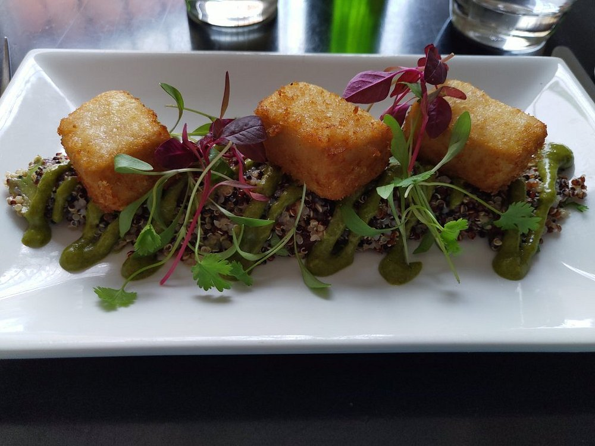

London's standing restaurant offers run through January: set lunches, weekday discounts and mocktail deals, plus a winter card at The Waterway that pauses for December. **Dry January** and **Veganuary** both run from **Friday 1 to Sunday 31 January 2027**.

> 💡 **The Short Version:** The **set lunches** keep running through January, from **£12.50 for a pizza and a soft drink at Franco Manca** to **£16 for two courses at Manzi's**. **The Waterway** in Little Venice gives **15% off food Tuesday to Friday** and **2-4-1 mains on Sunday evenings** with its free Winter Club card, which works again from 1 January after its December break. **Mildreds** pours a **free carafe of house wine** with its sharing menu Monday to Wednesday from 5pm. For **Dry January**, **The Lucky Saint** is a Marylebone pub run by an alcohol-free brewer, and **Purezza** sells **two alcohol-free spritzes for £14** on weekdays until 7pm. For **Veganuary**, **Mildreds**, **Purezza** and **Temple of Seitan** are vegan every day of the year. **The West End New Year Sale launches on Tuesday 5 January** with dining deals alongside the theatre seats.

*Offers as listed by each restaurant on 24 November 2026.*

> 🧭 **Plan the rest of January:** [Things to do in London in January](/articles/things-to-do-in-london-in-january/) · [London deals this month](/articles/london-deals-this-month/) (theatre, museums and trains) · [Food deals by day of the week](/articles/food-deals-london/)

## January 2027 dates

| When | What |
| --- | --- |
| Fri 1 Jan | Dry January and Veganuary start; Las Iguanas' classic bottomless brunch becomes bookable; The Waterway's Winter Club discounts apply again |
| Tue 5 Jan | Official London Theatre's New Year Sale launches, with dining deals |
| Sun 31 Jan | Dry January and Veganuary end |
| Wed 31 Mar | Last day of The Waterway's Winter Club card |

## Set lunches that run through January

These are standing menus rather than January promotions, so they run every week of the month. Most are weekday-only and finish mid-afternoon. Our [set lunch and pre-theatre guide](/articles/restaurant-deals-london/) has the full list, including the Michelin-starred rooms.

| Restaurant | Price | When | What you get |
| --- | --- | --- | --- |
| [Franco Manca](https://www.francomanca.co.uk/whats-on/lunch-deal-menu/) | £12.50 | Mon–Fri, 12pm–4pm | A sourdough pizza and a soft drink; dessert £2.50 more |
| [Manzi's](https://manzis.co.uk/set-menus/), Soho | £16 / £20 | Tue–Sun, 12pm–5pm | Two or three courses at a Soho seafood restaurant |
| [Dishoom](https://www.dishoom.com/menu/lunch-set-menu/) | £16 / £20 a head | Mon–Fri, 12pm–5pm | Swift Vitality or Prompt Replenishment, a lunch for two to share, and it can be booked |
| [Blanchette](https://www.blanchettesoho.co.uk/menu), Soho | £19.50 / £23 | Mon–Sat | Two or three courses; the same menu runs as a pre-theatre menu |
| [Hawksmoor](https://thehawksmoor.com/) | £21 / £26 / £30 | Lunch | One, two or three courses at the steak restaurant, with a two- or three-course early evening version |
| [Babur](https://www.babur.info/menus/daily-set-lunch), Forest Hill | £24.95 | Mon–Sat, 12pm–2pm | The daily set lunch; £29.95 with a 100ml glass of house wine |
| [Llama Inn](https://www.llamainnlondon.com/whats-on), Shoreditch | £25 / £29 | Mon–Fri, 12pm–4pm | A Peruvian set lunch running from ceviche to tres leches |
| [Chez Bruce](https://www.chezbruce.co.uk/special-offers/), Wandsworth Common | £40.50 / £48.50 | Tue–Fri lunch | The "Brucie Bonus" weekday set lunch, on Bellevue Road, Wandsworth Common |

## Offers that run all winter

### The Waterway, Little Venice

*££ · canalside at Little Venice · free Winter Club card*

A restaurant and bar on the canal at Little Venice. **Sign up for the free [Winter Club card](https://www.thewaterway.co.uk/winter-club)** and show it on arrival for **15% off food in the restaurant Tuesday to Friday**, **2-4-1 on à la carte main courses on Sunday evenings** (the cheapest mains are free) and complimentary tasters for the table. The card is valid from 1 October to 31 March but **cannot be used in December**, so January is the first month it works after Christmas.

### Mildreds: a carafe of wine on us

*££ · Soho, Camden, King's Cross and Victoria · Monday to Wednesday from 5pm*

**Carafe & Company** gives **one free carafe of house wine for every two people** ordering the **Taste of Mildreds** sharing menu, **Monday to Wednesday from 5pm**. Tables of two to four only, over-18s, and you must **book a "Wine On Us" slot** on [Mildreds' offer page](https://www.mildreds.com/wine-on-us/); it is not offered at Covent Garden. The menu is fully vegan, which makes it the January offer that suits a Veganuary table but not a dry one.

### Las Iguanas: bottomless brunch from 1 January

*££ · Latin American chain · from £39.95*

The festive brunch ends on 30 December, and the **classic bottomless brunch, from £39.95, is bookable from 1 January 2027**: a brunch dish and two hours of unlimited cocktails, mocktails, beer and fizz ([Las Iguanas](https://www.iguanas.co.uk/bottomless-brunch)). The mocktails count as the drinks, so a Dry January table pays the same price as everyone else. For a cheaper weekday meal, its [£10 meal deal](https://www.iguanas.co.uk/offers) is a main course with a soft drink or a mocktail. More packages are compared on our [bottomless brunch page](/articles/bottomless-brunch-london/).

### The West End New Year Sale

**Official London Theatre's New Year Sale launches on Tuesday 5 January 2027** with special offers, exclusive ticket prices and **dining deals**. The restaurants taking part are listed on the [sale page](https://officiallondontheatre.com/sale/) when it opens; the theatre side is on our [London deals this month](/articles/london-deals-this-month/) page.

## Dry January: where to drink alcohol-free

[Alcohol Change UK](https://alcoholchange.org.uk/help-and-support/managing-your-drinking/dry-january), the charity that runs Dry January, has a free **Try Dry** app for tracking your dry days.

### The Lucky Saint, Marylebone

*££ · 58 Devonshire Street, W1W 5EA · closed Sundays*

**A restored historic pub run by Lucky Saint, an alcohol-free beer brand.** Order the brand's own **Superior Unfiltered Lager**, and the bar stocks both alcohol-free and alcoholic drinks, so a mixed group can go. The food is a light menu of pub classics. It opens **11am to 11pm Tuesday to Friday, 11am to 10pm on Monday and 3pm to 11pm on Saturday**, and it is **closed on Sundays** ([The Lucky Saint](https://luckysaint.co/pages/the-lucky-saint-pub-london-w1)).

### Purezza, Camden

*££ · Camden · vegan pizzeria*

Purezza's happy hour, **Monday to Friday until 7pm**, prices **two alcohol-free spritzes at £14** and two cocktails at £18 ([Purezza offers](https://purezza.co.uk/current-offers/)). The pizzas are vegan too, so it covers both January challenges at one table.

### 2-for-1 mocktails

Three chains put their mocktails into a 2-for-1 cocktail offer:

- **[Slug & Lettuce](https://www.slugandlettuce.co.uk/offers/2-for-1-cocktails)**: 2-for-1 on cocktails and mocktails every day, **when you order two of the same drink**. Its bottomless brunch has an alcohol-free version.
- **[TGI Fridays](https://www.tgifridays.co.uk/)**: 2-for-1 cocktails and mocktails, all day.
- **[Banana Tree](https://bananatree.co.uk/)**: 2-for-1 on cocktails, mocktails included, at its Southeast Asian restaurants.

Every 2-for-1 offer in London, with its branch and condition, is on our [2-for-1 deals page](/articles/two-for-one-deals-london/).

## Veganuary: vegan restaurants and offers

[Veganuary](https://veganuary.com/) is a free 31-day pledge; signing up gets you meal plans, a recipe book and a coaching email every day of January. These places are vegan or vegetarian all year, so nothing depends on a January promotion. More are in our [vegetarian and vegan restaurants guide](/articles/best-vegetarian-vegan-restaurants-london/).

### Mildreds, Soho

*££ · 45 Lexington Street · since 1988*

**Fully vegan and on Lexington Street since 1988**, with a menu that runs from gyoza to burritos to Sri Lankan curry. Soho is the original; there are also sites in Camden, Covent Garden, King's Cross and Victoria ([Mildreds](https://www.mildreds.com/)). **Not every site takes bookings**, and the free-carafe offer above runs Monday to Wednesday evenings.

### Purezza, Camden

*££ · entirely vegan*

**A vegan pizzeria that makes its own cashew and rice-milk mozzarella** rather than buying a substitute. The dough is a long-fermented Neapolitan base with a hemp-flour option; order the **parmigiana pizza**, layered with aubergine. It takes walk-ins and bookings, and weekends are the busiest ([Purezza](https://purezza.co.uk/)).

### Temple of Seitan

*£ · Hackney, Camden and other sites · walk-in*

**A vegan fried chicken shop**: seitan, a wheat-gluten meat substitute, fried in a buttermilk-style batter as burgers, wings and tenders, at chicken-shop prices **under £12**. It is counter service and walk-in, and **some branches are takeaway only** ([Temple of Seitan](https://templeofseitan.co.uk/)).

### The Gate, Hammersmith

*£££ · 51 Queen Caroline Street · vegetarian since 1989*

*A dish at The Gate.*

**Vegetarian since 1989**, in a former artists' studio, with cooking drawn from the founding family's Indian and Iraqi-Jewish background: spiced aubergine, tamarind, pomegranate and rose. It is the most expensive meal in this section, and it **books ahead** ([The Gate](https://www.thegaterestaurants.com/)).

### Cheap vegan options with a student card

- **[Pizza Pilgrims](https://www.pizzapilgrims.co.uk/student-offer/)**: a Margherita or Nduja pizza, both also made vegan, for **£7.50**, dine-in with valid student ID.
- **[Greggs](https://www.greggs.com/legals/promotions-and-offers)**: students get a free vegan sausage roll, among other choices, with a full Sandwich Deal.

## More ways to pay less

- 🍽️ **[London food deals](/articles/food-deals-london/)**: every restaurant offer by type and by day of the week
- 🥗 **[Set lunch and pre-theatre menus](/articles/restaurant-deals-london/)**: fixed-price menus across London
- 🍸 **[Happy hours](/articles/happy-hour-london/)**: by area, with times
- 📅 **[London deals this month](/articles/london-deals-this-month/)**: January's theatre sales, museum offers and train fares
- 🎉 **[Things to do in London in January](/articles/things-to-do-in-london-in-january/)**: the events, the end of Christmas and the sport
- 🥞 **[Pancake Day in London](/articles/pancake-day-london/)**: races and pancakes on Tuesday 9 February
- 🏷️ **[All London deals](/articles/london-deals/)**
