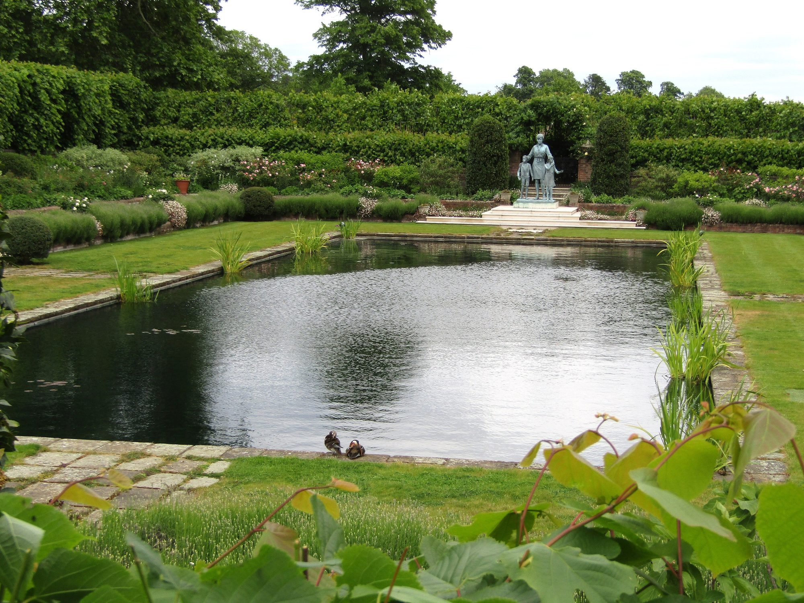
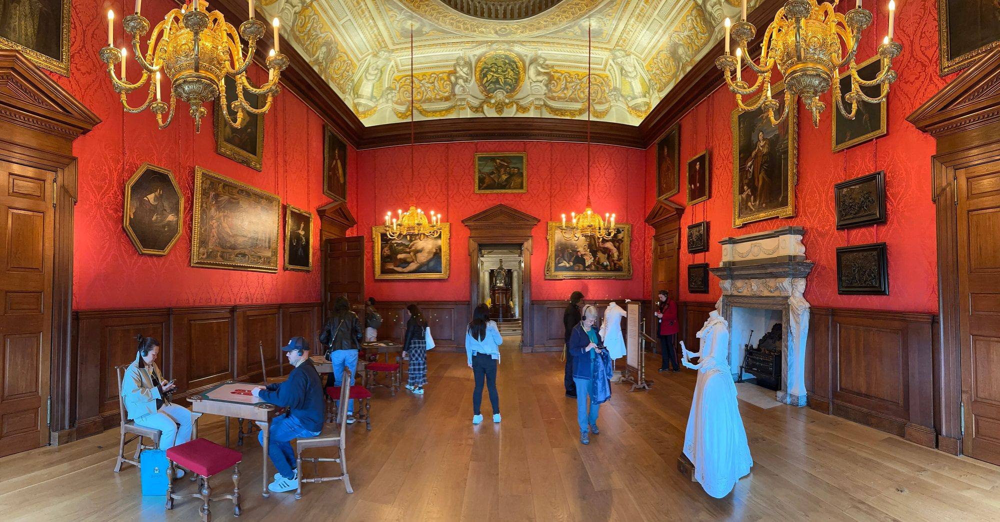
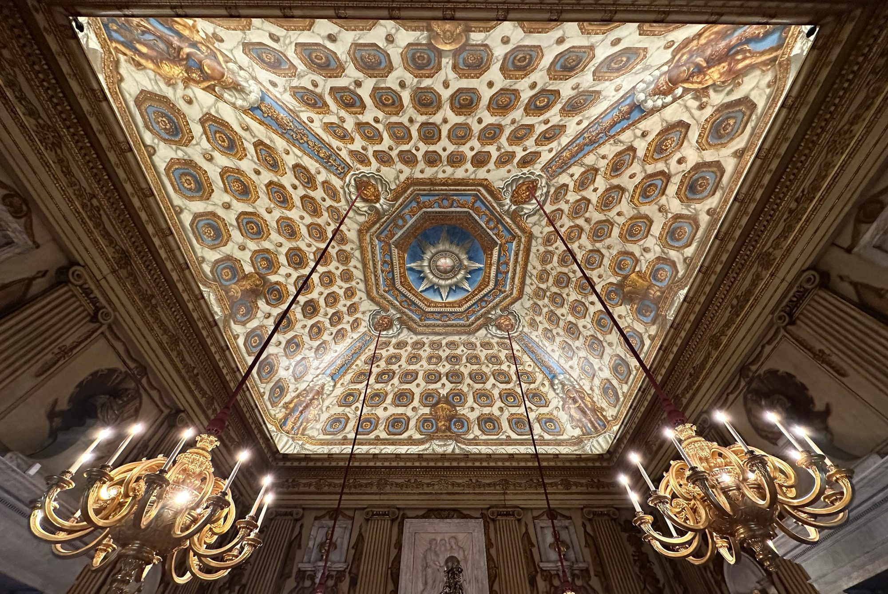
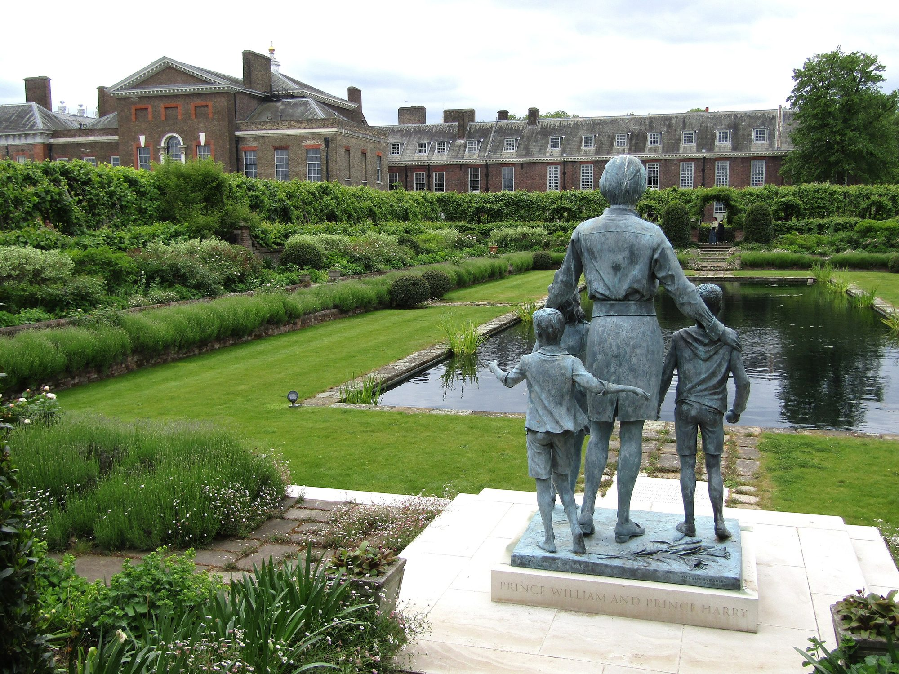
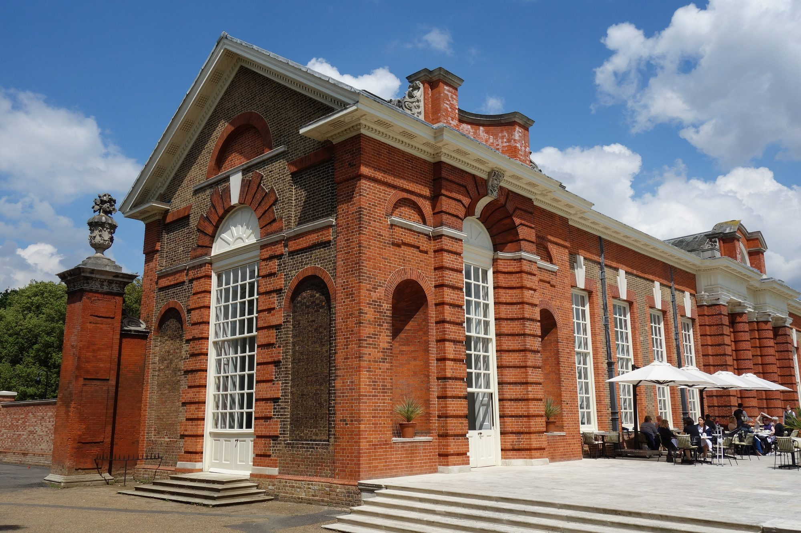

Kensington Palace is the official London residence of the Prince and Princess of Wales and, in the part open to visitors, the house where Queen Victoria was born and raised. It sits inside Kensington Gardens, a ten-minute walk from either High Street Kensington or Queensway, and Historic Royal Palaces, the charity that also runs the Tower of London and Hampton Court, sells the tickets.

Two things shape a visit until spring 2027. The Queen's State Apartments are shut for re-presentation until spring 2027, and the palace is closed every Monday and Tuesday. In return, adult tickets cost £13.00 to £16.00, against £19.00 until 15 November.

> 💡 **The Short Version:**
> - **Price:** Adult £13.00 from 18 to 22 November, £16.00 from 25 November to 3 January (Victoria's Countryside Christmas included), then £13.00 to 24 March 2027. Children 5–15 and young people 16–17 pay half; under-5s are free. An optional 10% donation is added at checkout. Book through [Historic Royal Palaces](https://www.hrp.org.uk/kensington-palace/visit/tickets-and-prices/).
> - **Open:** Wednesday to Sunday, from 10am to 4pm (noon on some Sundays), last entry 3pm. **Closed every Monday and Tuesday to 23 March 2027, and on 24, 25 and 26 December.**
> - **Free:** The palace gardens and the Sunken Garden, with the Diana statue, need no ticket.
> - **Time needed:** Two to three hours inside. The quietest slot is 1pm to 3pm.
> - **Discounts:** National Rail 2FOR1 (pay at the door), the London Pass, Historic Royal Palaces membership from £65 a year, and Art Fund National Art Pass.
> - **Closed until spring 2027:** the Queen's State Apartments (until spring 2027) and, from 18 November, the King's Gallery.

---

## Tickets and prices

Tickets are timed to 30-minute slots. You can arrive at any point inside your slot, but entry outside it isn't guaranteed. Historic Royal Palaces has a no-refunds policy; unused tickets bought on its website can be moved to another date for an amendment fee, by phone on 0333 320 6000 at least three working days before the new date. Prices below are without the optional donation.

| Ticket | 18–22 Nov 2026 | 25 Nov 2026 – 3 Jan 2027 | 6 Jan – 24 Mar 2027 |
| :--- | ---: | ---: | ---: |
| **Adult (18–64)** | **£13.00** | **£16.00** | **£13.00** |
| Child (5–15) | £6.50 | £8.00 | £6.50 |
| Young person (16–17) | £6.50 | £8.00 | £6.50 |
| Senior (65+), student, disabled concession | £10.40 | £12.80 | £10.40 |
| Carer or companion of a disabled visitor | Free | Free | Free |
| Groups of 15 or more, per person | £12.00 | £14.80 | £12.00 |
| Under 5s | Free | Free | Free |

*Prices are those listed for 18 November 2026 to 24 March 2027.*

Prices fall on 18 November, when the King's Gallery closes: an adult ticket is £19.00 up to 15 November. The 25 November to 3 January price includes Victoria's Countryside Christmas, and every ticket for those dates includes it. Add 10% for the optional donation. Tick the Gift Aid box and Historic Royal Palaces can claim an extra 25% of the ticket value at no cost to you.

An audio guide is included in the price, in English, French, German, Italian, Japanese, Mandarin, Portuguese, Spanish and British Sign Language.

### Discounts that apply

- **National Rail 2FOR1.** A second adult goes free when you show a valid National Rail ticket, paid at the door. It excludes 1–6 January, 28 March–12 April, 18 July–31 August and 19–31 December, so it does nothing for the Christmas fortnight. Our [National Rail 2FOR1 guide](/articles/national-rail-2for1-london-attractions/) lists the other attractions.
- **The London Pass.** Holders show their physical pass or the QR code in the app at the admissions desk. Our [London Pass guide](/articles/london-pass-guide/) works out when it pays.
- **Historic Royal Palaces membership.** From £65 a year, free entry here and at the Tower of London, Hampton Court Palace, Banqueting House and Kew Palace. Members just show their card or confirmation email on most days; a few event days need a free pre-booked ticket. Members also get 10% off in the cafés, shops and the Orangery.
- **Art Fund National Art Pass.** Free entry from 11 November 2026 to 24 March 2027.
- **£1 tickets.** Anyone on Universal Credit, Working Tax Credit, Pension Credit, Employment and Support Allowance, Income Support or Jobseeker's Allowance can buy £1 tickets for up to four people in the household. One person shows the documents. If a date shows none, it has sold out.
- **Military.** MOD90, Defence Discount Card or MOD Certificate of Eligibility holders get the concession rate, with tickets sold only on the day.
- **Third-party vouchers** can't be redeemed on the Historic Royal Palaces site; contact the voucher seller.

If you are doing the palaces, our [Hampton Court Palace guide](/articles/hampton-court-palace-guide/) and [Tower of London guide](/articles/tower-of-london-guide/) cover their prices on the same membership.

---

## Opening hours and closed days

> ⚠️ **Closed Monday and Tuesday.** Historic Royal Palaces' calendar has the palace shut every Monday and Tuesday through 23 March 2027, school holidays included, so a Christmas-week visit has to be a Wednesday to Sunday. It is also closed on 24, 25 and 26 December. The Sunken Garden follows the same Wednesday-to-Sunday pattern.

- **Palace:** 10am to 4pm, Wednesday to Sunday, with last entry at 3pm. Some Sundays open at noon, so check the day on the Historic Royal Palaces calendar.
- **Sunken Garden and palace gardens:** 10am to 4pm, free, viewed from the Cradle Walk.
- **Palace Café:** Wednesday to Sunday, 10am to 3.50pm.
- **The Orangery:** daily from 25 October, 10am to 4pm, though it closes on some days for events. Book ahead.

Every visitor passes through a security scanner at the entrance, including those only using the shop and café. Suitcases, large bags and rolling luggage aren't allowed inside, and there is no left-luggage service.

---

## What to see

The palace has two exhibitions, which you can walk in either order, finishing in the shop and café.

*The Sunken Garden at Kensington Palace. Photo: [Colin Smith](https://commons.wikimedia.org/wiki/File:London_-_Kensington_Palace_-_Sunken_Garden_-_geograph.org.uk_-_8327766.jpg), [CC BY-SA 2.0](https://creativecommons.org/licenses/by-sa/2.0/).*

### The King's State Apartments

A sequence of rooms used for audiences and meetings, which is why they are sparsely furnished. The route runs from the King's Staircase through the Presence Chamber, the Privy Chamber, the Cupola Room and the King's Drawing Room.

- The **Cupola Room** was William Kent's first royal commission. It holds the musical clock known as the "Temple of the Four Great Monarchies of the World".
- The **King's Drawing Room** has Vasari's *Venus and Cupid*. Queen Caroline tried to have it moved while her husband was in Hanover; he insisted on its return.
- The **King's Gallery**, where William III caught the chill that killed him in 1702, is closed from 18 November until spring 2027 for roof repairs.

*The King's Drawing Room. Photo: [APK](https://commons.wikimedia.org/wiki/File:King%27s_Drawing_Room,_King%27s_State_Apartments,_Kensington_Palace_-_wide_shot.jpg), [CC BY 4.0](https://creativecommons.org/licenses/by/4.0/).*

*The Cupola Room ceiling. Photo: [APK](https://commons.wikimedia.org/wiki/File:Cupola_Room,_King%27s_State_Apartments,_Kensington_Palace_-_13.jpg), [CC BY 4.0](https://creativecommons.org/licenses/by/4.0/).*

Free 15-minute talks by the palace's guides run Wednesday to Sunday: at 11.30am, 1.30pm and 3.30pm in the King's State Apartments, and at 12.30pm and 2.30pm in Victoria: A Royal Childhood.

### Victoria: A Royal Childhood

A permanent exhibition in the rooms where Princess Victoria was born and grew up, opened for the 200th anniversary of her birth. It includes her doll's house and a scrapbook of mementos made by her German governess, Baroness Lehzen. The **Jewel Room** on the first floor shows the diamond and emerald tiara, necklace, earrings and brooch that Prince Albert commissioned for her; the tiara, presented in 1845, is the only known example of a tiara designed by a consort for his queen.

### Victoria's Countryside Christmas

From 25 November to 3 January, decorations and displays mark 190 years since the young Victoria spent Christmas at Claremont House in Surrey. You'll find snowy landscapes brought indoors, floristry, trees hung with bespoke decorations, a garden arbour where you can have your Christmas photograph taken, and a display on the stage dancer who impressed the princess. It is included in every ticket for those dates; members go free.

### Closed until spring 2027: the Queen's State Apartments

The private rooms where Mary II took her meals and entertained are closed until spring 2027 for re-presentation.

### The Sunken Garden and the Diana statue

King Edward VII had the Sunken Garden laid out in 1908 on the site of potting sheds and greenhouses, modelled on the Pond Garden at Hampton Court. A statue of Diana, Princess of Wales stands in it: bronze, 1.25 times life size, by Ian Rank-Broadley, commissioned by her sons in 2017 and unveiled on what would have been her 60th birthday. Three children stand around her.

*The Diana statue in the Sunken Garden. Photo: [Colin Smith](https://commons.wikimedia.org/wiki/File:London_-_Kensington_Palace_-_Sunken_Garden_-_geograph.org.uk_-_8326799.jpg), [CC BY-SA 2.0](https://creativecommons.org/licenses/by-sa/2.0/).*

You view the garden from the covered Cradle Walk, entering by the Sunken Garden Gate. No ticket is needed. The wider Kensington Gardens beyond it are open as a park; our [best parks and gardens guide](/articles/best-parks-gardens-london/) covers them and Hyde Park next door.

---

## Events, winter 2026/27

- **Victoria's Countryside Christmas:** 25 November to 3 January, included in admission.
- **The Duke tour:** Saturdays to 19 December, then Saturdays from 2 January to 20 March 2027, 11am to 12.15pm. It goes behind the scenes in the State Apartments, including rooms not normally open, and meets inside the ticket office. £49.00 with palace admission included, rising to £55.00 from 2 January. Online booking only.
- **Palace in the Park:** a walking tour of the grounds, Wednesdays and Sundays to 20 December, 12pm to 1.15pm. It is a separate ticket and doesn't include palace admission.
- **Power, Perfume and Scandal:** weekends to 22 November, 10.30am to 2.45pm, included in admission, no booking.

Our [Christmas in London guide](/articles/christmas-in-london/) puts these alongside the markets and light trails, and [Things to Do in London in December](/articles/things-to-do-in-london-in-december/) and [in January](/articles/things-to-do-in-london-in-january/) list the dates against the rest of the month. Hyde Park's [Winter Wonderland](/articles/hyde-park-winter-wonderland/) is a short walk east across the park.

---

## A short history

- **1689:** William III and Mary II buy Nottingham House, a small suburban villa, as a country retreat close to Parliament. Christopher Wren draws up the plans, and the court moves in on Christmas Eve 1689.
- **1702:** William III dies after catching a chill in the King's Gallery.
- **1704–05:** Queen Anne has the Orangery built, designed by Wren and Hawksmoor with details by Vanbrugh, as a greenhouse for her orange trees in winter and a venue for summer parties.
- **1837:** Victoria, who was born and raised at the palace, leaves it to live at Buckingham Palace.
- **Today:** The Prince and Princess of Wales have their official London residence at the palace.

---

## Food and drink

- **Palace Café:** sandwiches, soup and cakes, with vegan, vegetarian and nut-free options. A cream tea is £8.95 and a children's meal deal £7.95. Open Wednesday to Sunday, and you don't need a palace ticket.
- **The Orangery:** breakfast, lunch and afternoon tea in Queen Anne's former greenhouse, with a terrace over the Sunken Garden. It is step-free with its own accessible toilet. Book on the Historic Royal Palaces site or call 020 3206 7781.

*The Orangery at Kensington Palace. Photo: [Daderot](https://commons.wikimedia.org/wiki/File:Kensington_Palace_Orangery_-_London,_England_-_DSC03824.jpg), [CC0](https://creativecommons.org/publicdomain/zero/1.0/).*

Picnics are fine in the gardens but not inside the buildings or the café.

---

## Getting there

- **Queensway (Central line):** 728 metres, about ten minutes. Walk up Bayswater Road and enter Kensington Gardens by the Black Lion Gate, then follow the main path for five to ten minutes.
- **High Street Kensington (Circle and District lines):** 765 metres, about ten minutes along Kensington High Street and into the gardens.
- **Notting Hill Gate:** a 20 to 25 minute walk. **Paddington** (National Rail and the Elizabeth line) is about 20 minutes' walk.
- **Buses:** routes 9, 49, 52, 70 and 452 stop along Kensington High Street; 94, 148 and 274 along Bayswater Road.
- **By car:** there is no on-site parking. The nearest car parks are Q-Park Queensway and the Euro Car Parks site on Bayswater Road, each ten minutes' walk. Blue Badge holders can book an on-site space at least seven days ahead on 020 3166 6199.
- **By bike:** racks are by the Orangery Gate. Cycle docking stations are at Black Lion Gate and Palace Gate. Cycling isn't allowed in the palace gardens.
- **Coaches:** no drop-off on site; the Euro Car Parks coach park at Orme Square Gate is a 10 to 15 minute walk.

Neither Queensway nor High Street Kensington has step-free access from platform to street. Our [Step-Free London guide](/articles/step-free-london/) covers alternatives.

---

## Accessibility

- Ground-level access from Kensington Gardens, and lifts to all three floors. The step-free route is the King's State Apartments on the top floor, then Victoria: A Royal Childhood on the first, then the shop and café on the ground floor.
- Manual wheelchairs are free to borrow indoors, first come, first served, and can't be reserved. Folding stools are free after the scanner desk.
- Two narrow doorways in the Victoria: A Royal Childhood route (790mm by 900mm) may be too small for larger mobility scooters and motorised wheelchairs. There is no charging on site.
- Disabled visitors can bring a carer or companion free; disabled adults buy a concession ticket, disabled children the ticket for their age. Proof is needed, such as a Blue Badge, Access Card or Freedom Pass.
- T-loops are at the ticket office, scanner desk, audio guide desk, shops, café and Orangery. Assistance dogs are welcome. Describer tours are included in admission but must be booked two weeks ahead.
- The quietest time is 1pm to 3pm. Peak periods are March to October and Christmas.

---

## With children

Under-5s go in free with no ticket, and children aged 5–15 must be with an adult. Pushchairs can be taken round the palace, and every toilet has baby-changing and accessible facilities.

In the gardens, watch children near the water features. Balls, frisbees, scooters, bikes and rollerblades aren't allowed. Our [London with children guide](/articles/london-with-children/) has more for a family day.

---

## Where to stay

The [Milestone Hotel](hotel:the-milestone-hotel) faces Kensington Palace, and our [where to stay in Kensington guide](/articles/where-to-stay-kensington/) lists the rest, including options by High Street Kensington.

---

## What people get wrong

1. **Turning up on a Monday or Tuesday.** The palace is shut both days to 23 March 2027, and on 24 to 26 December.
2. **Expecting the Queen's State Apartments or the King's Gallery.** Both are closed until spring 2027.
3. **Buying a ticket to see the Sunken Garden.** The garden and the Diana statue are free.
4. **Planning on 2FOR1 for Christmas week.** It excludes 19–31 December and 1–6 January.
5. **Arriving with a suitcase.** There is nowhere to leave it.

---

## Continue planning your London trip

- 🌳 **[Kensington Area Guide](/articles/kensington-area-guide/)** — Holland Park, the Design Museum and Leighton House.
- 🏨 **[Where to Stay in Kensington](/articles/where-to-stay-kensington/)** — hotels by the palace, High Street Kensington and Earl's Court.
- 🏞️ **[Best Parks and Gardens in London](/articles/best-parks-gardens-london/)** — Kensington Gardens, Hyde Park and the rest.
- 🦕 **[South Kensington Area Guide](/articles/south-kensington-area-guide/)** — the museums, a walk south across the park.
- 🦴 **[Natural History Museum Guide](/articles/natural-history-museum-guide/)** — a walk south of the palace.
- 👑 **[Hampton Court Palace Guide](/articles/hampton-court-palace-guide/)** — Historic Royal Palaces' Tudor palace upriver, on the same membership.
- 🏰 **[Tower of London Guide](/articles/tower-of-london-guide/)** — the other Historic Royal Palaces site in Zone 1.
- 🎟️ **[National Rail 2FOR1 London Attractions](/articles/national-rail-2for1-london-attractions/)** — every attraction with a rail-ticket offer.
- 🎄 **[Christmas in London](/articles/christmas-in-london/)** — markets, light trails and ice rinks.
- ♿ **[Step-Free London](/articles/step-free-london/)** — accessible routes between the main sights.
