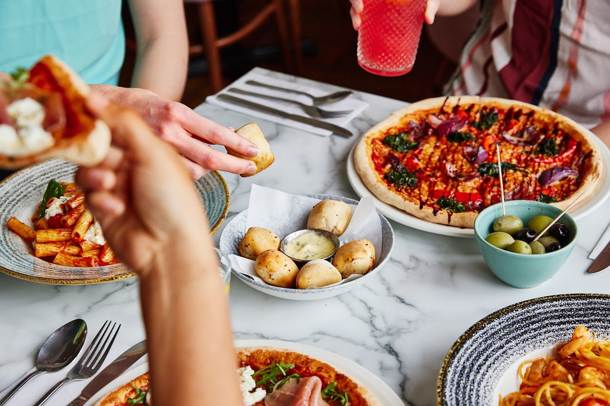
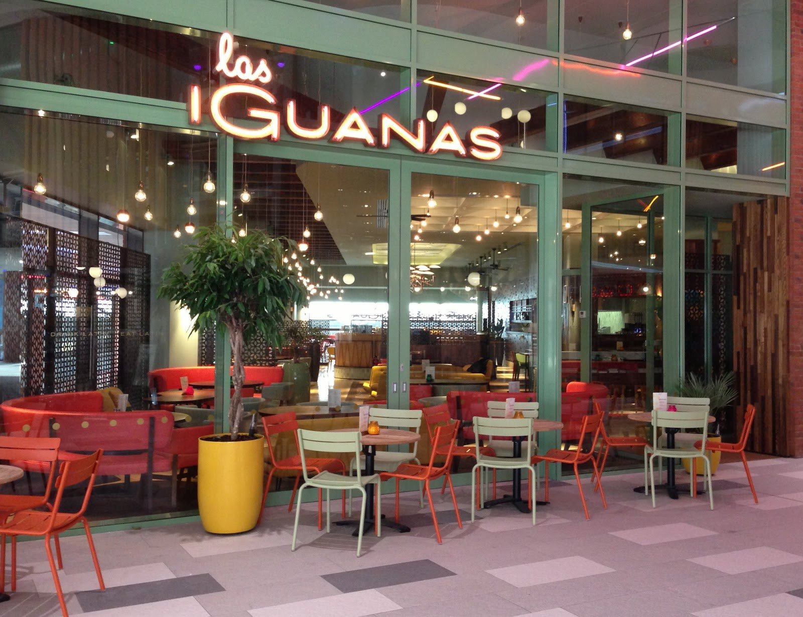
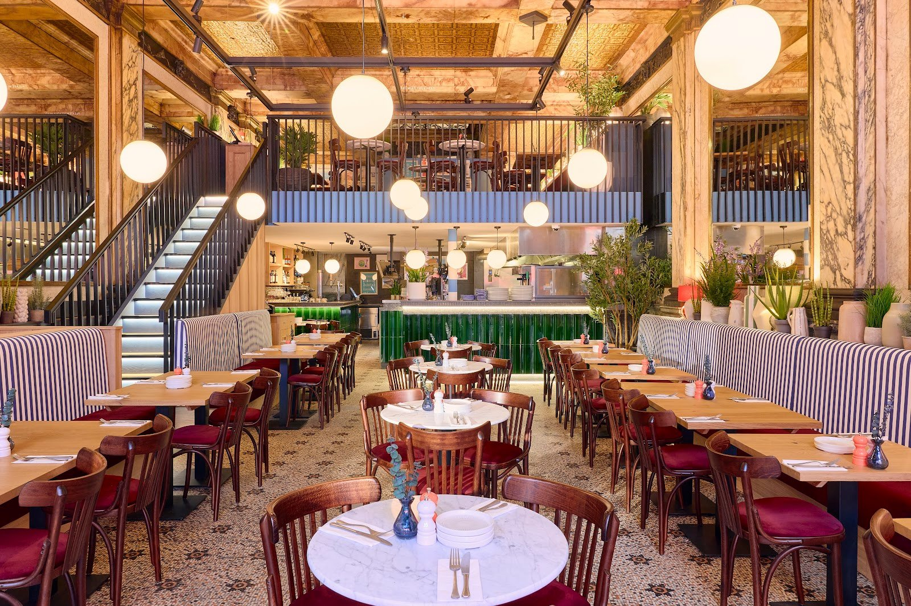
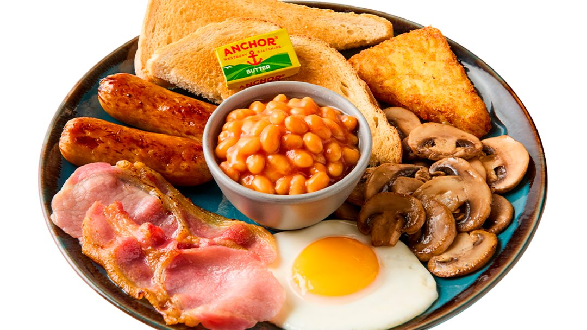
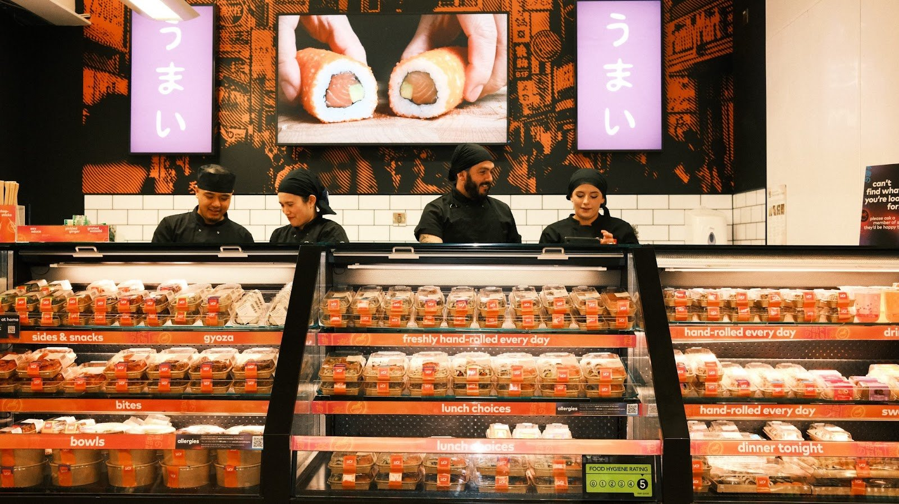
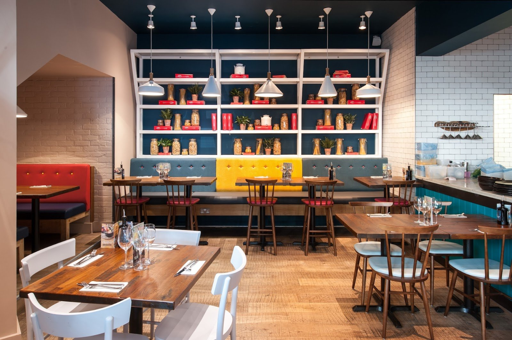

A free children's meal in London almost always costs you an adult main course at full price, and at ten of Bella Italia's eleven London restaurants it is not available at any price. The big Italian chains' offers are mostly in outer London; in the centre the year-round options are steakhouses, Gordon Ramsay's restaurants and a few Sunday-only deals, and the small print decides whether you get it.

> 💡 **The Short Version:** In central London, **Angus Steakhouse** feeds one child aged 8 or under free with each adult main, daily from 12pm to 5pm, and **Gordon Ramsay's restaurants** give a child of 10 or under a free main when an adult orders two courses. **Preto** lets children up to 10 eat free with an adult rodízio on weekday evenings and all weekend. On Sundays, **The Real Greek** and **Banana Tree** feed children free. **Bella Italia** runs kids eat free Sunday to Thursday outside school holidays, but its terms exclude ten of its eleven London restaurants, leaving only Croydon. **Morrisons Café** runs seven days a week with a £5 adult main, though only one of the ten Morrisons nearest Covent Garden has a café. **Prezzo's £1.99-a-month Kids Club** feeds up to three children free on one adult main. **IKEA charges 95p** for a kids' meal with no adult purchase at all. And if you are staying the night, **Premier Inn** feeds two under-16s free at breakfast.

> ⚠️ **School-holiday offers disappear when term restarts.** Several chains — ASK Italian, Zizzi, TGI Fridays and Toby Carvery among them — run kids-eat-free only in school holidays. They come and go on a few weeks' notice, so check the operator's own page in the fortnight before each half term.

---

## What counts as kids eat free

Three different things are sold as kids eat free:

**A free kids' meal with an adult main.** The commonest form. You buy a full-price main — £13 to £18 at the Italian chains — and one child eats free. The saving is the kids' menu price, typically £3.50 to £4.

**A free kids' meal with a spend threshold.** Morrisons wants £5 on an adult main, Dunelm £5 in the café, YO! Sushi £10 on food per child.

**A £1 kids' meal.** Sizzling Pubs, Hungry Horse and Travelodge breakfast, each with an adult purchase.

---

## Every offer at a glance

| Where | Offer | Age | When | Adult condition | Central London |
| --- | --- | --- | --- | --- | --- |
| Bella Italia | 3 courses + drink free | Not stated | Sun–Thu outside school holidays, daily in them | 1 adult main per child | No — 10 branches excluded |
| Las Iguanas | Main + 2 sides + dessert free | Under 12 | 7 days, all year | 1 à la carte main per child | No — 2 branches, both outer |
| Prezzo Kids Club | 3 courses free, up to 3 children | 2 to 12 | 7 days, all year | 1 full-price main + £1.99/month | Yes — check the app finder |
| Morrisons Café | Meal + drink free, worth £4.00 | Under 16 | 7 days, all year | Adult main £5 or over | No — nearest café Acton W3 |
| Angus Steakhouse | 1 child's meal free | 8 and under | Daily 12–5pm; not Saturdays at Bond Street and Oxford Circus | 1 full-paying adult main per child | Yes — Leicester Square, Bond Street, Oxford Circus, Paddington |
| Dunelm Pausa | Main + drink + 2 snacks free | Not stated | All year | £5 spend in the café | No — 11 stores, all outer |
| Sizzling Pubs | Kids' meal £1 | Not stated | Mondays from 12pm | 1 adult main | No — 5 pubs, all outer |
| Hungry Horse | Up to 2 kids' meals £1 each | Not stated | Mon–Fri | 1 adult main | No — 2 pubs, both outer |
| IKEA | Kids' meal 95p | Not stated | All year | None | No — 3 Swedish Restaurants |
| YO! Sushi | Kiddos bento free | 12 and under | Mon–Fri, school holidays | £10 food spend per child | No — 4 restaurants, all outer |
| Zizzi via Kids Pass | 1 Bambini meal free | Not stated | 7 days, all year | 1 adult main + paid membership | Yes — 28 London branches |
| Gordon Ramsay restaurants | Kids' main free | 10 and under | Daily or weekdays, by restaurant | 2 à la carte courses per child | Yes — Heddon Street Kitchen, Bread Street Kitchen St Paul's |
| Preto | Rodízio free | Up to 10 | Weekdays from 4pm, all weekend | 1 full-paying adult rodízio per child | Yes — Soho, Victoria, Angel |
| Mamuska! | Kids' meal free | 12 and under | Daily | 1 adult meal per child | Yes — Waterloo |
| Café Rouge | Kids' meal free | Not stated | Daily 12–4pm, varies by branch | Any adult main | Check the branch |
| The Real Greek | Kids' meal, drink and ice cream free | Under 12 | Sundays | £15 adult spend per child | Yes — Covent Garden, Soho, Bankside and more |
| Banana Tree | Main, drink and dessert free | Under-12s menu | Sundays | 1 full-price adult main per child | Check the branch |
| Tesco Café | Kids' hot meal, breakfast or pick 'n' mix free | Not stated | Daily until 18 December 2026 | Any adult café item + Clubcard | No — superstore cafés |

---

Powered by <a target="_blank" rel="sponsored" href="https://www.getyourguide.com/london-l57/">GetYourGuide</a>

## Central London, all year

### [Angus Steakhouse](https://www.angussteakhouse.co.uk/)

*Bond Street, Oxford Circus and other branches · daily 12–5pm · 8 and under*

One child aged 8 or under eats free from the kids' menu with every full-paying adult who orders a main from the Main Menu. It runs every day from 12pm to 5pm, except on Saturdays at the Bond Street and Oxford Circus branches, and does not combine with other offers.

### [Gordon Ramsay restaurants](https://www.gordonramsayrestaurants.com/whats-on/kids-eat-free-at-gordon-ramsay-restaurants/)

*West End, City, Limehouse, Stratford, Battersea · 10 and under · two adult courses*

For every adult ordering two courses from the à la carte, one of them a main, one child aged 10 or under gets a free main from the Ramsay Kids' Menu. It runs every day at Heddon Street Kitchen off Regent Street and at Bread Street Kitchen in St Paul's, Limehouse and Stratford, and on weekdays only at Bread Street Kitchen in the City and Battersea and at Bar & Grill Mayfair. Not on Christmas Day or New Year's Eve, and not with the seasonal set menu.

### [Preto](https://www.preto.co.uk/offers/)

*Soho, Victoria, Angel, Queensway, Putney · up to 10 · weekday evenings and weekends*

Children up to 10 eat free when an adult pays full price for the Brazilian rodízio, one child per adult, on weekdays from 4pm and all weekend. Tell the restaurant when you book; staff may ask for proof of age.

### [Mamuska!](https://mamuska.net/mamuska-menu)

*Waterloo · daily · 12 and under*

Mamuska! gives one free kids' meal to a child of 12 or under with each adult meal, all day, every day, with no app or membership.

### [Café Rouge](https://www.caferouge.com/restaurant-offers)

*All branches · daily 12–4pm*

Children eat free with any adult main from 12pm to 4pm every day, though Café Rouge says the dates can vary by restaurant, so check your branch's page.

## Sundays only

### [The Real Greek](https://www.therealgreek.com/offers/)

*Covent Garden, Soho, St Martin's Lane, Marylebone, Bankside, St Paul's, Tower Bridge, Westfield Stratford · Sundays · under 12*

One free kids' meal, with a drink and an ice cream or sorbet, for every £15 an adult spends, on Sundays at every Real Greek. Dine-in only, and the lunch menu and the Filoxenia set menu do not count towards the £15.

### [Banana Tree](https://bananatree.co.uk/kids-eat-free)

*All branches · Sundays*

A free kids' main, drink and dessert for each full-price adult main, every Sunday, up to six guests a table. Not at the O2 branch on event days, and not on delivery or takeaway.

---

## Offers that run all year

### Bella Italia — and its exclusion list

**Three courses and a drink free with one adult main per child, Sunday to Thursday outside school holidays and every day during them (in England it ran every day from 17 October to 1 November 2026).** No voucher, no app: tell the server when you order and remind them at the bill. Dine-in only, and it does not combine with any other offer, set menu, voucher or Tesco Clubcard voucher.

Then read the terms. Bella Italia's own page excludes **Cranbourn Street, Paddington, Irving Street, Queensway 110, Queensway 55, St Martins Lane, Strand, South Kensington, Shaftesbury Avenue and Wellington Street**. Bella Italia has eleven London restaurants. **Croydon — Valley Leisure Park, CR0 4YA — is the only one the exclusion list does not name.**

*Pizza, pasta and dough balls at Bella Italia.*

### Las Iguanas

**A free kids' main, two sides and a dessert from the Niños menu for every adult who orders an à la carte main, seven days a week, all year.** Children under 12. You claim it as a perk in the Las Iguanas app, and the lunch menu does not count as a qualifying main.

Las Iguanas has two London restaurants, **The O2 and Wembley**, and the terms exclude "event or selected days" at both. On a gig night at either, assume the offer is off.

*Las Iguanas.*

### Prezzo's Kids Club

**£1.99 a month or £19.99 a year through the Club Prezzo app buys a free three-course kids' meal for up to three children per visit, any day, with one full-priced adult main.** Once per day, unlimited visits, cancel or pause in the app.

**Three children free on one adult main**; every other offer here is one child per adult main, or two at best. The standard kids' menu is labelled ages 2 to 8 but Prezzo states it is available to any child aged 2 to 12.

*Inside a Prezzo restaurant.*

### Morrisons Café

**A free kids' meal and any kids' drink — normally £4.00 — with an adult main of £5 or over, every day, seven days a week.** Children under 16 and with an adult. The adult main has to come from "The Breakfasts" or "The Classics"; extras do not count. The free meal is Birds Eye chicken dippers, fish fingers, veggie fingers or a Goodfella's mini pizza, and it also works on the Kids Pick n Mix deal.

Of the ten Morrisons nearest Covent Garden — Southwark, Camden, Camberwell, Holloway, Peckham, Stamford Hill, Canning Town, Wood Green, Stratford and Acton — **only Acton, on King Street W3, lists a café.**

*A Morrisons Café breakfast.*

### Angus Steakhouse

**One child aged 8 or under eats free with every full-paying adult.** The [offer](https://www.angussteakhouse.co.uk/) runs at the four central branches: Leicester Square, Bond Street, Oxford Circus and Paddington.

### Tesco Café, until 18 December 2026

*Superstore cafés · daily · Clubcard*

[Tesco's cafés](https://www.tesco.com/zones/tesco-cafe/kids-menu) give a free kids' hot meal, breakfast or pick 'n' mix with each adult item bought in the café, weekends included, until 18 December 2026. Scan a Clubcard or the Tesco app; the child has to be there.

### Dunelm Pausa, Sizzling Pubs, Hungry Horse and IKEA

**Dunelm's Pausa cafés** do "kids eat free with every £5 spent" — one kids' main, one drink and two snacks. Dunelm has eleven London stores: Beckton, Catford, Colliers Wood, Croydon, Enfield, Feltham, Greenwich, Kingston, Romford, Wandsworth and Greenford.

**Sizzling Pubs** does kids eat for £1 every Monday from 12pm with an adult main. Their London-area pubs are in Dagenham, Northolt, Bexley, Bexleyheath and Chessington. The ordinary kids' meal deal is £4.99 for under-6s and £5.99 above, every day, so Monday saves about £5.

**Hungry Horse** does one adult main plus up to two children's meal deals at £1 each, Monday to Friday: a main, two sides, a pudding and a drink. There are two Hungry Horses in London — The Greene Man in E4 and The Honeycombe in Hounslow.

**IKEA charges 95p** for a kids' pasta with tomato sauce, a soft drink and a piece of fruit in the Swedish Restaurant, with no adult purchase condition attached. The three full-size London stores with a Swedish Restaurant are Croydon, Greenwich and Wembley; Oxford Street and Hammersmith are small-format stores with a Swedish Deli and a bistro instead.

---

## The two that survive the school holidays

Most of the big chains run kids-eat-free as a school-holiday campaign. **Kricket** gives under-10s a free Little Kricket Thali in every school holiday and half term, **Masala Zone** feeds children free in school and bank holidays for members of its loyalty club, and **Tower Bridge Collective** gives under-10s a free meal on weekdays in the local school holidays. The others appear a week or two before half term and are withdrawn the day term restarts. For autumn half term 2026 (most London boroughs ran **Monday 26 to Friday 30 October**), **ASK Italian** had kids eat free every day in October through the ASK Perks app and **Zizzi** gave a free Bambini meal with an adult main from **18 October to 1 November** (not Saturdays). **TGI Fridays** lists kids eat free for Stripes Rewards members for the festive season on its offers page. The next school holidays begin on **Saturday 19 December**, then **February half term is 15 to 19 February 2027**; our [February half-term guide](/articles/february-half-term-london/) has what's on that week. Academies and individual boroughs shift by a day or two.

Two things run without a published end date.

### YO! Sushi

**One free kiddos bento for every £10 an adult spends on food, Monday to Friday.** Children 12 and under. It runs on your local school holiday dates, not one national window. Its four London restaurants are all outer.

*A YO! sushi counter.*

### Zizzi through Kids Pass

Zizzi has partnered with **Kids Pass**, whose members get "one free Bambini Meal with the purchase of an adult main meal, seven days a week at participating restaurants". Zizzi has 28 London branches, including Bow Street, The Strand, Central St Giles, Bankside and Paddington Central.

*Inside a Zizzi restaurant.*

The drawback is the membership. **Kids Pass advertises £1 for a 30-day trial** and then renews as a paid subscription. Take the trial if the maths works for one holiday, and set a reminder to cancel.

Two Zizzi exclusions apply whichever route you use. The offer "cannot be used in Greenwich, Portsmouth, Port Solent, St Katharine Docks and Whitstable", and it is off at The O2 and Wembley on event days. Zizzi also accepts **Tastecard**, UNiDAYS and Student Beans — see our [restaurant discount cards guide](/articles/restaurant-discount-cards-london/).

---

Powered by <a target="_blank" rel="sponsored" href="https://www.getyourguide.com/london-l57/">GetYourGuide</a>

## Kids eat free at breakfast

| Hotel or pub | Offer | Age | Adult price | Serving times |
| --- | --- | --- | --- | --- |
| Premier Inn | 2 children free per paying adult | Under 16 | From £11.99 | Varies by hotel |
| Beefeater | 2 children free per adult breakfast | Under 16 | £11.99 unlimited | 6.30–10.30am, 7–11am weekends |
| Brewers Fayre | 2 children free per adult breakfast | Under 16 | £11.99 unlimited | To 10.30am, 11am weekends |
| Table Table | 2 children free per adult breakfast | Under 16 | £11.99 unlimited | To 10.30am, 11am weekends |
| Travelodge | 2 children at £1 each per paying adult | Under 15 | Unlimited breakfast, Bar Café hotels | Varies by hotel |

**At Premier Inn** up to two children under 16 eat breakfast free when an adult orders the full Premier Inn Breakfast or a Meal Deal. The breakfast is **from £11.99, with prices varying by restaurant**. The offer covers a restaurant breakfast, not the breakfast box.

**Travelodge charges £1 rather than nothing**, for up to two children under 15 per full-paying adult, and only at its Bar Café hotels. Breakfast To Go is excluded.

> ⚠️ **Whitbread has withdrawn its London pub-restaurants from public use.** Brewers Fayre Winsor House in Beckton closed to walk-in customers on 7 September 2026, with the Beefeaters at Woolwich and Harrow following on 10 September. Premier Inn guests continue to get breakfast, evening meals and drinks, so in London the £11.99 kids-eat-free breakfast is now an overnight-guest benefit.

---

## By area: what is actually near you

Outside school holidays:

| If you are near… | What is there |
| --- | --- |
| South Kensington and the museums | Nothing unconditional. Bella Italia South Kensington is excluded by name; Zizzi through Kids Pass is the only route |
| South Bank and Waterloo | **Mamuska! in Waterloo, daily.** The Real Greek Bankside on Sundays. Zizzi Bankside, Kids Pass only. Otherwise the £3.80 M&S Café menu |
| Covent Garden and Leicester Square | **Angus Steakhouse Leicester Square: one child under 9 free per full-paying adult.** **Heddon Street Kitchen, daily.** The Real Greek Covent Garden and St Martin's Lane on Sundays. Zizzi through Kids Pass. **All six Bella Italias here are excluded** |
| Oxford Street and Soho | **Angus Steakhouse, daily 12–5pm** (not Saturdays at Bond Street and Oxford Circus). Preto Soho on weekday evenings and weekends |
| King's Cross | Nothing within walking distance at all |
| Stratford and Westfield | Bread Street Kitchen Stratford, daily. The Real Greek Westfield Stratford on Sundays. Prezzo Kids Club if you hold it |
| Greenwich and The O2 | **IKEA Greenwich does 95p kids' meals with no adult purchase**. Las Iguanas at The O2 switches off on event days |
| Shepherd's Bush and Westfield | Zizzi Westfield White City, Kids Pass only |
| Paddington | Angus Steakhouse Paddington, one child under 9 free per full-paying adult. Zizzi Paddington Central, Kids Pass only. Both Bella Italias here are excluded |
| Croydon | **Bella Italia Valley Leisure Park** — the one London branch that runs it, plus IKEA and Dunelm |

The pub brands with a kids-eat-free offer (Sizzling, Hungry Horse, Brewers Fayre) are retail-park businesses, and the nearest branch is usually well outside Zone 1. In the centre, the year-round offers are Angus Steakhouse, the Gordon Ramsay restaurants, Preto and Mamuska!, each on an adult main at full price.

---

## When kids eat free is not the best deal

**Zizzi's Bambini menu costs £3.50 for two courses.** That is what the free version is worth. To get it you buy an adult main at full price, which at Zizzi runs £13 to £17, and outside the school holidays a Kids Pass membership on top. If you would otherwise have eaten at a £10 counter, the deal costs you more.

**Morrisons is the better shape of the same trade**: a £4.00 kids' meal free against a £5 adult main.

**Two places charge so little that the free offers cannot beat them.** IKEA's kids' meal is 95p with no adult purchase at all, and M&S Café's Kids Munch Menu — a main, a snack and a drink — is £3.80, again with no condition. **A £3.50 meal you get free for buying a £16 main is worse than a £3.80 meal you can just buy.**

**With more than one child, buy the Prezzo subscription.** It feeds three children free on one adult main, any day. Bella Italia needs one adult main per child, so a family of two adults and three children gets two free meals and pays for the third.

**At Beefeater, Brewers Fayre and Table Table the children eat free — but the adult breakfast is £11.99**, so two adults and two children pay £23.98. **Travelodge charges £1 a child, not nothing**, and its Bar Café breakfast is cheaper, so the same family can come out ahead at the hotel that does not use the word "free". More cheap family days out are in our [London with children guide](/articles/london-with-children/).

---

Powered by <a target="_blank" rel="sponsored" href="https://www.getyourguide.com/london-l57/">GetYourGuide</a>

## Continue planning your London trip

**Paying less to eat out in London.** A few different strategies, and they rarely combine — pick the one that fits how you eat:

- 🍽️ **[Set Lunch and Pre-Theatre Menus](/articles/restaurant-deals-london/)** — the restaurant's own fixed price, no membership, biggest single saving
- 💳 **[Restaurant Discount Cards](/articles/restaurant-discount-cards-london/)** — Tastecard and the rest, and why one costs £29.99 and its twin £79.99
- 🏷️ **[London Food Deals](/articles/food-deals-london/)** — 2-for-1, student and Blue Light discounts, offers by day, BYO and app rewards
- 📱 **[Off-Peak Restaurant Apps](/articles/off-peak-restaurant-apps-london/)** — First Table and EatClub — cheaper if you will eat early or walk in
- 🥂 **[Bottomless Brunch](/articles/bottomless-brunch-london/)** — packages compared on price per minute, and what “bottomless” covers
- 💷 **[Cheap Eats in London](/articles/cheap-eats-london/)** — good food under £15 with no offer, code or membership at all
- 👨‍👩‍👧 **[London With Children: Free Farms, Zoos and Days Out](/articles/london-with-children/)** — mostly free, and where the day actually goes
- 🎒 **[February Half Term in London](/articles/february-half-term-london/)** — 15 to 19 February 2027: what to book, the Tube strike day and the free options
- 🧭 **[London on a Budget](/articles/london-on-a-budget/)**

*Offers, prices, age limits and branch exclusions as of 3 September 2026 (Angus Steakhouse as of 22 November 2026); school-holiday offers as of 1 November 2026. School holiday dates are the common London pattern published by Southwark and Hounslow; check your own borough. These offers are rewritten for every school holiday, and the branch exclusions change with them.*
