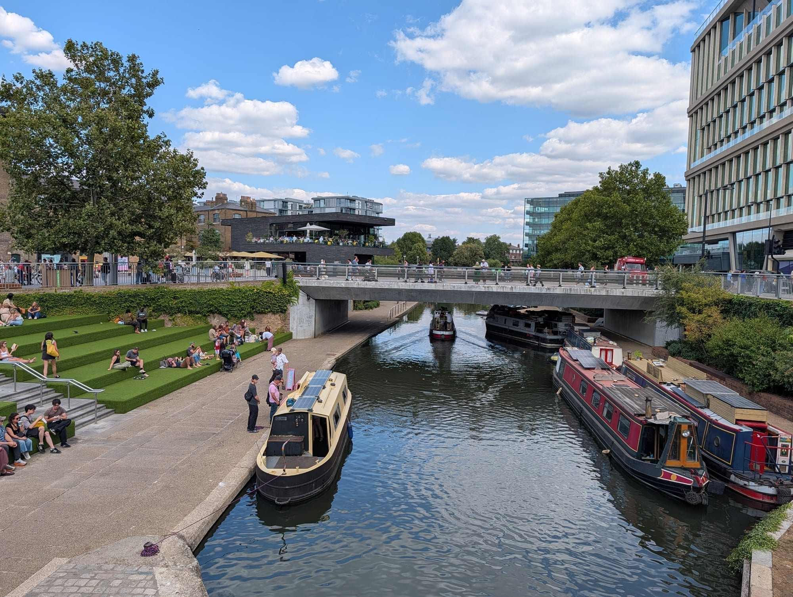
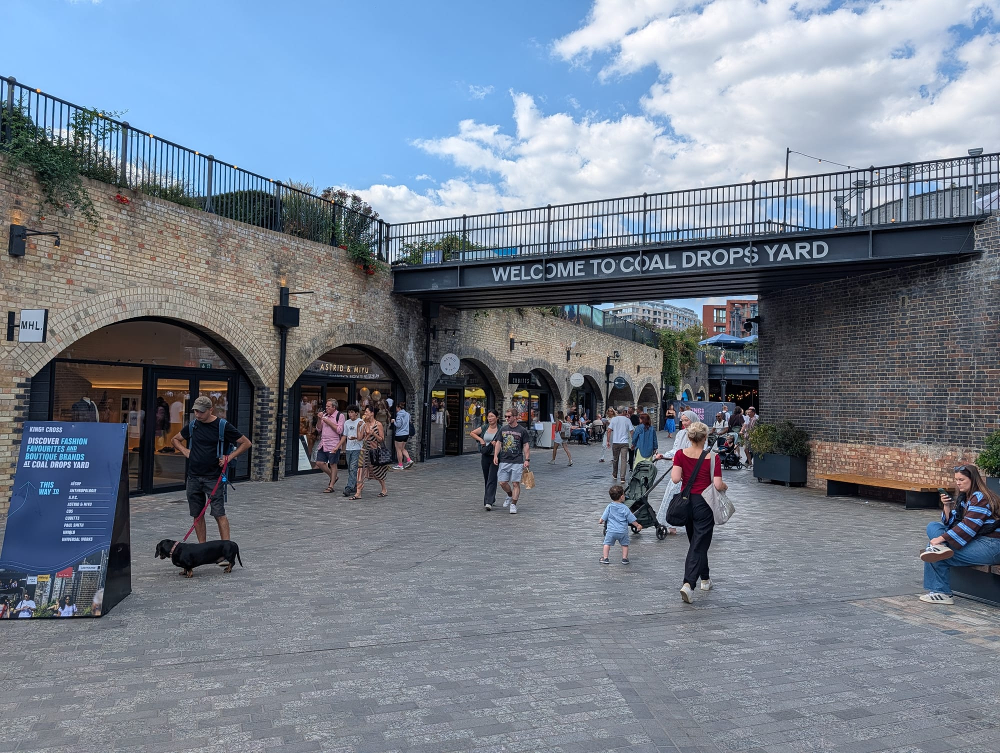
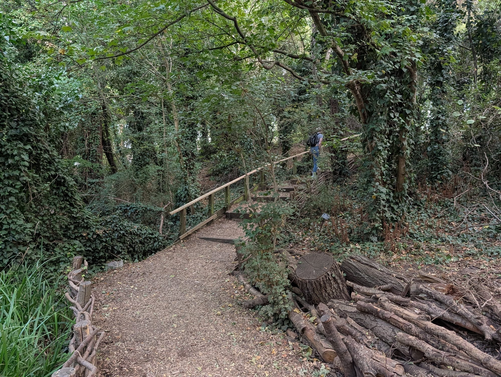
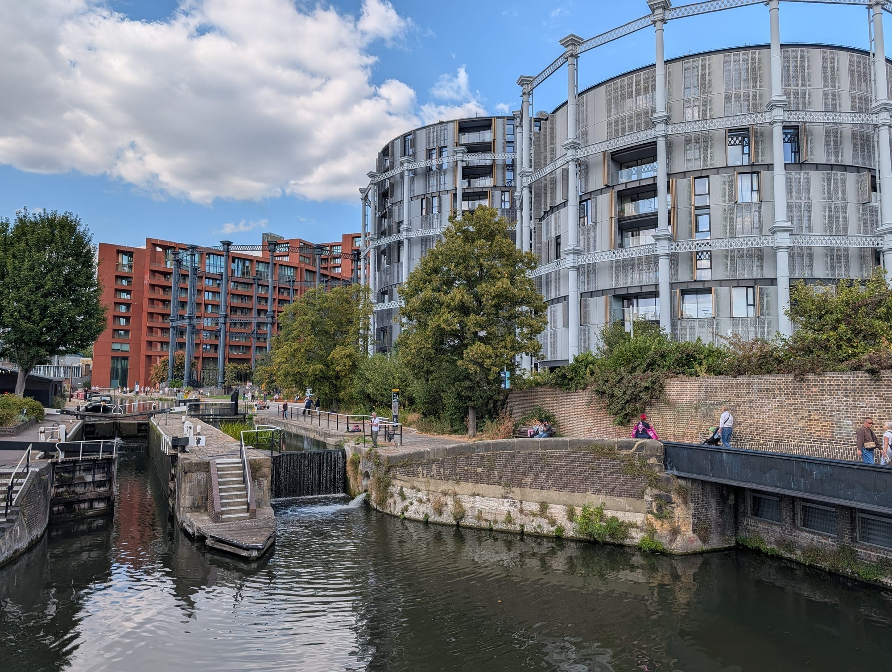
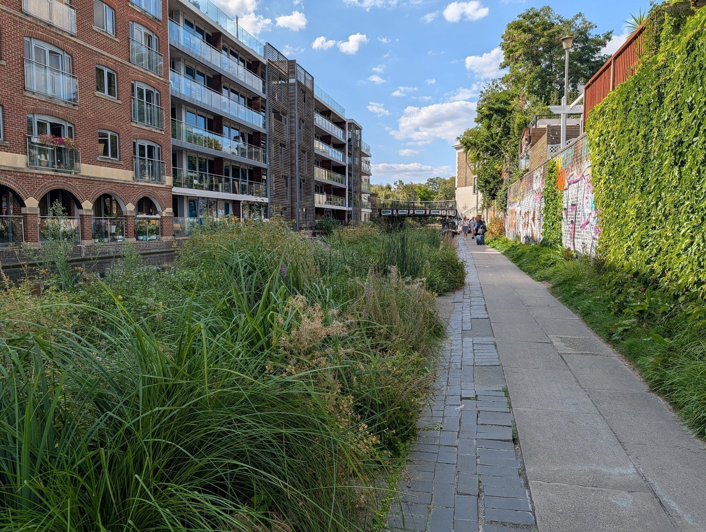
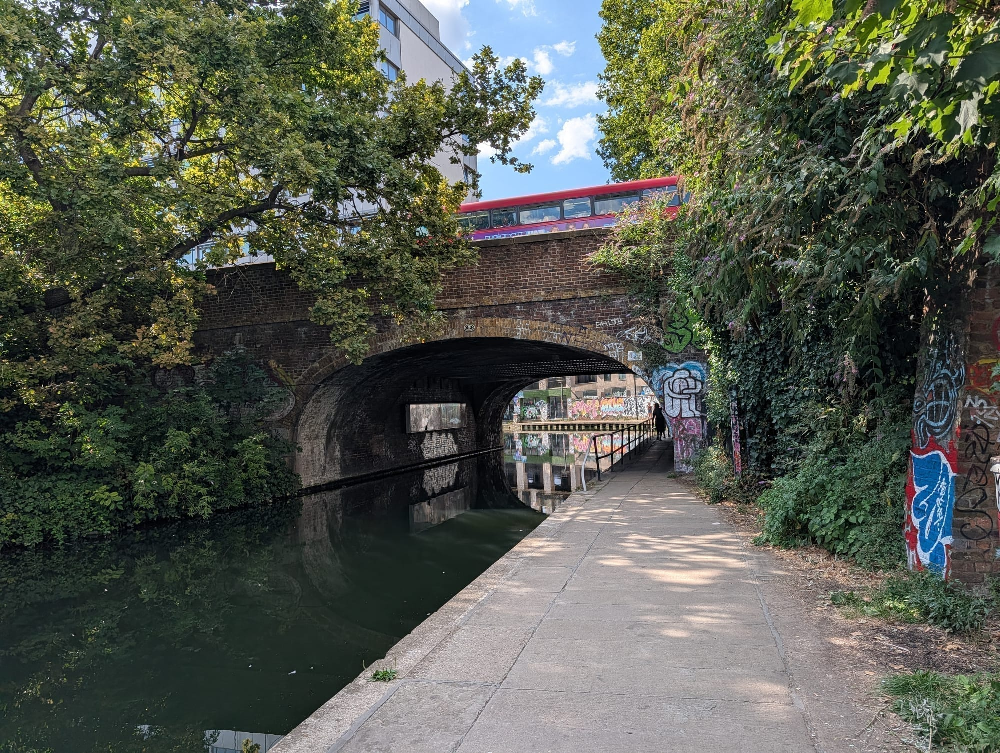
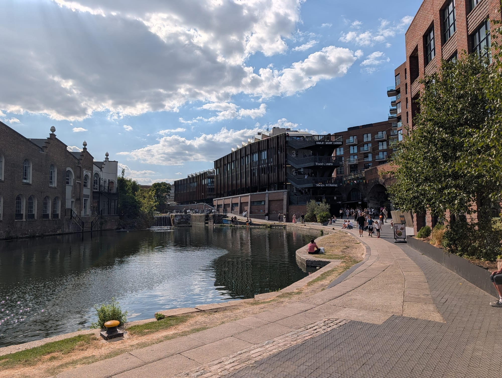

The alternative to the Northern line is a flat, free towpath that passes a nature reserve, three working locks and a Victorian gasholder with a lawn inside it.

**This walk goes east to west**, from Granary Square to Camden Market: ten numbered stops over about **1.5 miles**, of which **1.2 miles is towpath**. It takes about **an hour** with stops, or twenty-five minutes straight through.

East to west puts the built end first, the empty stretch in the middle, and the locks and the market, with food, at the finish.

For the areas at either end, see the [King's Cross area guide](/articles/kings-cross-area-guide/) and the [Camden area guide](/articles/camden-area-guide/).

> 💡 **The Short Version:** Start at **Granary Square** and finish at **Camden Market**. The one stop with a clock on it is **Camley Street Natural Park** — free, on the far bank, and it shuts at **4pm from October to March**. **Camden Market runs 10am to 7pm every day**, bank holidays included. If you want to see a lock actually working, come **before 3.30pm**: Camden's three locks are closed to boats from 3.30pm to 9am because of the drought. And there is a fenced-off stretch of towpath near Camley Street with a **floating pontoon** round it — you do not need a diversion.

## The route

  

    Map of the walk, numbered in walking order
  

  

    
Loading the map…

  

  

    <i class="route-map-marker" aria-hidden="true">1</i> On the route, in walking order
    <i class="route-map-marker route-map-marker--alt" aria-hidden="true">+</i> Optional detour
  

  <noscript>
    
The map needs JavaScript. Every stop below is numbered in walking order with its nearest station.

  </noscript>

**[Open the whole route in Google Maps →](https://www.google.com/maps/dir/?api=1&origin=51.535238,-0.125401&destination=51.542309,-0.147946&waypoints=51.535798,-0.126666%7C51.534970,-0.127094%7C51.536211,-0.127826%7C51.538251,-0.131996%7C51.541035,-0.140200%7C51.541589,-0.142431%7C51.541665,-0.143980%7C51.541117,-0.145725&travelmode=walking)** — all ten stops in walking order, set to walking directions, which is the version to put on your phone.

| # | Stop | Cost | Open |
| --- | --- | --- | --- |
| **1** | Granary Square | Free | Always; fountains in daylight |
| **2** | Coal Drops Yard & Bagley Walk | Free | Yard 10am–11pm; shops from 11am |
| **3** | Camley Street Natural Park | **Free** | **10am–5pm, 4pm in winter** |
| **4** | St Pancras Lock & the gasholders | Free | Always |
| **5** | The quiet mile | Free | Always |
| **6** | Camden Street bridge | Free | Always |
| **7** | Kentish Town Road Lock | Free | Always |
| **8** | Hawley Lock & Hawley Wharf | Free to walk | Food halls 11.30am–11pm |
| **9** | Camden Lock | Free | Always |
| **10** | Camden Market & the Stables | Free | **10am–7pm daily** |
| **+** | Word on the Water | Free to browse | Midday–7pm daily |

---

## 1. Granary Square

*The steps below Granary Square.*

**This was a canal basin**, where barges unloaded goods for the rest of London.

The square has **more than 1,000 fountains** set flush into the paving. They are **open daily and run during daylight hours**, and free to play in. Townshend Landscape Architects designed the square.

**Go down the steps to the water.** The wide stone terraces on the north side of the square drop straight onto the towpath and face west, so they fill on a warm evening.

> 💡 **If you came by Tube, come up through the tunnel.** The **King's Cross Tunnel** runs 90 metres under the road from the stations to King's Boulevard, with an LED art wall along one side. It is free and **open 7am to 8pm daily**, so it works on the way there and not on the way back from a late train.

## 2. Coal Drops Yard and Bagley Walk

*Coal Drops Yard, under the old viaduct.*

**Coal stores under a railway viaduct, now shops**, with two warehouse roofs extended until they meet in the middle. **You can get into the yard directly from the towpath**, and there is a ramp down to the water behind The Lighterman.

**The yard is open to visitors 10am to 11pm.** The shops keep shorter hours: **Monday to Saturday 11am to 7pm, Sunday 11am to 5pm.**

**Bagley Walk** is an elevated park on the old railway viaduct, curving along the canal with Camley Street Natural Park on one side and Coal Drops Yard on the other. It runs from Somers Town Bridge past the Fish and Coal Building, now Tom Dixon's headquarters and the Coal Office restaurant, and slopes down to Granary Square.

Powered by <a target="_blank" rel="sponsored" href="https://www.getyourguide.com/london-l57/">GetYourGuide</a>

## 3. Camley Street Natural Park

*Camley Street Natural Park.*

**Two acres of woodland, marsh and pond on the far bank.** It is a Local Nature Reserve run by London Wildlife Trust, on the site of a former coal drop.

**Cross at Somers Town Bridge**, the footbridge from the towpath to Camley Street, which gives a view of St Pancras Lock on the way over.

Kingfisher, Cetti's warbler, reed warbler, reed bunting, emperor dragonfly and common toad have all been recorded here. The Trust has also floated **reedbeds into the canal** along this stretch, visible from the towpath.

Inside there is a visitor centre, accessible toilets, baby-changing and the **Kingfisher Café**, which keeps the reserve's hours.

> ⚠️ **This is the one stop with a clock on it.** It opens **10am to 5pm April to September** and **10am to 4pm October to March**, every day. **Assistance dogs only**, so plan ahead if you are setting out with one.

Underfoot: the main path down to the pond dipping platform has an accessible surface; the rest of the reserve is woodchip, and there are **steep steps with handrails** at the southern end.

## 4. St Pancras Lock and the gasholders

*St Pancras Lock and the gasholders.*

Back on the towpath and a working lock, with the **St Pancras Cruising Club** immediately beyond it. You can stand at the balance beam and look straight down into the chamber.

Behind it, the cast-iron **gasholder frames**, restored and re-erected here. Three wrap around a circular apartment building. The fourth is **Gasholder Park**, and it is free: the frame of **Gasholder No. 8**, the largest of the King's Cross holders, which once held **1.1 million cubic feet of gas** and now encases a sculpted canopy and a circular lawn.

It is a few steps up off the towpath and takes four minutes.

## 5. The quiet mile

*The quiet mile.*

**From here to Camden there is nothing to buy.** The canal runs behind moored boats, small gardens, an estate or two, and a run of bridges where the path goes dark and cold for a few seconds.

The moorings here are eco-moorings with electric power bollards, so boats plug in rather than run a diesel generator.

There is no tunnel on this section and no road to cross: the towpath is unbroken from Granary Square to Camden Lock.

> ⚠️ **There is a fenced-off stretch just past Camley Street, and you can still walk it.** The Canal & River Trust has closed about **35 metres** of towpath north-west of the Camley Street access, from **1 July 2026 to 4 January 2027**, for a new footbridge over the canal. A **three-metre-wide pontoon** floated alongside the closed path means you carry straight on. **From January 2027 the bridge deck goes in over the water under a six-week winter stoppage**; check the [Trust's notices](https://canalrivertrust.org.uk/notices) before you travel after Christmas.

## 6. Camden Street bridge

*Camden Street bridge.*

**This is where the walk changes.** The bridges come every couple of hundred metres, the walls get painted, and the noise comes back.

It is also the **easiest place to cut the walk short**: Camden Road Overground is a couple of minutes up from the towpath. If you carry on, about **seven minutes of walking** remain to Camden Lock.

## 7. Kentish Town Road Lock

The first of Camden's three locks, with room to stand and watch.

The Canal & River Trust numbers them **downwards** as you walk west: this is **Lock 3**, Hawley is Lock 2, and Camden Lock is Lock 1. All three sit inside **300 metres**, so walking is quicker than floating.

> ⚠️ **Come before 3.30pm if you want to see a lock work.** Because of the drought, the Trust has closed **all three Camden locks to boats between 3.30pm and 9am**, ongoing since 26 August 2026 and under review from 24 September.

## 8. Hawley Lock and Hawley Wharf

*Hawley Wharf from the towpath.*

Lock 2, with **Hawley Wharf** stacked above it on Chalk Farm Road, the newest quarter of Camden Market.

**The food halls run 11.30am to 11pm, seven days, bank holidays included.** The retail units keep shorter and stranger hours: **noon to 6pm Monday to Wednesday, 11am to 6pm Thursday, 11am to 7pm Friday and Saturday, 11am to 6pm Sunday.**

If you arrive at seven and the market is shut, this is where the day carries on.

Powered by <a target="_blank" rel="sponsored" href="https://www.getyourguide.com/london-l57/">GetYourGuide</a>

## 9. Camden Lock

*Camden Lock.*

**Strictly, this is Hampstead Road Lock**, and it is **two chambers side by side**, which the Canal & River Trust calls 1A and 1B.

It is the busiest stretch of canal on this walk: the market crowds cross the bridge above you and the boats queue below.

> ⚠️ **A boat through here is slower than it looks.** One of the paddles at Lock 1B has been chained off since April, so the lock takes longer to fill.

## 10. Camden Market and the Stables

*Camden Market's umbrella alley.*

**Open 10am to 7pm, Monday to Sunday, bank holidays included.** Individual traders set their own hours, so the edges of the day are thinner than the middle.

**On Thursdays it runs a Night Market**, with traders open until **9pm**.

Keep going north-west up Chalk Farm Road for the **Stables**, the largest of the markets: a former network of saddlers' workshops, tack rooms, stables and a horse hospital, with the listed cobbled yards still in place.

The [Camden area guide](/articles/camden-area-guide/) breaks the five markets apart and says which is which.

---

## The detour: Word on the Water

**Word on the Water is a bookshop on a barge**, moored on the towpath between Granary Square and the York Way bridge, so it is **east** of where this walk starts.

It is **free to browse and open midday to 7pm, every day except Christmas Day**, so an early start misses it.

Visit it first, before you turn west; it is ten minutes there and back.

## Where to eat

**Eat at one end or the other**: between Camley Street and Camden there is the best part of a mile of towpath with no café, shop or pub.

**At the King's Cross end.** Coal Drops Yard's restaurants and the Granary Square terraces, or the **Kingfisher Café** inside Camley Street Natural Park, which does coffee, cake and bagels outdoors and keeps the reserve's hours: 10am to 5pm in summer, 10am to 4pm in winter.

**At the Camden end.** The food stalls around Camden Lock run on the market's hours, **10am to 7pm daily**. Later, **Hawley Wharf's food halls go to 11pm**, seven days.

## The best day to go

**Any day: there is no closed day on this route.**

| Day | What you get |
| --- | --- |
| **Mon–Wed** | Everything open, market at its emptiest. Hawley Wharf's shops start at noon |
| **Thursday** | **Camden's Night Market runs to 9pm** |
| **Fri–Sat** | Market and food halls at full tilt. Towpath busy with cyclists |
| **Sunday** | Camden at its most crowded. Coal Drops Yard shuts at 5pm |
| **Bank holidays** | Camden Market and Hawley Wharf both open as normal |

**What sets the timing is the hour.** Three clocks apply:

- **Camley Street Natural Park** shuts at **4pm** from October to March, and it is stop three.
- **Camden's locks close to boats at 3.30pm** while the drought restriction holds, so a working lock is a morning sight.
- **Camden Market shuts at 7pm** — but Hawley Wharf runs to 11pm, so the day does not end there.

**Start at 10am** and everything lands on the right side of its clock. Start at 3pm in January and the towpath is dark and the reserve locked.

**On the season:** the fountains run in daylight hours, and the reserve's summer hours give you an extra one.

Powered by <a target="_blank" rel="sponsored" href="https://www.getyourguide.com/london-l57/">GetYourGuide</a>

## Getting there and back

**Start:** King's Cross St Pancras — Piccadilly, Victoria, Northern, Circle, Metropolitan and Hammersmith & City, plus both mainline stations. Follow signs for **Granary Square**, not King's Cross Square, or take the light tunnel to King's Boulevard and walk north.

**Finish:** **Camden Town** (Northern) is five minutes from the market and very busy. **Chalk Farm** (Northern) is ten minutes and quieter. **Camden Road** (Overground) is eight minutes, and it is also the mid-route escape hatch at stop six.

The towpath is **flat and step-free the whole way**, with a ramp down to the water behind The Lighterman at the King's Cross end. The exception is stop three, where the park's paths are woodchip with steep steps at the southern end.

> ⚠️ **The towpath is shared.** Under the Trust's *Share the Space, Drop your Pace* code **pedestrians have priority**, cyclists must slow down for others, and e-scooters, motorbikes and modified e-bikes are not allowed. Dogs must be under close control and cleaned up after; the canal is unfenced, deep and steep-sided for the entire route.

Walked in reverse it still works, but it ends at a station, not a lunch.

## Carry on walking

- **[Hampstead Heath to Primrose Hill](/articles/hampstead-heath-primrose-hill-walk/)** — ends on Primrose Hill, a short walk from Camden.
- **[Baker Street to Marylebone through Regent's Park](/articles/regents-park-marylebone-walk/)** — Regent's Park is a short walk west of Camden along the canal.

## What to do with the rest of the day

- **[Where to stay in King's Cross](/articles/where-to-stay-kings-cross/)** — the walk starts on its doorstep.

- **[The King's Cross area guide](/articles/kings-cross-area-guide/)** — the British Library, Platform 9¾, Keystone Crescent and where to stay.
- **[The Camden area guide](/articles/camden-area-guide/)** — which of the five markets is which, the boat trips, and Primrose Hill.
- **[The best canal walks in London](/articles/best-canal-walks-london/)** — the other four sections of the Regent's Canal, including the two tunnels with no towpath.
- **[Free things to do in London](/free/)** — every stop on this walk costs nothing.
- **[The best areas to visit in London](/articles/best-areas-to-visit-london/)** — the neighbourhoods compared by what each is best for, how long it takes and the best day to go.
