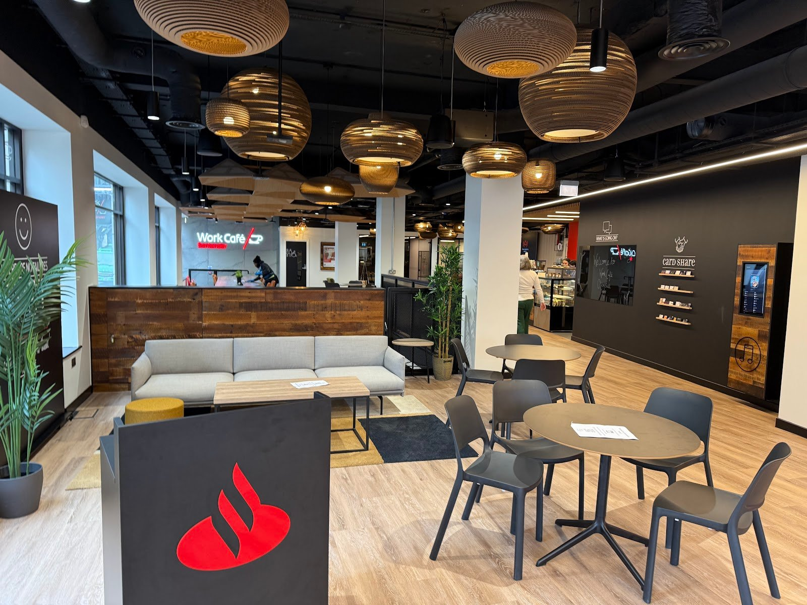
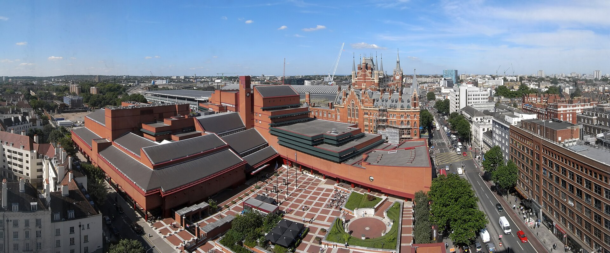
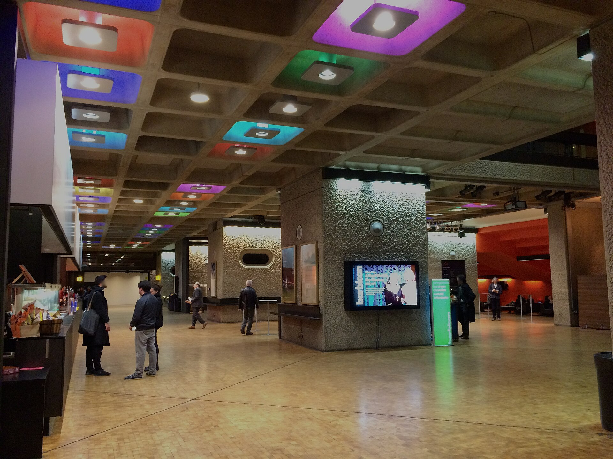
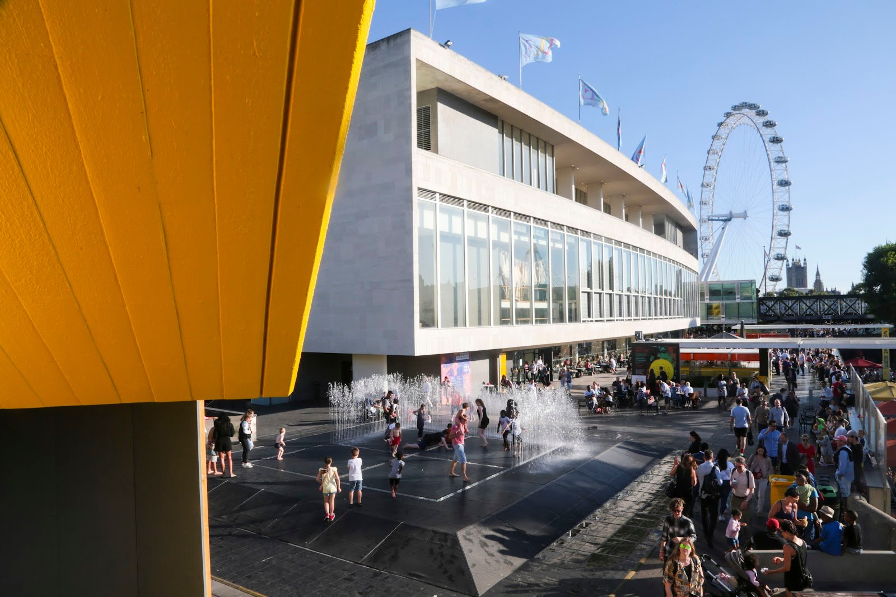
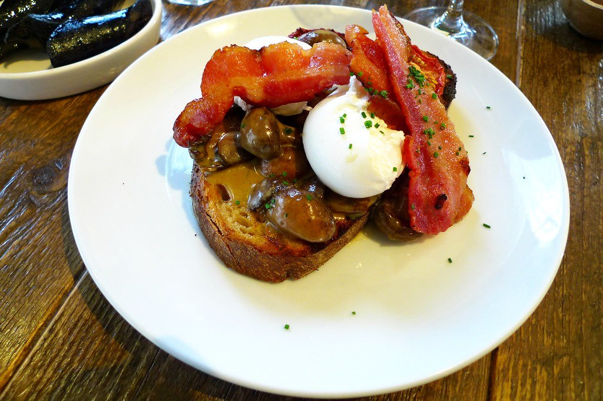
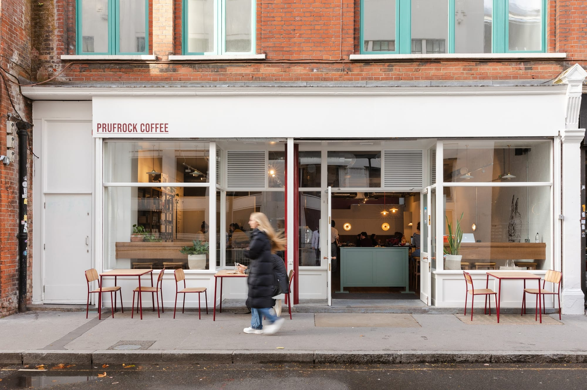
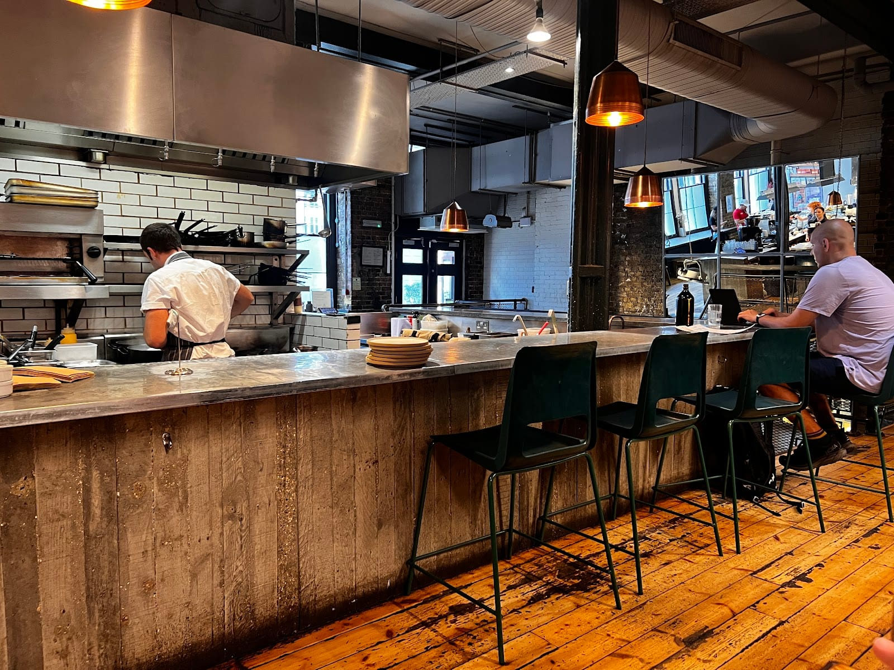

> 💡 **The Short Version:** The best free desks are not cafés. **[Santander Work Cafés](#santander-work-café-cheapside-and-triton-square)** at Cheapside and Triton Square have free Wi-Fi and co-working space open to anyone. The **[British Library](#british-library-st-pancras)** has free study spaces with plug sockets, and its Reading Rooms are open to anyone who gets a free Reader Pass in person. The **[Barbican](#barbican-centre-and-library)** is open to everyone until 11pm. For a café, **[Caravan at King's Cross](#caravan-kings-cross)** has long shared tables and serves until 10.30pm, and **[Ozone on Leonard Street](#ozone-coffee-roasters-shoreditch)** opens at 7.30am on weekdays. A few cafés ask you not to use a laptop at some tables, so [read the rules](#the-laptop-rules-you-will-meet) before you sit.

*Hours and policies are each venue's own as at 19 November 2026. Where a laptop rule comes from a recent report rather than the café itself, the text says so.*

## Where to work, by area

| If you are near… | Go to | Free? |
| --- | --- | --- |
| **The City (Bank, St Paul's, Moorgate)** | Santander Work Café, Cheapside; Notes at Paternoster Square; Barbican | Work Café and Barbican, yes |
| **Euston and Regent's Place** | Santander Work Café, Triton Square | Yes |
| **King's Cross and St Pancras** | British Library; Caravan King's Cross | Library, yes |
| **Clerkenwell and Farringdon** | Prufrock, Leather Lane | Café |
| **Shoreditch and Old Street** | Ozone, Leonard Street | Café |
| **South Bank** | Royal Festival Hall, Southbank Centre | Yes |

## Free places to work first

### Santander Work Café, Cheapside and Triton Square

*Regina House, 69 Cheapside, EC2V 6AZ, and 2 Triton Square, NW1 3AN · weekdays only*

*Santander Work Café.*

A bank branch rebuilt as a working café, with **Ozone coffee on sale, free Wi-Fi and co-working space** that Santander says is open to anyone, banking customers or not. Santander says there is no time limit on how long you stay. The free meeting rooms are the part reserved for Santander and TSB customers, for up to two hours.

**Hours differ by site.** At Cheapside, Ozone serves from 8.30am to 3pm on Mondays and Fridays and to 4pm Tuesday to Thursday. At Triton Square, which is a short walk from Euston Square and Warren Street, the barista is there from 7.30am to 5pm Monday to Friday. Neither opens at weekends.

### British Library, St Pancras

*96 Euston Road, NW1 2DB · King's Cross St Pancras station next door*

There are two layers. The **free study spaces in the public part of the building have comfortable seats, power outlets and free Wi-Fi**, with no pass. The **Reading Rooms** upstairs are quieter and need a **Reader Pass**, which is free for anyone over 18.

**How to get a Reader Pass.** Go in person to Reader Registration at St Pancras and bring either one state-issued photo ID that shows your name and address, or two documents, one showing your name and one your home address. The pass lasts three years. The Library does not take online pre-registration, so allow time on your first visit. Guests need their own pass, and it is for over-18s only.

*The British Library and St Pancras. Photo: [Patche99z](https://commons.wikimedia.org/wiki/File:British_Library_%2B_St_Pancras_7527-31hug.jpg), [CC BY-SA 3.0](https://creativecommons.org/licenses/by-sa/3.0/), via Wikimedia Commons.*

**Hours.** The building is open Monday to Thursday 9.30am to 8pm, Friday 9.30am to 6pm, Saturday 9.30am to 5pm and Sunday 11am to 5pm. The Reading Rooms run Monday 10am to 8pm, Tuesday to Thursday 9.30am to 8pm, and Friday and Saturday 9.30am to 5pm, and are closed on Sundays. The St Pancras site closes on Saturday 12 and Sunday 13 December 2026. The Library lists [its current hours and passes](https://www.bl.uk/visit) on its own site.

### Barbican Centre and library

*Silk Street, EC2Y 8DS · Moorgate or Barbican*

The Barbican says its building and foyers are **open to everyone**, and it lists studying among the things people do there. They open Monday to Friday 8am to 11pm, Saturday and Sunday 9am to 11pm, and bank holidays 11am to 11pm, which makes this the latest free desk in the City.

*Inside the Barbican Centre. Photo: [Kleon3](https://commons.wikimedia.org/wiki/File:London,_Barbican_Arts_Centre08.JPG), [CC BY-SA 4.0](https://creativecommons.org/licenses/by-sa/4.0/), via Wikimedia Commons.*

The **Barbican Library**, on Level 2, has free Wi-Fi and places to sit, read and study. It opens Monday, Wednesday and Friday 9.30am to 5.30pm, Tuesday and Thursday 9.30am to 7.30pm and Saturday 9.30am to 4pm, and it is closed on Sundays. More on the building is in our [Barbican guide](/articles/barbican-centre-guide/).

### Royal Festival Hall, Southbank Centre

*Belvedere Road, SE1 8XX · Waterloo*

*Royal Festival Hall, Southbank Centre.*

The South Bank's own [guide to out-of-office work spots](https://southbank.london/guides/best-out-of-office-work-spots) lists **dedicated laptop counters** inside the Royal Festival Hall, between the Festival Bar & Kitchen and the Ballroom and box office, and says they are built for laptop work and meetings. Check opening times for your day on the Southbank Centre's site before a long session, as they vary with the programme.

## Cafés, by area

### Caravan, King's Cross

*1 Granary Square, N1C 4AA · Mon to Fri 8am to 10.30pm, Sat 9am to 10.30pm, Sun 9am to 9.30pm*

*Caravan, King's Cross.*

An all-day restaurant and roastery in the Grade II-listed Grainstore on Granary Square. London x London named it the best café for a long session in September 2026 for its **long communal tables**. It is a restaurant first, so order a meal as well as coffee if you stay for hours. The terrace tables on the square are walk-in only, and the later closing time makes it one of the few places here that works after the office day. It sits between the [King's Cross](/articles/kings-cross-area-guide/) canal and Coal Drops Yard. Caravan's original on Exmouth Market is in our [coffee guide](/articles/best-coffee-london/#caravan-clerkenwell).

### Prufrock Coffee, Clerkenwell

*23-25 Leather Lane, EC1N 7TE · Mon to Fri 7.30am to 4.30pm, Sat 8am to 5pm, Sun 9am to 5pm*

*Prufrock Coffee, Clerkenwell.*

On Leather Lane since 2011, and named in Time Out's best UK coffee shops for 2026, according to London x London. London x London says to **sit in the front window**, and warns that the back of the room is Prufrock's barista training space, which closes off when a course is running. That is the one thing that can end a session early. Prufrock also has an entry in our [coffee guide](/articles/best-coffee-london/#prufrock-coffee-clerkenwell).

### Ozone Coffee Roasters, Shoreditch

*11 Leonard Street, EC2A 4AQ · Mon to Fri 7.30am to 4pm, Sat and Sun 8.30am to 4pm*

*Ozone Coffee Roasters, Shoreditch.*

A roastery café just off Old Street roundabout, with a kitchen serving breakfast and lunch seven days a week. **Weekends are walk-in only and brunch fills up fast**, which is when a laptop is least welcome. London x London recommends the basement dining room rather than the ground floor. Ozone also supplies the coffee at the Santander Work Cafés above. See [Ozone in the coffee guide](/articles/best-coffee-london/#ozone-coffee-roasters-shoreditch) and the [Shoreditch guide](/articles/shoreditch-area-guide/).

### Notes Coffee Roasters, St Paul's

*1 Paternoster Square, EC4M 7DX · Mon 8am to 5pm, Tue to Thu 7am to 9pm, Fri 8am to 6pm, Sat 9am to 6pm, Sun 9am to 5pm*

Notes has more than a dozen London sites, and **several are kiosks with no seating**. London x London picks Paternoster Square, by the cathedral, as one of the two big enough to absorb a laptop session. It is also one of the few cafés here that stays open until 9pm on three weekday evenings. See the [City of London guide](/articles/city-of-london-area-guide/) for what is nearby.

## The laptop rules you will meet

Cafés now set their own, and a few publish them.

- **WatchHouse, Battersea Power Station.** The café's own page says: "We kindly ask that laptops are only used at the bar in this House." Staff can show you to laptop-friendly seats. WatchHouse publishes its policy on each location's page, and other sites carry no such notice, so check the page for the one you are visiting.
- **Lumberjack, Camberwell.** London x London reported in September 2026 that the café has put no-laptop signs on roughly half its tables since 2025, and that power sockets are limited wherever you sit.
- **The Attendant, Fitzrovia.** The converted Victorian toilet on Foley Street is in our [coffee guide](/articles/best-coffee-london/#the-attendant-fitzrovia). London x London calls it a poor place to work, with cramped bench seating and almost no table surface.
- **Evenings at Grind.** London x London says the Grind bars turn into cocktail rooms in the evening, so work from them in the day only.

## Making it work

- **Arrive in the morning.** The pressure on tables is at lunch, and the cafés above mostly close by 4 or 5pm.
- **Buy something every ninety minutes**, as London x London advises, and take calls outside.
- **Do not count on a socket.** Most independents have only a few, so arrive charged.
- **Nearby, if you are planning around work.** The [King's Cross](/articles/kings-cross-area-guide/), [City of London](/articles/city-of-london-area-guide/) and [South Bank](/articles/south-bank-area-guide/) area guides cover where to stay and eat, and the [best coffee guide](/articles/best-coffee-london/) covers the independent roasters.
