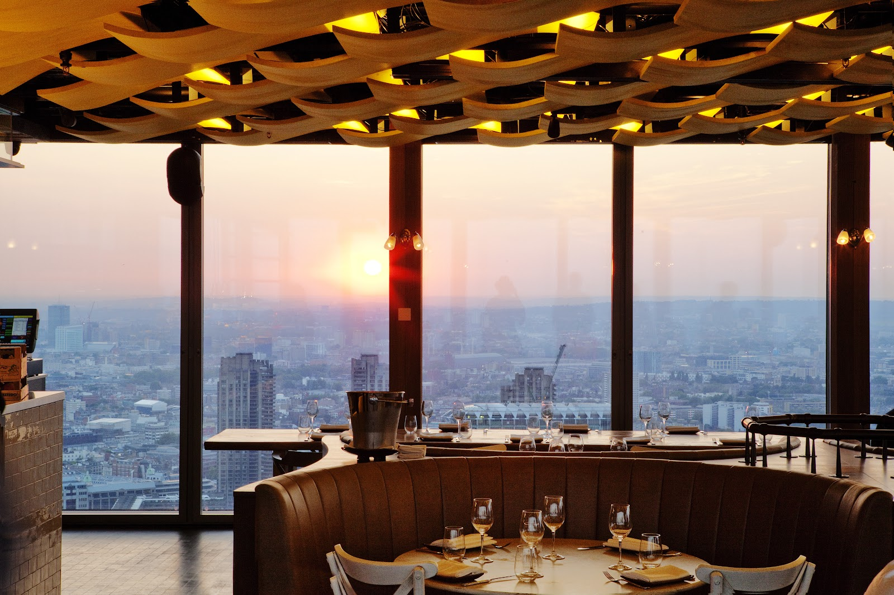
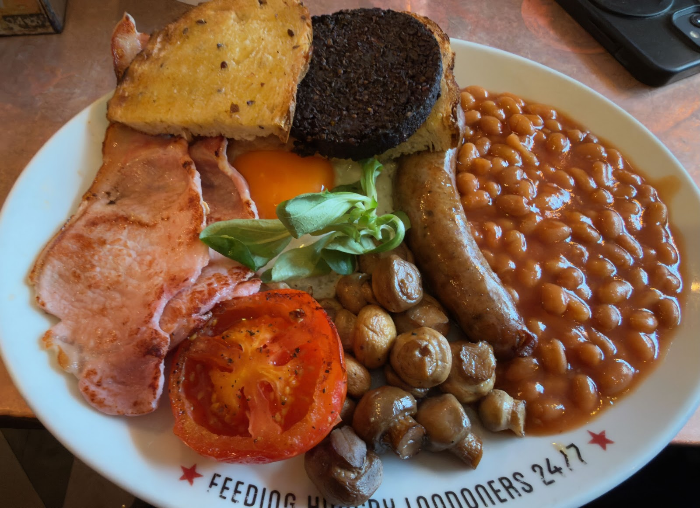
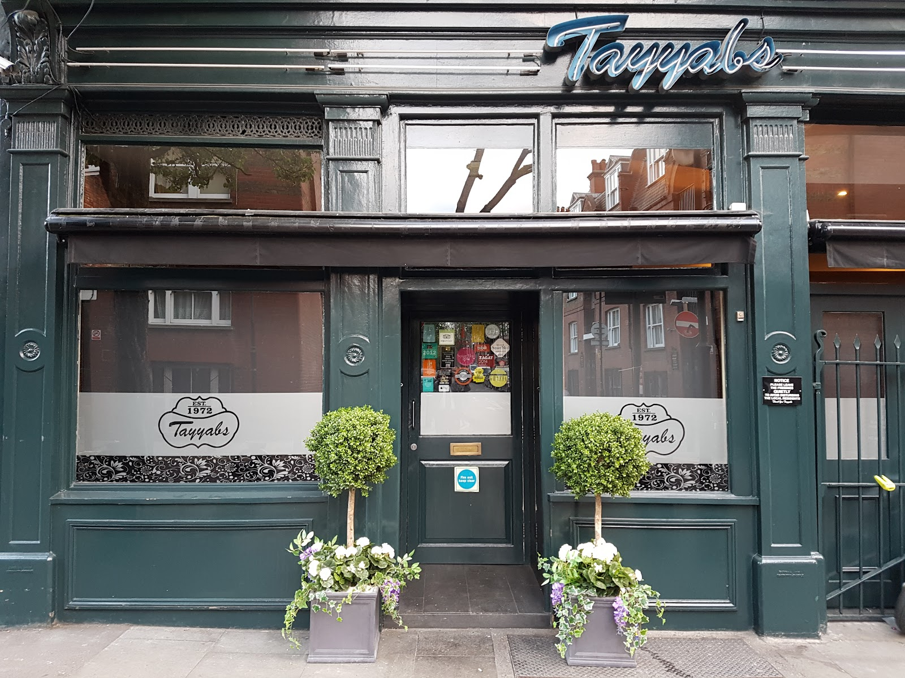
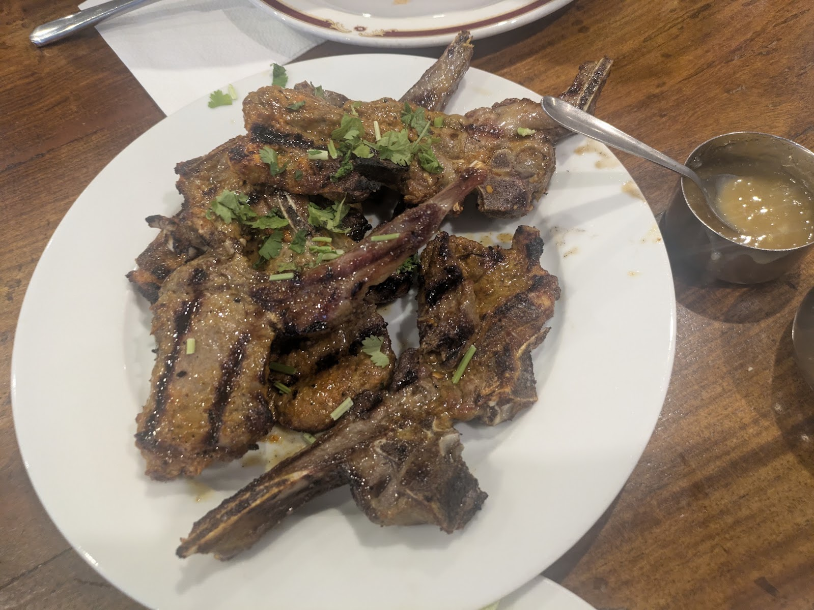
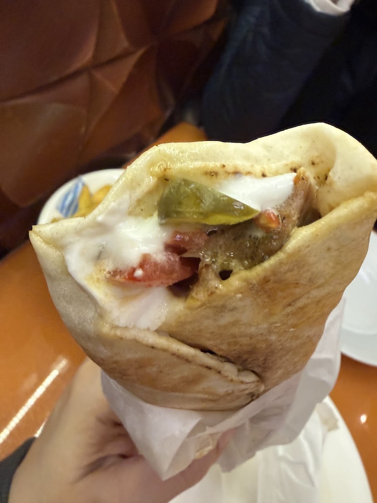
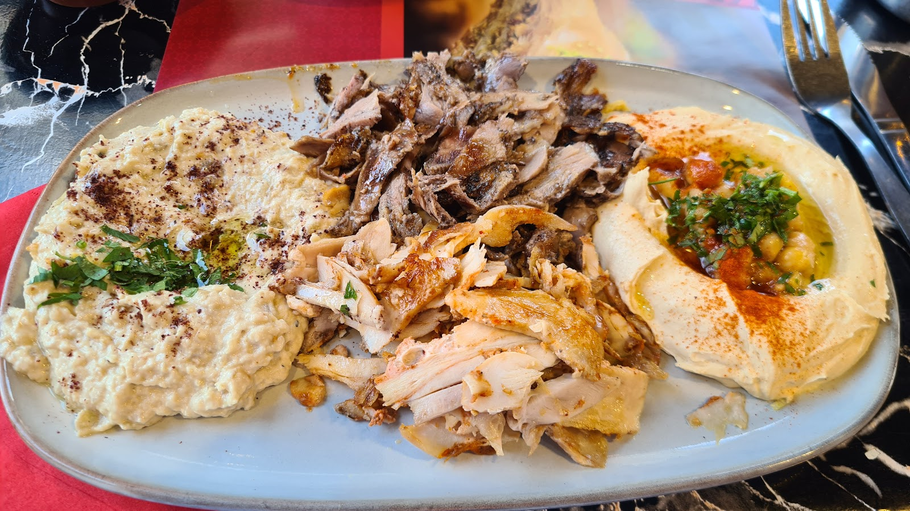
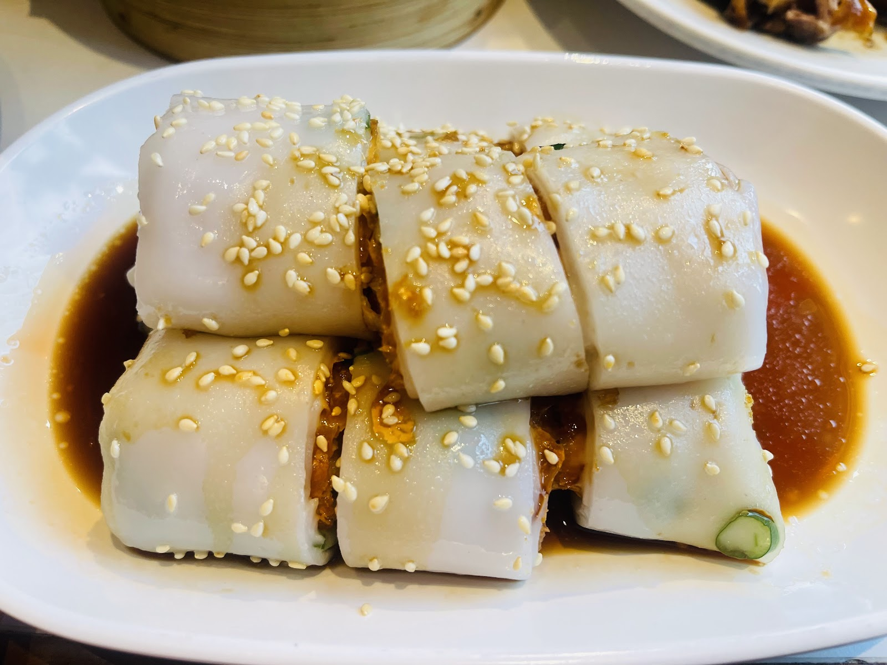
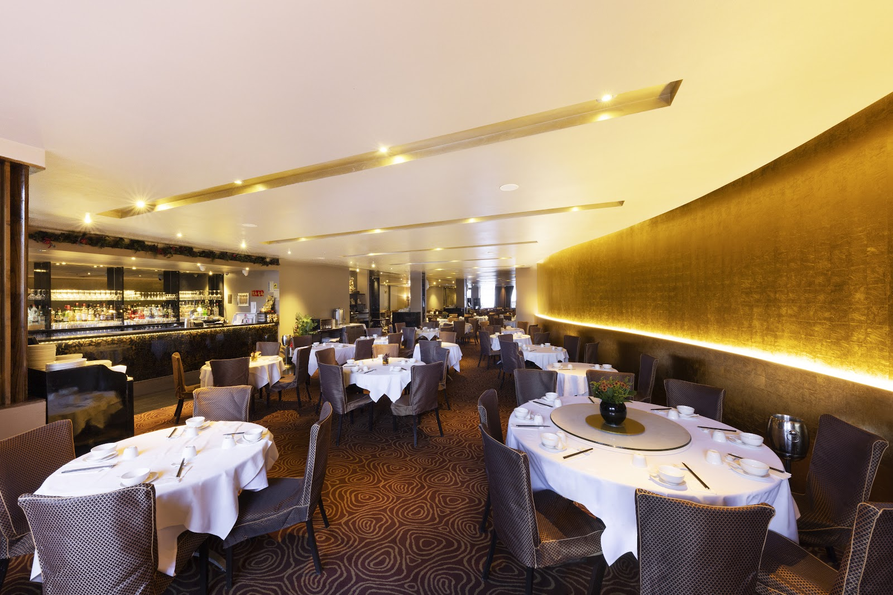

Most London kitchens stop at 10pm, and by midnight the options narrow to a handful of places.

> 💡 **The Short Version:** **Duck & Waffle** is open 24 hours, forty floors up. **The Polo Bar** has traded 24 hours since 1953 and has no front door to shut. **Tayyabs** in Whitechapel serves lamb chops until 11.30pm. **Ranoush** on Edgware Road is a £10 shawarma. **Voodoo Ray's** sells pizza by the slice until 2am on Fridays and Saturdays.

> 📘 **How we choose these (editorial note).**
> No paid placements. These are drawn from the food and travel press, listings sites, independent blogs, video and what Londoners recommend, and cross-referenced. Late-night hours change often, so confirm before crossing London at 1am.

## Where they are

  

    Map of the late-night eating in London
  

  

    
Loading the interactive map…

  

  

    <i class="restaurant-map-key restaurant-map-key--editorial" aria-hidden="true"></i> Recommended in this guide
    <i class="restaurant-map-key restaurant-map-key--streetfood" aria-hidden="true"></i> Counter & market stall
  

  <noscript>
    
The interactive map requires JavaScript. Every entry below lists its area.

  </noscript>

| If you are near… | Where to eat |
| --- | --- |
| **The City & Liverpool Street** | Duck & Waffle, Polo Bar |
| **Whitechapel** | Tayyabs, Original Lahore Kebab House |
| **Edgware Road** | Ranoush Juice, Cafe Helen |
| **Chinatown** | Joy King Lau |
| **Dalston** | Voodoo Ray's |
| **Marylebone** | Royal China |

**Price guide:** **£** under £15 · **££** £15–£30 · **£££** £35–£55 · **££££** £70+.

---

## Actually 24 hours

### Duck & Waffle, City of London

*££££ · 3 min from Liverpool Street · never closes*

Forty floors up in the Heron Tower and **open 24 hours, every day**.

*Duck & Waffle, fortieth floor.*

The signature dish — confit duck leg, fried duck egg and mustard maple syrup on a waffle — is **£26**.

**Book even at 2am.** Reservations open up to two months ahead and walk-ins are not guaranteed. **Card only, no cash**; the dress code is smart casual.

**110 Bishopsgate, EC2N 4AY**, three minutes from Liverpool Street. Trains stop long before the restaurant does, so plan the journey home before you go up.

### Polo Bar, Liverpool Street

*££ · no front door*

Open 24 hours since 1953, run by the same family, and **it has no front door**. On Christmas Day a sheet of plywood goes over the entrance.

**This is the cheap 24-hour option**, four minutes from Duck & Waffle. A fry-up here costs a fraction of a plate forty floors up.

*Polo Bar's fry-up.*

**It is a caff:** Formica, a counter and no bookings.

**176 Bishopsgate, EC2M 4NQ**, directly beside Liverpool Street station.

---

## Whitechapel

### Tayyabs, Whitechapel

*££ · 7 min from Whitechapel · walk-in only*

The **sizzling lamb chops** are the reason the queue forms outside before service. Trading since 1972, loud and packed.

*Tayyabs, before service.*

**Bring your own alcohol**: no licence, little corkage.

> ⚠️ **Tayyabs closes at 11.30pm.** After midnight, go to Beigel Bake or Edgware Road.

**No bookings for small groups at peak**, so expect to queue on the pavement. **83 Fieldgate Street, E1 1JU**, seven minutes from Whitechapel.

### Original Lahore Kebab House, Whitechapel

*££ · since 1972*

Lamb chops, dry lamb curry and chicken karahi in a plain room of strip lights and hard chairs, open since 1972.

*Original Lahore's lamb chops.*

**It is two minutes from Tayyabs**; walk to whichever has the shorter queue.

**Bring your own alcohol here too.**

**It runs later than Tayyabs.** Umberston Street, E1, about eight minutes from Whitechapel or Aldgate East.

---

Powered by <a target="_blank" rel="sponsored" href="https://www.getyourguide.com/london-l57/">GetYourGuide</a>

## Edgware Road

### Ranoush Juice, Edgware Road

*£ · 4 min from Marble Arch*

Mostly takeaway. The **chicken shawarma wrap** — garlic sauce, pickles, carved off the vertical spit to order — is what the queue out of the door late on a weekend is for.

*Ranoush's chicken shawarma.*

**There are a handful of seats;** it is a counter you order at and walk away from.

**43 Edgware Road, W2 2JR**, four minutes from Marble Arch, and Marble Arch is on the Central line, which runs all night on Fridays and Saturdays.

### Cafe Helen, Edgware Road

*££ · 6 min from Marble Arch*

An Edgware Road institution that trades late; the room fills as the rest of the street winds down.

Lebanese grills, mezze and mixed plates, plus the shisha terrace that keeps the pavement busy in warm weather.

*Cafe Helen's mixed grill.*

**Come here for a table at 1am** rather than a wrap from Ranoush a few doors along.

**105a Edgware Road, W2 2HX**, six minutes from Marble Arch. No bookings; you take a table when one goes.

---

## Late dim sum and pizza

### Joy King Lau, Chinatown

*££ · off Leicester Square*

Four floors of **dim sum ordered from a paper sheet with a pencil**, and one of the few Chinatown rooms still going late.

Order **har gau, siu mai and cheung fun**.

*Cheung fun at Joy King Lau.*

**3 Leicester Street, WC2H 7BL**, two minutes from Leicester Square, close to the West End theatres.

### Royal China, Marylebone

*£££ · Baker Street*

A large, formal dim sum room on Baker Street that stays open later than most.

*Royal China's dining room.*

**It is the expensive end of this page** and helps after 10pm when the alternatives have thinned out.

> ⚠️ **No bookings at weekend lunch**, its busiest service, so expect to queue. Evenings are easier.

**On Baker Street**, two minutes from the station, and the Jubilee and Bakerloo lines both run late from there.

### Voodoo Ray's, Dalston

*£ · pizza by the slice*

**New York-style slices**, sold by the slice.

*A slice at Voodoo Ray's.*

> ⚠️ **Open until 2am on Fridays and Saturdays only.** Hours: **Monday to Wednesday 5pm–10pm, Thursday 5pm–11pm, Friday 5pm–2am, Saturday 1pm–2am and Sunday 1pm–10pm.**

**E8 2PB in Dalston**, and Dalston Junction is on the Overground, which runs through the night on Fridays and Saturdays — the same two nights the pizza does.

---

## Best value after midnight

* **Beigel Bake**, Brick Lane — open **twenty-four hours**, salt beef beigel **£7.50**, smoked salmon **£4.50**.
* **Whitechapel and Edgware Road** are the two cheap late corridors. Grills, bakeries and sweet shops on both run well past midnight at daytime prices.
* **Chinatown** — the late noodle and roast-meat places are open past 1am and priced for the people who work in them.
* **Food halls.** **Seven Dials Market** trades to 11pm Wednesday to Saturday and **Arcade Food Hall** at Battersea to 11pm on Thursdays and Fridays, both with a dozen counters.

> ⚠️ **Mercato Metropolitano at Elephant & Castle trades only to the end of 2026** before the Borough Triangle redevelopment. It is open to midnight on Thursdays and 1am on Fridays and Saturdays.

---

Powered by <a target="_blank" rel="sponsored" href="https://www.getyourguide.com/london-l57/">GetYourGuide</a>

## What to know

* **Check before travelling.** Late opening hours change often.
* **The Night Tube runs Friday and Saturday only**, on the Victoria, Jubilee, Central, Northern, Piccadilly and Windrush lines. Night buses run every night and go further.
* **Tayyabs is BYO** and there is an off-licence nearby.
* **Duck & Waffle needs a booking** even in the middle of the night.

---

## Continue planning your London trip

- 🎺 **[EFG London Jazz Festival 2026](/articles/london-jazz-festival/)** — 13–22 November, and Ronnie Scott's puts a band on stage at midnight
- 🛡️ **[Is London Safe?](/articles/is-london-safe/)** — getting home at night, and who to call
- 💷 **[Cheap Eats in London](/articles/cheap-eats-london/)**
- 🎤 **[The Best Karaoke in London](/articles/best-karaoke-london/)** — Jihwaja in Vauxhall serves Korean food and karaoke until 3am at weekends
- 🍸 **[The Best Cocktail Bars in London](/articles/best-cocktail-bars-london/)**
- 🗝️ **[The Best Speakeasy Bars in London](/articles/best-speakeasy-bars-london/)**
- 🥟 **[The Best Dim Sum in London](/articles/best-dim-sum-london/)**
- 🚇 **[How to Use the London Underground](/articles/how-to-use-the-london-underground/)**
- 🍛 **[The Best Indian Restaurants in London](/articles/best-indian-restaurants-london/)**
- 🍜 **[Soho Area Guide](/articles/soho-area-guide/)**
