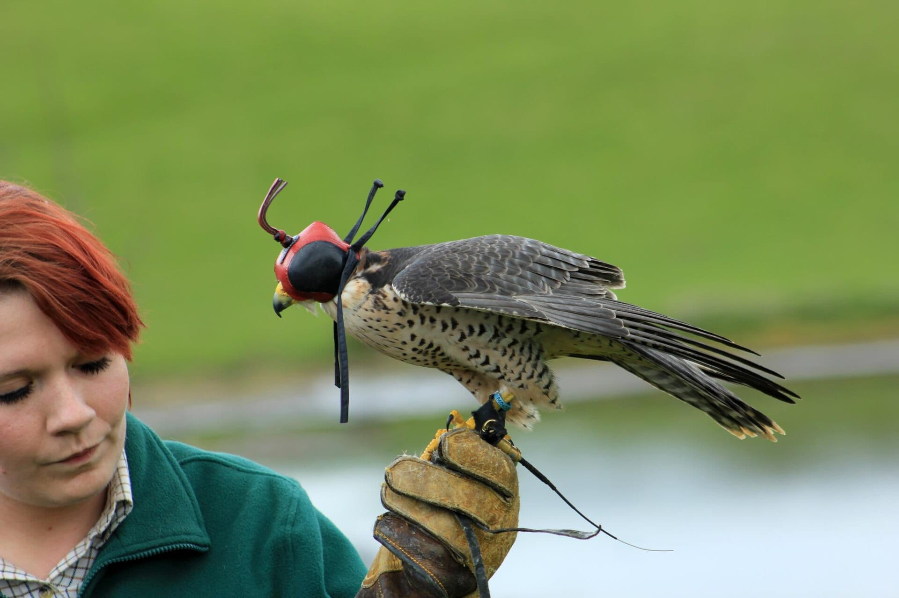
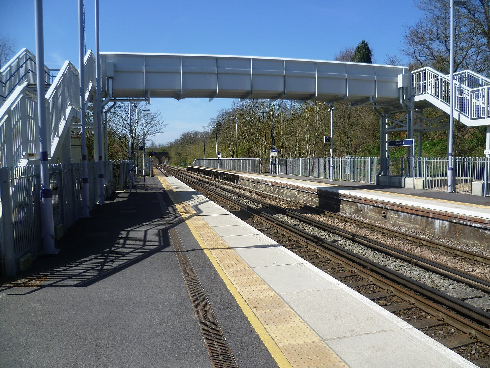
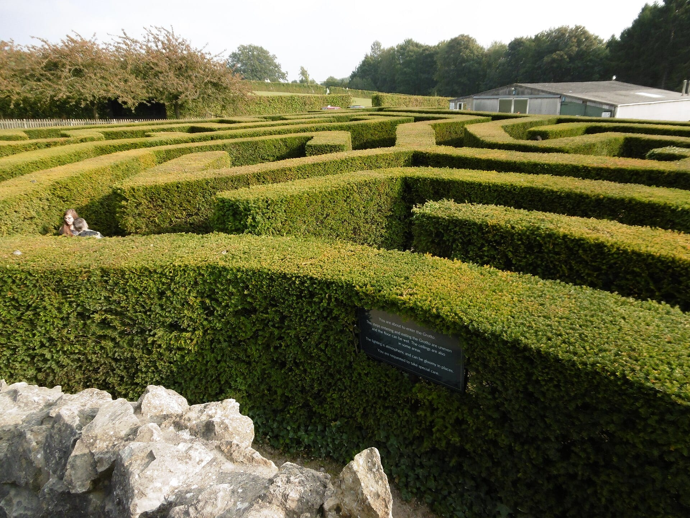
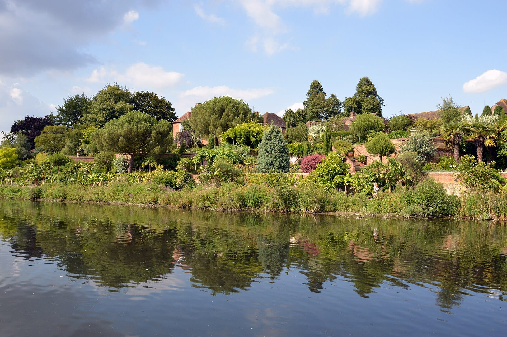

**Leeds Castle is in Kent, seven miles east of Maidstone, and an adult ticket is £34.50 booked online.** It has no railway station, so the choices are a coach tour from London, or the train to Bearsted or Hollingbourne and a short taxi.

> 💡 **The Short Version:** **Book a tour** if you also want Canterbury and Dover: **From London: Leeds Castle, Canterbury Cathedral & Dover** is **£105** for 10 hours (4.4 from 814 reviews), and the **Leeds Castle, Canterbury, Dover and Greenwich** tour is **£105** (4.7 from 125 reviews). A tour saves the train and the taxi, but leaves an hour or two at each stop. **On your own**, take the **train from Victoria to Bearsted (70 to 75 minutes)**, a **taxi of 5 minutes** and an **Explorer ticket at £34.50**, which is valid for a year. **Winter hours are short:** the Castle closes at 15:30 until 19 November and 15:00 after that.

> ⚠️ **Leeds Castle's winter closures catch people out.** The Castle is closed from 6 to 11 November 2026 and on 4 and 5 January 2027. From Monday 4 January to Thursday 11 February 2027 the castle and grounds open at weekends only, and everything is shut on Christmas Day.

## Opening hours

| Dates | Grounds | The Castle |
|---|---|---|
| 1 October to 19 November 2026 | 10:00 to 17:00, last entry 15:00 | 10:30 to 15:30, last entry 15:00 |
| 20 November 2026 to 3 January 2027 | 10:00 to 15:30, last entry 14:30 | 10:30 to 15:00, last entry 14:30 |
| 4 January to 11 February 2027 | Weekends only, 10:00 to 17:00 | Weekends only, 10:30 to 15:30 |
| 12 February to 21 March 2027 | 10:00 to 17:00, last entry 15:00 | 10:30 to 15:30, last entry 15:00 |

The main car park opens at 9:45. The Castle View restaurant serves from 11:30 to 14:30. Parking is included in the ticket.

## Tickets, and the one-year rule

| Ticket | Online | On the day |
|---|---|---|
| **Adult Explorer** | **£34.50** | £38.50 |
| Child, 3 to 15 | £24.50 | £28 |
| Family, 1 adult and up to 3 children | £87 | £97 |
| Family, 2 adults and up to 3 children | £115 | £128.50 |
| Adult Ultimate Explorer | £45.50 | £49.50 |
| Under 3 | Free | Free |

**An Explorer ticket is valid for multiple visits for one year from the date of issue.** Leeds Castle sells it as paying for a day and visiting free all year, so a second trip within 12 months costs nothing, and a castle closure doesn't waste it. The **Ultimate Explorer** adds six trips on the Black Swan Ferry or Elsie the Castle Train and one round of Adventure Golf. Tickets arrive by email and are exchanged for physical ones at the ticket office. Admission to anyone with a disability includes a free carer.

**Arriving by train, bus or bike takes 20% off admission** if you show a same-day ticket at the Visitor Centre, so a train ticket from London is worth showing. A cycle ride earns it too, and bikes stay at the stands in the car park.

*A hooded falcon at Leeds Castle. Photo: [Karen Roe](https://commons.wikimedia.org/wiki/File:Leeds_Castle_22-04-2012.jpg), [CC BY 2.0](https://creativecommons.org/licenses/by/2.0/).*

## Book a coach tour instead

Leeds Castle names Evan Evans, Golden Tours and Premium Tours as coach operators from London. GetYourGuide sells the common combination of Leeds Castle, Canterbury Cathedral and Dover, which tours do in about ten hours, with an hour or two at each stop.

| Tour | Price | Length | Rating | What the listing says |
|---|---|---|---|---|
| <a href="https://www.getyourguide.com/activity/-t2257?partner_id=WWP7I0R&amp;cmp=leeds-castle-day-trip" target="_blank" rel="sponsored nofollow noopener" data-affiliate="gyg">Leeds Castle, Canterbury Cathedral & Dover</a> | £105 | 10 hours | 4.4 from 814 | A full day through Kent; notes that Leeds Castle belonged to six different English queens |
| <a href="https://www.getyourguide.com/activity/-t1309?partner_id=WWP7I0R&amp;cmp=leeds-castle-day-trip" target="_blank" rel="sponsored nofollow noopener" data-affiliate="gyg">Leeds Castle, Canterbury, Dover and Greenwich</a> | £105 | 10 hours | 4.7 from 125 | Fast-track entry, the White Cliffs on a coastal drive, a walk through Greenwich and a Thames cruise |
| <a href="https://www.getyourguide.com/activity/-t969?partner_id=WWP7I0R&amp;cmp=leeds-castle-day-trip" target="_blank" rel="sponsored nofollow noopener" data-affiliate="gyg">Leeds Castle, Canterbury, Dover and Greenwich Boat Ride</a> | £109 | 10 hours | 4.4 from 342 | Early entry and mead tasting at Leeds Castle, entry to Canterbury Cathedral and a boat ride |
| <a href="https://www.getyourguide.com/activity/-t388695?partner_id=WWP7I0R&amp;cmp=leeds-castle-day-trip" target="_blank" rel="sponsored nofollow noopener" data-affiliate="gyg">Leeds Castle, Canterbury, Dover, Greenwich Day Trip</a> | £124 | 10 hours | 4.1 from 5 | Luxury coach; a photo stop at the White Cliffs |
| <a href="https://www.getyourguide.com/activity/-t388581?partner_id=WWP7I0R&amp;cmp=leeds-castle-day-trip" target="_blank" rel="sponsored nofollow noopener" data-affiliate="gyg">Leeds, Canterbury Christmas Market and Greenwich</a> | £104 | 10 hours | no reviews yet | Leeds Castle, Canterbury's Christmas markets, a drive through Greenwich and a return to Victoria |

**The £105 tours add Canterbury and Dover to the castle in one booking.** The Greenwich tour has the higher rating, 4.7, on 125 reviews against 814 for the other. Private tours with a driver-guide cost from £580. Our [Canterbury, Dover and Leeds Castle guide](/articles/canterbury-dover-day-trip/) compares the three-stop tours with the two-stop ones.

Powered by <a target="_blank" rel="sponsored" href="https://www.getyourguide.com/london-l57/">GetYourGuide</a>

## By train to Bearsted, then a taxi

**Southeastern runs from London Victoria to Bearsted and Hollingbourne in 70 to 75 minutes**, and from Ashford International in 25 to 30. From either station Leeds Castle gives two ways on: **a 5-minute taxi, or a 30 to 40 minute walk.** Its site lists no shuttle bus from the stations.

*Bearsted station. Photo: [Marathon](https://commons.wikimedia.org/wiki/File:Bearsted_station_-_geograph.org.uk_-_3430299.jpg), [CC BY-SA 2.0](https://creativecommons.org/licenses/by-sa/2.0/).*

- **Book a taxi for the return,** or plan the 30 to 40 minute walk back.
- **The 510 bus**, run by Stagecoach, reaches the Leeds Castle stop inside the grounds on Saturdays only. On other days it stops by the Mercure Maidstone Great Danes Hotel, about 12 minutes' walk from the Visitor Centre.
- **By car** it is 7 miles east of Maidstone at junction 8 of the M20, about an hour from London, with the postcode ME17 1RG. Follow the brown signs, as sat nav may send you to a private entrance.
- **Inside the grounds** a mobility bus and Elsie the Castle Train run from 10:00 to 16:30 until 19 November, and to 15:30 from 20 November.

## What's inside

Admission covers the Castle, whose rooms are set in the 1930s, and the gardens and parkland of about 500 acres. The Black Swan Ferry runs on weekends and school holidays, but is not in operation from November until 11 February 2027.

- **The Castle** opens 10:30 to 15:30 until 19 November. Multimedia guides are not available from 20 November to 3 January.
- **The maze and grotto**, the playgrounds and the beach close at 16:00 until 19 November, and at 15:00 after.
- **Birds of prey** have a centre and displays; the centre closes at 16:00 until 19 November and at 15:00 after.
- **The gardens** include the Culpeper Garden, the Lady Baillie Mediterranean Garden Terraces and the Princess Alexandra Gardens.

*The maze and grotto at Leeds Castle. Photo: [Marathon](https://commons.wikimedia.org/wiki/File:The_maze_at_Leeds_Castle_-_geograph.org.uk_-_4686526.jpg), [CC BY-SA 2.0](https://creativecommons.org/licenses/by-sa/2.0/).*

*The gardens seen from the water. Photo: [DimiTalen](https://commons.wikimedia.org/wiki/File:View_towards_Culpeper_Garden_from_the_Black_Swan_Ferry,_Leeds_Castle,_2019.jpg), [CC0](https://creativecommons.org/publicdomain/zero/1.0/).*

## Christmas and winter events

**Wallace & Gromit: A Cracking Christmas Caper** runs from 21 November 2026 to 3 January 2027 and is included with an admission ticket, as is the February half term from 13 to 21 February 2027. **Christmas Lights at Leeds Castle** runs from 20 November to 3 January as an evening event with its own tickets. Father Christmas visits from 21 November to 24 December, and a Christmas afternoon tea runs from 21 November to 3 January.

## What people get wrong

- **Arriving without checking the closures.** The Castle is shut on some weekdays in winter, and the castle and grounds are closed Monday to Friday from 4 January to 11 February 2027.
- **Leaving no time for the afternoon.** From 20 November the Castle's last entry is 14:30.
- **Forgetting the 20% train discount.** It is given only at the Visitor Centre, and only for a ticket valid for the same day.
- **Buying on the day.** Booking online is £4 cheaper for an adult.

Powered by <a target="_blank" rel="sponsored" href="https://www.getyourguide.com/london-l57/">GetYourGuide</a>

## Continue planning your day out

- ⛪ **[Canterbury, Dover and Leeds Castle](/articles/canterbury-dover-day-trip/)** — the high-speed trains to Canterbury and Dover, and which three-stop tours are worth it.
- 🏰 **[Windsor from London](/articles/windsor-day-trip/)** — the other castle that makes a day.
- 🗺️ **[Day trips from London](/articles/day-trips-from-london/)** — what the others cost, how long they take, and which days they are shut.

