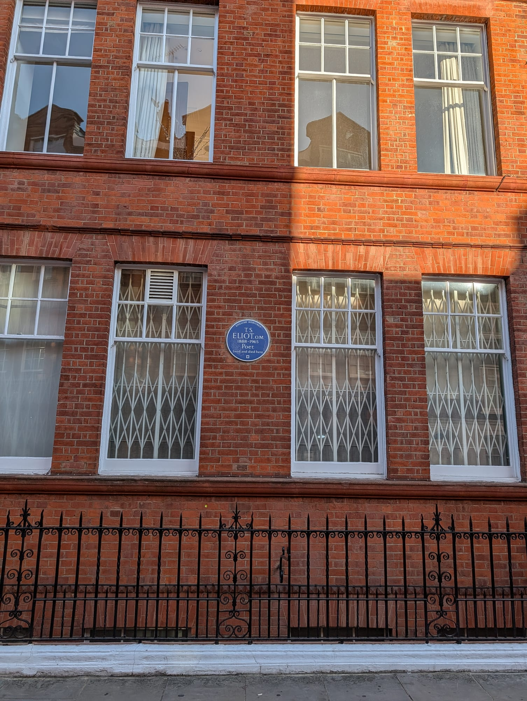

More than a thousand official blue plaques exist in London. Mozart wrote his first symphony in Belgravia **aged eight**, Engels hosted Marx in Primrose Hill for twenty years, and Handel and Hendrix lived in adjoining Mayfair houses two centuries apart.

This is a guide to the ones worth building a walk around.

> 🗺️ **[See every one of them on our interactive map →](/plaques/).**
> Every London plaque, official and unofficial — search by name or inscription, filter by colour or subject, and find what's near you.

> 💡 **The Short Version:** **Belgravia** has Mozart, Mary Shelley, Fleming and Tennyson in one short walk. **Bloomsbury** has Dickens, Darwin and Keynes. **Mayfair** has Handel and Hendrix next door to each other, and both houses are open as one museum. **St James's** has the oldest surviving plaque in London, put up in 1867 while its subject was still alive and still ruling France.

> 📘 **How we choose these (editorial note).**
> No paid placements. These are English Heritage plaques unless noted. Nearly all mark private homes, not anywhere you can go inside.

## Where they are

| If you are near… | Who lived there |
| --- | --- |
| **Belgravia** | Mozart, Mary Shelley, Ian Fleming, Tennyson |
| **Bloomsbury** | Dickens, Darwin, Keynes, the Bloomsbury Group |
| **Mayfair** | Handel, Jimi Hendrix |
| **Marylebone** | Dickens, Elizabeth Barrett Browning |
| **Primrose Hill & Camden** | Engels, Sylvia Plath, Orwell |
| **Bayswater** | J.M. Barrie |
| **Chelsea** | Oscar Wilde, Bram Stoker |
| **Hampstead** | Keats, Sigmund and Anna Freud |
| **St James's** | Napoleon III — the oldest surviving plaque |
| **Kensington** | T.S. Eliot |
| **Soho** | Karl Marx, Willy Clarkson |
| **Stockwell** | Vincent van Gogh |

---

## The oldest one, and the one that is not there

The scheme is thought to be **the oldest of its kind in the world**, and English Heritage did not start it. **The Society of Arts** did, after the MP William Ewart proposed the idea in Parliament in 1863. It was founded in **1866** and the first plaques went up in **1867**. English Heritage has run it since 1986.

The very first plaques were blue, but the colour was expensive and the Society mainly used brown, with terracotta, green, bronze, lead and stone also in use. **Blue ceramic only became standard in 1921**, and the simplified design still used today was drawn in **1938** by an unnamed student at the Central School of Arts and Crafts.

### The first plaque: Lord Byron, Holles Street

> ⚠️ **It is not there.** The very first plaque of the scheme marked Byron's supposed birthplace on Holles Street, off Cavendish Square. **The house was demolished in 1889** and John Lewis occupies the site. No evidence has ever been found that Byron was actually born at that number, so it may have been wrong from the start.

### Napoleon III, 1c King Street, St James's

*Free · 1867 · the oldest surviving plaque in London*

**NAPOLEON III LIVED HERE 1848**, on a building in St James's.

It is the earliest surviving plaque in London, and it went up while its subject was still alive and ruling France. Under today's rules, which require twenty years to have passed since the subject's death, it could not exist.

**Free, on a public street, visible at any hour.** It is on King Street between St James's Square and St James's Street, set higher than most plaques.

**Three more of London's oldest plaques are within ten minutes.** Green Park and Piccadilly Circus are each about five minutes away.

> **Only 15% of London's official plaques commemorate women.** Since 2016, more than half of new awards have gone to women.

---

## Belgravia: Mozart, Fleming and Mary Shelley

Four plaques within half an hour. Mozart at 180 Ebury Street and Ian Fleming at 22 are eight minutes apart on one residential street.

> 🗺️ **[We have this as a full walking route →](/articles/chelsea-belgravia-plaques-walk/)** — eleven numbered stops from Cheyne Walk to Belgrave Square with a map, a Google Maps link and the opening days, joining these Belgravia plaques to the Chelsea ones. The two areas together hold 184 blue plaques.

### Mozart's Belgravia Home

**Mozart composed his first symphony here in 1764, aged eight**, during his family's fifteen-month stay in London, written while his father was ill and the children were forbidden to touch the harpsichord.

**180 Ebury Street.** A private house: look from the pavement, free, at any hour.

Victoria and Sloane Square stations are each about ten minutes from the middle of it.

### Mary Shelley's Belgravia Home

Shelley spent her last years here and died in the house in 1851, decades after writing *Frankenstein* at eighteen.

**24 Chester Square.** A private residence, viewable from the pavement only, free and at any hour. **The square garden is private and railed**, so you look at the house across it.

It is about five minutes from the Ebury Street pair, which makes a four-plaque Belgravia walk — Mozart, Fleming, Tennyson and Shelley — comfortable in half an hour. Sloane Square is the nearest station.

### Ian Fleming's Belgravia Home

Fleming lived in a flat here in the late 1930s, before he created James Bond.

**22 Ebury Street.** Private, pavement-only, free, no hours. It is on the same street as Mozart's, eight minutes away.

For the Bond connection you can actually go inside, **Rules in Covent Garden** is written into *Spectre* as his regular, and **Dukes Bar in St James's** makes the martini — both about twenty minutes away and both covered elsewhere on this site.

### Lord Tennyson's Belgravia Home

Tennyson, the Poet Laureate, lived here in 1880 and 1881.

**9 Upper Belgrave Street.** Private, viewable from the street, free and unrestricted.

**This is the quietest corner of the Belgravia walk.** Upper Belgrave Street runs between Belgrave Square and Eaton Square, both private garden squares, with almost no through traffic and nothing commercial, so do not plan on a coffee here.

Hyde Park Corner is the nearest station, about six minutes, and Victoria about ten.

---

Powered by <a target="_blank" rel="sponsored" href="https://www.getyourguide.com/london-l57/">GetYourGuide</a>

## Bloomsbury

### Charles Dickens's Bloomsbury Home

*Now a museum*

Dickens wrote *Oliver Twist* and *Nicholas Nickleby* here, from 1837 to 1839. It is **the only one of his London homes still standing**.

**48 Doughty Street** is now the Charles Dickens Museum, a paid museum laid out as the house was when he lived in it, with his desk and the rooms in sequence. **It is open Wednesday to Sunday, 10am to 5pm, with last entry at 4pm.** Russell Square and Chancery Lane are each about eight minutes' walk.

### John Maynard Keynes's Bloomsbury Home

Keynes, the economist, was part of the Bloomsbury Group centred on Gordon Square and lived at **46 Gordon Square** from 1916 to 1946. The building is now university premises, viewable from the pavement for free; the campus is generally open to walk through in the daytime.

Virginia Woolf, Vanessa Bell, Lytton Strachey and Keynes all lived on the square at various points. The garden in the middle is public and open in daylight.

It is two minutes from Euston Square and five from Russell Square.

### Charles Darwin at UCL

Darwin lived in a house on this site from 1838 to 1842. The house has gone, and the plaque is on the Biological Sciences Building, UCL, Gower Street.

Free and viewable from the street; the campus is generally open to walk through in the daytime.

**UCL's front quad is two minutes away** and stood in for the British Museum's exterior in *The Mummy Returns*. Euston Square and Warren Street are both about five minutes.

> **The Bloomsbury squares** — Russell, Bedford, Gordon, Tavistock and Bloomsbury — can be walked in an hour.

---

## Mayfair: Handel and Hendrix

Two musicians, adjoining houses, **two centuries apart**, and both open to visit.

**Handel** lived and composed *Messiah* at **25 Brook Street, W1K 4HB**. **Jimi Hendrix** lived next door at **23 Brook Street, W1K 4HA** in 1968–69, and reportedly went out and bought a copy of *Messiah* when he found out who his neighbour had been.

The two houses are now a single museum, **Handel Hendrix House**, open Wednesday to Sunday, 10am to 5pm (last entry 4pm) and closed Monday and Tuesday. One ticket covers both.

> English Heritage say **18 houses in London carry two official plaques**. This pair is on adjoining buildings, not one.

---

## Primrose Hill and Camden

### Friedrich Engels's Primrose Hill Home

Engels lived here from 1870 to 1894 and **hosted Karl Marx regularly**.

**122 Regent's Park Road.** Private, pavement-only, free, no hours.

**Marx's own Soho plaque is at 28 Dean Street**, where he lived in two rooms while Engels, who was funding him, had a comfortable villa up here. They are about forty minutes apart on foot, or fifteen on the Northern line.

Chalk Farm is five minutes away, and **Primrose Hill itself is two streets up**, one of London's protected panoramas and free.

### Sylvia Plath's Primrose Hill Home

Plath and Ted Hughes lived here from 1960 to 1961. **The Yeats house is round the corner at 23 Fitzroy Road**, where she moved after they separated, taking it as a good omen that W.B. Yeats had lived there as a boy, and where she died in 1963.

**3 Chalcot Square.** Private, viewable from the pavement, free at any hour.

**The square is the one from the Paddington films**, its pastel terraces used for the Brown family's Windsor Gardens and, from the other side, Phoenix Buchanan's house in the sequel.

**It is a residential square where people live**: look from the pavement, do not linger on doorsteps. Chalk Farm is five minutes, and the Engels plaque is about eight minutes away.

### George Orwell's Kentish Town Home

**50 Lawford Road, Kentish Town.** Private, pavement-only, free. Orwell lived here from August 1935 to January 1936, while working in a Hampstead bookshop, the experience behind *Keep the Aspidistra Flying*.

There is nothing else on the street, an ordinary Victorian terrace. Kentish Town station is about eight minutes away, and the plaque combines best with the Primrose Hill pair.

---

## Kensington

### T.S. Eliot, 3 Kensington Court Gardens

*Free · W8 5QE*

The plaque reads "lived and died here", and covers the last eight years of Eliot's life. He moved into the mansion flat after marrying Valerie Fletcher in 1957 and died there in January 1965.

**Free and visible from the pavement**, on a quiet residential street a few minutes from High Street Kensington. The plaque sits at first-floor level on plain red brick. Kensington Gardens is ten minutes north.

Powered by <a target="_blank" rel="sponsored" href="https://www.getyourguide.com/london-l57/">GetYourGuide</a>

## Soho and the City

### Karl Marx, 28 Dean Street, Soho

*Free · W1D 3RY*

Marx lived here in the 1850s, in two rooms with his family, and walked daily to write in the British Museum Reading Room.

**Free and visible from the pavement.** The ground floor is now Quo Vadis, which opened in 1926; the smoked eel sandwich at the bar is £18.50 and needs no booking. Engels's plaque is at 122 Regent's Park Road, fifteen minutes away on the Northern line.

Marx's plaque is stop three on our [Soho and Chinatown walk](/articles/soho-chinatown-walk/), which also passes Mozart's on Frith Street, Baird's on the Bar Italia building and Ronnie Scott's at his first club on Gerrard Street.

### Willy Clarkson, 41–43 Wardour Street, Soho

*Free · W1D 6PY*

A theatrical wigmaker to the Victorian and Edwardian stage; the plaque says simply that he **"lived and died here."** The building's foundation stone was laid by **Sarah Bernhardt in 1904**, and the coping stone is credited to Henry Irving the following year, though historians doubt he did it in person.

**Free, on Wardour Street, visible at any hour.** Both ceremonial stones are still in the frontage.

Piccadilly Circus and Leicester Square are each about four minutes, and the Karl Marx plaque is five minutes north.

### Dr Samuel Johnson, 17 Gough Square

*Free · and not blue*

**The only plaque the official scheme has inside the City of London**, put up by the Society of Arts in **1876** and made of **brown terracotta**, from the years before the design was standardised. The City is otherwise outside the English Heritage scheme because the **City of London Corporation runs its own**, with around 140 plaques.

**Gough Square** is reached down narrow alleys off Fleet Street. **Dr Johnson's House at number 17 is a ticketed museum**, with the garret where he compiled the *Dictionary* on the top floor. It is open Tuesday to Saturday, 10am to 5pm (last entry 4.30pm), and Sunday, noon to 4pm (last entry 3.30pm).

**Hodge, Johnson's cat, has his own statue in the square**, sitting on a copy of the Dictionary beside a pair of oyster shells. It is free.

Chancery Lane is about five minutes; **Ye Olde Cheshire Cheese**, Johnson's local, is two.

### Vincent van Gogh, 87 Hackford Road, Stockwell

*Free · SW9 0RE*

Where Van Gogh lodged as a young art dealer, **years before he had painted anything at all**.

**87 Hackford Road, Stockwell.** The plaque is free and visible from the pavement. **Van Gogh House London runs guided tours on the last Saturday and Sunday of each month**, about an hour and a quarter, £18, not suitable for children.

It does not combine with any other plaque on this page. Stockwell is about ten minutes' walk, Oval about the same.

---

## Elsewhere

* **J.M. Barrie**, Bayswater — lived facing Kensington Gardens, **where Peter Pan is set** and where his statue of the character stands.
* **Oscar Wilde**, Chelsea — the Tite Street house he was living in when he was arrested.
* **Bram Stoker**, Chelsea — where *Dracula* was written.
* **Keats**, Hampstead — Keats House is open, and the garden has a descendant of the plum tree he wrote *Ode to a Nightingale* under.
* **Sigmund and Anna Freud**, 20 Maresfield Gardens, Hampstead NW3 5SX — father and daughter on one house, now the Freud Museum, with his actual couch. Anna lived and worked there for 44 years.
* **George Bernard Shaw and Virginia Woolf**, 29 Fitzroy Square — two literary giants, the same front door, different decades.

> ⚠️ **One to admire from a distance.** Luke Howard's plaque at 7 Bruce Grove, Tottenham reads **"Namer of Clouds"**, for the man who gave us cumulus, stratus and cirrus. English Heritage lists the plaque as **not on view to the public**, so do not build a walk around it.

---

## Beyond the walk: names famous the world over

People famous worldwide, whatever their London connection. Every name below is also starred on the [interactive map](/plaques/).

**Science**

* **Isaac Newton**, 87 Jermyn Street — laws of motion and gravity, the foundation of classical physics.
* **Michael Faraday**, 48 Blandford Street — electromagnetic induction, behind every electric motor and generator since.
* **Alexander Fleming**, 20a Danvers Street — discovered penicillin.
* **Alan Turing**, 2 Warrington Crescent — his birthplace; father of computer science and a WWII Enigma codebreaker.
* **Guglielmo Marconi**, 71 Hereford Road — pioneer of wireless communication, Nobel laureate.
* **James Watson**, 18 Vincent Square, and **Francis Crick**, 56 St George's Square — separately plaqued, joint discoverers of the structure of DNA.

**Music**

* **John Lennon**, 34 Montagu Square — of the Beatles.
* **Paul McCartney**, 9 Kingly Street — where he met Linda Eastman in 1967, at the Bag O'Nails club.
* **David Bowie**, 157 High Street, Beckenham — where his career launched at the Three Tuns pub, 1969–73.
* **Freddie Mercury**, 22 Gladstone Avenue, Feltham — his childhood home.
* **Bob Marley**, 34 Ridgmount Gardens — lived here in 1972.
* **Fela Kuti**, Greenwich Peninsula — father of Afrobeat.
* **Frédéric Chopin**, 4 St James's Place — left this house in 1848 for his final public performance.

**Literature**

* **William Shakespeare**, 5 St Andrew's Hill — bought lodgings near here in 1613, the only London property he's known to have owned.
* **Agatha Christie**, 58 Sheffield Terrace — the crime novelist.
* **Mark Twain**, 23 Tedworth Square — lived here 1896–97.
* **Rabindranath Tagore**, 3 Villas on the Heath, Hampstead — stayed here in 1912; first non-European Nobel laureate in Literature, and author of two national anthems (India's and Bangladesh's).
* **Natsume Soseki**, 81 The Chase, Clapham — lived here 1901–02; novelist, and once the face on the ¥1,000 note.

**Film and dance**

* **Charlie Chaplin**, East Street, Walworth — born here; silent-film star.
* **Alfred Hitchcock**, 153 Cromwell Road — lived here 1926–39, already directing before his most famous films.
* **Rudolf Nureyev**, 27 Victoria Road — ballet dancer.

**Art**

* **Pablo Picasso**, Floral Street — painted a ballet backdrop here in 1919 for Diaghilev's Ballets Russes.
* **J.M.W. Turner**, 40 Sandycoombe Road, Twickenham — designed and lived in this riverside house himself.
* **Henry Moore**, 11a Parkhill Road — sculptor; lived and worked here 1929–40.

**Politics and world leaders**

* **Winston Churchill**, 28 Hyde Park Gate — lived and died here.
* **Mahatma Gandhi**, Kingsley Hall, Tower Hamlets — stayed here in 1931.
* **Charles de Gaulle**, 4 Carlton Gardens — set up the Free French Forces' headquarters here in 1940.
* **Simón Bolívar**, 4 Duke Street — lodged here in 1810, decades before leading much of South America to independence.
* **Ho Chi Minh**, Haymarket — worked in 1913 at the Carlton Hotel, which stood on this site.
* **Vladimir Lenin**, 16 Percy Circus — stayed on this site in 1905.

**Exploration**

* **Captain James Cook**, 88 Mile End Road — a house on this site was his for some years before his Pacific voyages.
* **Ernest Shackleton**, 12 Westwood Hill — the Antarctic explorer of the *Endurance* expedition.
* **Robert Falcon Scott**, 56 Oakley Street — "Scott of the Antarctic."

**Other**

* **Robert Baden-Powell**, 9 Hyde Park Gate — founded the Scouting movement.
* **Emmeline and Christabel Pankhurst**, 50 Clarendon Road — mother and daughter, leaders of the women's suffrage movement.

---

Powered by <a target="_blank" rel="sponsored" href="https://www.getyourguide.com/london-l57/">GetYourGuide</a>

## Not every plaque is an English Heritage plaque

Not every blue disc is official: the official scheme, with the councils that ran it before English Heritage, accounts for about a quarter of the plaques on [our map of London](/plaques/). The City of London Corporation, the Nubian Jak Community Trust, the Heritage Foundation and several boroughs all use blue too, and a few genuine English Heritage plaques are brown, black or stone.

**The quick test:** if it commemorates a shop, a band, an event, a building or somebody still alive, it is not an English Heritage plaque.

For the full breakdown of the schemes, the colours and the rules, see our **[guide to how London's plaques work](/articles/london-plaques-guide/)**.

---

## What it costs

**Nothing.** Every plaque in this guide is on a public street and free to look at. The buildings are usually private homes, so the plaque on the wall is the whole of the visit. English Heritage's online map of its plaques is free and searchable.

---

## What to know

* **The criteria are strict**: 20 years since death, a surviving building outside the City, visible from the street. Churches, schools and theatres are not normally considered because too many people passed through them. [The full rules, and how the other schemes differ](/articles/london-plaques-guide/).
* **Five addresses are open as museums**: Handel Hendrix House, the Charles Dickens Museum, Dr Johnson's House, Keats House and the Freud Museum. Everything else is somebody's front wall.
* **New plaques go up every year.** 2025 brought Audrey Hepburn (65 South Audley Street) and Marc Bolan (Maida Vale); 2026 brought the astronomer **Cecilia Payne-Gaposchkin** (Lansdowne Road, Notting Hill) and **Laurence Olivier** (Lupus Street, Pimlico).

---

## Continue planning your London trip

- 🗺️ **[Best Areas to Visit in London](/articles/best-areas-to-visit-london/)** — the neighbourhoods compared by what each is best for and the best day to go
- 🗺️ **[Every plaque in London on one map](/plaques/)**
- 🎬 **[London Filming Locations](/articles/london-filming-locations/)**
- 🏰 **[Historic Houses in London](/articles/historic-houses-london/)**
- 🎪 **[Free Things to Do in London](/free/)**
- 📚 **[Bloomsbury Area Guide](/articles/bloomsbury-area-guide/)**
- 🌳 **[Hampstead Area Guide](/articles/hampstead-area-guide/)**
- 🛍️ **[Mayfair Area Guide](/articles/mayfair-area-guide/)**
