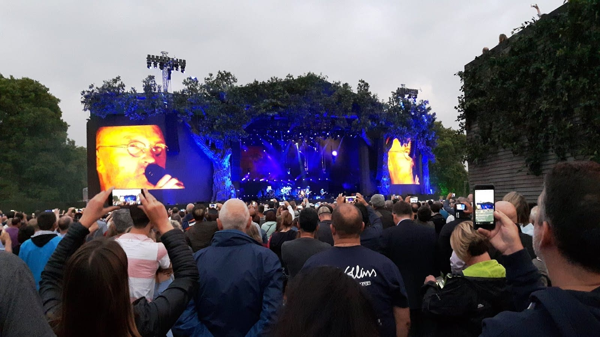

> 💡 **The Short Version:** London's biggest 2027 gigs so far are **Harry Styles** at Wembley (25, 27 and 28 August), **U2** at Tottenham Hotspur Stadium (18, 19, 22 and 25 June, the tour's only UK venue), **Sam Fender** at Wembley (18 and 20 June and 2 September), **Noah Kahan** at Wembley (23 to 25 July), **Slipknot** at Wembley (3 July, the band's only UK and European show of the tour) and **Fontaines D.C.** at London Stadium (9 July). Tottenham also has **Fall Out Boy** (5 June), **Karol G** (6 July) and **Stray Kids** (13 July, on sale 19 November). In the parks, BST Hyde Park has **Bon Jovi**, **Muse** and **Raye** (sold out), and All Points East has **Phoebe Bridgers**. Indoors, **Olivia Rodrigo** plays eleven nights at The O2 between 5 April and 10 May. **Tickets go to presales first**, usually two to four days before general sale, so sign up with the artist and the venue as soon as a tour is announced.

## Stadium and park gigs

| Date | Artist | Venue | Tickets |
|---|---|---|---|
| Sat 5 June | **Fall Out Boy**, Twilight of the Punks tour | Tottenham Hotspur Stadium | [Tottenham Hotspur Stadium](https://www.tottenhamhotspurstadium.com/events/1184972/fall-out-boy): on sale since 12 November 2026 |
| Fri 18, Sat 19, Tue 22 and Fri 25 June | **U2**, with Wolf Alice | Tottenham Hotspur Stadium | [Tottenham Hotspur Stadium](https://www.tottenhamhotspurstadium.com/events/1181495/u2): on general sale since 6 November 2026 |
| Fri 18 and Sun 20 June, Thu 2 September | **Sam Fender**, Proper Massive Stadium Tour | Wembley Stadium | [Wembley Stadium](https://www.wembleystadium.com/events/2027/Sam-Fender): on general sale since 30 October 2026 |
| Thu 24 June | **Bon Jovi** | BST Hyde Park | [BST Hyde Park](https://www.bst-hydepark.com/events/bon-jovi-thurs-24-june): on sale |
| Sat 26 June | **Muse**, with Nothing But Thieves and CHVRCHES | BST Hyde Park | [BST Hyde Park](https://www.bst-hydepark.com/events/muse-sat-26-june): on sale |
| Sat 3 July | **Slipknot**, (sic)est Stadium Tour | Wembley Stadium | [Wembley Stadium](https://www.wembleystadium.com/events/2027/Slipknot): on general sale since 2 October 2026 |
| Tue 6 July | **Karol G** | Tottenham Hotspur Stadium | [Tottenham Hotspur Stadium](https://www.tottenhamhotspurstadium.com/events/1021367/karol-g): on sale since 30 April 2026 |
| Fri 9 July | **Fontaines D.C.**, with Little Simz | London Stadium | [London Stadium](https://www.london-stadium.com/news/2026/september/fontaines-d-c-summer-2027.html): on general sale since 10 September 2026 |
| Sat 10 July | **Raye**, with Sienna Spiro | BST Hyde Park | [BST Hyde Park](https://www.bst-hydepark.com/events/raye-sat-10-july): sold out |
| Tue 13 July | **Stray Kids**, Run It London | Tottenham Hotspur Stadium | [Tottenham Hotspur Stadium](https://www.tottenhamhotspurstadium.com/events/1184882/stray-kids): on sale 3pm, Thursday 19 November 2026 |
| Fri 23, Sat 24 and Sun 25 July | **Noah Kahan**, The Last of the Bugs Tour | Wembley Stadium | [Wembley Stadium](https://www.wembleystadium.com/events/2027/Noah-Kahan): on general sale since 28 August 2026 |
| Wed 25, Fri 27 and Sat 28 August | **Harry Styles**, Together, Together | Wembley Stadium | [Wembley Stadium](https://www.wembleystadium.com/events/2027/Harry-Styles): on general sale since 17 September 2026 |
| Fri 27 August | **Phoebe Bridgers**, with Caroline Polachek | All Points East, Victoria Park | [All Points East](https://www.allpointseastfestival.com/events/phoebe-bridgers-fri-27-aug): on sale |

**Two June Fridays are the busiest nights.** On 18 June, Sam Fender plays Wembley while U2 open at Tottenham. On 25 June, U2 play their last night with Toto at OVO Arena Wembley and SOMBR at The O2 the same evening. If you are going on either Friday, book your hotel as soon as you have tickets.

*The Great Oak Stage at BST Hyde Park.*

BST and All Points East will add more headliners through the winter. Their age rules, bag limits and the rest of London's festival summer are in our [London music festivals 2027 guide](/articles/london-music-festivals-2027/).

## Arena gigs by month

The O2 sells through AXS, and OVO Arena Wembley through AXS too; each link below goes to the venue's own page for the show, which hands over to the ticket seller. The O2 turns 20 in 2027, and Maisie Peters, David Guetta, SOMBR, Santana, Kings of Leon, Jack Johnson, Pet Shop Boys, alt-J, Jamiroquai and Jorja Smith are among the acts in its birthday series.

### January

| Date | Artist | Venue | Tickets |
|---|---|---|---|
| 16 Jan | **aespa** | The O2 | [The O2](https://www.theo2.co.uk/events/detail/aespa-2027): on sale |
| 23 Jan | **Five Finger Death Punch** | The O2 | [The O2](https://www.theo2.co.uk/events/detail/five-finger-death-punch): on sale |
| 28 Jan | **Two Door Cinema Club** | The O2 | [The O2](https://www.theo2.co.uk/events/detail/two-door-cinema-club-2027): on sale |

### February

| Date | Artist | Venue | Tickets |
|---|---|---|---|
| 5 Feb | **Nothing But Thieves** | The O2 | [The O2](https://www.theo2.co.uk/events/detail/nothing-but-thieves-2027): on sale |
| 13 Feb | **Scouting for Girls**, 20th anniversary | OVO Arena Wembley | [OVO Arena Wembley](https://www.ovoarena.co.uk/events/detail/scouting-for-girls): on sale |
| 19 and 20 Feb | **Charli xcx**, with Audrey Hobert | The O2 | [The O2](https://www.theo2.co.uk/events/detail/charli-xcx-2027): on sale |
| 24 Feb | **Kenshi Yonezu** | The O2 | [The O2](https://www.theo2.co.uk/events/detail/kenshi-yonezu): on sale |
| 26 Feb | **Kacey Musgraves** | OVO Arena Wembley | [OVO Arena Wembley](https://www.ovoarena.co.uk/events/detail/kacey-musgraves-1): on sale |
| 26 Feb | **Bullet for My Valentine** and **Pendulum** | The O2 | [The O2](https://www.theo2.co.uk/events/detail/bullet-for-my-valentine): on sale |
| 27 Feb | **John Summit** | The O2 | [The O2](https://www.theo2.co.uk/events/detail/john-summit-2027): on sale |

### March

| Date | Artist | Venue | Tickets |
|---|---|---|---|
| 3, 4 and 5 Mar | **N-Dubz**, The Legacy Tour | The O2 | [The O2](https://www.theo2.co.uk/events/detail/n-dubz-2027): on sale |
| 8 and 9 Mar | **ENHYPEN** | The O2 | [The O2](https://www.theo2.co.uk/events/detail/enhypen-world-tour-blood-saga): on sale |
| 11 Mar | **Megadeth**, with Black Label Society and Testament | OVO Arena Wembley | [OVO Arena Wembley](https://www.ovoarena.co.uk/events/detail/megadeth): on sale |
| 12 Mar | **FLO** | OVO Arena Wembley | [OVO Arena Wembley](https://www.ovoarena.co.uk/events/detail/flo): on sale |
| 12 to 14 Mar | **C2C: Country to Country** | The O2 | [The O2](https://www.theo2.co.uk/events/detail/c2c-country-to-country-2027): on sale |
| 13 Mar | **Tash Sultana** | OVO Arena Wembley | [OVO Arena Wembley](https://www.ovoarena.co.uk/events/detail/tash-sultana): on sale |
| 16, 18 and 21 Mar | **RUSH**, Fifty Something Tour | The O2 | [The O2](https://www.theo2.co.uk/events/detail/rush): on sale |
| 25 Mar | **Olamide** | The O2 | [The O2](https://www.theo2.co.uk/events/detail/olamide): on sale |
| 25 Mar | **The Jacksons** | OVO Arena Wembley | [OVO Arena Wembley](https://www.ovoarena.co.uk/events/detail/the-jacksons): on sale |
| 26 Mar | **Sub Focus** | The O2 | [The O2](https://www.theo2.co.uk/events/detail/sub-focus): on sale |
| 28 Mar | **Ice Nine Kills** | The O2 | [The O2](https://www.theo2.co.uk/events/detail/ice-nine-kills): on sale |

### April

| Date | Artist | Venue | Tickets |
|---|---|---|---|
| 2 and 3 Apr | **Chase & Status** | The O2 | [The O2](https://www.theo2.co.uk/events/detail/chase-status): on sale |
| 2 Apr | **The Warning** | OVO Arena Wembley | [OVO Arena Wembley](https://www.ovoarena.co.uk/events/detail/the-warning): on sale |
| 4 Apr | **James Blunt** | The O2 | [The O2](https://www.theo2.co.uk/events/detail/james-blunt-2027): on sale |
| 5, 6, 8, 9, 12, 14, 15, 19 and 20 Apr, then 9 and 10 May | **Olivia Rodrigo**, The Unraveled Tour | The O2 | [The O2](https://www.theo2.co.uk/events/detail/olivia-rodrigo-2027): on sale; a UK-only residency |
| 7 Apr | **2hollis** | OVO Arena Wembley | [OVO Arena Wembley](https://www.ovoarena.co.uk/events/detail/2hollis): on sale |
| 9 Apr | **James Marriott** | OVO Arena Wembley | [OVO Arena Wembley](https://www.ovoarena.co.uk/events/detail/james-marriott): on sale |
| 21, 22, 24 and 25 Apr | **Teddy Swims** | The O2 | [The O2](https://www.theo2.co.uk/events/detail/teddy-swims): 21 and 22 April sold out; 24 and 25 April on sale |
| 23 Apr | **Thomas Rhett** | The O2 | [The O2](https://www.theo2.co.uk/events/detail/thomas-rhett): on sale |
| 28 Apr | **Thirty Seconds to Mars** | The O2 | [The O2](https://www.theo2.co.uk/events/detail/thirty-seconds-to-mars-2027): on sale |
| 30 Apr, 1, 3 and 4 May | **Gracie Abrams**, The Look at My Life | The O2 | [The O2](https://www.theo2.co.uk/events/detail/gracie-abrams-2027): on sale |

### May

| Date | Artist | Venue | Tickets |
|---|---|---|---|
| 2 May | **Omah Lay** | OVO Arena Wembley | [OVO Arena Wembley](https://www.ovoarena.co.uk/events/detail/omah-lay): on sale |
| 6 May | **Simple Minds**, with Gary Numan | The O2 | [The O2](https://www.theo2.co.uk/events/detail/simple-minds-with-special-guest-gary-numan): on sale |
| 8 May | **Maisie Peters** | The O2 | [The O2](https://www.theo2.co.uk/events/detail/maisie-peters): on sale |
| 11, 14 and 15 May | **Rod Stewart**, The Final Encore | The O2 | [The O2](https://www.theo2.co.uk/events/detail/rod-stewart-2027): on sale; billed as his farewell tour |
| 12 May | **Erasure** | The O2 | [The O2](https://www.theo2.co.uk/events/detail/erasure-2027): on sale |
| 24 and 25 May | **Nickelback** | The O2 | [The O2](https://www.theo2.co.uk/events/detail/nickelback-2027): on sale |
| 28 May | **Greta Van Fleet** | The O2 | [The O2](https://www.theo2.co.uk/events/detail/greta-van-fleet): on sale |

### June

| Date | Artist | Venue | Tickets |
|---|---|---|---|
| 1, 2 and 3 June | **Tame Impala**, with Wet Leg | The O2 | [The O2](https://www.theo2.co.uk/events/detail/tame-impala-2027): on sale |
| 4 June | **Shreya Ghoshal** | The O2 | [The O2](https://www.theo2.co.uk/events/detail/shreya-ghoshal-2027): on sale |
| 5 June | **David Guetta** | The O2 | [The O2](https://www.theo2.co.uk/events/detail/david-guetta-2027): on sale |
| 21, 22, 24, 25 and 29 June | **SOMBR**, his first UK arena shows | The O2 | [The O2](https://www.theo2.co.uk/events/detail/sombr): on sale |
| 25 June | **Toto** | OVO Arena Wembley | [OVO Arena Wembley](https://www.ovoarena.co.uk/events/detail/toto-1): on sale |
| 26 June | **Brad Paisley** | The O2 | [The O2](https://www.theo2.co.uk/events/detail/brad-paisley-2027): on sale |
| 30 June | **Santana** | The O2 | [The O2](https://www.theo2.co.uk/events/detail/santana-2027): on sale |

### July

| Date | Artist | Venue | Tickets |
|---|---|---|---|
| 2 and 3 July | **Kings of Leon** | The O2 | [The O2](https://www.theo2.co.uk/events/detail/kings-of-leon-2027): on sale |
| 4 July | **Jack Johnson** | The O2 | [The O2](https://www.theo2.co.uk/events/detail/jack-johnson): on sale |
| 5 July | **Don Omar** | The O2 | [The O2](https://www.theo2.co.uk/events/detail/don-omar): on sale |
| 6 July | **Scorpions** | The O2 | [The O2](https://www.theo2.co.uk/events/detail/scorpions): on sale |
| 9 and 10 July | **Pet Shop Boys**, Dreamworld MAX | The O2 | [The O2](https://www.theo2.co.uk/events/detail/pet-shop-boys-2027): on sale |
| 14 July | **alt-J** | The O2 | [The O2](https://www.theo2.co.uk/events/detail/alt-j-2027): on sale 10am, Friday 20 November 2026 |
| 15, 16 and 19 July | **Jamiroquai** | The O2 | [The O2](https://www.theo2.co.uk/events/detail/jamiroquai-2027): on sale |
| 17 July | **Jorja Smith** | The O2 | [The O2](https://www.theo2.co.uk/events/detail/jorja-smith): on sale |

### October and November

| Date | Artist | Venue | Tickets |
|---|---|---|---|
| 1 Oct | **Andrea Bocelli** | The O2 | [The O2](https://www.theo2.co.uk/events/detail/andrea-bocelli-2027): on sale |
| 7 Oct | **The Teskey Brothers** | The O2 | [The O2](https://www.theo2.co.uk/events/detail/the-teskey-brothers): on sale |
| 16 Oct | **S Club** | The O2 | [The O2](https://www.theo2.co.uk/events/detail/s-club): on sale |
| 19 Oct | **Jean-Michel Jarre**, Oxygène & Beyond | The O2 | [The O2](https://www.theo2.co.uk/events/detail/jean-michel-jarre-2027): on sale |
| 22 and 23 Oct | **KPop Demon Hunters: Golden World Tour** | The O2 | [The O2](https://www.theo2.co.uk/events/detail/kpop-demon-hunters): on sale 10am, Friday 20 November 2026 |
| 27 Oct | **Texas**, White on Blonde at 30 | The O2 | [The O2](https://www.theo2.co.uk/events/detail/texas-2027): on sale |
| 30 Oct | **Meshuggah** | OVO Arena Wembley | [OVO Arena Wembley](https://www.ovoarena.co.uk/events/detail/meshuggah-1): on sale |
| 3 Nov | **Billy Ocean** | The O2 | [The O2](https://www.theo2.co.uk/events/detail/billy-ocean-2027): on sale |

For sport, theatre openings and the other big dates alongside these, see the [major events calendar](/whats-on/big-events/).

## Getting tickets

- **Presales come first.** U2's U2.com presales opened on 2 November 2026 and the artist presale on 5 November, a day before general sale. The O2's Priority presale for Jamiroquai opened two days before general sale, and London Stadium's presale for Fontaines D.C. two days before. London Stadium gives presale access to its mailing list and The O2 runs its own Priority presale, so sign up with [Wembley](https://www.wembleystadium.com/events), [Tottenham Hotspur Stadium](https://www.tottenhamhotspurstadium.com/events/), [London Stadium](https://www.london-stadium.com/events) and [The O2](https://www.theo2.co.uk/events) before a tour you want is announced.
- **Buy from the sellers the venue names.** Each Wembley event page lists them: Ticketmaster and Wembley Stadium for Sam Fender and Slipknot, with AXS and See Tickets added for Noah Kahan. The O2 sells through AXS, and its tickets live in The O2 app on your phone.
- **Resell through the official route.** Harry Styles' Wembley tickets can be resold on Ticketmaster, which opened resale on 16 October 2026; Wembley cancels tickets it finds resold for profit, caps the show at eight tickets per person and per household, and admits mobile tickets only. Tickets bought from The O2 or AXS can be resold on AXS Official Resale.
- **Accessible tickets need registration first.** Tottenham and All Points East ask for a Nimbus Access Card (or, at All Points East, AXS's free access registration) before you book. Wembley sells accessible tickets by phone only, on 0800 093 0824, and its line opens for presales at the same time as the official sellers.

## Getting there and home

- **Wembley Stadium and OVO Arena:** after a sell-out concert, TfL queues the crowd at Wembley Park from about 22:30 to 23:40, and Chiltern sorts trains to Marylebone into a separate queue at Wembley Stadium station. Our [Wembley travel guide](/articles/wembley-stadium-arena-guide/) has the queue windows, the walking routes and where to park.
- **Tottenham Hotspur Stadium:** White Hart Lane is closest but has no Night Overground, so its last train keeps to the ordinary timetable. U2's Friday and Saturday nights fall on Night Tube nights, when the Victoria line runs all night from Seven Sisters and Tottenham Hale. More in the [Tottenham Hotspur Stadium travel guide](/articles/tottenham-hotspur-stadium-travel-guide/).
- **London Stadium:** Fontaines D.C. play on a Friday, when the Central and Jubilee lines run all night through Stratford. Stewards hold and release the crowd on the bridges off the stadium island. See the [London Stadium travel guide](/articles/london-stadium-travel-guide/).
- **The O2:** TfL meters the crowd into North Greenwich, and the Jubilee line keeps its ordinary last trains, as early as 23:45 westbound on a Sunday. The [O2 travel guide](/articles/the-o2-travel-guide/) has the full last-train table and the river and cable car options.
- **Hyde Park and Victoria Park:** BST shows end by 10.30pm, or 10pm on Sundays, early enough for the normal Tube. Getting away from both parks is covered in the [festivals guide](/articles/london-music-festivals-2027/#getting-home-late).
- **Twickenham:** Allianz Stadium Twickenham's 2027 listing is rugby only so far (as at 14 November 2026). If a concert is added, the [Twickenham Stadium travel guide](/articles/twickenham-stadium-travel-guide/) covers the station queues.

## Where to stay

For Wembley, our [where to stay near Wembley Stadium](/articles/where-to-stay-near-wembley-stadium/) guide compares sleeping next to the stadium with a hotel a few Tube stops away. For The O2, [where to stay near The O2](/articles/where-to-stay-near-the-o2/) does the same for the Greenwich peninsula, and [where to stay in Greenwich](/articles/where-to-stay-greenwich/) sorts Greenwich's hotels from the town centre to the peninsula. For Tottenham and Stratford, the where-to-stay sections of the [Tottenham](/articles/tottenham-hotspur-stadium-travel-guide/) and [London Stadium](/articles/london-stadium-travel-guide/) travel guides cover the options, and our [best areas to stay in London](/articles/best-areas-to-stay-in-london/) sorts the rest of the city.

## Continue planning your London trip

- 🎪 **[London Music Festivals 2027](/articles/london-music-festivals-2027/)**: BST Hyde Park, All Points East, Brockwell Park and the ones a train ride away
- 🎤 **[Best Live Music Venues in London](/articles/best-live-music-venues-london/)**: the smaller rooms, from clubs to concert halls
- 📅 **[Major Events Calendar](/whats-on/big-events/)**: the big gigs, sport and shows by month
- 🎟️ **[Tickets Going On Sale Soon](/whats-on/on-sale/)**
- 🗓️ **[What's On in London](/whats-on/)**: every gig, show and concert we list, searchable by date and price
- 🏟️ **[Wembley Stadium and OVO Arena Travel Guide](/articles/wembley-stadium-arena-guide/)**
- 🏟️ **[Tottenham Hotspur Stadium Travel Guide](/articles/tottenham-hotspur-stadium-travel-guide/)**
- 🏟️ **[London Stadium Travel Guide](/articles/london-stadium-travel-guide/)**
- 🏟️ **[The O2 Travel Guide](/articles/the-o2-travel-guide/)**
- 🏉 **[Twickenham Stadium Travel Guide](/articles/twickenham-stadium-travel-guide/)**

*Dates and on-sale status as at 14 November 2026. New dates are announced every week and sell-outs change daily, so check the venue's page before you book.*
