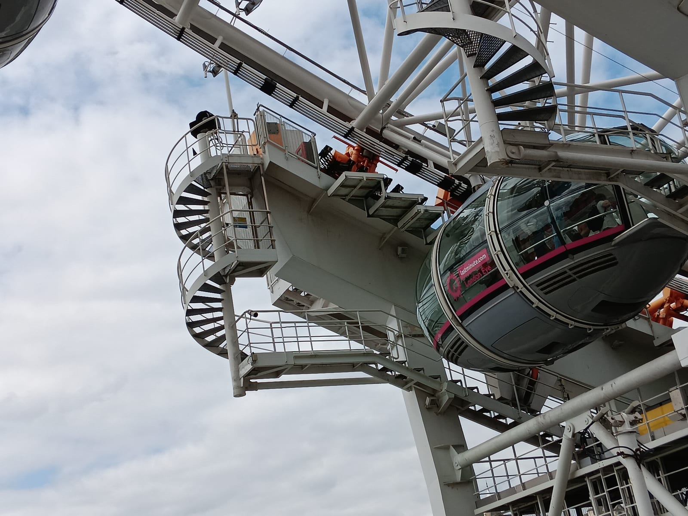
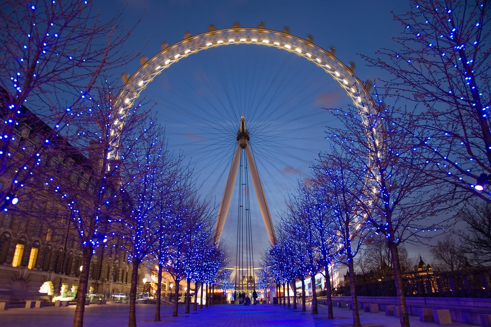
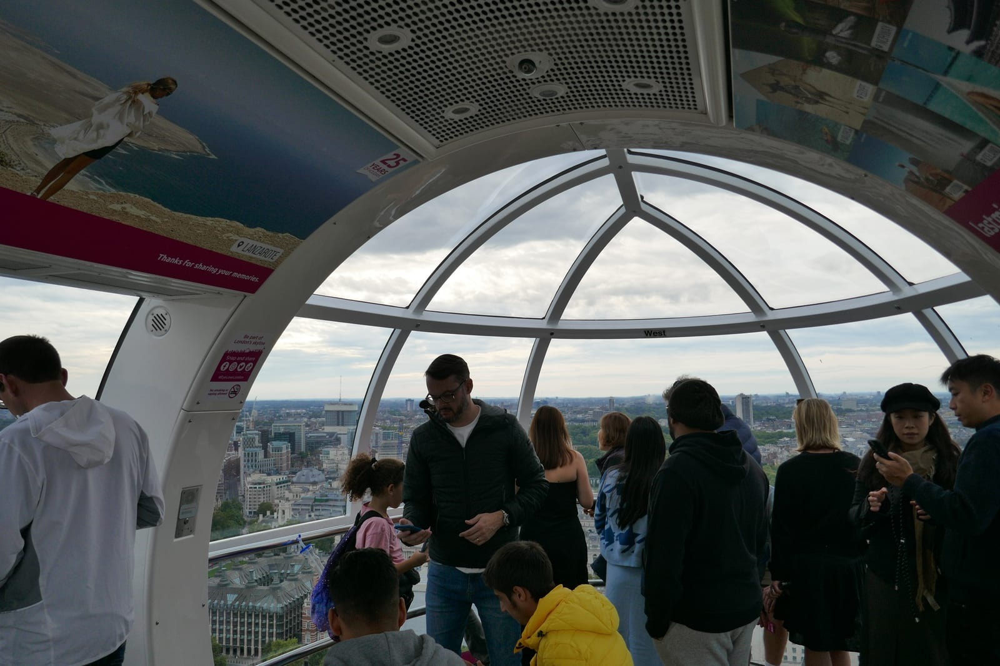
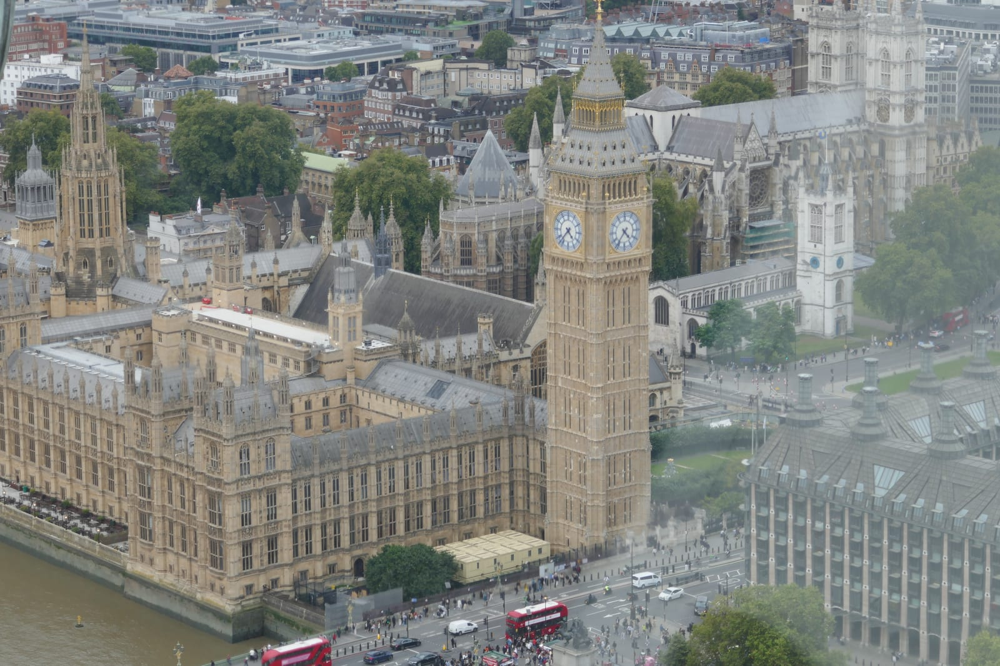

> 💡 **The Short Version:**
> - **The price:** An adult London Eye ticket costs **from £29 online** and **£39 at the gate**; a child aged 2 to 15 is **from £26 online** and **£35 at the gate**, and under-2s go free. Book online.
> - **Bundles:** Merlin's five-attraction bundle (the Eye, Madame Tussauds, SEA LIFE, the Dungeon and Shrek's Adventure) runs **from £59 online against £184 bought separately**. The Eye-plus-Tussauds combo is **from £49 against £78 separately**. <a href="https://www.getyourguide.com/activity/-t26207?partner_id=WWP7I0R&amp;cmp=london-eye-guide" target="_blank" rel="sponsored nofollow noopener" data-affiliate="gyg">The London Pass on GetYourGuide</a> adds the Eye to 100+ other sights, including the Tower of London and Westminster Abbey.
> - **Fast Track:** Standard queues run 20 to 30 minutes on a quiet day and 5 to 10 for Fast Track, rising to an hour or more at peak times. Flexi Fast Track costs **from £49 online / £54 at the gate** against Standard's **from £29 / £39**.
> - **Sunset:** Book a slot **30 minutes before sunset** on your date. You board in daylight, reach the apex at dusk and see Parliament and the bridges light up on the way down.
> - **Weather:** Tickets are non-refundable, but you can reschedule for free up to an hour before arrival (up to 24 hours, three times, on a multi-attraction ticket) through the booking portal.
> - **Luggage:** Suitcases can't ride the wheel; the ticket hall stores them for **£5 an item (£25 overnight)** and takes buggies for free.

---

The London Eye stands 135 metres (443 feet) tall on the South Bank of the Thames. Its 32 climate-controlled glass capsules give 360-degree views of up to 40 kilometres (25 miles) on clear days.

About 3.5 million people ride it every year, so turning up without a booking risks a long queue on top of the £39 walk-up price.

---

## 2026 ticket prices and booking options

The London Eye is operated by **Merlin Entertainments** and uses dynamic pricing: tickets cost more at weekends, in school holidays and on peak summer dates.

| Ticket Type | Adult (16+) | Child (2–15) | Under 2 | Key Details |
| :--- | :--- | :--- | :--- | :--- |
| **Standard Admission (Online Advance)** | **From £29** | **From £26** | **Free** | Timed entry slot. Price rises with demand. |
| **Standard Admission (Walk-Up)** | **£39** | **£35** | **Free** | Box-office price at County Hall on the day. |
| **Flexi Fast Track (Online Advance)** | **From £49** | — | **Free** | Dedicated priority lane; valid any time on your chosen day. |
| **Flexi Fast Track (Walk-Up)** | **£54** | — | **Free** | Bought on the day at the priority desk. |
| **London Eye + River Cruise Combo** | **From £49** | — | **Free** | A 40-minute circular Thames cruise from London Eye Pier. The slot you pick is for the cruise; book the Eye separately within 7 days. |
| **London Eye + Madame Tussauds Combo** | **From £49** | — | **Free** | £78 bought separately; visit Tussauds within 7 days of your Eye slot. |
| **5-Attraction Merlin Bundle** | **From £59** | — | **Free** | The Eye, Tussauds, SEA LIFE, the Dungeon and Shrek's Adventure — £184 bought separately. |
| **The London Pass (Go City)** | **Included** | **Included** | **Free** | 100+ London attractions included. Requires free advance reservation on the Go City portal. |
| **Merlin Annual Pass** | **Included** | **Included** | **Free** | Pre-booking fee required (£1–£5) depending on pass tier; excluded on select peak dates. |

Online tickets need a timed entry slot. If you arrive late, staff fit you into the next boarding group, which can mean a long wait on peak afternoons.

Current dates, slots and entry times:

Powered by <a target="_blank" rel="sponsored" href="https://www.getyourguide.com/london-l57/">GetYourGuide</a>

---

## Is Fast Track worth it?

The upgrade is called Flexi Fast Track: it buys a dedicated priority lane on the boarding ramp and, unlike Standard tickets, lets you turn up any time on your chosen day rather than a fixed slot. It costs from £49 online or £54 at the gate, against Standard's from £29 online or £39 at the gate: a gap of roughly £20 online and £15 at the gate.

*The boarding platform beside County Hall. Photo: [Simiprof](https://commons.wikimedia.org/wiki/File:London_Eye_boarding_platform.jpg), [CC0 1.0](https://creativecommons.org/publicdomain/zero/1.0/).*

The operator's own guidance on wait times: **20 to 30 minutes for Standard and 5 to 10 minutes for Fast Track on a quiet day, rising to an hour or more during peak periods.**

### When Fast Track is worth it
- **Weekends, school holidays and summer afternoons:** the Standard queue is most likely to reach the "hour or more" band, and Fast Track's separate lane keeps its advantage.
- **Sunset flights:** slots within an hour of dusk are the busiest of the day and the standard line bunches up.
- **Young children, or anyone who finds standing difficult:** the standard queue is an outdoor zigzag with no seating.

### When Fast Track isn't worth it
- **Midweek, term-time, off-peak months:** a 20-to-30-minute Standard queue against a 5-to-10-minute Fast Track one saves at most 25 minutes for £15 to £20.
- **Opening slots:** the first flights of the day have the least backlog.

---

## Combination tickets and the London Pass

If the Eye is one stop of several, there are two ways to save:

### 1. Merlin multi-attraction combination tickets
Merlin sells combined tickets for the Eye and several of its other attractions. Three are a few minutes' walk away on the South Bank; the fourth is across town:
- **SEA LIFE London Aquarium** (inside County Hall, next to the wheel entrance)
- **The London Dungeon** (inside County Hall)
- **Shrek's Adventure! London** (inside County Hall)
- **Madame Tussauds London** (on Marylebone Road, near Baker Street tube)

Every multi-attraction ticket gives you 7 days to visit the rest and can be rescheduled free up to three times. The main ones:
- **The five-attraction bundle:** the Eye, Madame Tussauds, SEA LIFE London Aquarium, the London Dungeon and Shrek's Adventure, from £59 online against £184 bought separately. See the [multi-attraction tickets page](https://www.londoneye.com/tickets-and-prices/multi-attraction-tickets/) for current dates.
- **London Eye + Madame Tussauds:** from £49 online against £78 separately. Book a <a href="https://www.getyourguide.com/activity/-t432130?partner_id=WWP7I0R&amp;cmp=london-eye-guide" target="_blank" rel="sponsored nofollow noopener" data-affiliate="gyg">London Eye and Madame Tussauds combination ticket on GetYourGuide</a>.
- **London Eye + Thames River Cruise:** from £49 online. A 40-minute circular cruise from London Eye Pier at the foot of the wheel; the slot you pick is for the cruise, so book the Eye separately within 7 days. Book the <a href="https://www.getyourguide.com/activity/-t193403?partner_id=WWP7I0R&amp;cmp=london-eye-guide" target="_blank" rel="sponsored nofollow noopener" data-affiliate="gyg">London Eye River Cruise combo on GetYourGuide</a>.
- **London Eye + Big Bus + river cruise:** a 24- or 48-hour Big Bus hop-on hop-off ticket, London Eye entry and a one-way City Cruises boat between Westminster and Tower piers. The <a href="https://www.getyourguide.com/activity/-t292175?partner_id=WWP7I0R&amp;cmp=london-eye-guide" target="_blank" rel="sponsored nofollow noopener" data-affiliate="gyg">London Eye, River Cruise and Hop-on Hop-off Bus Tour on GetYourGuide</a> is from £60, 4.4 from 6,698 reviews. **Your Eye slot is not booked for you:** reserve it through Big Bus once you have paid. The bus routes are in our [tour buses compared](/articles/london-tour-buses-compared/) guide.
- **London Eye + SEA LIFE London Aquarium:** from £49 online against £78 separately; both are in County Hall.

### 2. The London Pass (Go City): 100+ London attractions
**The London Pass by Go City** includes standard entry to the London Eye alongside these paid landmarks (values as listed by londonpass.com):
- **[Tower of London](/articles/tower-of-london-guide/)** (up to £38)
- **[Westminster Abbey](/articles/westminster-abbey-guide/)** (up to £32)
- **St Paul's Cathedral** (up to £27)
- **[Kew Gardens](/articles/kew-gardens-guide/)** (up to £22)
- **Tower Bridge Exhibition** (up to £18)
- **Uber Boat by Thames Clippers** 1-Day River Roamer (£24.00 value)
- **The View from The Shard** (£26.00–£32.00 value)
- **Windsor Castle** (up to £36)

#### Does the London Pass save money?
Individual adult advance tickets for the London Eye (from £29), the Tower of London (up to £38) and Westminster Abbey (up to £32) add up to as much as £99 for three sights. Whether a pass beats that depends on how many days and sights you use: our [London Pass Guide](/articles/london-pass-guide/) does the arithmetic.

#### How London Eye booking works with the London Pass
Many sites on the pass admit you on arrival, but **the London Eye requires pass holders to pre-book a timed slot online**:
1. Purchase your pass online (e.g. <a href="https://www.getyourguide.com/activity/-t26207?partner_id=WWP7I0R&amp;cmp=london-eye-guide" target="_blank" rel="sponsored nofollow noopener" data-affiliate="gyg">The London Pass on GetYourGuide</a>, which provides mobile pass vouchers and 24-hour cancellation flexibility).
2. Open the dedicated Go City reservation portal link provided in your booking confirmation.
3. Select your desired date and timed flight slot for the London Eye to generate a zero-balance entry reservation.
4. On the day of your visit, head to the South Bank boarding ramp with both your London Eye booking confirmation and your active London Pass QR code.

Pass prices, durations (1 to 10 days) and availability:

Powered by <a target="_blank" rel="sponsored" href="https://www.getyourguide.com/london-l57/">GetYourGuide</a>

---

## Timing a sunset flight

Book around sunset and one 30-minute revolution gives you daylight, golden hour and lit-up London.

*The wheel illuminated at twilight. Photo: [David Iliff (Diliff)](https://commons.wikimedia.org/wiki/File:London_Eye_Twilight_April_2006.jpg), [CC BY 2.5](https://creativecommons.org/licenses/by/2.5/).*

### The 30-minute booking formula
Look up the sunset time for your date and book a slot **30 minutes before it**.

1. **Boarding (T minus 30 mins):** you join the queue and, after ticket scanning and security, board shortly after.
2. **Ascent in daylight (T minus 15 mins):** the capsule climbs over central London in evening light.
3. **Apex at golden hour (T to T plus 5 mins):** at 135 metres the sun dips to the horizon behind the Palace of Westminster.
4. **Descent into night (T plus 5 to T plus 15 mins):** the lamps on Westminster Bridge, the floodlights of Big Ben and the office towers of the City and Canary Wharf switch on.

### London sunset reference guide

| Month | Approximate Sunset | Target Booking Slot | Notes |
| :--- | :--- | :--- | :--- |
| **January** | 16:00 – 16:45 | **15:30 – 16:15** | Earliest evening slots; combines well with winter South Bank lights. |
| **April** | 19:40 – 20:20 | **19:15 – 19:30** | British Summer Time begins; clear spring sunsets. |
| **July** | 21:00 – 21:20 | **20:30 – 20:45** | Long summer twilight; check late attraction closing hours. |
| **October** | 16:40 – 18:35 | **16:10 – 18:05** | Clocks go back on the last Sunday, which moves sunset about an hour earlier overnight. |

---

## Inside the capsule: what you see from the top

Each of the 32 capsules holds up to 25 passengers and is mounted on the outside of the rim rather than suspended beneath it, so the view is unobstructed in every direction.

*Inside a London Eye capsule. Photo: [LittleRoamingChief](https://commons.wikimedia.org/wiki/File:2024--15_September--London_Eye_Capsule_interior.jpg), [CC BY 2.0](https://creativecommons.org/licenses/by/2.0/).*

Each capsule is air-conditioned and heated, with a wooden bench in the centre so the glass perimeter stays clear for photographs.

Rubber tyres drive the rim, so the ride is smooth even in strong river breezes.

*The Palace of Westminster, from the apex. Photo: [LittleRoamingChief](https://commons.wikimedia.org/wiki/File:2024--15_September--_Palace_of_Westminster_from_the_London_Eye.jpg), [CC BY 2.0](https://creativecommons.org/licenses/by/2.0/).*

### Key landmarks from the 135-metre apex
- **Looking west and south-west:** Directly opposite are the Palace of Westminster and the Elizabeth Tower (Big Ben). Behind Parliament lie Westminster Abbey, Victoria Tower Gardens, St James's Park, Green Park and Buckingham Palace.
- **Looking north:** The curve of the Thames sweeps past Victoria Embankment towards Charing Cross railway bridge and Somerset House. On clear days the BT Tower in Fitzrovia stands out against Hampstead Heath.
- **Looking east:** Follow the river downstream past Waterloo Bridge towards St Paul's Cathedral and the high-rise cluster of the City of London (including The Gherkin, 22 Bishopsgate, and 20 Fenchurch Street). The jagged silhouette of The Shard rises directly across London Bridge.
- **Distance horizon:** on clear days with high atmospheric pressure, visibility extends 40 kilometres to Windsor Castle to the west and the North Downs to the south.

---

Powered by <a target="_blank" rel="sponsored" href="https://www.getyourguide.com/london-l57/">GetYourGuide</a>

## Weather, fog and rescheduling

The wheel turns in rain, fog and light snow, closing only for severe storms or sustained gale-force winds.

### Low cloud and mist
The apex is 135 metres up. On rainy days London's cloud ceiling regularly drops below 100 metres, putting the upper third of your rotation inside dense cloud with no view across the river.

### Refunds and rescheduling
Tickets bought direct from londoneye.com are non-refundable and non-transferable. A Standard or Fast Track ticket can be rescheduled for free up to one hour before your arrival slot, through the operator's own [booking portal](https://www.londoneye.com/plan-your-visit/information-and-support/manage-your-booking/). A multi-attraction ticket, such as the Tussauds combo or the five-attraction bundle, can be rescheduled free up to three times, any time up to 24 hours before arrival.

### If you'd rather cancel than reschedule
A <a href="https://www.getyourguide.com/activity/-t170451?partner_id=WWP7I0R&amp;cmp=london-eye-guide" target="_blank" rel="sponsored nofollow noopener" data-affiliate="gyg">London Eye timed entry ticket on GetYourGuide</a> matches official advance pricing and adds free cancellation up to 24 hours before your slot.

To plan around the forecast:
1. **Check the 48-hour forecast.** The Met Office two days out shows whether the apex will be in cloud.
2. **Move the slot rather than gamble on it.** If the outlook is poor, reschedule to a clearer time up to an hour before arrival.
3. **In spring and autumn, book 24 to 48 hours out** so you can read the conditions before you commit.

---

## Getting there, security and luggage

### Nearest stations and walking routes
- **Waterloo Station (Bakerloo, Jubilee, Northern, Waterloo & City lines + South Western Railway):** the most direct route. Take the South Bank exit; it is five minutes through York Road or Jubilee Gardens to the riverside.
- **Westminster Station (Circle, District and Jubilee lines):** exit onto Bridge Street and cross Westminster Bridge, seven minutes, with the wheel across the river ahead of you.
- **Charing Cross / Embankment Stations (Bakerloo, Northern, District, Circle lines):** cross the Golden Jubilee footbridge beside Hungerford Bridge, ten minutes, ending in Jubilee Gardens.

### Security screening
Every passenger goes through security screening in the marquee before the boarding ramp: bags are inspected, with walkthrough metal detectors and handheld wands.

### Luggage and storage
Large suitcases and bulky bags can't ride the capsule; security will ask you to check them in. The ticket hall's storage desk charges **£5 per item**, collected by 7pm the same day, or **£25** if you leave something overnight. Buggies and pushchairs can be folded into the capsule or left at the same desk for free, also collected by 7pm.

To avoid carrying a case to County Hall, use the staffed **Excess Baggage Company** counter on the main concourse of Waterloo station (open daily 07:00 to 23:00) is a five-minute walk away. See our [luggage storage in London guide](/articles/luggage-storage-london/) for pricing and nearby app-based drop points.

### Wheelchair and accessibility access
The London Eye is fully step-free:
- Boarding ramps have gentle gradients, and staff slow or halt the wheel to position the ramp against the capsule threshold.
- Only **two wheelchair users are permitted per capsule**, and a maximum of **eight wheelchairs** may be on the wheel at any one time.
- Wheelchair slots must be booked in advance online to secure an allocated time. Carers receive a complimentary companion ticket when booking.

---

Powered by <a target="_blank" rel="sponsored" href="https://www.getyourguide.com/london-l57/">GetYourGuide</a>

## Continue planning your London trip

- 🏛️ **[South Bank Area Guide](/articles/south-bank-area-guide/)** — street performers, cultural centres, and dining along the riverside.
- 🚶 **[South Bank Walk](/articles/south-bank-walk/)** — self-guided walking route from Westminster Bridge to Tower Bridge.
- 🏛️ **[Westminster Area Guide](/articles/westminster-area-guide/)** — Big Ben, Parliament, and royal landmarks directly across the river.
- 🎟️ **[The London Pass Guide](/articles/london-pass-guide/)** — the maths, included attractions, and when a sightseeing pass saves money.
- 🗺️ **[Three Days in London Itinerary](/articles/three-days-in-london-itinerary/)** — an efficient Zone 1 plan that fits the London Eye into a central London day.
- 🚤 **[How to Use London River Boats](/articles/how-to-use-london-river-boats/)** — scenic Uber Boat by Thames Clippers services departing from London Eye Pier.
- 🧳 **[Luggage Storage in London](/articles/luggage-storage-london/)** — station left luggage desks and affordable bag drop services near Waterloo.
- ♿ **[Step-Free London](/articles/step-free-london/)** — accessible stations, piers and attractions across the city.
