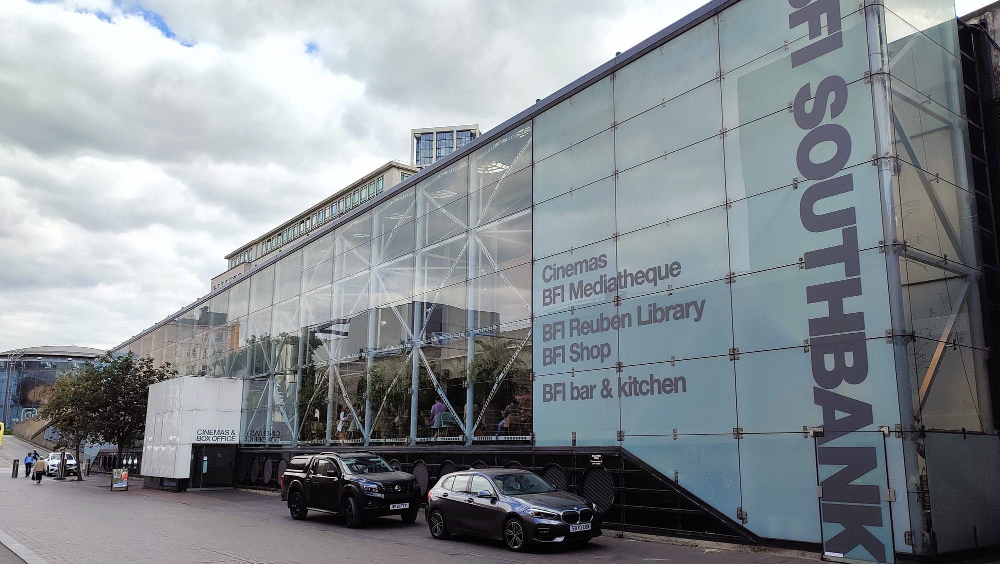

The BFI London Film Festival ran **7 to 18 October 2026**, its 70th edition. Unlike Cannes or Venice it is built for ordinary ticket-buyers, not accredited industry: most of the programme is on general sale, and most of it is affordable.

The calendar catches people out. **Tickets went on general sale at 10am on 17 September**, after a week of priority booking for Members, and the screenings everyone wanted went in that week. **Elsinore**, which opened the festival on 7 October, and **The Debut**, which closed it on the 18th, sold out at every screening, the repeats and the relaxed screening included. Much of the rest of the programme was still bookable, and a further batch was released at **10am on 1 October**.

> 💡 **The Short Version:** **The 2026 festival ended on 18 October**; this is how it worked. The galas went in the first week. The BFI's [ticket availability page](https://whatson.bfi.org.uk/lff/Online/default.asp?BOparam::WScontent::loadArticle::permalink=ticket-availability) listed every screening that was not yet full and refreshed every half hour. If you are **16 to 25**, join **BFI 25 & Under** before you book: it is free, and it made every festival ticket **£6**. Standard tickets started at **£10**, plus a **£1 booking fee** capped at £3 a transaction and dropped at the box office. For a sold-out film the routes in were a **fresh release at 10am on 1 October**, another **at 10am every festival morning**, face-value resale on **Twickets**, and a **returns and standby queue** at the venue.

---

> 🧭 **Plan the rest of it:** [Cheap cinema tickets](/articles/cinema-deals-london/) · [Best independent cinemas](/articles/best-cinemas-london/) · [Late-night eating](/articles/late-night-eating-london/) · [Things to do in London in October](/articles/things-to-do-in-london-in-october/) · [NFL London Games](/articles/nfl-london-games/)

## Festival dates

| Date | Time | What happens |
| --- | --- | --- |
| **Wed 2 September** | 11am | Full programme revealed |
| **Wed 9 September** | 10am | Priority booking opened for BFI Patrons |
| **Thu 10 September** | 10am | Priority booking opened for BFI Members |
| **Thu 17 September** | 10am | General sale opened |
| **Thu 1 October** | 10am | **Extra tickets released, and LFF for Free booking opened** |
| **Wed 7 – Sun 18 October** | — | The festival itself |

Two things follow. Membership taken out now saves booking fees and buys the priority window for the 2027 festival, not a seat in 2026. And 1 October is a second chance that most people miss: it was a real release of held-back stock.

---

## What it costs

**Tickets start at £10, or £6 if you are 16 to 25**, plus a £1-a-ticket booking fee online and by phone, capped at £3 a transaction. Buy at the BFI Southbank box office and there is no fee at all; Members and Patrons never pay it. These are the 2026 prices:

| Screening type | 2026 price |
| --- | --- |
| Weekday matinee, before 5pm | £13 |
| Evenings, and weekend matinees | £18 |
| Gala premiere, Royal Festival Hall | £21–£30 |
| **Opening and Closing Night Gala** | £40 |
| Repeat matinee of a gala, weekday / weekend | £16 / £18 |
| Special Presentation, premiere | £21 |
| Special Presentation, matinee weekday / weekend | £16 / £18 |
| Surprise Film | £21 |
| Family strand | £10 adult, £6 child |
| Relaxed screenings | £6 |
| **16 to 25 year olds, anything** | **£6** |

Two 2026 prices were fundraising tickets, not ordinary admission: **£1,000** for the Opening Night Gala, which includes red-carpet arrival and receptions either side of the film, and **£250** for the Closing Night Gala, which does not. Standard gala tickets for both films went on sale with everything else.

### If you are 16 to 25, read this first

**BFI 25 & Under is free to join, open to anyone aged 16 to 25, and makes London Film Festival tickets £6.**

The scheme has two rates. The same free membership gets you **£4** tickets for regular year-round screenings at BFI Southbank, and **£6** tickets for the London Film Festival and BFI Flare. Set the account up before you book: the £6 price only shows when you are logged in.

### Other concessions

Reduced prices are available to over-60s, students with valid ID, and anyone on Universal Credit, Pension Credit or Jobseeker's Allowance. The last of those was **£6** on the day in 2025, but it requires signing up in person at the box office beforehand with two documents proving eligibility — not something you can do online on the morning. Concessions do not apply to Screen Talks or screenings at the Southbank Centre.

**Access:** companion tickets are free for guests who need support, with a CEA Card, Access Card, National Disability Card or National Carers Card accepted as proof. Book on **020 7960 2102** and quote ACCESS. Every festival venue is step-free except the Prince Charles Cinema.

---

Powered by <a target="_blank" rel="sponsored" href="https://www.getyourguide.com/london-l57/">GetYourGuide</a>

## Is BFI Membership worth it?

Membership costs **£44 a year** paying by direct debit without a printed programme, £54 with one, or £60 as a one-off card payment. It gets you priority booking (for 2026, from 10 September), no booking fees, two free tickets for standard BFI Southbank screenings, and up to £2.50 off Southbank and IMAX tickets.

If the festival is the only reason you are considering it:

- The **booking fee saving is £1 a ticket**. To recover £44 on that alone you would need to buy 44 tickets.
- The **two free tickets** and the **£2.50 discount** are Southbank benefits, useful year-round but not at the festival.
- What you are buying is **the priority window**. A membership taken out now applies to the 2027 festival.

If you go to BFI Southbank through the year anyway, membership pays for itself on the free tickets and the per-ticket discount. If you turn up once a year for the festival, it buys the head start on the screenings that sell out, and whether that is worth £44 depends on whether there is a film you would be disappointed to miss.

The **Patron** tiers (£2,000, £6,500 and £15,000) got one further day of priority, on 9 September, along with a personalised booking service.

---

## Where it happens

*BFI Southbank.*

Seven London venues for 2026:

- **BFI Southbank** — the hub, and where most of the programme screens
- **Royal Festival Hall** — the galas, including both Opening and Closing Night, and the Surprise Film
- **BFI IMAX**, Waterloo
- **Curzon Soho**
- **Prince Charles Cinema**, Leicester Square
- **ICA**, The Mall
- **Vue West End**, Leicester Square

Selected films also play at **ten partner cinemas around the UK** — Broadway Nottingham, Chapter Cardiff, Glasgow Film Theatre, HOME Manchester, MAC Birmingham, Queen's Film Theatre Belfast, Showroom Sheffield, Tyneside Newcastle, Filmhouse Edinburgh and Watershed Bristol — and a selection streams UK-wide on **BFI Player**. Press and industry screenings run separately at Picturehouse Central.

If you are booking several films in a day, check the venues before the times. Southbank to Leicester Square is about 20 minutes on foot across Waterloo Bridge, and the schedule is tight enough that a cross-river gap can catch you out.

---

## The 2026 programme

**The Opening Night Gala** was *Elsinore*, at the Royal Festival Hall on Wednesday 7 October. Directed by Simon Stone and written by Stephen Beresford, it tells the true story of the actor Ian Charleson preparing to play Hamlet at the National Theatre while facing HIV/AIDS, with Andrew Scott and Olivia Colman leading a cast that includes Billie Piper, Johnny Flynn and Luke Thompson.

**The Closing Night Gala** was *The Debut*, which had its UK premiere on the evening of Sunday 18 October. It is Jesse Eisenberg's follow-up to *A Real Pain*, which itself premiered at this festival in 2024, and he directs and stars alongside Julianne Moore, Paul Giamatti and Halle Bailey.

Gala tickets are on public sale like any other screening, at the prices above. To see the stars arrive rather than the film, or to find the other premieres London holds through the year, read [how to see stars at a London film premiere](/articles/film-premieres-london/). The Royal Festival Hall also hosted the 2026 BAFTA Film Awards, whose red carpet has [free fan-pen places](/articles/bafta-red-carpet/).

**The Official Competition** had ten films in the running for Best Film, from directors including Carol Morley, Hirokazu Koreeda and May el-Toukhy. Winners were announced on **Sunday 18 October**. There are four juried awards (Best Film, the **Grierson Award** for documentary, the **Sutherland Award** for a first feature, and the **Short Film Award**) plus separate **Audience Awards** voted for by ticket-holders, decided after the festival closed.

The festival also runs **LFF for Free** most years: free talks, short film programmes, immersive and VR work and family workshops, largely at BFI Southbank across the two festival weekends. In 2026 these could be booked from **10am on Thursday 1 October**, two tickets per person, and a ticket did not guarantee entry: it was first come, first served on the day.

### How the programme is organised

The strands are the fastest way to navigate a programme of this size. Alongside the **Galas** and the four competitions, films are grouped as **Love**, **Debate**, **Laugh**, **Dare**, **Thrill**, **Cult**, **Journey**, **Create** and **Family**, with **Treasures** for restored archive classics, **Experimenta** for artist and experimental film, and **Expanded** for immersive and XR work.

The 2026 edition presented 251 features, shorts, series and immersive works from 88 countries across the 12 days, against 247 from 79 countries in 2025. A dozen or so screenings sell out in minutes. Several hundred do not.

---

Powered by <a target="_blank" rel="sponsored" href="https://www.getyourguide.com/london-l57/">GetYourGuide</a>

## How booking worked once general sale was open

**Start at the [ticket availability page](https://whatson.bfi.org.uk/lff/Online/default.asp?BOparam::WScontent::loadArticle::permalink=ticket-availability).** It lists every screening and event that is not yet full, including tickets released back into sale, and it refreshes every 30 minutes. In 2026 it had a filter for screenings still selling at £10.

**What went first.** Both the Opening and Closing Night Galas: *Elsinore* sold out at the Royal Festival Hall premiere, both repeats and the relaxed screening, and *The Debut* sold out at the Royal Festival Hall, at both simulcasts, in NFT1 and at the Prince Charles. The films that sell out first are the ones with a famous cast and a single evening screening.

**What lasted.** Days after general sale the availability page still listed gala titles, Official Competition films, documentary strand screenings and the whole immersive programme.

**The two-ticket limit.** Bookings were capped at two per film per customer, or four for a family film, until 17 September. Group bookings were straightforward after that.

**Log in first.** You need to be signed in to the BFI's booking site to see prices and to book.

**Book the second screening, not the premiere.** Most films screen more than once, and the repeat is very often a weekday matinee at £13–£16 rather than a £21–£30 gala. The premiere has the red carpet and the director introduction; the repeat is the same film, cheaper and far easier to get.

---

## If it has already sold out

Four routes, in the order worth trying them.

### 1. The daily 10am release

Once the festival starts, **more tickets are released online at 10am each morning** for that day's screenings. This is worth doing for Royal Festival Hall screenings, because production holds are released late in a large venue.

### 2. Twickets

Returned and unwanted tickets are resold through **Twickets**, where London Film Festival tickets have been listed under official festival pages for the past couple of years. It is a face-value platform: a ticket is listed at what the original buyer paid, plus Twickets' own fee. You are not bidding against anyone.

Search for "BFI London Film Festival" at [twickets.live](https://www.twickets.live/en/uk). Listings build through the fortnight before the festival as people's plans change; set an alert for the screening you want rather than refreshing. If you end up with a ticket you cannot use, listing it there is how you get your money back without breaking the BFI's resale rules.

### 3. Returns at the box office

**Go to the venue box office 45 minutes before the screening** and ask whether any tickets have been returned. Staff check returns first, and if there are none they will point you at the standby queue.

### 4. The standby queue

**Join it 30 minutes before the screening starts. Standby tickets are released 15 minutes before the film.**

One detail that catches people out: **for Royal Festival Hall screenings, the standby queue is at BFI Southbank**, in the Atrium box office, not at the Southbank Centre itself. Turning up at the RFH doors will cost you your place. At Curzon Soho, the Prince Charles, the ICA, BFI IMAX and Vue West End, the BFI's advice is to try the standby queue 15 minutes before the start.

Festival screenings have a high no-show rate, particularly weekday matinees and late-evening slots, so standby is a real route, but it is not a guarantee and it is a poor plan for the galas.

---

Powered by <a target="_blank" rel="sponsored" href="https://www.getyourguide.com/london-l57/">GetYourGuide</a>

## What not to do

**Do not buy above face value.** The BFI's terms cap resale at 20% above the face value shown on the ticket, and state that it may cancel the original booking if that is breached. A ticket bought for triple the price from a stranger can be void when it is scanned, with no way to recover the money.

**Be careful with social media resale.** Tickets circulate in Facebook groups and on X, with no protection and no way to verify a ticket before you pay. Twickets exists to solve this problem.

**If you are a member, do not resell priority-window tickets for profit.** The BFI's membership terms say it can cancel your membership without notice or refund for using priority booking for commercial gain.

---

## After the festival

Most of the festival's venues screen all year, and several are worth a trip on an ordinary week. Our [London cinemas guide](/articles/best-cinemas-london/) covers the independents, the repertory programmes and the two screens that show 70mm.

## A practical plan for the next festival

If you want to do the festival without overthinking it:

1. **Before booking opens** — if you are 16 to 25, join BFI 25 & Under. It is free and makes every ticket £6.
2. **When general sale opens** — read the programme, then open the [ticket availability page](https://whatson.bfi.org.uk/lff/Online/default.asp?BOparam::WScontent::loadArticle::permalink=ticket-availability) and book what is left. Films with a second or third screening are the easy ones.
3. **During the festival** — 10am online each morning, then returns at 45 minutes and standby at 30 minutes for anything still out of reach.

**Deciding whether October is the right time for your trip?** [Best Time to Visit London](/articles/best-time-to-visit-london/) sets the month's weather, crowds and cost against the rest of the year.

---

*Ticket prices, booking dates, the booking fee, the ticket limit and the LFF for Free booking date are the BFI's 2026 figures.*
