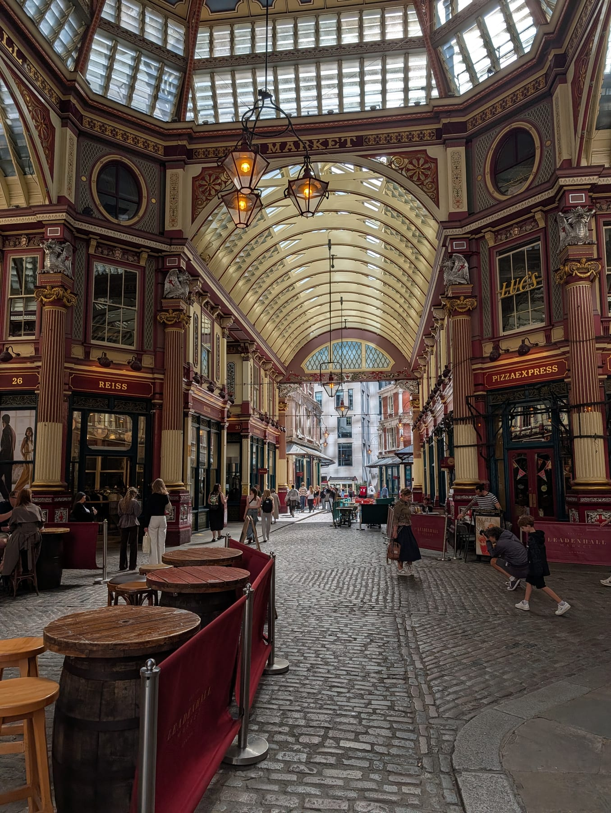
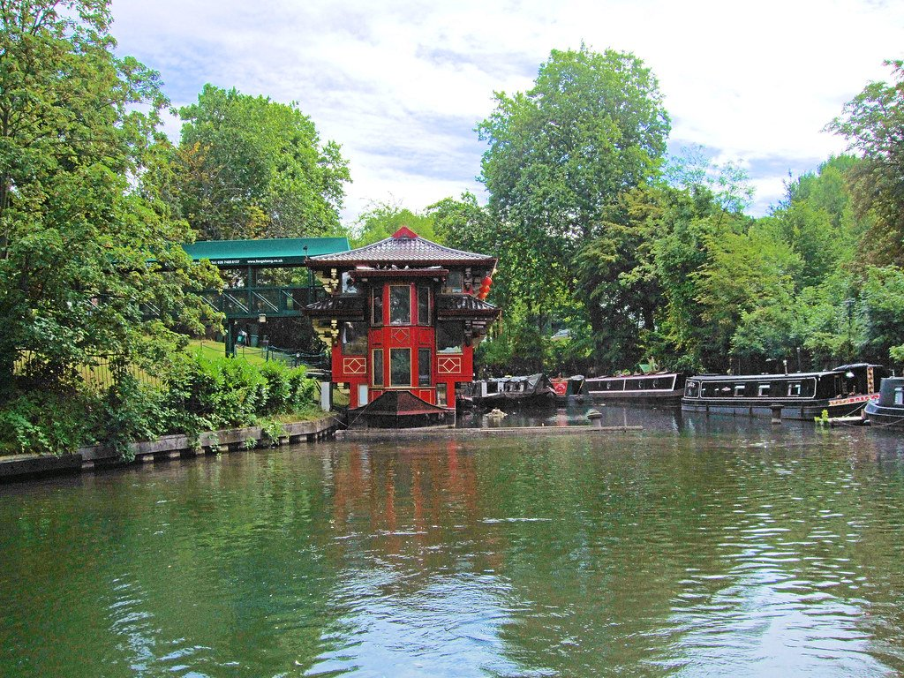
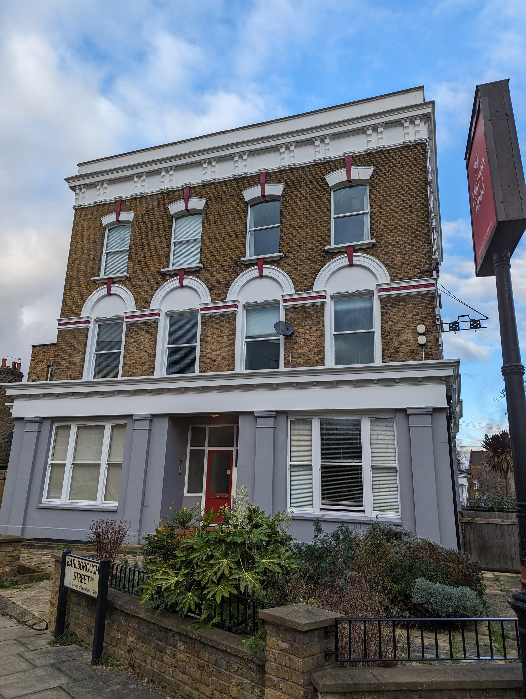
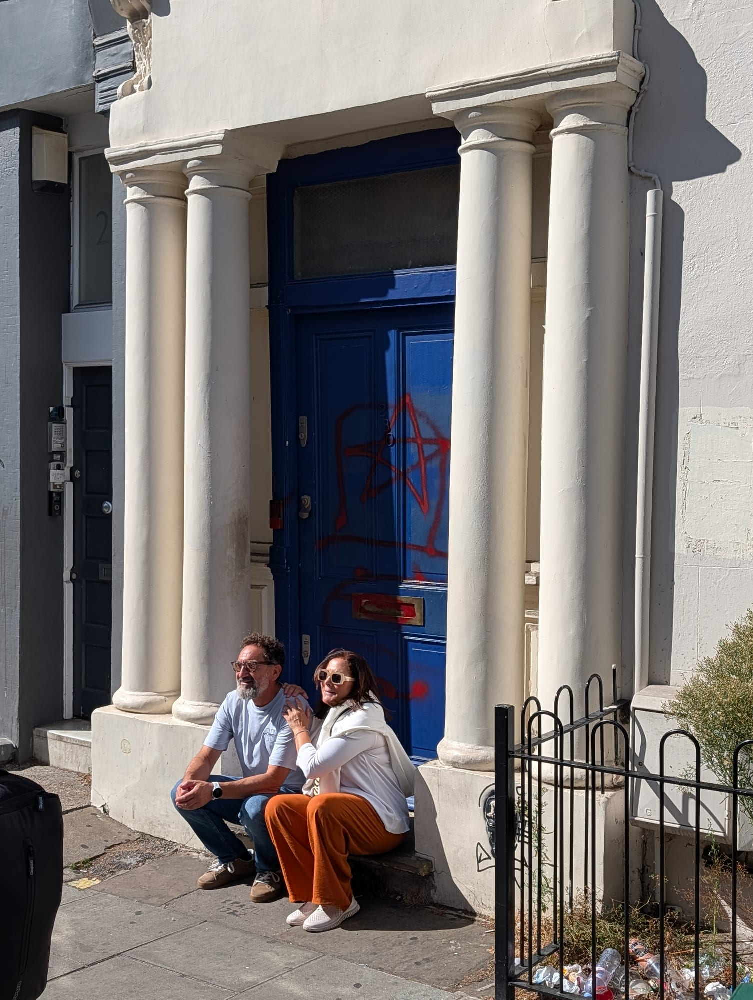
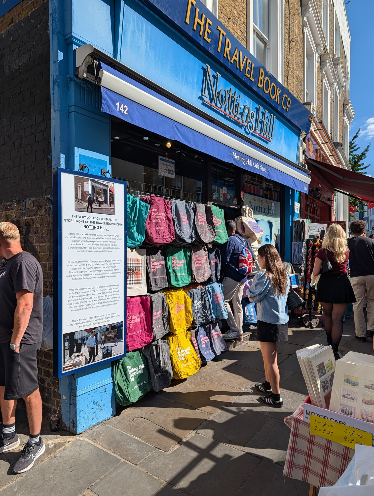
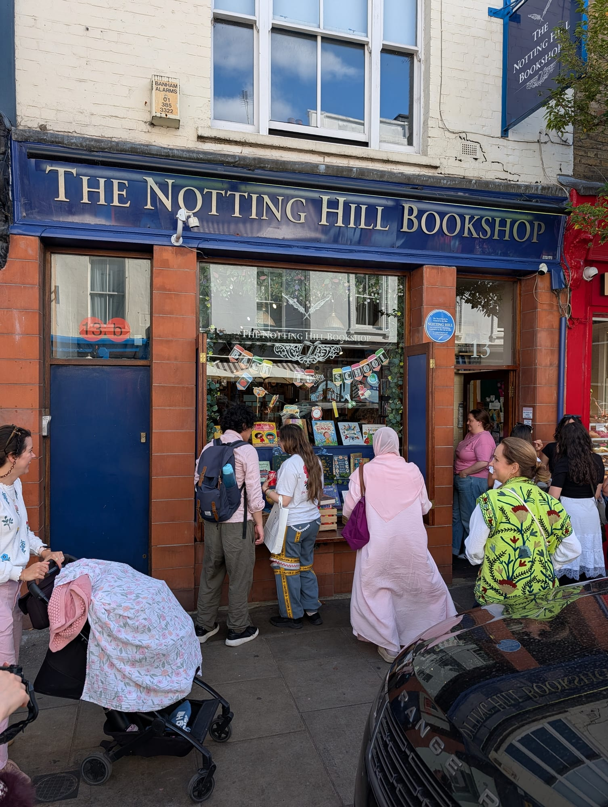
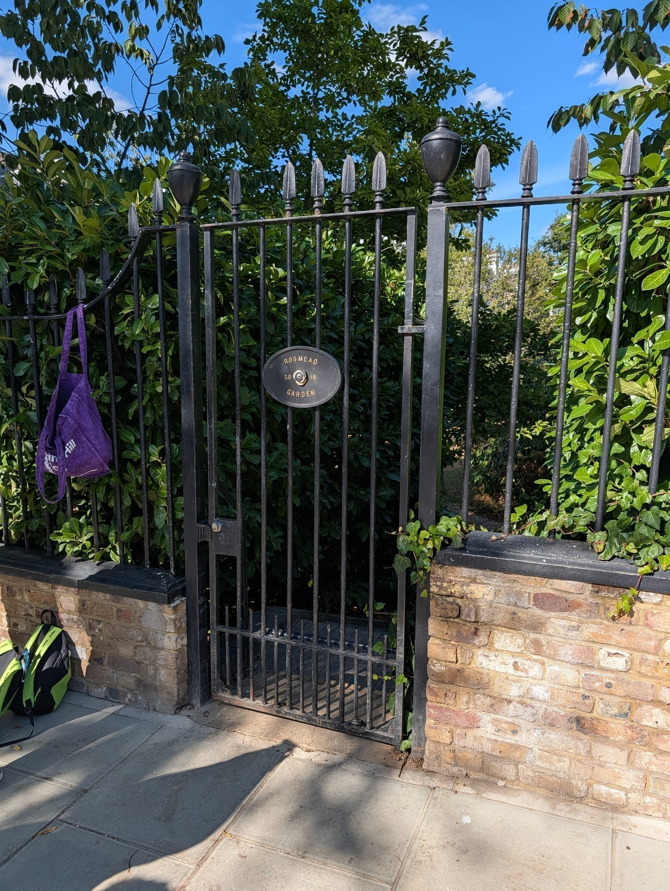
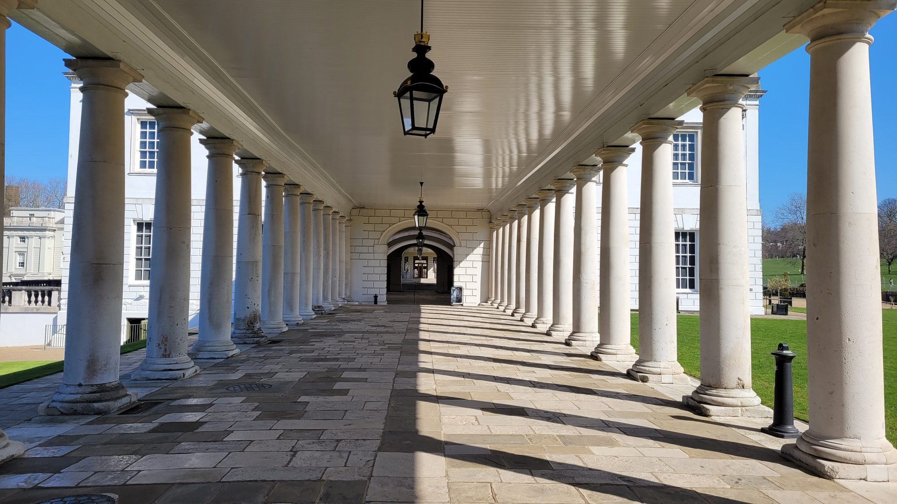
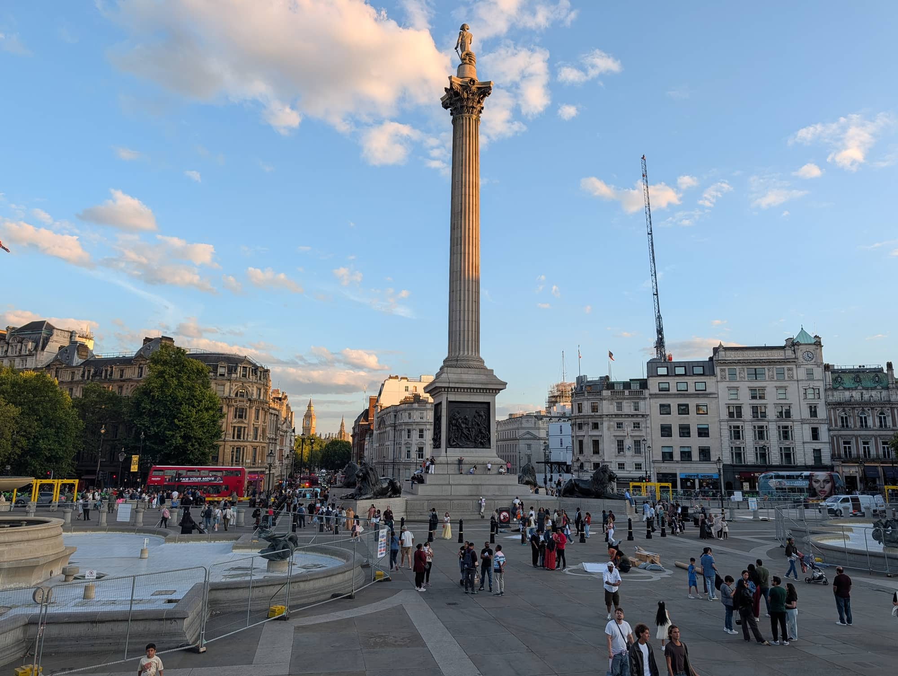
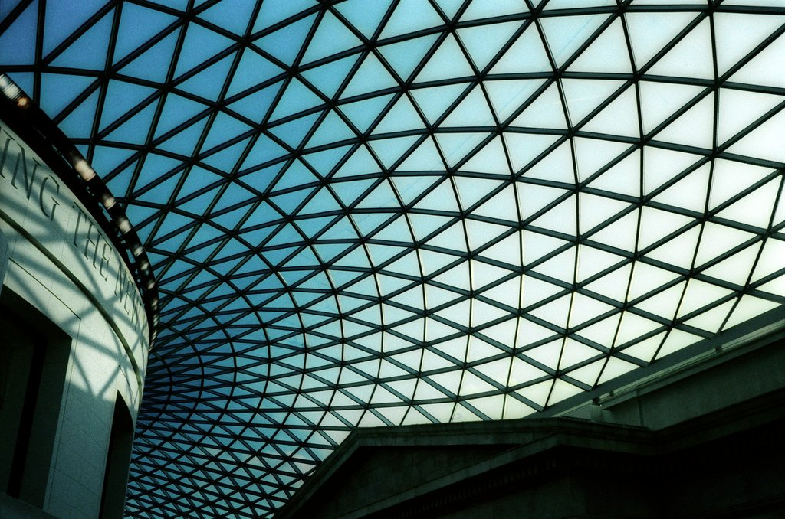

Most of London's filming locations are ordinary streets you can walk down for nothing. Gringotts is a working high commission, Sherlock's flat is on the wrong road, and the Shanghai hotel pool in *Skyfall* is in Canary Wharf.

> 💡 **The Short Version:** **Australia House** is Gringotts and you cannot go in. **North Gower Street** is Sherlock's Baker Street. **Aldersgate Street** has the Slough House door. **Leadenhall Market** is the way to the Leaky Cauldron. And **Rules** in Covent Garden is Bond's favourite restaurant, written into *Spectre*.

> 📘 **How we choose these (editorial note).**
> No paid placements. Locations are the ones confirmed by production credits, location agencies or the films themselves. Several are private or working buildings, and none of this is an invitation to trespass.

## Where they are

| If you are near… | What was filmed there |
| --- | --- |
| **The City** | Slow Horses, Snatch, Harry Potter (Leadenhall) |
| **Clerkenwell** | Batman — Gotham police station |
| **Covent Garden & Strand** | Harry Potter (Gringotts), Spectre (Rules), Notting Hill (The Savoy) |
| **Euston** | Sherlock |
| **Bethnal Green** | Snatch |
| **Canary Wharf** | Skyfall, 28 Weeks Later, Layer Cake |
| **Camden & Primrose Hill** | Paddington |
| **Greenwich** | Les Misérables, The Crown, Thor |
| **Regent's Park** | The Gentlemen, Slow Horses |
| **Notting Hill** | Notting Hill — the blue door, the bookshop, Rosmead Garden |

---

## Harry Potter

> 🚶 **Walk them in order:** [the Harry Potter filming locations walk](/articles/harry-potter-filming-locations-walk/) links nine Potter locations from Leadenhall Market to Lambeth Bridge, with the days each one opens.

### Gringotts Wizarding Bank — Australia House, Strand

*Exterior only*

The **ornate banking hall of Australia House** played Gringotts in the first film, chandeliers and marble intact.

It is a real working High Commission, so **the interior is not open to visitors**. Open House London weekends in September are the only way in, and they are balloted.

The exterior on the Strand is free to look at at any hour, and it is a **two-minute walk from Somerset House** below. **Strand WC2B 4LA**, with Temple and Covent Garden about five minutes away in either direction.

### Leadenhall Market, City of London

*Free*

An 1881 covered market in cream, maroon and green wrought iron, used in the first film for **the London streets Hagrid walks Harry down to the Leaky Cauldron**. Diagon Alley itself was a set. The blue door that served as the entrance to the Leaky Cauldron is now Two Eyes Coffee House on Bull's Head Passage, which shares the building with an opticians.

**Free to walk through and roofed, so it works in rain.** The shops and bars keep weekday hours, so it is fullest on a weekday evening around six and close to dead on a Sunday. **Gracechurch Street EC3V 1LT**, two minutes from Bank or Monument.

### Platform 9¾, King's Cross

*Free*

The trolley embedded in a wall, with a permanent queue, a staff member to swing the scarf and a photographer to sell you the result.

**The on-screen barrier was actually shot between platforms 4 and 5**, and the trolley sits in the western departures concourse, nowhere near either.

**Free to look at, and free to photograph yourself** — the paid photographer is optional and the staff will use your own phone. Expect a long wait at weekends and in school holidays; first thing in the morning is quietest. The shop beside it needs no ticket.

**King's Cross station N1 9AP**, and it is inside the barrier-free part of the concourse, so you do not need a train ticket to reach it.

---

### The Millennium Bridge — Bankside

*Free · open at all times*

Destroyed by Death Eaters in the opening minutes of **Harry Potter and the Half-Blood Prince (2009)**, writhing and collapsing into the Thames while Muggle London watches.

It survived in reality. The walk across gives a straight-on view of St Paul's, because the bridge is aligned on the dome.

**Free and open at all times**, two minutes from Tate Modern and five from St Paul's. **SE1 9JE.** Go early on a weekday if you want the axis to yourself.

### Claremont Square — Islington

*Free · viewable from the pavement*

**12 Grimmauld Place** was a set built at Leavesden, but it was modelled on this Georgian terrace above the Angel.

The centre of the square is a covered Victorian reservoir, which is why the grass rises above street level.

**A private residential square, so this is a pavement visit.** Keep the noise down and do not photograph through windows. There is no marker or plaque.

**Claremont Square N1 9LY**, five minutes from Angel and about the same from King's Cross, so it is an easy add-on to Platform 9¾.

### London Zoo's Reptile House — Regent's Park

*Closed*

Where Harry discovers he can talk to snakes and Dudley ends up behind the glass, in **the Philosopher's Stone (2001)**.

**London Zoo closed the 1926 Reptile House to the public in 2023**, and its reptiles moved to a new building, the Secret Life of Reptiles and Amphibians, from Easter 2024. There is no longer anything from the scene to see, so do not buy a zoo ticket for it.

## Bond

### Rules, Covent Garden

*Open · book a table*

**Trading since 1798**, and calling itself London's oldest restaurant, Rules is written into *Spectre* as Bond's own regular — M meets him here.

Game is the speciality, served in season from the restaurant's own estate in the Pennines: grouse from mid-August, then partridge, pheasant and venison through the autumn.

**Book well ahead.** It is small and heavily panelled, and the ground-floor room is the one from the film. Prices are special-occasion prices.

It is in **Covent Garden, a few minutes from the piazza**.

### Skyfall's "Shanghai" pool — Canary Wharf

*Hotel*

Bond's Shanghai hotel pool was filmed **at the riverside hotel at 46 Westferry Circus**, then the Four Seasons and now Canary Riverside Plaza.

**It is a working hotel pool**, so access is for guests, and there is no viewing. The **towers outside** are the free photograph.

**Westferry Circus E14 8RS**, five minutes from Canary Wharf station. Bōkan's rooftop, at the Novotel on Marsh Wall a few minutes away, gives you the same skyline from above without a hotel booking.

---

### Somerset House — Strand

*Free courtyard · exhibitions ticketed*

Bond drives a **tank through St Petersburg** in **GoldenEye (1995)** — in a courtyard three minutes' walk from Waterloo Bridge. The neoclassical facades passed for Russian imperial architecture.

**The courtyard is free and open daily**: fifty-five fountains you can walk through in summer, and an ice rink from 11 November 2026 to 10 January 2027. Exhibitions inside are ticketed and separate.

**Strand WC2R 1LA**, with Temple two minutes away and Covent Garden five, and the river terrace at the back is also free.

### The National Gallery — Trafalgar Square

*Free*

Bond meets Q on a bench in front of **Turner's The Fighting Temeraire** in **Skyfall (2012)**.

**The painting is on permanent display and free to see**, with no ticket and no booking. The gallery opens late on Fridays, when the room is emptier.

**Trafalgar Square WC2N 5DN**, two minutes from Charing Cross.

### The Treasury Building — Great George Street

*Free to view from the street*

The Edwardian government block off Whitehall stands in for the security establishment Bond spends **Spectre (2015)** fighting.

**The building is not open to the public**, so look from the street.

The **Churchill War Rooms occupy the basement of the same block**, preserved as they were left in 1945. They are ticketed (£34 for an adult) and best booked ahead.

**Great George Street SW1P 3AL**, three minutes from Westminster, and St James's Park is the quieter approach.

Powered by <a target="_blank" rel="sponsored" href="https://www.getyourguide.com/london-l57/">GetYourGuide</a>

## Television

### Slough House — Aldersgate Street, City of London

*Free · exterior*

The grubby door the slow horses trudge through in nearly every episode is **a real one**, on the corner of Aldersgate Street opposite the Barbican. The interiors — the damp, the piles of paper, Lamb's office — are a set built elsewhere.

**Free to see from the pavement, at any time.** It is a doorway above an Italian restaurant on the corner of Aldersgate and Carthusian Street.

**126 Aldersgate Street EC1A 4JQ**, two minutes from Barbican station. Smithfield and the Farmiloe Building (further down this page) are within five minutes, and the Charterhouse is on the same corner.

### Sherlock's 221B — North Gower Street, Euston

*Free · exterior*

The BBC filmed its 221B exterior here rather than on the real, much busier Baker Street. **Speedy's Sandwich Bar & Café next door is real and trading.** **187 North Gower Street NW1 2NJ**, three minutes from Euston Square.

For the museum, the statue, the pub's replica study and Arthur Conan Doyle's own London, see our full [Sherlock Holmes in London](/articles/sherlock-holmes-london/) guide.

### The Crown's Buckingham Palace — Old Royal Naval College, Greenwich

*Grounds free*

Wren's riverside campus stands in for **Buckingham Palace's exterior and courtyard** throughout *The Crown* — the real palace does not allow filming, so almost every screen version of it is somewhere else.

The same buildings have played 1830s Paris in *Les Misérables*, Asgard in *Thor: The Dark World*, and the Italian cafe where Alfred spots Bruce Wayne at the end of *The Dark Knight Rises*. The college says it has featured in more than 300 productions.

**The grounds are free and open daily**; the Painted Hall and the Chapel are ticketed separately. Allow an hour for the grounds alone, and combine it with the Cutty Sark five minutes away and the free Greenwich Park panorama ten minutes uphill.

**King William Walk SE10 9NN.** Cutty Sark DLR is the nearest, or arrive by river: the boat from Westminster takes about an hour.

---

### Sherlock's fall — St Bartholomew's Hospital, Smithfield

*Free to view · working hospital*

Sherlock jumps from the roof of the pathology block in **The Reichenbach Fall (2012)** — the same building where Holmes and Watson first meet in Conan Doyle's own books. Barts is also **the oldest hospital in Britain still on its original site**, founded in 1123; the exterior and square are public, but it's a working hospital, so keep clear of patients and staff.

For the full story, and the museum's own Conan Doyle plaque, see our [Sherlock Holmes in London](/articles/sherlock-holmes-london/) guide.

## Guy Ritchie's London

### Snatch's Pawn Shop and Tailor, Bethnal Green

*Free · exteriors*

Several genuine East End addresses, including **Bethnal Green Town Hall** as Franky Four Fingers's tailor.

**Exteriors are free to see at any time.** The Edwardian town hall is now the Town Hall Hotel, and its bar and restaurant are open to non-residents, so you can sit inside the shot.

The pawn shop was at **88 Teesdale Street E2 0AA**; the frontage was dressed for filming, has since reverted and is not marked.

Bethnal Green station is five minutes from both, and Columbia Road and Brick Lane are a short walk away.

### Snatch's Diamond Store, Hatton Garden

*Free*

Doug the Head's diamond shop sits on **Hatton Garden, London's diamond district**, where roughly three hundred jewellery businesses trade on and around one street.

**Free; the shops are open on weekdays and shuttered at weekends.**

The shop used in the film is **Premier House, 12-13 Hatton Garden EC1N 8AN**, a working commercial building you look at from the pavement. **Ye Olde Mitre**, an old pub, is down an alley off the street nearby.

Farringdon and Chancery Lane are both about five minutes. The same stretch played Greenwich Village in *Eyes Wide Shut* — see below.

### Feng Shang Princess, Regent's Canal

*Open · a restaurant*

The floating Chinese pagoda appears in *The Gentlemen* and as a backdrop in *Slow Horses*, and it is three tiers of red and gold moored permanently at Cumberland Basin, in service since 1983.

**It is a working restaurant, and you can book a table on it.** Cantonese, with dim sum at lunch. It does not open every day, so check before walking out there.

**Cumberland Basin, Prince Albert Road**, about ten minutes from Camden Town — and you pass it anyway on the towpath walk between Little Venice and Camden Lock, which is the best way to arrive.

*Feng Shang Princess at Cumberland Basin. Photo: [Jim Linwood](https://www.flickr.com/photos/54238124@N00/14431541920), [CC BY 2.0](https://creativecommons.org/licenses/by/2.0/).*

---

Powered by <a target="_blank" rel="sponsored" href="https://www.getyourguide.com/london-l57/">GetYourGuide</a>

## Horror and comedy

### The Winchester — Duke of Albany, New Cross

*Free · exterior only, and not a pub any more*

The pub Shaun and Ed barricade themselves in for the finale of *Shaun of the Dead* (2004) was a real one: **the Duke of Albany**, on Monson Road in New Cross. It closed in 2008 and was converted into flats, so there is no pub to visit — just the building, recognisable from the film but now somebody's front door.

*The former Winchester, now flats.*

> ⚠️ **Do not turn up expecting a pint.** This is a residential building. Look from the street and move on.

## Notting Hill

Four addresses within fifteen minutes of each other.

### The blue door — 280 Westbourne Park Road

*Free · exterior only, and it is somebody's front door*

William Thacker's flat. Screenwriter Richard Curtis owned the real house and lived behind that door.

*The blue door.*

> ⚠️ **People live here.** It is a private flat on an ordinary street. Photograph from the pavement and do not sit on the step, however many others are doing exactly that.

### The travel bookshop that was filmed — 142 Portobello Road

*Free · a gift shop you can walk into*

**This is the shopfront in the film**, and it was an antiques arcade at the time it was shot — the interior was built elsewhere. It has been a shoe shop, a store called Notting Hill from 2006, and a gift shop since 2014, which now paints THE TRAVEL BOOK Co across the fascia and puts a board outside explaining the whole history.

*The Travel Book Co, Portobello Road.*

### The bookshop that inspired it — 13 Blenheim Crescent

*Free · a real working bookshop*

**Nothing was filmed here.** The Travel Bookshop that gave Curtis the idea traded on Blenheim Crescent for about thirty years and closed in 2011; it reopened as **The Notting Hill Bookshop** and sells books to this day.

**Portobello Road is where the camera was; Blenheim Crescent is where the idea came from.** They are ten minutes apart, and the second sells books.

### Rosmead Garden — Rosmead Road

*Free to look at · you cannot go in*

The private communal garden William and Anna climb into, in the scene with the bench. It is a keyholders' garden for the surrounding houses, permanently locked, marked only by a small oval plaque on the gate.

> ⚠️ **There is no public access.** You look through the railings.

If you came for the houses, not the film, the pastel streets are mapped in walking order in our [Notting Hill colourful houses route](/articles/notting-hill-colourful-houses/).

## Batman and dystopia

### Gotham City Police Station — Farmiloe Building, Clerkenwell

*Exterior only*

A grand Victorian former lead-manufacturing warehouse on St John Street, used for **Gotham City Police Department interiors in Batman Begins and The Dark Knight Rises**. **Exterior only and privately owned.** It has since been redeveloped, so the interiors are no longer available as a film location.

**28-36 St John Street EC1M 4AY**, five minutes from Farringdon and about the same from Barbican. Smithfield Market is across the road and the Slough House doorway is a five-minute walk, so all three fit into one loop.

### 28 Weeks Later — Isle of Dogs

*Free*

The Isle of Dogs plays **"District 1"**, the US-military quarantine zone where survivors are resettled. **Free and open at all times.** The **DLR is the way to do it**: ride it from Bank through Canary Wharf to Island Gardens, sitting at the front, in about twelve minutes.

The **South Quay footbridge** is the specific structure used for the quarantine-zone crossing, and the **Greenwich Foot Tunnel** at the southern tip is used in a chase sequence in the same film — free, open around the clock, with lifts now running 24 hours.

---

## Paddington

### The Brown family home — Primrose Hill

*Free · a residential street*

The fictional **32 Windsor Gardens** is a pastel-painted Primrose Hill crescent — Chalcot Crescent, which also supplied Phoenix Buchanan's house in the sequel. There is no marker and no blue front door; the paintwork was done for the film.

**It is a private residential street.** Look from the pavement, do not linger outside individual houses, and do not knock. Chalk Farm is five minutes away, and Primrose Hill, with its protected view over the city, is two streets on.

There is also a free, self-guided **Paddington Bear trail** around Paddington station, and a **statue on the concourse** by platform 1.

---

---

Powered by <a target="_blank" rel="sponsored" href="https://www.getyourguide.com/london-l57/">GetYourGuide</a>

## Blockbusters

### The Old Royal Naval College — Greenwich

*Free grounds · Painted Hall ticketed*

Thor and Malekith fight through Wren's colonnades in the finale of **Thor: The Dark World (2013)**, with Greenwich playing itself.

**The grounds are free and open daily**, and you can walk the colonnades the fight runs through. The **Painted Hall is ticketed**: Thornhill spent nineteen years on the ceiling, and the price includes a hand mirror so you can look up comfortably.

**King William Walk SE10 9NN.** Allow an hour for the grounds, two if you go inside. The Cutty Sark and the free Greenwich Park viewpoint are both within ten minutes.

### Trafalgar Square — Westminster

*Free · open at all times*

Dressed as 1918 London for the Armistice celebrations that close **Wonder Woman (2017)**.

**Free and always open**, with no gates and nothing to book. The **National Gallery on the north side is free too**, and holds the Turner from *Skyfall* (see above), ninety seconds away.

**WC2N 5DN**, two minutes from Charing Cross.

### Canary Wharf Underground Station — Isle of Dogs

*Free to walk through*

Norman Foster's ticket hall played an **Imperial facility in Rogue One (2016)**.

**A working Jubilee line station**, so you need a valid fare to be on the platforms — but the ticket hall itself is before the gateline and free to walk through, which is the part that appears on screen.

**Quietest at weekends**; weekday rush hours are the worst time.

The station sits under Canada Square Park, and Bōkan and the *Skyfall* hotel are both within a few minutes.

### Blackfriars Bridge — City of London

*Free · open at all times*

Tom Cruise runs along the top of the bridge in the chase that ends at Tate Modern in **Mission: Impossible — Fallout (2018)**, having already run across the roof of Blackfriars station.

**View the run from the Thames Path** on the south bank, looking north: the bridge, the station roof he crosses first and St Paul's in one frame.

**Free and open at all times**, and a five-minute walk from Tate Modern where the chase ends, so the whole sequence is walkable in about fifteen minutes. Blackfriars station has entrances on both banks.

The **Millennium Bridge is three minutes upstream**, so the Harry Potter and Mission: Impossible locations pair naturally.

---

## London playing somewhere else

### Hatton Garden — Clerkenwell

*Free · a working street*

Kubrick would not fly to New York, so American shopfronts and a payphone were added to this stretch of London's jewellery quarter to turn it into **Greenwich Village for Eyes Wide Shut (1999)**, where Tom Cruise's character is followed through the night.

**Nothing marks it** — it is a working street of jewellers, open in shop hours and busy on weekdays. The same street appears in *Snatch* below, as itself.

### The British Museum — Bloomsbury

*Free*

The museum sequence in **The Mummy Returns (2001)** was filmed at the museum itself — though the exterior shots used **UCL's front quad** up the road, because the real facade was behind scaffolding at the time. Two Bloomsbury buildings, one museum, in the same film.

**Free and open daily**, with no ticket for the permanent collection and no booking needed. Use the **Montague Place entrance at the back** to avoid the queue on Great Russell Street.

The Egyptian sculpture gallery on the ground floor is where the film's museum scenes read from, immediately left of the Great Court.

**Great Russell Street WC1B 3DG.** Tottenham Court Road, Holborn and Russell Square are all about five minutes, and Friday is the late night.

### Paddington Station — Paddington

*Free to walk through*

Eloise steps off the train from Cornwall under Brunel's roof at the start of **Last Night in Soho (2021)**. The same shed appears in both **Paddington** films.

**Free to walk through and open around the clock** — the concourse is outside the ticket barriers, so you need no fare to stand under Brunel's 1854 roof. The **Paddington Bear statue sits on platform 1**, near the Praed Street end, and there is a small shop beside it; both are free to reach.

**Mid-morning or after eight in the evening** is quietest.

**W2 1HQ**.

### Parliament Square — Westminster

*Free · open at all times*

Bridge Street and Parliament Street were closed overnight to film the masked crowd converging on Westminster in **V for Vendetta (2005)**.

**Free and always open**, with no gates — though the square is **often partly fenced** for works, ceremonies or demonstrations, and the pavement around Parliament has short-notice closures.

The statues around the edge include Churchill, Mandela, Gandhi and, since 2018, Millicent Fawcett, the first woman commemorated here.

**SW1P 3BD**, two minutes from Westminster station, and the *Suffragette* and *Spectre* locations are both within a five-minute walk.

Powered by <a target="_blank" rel="sponsored" href="https://www.getyourguide.com/london-l57/">GetYourGuide</a>

## What it costs

**Almost all of it is free**, because a filming location is usually just a street.

* **Free and public:** Leadenhall Market, Millennium Bridge, Borough Market, the South Bank, St Pancras, Notting Hill's streets and almost every exterior in this guide.
* **Ticketed:** the **Warner Bros. Studio Tour** at Leavesden needs booking weeks ahead, and it is a studio tour, not a location. **Platform 9¾** at King's Cross is free to look at; the photograph with the trolley and scarf is the paid part.
* **Working buildings.** Several locations here are private homes, offices or churches. Look at exteriors; do not go in.

---

## Can you watch filming in London?

Only if you come across one. Nobody publishes a schedule of London shoots with a street and a date; productions tell residents and businesses on the street.

> ⚠️ **Do not plan a trip around catching a shoot.** The monthly roundup names productions and sometimes a borough, never a street or a date. The one thing you can book is the film tour at Greenwich.

### The one official feed

Film London, the capital's film agency, posts a monthly "What's On Screen and Filming" roundup on its [news pages](https://filmlondon.org.uk/latest). It names the productions filming in London that month, such as Bridgerton series five and the second series of HBO's Harry Potter in October 2026, and sometimes a borough. It gives no dates and no streets.

Spotlight and Screen Daily list productions the same way, by title.

### How to tell you have found one

Residents hear through a letter from the production and signs on the parking bays being suspended, according to [FilmFixer](https://filmfixer.co.uk/information-for-residents/), the film office for Camden, Southwark, Royal Greenwich, Kensington and Chelsea and Tower Hamlets. Productions are also expected to put up "Filming in Progress" signs.

Small shoots give less warning. A Westminster crew of five or fewer on a pavement, with handheld kit only, needs no application to the council.

### Where shoots keep happening

- **Old Royal Naval College, Greenwich.** The college says it has featured in more than 300 productions over 100 years and calls itself the UK's most filmed heritage location. Its film tours leave from the Visitor Centre: "Wigs, Weddings, Powder and Palaces" on Saturdays at 11.30am and 1.30pm, and "Spies, Sleuths and Superheroes" on Sundays at 11.30am. Each takes 1 hour 15 minutes and costs £25 for adults and £10 for children. Book on the college's [Saturday](https://ornc.org/whats-on/wigs-weddings-powder-and-palaces-film-tour/) or [Sunday](https://ornc.org/whats-on/film-tour-spies/) tour page. The grounds are free, and our [Greenwich guide](/articles/greenwich-area-guide/) covers the rest of the day.
- **Senate House, Bloomsbury.** *Spider-Man: Brand New Day* used the 19-storey Art Deco tower as the Department of Damage Control, according to [FilmFixer](https://filmfixer.co.uk/spiderman-brand-new-day/).
- **The City.** The City of London Corporation lists Leadenhall Market, Smithfield Market, Guildhall, the Millennium, London, Southwark and Blackfriars bridges, the Old Bailey, the Monument and the Barbican Estate as places where crews must apply to it.
- **Soho, Chinatown, Trafalgar Square and the streets round Big Ben.** Westminster names these as its main filming streets.
- **Richmond Green.** Film London describes Ted Lasso series four filming here, with fans photographing the pub and bench a few metres from the crew.

The [Bridgerton guide](/articles/bridgerton-london/) and the [Harry Potter filming locations walk](/articles/harry-potter-filming-locations-walk/) cover those productions' own locations.

### If you walk into one

Crews hold pedestrians between takes with lock-offs: marshals stop people at the edge and direct them round the set. Do what the marshals say. Westminster expects crews to leave 2 metres of pavement clear, so you should still be able to get past.

FilmFixer notes that English law gives you no right not to be filmed in public.

Police cars, uniformed actors and guns are usually staged. The City of London requires police at shoots with replica firearms, emergency-service vehicles or actors dressed as police, fire or military, and the Met's Film Unit warns local officers and armed response teams about replica firearms in advance, under Film London's [Code of Practice](https://filmlondon.org.uk/resource/code-of-practice).

### Being an extra

This is not open to visitors. [Casting Collective](https://www.castingcollective.co.uk/artiste/help), a UK agency for supporting artists, takes only people over 16 with the right to work in the UK and a National Insurance number, and checks passports, visas and right-to-work documents. It says supporting artists have been legally self-employed since 2014, and [gov.uk](https://www.gov.uk/standard-visitor) says a Standard Visitor cannot do paid or unpaid work for a UK company or as a self-employed person.

To be inside a production as a visitor, take free studio audience tickets instead: see our [guide to free TV and radio tickets](/articles/free-tv-show-tickets-london/).

---

## What to know

* **Australia House and the Farmiloe Building are working buildings.** Exterior views only.
* **Leadenhall Market never closes** — the arcade is a public thoroughfare. The shops and bars inside keep City hours, though weekend pop-up markets also run there.
* **The City cluster** — Slough House, Leadenhall, Hatton Garden, the Farmiloe Building — is walkable in under an hour.

---

## Continue planning your London trip

- 🎨 **[London's Street Art and Banksys](/articles/london-street-art/)**
- 🎪 **[Free Things to Do in London](/free/)**
- 🏛️ **[Historic Houses in London](/articles/historic-houses-london/)**
- 🏙️ **[City of London Area Guide](/articles/city-of-london-area-guide/)**
- 🎭 **[Covent Garden Area Guide](/articles/covent-garden-area-guide/)**
- ⛵ **[Greenwich Area Guide](/articles/greenwich-area-guide/)**
- 💃 **[Bridgerton in London](/articles/bridgerton-london/)**
