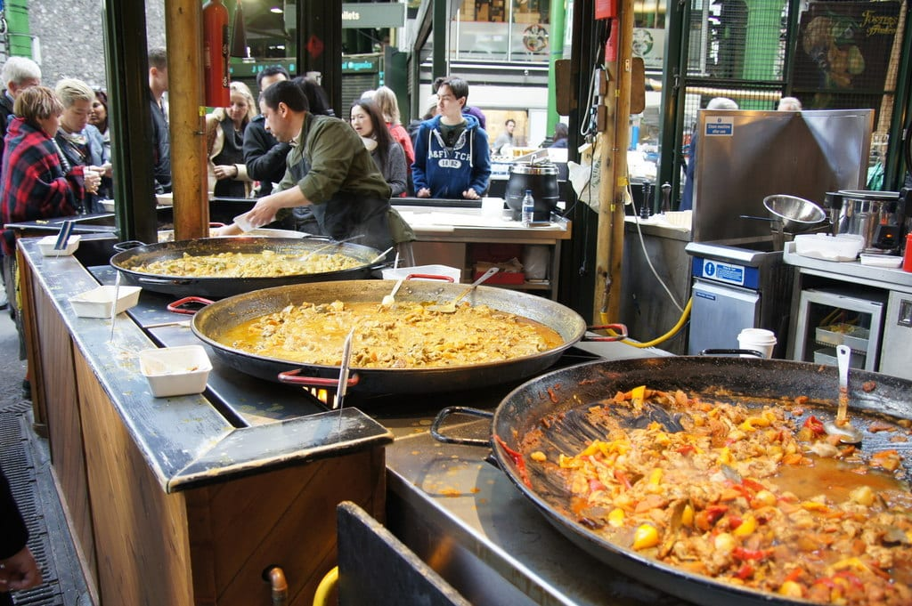
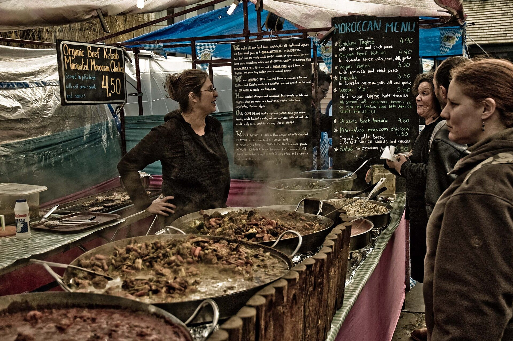
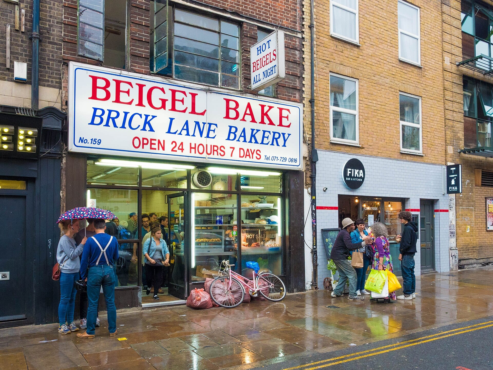
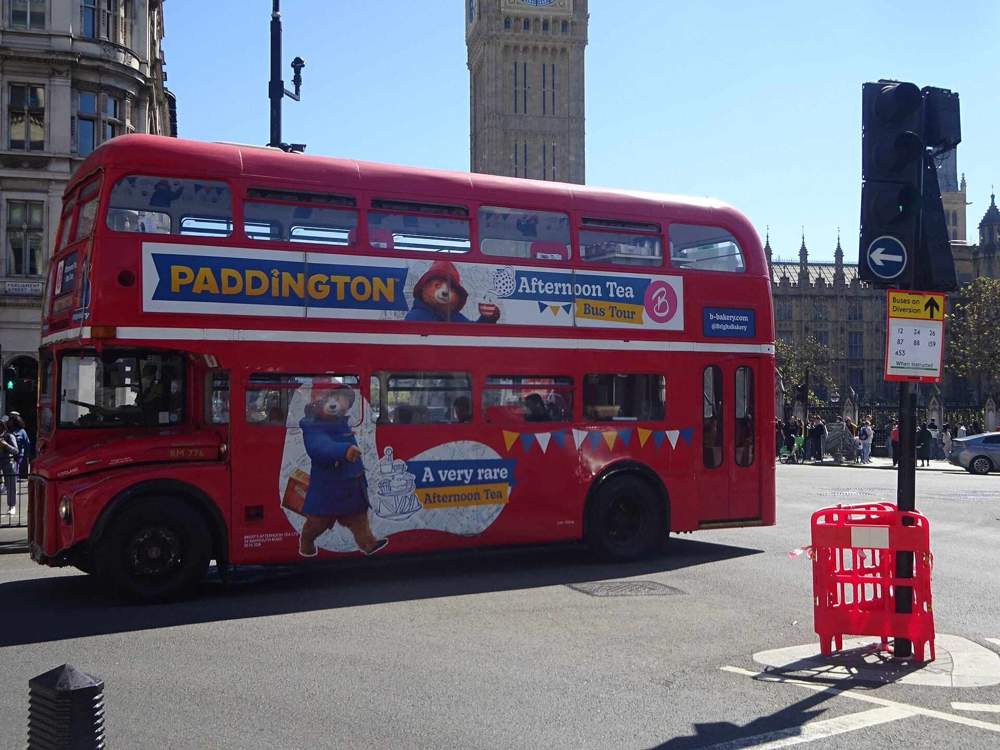

**Every tour on this page is bookable on GetYourGuide.** They fall into four kinds: a guided walk with tastings, a class where you make the food or drink, a tasting at a distillery or brewery, and afternoon tea on a bus.

> 💡 **The Short Version:** For a first visit, take the **Borough Market tour** (**£92**, three hours, 4.8 from 625 reviews). For a cheaper meal on foot, **No Diet Club's East London tour** is **£58**. For a market other than Borough, **Camden Market** has seven street-food tastings (**£92**). For a rainy day, the **Sipsmith distillery tour** (**£30**) and the **scone workshop** (**£23**) are both indoors. For a gift, **make your own gin** and take the bottle home (**£68**). For tea with a view, the **Great British Afternoon Tea Bus Tour** (**£59**) runs a vintage Routemaster.

> 📘 **Booking and prices.** We earn a commission if you book through our links; the price is the same either way. No operator paid to be included. Prices are the lowest adult price for the standard option and move with the date.

## The pick for each reader

| Best for | Tour | From | Length |
|---|---|---|---|
| A first visit | Borough Market, Secret Food Tours | £92 | 3 hours |
| Markets | Camden Market food tour | £92 | 3 hours |
| Budget | East London Food, No Diet Club | £58 | 3½ hours |
| A rainy day | Sipsmith gin distillery tour | £30 | 1½ hours |
| A gift | Make your own gin workshop | £68 | 2½ hours |
| Afternoon tea | Great British Afternoon Tea Bus Tour | £59 | 1½ hours |

## Market tours

### Borough Market — Secret Food Tours

*£92 · 3 hours · 4.8 from 625 reviews · <a href="https://www.getyourguide.com/activity/-t67794?partner_id=WWP7I0R&amp;cmp=london-food-tours" target="_blank" rel="sponsored nofollow noopener" data-affiliate="gyg">Book on GetYourGuide</a>*

Six or more British classics in and around **Borough Market** and London Bridge, with a drink, a dessert and a "secret" dish the guide doesn't name in advance. It is the most reviewed food tour on this page. To eat round the market on your own, our [Bankside and Borough walk](/articles/bankside-borough-walk/) has the route.

*Hot food stall at Borough Market. Photo: [Mike Pennington](https://commons.wikimedia.org/wiki/File:Stall_in_Borough_Market,_Southwark_-_geograph.org.uk_-_4414179.jpg), [CC BY-SA 2.0](https://creativecommons.org/licenses/by-sa/2.0/).*

Powered by <a target="_blank" rel="sponsored" href="https://www.getyourguide.com/london-l57/">GetYourGuide</a>

### Camden Market food tour — seven street-food tastings

*£92 · 3 hours · 4.9 from 42 reviews · <a href="https://www.getyourguide.com/activity/-t504469?partner_id=WWP7I0R&amp;cmp=london-food-tours" target="_blank" rel="sponsored nofollow noopener" data-affiliate="gyg">Book on GetYourGuide</a>*

Seven tastings at **Camden Market**: birria tacos, an artisanal gin, British cheeses and street food from around the world. Our [Camden area guide](/articles/camden-area-guide/) covers the rest of the neighbourhood.

*Moroccan food stall at Camden Market. Photo: [Rene Ehrhardt](https://commons.wikimedia.org/wiki/File:Moroccan_foods_at_Camden_Market_of_London.jpg), [CC BY 2.0](https://creativecommons.org/licenses/by/2.0/).*

### East End Food Tour — Eating London

*£89 · 3½ hours · groups of up to 12 · 4.9 from 88 reviews · <a href="https://www.getyourguide.com/activity/-t136652?partner_id=WWP7I0R&amp;cmp=london-food-tours" target="_blank" rel="sponsored nofollow noopener" data-affiliate="gyg">Book on GetYourGuide</a>*

Tastings along **Spitalfields Market, Brick Lane and Shoreditch**, with the street art on the way. Tripadvisor's Travellers' Choice 2025 ranked *Eating London: Brick Lane, Shoreditch & Spitalfields Food Tour* **No. 12 among the world's food and drink experiences**. For the same streets on foot without a guide, see our [Shoreditch and Spitalfields walk](/articles/shoreditch-spitalfields-walk/).

*Beigel Bake on Brick Lane. Photo: [chas B](https://commons.wikimedia.org/wiki/File:Beigel_Bake_Brick_Lane_London_2015-08-29.jpg), [CC BY 2.0](https://creativecommons.org/licenses/by/2.0/).*

## Neighbourhood tasting walks

### East London Food — No Diet Club

*£58 · 3½ hours · starts at midday · 4.9 from 141 reviews · <a href="https://www.getyourguide.com/activity/-t508003?partner_id=WWP7I0R&amp;cmp=london-food-tours" target="_blank" rel="sponsored nofollow noopener" data-affiliate="gyg">Book on GetYourGuide</a>*

Local cheese, ice cream, chai, pies and a bakery, between midday and 4pm. All the food is in the price, which makes it the cheapest tour here that works as lunch and the afternoon together.

### Authentic Indian Food Tour — East London

*£92 · 3 hours · 4.9 from 111 reviews · <a href="https://www.getyourguide.com/activity/-t67800?partner_id=WWP7I0R&amp;cmp=london-food-tours" target="_blank" rel="sponsored nofollow noopener" data-affiliate="gyg">Book on GetYourGuide</a>*

Six or more tastings at the Indian restaurants around **Brick Lane**, with only a little walking between them, so it suits anyone who doesn't want three hours on their feet. For a table of your own afterwards, see our [best Indian restaurants in London](/articles/best-indian-restaurants-london/).

### Soho and Chinatown — London's Best Bites

*£67 · 3 hours · 4.7 from 263 reviews · <a href="https://www.getyourguide.com/activity/-t943039?partner_id=WWP7I0R&amp;cmp=london-food-tours" target="_blank" rel="sponsored nofollow noopener" data-affiliate="gyg">Book on GetYourGuide</a>*

Mediterranean, Indian, Chinese and British food at **pre-booked tables with a set menu**, so there is no queueing and no choosing on the day. That also means dietary needs have to be sorted with the operator before you book. The route is the one in our [Soho and Chinatown walk](/articles/soho-chinatown-walk/).

### Notting Hill Food Walking Tour

*£76 · 2 hours · morning · 5.0 from 11 reviews · <a href="https://www.getyourguide.com/activity/-t1127788?partner_id=WWP7I0R&amp;cmp=london-food-tours" target="_blank" rel="sponsored nofollow noopener" data-affiliate="gyg">Book on GetYourGuide</a>*

A morning walk through **Notting Hill** to local bakeries and cafés and the market bites, with the area's history from the guide. See the [Notting Hill area guide](/articles/notting-hill-area-guide/).

### African and Caribbean Food Tour — Obi's, Brixton

*£90 · 3 hours · 4.9 from 192 reviews · <a href="https://www.getyourguide.com/activity/-t548968?partner_id=WWP7I0R&amp;cmp=london-food-tours" target="_blank" rel="sponsored nofollow noopener" data-affiliate="gyg">Book on GetYourGuide</a>*

African and Caribbean dishes through **Brixton**, with the area's multicultural history alongside. It is the only tour here in south London away from the river.

### Cheese Walking Tour

*£39 · 2 hours · 4.7 from 274 reviews · <a href="https://www.getyourguide.com/activity/-t399788?partner_id=WWP7I0R&amp;cmp=london-food-tours" target="_blank" rel="sponsored nofollow noopener" data-affiliate="gyg">Book on GetYourGuide</a>*

Two hours of cheese tastings with a guide, on foot. It covers one food only, so it costs less than the full-meal tours.

Powered by <a target="_blank" rel="sponsored" href="https://www.getyourguide.com/london-l57/">GetYourGuide</a>

## Cookery classes

### Traditional Pork Pie Cookery Class

*£60 · 3 hours · 4.9 from 18 reviews · <a href="https://www.getyourguide.com/activity/-t608869?partner_id=WWP7I0R&amp;cmp=london-food-tours" target="_blank" rel="sponsored nofollow noopener" data-affiliate="gyg">Book on GetYourGuide</a>*

You make **pork pies** under the instruction of the host, JoJo, or her team. It is the longer of the two classes.

### Scone Workshop and Afternoon Tea

*£23 · 1 hour · near Camden Market · 4.9 from 1,236 reviews · <a href="https://www.getyourguide.com/activity/-t826151?partner_id=WWP7I0R&amp;cmp=london-food-tours" target="_blank" rel="sponsored nofollow noopener" data-affiliate="gyg">Book on GetYourGuide</a>*

You bake **traditional British scones** a short walk from Camden Market, with a cup of tea while you work, and eat them warm from the oven with jam and cream. At £23 it is one of the cheapest bookings on this page. Our [Camden area guide](/articles/camden-area-guide/) has what to do after it.

## Gin and whisky

### Sipsmith Gin Distillery Tour and Tasting

*£30 · 1½ hours · 5.0 from 18 reviews · <a href="https://www.getyourguide.com/activity/-t1107345?partner_id=WWP7I0R&amp;cmp=london-food-tours" target="_blank" rel="sponsored nofollow noopener" data-affiliate="gyg">Book on GetYourGuide</a>*

You see the **copper stills** and hear the history of gin, then taste **four gins**. You leave with a gift bag holding two samples, and there is a gin shop to buy a full bottle from.

### Make Your Own Gin Workshop

*£68 · 2½ hours · 5.0 from 22 reviews · <a href="https://www.getyourguide.com/activity/-t928650?partner_id=WWP7I0R&amp;cmp=london-food-tours" target="_blank" rel="sponsored nofollow noopener" data-affiliate="gyg">Book on GetYourGuide</a>*

You smell and taste the **botanical distillates**, write your own recipe, then **craft, label and seal a bottle** to take home, and drink a gin cocktail while you're there. The take-home bottle makes it the best gift on this page.

### Bimber Distillery Tour

*£40 · 2 hours · <a href="https://www.getyourguide.com/activity/-t1289766?partner_id=WWP7I0R&amp;cmp=london-food-tours" target="_blank" rel="sponsored nofollow noopener" data-affiliate="gyg">Book on GetYourGuide</a>*

The tour explains how **single malt whisky is made in London** at Bimber, using traditional methods. It is the only whisky distillery visit on this page.

## Beer and wine

### 3 Locks Brewing Company Tour and Tasting

*£25 · 1½ hours · inside Camden Market · 4.9 from 28 reviews · <a href="https://www.getyourguide.com/activity/-t734568?partner_id=WWP7I0R&amp;cmp=london-food-tours" target="_blank" rel="sponsored nofollow noopener" data-affiliate="gyg">Book on GetYourGuide</a>*

A guided tour of an independent brewery in the middle of **Camden Market**, with a tasting where you drink beer **straight from the tank**. Combine it with the Camden Market food tour for a day in one place.

### Italian Wine Tasting at St Mark's Church, Mayfair

*£23 · 1 hour · 4.9 from 14 reviews · <a href="https://www.getyourguide.com/activity/-t1416129?partner_id=WWP7I0R&amp;cmp=london-food-tours" target="_blank" rel="sponsored nofollow noopener" data-affiliate="gyg">Book on GetYourGuide</a>*

An interactive tasting of **Italian wines** inside St Mark's, a historic church in **Mayfair**, guided by FirstGlass wine consultants, who help you work out which flavours you like. It is an hour indoors, so it fits a wet afternoon.

### Full-Day English Wine Tour with Lunch

*£150 · 8 hours · leaves London · 4.7 from 18 reviews · <a href="https://www.getyourguide.com/activity/-t222855?partner_id=WWP7I0R&amp;cmp=london-food-tours" target="_blank" rel="sponsored nofollow noopener" data-affiliate="gyg">Book on GetYourGuide</a>*

Three award-winning **English vineyards** in the countryside, with wines tasted at each and lunch. This one is a day out of the city rather than a London tasting. To drink wine in town, see our [London wine bars guide](/articles/best-wine-bars-london/).

## Afternoon tea on a bus

### Great British Afternoon Tea Bus Tour

*£59 · 1½ hours · 4.7 from 1,141 reviews · <a href="https://www.getyourguide.com/activity/-t860156?partner_id=WWP7I0R&amp;cmp=london-food-tours" target="_blank" rel="sponsored nofollow noopener" data-affiliate="gyg">Book on GetYourGuide</a>*

Afternoon tea on a **vintage Routemaster** bus, on a round-London sightseeing route, so you see the sights from your seat while you eat.

### Afternoon Tea Bus with a Glass of Prosecco

*£49 · 1½ hours · 4.4 from 2,156 reviews · <a href="https://www.getyourguide.com/activity/-t267952?partner_id=WWP7I0R&amp;cmp=london-food-tours" target="_blank" rel="sponsored nofollow noopener" data-affiliate="gyg">Book on GetYourGuide</a>*

A classic **double-decker** with sweet and savoury treats and a glass of **Prosecco**. It is the most reviewed tour on this page, and £10 cheaper than the Great British tour.

### Paddington Bear-Themed Afternoon Tea Bus Tour — Brigit's Bakery

*£48 · 1½ hours · 4.6 from 212 reviews · <a href="https://www.getyourguide.com/activity/-t433305?partner_id=WWP7I0R&amp;cmp=london-food-tours" target="_blank" rel="sponsored nofollow noopener" data-affiliate="gyg">Book on GetYourGuide</a>*

The same format, with a Paddington theme for children and the grown-ups who take them. Brigit's Bakery runs it on a Routemaster.

*Brigit's Bakery's Paddington afternoon tea bus in Westminster. Photo: [Vintage Fan 5678](https://commons.wikimedia.org/wiki/File:Paddington_Bear_Afternoon_Tea_London_Routemaster_Heritage_bus_in_Westminster,_London_(April_2026).jpg), [CC BY-SA 4.0](https://creativecommons.org/licenses/by-sa/4.0/).*

For tea at a hotel table rather than a moving bus, our [afternoon tea guide](/articles/best-afternoon-tea-london/) ranks the rooms, and [London tour buses compared](/articles/london-tour-buses-compared/) covers the sightseeing buses that don't serve tea.

Powered by <a target="_blank" rel="sponsored" href="https://www.getyourguide.com/london-l57/">GetYourGuide</a>

## Doing it yourself

You can eat your way round London without a guide, and the tours above are a good way to learn where to return. Our own guides cover the same ground:

* **Markets:** [the best London markets](/articles/best-london-markets/), including Borough, Camden and Spitalfields, with opening days.
* **Street food:** [the best street food in London](/articles/best-street-food-london/).
* **Afternoon tea:** [the best afternoon tea in London](/articles/best-afternoon-tea-london/).
* **Beer:** [the best craft beer pubs in London](/articles/best-craft-beer-pubs-london/).
* **Wine:** [the best wine bars in London](/articles/best-wine-bars-london/).
* **Cocktails and gin:** [the best cocktail bars in London](/articles/best-cocktail-bars-london/) and [the best speakeasy bars](/articles/best-speakeasy-bars-london/).
* **Old pubs:** [historic pubs and dining rooms in London](/articles/historic-pubs-dining-rooms-london/).
* **Prefer a walk with a guide but no food?** [The best walking tours in London](/articles/best-walking-tours-london/) covers history, ghosts, music and film.
