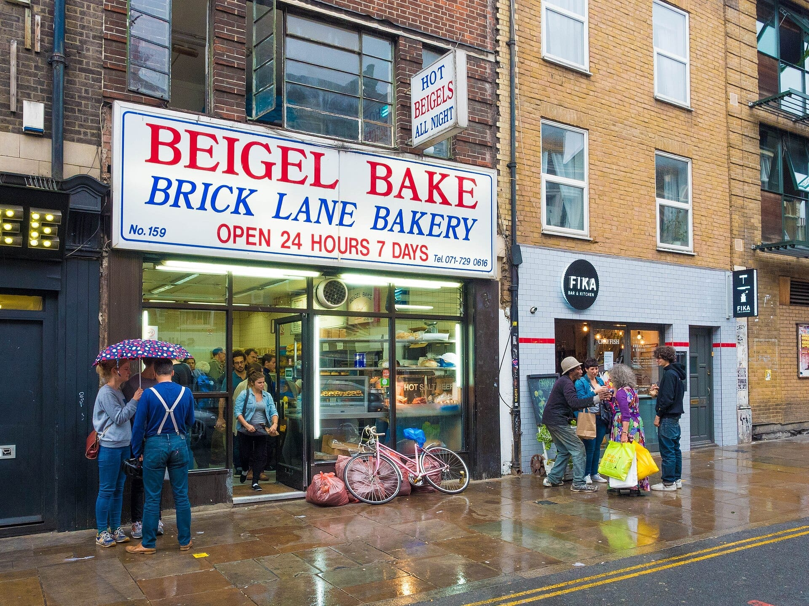
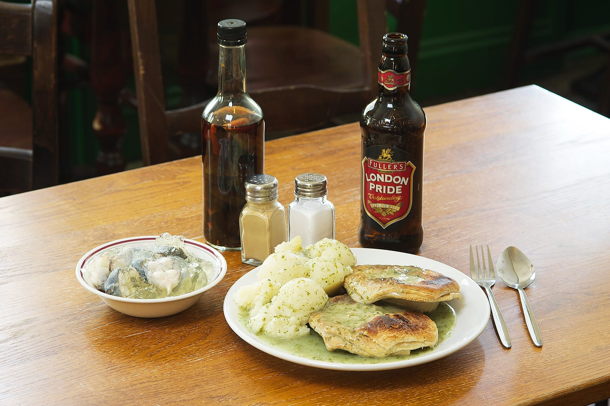
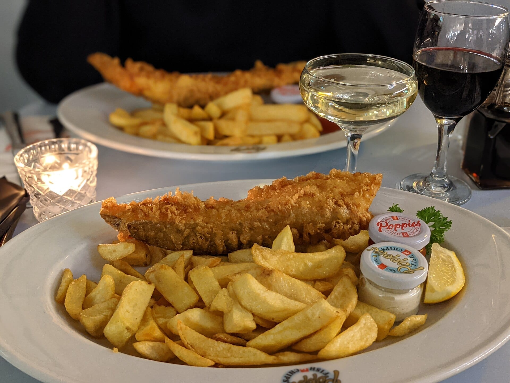
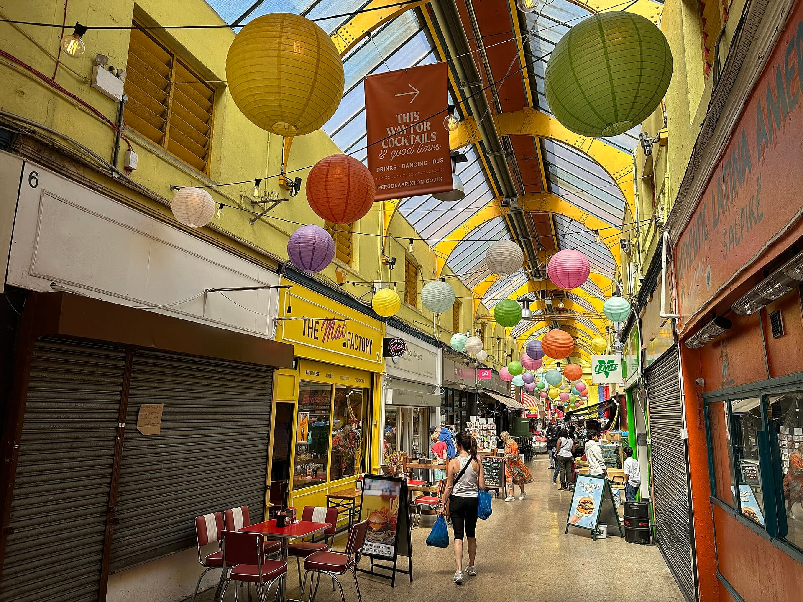

**London's best-known foods each have a place you can still eat them, and a few have a guided tour that includes them.** Some are old London trades, such as the pie and mash shop and the chippy. Others arrived with the people who settled in the East End, Chinatown and Brixton.

> 💡 **The Short Version:** Ten foods, and where to start with each.
>
> * **Salt beef beigel:** [Beigel Bake](#the-salt-beef-beigel), Brick Lane, open 24 hours.
> * **Pie, mash and eels:** [M. Manze](#pie-mash-liquor-and-jellied-eels) in Bermondsey or Goddards in Greenwich.
> * **Brick Lane curry:** [Aladin](#brick-lane-curry), Bangladeshi cooking on Brick Lane.
> * **Afternoon tea and the scone:** [The Langham's Palm Court](#afternoon-tea-and-the-scone), which says it has served tea since 1865.
> * **Cheese:** [Neal's Yard Dairy](#cheese-at-borough-market) at Borough Market.
> * **The full English:** [E. Pellicci](#the-full-english-and-the-caff), a Grade II listed caff in Bethnal Green.
> * **Fish and chips:** [Poppies](#fish-and-chips) in Spitalfields or the Golden Hind in Marylebone.
> * **Sunday roast:** [The Devonshire](#the-sunday-roast), Soho, booked three weeks ahead.
> * **Roast duck:** [Four Seasons](#roast-duck-in-chinatown), Gerrard Street.
> * **Caribbean food:** [Fish, Wings & Tings](#caribbean-food-in-brixton), Brixton Village.
>
> The East End food tour on GetYourGuide includes three of these in one afternoon: the beigel, the curry and the fish and chips.

> 📘 **Booking and prices.** We earn a commission if you book through our links; the price is the same either way. Tour prices are the lowest adult price and move with the date. Opening hours are the venues' own and are worth a glance before a long journey.

## The ten at a glance

| Food | Where to eat it | A tour that includes it |
|---|---|---|
| Salt beef beigel | Beigel Bake, Brick Lane | East End food tour, £89 |
| Pie, mash and eels | M. Manze, Bermondsey; Goddards, Greenwich | None |
| Brick Lane curry | Aladin, Brick Lane | Authentic Indian food tour, £92 |
| Afternoon tea and the scone | The Langham, Marylebone | Scone workshop, £23 |
| Cheese | Neal's Yard Dairy, Borough Market | Cheese walking tour, £39 |
| The full English | E. Pellicci, Bethnal Green | None |
| Fish and chips | Poppies, Spitalfields; Golden Hind, Marylebone | East End food tour, £89 |
| Sunday roast | The Devonshire, Soho | None |
| Roast duck | Four Seasons, Chinatown | Soho and Chinatown food tour, £67 |
| Caribbean food | Fish, Wings & Tings, Brixton Village | Brixton food tour, £90 |

## The salt beef beigel

Hand-carved salt beef with mustard and pickles in a beigel baked on the premises, the East End spelling on the signs. It belongs to the Jewish East End: [Time Out's history of the Brick Lane shops](https://www.timeout.com/london/things-to-do/the-chewy-twisted-history-of-the-brick-lane-bagel-shops) says a large Jewish community settled around Spitalfields from the late nineteenth century, and that a Bangladeshi community began moving in from the 1950s. [Beigel Bake](https://www.beigelbake.co.uk/) at 159 Brick Lane was opened in 1974 by Asher Cohen and his brothers in a former butcher's shop, and the family still runs it.

*Beigel Bake at 159 Brick Lane. Photo: [chas B](https://commons.wikimedia.org/wiki/File:Beigel_Bake_Brick_Lane_London_2015-08-29.jpg), [CC BY 2.0](https://creativecommons.org/licenses/by/2.0/).*

**Eat it at:** Beigel Bake, open 24 hours, seven days a week, with the salt beef beigel at £7.50 on its own site. The yellow shop at 155 is the separate Beigel Shop, which reopened in June 2024 after a four-month closure. Our [sandwiches guide](/articles/best-sandwiches-london/) tells the two apart.

**Tour:** The East End food tour below lists "London's most famous beigel" among its tastings, [per the operator](https://www.eatingeurope.com/london/east-end-food-tour/).

*£89 · 3½ hours · groups of up to 12 · 4.9 from 88 reviews · <a href="https://www.getyourguide.com/activity/-t136652?partner_id=WWP7I0R&amp;cmp=london-foods-worth-travelling-for" target="_blank" rel="sponsored nofollow noopener" data-affiliate="gyg">Book on GetYourGuide</a>*

## Pie, mash, liquor and jellied eels

A minced beef pie, mashed potato and "liquor", a green parsley sauce that is not a drink. The [London Museum](https://www.londonmuseum.org.uk/collections/london-stories/jellied-eels/) traces eel pies to street traders with portable ovens in the sixteenth century, and says the first pie and mash shops opened in the East End in the nineteenth. [Goddards](https://goddardsatgreenwich.co.uk/about-pie-mash/) says there were more than 50 pie shops by 1890 and over 100 by the end of the century. Jellied eels are boiled and set in gelatin or their own cooking liquid, eaten cold with vinegar. Thames eels have crashed since the 1980s, and the eels now sold are imported, many from Northern Ireland, according to the London Museum.

*Pie, mash, liquor and jellied eels at Goddards at Greenwich. Photo: [Goddards Pies Limited](https://commons.wikimedia.org/wiki/File:Goddards_pie_mash_and_liquor.jpg), [CC BY-SA 4.0](https://creativecommons.org/licenses/by-sa/4.0/).*

**Eat it at:** [M. Manze](https://www.manze.co.uk/), 87 Tower Bridge Road, SE1. The shop was opened by Robert Cooke and bought in 1902 by his son-in-law Michele Manze. Its eels are cooked on the premises and its pies are filled with beef minced on site. It shuts at 5.45pm Monday to Thursday, 6.45pm on Friday, 7.45pm on Saturday and 3.45pm on Sunday. [Goddards at Greenwich](https://goddardsatgreenwich.co.uk/), 22 King William Walk, has traded since 1890 and opens daily from 10am to 7.30pm, to 8pm on Friday and Saturday. It also sells vegetarian pies. Our [classic British food guide](/articles/classic-british-food-london/) covers the other pies.

**Tour:** None of the GetYourGuide food tours lists pie and mash, so this one is a visit of its own.

## Brick Lane curry

The curry houses on Brick Lane are Bangladeshi. The [Runnymede Trust's history of the street](https://runnymedetrust.org/blog/beyond-banglatown-the-rich-history-of-brick-lanes-curry-restaurants) says the head chef of The Famous Clifton remembered only three curry restaurants on Brick Lane when he arrived in 1969, and that the Clifton was the first to draw diners from outside the area. Former kitchen staff went on to open their own places through the 1970s and 1980s.

**Eat it at:** [Aladin](https://www.aladinbricklane.co.uk/), 132 Brick Lane. The LSE's [Beyond Banglatown](https://beyondbanglatown.org.uk/street/aladin/) project records that it opened in 1983 as a café and sweet shop for local Bangladeshi customers. [Time Out's July 2025 Brick Lane list](https://www.timeout.com/london/restaurants/brick-lane-restaurants) describes it as unlicensed, so you bring your own drink, with a 20 per cent discount at the off-licence next door and no corkage. It is on two floors, and Time Out advises booking for large groups. For where the consensus has moved since, see our [Indian restaurants guide](/articles/best-indian-restaurants-london/).

**Tour:** The Authentic Indian Food Tour tastes six or more dishes at restaurants around Brick Lane with little walking between them. The East End tour above also stops for a curry at Aladin.

*£92 · 3 hours · 4.9 from 111 reviews · <a href="https://www.getyourguide.com/activity/-t67800?partner_id=WWP7I0R&amp;cmp=london-foods-worth-travelling-for" target="_blank" rel="sponsored nofollow noopener" data-affiliate="gyg">Book on GetYourGuide</a>*

## Afternoon tea and the scone

Sandwiches, scones with clotted cream and jam, then cakes, over a pot of tea. The custom is credited to Anna, Duchess of Bedford, who around 1840 found the gap between lunch and an eight o'clock dinner too long, according to [Historic UK](https://www.historic-uk.com/CultureUK/Afternoon-Tea/). [The Langham](https://www.palm-court.co.uk/) in Marylebone says it has served afternoon tea in its Palm Court since the hotel opened in 1865.

**Eat it at:** The Palm Court, 1C Portland Place, serves tea from 12.30pm to 4pm on weekdays and to 5pm at weekends, with home-baked scones and Devonshire clotted cream. Book ahead. Our [afternoon tea guide](/articles/best-afternoon-tea-london/) ranks the other rooms.

**Tour:** To make the scones yourself, the one-hour workshop near Camden Market ends with them warm from the oven. For tea on a moving bus, the [afternoon tea bus tours](/articles/afternoon-tea-bus-tours-london/) are compared on their own page.

*Scone workshop: £23 · 1 hour · 4.9 from 1,236 reviews · <a href="https://www.getyourguide.com/activity/-t826151?partner_id=WWP7I0R&amp;cmp=london-foods-worth-travelling-for" target="_blank" rel="sponsored nofollow noopener" data-affiliate="gyg">Book on GetYourGuide</a>*

## Cheese at Borough Market

[Neal's Yard Dairy](https://boroughmarket.org.uk/traders/neals-yard-dairy/) was founded in Covent Garden in 1979 by Randolph Hodgson, and was one of the first retailers to move into the empty warehouse spaces around Borough Market in the 1990s. It matures many of its cheeses in its own rooms under the railway arches of Bermondsey.

**Eat it at:** The shop at 8 Park Street, SE1, opens Monday to Friday 9am to 5pm, Saturday 8am to 5pm and Sunday 10am to 5pm. [Borough Market](https://boroughmarket.org.uk/visit-us/) itself, at 8 Southwark Street, is closed on Mondays and open 10am to 5pm Tuesday to Friday, 9am to 5pm on Saturday and 10am to 4pm on Sunday. For the stalls and the route, see our [Bankside and Borough walk](/articles/bankside-borough-walk/).

**Tour:** The cheese walking tour is two hours of tastings with a guide, on foot. The Borough Market food tour also stops at a historic pub for British cheeses with fruit, crackers and chutney, and cider, according to its operator, [Secret Food Tours](https://www.secretfoodtours.com/london/london-bridge-food-tour/).

*Cheese walking tour: £39 · 2 hours · 4.7 from 274 reviews · <a href="https://www.getyourguide.com/activity/-t399788?partner_id=WWP7I0R&amp;cmp=london-foods-worth-travelling-for" target="_blank" rel="sponsored nofollow noopener" data-affiliate="gyg">Book on GetYourGuide</a>*

*Borough Market food tour: £92 · 3 hours · 4.8 from 625 reviews · <a href="https://www.getyourguide.com/activity/-t67794?partner_id=WWP7I0R&amp;cmp=london-foods-worth-travelling-for" target="_blank" rel="sponsored nofollow noopener" data-affiliate="gyg">Book on GetYourGuide</a>*

## The full English and the caff

Eggs, bacon, sausage, beans, grilled tomato, mushrooms and toast or fried bread, from a "caff", the cheap family café. [E. Pellicci](https://epellicci.co.uk/) at 332 Bethnal Green Road is the one most often held up as the model. Priamo Pellicci began working in the café in 1900, and his wife Elide ran it after his death in 1931. It is Grade II listed, and the family still runs it. [Time Out](https://www.timeout.com/london/restaurants/e-pellicci) calls it a proper caff with monumental fry-ups, and our [breakfast guide](/articles/best-breakfast-brunch-london/) records three sources naming it.

**Eat it at:** Monday to Saturday, 8am to 3pm, closed Sunday, walk-ins only. The menu runs from breakfast to pasta lunches.

**Tour:** None.

## Fish and chips

Fried fish came to London with Jewish immigrants. The earliest recorded shop to sell it with chips is usually placed on Old Ford Road in Bow, where Joseph Malin traded from 1860 according to research by Claudia Roden, reported by the [Tower Hamlets Slice](https://romanroadlondon.com/?p=21356). A Lancashire shop in Mossley in 1863 is the rival claim.

*Fish and chips at Poppies, Spitalfields. Photo: [Platdujour](https://commons.wikimedia.org/wiki/File:Fish_and_Chips_at_Poppies_Restaurant_Spitalfields_London_UK.jpg), [CC BY-SA 4.0](https://creativecommons.org/licenses/by-sa/4.0/).*

**Eat it at:** [Poppies](https://poppiesfishandchips.co.uk/poppies-spitalfields/), 6-8 Hanbury Street in Spitalfields, the first Poppies and done out as a retro diner, open daily from 11am to 10pm. In Marylebone, the [Golden Hind](https://www.goldenhindrestaurant.com/about-us-the-golden-hind-fish-chips-restaurant-marylebone-london/) at 71a-73 Marylebone Lane says it has traded in the area since 1914. It serves lunch and dinner Monday to Saturday, and on Sunday from noon to 7.30pm. Our [fish and chips guide](/articles/best-fish-and-chips-london/) ranks both, with Poppies named by eight sources and the Golden Hind by seven.

**Tour:** The East End tour above includes fish and chips from Poppies, and the Borough Market tour includes an award-winning chippy.

## The Sunday roast

Roast beef or another joint, roast potatoes, vegetables, gravy and a Yorkshire pudding, eaten at lunchtime on Sunday. Hannah Glasse's cookery book of 1747 gives a recipe for "a Yorkshire pudding": a batter of milk, eggs and flour, cooked under the roasting meat in the dripping, according to the [Foods of England](https://foodsofengland.info/yorkshirepudding.html) archive.

**Eat it at:** [The Devonshire](https://www.devonshiresoho.co.uk/), 17 Denman Street, Soho, which our [Sunday roast guide](/articles/best-sunday-roast-london/) ranks first, named by six sources. Sunday lunch is served from 12pm to 4pm and is the only lunch menu that day. Tables in the restaurant are released every Thursday at 10.30am for the next three weeks, and the ground-floor pub does not take bookings.

**Tour:** None.

## Roast duck in Chinatown

Roast duck with crisp skin, hung in restaurant windows along Gerrard Street. London's first Chinatown was in Limehouse, serving Chinese sailors; the Second World War bombing hit the area, and [Wikipedia](https://en.wikipedia.org/wiki/Chinatown,_London) reports that the present Chinatown around Gerrard Street was not widely recognised until the 1970s, with the first restaurants on Lisle Street.

**Eat it at:** [Four Seasons](https://www.fs-restaurants.co.uk/chinatown-gerrard-street), 12 Gerrard Street. The chain's own site says it began in Queensway in 1990 and introduced London to its roast duck then, and that the birds are on display in the window. Hours are 12pm to 11pm Monday to Thursday, to 11.30pm Friday and Saturday, and 11am to 10pm on Sunday. For the streets around it, see our [Soho and Chinatown walk](/articles/soho-chinatown-walk/).

**Tour:** The Soho and Chinatown tour serves a set menu of Mediterranean, Indian, Chinese and British food at pre-booked tables, so dietary needs have to be settled with the operator first. It tastes Chinese flavours but does not list roast duck.

*£67 · 3 hours · 4.7 from 263 reviews · <a href="https://www.getyourguide.com/activity/-t943039?partner_id=WWP7I0R&amp;cmp=london-foods-worth-travelling-for" target="_blank" rel="sponsored nofollow noopener" data-affiliate="gyg">Book on GetYourGuide</a>*

## Caribbean food in Brixton

Brixton's Caribbean food follows its settlement. [Brixton Village's own history](https://brixtonvillage.com/our-story) says many West Indian immigrants settled in Brixton after the Second World War, and that the Empire Windrush brought Caribbean migrants in June 1948. The arcade, then called Granville Arcade, opened in 1937 and was Grade II listed in 2010 after a local campaign to save it from redevelopment.

*Inside Brixton Village arcade. Photo: [Matt Brown](https://commons.wikimedia.org/wiki/File:Brixton_Village_2024-06-29.jpg), [CC BY 2.0](https://creativecommons.org/licenses/by/2.0/).*

**Eat it at:** [Fish, Wings & Tings](https://fishwingsandtings.co.uk/), Brixton Village, 3 Granville Arcade, Coldharbour Lane. Its Trinidadian owner, Brian Danclair, cooks Caribbean street food, and our [Caribbean restaurants guide](/articles/best-caribbean-restaurants-london/) names it in seven sources, for its doubles and aloo pies.

**Tour:** Obi's African and Caribbean food tour walks through Brixton with the area's history.

*£90 · 3 hours · 4.9 from 192 reviews · <a href="https://www.getyourguide.com/activity/-t548968?partner_id=WWP7I0R&amp;cmp=london-foods-worth-travelling-for" target="_blank" rel="sponsored nofollow noopener" data-affiliate="gyg">Book on GetYourGuide</a>*

Powered by <a target="_blank" rel="sponsored" href="https://www.getyourguide.com/london-l57/">GetYourGuide</a>

## Doing it yourself

Every food above can be eaten without a guide, and the tours are a quick way to learn where to return. Our own guides cover the same ground:

* **Tours:** [food tours in London](/articles/london-food-tours/), [Borough Market tours](/articles/borough-market-tours/) and [afternoon tea bus tours](/articles/afternoon-tea-bus-tours-london/), compared.
* **East End:** [the Shoreditch and Spitalfields walk](/articles/shoreditch-spitalfields-walk/) passes Brick Lane, and [the best bakeries](/articles/best-bakeries-london/) and [sandwiches](/articles/best-sandwiches-london/) cover Beigel Bake.
* **British classics:** [classic British food in London](/articles/classic-british-food-london/), [fish and chips](/articles/best-fish-and-chips-london/) and [Sunday roasts](/articles/best-sunday-roast-london/).
* **Other cuisines:** [Indian](/articles/best-indian-restaurants-london/) and [Caribbean](/articles/best-caribbean-restaurants-london/) restaurants.
* **Markets:** [the best markets in London](/articles/best-london-markets/) and [the best street food](/articles/best-street-food-london/).
* **Everything else:** [the full eating guide](/articles/eat-in-london-guide/).
