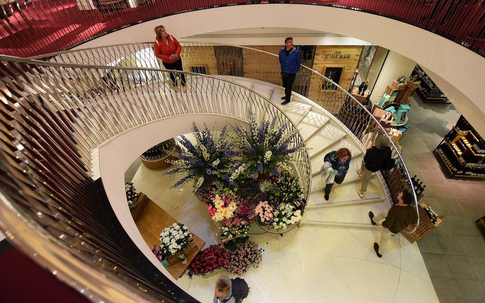
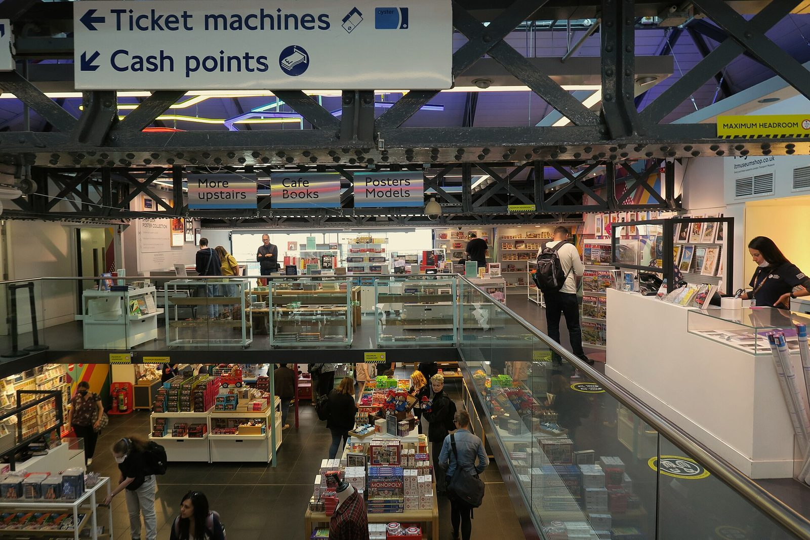
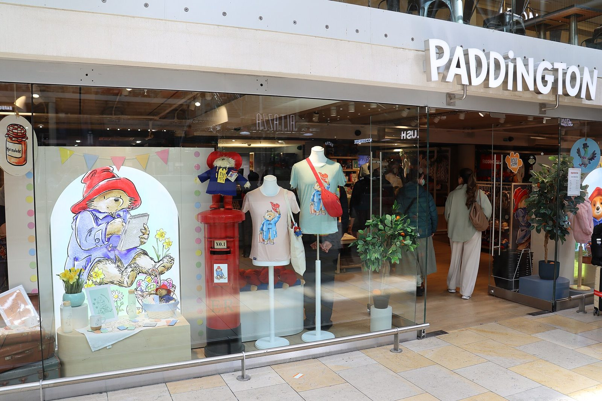
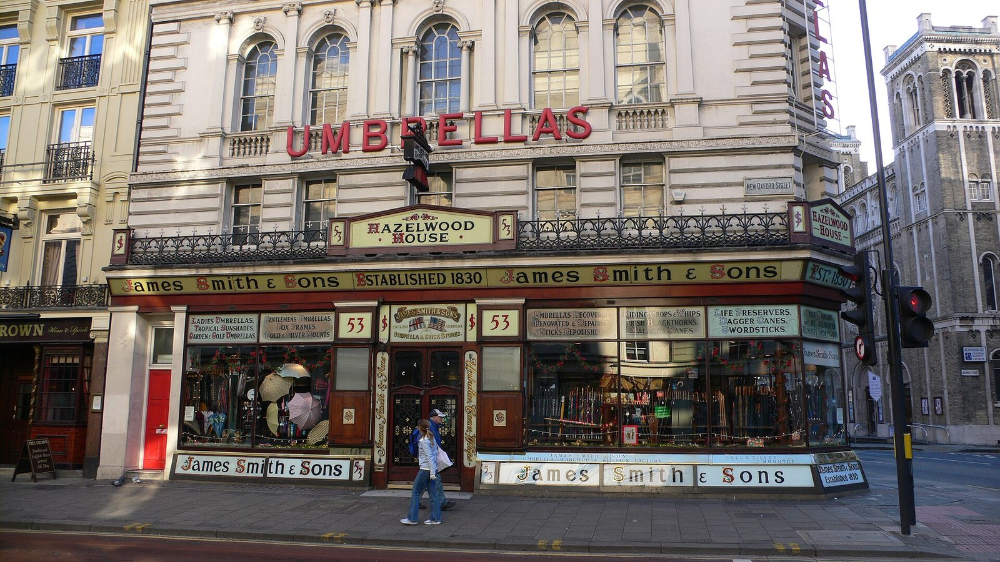

> 💡 **The Short Version:**
> - **Under £10:** a **Fortnum & Mason** pocket tin of Royal Blend or Earl Grey tea (£5.95), **Postcard Teas** single-estate tea from £9.50, or a pencil (£6) or pen (£7) from **Papersmiths**.
> - **£10 to £30:** a **Biscuiteers** gift box (£10.25), **Stanfords** maps from £10.99, a **Benjamin Pollock's** toy theatre (£25 to £30) or **Neal's Yard Dairy** cheese from £13.95.
> - **£30 and over:** a **Fortnum & Mason** hamper from £40, or a **Liberty** silk scarf from £95.
> - **No admission ticket needed:** the **London Transport Museum** shop, the **V&A** shops, and from 13 November 2026 to 4 January 2027 the **Royal Mews Christmas Shop**. The **British Museum** shops are free to enter, but the museum asks for a timed ticket.
> - **No VAT refund** for visitors on anything carried home; see [tax-free shopping](/articles/tax-free-shopping-london/).

*Prices, dates and shop details as of 1 November 2026.*

## Under £10

### Fortnum & Mason

*Piccadilly · pocket tin £5.95 · gift wrap £5 an item*

[Fortnum & Mason](https://www.fortnumandmason.com/stores/piccadilly) is a department store on Piccadilly with its food hall on the ground floor, where a Tea Counter blends tea to order. The way in is a **Royal Blend or Earl Grey pocket tin** (five whole-leaf silky tea bags, 12.5g) at £5.95. For more tea, a 50-bag pack of Royal Blend is £14.95, £15.95 in a tin, and a 250g loose-leaf caddy is £17.95.

*The staircase at Fortnum & Mason. Photo: [Mark from Brighton](https://commons.wikimedia.org/wiki/File:Inside_Fortnum_%26_Mason_-_London_(48128427876).jpg), [CC BY 2.0](https://creativecommons.org/licenses/by/2.0/).*

Gift wrapping is £5 an item on the third floor, where the shop also arranges international delivery. Hampers are in the [£30 and over](#30-and-over) section. The fourth-floor Diamond Jubilee Tea Salon is in our [afternoon tea guide](/articles/best-afternoon-tea-london/), and Fortnum's Christmas opening hours are in the Christmas section below.

### Postcard Teas

*Mayfair · from £9.50 · closed Sundays*

[Postcard Teas](https://www.postcardteas.com/) at 9 Dering Street, a side street off New Bond Street, sells single-estate tea, each from one garden rather than blended. Prices start at £9.50 (Sparrow's Tongue) and rise to £545 for Auld Tree. It opens at noon, closes at 6.30pm Monday to Saturday and is shut on Sundays. Charbonnel et Walker, below, is a few minutes away; the [Mayfair guide](/articles/mayfair-area-guide/) covers the streets around both.

### Papersmiths

*Pavilion Road, Chelsea · pencil £6 · pen £7*

[Papersmiths](https://www.papersmiths.co.uk/pages/visit-us) at 170 Pavilion Road is a stationery shop. A pocket pencil is £6, a pocket pen £7 and a Primo pen £15. The 2027 diary is £38 and notebook sets run up to £48, so it also sits in the next two price bands.

### Supermarkets

The cheapest edible gifts are on the shelves of Marks & Spencer, Waitrose, Tesco and Sainsbury's: Cadbury chocolate, McVitie's biscuits and M&S's Percy Pig sweets all go into a suitcase without fuss. The Royal Mews Christmas Shop has stocking fillers under £10 from 13 November 2026; it is in the museum and palace table below.

## £10 to £30

### Biscuiteers

*Notting Hill · gift box £10.25 · An Iced Christmas Book £20*

[Biscuiteers](https://www.biscuiteers.com/pages/biscuiteers-shop-icing-cafe-notting-hill), at 194 Kensington Park Road, is a shop and icing café selling iced biscuits. The 2026 Christmas catalogue lists a gift box at £10.25, a tote bag at £8.75 and *An Iced Christmas Book* at £20. The shop is in Notting Hill; the [area guide](/articles/notting-hill-area-guide/) covers the streets around it.

### Stanfords

*Covent Garden · maps from £10.99*

[Stanfords](https://www.stanfords.co.uk/london-store) at 7 Mercer Walk has traded in the Covent Garden area since 1853. It sells maps of the UK and the world, including 1:50,000 walking maps, from £10.99 to £25.99. The [Covent Garden guide](/articles/covent-garden-area-guide/) covers the area.

### Benjamin Pollock's Toyshop

*Covent Garden · toy theatres £25 to £30*

[Benjamin Pollock's Toyshop](https://www.pollocks-coventgarden.co.uk/) at 44 The Market, Covent Garden, sells toy theatres: a miniature paper stage with cut-out characters, the Victorian children's toy. They cost £25 to £30.

### Neal's Yard Dairy

*Covent Garden and Borough Market · cheese from £13.95 · card only*

[Neal's Yard Dairy](https://www.nealsyarddairy.co.uk/pages/store-locator) is a cheese shop at 17 Short's Gardens in Covent Garden and 8 Park Street at Borough Market. Cheese starts at £13.95. Both shops take card payments only. For the rest of Borough Market's food gifts, see [the best London markets](/articles/best-london-markets/).

### Hatchards

*Piccadilly · books £12.99 to £40*

[Hatchards](https://www.hatchards.co.uk/) says it was founded in 1797 and calls itself the oldest bookshop in the UK. It stands on Piccadilly a short way along from Fortnum & Mason, and books are priced from £12.99 to £40.

### House of MinaLima

*Soho · illustrated classics £28 to £35*

[House of MinaLima](https://www.minalima.com/visit), at 157 Wardour Street, is the gallery and shop of the two designers behind the graphic props in the Harry Potter films. It sells illustrated classic books at £28 to £35. The gallery is down a flight of stairs with no step-free alternative, and the shop can run timed entry when it is busy. The [Harry Potter guide](/articles/harry-potter-london/) has the rest. The [Soho guide](/articles/soho-area-guide/) covers the street around it.

## £30 and over

### Liberty

*Regent Street · silk scarves from £95 · closed Christmas Day*

[Liberty](https://www.libertylondon.com/uk) sells scarves in its own prints from a mock-Tudor building on Regent Street. Silk scarves start at £95 for the 45cm sizes, such as John's Ditsy Silk Scarf 45. Most 70cm to 90cm silk scarves cost £185 to £245 and the 140cm size is £265. Wool and wool-silk scarves start at about £95, and *The Liberty Scarf Book* is £50.

### Fortnum & Mason hampers

*Piccadilly · £40 to £250 · delivery arranged on the third floor*

Fortnum & Mason's hampers start with the Bellini Box at £40 and the Cream Tea Selection at £50. Next come the Taste of Fortnum's Hamper at £75, the Piccadilly Hamper at £120, the Fortnum's Hamper at £200 and the Burlington Hamper at £250. The shop's third floor handles international delivery.

### Twinings, 216 Strand

*Strand · limited First Flush Darjeeling £65*

[Twinings](https://www.twinings.co.uk/pages/twinings-flagship-store-216-strand) says its flagship at 216 Strand is the oldest tea shop in London, on the site where Thomas Twining bought Tom's Coffee House in 1706. A wall of tea-bag envelopes lets you pick your own mix, alone or in a wooden box, and there is a loose-leaf sampling bar. The splurge is the limited 2026 First Flush Darjeeling, 90g, at £65. The shop opens at 11am, and on Thursdays at 11.30am, and closes at 6pm (6.30pm on Thursdays).

## Museum and palace shops you can enter without an admission ticket

The London Transport Museum, the V&A and the Royal Mews shops let you in without a ticket. The British Museum's shops are inside a free museum that asks for a timed ticket.

| Shop | Entry | What to buy, and what it is like |
| --- | --- | --- |
| [London Transport Museum Shop](https://www.ltmuseum.co.uk/visit/shopping), Covent Garden Piazza | Shop-only visitors do not pay the museum admission fee | Two floors. The ground floor has souvenirs, designer gifts and accessories in moquette, the patterned seat fabric of London's trains and buses. The first floor has books and more than 5,000 posters and 700 original artworks, many of them Underground posters by named artists, all for sale. Lonely Planet's guide to [London's independent shops](https://www.lonelyplanet.com/articles/best-independent-shops-in-london) names it the best place to buy a souvenir. |
| [British Museum shops](https://www.britishmuseum.org/visit), Great Russell Street | Museum entry is free; book a free timed ticket, or entry depends on capacity and queues | Four shops inside the building: the Bookshop, the Family shop, the Collections shop and the Grenville Room. They stay open until 8.15pm on Fridays. More in the [British Museum guide](/articles/british-museum-guide/). |
| [V&A shops](https://www.vam.ac.uk/south-kensington/visit), South Kensington | Free, no booking | The Main Shop, the Fashion Shop and the Exhibition Road Quarter Shop. They stay open until 9.45pm on Fridays. More in the [South Kensington guide](/articles/south-kensington-area-guide/). |
| [Royal Mews Christmas Shop](https://www.rct.uk/visit/the-royal-mews-buckingham-palace), Buckingham Palace Road, SW1W 0QH | No ticket; open 13 November 2026 to 4 January 2027, closed 24 to 26 December | A pop-up inside the Royal Mews gift shop, entered from Buckingham Palace Road while the Royal Mews itself is closed to the public for the winter. Stocking fillers under £10 include plush toys, keyrings made from recycled materials and confectionery from the Royal Sweet Shop range. There are necklaces with corgi or crown pendants and a reusable, fillable Buckingham Palace advent calendar. Its hampers are online only and delivered in the UK. |
| [Design Museum High Street Shop](https://designmuseum.org/plan-your-visit/museum-shops), 224 to 238 Kensington High Street | No ticket: it stands outside the main building | Stock follows the exhibition on show. It closes at 5pm Monday to Thursday and 6pm Friday to Sunday, takes card payments only and is shut 24 to 26 December. |

*The London Transport Museum shop. Photo: [Cityswift](https://commons.wikimedia.org/wiki/File:London_Transport_Museum_shop.jpg), [CC BY 2.0](https://creativecommons.org/licenses/by/2.0/).*

## Gifts by who they are for

### Children and fans

#### Hamleys

*188 to 196 Regent Street · seven floors of toys · free delivery over £45*

[Hamleys](https://www.hamleys.com/our-stores) is a toy shop over seven floors, also on Regent Street. Delivery is free over £45.

#### The Paddington Bear Shop

*Paddington station · plush bears, books and jars of marmalade*

The [Paddington Bear Shop](https://thisispaddington.com/article/paddington-bear-shop) is at The Lawn in Paddington station. It sells plush toys, picture books, stationery, clothing for adults and children, and jars of official Paddington marmalade. It is worth a visit only if you are already at the station; the [Paddington guide](/articles/paddington-area-guide/) covers the area.

*The Paddington Bear Shop. Photo: [eebAMDG](https://commons.wikimedia.org/wiki/File:Paddington_Bear_shop_-_2026-04-19.jpg), [CC BY-SA 4.0](https://creativecommons.org/licenses/by-sa/4.0/).*

For Harry Potter fans, the official Harry Potter Shop at King's Cross station and the shop at The Ribbon on Oxford Street are in our [Harry Potter guide](/articles/harry-potter-london/), with the [King's Cross guide](/articles/kings-cross-area-guide/) for the area. Benjamin Pollock's toy theatres (£25 to £30 above) and the London Transport Museum shop also suit children.

### Readers and travellers

#### Daunt Books

*83 to 84 Marylebone High Street · opens 11am on Sundays*

[Daunt Books](https://www.dauntbooks.co.uk/) occupies a galleried Edwardian room on Marylebone High Street. It opens at 9am Monday to Saturday and 11am on Sundays. The [Marylebone guide](/articles/marylebone-area-guide/) covers the street. Hatchards, Stanfords and House of MinaLima are in the £10 to £30 section.

### Tea, chocolate and food

#### Charbonnel et Walker

*Royal Arcade, 28 Old Bond Street · chocolates · Sunday 12pm to 5pm*

[Charbonnel et Walker](https://www.charbonnel.co.uk/locations) says it was established in 1875, and sells chocolates from a shop in the Royal Arcade on Old Bond Street. It is open from 10am to 6.30pm Monday to Saturday and from noon to 5pm on Sundays. Postcard Teas is a few minutes away.

#### Harrods Food Halls

*Brompton Road, Knightsbridge · Harrods tea and biscuit tins*

The Food Halls on the ground floor of [Harrods](https://www.harrods.com/), by Knightsbridge station, are the part of the store to head for if you want a gift. They are a run of grand food rooms selling chocolate, tea, biscuits and hampers, and the one to take home is Harrods' own tea or biscuits in a tin printed with the shop's frontage. If Harrods ships a purchase to an overseas address, the VAT comes off at the till, which is covered in the [tax-free shopping guide](/articles/tax-free-shopping-london/).

For the rest, Fortnum & Mason, Postcard Teas, Neal's Yard Dairy, Biscuiteers and Twinings are in the price sections above.

### Someone who will use it for years

#### James Smith & Sons

*53 New Oxford Street · umbrellas, walking sticks and seat sticks*

*James Smith & Sons, New Oxford Street. Photo: [Justinc](https://commons.wikimedia.org/wiki/File:James_Smith_and_Sons_Umbrella_Shop_New_Oxford_Street.jpg), [CC BY-SA 2.0](https://creativecommons.org/licenses/by-sa/2.0/).*

[James Smith & Sons](https://www.james-smith.co.uk/visit-us) sells umbrellas, walking sticks and seat sticks from a Victorian corner shop, Hazelwood House, with a fascia that reads Established 1830. It also sells gifts such as cufflinks and books. The address is New Oxford Street, near Tottenham Court Road station and a short walk from the British Museum; it is not on Oxford Street itself. See the [British Museum guide](/articles/british-museum-guide/) for the museum.

### Design-minded people

The London Transport Museum's Underground posters, the V&A's three shops and the Design Museum shop are in the museum table above. Liberty's scarves are in the £30 and over section, Papersmiths stationery is under £10, and House of MinaLima's illustrated books are in the £10 to £30 section. For prints, ceramics and food from the people who made them, see [the best London markets](/articles/best-london-markets/).

## Christmas gifts in 2026

The dates below are for 2026.

- **Royal Mews Christmas Shop:** 13 November 2026 to 4 January 2027, closed 24 to 26 December. Details are in the museum and palace table.
- **Fortnum & Mason:** open 9am to 10pm from 14 to 23 December, 9am to 6pm on 24 December, and closed on 25 and 26 December. Its Christmas hampers include The Nice List Gift Box at £50 and the Burlington Hamper at £250.
- **Liberty:** a Christmas Shop on the fourth floor and online. The shop is closed on Christmas Day.

For gifts from the stalls, see [Christmas markets in London](/articles/christmas-markets-london/). The lights, grottos and shows are in [Christmas in London](/articles/christmas-in-london/).

## What to skip

Union Jack goods and novelty royal items are the main stock of the souvenir shops on Oxford Street and around Piccadilly Circus. Our [Oxford Street guide](/articles/oxford-street-guide/) covers the street's other shops, and [Shopping in London](/articles/shopping-in-london/) covers the streets, department stores and markets.

---

## Continue planning your London trip

- 🛍️ **[Shopping in London](/articles/shopping-in-london/)** — the streets, department stores and markets
- 🏪 **[The Best Markets in London](/articles/best-london-markets/)** — makers' stalls and food, by day
- 🎄 **[Christmas Markets in London](/articles/christmas-markets-london/)** — where to buy gifts from stalls in 2026
- 💷 **[Tax-Free Shopping in London](/articles/tax-free-shopping-london/)** — what you can and cannot get back
