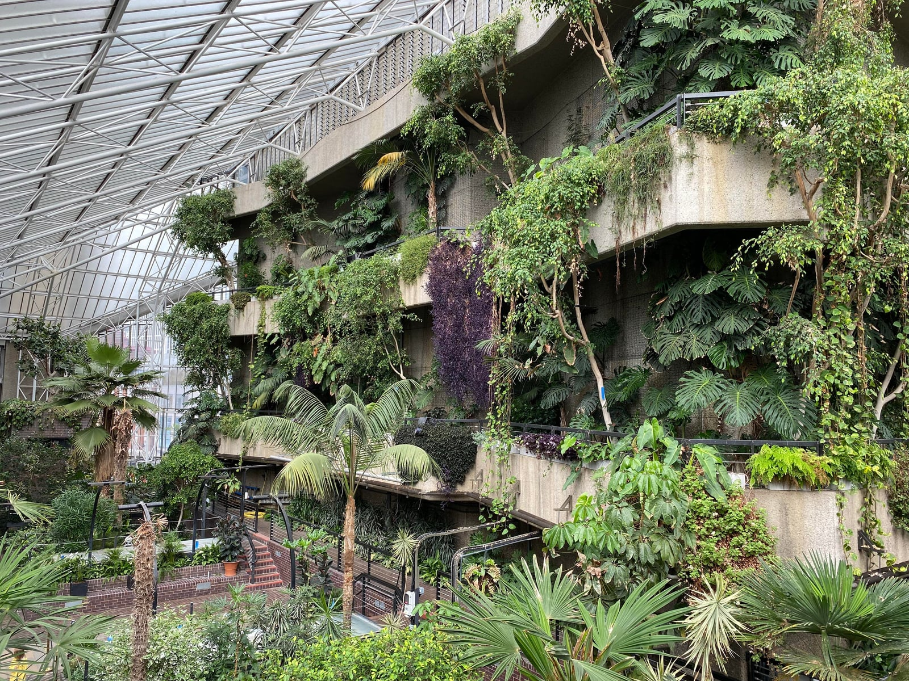

> 💡 **The Short Version:** **Canary Wharf** has underground shopping malls that connect the Elizabeth line, the Jubilee line and the DLR without a drop of rain. **Battersea Power Station** is over 150 shops and both restored turbine halls under one roof. **The Barbican** links two galleries, three cinema screens, a concert hall, a theatre and a library by raised walkway. **King's Cross** clusters the British Library, a covered Victorian coal yard and a 360-degree projection venue within five minutes of the station. **The West End** clusters covered market halls, theatres and immersive shows. **The City** strings a Victorian covered market, a free indoor garden at the top of the "Walkie-Talkie" and a Roman amphitheatre together on foot. And the **Westfield centres** at White City and Stratford are roofed malls with immersive attractions: Absurd City is open at White City, and Phantom Peak opens at Stratford on 4 December.

---

## Free, indoors, wherever you are

**Every national museum in London is free.** The [British Museum](/articles/british-museum-guide/)'s Great Court, the Natural History Museum, the Science Museum, the V&A, Tate Modern, the National Gallery and National Portrait Gallery on Trafalgar Square, and smaller free ones — the Wellcome Collection, Sir John Soane's Museum, Young V&A — are all indoors and cost nothing at the door. Our [guide to London's best museums](/articles/best-museums-london/) has all of them compared.

**South Kensington has a pedestrian subway from inside the Tube station**, and the Natural History Museum has a gate straight off it, so you can walk in without going outside. The Science Museum and the V&A are a short stretch above ground from the same subway.

---

## The areas worth heading for

### Battersea Power Station

Walking in is free, and both of Giles Gilbert Scott's turbine halls, the restored 1930s Art Deco **Turbine Hall A** and the plainer 1950s **Turbine Hall B**, sit under the original steel roof, with more than 150 shops, bars and restaurants on several indoor levels between them. Our [Battersea area guide](/articles/battersea-area-guide/#the-power-station-and-electric-boulevard) has both halls in full.

**Only the power station building is covered.** Circus West Village, the restaurant quarter in the railway arches beside it, and Electric Boulevard, the newer pedestrian street south of the station, are open to the sky, so you will get wet crossing between them.

**NEON**, a purpose-built exhibition space in Circus West Village, runs large-scale ticketed shows — *Ramses and the Pharaoh's Gold* until 1 January 2027 — and there are two separate cinemas on the estate: the Cinema in the Arches at Circus West Village, and a second screen inside the power station itself. Our [immersive experiences guide](/articles/immersive-experiences-london/) covers venues a short Tube ride away.

Battersea Power Station station is on the Northern line's Charing Cross branch, a few minutes from Nine Elms and about fifteen from Tottenham Court Road.

### Canary Wharf

**Canada Place, Cabot Place and Jubilee Place** are underground shopping malls that connect most of the estate to the Elizabeth line, the Jubilee line and the DLR without going outside. Our [Canary Wharf area guide](/articles/canary-wharf-area-guide/#canada-square-and-the-malls) has the layout.

**[Crossrail Place](/articles/canary-wharf-area-guide/#crossrail-place)** is above ground but under cover: a timber lattice roof built over the old North Dock, with a free roof garden planted by hemisphere along the old trade routes, reached straight from the Elizabeth line station. It's open daily and free.

The **London Museum Docklands** is free, in a Georgian sugar warehouse on West India Quay. The malls keep shorter hours at weekends, so on a Sunday head for Crossrail Place and the museum.

The Elizabeth line reaches Canary Wharf from Liverpool Street in six minutes.

### King's Cross

King's Cross is a cluster of indoor stops within a few minutes of the station; crossing the open pavement of Granary Square between them is the one damp part.

The **British Library's Treasures Gallery** is free and holds Magna Carta, the Lindisfarne Gospels and Beatles lyrics scribbled on the backs of envelopes; allow an hour. At **Coal Drops Yard**, the Victorian coal warehouses joined by Thomas Heatherwick's swooping "kissing roof", only the double-height space under the roof is covered; the wider cobbled yard is open to the sky. Our [King's Cross area guide](/articles/kings-cross-area-guide/#granary-square-and-coal-drops-yard) has the detail.

**Lightroom**, a purpose-built 360-degree projection room, shows *David Bowie: You're Not Alone* until 10 January 2027, alongside the Aardman show *Larger Than Life: Starring Wallace & Gromit, Shaun and More*, which runs until 4 January 2027; both are covered in our [immersive experiences guide](/articles/immersive-experiences-london/). **Word on the Water**, the canal-boat bookshop moored at Granary Square, has a wood stove and a roof.

### The West End: Covent Garden, Soho and the theatre district

**Around 200 shows run every night** within about half a mile of Leicester Square; our [London theatre guide](/articles/london-theatre-guide/) covers choosing one and paying less for it.

**Covent Garden's Apple Market** sits under a glass roof added in the 1870s, **Seven Dials Market** fills a former banana warehouse three minutes north, and **Kingly Court** off Carnaby Street is three galleried floors around a courtyard covered enough to work in the rain. Our [Covent Garden](/articles/covent-garden-area-guide/) and [Soho](/articles/soho-area-guide/) guides have both in full.

**Twist Museum** at Oxford Circus is eighty-plus hands-on illusions about perception, one minute from the station; **The Crystal Maze LIVE Experience** runs at Piccadilly Circus; **The Traitors: Live Experience** puts you at the Round Table in Covent Garden; and the nine **Can-Can tables** at the Piccadilly Theatre's *Moulin Rouge!* sit inside the set. On Soho's eastern edge, **Outernet**, the wraparound 4K screens beside Tottenham Court Road station, is free and needs no ticket. All of these, and more, are in our [immersive experiences guide](/articles/immersive-experiences-london/).

For cinema, the **Prince Charles** off Leicester Square and **The Garden Cinema** in Covent Garden are covered in our [independent cinemas guide](/articles/best-cinemas-london/), and our [cinema deals guide](/articles/cinema-deals-london/) has the memberships and 2-for-1 codes. **Foyles** on Charing Cross Road has five floors with a café at the top, and Chinatown's dim sum kitchens on Gerrard Street serve until mid-afternoon.

### The Barbican

A short flight of stairs from Barbican station leads over a bridge onto the estate's raised highwalks, and from there the Centre connects **two art galleries** (the main gallery and the free Curve), **three cinema screens**, the 1,943-seat **Barbican Hall** (home to the London Symphony Orchestra), the **Barbican Theatre** and **The Pit**, and the public **Barbican Library** by internal walkway. Our [City of London area guide](/articles/city-of-london-area-guide/#smithfield-and-barbican) has the wider estate, and our [independent cinemas guide](/articles/best-cinemas-london/#barbican-cinema-city-of-london) covers the Barbican's own repertory programme, including a second pair of screens a few minutes away on Beech Street.

The **Conservatory**, around 1,500 species inside the old theatre's fly tower, is free but opens on selected dates only, published up to a month ahead on [the Barbican's own booking page](https://www.barbican.org.uk/whats-on/2026/event/visit-the-conservatory), with a small batch of day tickets released online at 9.30am on the day itself.

*The Barbican Conservatory.*

Barbican station is on the Circle, Hammersmith & City and Metropolitan lines; Moorgate, a few minutes further round the highwalks, adds the Northern line.

### The City

The City works on foot, with short outdoor stretches between indoor and covered stops. Go on a weekday: much of it keeps office hours and empties at weekends.

**Leadenhall Market**, an 1881 wrought-iron arcade painted maroon and green, is roofed and free to walk through — it played the streets outside the Leaky Cauldron in the first Harry Potter film. Within five minutes are two free indoor viewpoints, **Horizon 22** and the **[Sky Garden](/articles/sky-garden-guide/)**, a planted terrace at the top of the "Walkie-Talkie", both booked online ahead. The **Roman amphitheatre** under the Guildhall Art Gallery is free and indoors too, a ten-minute walk away. Our [City of London area guide](/articles/city-of-london-area-guide/#leadenhall-and-the-tower-cluster) has the full cluster.

**The Crosse Keys**, a Wetherspoons inside a 1913 banking hall on Gracechurch Street, is indoors and cheap.

### The Westfield centres

London's two Westfield centres are fully roofed malls.

**Westfield London**, at White City and Shepherd's Bush, has around 476 shops and a 17-screen Vue cinema under one roof. **Absurd City**, an 80,000 sq ft immersive art experience from the makers of Bristol's "amazement park", opened inside the centre, in the old KidZania unit, on 15 October 2026. **Westfield Stratford City** connects directly to Stratford station, so you walk through it to reach the Olympic Park whatever the weather, and has around 250 shops, a cinema, a casino and a bowling alley; **Phantom Peak**, the immersive free-roam show that closed at Canada Water, reopens here on 4 December 2026. Both malls are covered in our [shopping guide](/articles/shopping-in-london/) and [immersive experiences guide](/articles/immersive-experiences-london/); Stratford also has its own [area guide](/articles/stratford-area-guide/#westfield-stratford-city).

**The UK abolished VAT refunds for visitors in 2021**; the only way to claim it back now is to have the shop ship your purchase abroad. Our [tax-free shopping guide](/articles/tax-free-shopping-london/) has what still works.

---

Powered by <a target="_blank" rel="sponsored" href="https://www.getyourguide.com/london-l57/">GetYourGuide</a>

## A few more places

**The London Silver Vaults**, Holborn — a vault complex under Chancery Lane with more than forty dealers and, by its own claim, the largest single collection of silver for sale in the world. Free to browse, Monday to Friday and Saturday mornings.

**Mail Rail**, at the Postal Museum in Bloomsbury — a miniature train on a circular route through the Post Office's own tunnels beneath Mount Pleasant, about fifteen minutes end to end.

**Babylon Park**, Camden — an underground, three-storey theme park at Hawley Wharf with an indoor rollercoaster, a drop tower and arcade games throughout. Free to enter, pay per ride.

**The Porchester Spa**, Bayswater — an Art Deco Turkish bath from 1929, Grade II* listed, with two steam rooms, a tepidarium, caldarium and laconium, a sauna and a plunge pool. Single-sex days: men Monday, Wednesday and Saturday; women Tuesday, Thursday and Friday; mixed on Sunday.

**London Fields Lido**, Hackney — heated and open through the winter.

**Bookshops you can lose an hour in**: **Daunt Books** on Marylebone High Street, with its Edwardian galleried room and books arranged by country rather than genre, and **Persephone Books** in Bloomsbury, reprinting forgotten women writers with endpapers taken from period fabrics.

**BFI Southbank**'s Mediatheque lets you watch archive film free with no ticket at all; our [independent cinemas guide](/articles/best-cinemas-london/) covers the repertory scene.

---

## What to know

* **Museums are quietest in the last two hours before closing** — everyone else has the same rainy-day idea at 11am.
* **Leadenhall Market and the Silver Vaults both keep office-district hours** — Leadenhall is weekdays only, and the Silver Vaults adds Saturday mornings, but neither is worth a special trip on a Sunday.

---

Powered by <a target="_blank" rel="sponsored" href="https://www.getyourguide.com/london-l57/">GetYourGuide</a>

## Continue planning your London trip

- 🗺️ **[Best Areas to Visit in London](/articles/best-areas-to-visit-london/)** — the neighbourhoods compared by what each is best for and the best day to go
- 🏛️ **[The Best Museums in London](/articles/best-museums-london/)**
- 🎭 **[London Theatre: How to Choose a Show and Pay Less](/articles/london-theatre-guide/)**
- 🎢 **[The Best Immersive Experiences in London](/articles/immersive-experiences-london/)**
- 🎬 **[London's Best Independent Cinemas](/articles/best-cinemas-london/)**
- 💷 **[The Best Cinema Deals in London](/articles/cinema-deals-london/)**
- 🛍️ **[Shopping in London](/articles/shopping-in-london/)**
- 💳 **[Tax-Free Shopping in London](/articles/tax-free-shopping-london/)**
- 🎪 **[Free Things to Do in London](/free/)**
- 🫖 **[The Best Afternoon Tea in London](/articles/best-afternoon-tea-london/)**
- 👨‍👩‍👧 **[London With Children](/articles/london-with-children/)**
- 🛒 **[London Markets by Day](/markets/)**
