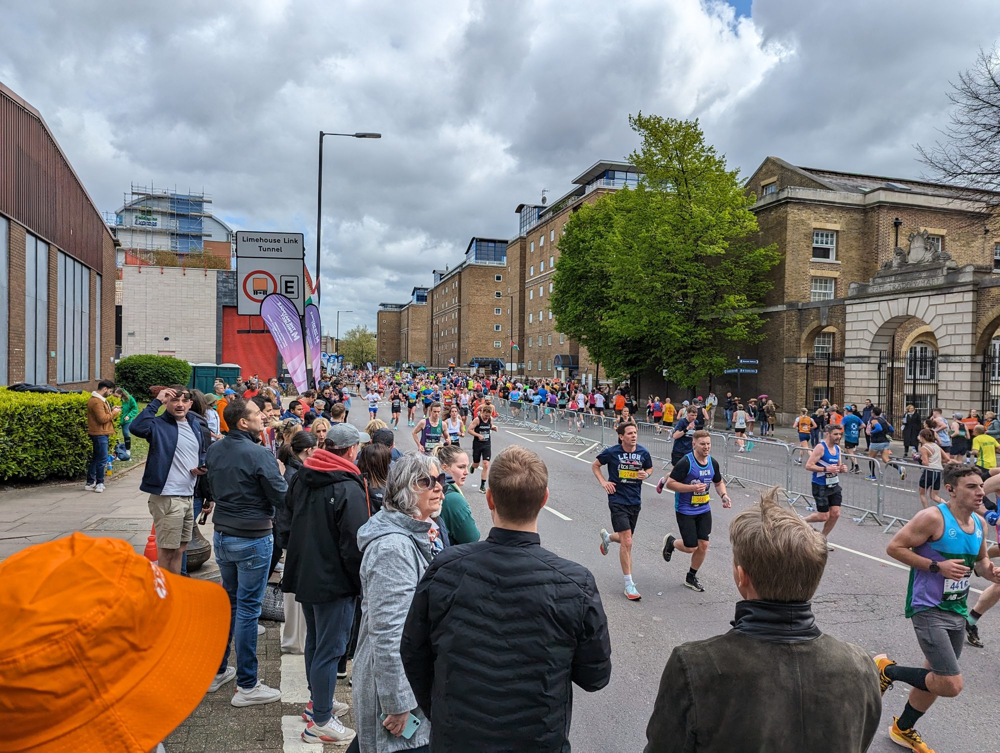
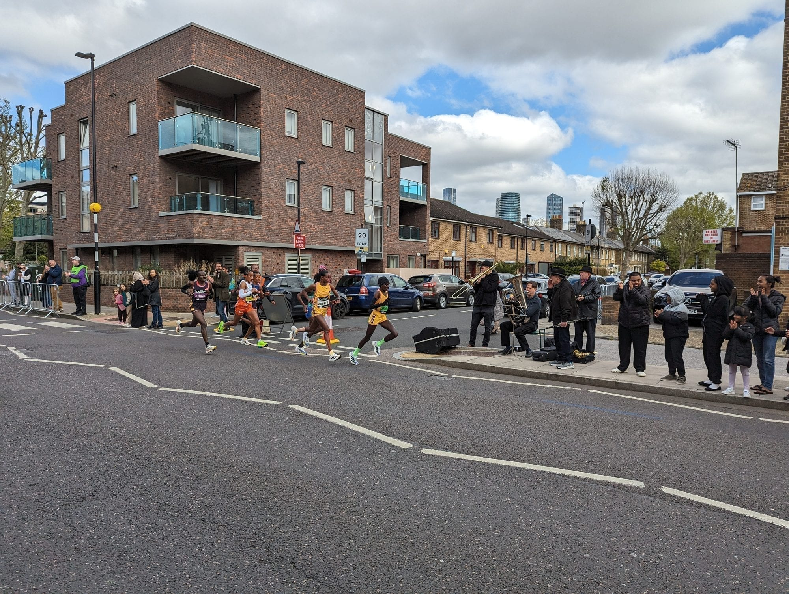
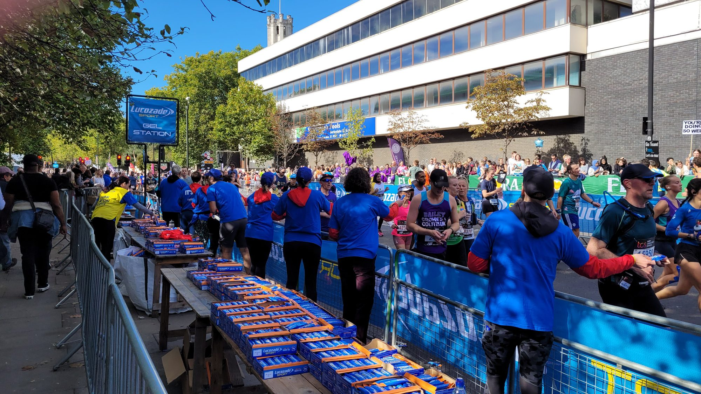
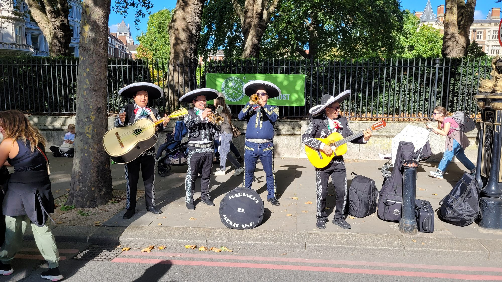

A record **1,338,541 people applied for a place in the 2027 London Marathon** — more than double the number who applied for 2024, and more than a million of them from the UK alone.

**2027 is also unlike any London Marathon before it.** For one year only it runs over **two days, Saturday 24 and Sunday 25 April 2027**, with 100,000 runners across the weekend on the same course from Greenwich to The Mall.

> 💡 **The Short Version:** The **2027 ballot has closed**. **Good For Age** applications for UK residents close at **16:00 on Thursday 29 October 2026**; Championship entry has closed. Otherwise, what is still open for 2027 is a **charity place**, which means raising roughly **£2,000–£3,000**; an **official international tour operator** if you live abroad; or the **MyWay virtual marathon** at £40. For 2028, the ballot should open around **race weekend in late April 2027** — it is **free to enter** and you only pay if you get in. To **watch**, skip the famous spots and go to the **Isle of Dogs**.

---

## The dates

| What | When |
| --- | --- |
| **TCS London Marathon 2027** | **Sat 24 and Sun 25 April 2027** |
| Field size | **100,000** across the two days |
| 2027 ballot | Closed — ran 24 April to 1 May 2026, results 9 July 2026 |
| Good For Age 2027 | Applications close **16:00, Thu 29 October 2026** |
| Championship 2027 | Applications closed |
| 2028 ballot | Not announced. Expect it around **race weekend, late April 2027** |

> ⚠️ **The two-day format is a 2027 one-off.** The Saturday field, the split of Good For Age and Championship runners by sex across the two days, and the extra charity and club places apply to 2027 only. Expect a single-day race in 2028.

---

## Route 1: The ballot

### When it runs

The ballot opens on the **Friday of race weekend** in late April, closes the **following Friday**, and results go out by **early July**.

| Race | Ballot opened | Ballot closed | Results |
| --- | --- | --- | --- |
| **2026** | Fri 25 April 2025 | Fri 2 May 2025 | July 2025 |
| **2027** | 09:00, Fri 24 April 2026 | 16:00, Fri 1 May 2026 | Emailed 9 July 2026 |
| **2028** | Expected late April 2027 | Expected a week later | Expected July 2027 |

### What it costs

**Entering the ballot is free.** You choose between two options when you apply:

| Option | Pay now | Pay if you get in | If you miss out |
| --- | --- | --- | --- |
| **Standard** | Nothing | **£79.99** | Nothing lost |
| **"Double your chances"** | **£49.99** donation | Nothing more — the £49.99 is your entry fee | £49.99 kept as a donation; you get a hydration vest |

The second option is a **£30 discount if you get in** and a second draw if you miss the first. In 2027, with two race days, it meant four chances at a place instead of two. The £49.99 goes to the London Marathon Foundation if you miss both draws.

**Overseas runners pay £275**, which includes a carbon offset charge for international travel.

There are separate **UK and international ballots**, entered through the same form in the same window. The organisers do not publish whether the odds differ between them.

### The odds

| Race | Applications | UK | Overseas |
| --- | --- | --- | --- |
| 2024 | 578,304 | — | — |
| 2025 | 840,318 | 672,631 | 167,687 |
| 2026 | 1,133,814 | 869,803 | 264,011 |
| **2027** | **1,338,541** | **1,008,091** | **330,450** |

2027 was the first year UK applications passed a million — about **1.5% of the entire UK population**. The single largest group was **women aged 20–29**, more than 179,000 of them.

> ⚠️ **Nobody publishes the number of ballot places, so nobody knows the real success rate.** London Marathon Events releases applicant totals but has never released the ballot allocation. Reporting puts it at roughly **20,000 places a year**, which would give odds somewhere between **1 in 30 and 1 in 60** depending on the year. You will see "1 in 13" quoted widely for 2027, but that divides applicants by the **entire 100,000 field**, including charity, Good For Age, Championship, club and tour operator places. It is not the ballot rate.

---

## Route 2: A charity place

**Charity places are still open for 2027**, and for most people who miss the ballot this is the realistic route.

Charities buy entries from the organisers (£400 plus VAT each) and give them to runners who commit to fundraising.

### What it costs you

| Charity | Registration fee | Minimum to raise |
| --- | --- | --- |
| Get Kids Going! | £40 | **£2,000** |
| National Trust | £100 | **£2,000** |
| ZSL | £100 | **£2,000** |
| Médecins Sans Frontières UK | — | **£2,500** |
| Guy's & St Thomas' Charity | — | **£2,750** |

**Budget £2,000–£3,000 plus a registration fee of £40–£100.** Smaller charities cluster at the £2,000 floor and sometimes waive the fee; the big names ask more.

> ⚠️ **The target is a pledge, not a suggestion.** Charities set interim milestones — Médecins Sans Frontières required £660 of its £2,500 by early January — and reserve the right to withdraw your place before race day if you are clearly not going to get there. Oxfam's terms went further, stating that missing the target means the organisers are informed and it "will impact your chances of running the TCS London Marathon in the future".

### Charity place or good-for-age place

- **A charity place** is the charity's bought entry, given to you in exchange for a registration fee and a fundraising commitment.
- **An "own place"** is when you already have a ballot or club place and choose to fundraise anyway. There is normally **no registration fee and no minimum target**, and you still get the running vest and the charity's support. If you have your own place, do not also take a charity's place: it uses up an entry the charity paid for.

---

Powered by <a target="_blank" rel="sponsored" href="https://www.getyourguide.com/london-l57/">GetYourGuide</a>

## Route 3: Good For Age

If you are fast, this is a far better bet than the ballot, and most people who would qualify never check.

**Applications for 2027 are open until 16:00 on Thursday 29 October 2026.** Only UK residents can apply, and the qualifying period was 1 October 2025 to 30 September 2026. Men run on Saturday 24 April and women on Sunday 25 April. The standards:

| Age | Women | Men |
| --- | --- | --- |
| 18–39 | sub 3:38 | **sub 2:52** |
| 40–44 | sub 3:43 | sub 2:57 |
| 45–49 | sub 3:46 | sub 3:02 |
| 50–54 | sub 3:53 | sub 3:07 |
| 55–59 | sub 3:58 | sub 3:12 |
| 60–64 | sub 4:23 | sub 3:34 |
| 65–69 | sub 4:53 | sub 3:52 |
| 70–74 | sub 5:53 | sub 4:52 |
| 75–79 | sub 6:13 | sub 5:07 |
| 80–84 | sub 6:38 | sub 5:27 |
| 85–89 | sub 7:10 | sub 6:10 |
| 90+ | sub 7:45 | sub 7:20 |

Things that catch people out:

- **Meeting the time is not a place.** Good For Age is capped at **6,000 entries for 2027** (3,000 men, 3,000 women) and allocated **fastest-first** within each age and gender group.
- **Your age is the age you were when you ran the time**, not on marathon day.
- **The time must come from an in-person race** on a course certified by UK Athletics, AIMS or a national governing body, or from MyWay.
- **You need proof**: a link to the results page showing your name, date and time, proof of age (passport or driving licence) and proof of UK residence.
- **Good For Age places cannot be deferred**, with pregnancy and postpartum the only exception.

---

## Route 4: Championship entry

For serious club runners. **Applications for 2027 have closed.** The qualifying period was 1 October 2025 to 30 September 2026, and the standards were:

| | Men | Women |
| --- | --- | --- |
| **Marathon** | sub-2:38:00 | sub-3:10:00 |
| **Half marathon** | sub-1:11:30 | sub-1:26:00 |

**1,200 places** for 2027 (600 men, 600 women; men run on the Saturday, women on the Sunday), allocated fastest-first if oversubscribed. You needed a **valid affiliated UK Athletics membership** and a link to the official results page; screenshots are rejected. Half-marathon times only count if you have never completed a marathon, or your marathon time falls outside the qualifying window.

Unsuccessful UK applicants who applied with a marathon time may be offered a Good For Age place instead.

> ⚠️ **Falsifying a qualifying time carries a ban of up to five years from every London Marathon Events race**, and up to a life ban for a second offence.

---

## Route 5: A running club place

A guaranteed route in if you already run with a club.

Clubs affiliated to British Athletics get an allocation based on how many first-claim members aged 18 or over they have:

| First-claim members | Entries |
| --- | --- |
| **0–9** | None — the club does not qualify |
| **10–39** | Entered into a draw for **228 guaranteed entries**, one per successful club |
| **40–189** | **1** guaranteed |
| **190+** | **2** guaranteed |

Clubs do not apply: the organisers email every eligible club with its allocation (31 October for the 2026 race), with names due back by mid-December. **Most clubs run their internal draw in November or early December**, on whatever basis they choose, such as years of membership, race and volunteering participation, or priority to people who have never run London. Ask your club how it decides.

Runners pay the standard £79.99, and **club places can be deferred**, unlike Good For Age and Championship. For 2027, clubs get more places than usual, spread across both days.

---

## Route 6: Entering from overseas

**The international ballot** runs in the same window as the UK one, through the same form. It is free to enter, and the entry fee if you are drawn is the higher international one.

**Official international tour operators** are the guaranteed-entry route, listed by region on the organiser's international page. **Sports Tours International** is the official overseas tour operator, covering the USA, Ireland, France and selected other territories, and it is **not available to UK residents**. **Marathon Tours & Travel** is the official North American agency and publishes prices.

Indicative 2027 package prices for the Sunday race, four nights (22 to 26 April), per person, guaranteed race entry included:

| Package | Sharing a double | Single room |
| --- | --- | --- |
| **Classic** (Marble Arch Hotel, sold out; COMO Metropolitan) | **$3,150–$3,960** at Marble Arch; $3,375 at COMO | $4,135–$4,475 at Marble Arch; $4,595 at COMO |
| **Signature** (Mayfair and Park Lane five-stars) | **$3,675–$4,510** | $4,765–$6,780 |

Flights are extra. A non-runner pays $1,350 less.

---

## Route 7: The virtual marathon

**TCS London Marathon MyWay** is 26.2 miles wherever you like on marathon day, for **£40 in the UK or £55 internationally**. It has to be outdoors; treadmills do not count. For 2027 you can enter either day, or both (register and pay for each separately), or run the real race one day and MyWay the other. Same medal.

> 💡 **A MyWay time counts as a Good For Age qualifier**, but you also need an in-person certified half-marathon time from the same qualifying window that meets a separate standard (for example sub 1:23:37 for men aged 18–39, sub 1:44:23 for women). MyWay gives you **no ballot advantage and no priority** for a future place.

---

## What never works

- **Buying a place.** Selling, swapping or transferring an entry is explicitly banned, as is running on someone else's number. There is **no official resale platform**, so every bib for sale on eBay, Facebook or Gumtree is one that will be cancelled.
- **Entering the ballot more than once.** Multiple entries using different email addresses will disqualify **all** of them.
- **Swapping days in 2027.** Even between friends or family allocated different days, this cancels your place.
- **Using someone else's qualifying time** for Good For Age or Championship entry.

The penalty for any of these is annulled results and **a ban from all London Marathon Events races for up to five years**, and up to a **life ban** for a second breach.

### Deferrals

Whether you can roll a place over depends on how you got it:

| Entry route | Can you defer? |
| --- | --- |
| Ballot, UK or international | **Yes** |
| Running club | **Yes** |
| Charity | Not through the organisers — ask the charity |
| **Good For Age** | **No** |
| **Championship** | **No** |
| Tour operator | Ask the operator |
| MyWay virtual | **No** |

You **pay the entry fee again** for the deferred year, and you **cannot defer a place that was already deferred once**. Pregnancy and postpartum deferrals are more generous: up to three years, keeping any Good For Age or Championship category without requalifying.

---

Powered by <a target="_blank" rel="sponsored" href="https://www.getyourguide.com/london-l57/">GetYourGuide</a>

## Watching the London Marathon

You do not need a ticket to watch: the whole route is public pavement and it is free. The course cuts London in half for most of the day, and the obvious viewing spots are the ones everyone else has picked.

### The route, in order

The race starts on Blackheath and in Greenwich Park in three waves — **Red** on Charlton Way, **Blue** on Shooters Hill Road and **Pink** on St John's Park. The three courses meet **just before Mile 3, at Woolwich**, then head back west.

| Mile | Where |
| --- | --- |
| 3–4 | Woolwich |
| **6.5** | **Cutty Sark**, Greenwich |
| 9 | Canada Water and Surrey Quays |
| 11.5 | Bermondsey, Jamaica Road |
| **12.5** | **Tower Bridge** — halfway falls just after, on The Highway |
| 14 | The Highway, eastbound |
| 15–16 | Westferry Road, Isle of Dogs |
| 17 | Mudchute |
| 18 | Marsh Wall |
| **19** | **Canary Wharf** |
| 20 | Poplar High Street |
| 21 | Commercial Road, Limehouse — **Rainbow Row** just after |
| **22** | **The Highway, westbound** |
| 23 | Tower Hill |
| 24 | Upper and Lower Thames Street |
| 25 | Victoria Embankment and Parliament Square |
| 26 | Birdcage Walk, then the finish on **The Mall** |

### Where to stand

The organisers split the route into places that will be heaving and places that will not.

| Officially "extremely busy" | Officially quieter |
| --- | --- |
| Cutty Sark (6.5) | Rotherhithe peninsula (9–11) |
| Canada Water (9) | **The Highway (14 and 22)** |
| Bermondsey (11.5) | Westferry (15) |
| **Tower Bridge (12.5)** | Isle of Dogs (16) |
| Canary Wharf (18–19) | Poplar High Street (20) |
| Limehouse (21) | |
| Tower Hill (23) | |
| **Westminster (26)** | |

> ⚠️ **Expect station queues of up to 90 minutes** at the busy points, according to the organisers, particularly at Cutty Sark and Limehouse.

**Tower Bridge is the iconic spot and worth it once.** Arrive early, and use London Bridge rather than Tower Hill or Tower Gateway.

### The best place to watch: the Isle of Dogs

Go to the **southern half of the Isle of Dogs — Westferry Road, Millwall and Mudchute, Miles 15 to 17.**

**It is quiet because it is awkward to reach.** The island is a peninsula served by small DLR stations — Crossharbour, Mudchute, Island Gardens and South Quay — with none of the mainline capacity that funnels crowds to Tower Bridge or Greenwich, and the course loops around it, so you can only cross at designated points.

What you get for the inconvenience:

- **Room at the barrier**, even fairly late in the morning. The photograph above is the elite women's lead pack going through, from a standing spot a few feet back with no crush.
- **A local crowd**: residents out on their own street, and bands playing on the pavement.
- **A second sighting.** The course runs out along Westferry Road and comes back through Canary Wharf, so from around here you can catch the field at Mile 15 and again at Mile 18 without getting on a train.
- **Mudchute at Mile 17 is the pick if you have children.** It is quieter still, and Mudchute Farm is next door.

> ⚠️ **Canary Wharf itself is not quiet.** Miles 18 and 19, in the estate, are on the organisers' "extremely busy" list. The quiet stretch is the residential southern half of the island, not the towers.

**Poplar High Street at Mile 20** works on the same principle: you stand with local residents, not tourists.

### How to see your runner twice

> 💡 **The Highway, Miles 14 and 22.** The course runs out along the north bank and comes back on the other carriageway, so you can stand in one place and see the field twice, roughly 45 minutes to an hour apart. Get there on the Overground to **Shadwell** or **Wapping**. It is on the organisers' own list of quieter stretches.

Three more that work:

- **Limehouse DLR** — Mile 15, then Mile 21 and Rainbow Row.
- **Canary Wharf** — Miles 15 and 18, using the estate's loop, not a train.
- **Tower Hill** — halfway on The Highway, then Mile 23.

### Getting around on the day

**Cutty Sark DLR is entrance only on marathon day: you cannot get off the train there.** Walk in from Deptford, Greenwich, Island Gardens or Maze Hill instead. **Westminster station is exit only from 07:00 to 19:00**: you can arrive there but not leave from it.

**Crossing the course** catches people out. On the 2026 race day roads shut from **07:00**, and the bulk of the route stayed closed until about **20:30**. Only stewarded crossing points let you across:

- **Greenwich** — Creek Road and Romney Road. **Creek Road is one-way for pedestrians, east to west only.**
- **Tower Bridge and Tower Hill** — no surface crossing at all; use the underpasses.
- **Wapping** — the pedestrian subway where The Highway meets Glamis Road.
- **Limehouse** — Butcher Row.
- **Canary Wharf** — Upper Bank Street, Bank Street, Montgomery Street and Marsh Wall.
- **Westminster** — Parliament Square, Victoria Embankment and the Spur Road footbridge. Birdcage Walk is **entry only** into St James's Park; Storey's Gate is **exit only**.

The **Greenwich Foot Tunnel** runs **one way, south to north, between 10:00 and 12:30**, and it queues.

> 💡 **The boat beats the trains.** Uber Boat by Thames Clippers runs pier to pier between Woolwich and Westminster via Greenwich, Canary Wharf, Rotherhithe, Tower and Embankment. It crosses none of the course, it is far less crowded than the DLR, and the boats have toilets and a café bar, while the whole route has only five spectator toilets (see below).

Buses on the route are diverted or curtailed, no taxi will take you across the course during the race, and Santander Cycles docking stations along the route are suspended.

### Timings

The organisers expect the Saturday race to start at **09:00** and the Sunday race at **09:30**. The Saturday finish line on The Mall closes at **17:30**; on Sunday the secondary finish line in Green Park closes at **23:59**.

At any point on the course the runners keep coming for **hours**. At Tower Bridge you are looking at roughly 11am until mid-afternoon; at Canary Wharf, roughly midday until late afternoon. If you are watching for one person, that is a long wait in one spot, which is the argument for the two-sightings plan above.

### Toilets

> ⚠️ **There are five spectator toilets on the entire 26.2-mile route.** They are at Trafalgar Road, Cutty Sark Gardens and Welland Street around Mile 6, Reuters Plaza in Canary Wharf, and St James' Gardens at Mile 21. The portaloos you can see every mile are for runners. The Thames Clipper boats have toilets on board.

There are **five accessible viewing areas** — barrier-free, stewarded, each with an accessible toilet, and a carer or supporter is welcome: Cutty Sark, Canary Wharf, Rainbow Row on Butcher Row, Tower Hill and Victoria Embankment.

### The finish, and finding your runner

**You cannot stand at the finish line.** The Mall is not a general spectator area, and access to St James's Park is controlled. Spectators are directed instead to the **Meet and Greet area** on Horse Guards Avenue, Horse Guards Road and Horse Guards Parade, where meeting points are marked by letter — A, B, CD, EF, G, HIJ, KL, M, NO, P, QR, S, TUV and WXYZ. Several letters are grouped, so "meet at F" means the EF point.

> ⚠️ **Agree your letter and a fallback time before race day.** Your runner needs **up to 30 minutes** to walk from the finish line to the meeting area, and phone signal in the crowds is poor. The official app has live runner tracking and is worth having, but do not rely on it alone.

The finish area also has a sensory calm tent, a parent and child tent for feeding and young children, and a multi-faith prayer tent. Charity post-race receptions are invitation-only, so if your runner is with a charity, check with them.

The **free post-race TfL travel is for runners showing a bib**, not for the people who came to watch.

### The rest of the marathon weekend

| When | What |
| --- | --- |
| **Fri 23 April** | **TCS Mini London Marathon** — moved from its usual Saturday slot. Around 22,000 young runners finishing on The Mall. Schools enter, not individuals |
| **Fri 23 April** | **TCSLM & Friday Night Lights 5K** in Battersea Park |
| **Sat 24 and Sun 25 April** | The marathon itself |

---

Powered by <a target="_blank" rel="sponsored" href="https://www.getyourguide.com/london-l57/">GetYourGuide</a>

## Continue planning your London trip

- 🎾 **[How to Get Wimbledon Tickets](/articles/wimbledon-tickets-guide/)**
- 🚇 **[How to Use the London Underground](/articles/how-to-use-the-london-underground/)**
- 💷 **[London Transport Costs and Fares](/articles/london-public-transport-costs-and-fares/)**
- 🌳 **[Best Parks and Gardens in London](/articles/best-parks-gardens-london/)**
- 💷 **[London on a Budget](/articles/london-on-a-budget/)**
- 📅 **[Best Time to Visit London](/articles/best-time-to-visit-london/)** — April's weather and crowds against every other month
