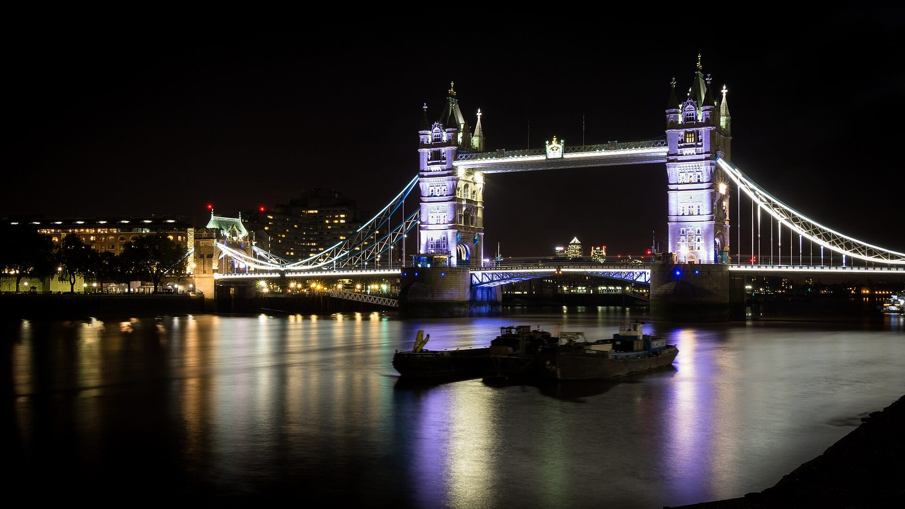
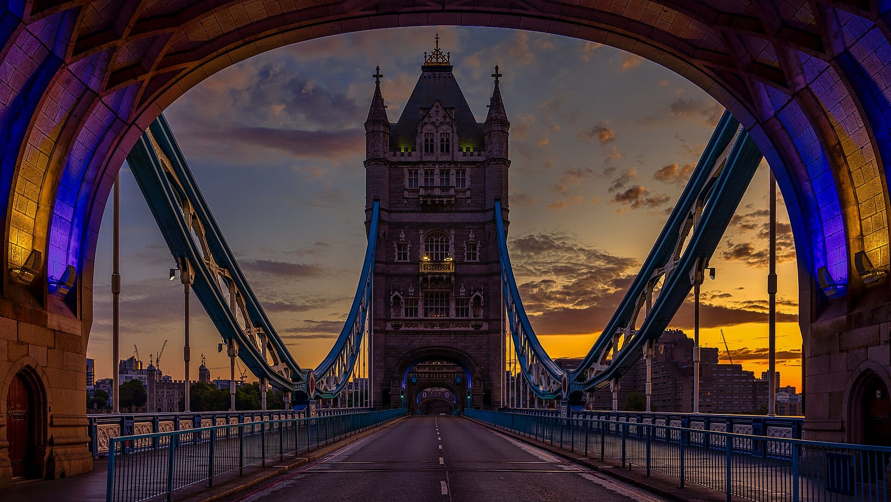
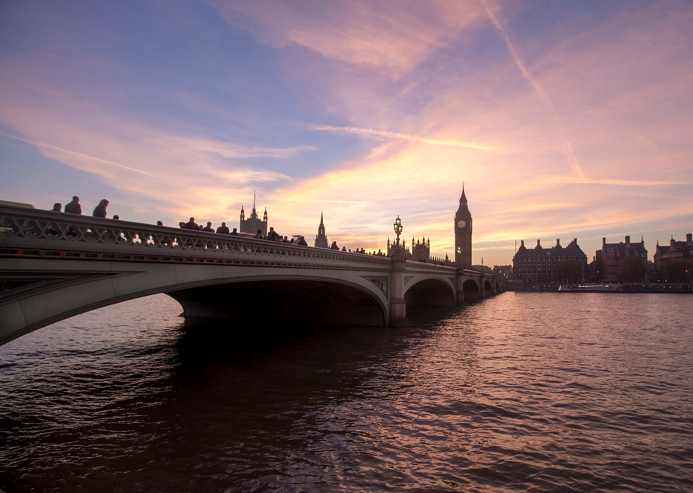

**Photography on GetYourGuide splits into two kinds: a guide who teaches you to take the pictures, and a photographer who takes pictures of you.** Most of them head for Tower Bridge, Westminster and the Thames.

> 💡 **The Short Version:** To learn, take the **guided photography tour** (**£99**, 3½ hours, in a group of one to three). For a night walk, the **private night photography tour** is **£96** for up to six. To be photographed, the **1-hour London photoshoot** is **£79 a person with 20 edited photos** (5.0 from 89 reviews), and **£30** is the cheapest shoot. The **private shoot with a video-clip option** (**£110** for up to ten, 4.9 from 299 reviews) is the most reviewed.

> 📘 **Booking and prices.** We earn a commission if you book through our links; the price is the same either way. No operator paid to be included. Prices are the lowest adult price and move with the date; some are per group.

## The pick for each reader

| Best for | Tour | From | Length |
|---|---|---|---|
| Learning technique | Guided photography tour | £99 a person | 3½ hours |
| Night shots | Night photography walking tour | £96 a group of up to 6 | 2½ to 5 hours |
| A quick set of photos | Iconic Sights photo walk | £49 a person | 1 hour |
| Photos to keep | 1-hour London photoshoot | £79 a person | 1 hour |
| A group or family | Private shoot with video-clip option | £110 a group of up to 10 | 30 to 60 minutes |
| Tower Bridge | Tower Bridge photoshoot | £88 a group of up to 2 | 15 minutes to 1½ hours |

## Photo walks that teach you to shoot

### London Guided Photography Tour

*£99 a person · 3½ hours · <a href="https://www.getyourguide.com/activity/-t1556807?partner_id=WWP7I0R&amp;cmp=london-photography-tours" target="_blank" rel="sponsored nofollow noopener" data-affiliate="gyg">Book on GetYourGuide</a>*

Iconic photo spots and hidden corners, with different techniques to try, finishing at a food market. Groups are one to three people, usually one-to-one. It suits anyone who wants to leave knowing how to take better pictures, rather than only collecting them.

### Guided walk with hidden photo spots

*£58 a person · 3 hours · <a href="https://www.getyourguide.com/activity/-t1313003?partner_id=WWP7I0R&amp;cmp=london-photography-tours" target="_blank" rel="sponsored nofollow noopener" data-affiliate="gyg">Book on GetYourGuide</a>*

A 3-hour walk through hidden alleys, gardens and street art, with photo stops at 10 to 12 visually striking locations. It is built around the photo stops and costs £41 less than the guided photography tour. For the street art itself, see our [London street art guide](/articles/london-street-art/).

### Richmond Park nature photography walk

*£90 a person · 4 hours · <a href="https://www.getyourguide.com/activity/-t1187287?partner_id=WWP7I0R&amp;cmp=london-photography-tours" target="_blank" rel="sponsored nofollow noopener" data-affiliate="gyg">Book on GetYourGuide</a>*

A guided walk for the park's deer, birds and woodland rather than the landmarks. It suits nature and wildlife photography. Our [Richmond guide](/articles/richmond-area-guide/) covers getting there.

## Night and sunrise

### London Night Photography Walking Tour

*£96 for a group of up to 6 · 2½ to 5 hours · <a href="https://www.getyourguide.com/activity/-t1292721?partner_id=WWP7I0R&amp;cmp=london-photography-tours" target="_blank" rel="sponsored nofollow noopener" data-affiliate="gyg">Book on GetYourGuide</a>*

A private walking tour that covers Tower Bridge, Big Ben and St Paul's lit up, and teaches light painting. Because the price is per group, it costs least with six people sharing.

*Tower Bridge at night. Photo: [Rafa Esteve](https://commons.wikimedia.org/wiki/File:Tower_Bridge_-_Thames_Night_Long_Exposure_01.jpg), [CC BY-SA 4.0](https://creativecommons.org/licenses/by-sa/4.0/).*

### Tower Bridge Sunrise Photoshoot

*£90 for a group of up to 6 · 40 minutes · <a href="https://www.getyourguide.com/activity/-t1230649?partner_id=WWP7I0R&amp;cmp=london-photography-tours" target="_blank" rel="sponsored nofollow noopener" data-affiliate="gyg">Book on GetYourGuide</a>*

A private shoot at the bridge at sunrise, set up for solo travellers, couples and content creators.

*Tower Bridge at sunrise. Photo: [Pierre Blaché](https://commons.wikimedia.org/wiki/File:Tower_Bridge,_London_at_sunrise.jpg), [CC0](https://creativecommons.org/publicdomain/zero/1.0/).*

## A photographer who takes your picture

### Iconic Sights photo walking tour

*£49 a person · 1 hour · 5.0 from 20 reviews · <a href="https://www.getyourguide.com/activity/-t1045160?partner_id=WWP7I0R&amp;cmp=london-photography-tours" target="_blank" rel="sponsored nofollow noopener" data-affiliate="gyg">Book on GetYourGuide</a>*

An hour with a professional photographer around Trafalgar Square, St James's Park and the Thames, shooting Big Ben and the London Eye.

### Instagram tour of London's iconic landmarks

*£49 a person · 1 hour · 4.9 from 25 reviews · <a href="https://www.getyourguide.com/activity/-t1062099?partner_id=WWP7I0R&amp;cmp=london-photography-tours" target="_blank" rel="sponsored nofollow noopener" data-affiliate="gyg">Book on GetYourGuide</a>*

A one-hour walk in the Westminster area, posing with Big Ben and the London Eye.

### A Professional Photo Walk Experience

*£134 for a group of up to 10 · 1 to 3 hours · 4.9 from 54 reviews · <a href="https://www.getyourguide.com/activity/-t1118056?partner_id=WWP7I0R&amp;cmp=london-photography-tours" target="_blank" rel="sponsored nofollow noopener" data-affiliate="gyg">Book on GetYourGuide</a>*

London's sights and hidden spots with a professional photographer capturing the group. Priced for the group, so it suits a family or a party of friends more than a solo traveller.

*Westminster Bridge at dusk. Photo: [Rockymaxwell](https://commons.wikimedia.org/wiki/File:Westminster_Bridge_at_dusk.jpg), [CC BY-SA 4.0](https://creativecommons.org/licenses/by-sa/4.0/).*

## Private photoshoots

### 1-Hour London Photoshoot

*£79 a person · 1 hour · 5.0 from 89 reviews · <a href="https://www.getyourguide.com/activity/-t942741?partner_id=WWP7I0R&amp;cmp=london-photography-tours" target="_blank" rel="sponsored nofollow noopener" data-affiliate="gyg">Book on GetYourGuide</a>*

A choice of urban and historical backdrops, with 20 edited photos at the end. The most reviewed single-person shoot here.

### Private Photoshoot with Video Clip Option

*£110 for a group of up to 10 · 30 to 60 minutes · 4.9 from 299 reviews · <a href="https://www.getyourguide.com/activity/-t671690?partner_id=WWP7I0R&amp;cmp=london-photography-tours" target="_blank" rel="sponsored nofollow noopener" data-affiliate="gyg">Book on GetYourGuide</a>*

At the London Eye, Big Ben or Westminster, with a package of 25 or 50 photos or one that includes a video clip. It is the most reviewed photoshoot on this page, and the best value for a family of five or more.

### Private Landmark Tour with Professional Photographer

*£83 for a group of up to 2 · 15 minutes to 1 hour · 4.6 from 103 reviews · <a href="https://www.getyourguide.com/activity/-t434920?partner_id=WWP7I0R&amp;cmp=london-photography-tours" target="_blank" rel="sponsored nofollow noopener" data-affiliate="gyg">Book on GetYourGuide</a>*

A personalised shoot for a couple, with edited photos delivered within 48 hours.

### Professional Photoshoot at Tower Bridge

*£88 for a group of up to 2 · 15 minutes to 1½ hours · 4.2 from 87 reviews · <a href="https://www.getyourguide.com/activity/-t427198?partner_id=WWP7I0R&amp;cmp=london-photography-tours" target="_blank" rel="sponsored nofollow noopener" data-affiliate="gyg">Book on GetYourGuide</a>*

A photographer in front of Tower Bridge, with high-quality digital photos afterwards. See our [Tower Bridge guide](/articles/tower-bridge-guide/) for the bridge itself.

### Professional Photoshoot in London

*£30 a person · 1 hour · 5.0 from 20 reviews · <a href="https://www.getyourguide.com/activity/-t1343204?partner_id=WWP7I0R&amp;cmp=london-photography-tours" target="_blank" rel="sponsored nofollow noopener" data-affiliate="gyg">Book on GetYourGuide</a>*

A shoot at iconic locations, and the cheapest here by £19.

Powered by <a target="_blank" rel="sponsored" href="https://www.getyourguide.com/london-l57/">GetYourGuide</a>

## As a gift

A photoshoot gives the recipient photos of the trip, not an object. The listings promise edited pictures: 20 on the one-hour shoot, 25 or 50 photos or a video clip in the private group package, and edited photos within 48 hours on the couple's shoot. The private Tower Bridge and Big Ben shoots suit a couple. For other ideas, see our [gifts and souvenirs guide](/articles/london-gifts-souvenirs/).

## Doing it yourself

You can take the same pictures without a guide. Our own guides cover where to stand:

* **Viewpoints:** [the best views in London](/articles/best-views-london/), with which are free.
* **The bridge:** [Tower Bridge](/articles/tower-bridge-guide/).
* **Colour:** [Notting Hill's colourful houses](/articles/notting-hill-colourful-houses/) and [London street art](/articles/london-street-art/).
* **After dark:** [the Christmas lights walk](/articles/christmas-lights-walk-london/).
* **With a guide, no camera:** [the best walking tours in London](/articles/best-walking-tours-london/).
