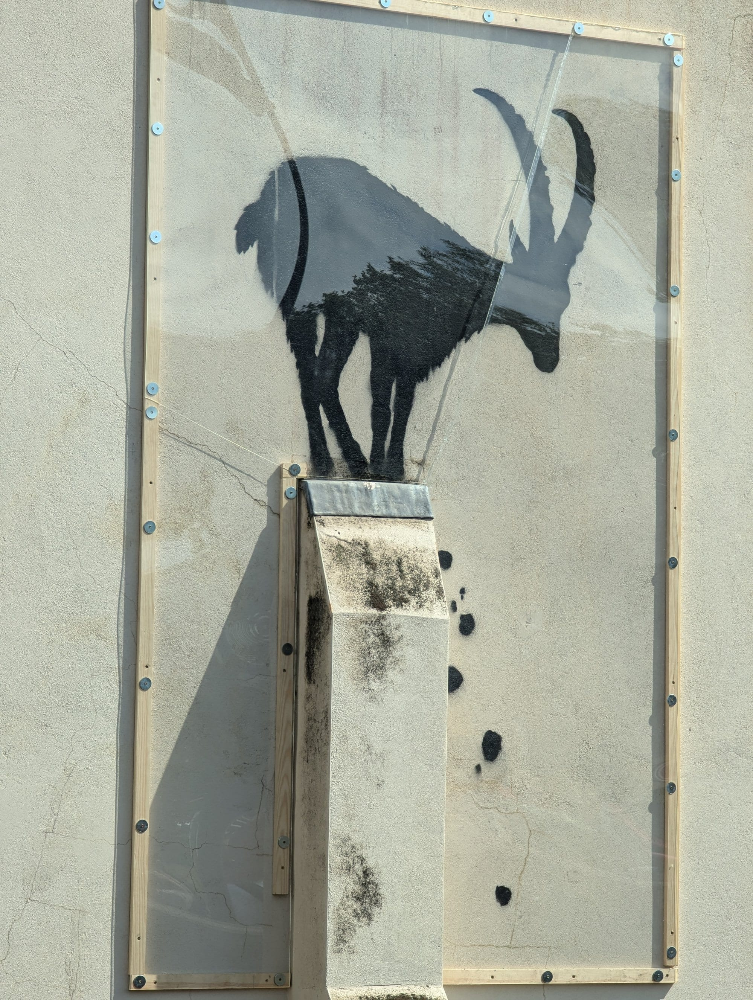
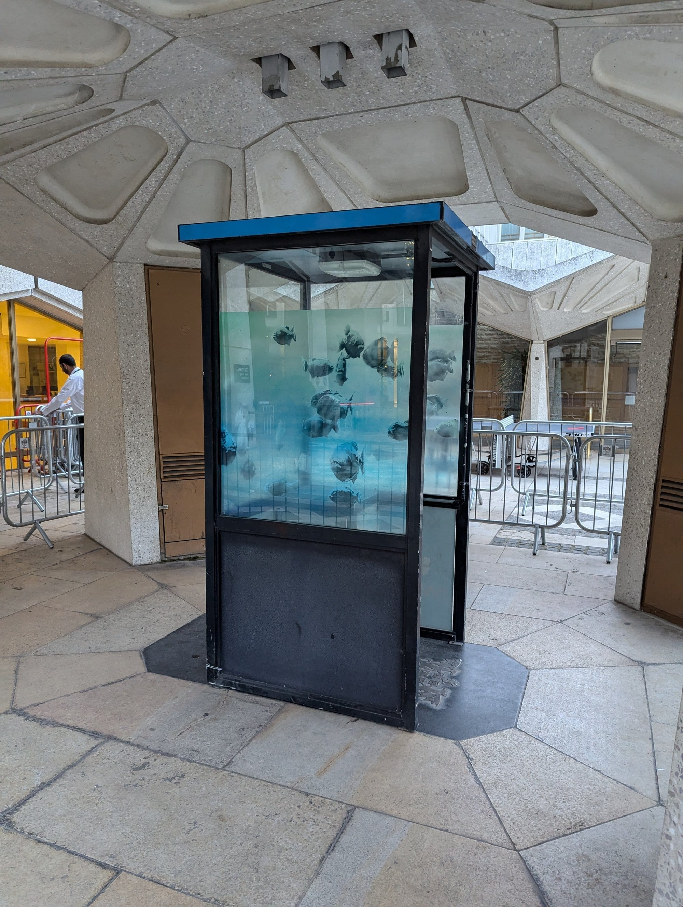

Most Banksy maps of London send you to walls where the work no longer exists. Pieces get removed, painted over, stolen, sold with the wall attached, or covered in perspex that makes them impossible to photograph. This guide **says which Banksys are gone**, which saves a wasted trip.

**It covers two things.** The first half is Banksy: what survives, what has been removed, and the indoor collections showing work that has come off walls. The second half is the rest of London's street art, none of which needs a ticket.

**Fifteen Banksys are still viewable as originals in situ**: the Cannon Street rat, the I Love London rat on Chiswell Street, the two Basquiat tributes, the two Foundry pieces now on the front of art'otel Hoxton, the Pink Car at the Old Truman Brewery, the Bermondsey fishing boy, the Royal Family in Stoke Newington, the Chelsea elephants, the Walthamstow pelicans, the Charlton rhino, the Finsbury Park tree, the Stargazing Children at Centre Point, and Blind Patriotism at Waterloo Place. Everything else has been removed, stolen, boarded over, scrubbed off or replaced with a replica.

> 💡 **The Short Version:** **Ten of the fifteen are on one route**. Our [Banksy route](/articles/banksy-walk-london/) runs from **Blind Patriotism** at Waterloo Place to the **Royal Family** in Stoke Newington in about three and a half hours, with one Tube ride and one Overground train. The **2024 animal series** left work across the city, though six of the nine have gone. **Leake Street** is legal graffiti under Waterloo and repainted constantly. **Shoreditch** is the densest area.

*Status of each work as of 26 October 2026.*

## Where they are

| If you are near… | What to see |
| --- | --- |
| **The City** | Cannon Street rat, Chiswell Street rat, two Basquiat tributes |
| **Shoreditch & Brick Lane** | Constantly changing street art, plus the two Foundry Banksys on art'otel Hoxton and the Pink Car |
| **Stoke Newington** | Banksy's Royal Family, painted in 2001 |
| **Waterloo** | Leake Street tunnel — legal, and repainted continuously |
| **Chelsea** | Banksy's elephants |
| **Walthamstow** | Banksy's pelicans |
| **Charlton** | Banksy's rhinoceros |
| **Bermondsey** | Banksy's fishing boy, on the Thames Path |
| **Trafalgar Square** | Blind Patriotism, the 2026 statue |
| **Hackney Wick** | Large-scale murals along the canal |
| **Brixton** | The Bowie mural, locally listed |

**[See ten of them in one day →](/articles/banksy-walk-london/)** Eight stops from Waterloo Place to Stoke Newington, with a map, the Tube and Overground legs, and what you can see at each. The short version is at the bottom of this page.

**For every Banksy ever recorded in London**, including the ones that have gone, [Banksy Map](https://banksymap.com/explore/london-map/) plots them all with photographs.

---

## Banksy, and what survives

### Cannon Street Rat, City of London

*Free · faded*

One of Banksy's **earliest surviving London rats**, stencilled in **Steelyard Passage**, the footpath that takes the Thames Path underneath Cannon Street station.

**Free and on a public riverside path.** There is no marker or protective perspex. It is **small and faded**, so walk the passage slowly.

It is a few minutes from Cannon Street station, and easy to combine with the Basquiat pair at the Barbican and the I Love London rat on Chiswell Street, about half an hour's walk north. These are stops 3 to 5 of our [Banksy walk](/articles/banksy-walk-london/).

**Go on a weekend if you want the street to yourself.** The City is crowded at 8.30 on a weekday and deserted on a Sunday.

### The Basquiat pair, City of London

*Free · still in place*

Painted in **2017 to coincide with a Basquiat exhibition at the Barbican**: a ferris wheel reworking Basquiat's crown motif, and a police officer frisking a crowned Basquiat-style figure.

**Both are in the Beech Street tunnel** under the Barbican, about thirty seconds apart. They are free, and the tunnel roof has kept the weather off them.

> ⚠️ **Beech Street is a road tunnel, not a walkway.** There is a pavement, but it is narrow, loud and used by traffic. Look, photograph and move on. Barbican station is two minutes at the western end.

### The I Love London rat, Chiswell Street

*Free · still in place · behind plastic*

A rat wearing a medallion holds up a placard declaring **I Love London**, on the wall at **52 Chiswell Street**, where Beech Street comes out of its tunnel.

It is behind a plastic cover and has still been attacked several times. The blacked-out word under "London" once read **"Robbo"**, the graffiti writer Banksy feuded with for years, and a sticker tagger has since written over it.

**Free and visible from the pavement at any hour**, and three minutes on foot from the Basquiat pair, so the two are one stop.

### The Foundry pair, Shoreditch

*Free · still in place*

Two stencils from **2004** — a giant rat carrying a knife and fork, and a television thrown through a window — painted on a wall behind **The Foundry**, the alt-culture bar that stood on the Old Street roundabout. They were boarded over for around twelve years when the bar closed, and were salvaged during demolition.

They are now mounted on the front of **art'otel London Hoxton**, which was built on the site, above the entrance on the Great Eastern Street corner. **Free, outdoors, and visible from the pavement.**

### Fishing Boy, Bermondsey

*Free · Thames Path · very faded*

A 2008 piece showing a boy fishing, stencilled on the **Thames Path at Bermondsey Wall**. His catch was once a hypodermic needle.

**It is now so faded it is hard to make out**, so do not make the trip for this alone. It is on a public riverside path that never closes.

The Thames Path runs east from Tower Bridge past Shad Thames and Butler's Wharf, and the piece is about fifteen minutes along it, with the Angel pub and the remains of Edward III's manor house on the same stretch.

Bermondsey station on the Jubilee line is about ten minutes inland; London Bridge is fifteen minutes west along the river.

### Elephants, Chelsea

*Free · still in place · one of the 2024 animal series*

Two elephant heads stencilled reaching toward one another from **a pair of bricked-up windows**, so the bricked openings read as the space between them. It is **one of only three of the animal series still in place**.

It is at the junction of **Edith Terrace and Edith Grove**, off the western end of the King's Road: residential, unmarked, and twenty-five minutes' walk from Sloane Square.

**Free and visible from the pavement at any hour**, but people live on this street, so look rather than linger.

**Take the bus.** The 11, 19 and 22 run the length of the King's Road, and there is no station at this end.

### The Royal Family, Stoke Newington

*Free · still in place · since 2001*

A mock royal family waves from a balcony halfway up the side of a building on **Stoke Newington Church Street**, where it has been since 2001.

In 2009 the council started painting the wall black, until locals realised what was happening and got the work stopped, which is why the family is now surrounded by black paint.

**Free and visible from the pavement at any hour**, about 15 minutes' walk from Stoke Newington station on the Weaver line. It is the last stop on our [Banksy route](/articles/banksy-walk-london/).

---

Powered by <a target="_blank" rel="sponsored" href="https://www.getyourguide.com/london-l57/">GetYourGuide</a>

## The 2024 animal series: what is left

Banksy put up nine animal works across London over nine days in August 2024. **Six are gone**: removed, stolen, dismantled or swapped for a copy. It is not the walkable trail it is often written up as.

*The goat near Kew Bridge.*

*The piranhas at Guildhall Yard.*

*The monkeys on Brick Lane railway bridge.*

| The work | Where | What is there now |
| --- | --- | --- |
| **Elephants** | Edith Grove, Chelsea | **Still there.** Defaced and since repaired |
| **Pelicans** | Bonners Fish Bar, Walthamstow | **Still there** |
| **Rhinoceros** | Westmoor Street, Charlton | **Partly there.** The wall stencil survives; the car it was mounting has gone |
| Goat | Kew Green | Cut out and removed in February 2025 by the building's owner "for protection during building works" |
| Monkeys | Brick Lane railway bridge | Removed by Transport for London, December 2024 |
| Wolf | Rye Lane, Peckham | **Stolen** within about an hour. No arrests |
| Big cat | Edgware Road, Cricklewood | Dismantled over billboard safety concerns |
| Piranhas | Police sentry box, Ludgate Hill | In storage — **free display at the London Museum from 28 November 2026** |
| Gorilla | London Zoo shutter, Regent's Park | Original removed. What is on the shutter is a replica |

**Go to Chelsea, Walthamstow and Charlton.** The other six are a wasted journey.

---

## Later work, and what happened to it

### Blind Patriotism, Waterloo Place

*Free · April 2026 · in place, behind barriers*

A suited figure stepping down off his plinth, holding a flag that blows back and covers his own face. It went up overnight on **29 April 2026** near Trafalgar Square and Banksy confirmed it the next day.

**Westminster City Council has spent almost £60,000 on it** and is still deciding whether to make it permanent. It stands behind barriers, in the open, free to walk up to at any hour.

It is **two minutes from Piccadilly Circus and five from Trafalgar Square**. The council has not committed to keeping it, and the barriers are a holding measure, so go soon.

### The Finsbury Park tree

*Free · March 2024 · damaged but visible*

Green paint sprayed across a wall behind a **pollarded cherry tree**, so the wall reads as the foliage the tree has lost. It was defaced with white paint within days; Islington Council fenced it, installed CCTV and sent patrols.

It is on **Hornsey Road in Islington**, still fenced and still damaged. You look at it through a barrier, and the white paint over the green is not coming off.

**The piece only works when the cherry is bare**, so **go between November and March**. In summer the real leaves come back.

Finsbury Park station is about ten minutes' walk.

### Stargazing Children — two versions

*Free · December 2025 · one visible, one boarded over*

Two identical murals of children lying on their backs, one pointing upward, widely read as a comment on the housing crisis. They came more than a year after the animal series.

* **New Oxford Street**, in front of Centre Point, at the northern tip of Soho where it meets St Giles — behind transparent protection, and damaged, but visible. Free, on a public pavement, **two minutes from Tottenham Court Road station**.
* **Queen's Mews, Bayswater** — **boarded over.** Nothing is visible; do not make the journey.

### Royal Courts of Justice, the Strand

> ⚠️ **Gone.** A judge striking a cowering protester, painted on the **Grade I listed** Royal Courts of Justice on 8 September 2025 and scrubbed off within two days because the building is heritage-protected. **Over £85,000 has been spent removing it** and a faded trace is still there behind screens.

> **Girl with Balloon is not where people look for it, and has not been for twenty years.** The original stencil was under **Waterloo Bridge** in 2002, with the words "There is always hope" beside it, and the council painted over it. The famous self-shredding at auction in 2018 was a **framed canvas**, a different object entirely. There is nothing to see at Waterloo.

---

Powered by <a target="_blank" rel="sponsored" href="https://www.getyourguide.com/london-l57/">GetYourGuide</a>

## Where street art actually lives

### Leake Street, Waterloo

*Free · legal · always changing*

A three-hundred-metre tunnel under Waterloo station where graffiti is **legal and repainted continuously**. On any given afternoon somebody is painting, and they are happy to be watched.

**Free, open at all hours, and roofed**, so it works in the rain. A wall painted on Monday may be gone by Friday. There is no shop, ticket or guide, but there are bars, a bowling alley and a restaurant in the arches off it.

**It is two minutes from Waterloo station**, down the ramp off Lower Marsh, and the entrance is easy to miss.

> **The published rules.** You do not need permission to paint here. Discriminatory content and **political messaging** are removed, as is unauthorised advertising. Keep noise down after 10pm. Organised events, filming and photoshoots need clearing in advance. Anything you paint may be painted over within days; the tunnel is managed by Platform4.
>
> Do not come looking for a Banksy. He ran the Cans Festival here in 2008, but with constant repainting none of that work survives.

### Shoreditch and Brick Lane

*Free · best on a Sunday · walkable in two hours*

**Rivington Street, Redchurch Street, Hanbury Street and the Brick Lane side streets** are the core, and you can walk the lot in about two hours without a guide. It changes month to month.

**Rivington Street is where the Banksys are.** The **knife-and-fork rat** and the **television out of a window** are mounted on the front of **art'otel London Hoxton** on the Great Eastern Street corner, visible from the pavement.

**The Pink Car is in Ely's Yard at the Old Truman Brewery**, just off Brick Lane: weathered, sealed in a perspex box and parked beside the food trucks.

**Sunday is the day.** Brick Lane, Columbia Road and Spitalfields markets all run. Shoreditch High Street and Liverpool Street are both a few minutes' walk.

**[Our numbered Shoreditch and Spitalfields walking route →](/articles/shoreditch-spitalfields-walk/)** takes in both mural clusters with a map and a day-by-day table of what is open.

### Hackney Wick

*Free · canal towpath · open at all hours*

Large-scale murals along the **Lee Navigation towpath**, on warehouse walls and canal bridges, produced by a working artists' community.

**Walk it from Hackney Wick station south to the Olympic Park**, about twenty-five minutes, and the murals are more or less continuous. The towpath is flat, free and never closes.

Much of the best work faces the water, so you see it from the towpath. There are no tours and no map. The warehouses hold breweries and canalside bars that open at weekends and are mostly shut midweek. Hackney Wick on the Overground is the station.

### Camden

*Free · busiest at weekends*

The **Stables Market** walls and the canal bridges either side of Camden Lock, plus shop-front murals along Camden High Street that are repainted often.

**The Amy Winehouse mural is the one people come for.** Pegasus's *Fallen Angel*, showing her as a winged figure, is on the side of the canalside visitor information centre at **Camden Lock Place**; people still leave things at the wall. There is also a bronze statue of her in the Stables Market.

**Free and outdoors**, but the lanes are impassable on a Saturday afternoon. **Come on a weekday morning** to photograph anything, or arrive by canal: the towpath from Little Venice takes about an hour and puts you in beside the lock.

---

### Brixton

*Free · the Bowie mural, Tunstall Road*

James Cochran's **Aladdin Sane portrait** on the side of Morleys, painted in 2013. Flowers appear against it every January.

It is behind protective glass and has been **locally listed by Lambeth Council since 2016**, so it cannot be altered or demolished without planning permission.

**Free, outdoors, on a public pavement, and lit at night.** It is on the Tunstall Road side of Morleys department store, **thirty seconds from Brixton station**. Flowers, candles and notes appear against it around the anniversary of his death in January.

Brixton Village and Pope's Road murals are five minutes away.

### Walthamstow

*Free · Wood Street Walls*

The **Wood Street Walls** project has put dozens of community-backed murals on gable ends across E17 over a decade, negotiated with residents.

**It also has one of the three surviving pieces from Banksy's 2024 animal series**: the **Pelicans on Pretoria Avenue**, two birds painted above a fish and chip shop and seemingly eyeing up the fish inside. Free, outdoors and still in place.

**The murals are spread across residential E17**, so this is a walk of an hour or more. Wood Street and Walthamstow Central are the two stations, about fifteen minutes apart on foot.

**Combine it with Sunday.** Walthamstow's market runs along the High Street, and God's Own Junkyard, the neon warehouse, opens Friday to Sunday only.

### Dulwich

*Free · the Dulwich Outdoor Gallery*

International street artists were invited to reinterpret **Baroque Old Masters from the Dulwich Picture Gallery collection**, and the results are painted on gable ends and garage doors through ordinary residential streets. Founded by the late Ingrid Beazley.

You are looking at a Murillo or a Poussin rendered at four metres on the side of a suburban house, a few minutes from the gallery that owns the original. Do the gallery first, then walk out to find them.

**Free and outdoors, but you need the map.** The pieces are scattered and unmarked, and without the Dulwich Outdoor Gallery's own trail you will find two and miss ten.

**Dulwich Picture Gallery is closed on Mondays.** West Dulwich is about twelve minutes by train from Victoria.

### Croydon

*Free · RISE Gallery and the Croydon Collection*

RISE Gallery, founded in 2014, brokered most of it, negotiating between artists and building owners, and **The Croydon Collection** is the umbrella name for the borough's permanent murals.

These are full building-side works on office blocks and car parks, and several are visible from the tram.

**Free, outdoors, and concentrated enough to walk in an hour** around the town centre. **East Croydon is fifteen minutes from Victoria or London Bridge.**

### Penge

*Free · Penge High Street · open at all hours*

Dozens of murals along and around the high street, coordinated locally over several years, so the styles vary.

**Free, outdoors and permanently accessible**, and it takes about forty minutes to walk the lot.

**Penge East and Penge West are different stations on different lines** — East for Victoria and Blackfriars, West for London Bridge and the Overground — about ten minutes apart, so check which one your train serves.

---

Powered by <a target="_blank" rel="sponsored" href="https://www.getyourguide.com/london-l57/">GetYourGuide</a>

## Seeing Banksy indoors

Everything else in this guide is on a wall in the street, free, and might be gone within a week. These are originals indoors.

**Two are public museums holding single works that came off the street**: the piranhas at the London Museum and a rat at the London Transport Museum. **The third is a private collection**, Moco Museum, assembled from resale pieces and mounted commercially: you are seeing a collector's holdings, not an artist's show.

### The piranhas, London Museum, Smithfield

*Free · opens 28 November 2026*

Banksy painted a shoal of piranhas on the glass of a City of London police sentry box on Ludgate Hill, so it read as an aquarium; it was moved to Guildhall Yard, then into storage.

**It goes on display when the new London Museum opens at Smithfield on 28 November 2026.** The museum is free to enter, and it is about 11 minutes' walk from the Basquiat pair in the Beech Street tunnel, an easy detour on our [Banksy route](/articles/banksy-walk-london/).

### The Croydon rat, London Transport Museum

*Annual pass £27, under-18s free · Covent Garden Piazza · daily 10am–6pm*

A rat dangling from a clock face, painted in October 2019 on the door of a Transport for London signal cabinet in Croydon. TfL removed the door to protect it, and since August 2025 it has been on show in a glass case at the museum.

**Entry is an annual pass**, £27 for an adult with under-18s free, plus a free timed ticket for the day. Last entry is 5.15pm. The museum is about ten minutes' walk from Centre Point, the second stop on the route.

### Moco Museum London, Marble Arch

*From £17.90 · Marble Arch 1-4, W1H 7EJ · daily 10am–7pm*

Moco is a private modern-art museum with sister sites in Amsterdam and Barcelona, and its London building sits beside Marble Arch. **Banksy is the anchor but not the whole show**: Basquiat, Warhol and a rotating contemporary programme share the floors.

**Allow 90 to 120 minutes.**

**Online tickets start at £17.90**, with flexible tickets at £26.90 and VIP at £33.90; prices vary by day. **Under-4s go free.**

**Open every day, 10am to 7pm.** Marble Arch is the nearest station.

### The gift shops

**Moco has one, and it is the realistic souvenir answer.** It sells no original Banksy work (for that, see **Where to buy it** below), but a poster costs a fraction of a Di-Faced Tenner and is labelled as what it is.

---

## Where to buy it

There are two separate markets here.

**In east London, prints by working street artists cost less than a nice dinner.** These are galleries and print studios where the artists are alive, the editions are current, and you can walk in off the street and take something home the same day.

**In Mayfair, Banksy screenprints are a secondary-market asset** sold by appointment and priced on enquiry.

### The east London print galleries

| Gallery | Where | Open | What it is |
| --- | --- | --- | --- |
| **Nelly Duff** | 156 Columbia Road E2 7RG | Wed–Fri 9am–6pm, Sat 11am–6pm, Sun 9am–5pm; Mon–Tue by appointment | Print gallery on the flower-market street, with its own framing service and gift vouchers |
| **Jealous Gallery** | 53 Curtain Road, Shoreditch EC2A 3PT | Mon–Sat 10am–6pm, closed bank holidays | Gallery and screenprint publisher. The **print studio at 2a Luke Street EC2A 4NT** is where the work is made, open Mon–Sat 9.30am–6pm |
| **StolenSpace** | 17 Osborn Street E1 6TD | Check before travelling | Street art gallery at the Brick Lane end |
| **Pure Evil** | 108 Leonard Street EC2A 4XS | **Thu–Sat 10am–6pm, Wednesday by appointment only** | Artist-run |

**Nelly Duff is the one to do on a Sunday**, because Columbia Road Flower Market is happening outside the door and the gallery opens at 9am. It is the only gallery here with useful Sunday hours.

> ⚠️ **StolenSpace shows its prices before VAT.** Add 20% to anything you see there.

### If it is a Banksy you want

Banksy has not sold new work through a London gallery since Pictures on Walls wound up, so everything on the market is resale.

* **Maddox Gallery** — Maddox Street W1S 2QE and Shepherd Market W1J 7QE. Stocks signed Banksy screenprints alongside Hockney and Warhol. Prices are **on enquiry**.
* **Grove Gallery** — Berkeley Square House, Berkeley Square W1J 6BD. Same model, same names.
* **Quantus Gallery** — Shoreditch, and the one that publishes figures. A **Di-Faced Tenner is £2,450**, the cheapest genuine Banksy object you are likely to see priced openly.

> 💡 **The Di-Faced Tenner is the entry point.** It is a printed banknote from the 2004 stunt rather than a signed edition, so it costs low thousands instead of tens of thousands. Anything cheaper claiming to be Banksy is a poster.

> ⚠️ **Banksy's own body, Pest Control, is the only issuer of certificates**, and unauthenticated work is effectively unsaleable. Ask for the Pest Control paperwork before money moves.

### Gift shops rather than galleries

**Jealous and Nelly Duff both sell at gift-shop prices as well as gallery ones**: small unframed editions, cards and prints in the tens, not the hundreds. Nelly Duff also does framing.

**Leake Street has no shop.** The spray-paint shops around Shoreditch and Brick Lane are where the artists buy.

---

## What it costs

**Nothing.** Everything in this guide is on a public street.

* **Walk it yourself.** Shoreditch, Hackney Wick, Camden, Brixton, Croydon and Penge all reward an aimless hour.
* **Guided tours** run roughly £15–£30. The free walking tours are tip-based. Our [walking tours guide](/articles/best-walking-tours-london/#street-art) covers Alternative London's two, with and without a spray-painting workshop.
* **Leake Street tunnel** under Waterloo is legal, free, open all hours, and repainted constantly.
* **The indoor Banksys are mostly the exception.** Moco Museum is from £17.90 and runs year-round; the London Transport Museum's rat needs a £27 annual pass. The piranhas at the London Museum, from 28 November 2026, are free.
* **Buying it.** A print by a working street artist from a Shoreditch gallery runs from the low tens to a few hundred pounds. A resale Banksy starts around £2,450 for a Di-Faced Tenner. See **Where to buy it** above.

---

Powered by <a target="_blank" rel="sponsored" href="https://www.getyourguide.com/london-l57/">GetYourGuide</a>

## The best Banksy route

**Ten of the fifteen surviving Banksys fit into one day**, on foot with two train rides where walking would drag. The full stop-by-stop version, with a map, is our [Banksy route](/articles/banksy-walk-london/).

1. **Blind Patriotism**, Waterloo Place — start near Piccadilly Circus.
2. **Stargazing Children**, Centre Point — walk, 15 minutes.
3. **Take the Central line** from Tottenham Court Road to Bank — about 27 minutes door to door to the **Cannon Street rat** in Steelyard Passage.
4. **The Basquiat pair**, Beech Street tunnel — walk, 25 minutes. From 28 November 2026, detour 11 minutes to the **piranhas** at the London Museum.
5. **The I Love London rat**, Chiswell Street — 3 minutes.
6. **The Foundry pair**, art'otel Hoxton — 15 minutes.
7. **The Pink Car**, Ely's Yard off Brick Lane — 15 minutes. Eat here.
8. **Take the Weaver line** from Liverpool Street to Stoke Newington — about 47 minutes door to door to the **Royal Family** on Stoke Newington Church Street.

**About three and a half hours**, or two and a half if you stop at the Pink Car. Go on a Sunday, when the City is empty and Brick Lane's market is on.

**Not on it, and why:** the Chelsea elephants, the Walthamstow pelicans and the Charlton rhino are each in a different direction, so they are separate trips. The Bermondsey fishing boy is too faded to be worth the detour. The Finsbury Park tree is out of the way, and only worth it between November and March, when the cherry is bare.

---

## What to know

* **Pieces disappear.** Check recent photographs before making a special trip for one specific work.
* **Perspex covers** protect several Banksys and make them hard to photograph without reflections. Overcast days are better.
* **Leake Street is legal and constantly renewed**, so you will always find something.
* **Shoreditch changes fastest.** A guided tour is worth it there for the commentary on what is new.
* **Respect residents.** Much of this is on the side of people's homes and businesses.
* **The London Mural Festival runs every four years**, not annually: 2020, 2024, and next in 2028.

---

## Continue planning your London trip

- 🎬 **[London Filming Locations](/articles/london-filming-locations/)**
- 🎪 **[Free Things to Do in London](/free/)**
- 🎨 **[Shoreditch Area Guide](/articles/shoreditch-area-guide/)**
- 🎭 **[Camden Area Guide](/articles/camden-area-guide/)**
- 🏙️ **[City of London Area Guide](/articles/city-of-london-area-guide/)**
- 👀 **[The Best Views in London](/articles/best-views-london/)**
