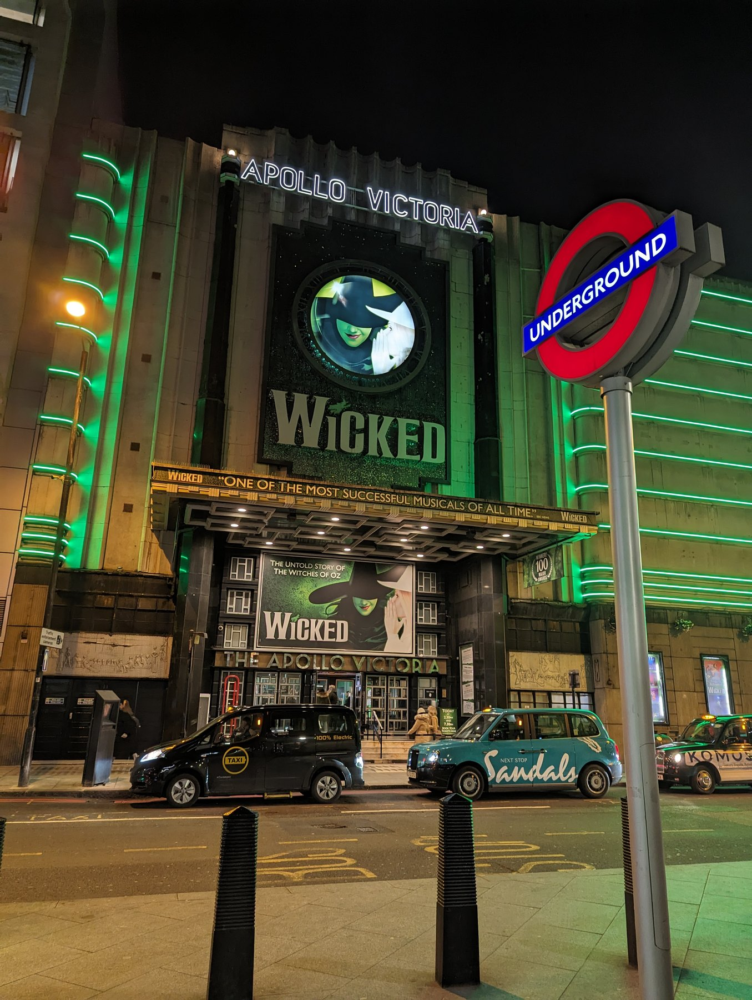
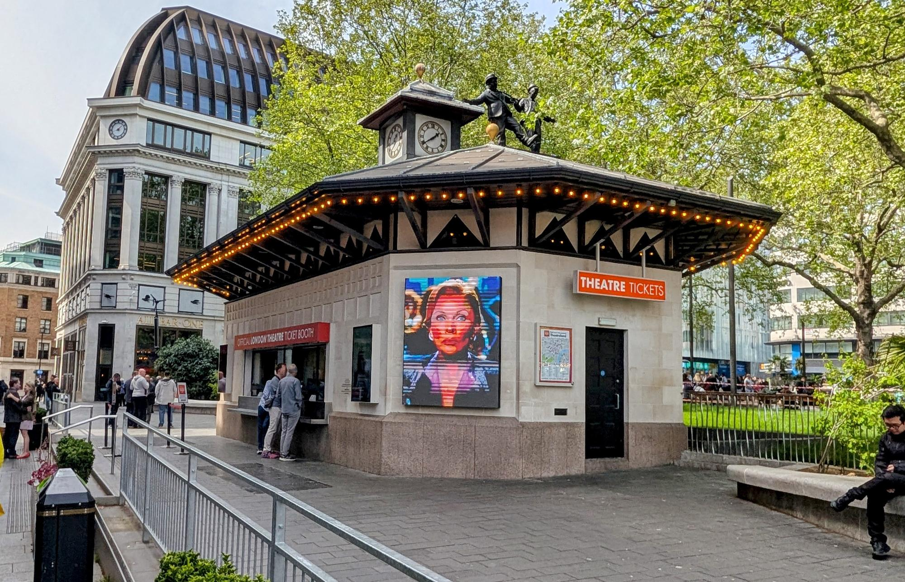
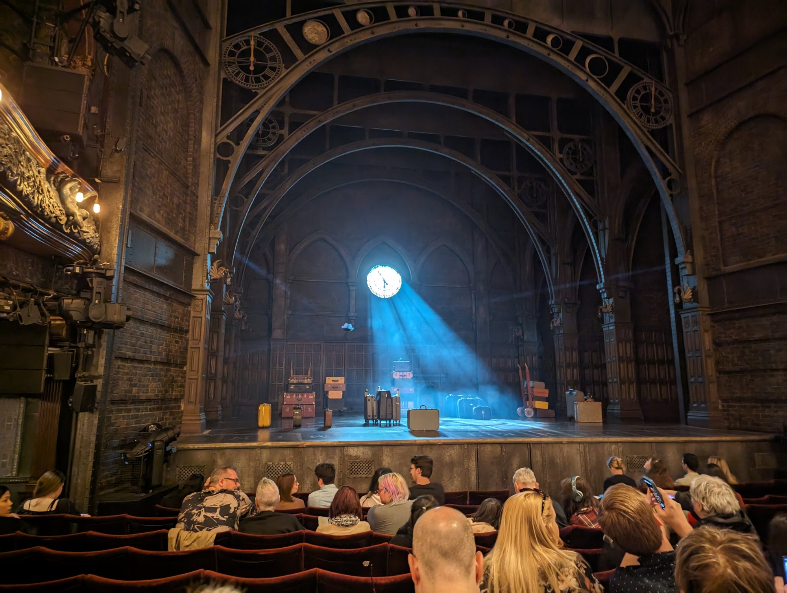
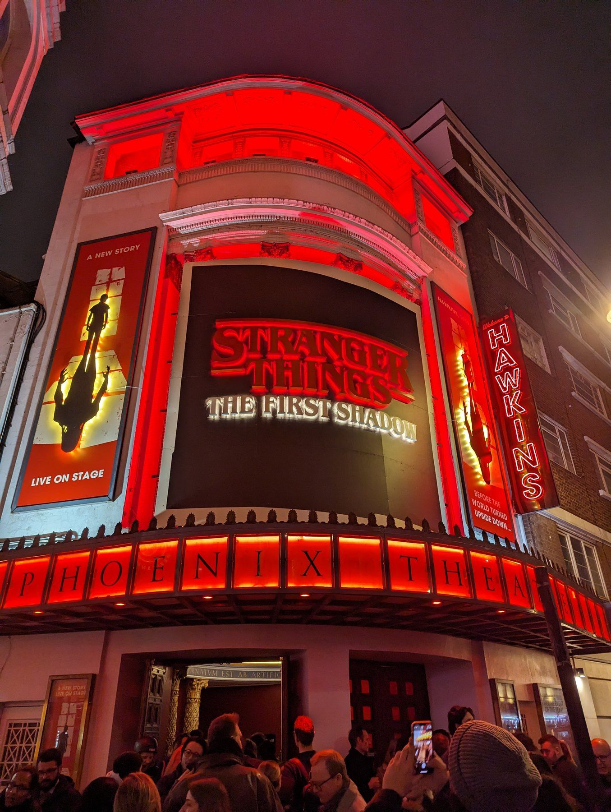

Prices for a West End evening run from £10 to £250. This guide covers two decisions: **what to see**, and **how to pay less for it**.

> 💡 **The Short Version:** Decide what kind of evening you want before you look at prices. Then: **use TKTS, either online or at the Leicester Square booth**, **go midweek and never on a Saturday night**, and **think about where you are sitting** as much as what you are seeing. Day seats, rush tickets and lotteries are worth a try if you like a gamble. Never buy from someone on the street.

---

## Deciding what to see

**For spectacle**, a big West End musical: full orchestras, large casts and theatres seating two thousand or more. They are also the most expensive and the most heavily marketed.

*The Apollo Victoria, over 2,300 seats.*

**For the writing and the acting**, look outside the West End. The National Theatre, the Old Vic, the Bridge, the Almeida, the Donmar and the Young Vic stage new work, and a lot of what later appears on Shaftesbury Avenue started at one of them, at a fraction of the eventual price.

**For dance**, Sadler's Wells in Islington programmes everything from ballet to hip hop. For opera and ballet, the London Coliseum and the Royal Opera House.

**With children**, the long-running family musicals are the safe choice, but check the running time and whether there is an interval before you commit a seven-year-old to three hours.

**If you want something unpredictable**, the fringe is dozens of small rooms, many above pubs, most seating under a hundred. Tickets often cost less than a cinema seat.

**If you want to see what the industry rates**, the Olivier Awards nominations are the shortlist, and the green-carpet fan pens outside the Royal Albert Hall give out free places: see [Olivier Awards tickets](/articles/olivier-awards-tickets/).

**On the labels:** **"West End" is a classification, not an address or a quality rating.** Most West End theatres sit around Shaftesbury Avenue, the Strand and Drury Lane, but the Apollo Victoria pictured above is in Victoria. **Off-West End** does not mean smaller: several of those venues seat more than West End theatres do. **Fringe** means small rooms.

---

Powered by <a target="_blank" rel="sponsored" href="https://www.getyourguide.com/london-l57/">GetYourGuide</a>

## How to pay less

### Start with TKTS, online or at the booth

**TKTS works two ways.** The Official London Theatre Ticket Booth (TKTS) is run by the Society of London Theatre, the industry's own body, and sells discounted seats for a wide spread of shows.

**Online**, at [officiallondontheatre.com](https://officiallondontheatre.com/todays-tickets), you can see what is discounted and book before you travel, or from your hotel that morning.

**In person**, the booth is in the Clocktower building on the south side of Leicester Square, open Monday to Saturday 10.30am to 6pm and Sunday 11am to 4pm. Staff will tell you what is worth seeing, and you leave with a physical ticket. The website saves the queue.

*The official TKTS booth, Leicester Square.*

> ⚠️ **It is the only official booth in Leicester Square.** The shops with similar signage are unrelated ticket agencies, and street sellers are not a bargain. Buy at the booth, at a theatre's own box office, or from an official agency, and nowhere else.

**Go with a list of three or four shows you would happily see**, and take whichever is discounted today.

### Go midweek, and never Saturday

**The same seat for the same show costs materially more on a Saturday night than on a Tuesday.**

- **Best value:** Tuesday, Wednesday and Thursday evenings
- **Also good:** midweek matinees, which are the quietest houses of the week
- **Avoid:** **Saturday evening**, which carries the highest prices, and Friday nights after it

**Season affects the price too.** January and February are cheaper than the rest of the year; the summer holidays are the busiest and cost more.

### The lower-cost routes, briefly

All take planning and none is guaranteed:

- **Day seats** — a handful of cheap seats released at the box office on the morning of the performance
- **Rush tickets** — the same idea released digitally through an app at a set time
- **Lotteries** — a ballot for a small number of very cheap seats, free to enter
- **Returns** — ask at the box office shortly before curtain, especially for a sold-out run
- **Twickets** — resale at face value or less, unlike the sites that charge multiples

**Which shows run which scheme changes constantly**, so check on the day. Our theatre site tracks it: **[Cheap London Theatre Tickets](https://www.londontheatregeek.co.uk/guides/cheap-theatre-tickets)**.

### Where you sit is the other half of the price

A West End ticket can vary by more than £100 within the same performance, and the cheap end is not always the bad end.

*The view from the stalls, before curtain.*

**Most of these theatres are Victorian or Edwardian**: narrow seats, tight legroom, steep upper tiers and overhangs that cut off the top of the stage. A cheap seat in a well-shaped house can be better than an expensive one behind a pillar.

**Two things to check before you book.** The **overhang** — where the tier above cuts into your view of the stage's upper half — and whether the theatre labels its **restricted view** seats as such, which most now do.

For seat-by-seat detail, theatre by theatre, see **[the seat guides](https://www.londontheatregeek.co.uk/guides/best-theatre-seats)**.

---

## The practical bit

**Curtain times** are usually **7.30pm**, occasionally 7pm or 8pm. **Matinees** are typically **Wednesday or Thursday and Saturday**, usually at 2.30pm — but it varies by production, so check the show.

**Most theatres are closed on Sunday**, and there is less on offer on Mondays. Plan those two evenings around something else.

**Running times** are usually around two and a half hours for a musical including an interval; plays are often shorter and some run straight through.

**Latecomers are not admitted** until a suitable break, which at some shows means the interval. Arrive twenty minutes early — bag checks are standard and slow the queue.

**There is no dress code.**

**Getting home is rarely a problem.** A 7.30pm start puts you out around 10pm, well inside normal Tube hours, and the Night Tube runs on several lines on Friday and Saturday. The streets and the nearest station are busiest in the fifteen minutes right after curtain. If you are staying outside central London on a National Rail line, the last train is the constraint.

*Leaving the Phoenix Theatre, after the show.*

**Eat before, and book early.** Book around 5.30pm a street or two back in Soho or Seven Dials rather than opposite the theatre; see [Where to Eat in London](/articles/eat-in-london-guide/). Many restaurants run **pre-theatre menus** that are much cheaper than the same food at 8pm.

---

Powered by <a target="_blank" rel="sponsored" href="https://www.getyourguide.com/london-l57/">GetYourGuide</a>

## Where to go deeper

We run a **[dedicated London theatre site](https://www.londontheatregeek.co.uk/)** with the show-by-show detail no general travel guide can carry:

- 💷 **[Cheap theatre tickets](https://www.londontheatregeek.co.uk/guides/cheap-theatre-tickets)** — every tactic above, in full
- 🎟️ **[Where to buy tickets](https://www.londontheatregeek.co.uk/guides/where-to-buy-theatre-tickets)** — which sellers are legitimate
- 🎫 **[Current offers](https://www.londontheatregeek.co.uk/guides/theatre-offers)** — TKTS, Twickets, rush, day seats and lotteries
- 💺 **[Best theatre seats](https://www.londontheatregeek.co.uk/guides/best-theatre-seats)** — seat-by-seat, theatre by theatre, including the restricted views
- 📅 **[Best time to visit](https://www.londontheatregeek.co.uk/guides/best-time-to-visit)** — when prices fall and when everything sells out
- 🎭 **[Every London theatre](https://www.londontheatregeek.co.uk/theatres)** — capacities, bars and stage doors for every venue

---

## Continue planning your London trip

- 🎪 **[Free Things to Do in London](/free/)**
- 🎤 **[The Best Cabaret in London](/articles/best-cabaret-london/)**
- 🏆 **[Olivier Awards Tickets](/articles/olivier-awards-tickets/)** — the free green-carpet places and how to get one
- 🎬 **[The Best Cinemas in London](/articles/best-cinemas-london/)**
- 🍽️ **[Where to Eat in London](/articles/eat-in-london-guide/)**
- 🏛️ **[Covent Garden Area Guide](/articles/covent-garden-area-guide/)**
- 🌉 **[South Bank Area Guide](/articles/south-bank-area-guide/)**
