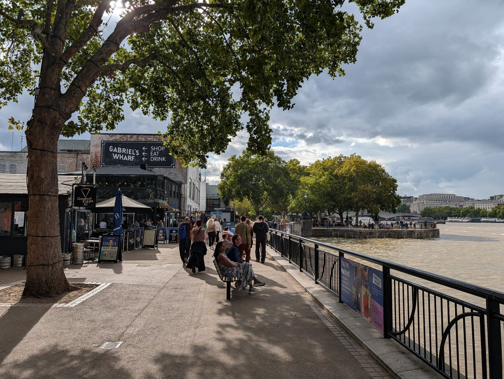
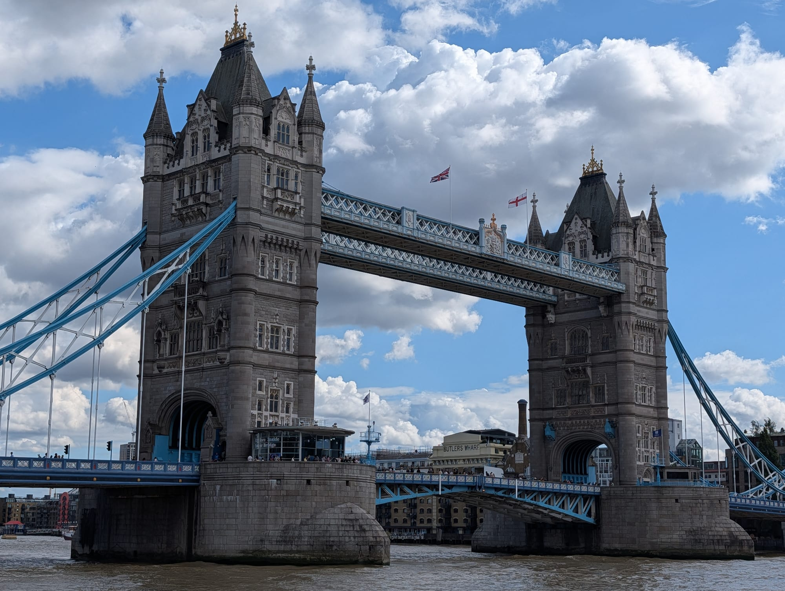
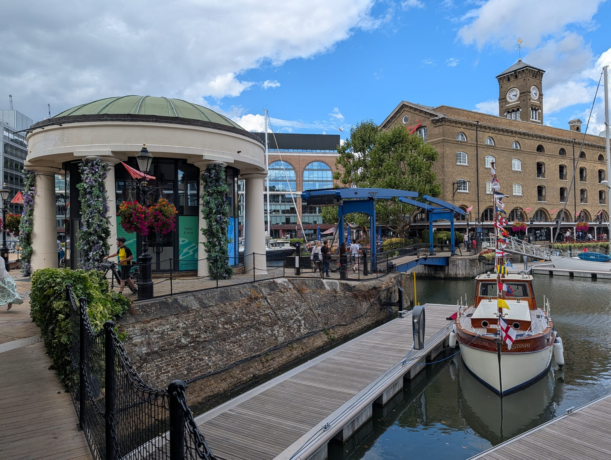
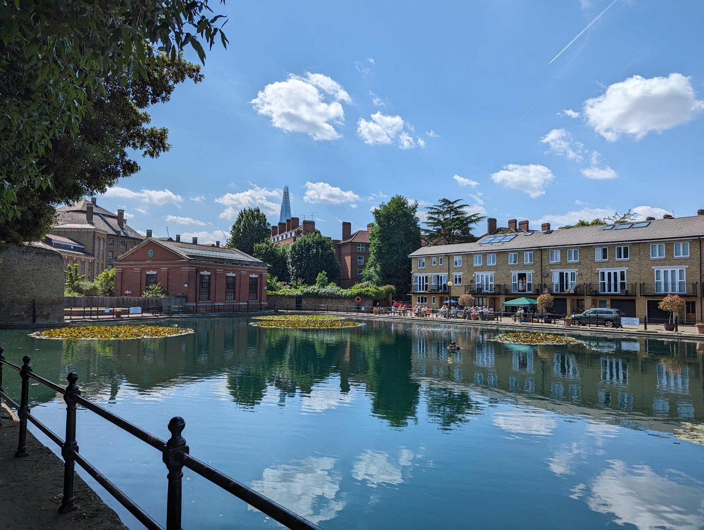
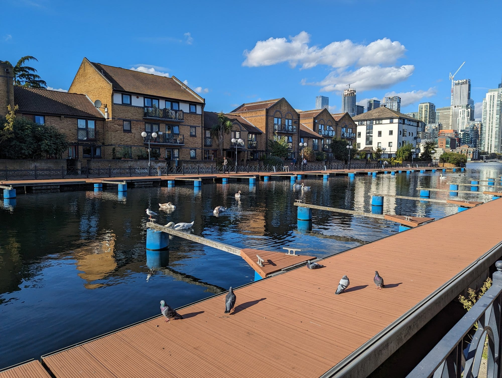
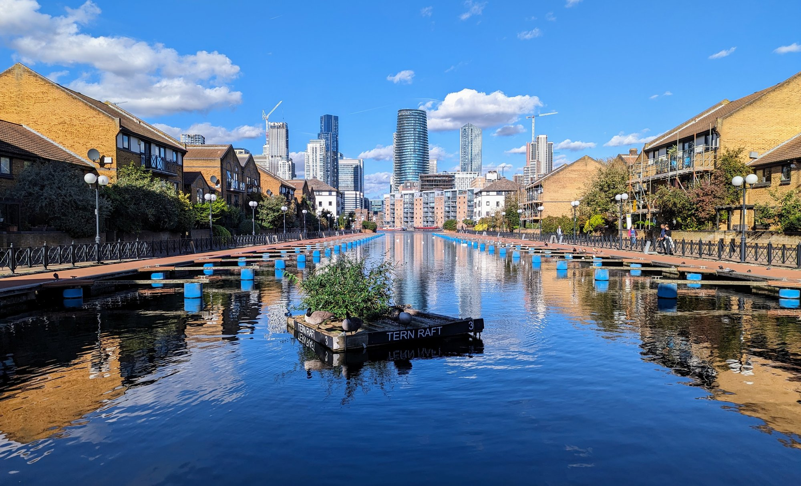

The Thames Path runs 185 miles from its source in Gloucestershire to the Thames Barrier. Through London it is flat and mostly signposted, and every route below is free.

> 💡 **The Short Version:** **Westminster to Tower Bridge** on the south bank is the classic hour. **Rotherhithe to Greenwich** is the quiet stretch almost nobody else walks. **Wapping to Limehouse** is the riverside pub route. And the **City on a Sunday** is empty.

> 📘 **How we choose these (editorial note).**
> No paid placements. Timings are walking pace without stopping; double them for the stops along the way.

---

## The South Bank: Westminster to Tower Bridge

*About an hour · entirely riverside · free*

**The route:** Westminster Bridge → the London Eye → Southbank Centre → the National Theatre → Gabriel's Wharf → Tate Modern → Millennium Bridge → Shakespeare's Globe → Borough Market → HMS Belfast → Tower Bridge.

**Worth stopping for:** Tate Modern, the second-hand book market under Waterloo Bridge, Forza Wine's terrace on top of the National Theatre, and Borough Market — which is **closed on Mondays**.

**[We have this one stop by stop →](/articles/south-bank-walk/)** — eleven numbered stops with a map, a Google Maps walking link and what is open on which day.

**Detour:** cross the Millennium Bridge for St Paul's.

*Gabriel's Wharf.*

*Tower Bridge, the end of the walk.*

---

> 🛶 **Want the canal instead of the river?** The Regent's Canal is 8.6 miles and 13 locks from Little Venice to Limehouse Basin, in sections that each end at a Tube station. See our [canal walks guide](/articles/best-canal-walks-london/).

---

## Wapping to Limehouse: the riverside pubs

*About 40 minutes · free · best at high tide*

Riverside pubs, in walking order.

**The route:** Tower Bridge → St Katharine Docks → **The Town of Ramsgate** (a pub here since 1545) → Wapping Old Stairs → **Turner's Old Star** → **The Captain Kidd** → **The Prospect of Whitby** → **The Grapes** in Limehouse.

**[The riverside pub walk from Wapping to Canary Wharf, stop by stop →](/articles/wapping-canary-wharf-walk/)** — the Town of Ramsgate, the Captain Kidd, the Prospect of Whitby and the Grapes as eleven numbered stops, with the Ornamental Canal and Tideway's new riverside park at Shadwell in between. It has a map, each pub's hours and kitchen times, who takes bookings, and carries on to Canary Wharf.

*St Katharine Docks.*

*One of Wapping's old docks.*

---

Powered by <a target="_blank" rel="sponsored" href="https://www.getyourguide.com/london-l57/">GetYourGuide</a>

## The City on a Sunday

*As long as you like · free · Sundays only*

The Square Mile empties at weekends, so it is a good time to walk it and a bad time to go inside anything.

**Worth finding:** **Postman's Park**, **St Dunstan in the East**, Leadenhall Market's exterior, the Roman wall at Tower Hill, and the Barbican highwalks.

> ⚠️ Almost everything is closed. This is a walk, not a day out — bring a coffee with you.

---

## Under the river: the docks to the Observatory

*About 6.5km · 3–4 hours · free*

The only walk on this page that crosses the Thames without a bridge. It runs south down the Isle of Dogs past the old docks and **Mudchute Farm**, dives under the river through the **1902 Greenwich Foot Tunnel** at Island Gardens, and comes up beside the *Cutty Sark* with the whole of Maritime Greenwich in front of you.

The Royal Observatory at the end of it is closed from 2 November 2026, so the walk finishes on the hill above it.

**[We have this one stop by stop →](/articles/canary-wharf-greenwich-walk/)** — the full **Canary Wharf to Greenwich walk via the Isle of Dogs**, eleven numbered stops with a map, a Google Maps walking link, the live status of the foot tunnel's lifts and what is open on which day.

*One of the Isle of Dogs' old docks.*

---

## Rotherhithe to Greenwich: the quiet stretch

*About 4 miles · 1 hour 45 · Rotherhithe to Cutty Sark DLR*

From Rotherhithe the route runs past the **Mayflower** — the pub beside the steps the Pilgrims' ship left from — through Surrey Docks and the old timber ponds, round the peninsula at Greenland Dock, and into Deptford past the site of Henry VIII's naval dockyard.

You emerge at the Cutty Sark with the Old Royal Naval College ahead of you.

**Stave Hill** is a short detour inland: an artificial mound with a bronze relief on top mapping the docks that used to be here, and a 360-degree view over what replaced them.

## Battersea to Putney: the boat race stretch

*About 4.5 miles · 1 hour 45 · Battersea Power Station to Putney Bridge*

Flat and mostly quiet. Past **Battersea Park** and the Peace Pagoda, under the pink-and-green Albert Bridge, along the Wandsworth reach and into Putney where the rowing clubs line the embankment.

Best done on a spring morning when the crews are out. On Boat Race day itself the towpath is packed for hours before the start.

## Thames Barrier to the Woolwich Ferry

*About 2 miles · 45 minutes · Charlton to Woolwich*

The **Thames Barrier** is the end of the Thames Path's London section — ten steel gates across 520 metres of river, each as tall as a five-storey building, and the Information Centre on the south bank explains what happens when they close.

Walk east from there to the **Woolwich Ferry**, which is free, takes vehicles and foot passengers, and has crossed the river on that spot since 1889.

---

## Practical notes for walking the river

* **The tide runs fast and the foreshore is not a beach.** The stairs at Wapping, Bankside and Rotherhithe are only usable around low water. Check a tide table before going down.
* **Mudlarking needs a permit.** Picking things up off the foreshore requires a Port of London Authority licence, and they are limited. Looking is free.
* **The path is not continuous.** Private wharves and construction close sections at both ends of the city.
* **North bank or south?** The south is more continuous and greener; the north has more of the historic pubs and the City.
* **Bridges** are free to cross, and most walks work better as a loop over two of them than as an out-and-back.

---

## What it costs

**Nothing.** The Thames Path is a National Trail, free and open at all hours along almost its entire London length.

* **Bridges are free**, including Tower Bridge's pavement; you only pay for the high-level walkways.
* **The one thing you pay for is getting back.** Walk one way and take the Tube, the DLR or a Thames Clipper back. A river bus fare is well above a Tube one.
* **The Greenwich Foot Tunnel is free** and open 24 hours to pedestrians. The lifts at both ends run 24 hours too, and the Royal Borough of Greenwich publishes a [live status page](https://www.royalgreenwich.gov.uk/parking-transport-and-streets/travel-foot-bike-or-public-transport/check-status-foot-tunnels) for them.

---

Powered by <a target="_blank" rel="sponsored" href="https://www.getyourguide.com/london-l57/">GetYourGuide</a>

## Continue planning your London trip

- 🌇 **[The Best Rooftop and Riverside Restaurants in London](/articles/best-rooftop-restaurants-london/)** — where to eat on the stretch you are walking
- 🛶 **[Best Canal Walks in London](/articles/best-canal-walks-london/)**
- 🚇 **[Canary Wharf to Greenwich Under the River](/articles/canary-wharf-greenwich-walk/)**
- 🥾 **[The Hampstead Heath to Primrose Hill Walk](/articles/hampstead-heath-primrose-hill-walk/)**
- 🎪 **[Free Things to Do in London](/free/)**
- 👀 **[The Best Views in London](/articles/best-views-london/)**
- 🍺 **[Historic Pubs and Dining Rooms in London](/articles/historic-pubs-dining-rooms-london/)**
- ⛵ **[Greenwich Area Guide](/articles/greenwich-area-guide/)**
- 🚂 **[King's Cross Area Guide](/articles/kings-cross-area-guide/)**
- 🗺️ **[Best Areas to Visit in London](/articles/best-areas-to-visit-london/)**
