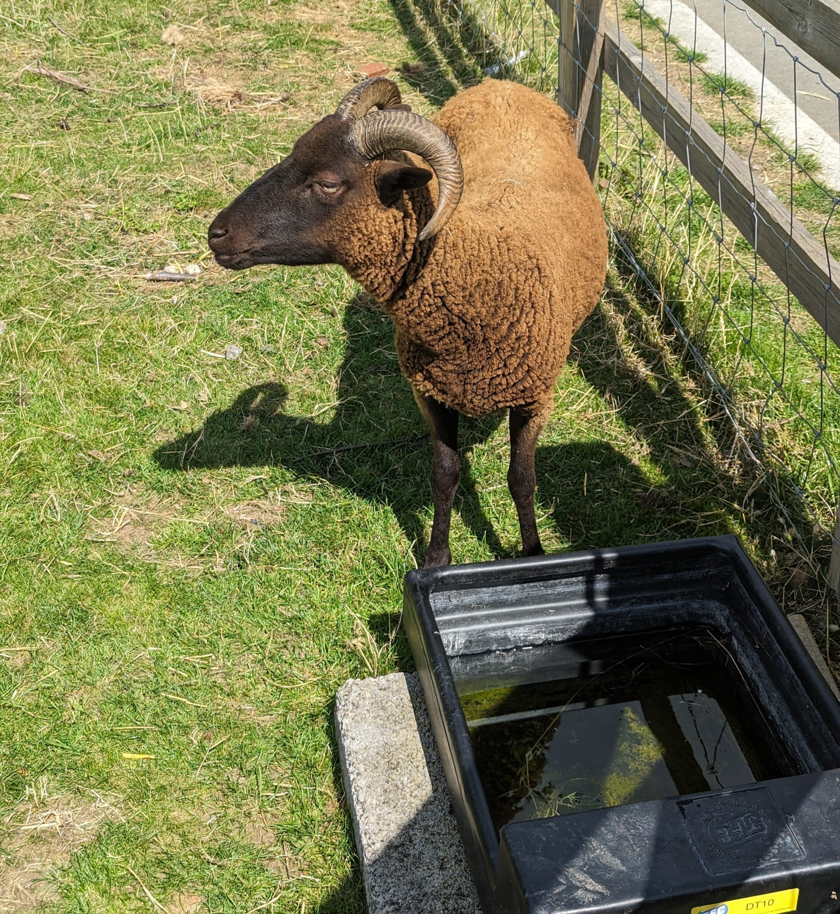
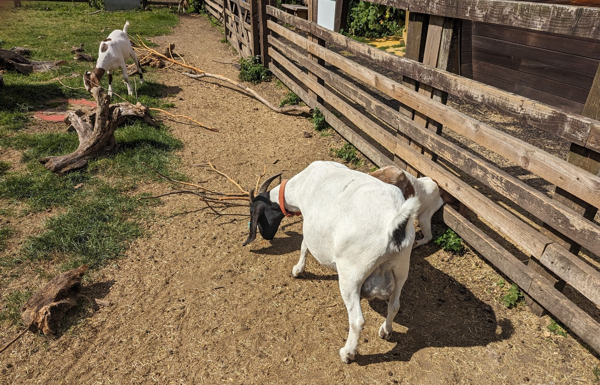
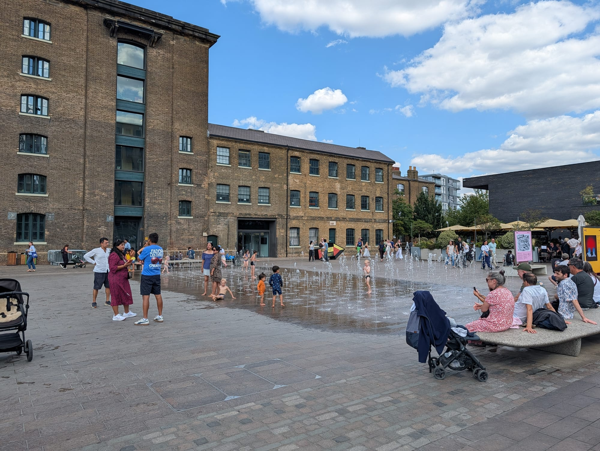

Most of the best of London with children is free: **eight city farms** you can walk into, a museum built entirely around children, and over a thousand fountain jets in the paving at King's Cross. Every big national museum is free at the door too.

> 💡 **The Short Version:** **Young V&A** is free, needs no booking and is built for children. The **city farms** are all free. **Granary Square fountains** are free and best on a hot day. **Babylon Park** in Camden has an indoor rollercoaster, with a 105cm height limit. **Mail Rail** puts you on a train inside real Post Office tunnels.

> 📘 **How we choose these (editorial note).**
> No paid placements. Where something is free we mean free at the door. Age suitability is the venues' own guidance, and worth checking: several attractions marketed at families are 12+.

## Where they are

| If you are near… | Where to go |
| --- | --- |
| **South Kensington** | Natural History Museum, Science Museum |
| **Bloomsbury** | Postal Museum & Mail Rail, British Museum |
| **Bethnal Green** | Young V&A, Spitalfields City Farm |
| **King's Cross** | Granary Square fountains, Word on the Water |
| **Camden & Regent's Park** | Babylon Park, London Zoo, Kentish Town City Farm |
| **Battersea** | Children's Zoo, Go Ape, Lift 109 |
| **South Bank** | SEA LIFE, Shrek's Adventure, London Eye |
| **Greenwich & east** | Cutty Sark, Mudchute Farm, foot tunnel |

---

## Free city farms

All eight are free to walk into, and none of them needs booking.

Check the day. Only Mudchute, Kentish Town and Surrey Docks open seven days a week. Hackney, Spitalfields, Stepney and Vauxhall all close on Mondays, and Freightliners closes on Tuesdays.

*A city farm.*

### Mudchute Park and Farm, Isle of Dogs

*Free · every day 9am–4pm · Crossharbour DLR*

A working farm on 32 acres in the middle of the Isle of Dogs, with the Canary Wharf towers standing over the fence. It keeps over a hundred animals (cattle, sheep, pigs, goats, llamas, donkeys, poultry) in paddocks you walk between rather than view through glass. **Entry is free, the farm is open every day 9am to 4pm, and the animals start going in from 3pm**, so arrive before two if the animals are the point. The park is open dawn to dusk, and buggies are fine on the paths, which turn to mud after rain.

### Kentish Town City Farm

*Free · every day 9am–5pm · Gospel Oak Overground*

Britain's first city farm, founded in 1972 on a strip of land beside the Gospel Oak railway line. Half an hour covers it. There are cows, pigs, goats, sheep, poultry and a set of well-known donkeys, plus a duck pond, a riding programme and a café. At weekends the farm runs small-animal handling sessions for children, which need signing up for in advance. **Entry is free, it opens every day from 9am to 5pm, and no booking is required** for an ordinary visit. It is ten minutes from Camden Town on foot.

### Hackney City Farm

*Free · Tuesday to Sunday, 10am–4.30pm · Hoxton Overground*

A farmyard on a small plot off Goldsmiths Row, a few minutes from Broadway Market and backing onto Haggerston Park. Pigs, goats, donkeys, sheep, chickens and rabbits, plus a walled garden and beehives, all visible from the gate. The attached café is busy at weekends. **The farmyard is open Tuesday to Sunday, 10am to 4.30pm, and closed on Mondays except bank holidays.** Entry is free. Allow an hour, and less in bad weather, as there is very little cover in the yard.

### Spitalfields City Farm

*Free · Tuesday to Sunday · Whitechapel*

A working farm on reclaimed railway land off Buxton Street, five minutes from Brick Lane. Sheep, goats, donkeys, pigs, poultry and rabbits, alongside vegetable and herb beds worked by volunteers, a farm shop selling eggs and plants, and a tea hut. There is mud and there are working tools, and young children need holding onto near the growing beds. **Entry is free, it opens Tuesday to Sunday, and the hours move with the clocks: 10am to 4pm in winter, 10am to 4.30pm in summer.** Closed Mondays. An hour covers it unless there is an event on.

### Surrey Docks Farm, Rotherhithe

*Free · every day 10am–4pm · Canada Water*

A compact farm directly on the Thames Path at Rotherhithe, with pigs, goats, sheep, donkeys, poultry and beehives, and the river running past the fence. The walk in along the Thames Path from Rotherhithe or Greenland Dock makes it easy to fold into something else. There is a farm shop run by volunteers selling eggs, meat, plants and honey, and a coffee shop doing hot food and cakes. **It is free and open 10am to 4pm every day of the week, bank holidays included.** The farm shop trades 10am to 1pm and 2pm to 4pm, so it shuts over lunch.

### Stepney City Farm

*Free · Tuesday to Sunday, 10am–4pm · Stepney Green*

Four and a half acres between Stepney Green and the Mile End Road, with rare-breed livestock, growing beds, and craft studios on site that visitors can look into. The farm café cooks with what is grown in the beds. **The farm and café open 10am to 4pm Tuesday to Sunday and on bank holiday Mondays; the Saturday farmers' market runs 10am to 3pm.** Entry is free and no booking is needed. Closed Mondays, and closest to Stepney Green on the District and Hammersmith & City lines.

*Goats at a city farm.*

### Freightliners Farm, Islington

*Free · closed Tuesdays · Highbury & Islington*

A small farm behind Paradise Park on Sheringham Road, about ten minutes' walk from Highbury & Islington. Pigs, goats, sheep, poultry, rabbits and bees on a site you can see round in half an hour, with a garden and a café. It suits under-fives better than ten-year-olds, who will want Mudchute. **It is free at the point of entry, funded by donations, and closed on Tuesdays rather than Mondays. The usual hours are 10.30am to 4.30pm, dropping to 3.30pm through the winter.** Closing times vary, so check the morning you go.

### Vauxhall City Farm

*Free, £4 suggested donation · Tuesday to Sunday · Vauxhall*

A small farm on Tyers Street, five minutes from Vauxhall station, with pigs, alpacas, goats, sheep, rabbits, guinea pigs and an aviary, plus a riding school. **Entry is free with a suggested donation of £4, and it opens Tuesday to Sunday, 10.30am to 4pm, with last entry at 3.45pm.** Closed Mondays. Riding sessions and animal encounters are booked separately and are not covered by walking in. Forty minutes is enough for the animals.

---

Powered by <a target="_blank" rel="sponsored" href="https://www.getyourguide.com/london-l57/">GetYourGuide</a>

## Museums built for children

### Young V&A, Bethnal Green

*Free · no booking · Bethnal Green*

The V&A's museum for children, reopened in 2023 on the old Museum of Childhood site, and Art Fund Museum of the Year in 2024. Three galleries (Imagine, Play and Design) run from a sensory area for babies through dressing-up, building and a small stage, to design benches aimed at teenagers, and nearly all of it is meant to be handled. **Admission is free and you do not need to book.** It opens daily 10.00 to 17.45, though the galleries start closing from 17.00, and it is closed 24 to 26 December. **There is buggy parking in the Welcome Area by the main entrance**, plus 24 free lockers on the lower ground floor. Children must be supervised throughout.

### The Postal Museum and Mail Rail, Bloomsbury

*Adult £20.50, child (2–17) £11 · Tuesday to Sunday · Chancery Lane*

**Mail Rail puts you in a narrow train running through the actual tunnels of the Post Office's own underground line**, which carried letters beneath London from 1927 to 1993. The ride takes about 15 minutes, the tunnels are no wider than 2.1 metres at their tightest, and it includes pitch darkness, loud noise and flashing light. **Adults are £20.50 and children aged 2 to 17 are £11, under-2s go free, and the ticket converts to an annual pass.** **No buggies are allowed on the lower ground floor where the train runs**; buggy parking is upstairs. The queue for the train reaches 45 minutes in school holidays. Sorted!, the play space for ages 1 to 8, is a separate £5 ticket.

### Natural History Museum and Science Museum, South Kensington

*Both free · book a free entry ticket · South Kensington*

Next door to each other on Exhibition Road, **and both free**. The Natural History Museum has Hintze Hall with the blue whale hung overhead, and the dinosaur gallery; it opens daily 10.00 to 17.50, last entry 17.30, and is closed 24 to 26 December. Our [Natural History Museum guide](/articles/natural-history-museum-guide/) has the entrances, a route through the galleries and where children can eat. The Science Museum suits children old enough to press things, opens daily 10.00 to 18.00, last entry 17.15, and its hands-on Wonderlab gallery is the one part that carries a charge. **General admission at both is free, but book the free ticket** instead of queueing: at weekends and in school holidays the Natural History Museum can have a queue to enter, and ticket holders skip it. With anyone under about eight, pick one and go at opening or after three.

### London Transport Museum, Covent Garden

*Adult £27 for a year, under-18s free · daily 10am–6pm · Covent Garden*

Real Tube carriages, trams, trolleybuses and horse-drawn omnibuses under the iron roof of the old Covent Garden flower market, and **you can climb into most of them**. There is a stamp trail, a play zone for under-fives and a Tube driving simulator upstairs. **Children and under-18s go free, and the £27 adult ticket is an annual pass, not a day ticket**: it covers unlimited return visits for twelve months. An off-peak version is £22.50 for weekday afternoons in term time. Free tickets for children still need booking. Open every day 10.00 to 18.00, last entry 17.00.

---

## Animals

### ZSL London Zoo, Regent's Park

*Adult from £27.70, child (3–15) from £19.40 · under-3s free · Camden Town*

Opened in 1828 as the world's first scientific zoo, with listed Victorian and modernist buildings, including the old Snowdon Aviary, reworked as Monkey Valley. It is a full day, with a long walk built into it. **Under-3s go free and need no ticket at all. Children aged 3 to 15 start at £19.40 and adults at £27.70 for an off-peak weekday if you book online, rising to £24.10 and £34.50 at peak**, and buying at the gate adds roughly two pounds a head. Last entry is an hour before closing and some animal houses shut half an hour before that, so a late-afternoon arrival is poor value. Children under 16 are not admitted without an adult.

### Battersea Park Children's Zoo

*Adult £17.50, child (2–15) £13.95, family £53.95 · under-2s free*

A small zoo built around young children, with meerkats, monkeys, otters, lemurs, a barnyard of sheep and goats to get close to, and two adventure playgrounds. It takes an afternoon rather than a day. **Adults are £17.50, children aged 2 to 15 are £13.95, under-2s go free, and the family ticket is £53.95 for two adults and two children or one adult and three children**, about £9 less than buying the same tickets separately. Open 10am to 5.30pm with last entry at 5pm, dropping to 4.30pm from late September. Under-16s must be with an adult.

### SEA LIFE London Aquarium, South Bank

*From £28 online · under-2s free · Waterloo*

In the basement of County Hall beside the London Eye: fourteen zones over three floors, a walk-through tunnel with sharks and rays passing overhead, and a rockhopper penguin colony. **Their own estimate is one to one and a half hours, against a standard online ticket from £28**, and walking up on the day costs meaningfully more. Under-2s go free, and under-16s must be with someone over 18. **There is no cloakroom of any kind, and that includes pushchairs**, so whatever you arrive with you push around the tanks. Open 10am to 6pm with last entry at 5pm. Book a timeslot, as queues build from mid-morning.

### WWT London Wetland Centre, Barnes

*Adult £17.10, junior (3–17) £11.12, family £48.11 · under-3s free*

Reedbed, lagoon and marsh in a loop of the Thames at Barnes, made out of four disused Victorian reservoirs and now a national nature reserve. Otters, bitterns, kingfishers and a large collection of ducks, geese and swans, plus pond dipping, adventure play areas and hides you can sit in out of the rain. Allow three hours. **Booked online without Gift Aid it is £17.10 for an adult, £11.12 for a junior aged 3 to 17 and £48.11 for a family of two adults and two children; under-3s are free and parking costs nothing.** Open 364 days a year, 10am to 5.30pm in summer and 4.30pm in winter, last admission an hour before closing.

---

Powered by <a target="_blank" rel="sponsored" href="https://www.getyourguide.com/london-l57/">GetYourGuide</a>

## Rides and running about

### Babylon Park, Camden

*Free entry, pay per ride · 105cm minimum on the big two · Camden Town*

An indoor amusement park on Castlehaven Road, a minute from Camden Lock, on three levels: reception at street level, a restaurant and toddler soft play on the mezzanine, and the rides down in the basement: **a rollercoaster, a drop tower, bumper cars, a carousel, VR and a wall of arcade machines**. **Entry is free and there is no minimum age, but the rollercoaster and the drop tower both require a minimum height of 105cm**, which rules out most three-year-olds and some fours. You either buy a wristband for unlimited rides or load Babylon coins and pay per go; for an hour with one child, the coins work out cheaper. Prams are allowed, with a buggy park inside. Open daily from 10am, to 9pm most days and 10pm on Saturdays.

*Babylon Park, Camden.*

### Granary Square Fountains, King's Cross

*The Granary Square fountains.*

*Free · daylight hours, every day · King's Cross St Pancras*

Four banks of jets set flush into the paving in front of the old Granary Building, **over 1,000 of them, individually controlled and individually lit**, with no fence, no queue and no ticket. It is five minutes from the King's Cross and St Pancras concourses. **They run daily during daylight hours and cost nothing**, though the display varies between a low, intermittent pattern and the full choreographed programme. Bring a towel and a complete change of clothes. The paving is hard and children fall over on it.

### Go Ape, Battersea Park

*From £28.95 · age 6 and 1.2m, or age 10 and 1.4m · Battersea Park rail*

High ropes strung through the plane trees in Battersea Park. Two courses run here. **Treetop Adventure Plus is from £28.95, with a minimum age of 6 and a minimum height of 1.2 metres, and takes 60 to 90 minutes; the full Treetop Challenge is from £39.95, minimum age 10 and minimum height 1.4 metres, and runs one to three hours.** Both cap participants at 130kg. There is also an indoor escape room, Codebreakers, from £24.95 and age 8 up. **Book ahead**: sessions are timed, and holiday weekends go early. Heights are checked at the gate and there are no exceptions, so measure your child before paying.

### Shrek's Adventure, South Bank

*From £21 online · recommended ages 6–12 · Waterloo*

A guided walkthrough on the South Bank with live actors, built sets and a 4D flying bus ride, finishing in a DreamWorks play area with characters from Kung Fu Panda and Madagascar. **The operator recommends it for ages 6 to 12, and says a tour lasts about an hour on top of a queue that typically runs 10 to 30 minutes and can reach an hour when busy.** There is no age limit as such, under-2s go free, and anyone 15 or under must be with an adult over 18. Standard tickets start at £21 online. There are witches in it and a couple of deliberate jump moments, so a cautious five-year-old will find it a lot. Closing time is often 3pm, so check before building an afternoon on it.

> ⚠️ **The London Dungeon is in the same building.** Merlin recommend it for 12+ and it frightens younger children.

---

Powered by <a target="_blank" rel="sponsored" href="https://www.getyourguide.com/london-l57/">GetYourGuide</a>

## The big attractions, and whether they are worth it with children

### Tower of London

*Adult £38, child (5–15) £19 · under-5s free · Tower Hill*

Armour, the Crown Jewels on a moving walkway, the ravens, and a Yeoman Warder tour included in the price. **Adults are £38 and children aged 5 to 15 are £19, while under-5s go free and need no ticket at all**, which puts two adults and two toddlers at £76 against the £114 a family with two older children pays. Open 09.00 to 17.30, last entry 16.30, and **the last included Warder tour leaves at 14.00**. Arrive at opening, as the Jewel House queue builds by midday.

### The British Museum

*Free · daily 10.00–17.00 · Russell Square*

The mummies are why most children want to come. **Pick three things and leave**: the museum is large enough that completeness is not an option. Free family trails are handed out at the information desks, and the Great Court is one of very few places in central London where you can sit down indoors without buying something first. **Entry is free and needs no ticket; it opens daily 10.00 to 17.00 with last entry at 16.45, and Fridays run to 20.30.** Fold-up pushchairs go in the cloakroom free, though bags cost £4 to £6 to leave. Special exhibitions are ticketed separately. Our [British Museum guide](/articles/british-museum-guide/) has the rooms for the mummies and the other headline objects.

### Tower Bridge

*Adult £18, child (5–15) £9 · under-5s free · Tower Hill*

The **glass floors in the high-level walkways** are what children come for, and a bus passing underneath your feet is the draw. The ticket also covers the Victorian engine rooms on the south side: the original coal-fired pumping engines that raised the bascules. **Adults are £18 and children aged 5 to 15 are £9, with under-5s free though they still need a ticket on the booking.** Open daily 09.30 to 18.00, last entry 17.00, and an hour covers it. **Watching the bridge lift from the pavement is free**, and the lift times are published on their site weeks ahead.

### The London Eye

*Adult from £29 online, £39 walk-up · under-2s free · Waterloo*

Thirty minutes, one slow rotation in a sealed pod with no way off once the door shuts. No walking is involved, which counts for a lot at the end of a long day. **Booked online it is from £29 for an adult and £26 for a child aged 2 to 15; walk up on the day and it is £39 and £35, so booking ahead saves a family of four around £38.** Under-2s go free.

### Westminster Abbey and Buckingham Palace

*Abbey £32 adult, £14 child (6–17) · Palace £33 and £16.50 · Westminster*

Neither is designed for children. **Westminster Abbey is £32 for an adult and £14 for a child aged 6 to 17, under-6s free, with general sightseeing from 9.30am to 3.30pm**; hours shift around services, and Sunday is for worship, not visits. **Buckingham Palace's State Rooms open only in summer, cost £33 for an adult and £16.50 for a child aged 5 to 17 booked in advance, and under-5s go free.** For most families the version worth having is the free one outside: **Changing the Guard costs nothing to watch**, happens on the forecourt and along the Mall, and does not run every day, so check the schedule.

### Madame Tussauds

*From £27 online, £39 walk-up · under-2s free · Baker Street*

The draw is photographs beside waxworks, plus a short dark ride at the end. **Book online and it starts at £27 for an adult and £24 for a child aged 2 to 15; walking up on the day is £39 and £35.** Under-2s go free. Closing times move around a great deal, so look them up instead of assuming a late slot exists.

---

## Free spectacle

* **Changing the Guard**, St James's: guards in bearskins and a full regimental band, free to watch. Check the schedule; it does not run daily. Our [Changing of the Guard guide](/articles/buckingham-palace-changing-of-the-guard-guide/) has the days and where to stand.
* **Greenwich Foot Tunnel**: walk **under the Thames** through a tiled Victorian tunnel and come up on the Isle of Dogs. Free and open at all hours.
* **Word on the Water**, King's Cross: a bookshop on a barge, with a roof deck.
* **The Crystal Palace Dinosaurs**: the first dinosaur sculptures ever made, from 1854, and scientifically out of date.
* **Covent Garden street performers**: three licensed pitches, free, and the West Piazza takes the big circle acts.

---

## What to know

* **Book the free timed ticket** at the national museums where one is offered.
* **Under-5s go free almost everywhere that charges**: the Tower of London, Tower Bridge, Buckingham Palace. Under-3s at London Zoo and the Wetland Centre; under-2s at the London Eye, SEA LIFE, Shrek's and Madame Tussauds.
* **Check age and height guidance.** The London Dungeon is 12+; Shrek's Adventure is recommended for 6–12; Babylon Park's rollercoaster and drop tower need 105cm; Go Ape needs 1.2m at six or 1.4m at ten.
* **Buggies are not always welcome.** Mail Rail bans them below ground, SEA LIFE has nowhere to leave one, and Young V&A and the British Museum both have somewhere to park one.
* **Under-11s travel free** on the Tube, DLR and Elizabeth line with a fare-paying adult, and free on buses and trams at any time.
* **Plan a buggy day around the lifts.** Only 95 Tube stations are step-free, and Covent Garden, Leicester Square and Charing Cross are not among them; every bus has a ramp instead. Our [step-free London guide](/articles/step-free-london/) has the station list and the attractions with lifts.
* **Museums are quietest in the last two hours** before closing.

---

## The one pass aimed at families

Merlin's **5-Attraction Pass** covers **Madame Tussauds, SEA LIFE London, the London Dungeon, Shrek's Adventure and the London Eye** on one ticket. You book the Eye first, then have **7 days for the other four**, with free rescheduling.

**From £59, against £132 for all five booked separately.** Two of them are cheaper bought direct, and it starts paying from the third.

Powered by <a target="_blank" rel="sponsored" href="https://www.getyourguide.com/london-l57/">GetYourGuide</a>

Two of the five are narrow: the **Dungeon is 12+** and **Shrek's Adventure is pitched at 6–12**. If neither suits your children you are down to three attractions, which is the break-even.

---

## Christmas with children

### Wundrful World of Christmas, ExCeL

*13 November to 24 December 2026 · adults £29.90–£34.90, children £24.90–£29.90 · ages 3 to 8 · Custom House*

A timed walk-through to Santa's grotto in Immerse LDN, on ExCeL's waterfront. Children ride a lift to the North Pole, sort toys in the Elves' Workshop, meet Mrs Claus in her kitchen and then Santa, who gives each of them a small gift. **The walk-through takes about 50 minutes, and the Elves' Playground after it (light installations, gentle fairground rides, food stalls) adds at least 30 more.** Every child needs a ticket, babies included, though under-12-month tickets are free, and pushchairs stay outside the walk-through. Rides and food are paid for on the day, by card only. [Dates and tickets](https://wundr.seetickets.com/timeslot/wundrful-world-of-christmas).

### Scrooge: Cirque Extravaganza, ExCeL

*23, 24, 27 and 28 December 2026 · seated · Prince Regent*

A circus version of *A Christmas Carol* with aerialists, acrobats and fire breathers, which the organiser describes as suitable for kids, teens and grandparents alike. It warns of water effects, loud noises, strobe lights and pyrotechnics, so it is not a first show for a nervous toddler. One seat number is drawn at each performance and wins £1,000 cash on stage. [Dates and tickets](https://scroogecirque.com/london).

### Disney On Ice presents Discover the Magic, The O2

*24 December 2026 to 3 January 2027 · North Greenwich*

An ice show following the search for Tinker Bell through scenes from *Coco*, *Moana*, *Beauty and the Beast* and *Frozen*, with Stitch causing trouble. Doors open at 12pm and 3.30pm on Christmas Eve and at 9.30am and 1.30pm on 2 and 3 January. [Dates and tickets](https://www.theo2.co.uk/events/detail/disney-on-ice-presents-discover-the-magic).

### Theatre for under-eights

**Room on the Broom** (Lyric Theatre, 27 November 2026 to 3 January 2027, from £10, ages three and over, 60 minutes with no interval, [tickets](https://thelyrictheatre.co.uk/tickets/room-on-the-broom-live-on-stage/)), **Peppa Pig's Big Family Show!** (Theatre Royal Haymarket, 4 December 2026 to 3 January 2027, from £10, about 1 hour 20 minutes, [tickets](https://trh.co.uk/whatson/peppa-pigs-big-family-show/)) and **Pinocchio** (Shakespeare's Globe, 28 November 2026 to 3 January 2027, for ages five and over, half-price seats for under-16s, [tickets](https://www.shakespearesglobe.com/whats-on/pinocchio/)) are the three to book first. Pantomimes, Nutcrackers and the shows at Little Angel and the Unicorn are in our [Christmas shows guide](/articles/christmas-shows-london/).

---

## Family shows this fortnight

Children's theatre, comedy and one-off shows in the next two weeks.

## October half-term

Family theatre, comedy and one-off shows in the week of October half-term.

---

## Continue planning your London trip

- 🗺️ **[Best Areas to Visit in London](/articles/best-areas-to-visit-london/)** — the neighbourhoods compared by what each is best for and the best day to go
- 🧱 **[LEGOLAND Windsor](/articles/legoland-windsor-day-trip/)** — tickets from £32, under-90cm free, and the train and bus from London
- 🐷 **[Paultons Park and Peppa Pig World](/articles/paultons-park-day-trip/)** — under-1m free, the train from Waterloo and every height limit
- 🦁 **[Chessington World of Adventures](/articles/chessington-world-of-adventures-day-trip/)** — a theme park and zoo in Zone 6, on Oyster, with under-90cm free
- 🎢 **[Theme parks near London](/articles/theme-parks-near-london/)** — Thorpe Park, Chessington, LEGOLAND, Paultons and the seaside parks compared
- 🎄 **[Christmas Shows and Pantomimes in London](/articles/christmas-shows-london/)** - pantos, Nutcrackers and shows for under-fives, with age guidance
- ⚽ **[Premier League Tickets in London](/articles/premier-league-tickets-london/)** — under-12s get in for £5 at Charlton against £39 for a junior Premier League seat
- 🎪 **[Free Things to Do in London](/free/)**
- 🏛️ **[The Best Museums in London](/articles/best-museums-london/)**
- 🌳 **[London's Parks and Gardens](/articles/best-parks-gardens-london/)**
- 🚇 **[How to Use the London Underground](/articles/how-to-use-the-london-underground/)**
- ♿ **[Step-Free London](/articles/step-free-london/)** — lifts, ramps and which attractions have them
- 🎭 **[Camden Area Guide](/articles/camden-area-guide/)**
- 🚂 **[King's Cross Area Guide](/articles/kings-cross-area-guide/)**
