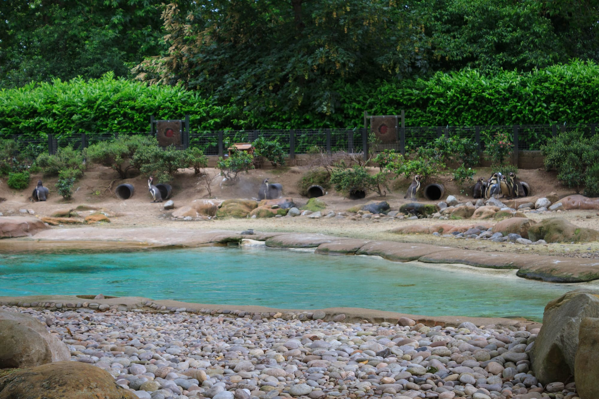
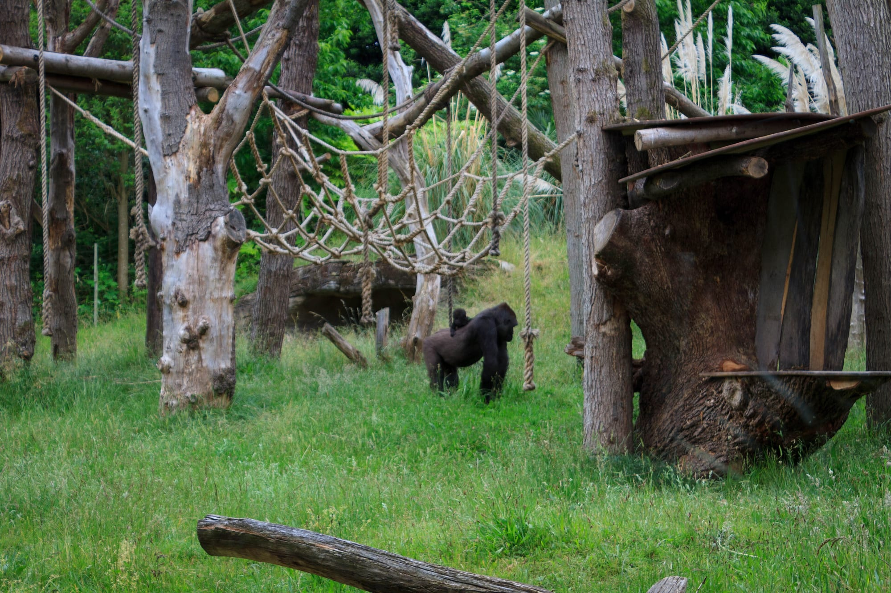
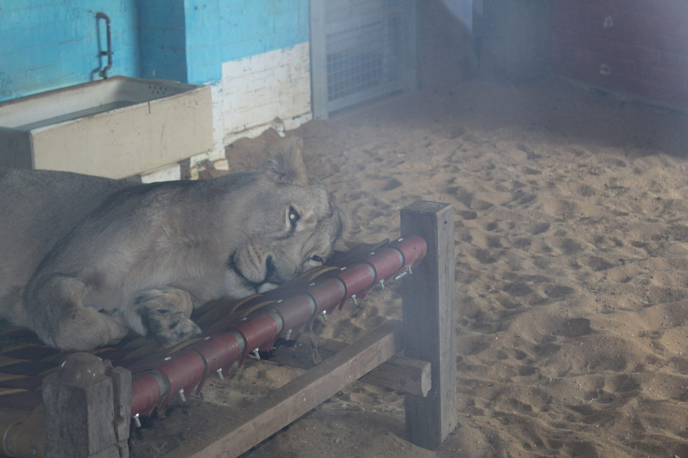
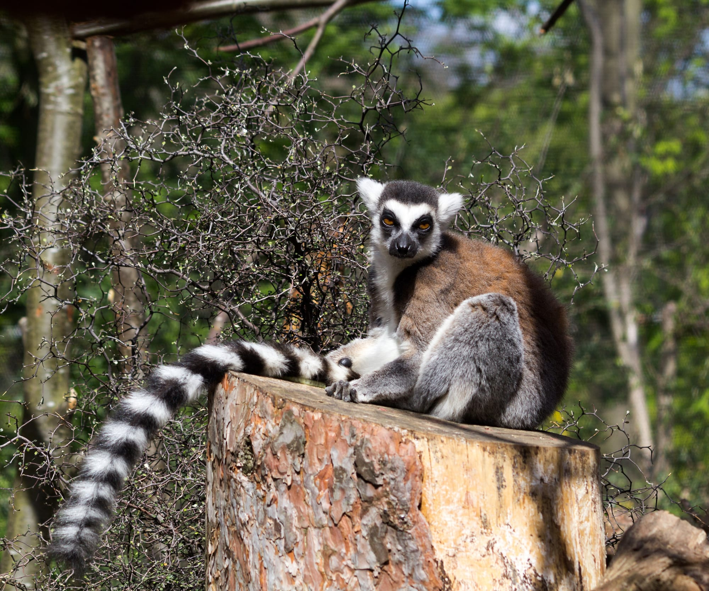

> 💡 **The Short Version:**
> - **Price:** an adult ticket bought online **before 10am on the day** costs **£27.70 to £34.50**, depending on the date; a child (3–15) **£19.40 to £24.10**. Under-3s are free. After 10am, online and gate prices are the same, **£1.80 an adult higher**. ZSL's headline prices include an optional 10% donation.
> - **Discounts that work:** **National Rail 2FOR1** (two train tickets, one free entry), the **London Pass**, **Blue Peter badges** (gate only), Universal Credit tickets, and Blue Light Card. Concession rates cover over-65s, students with ID and disabled adults, and a disabled visitor's carer goes free.
> - **Winter hours:** **10am to 4pm, last entry 3pm**, until 12 February 2027.
> - **Don't miss:** Land of the Lions, Gorilla Kingdom, Tiger Territory, Penguin Beach and the walk-through Rainforest Life. The daily talks run from 10.45am to 3.30pm; the gibbons eat breakfast at the first and the penguins are fed at the last.
> - **Getting there:** Camden Town is a 16-minute walk; the **274 bus** stops outside on Prince Albert Road.
> - **Christmas:** The Magic of Christmas runs **21 November 2026 to 3 January 2027**; Meet Santa is a separate ticket from **£19.50 a child**.

---

London Zoo opened in Regent's Park in 1828 as the Zoological Society of London's scientific collection, and ZSL still runs it as a conservation charity. More than 8,000 animals live on the site, which has 12 listed buildings. In 2026 ZSL marks its 200th anniversary with an exhibition free with entry until 31 December.

---

## 2026 ticket prices

Prices vary by date across four bands. The cheapest way in is online, before 10am on the day of your visit: from 10am, online tickets cost the same as the gate.

**Online, bought before 10am on the day (without donation)**

| Ticket | Off-peak | Weekday standard | Standard | Weekend peak |
| :--- | ---: | ---: | ---: | ---: |
| **Adult (16–64)** | **£27.70** | **£31.80** | **£33.60** | **£34.50** |
| **Child (3–15)** | **£19.40** | **£22.20** | **£23.50** | **£24.10** |
| Concession | £25.90 | £30.00 | £31.80 | £32.70 |
| Under 3 | Free | Free | Free | Free |

**At the gate, or online from 10am on the day (without donation)**

| Ticket | Off-peak | Weekday standard | Standard | Weekend peak |
| :--- | ---: | ---: | ---: | ---: |
| **Adult (16–64)** | £29.50 | £33.60 | £35.40 | £36.30 |
| **Child (3–15)** | £20.60 | £23.50 | £24.80 | £25.40 |
| Concession | £27.70 | £31.80 | £33.60 | £34.50 |

*Concession covers over-65s, students with ID (UK or international) and disabled adults. One essential carer per disabled visitor enters free; the carer ticket is issued at the gate on seeing supporting documents, and doesn't need booking.*

ZSL's [ticket page](https://www.londonzoo.org/plan-your-visit/london-zoo-tickets) leads with prices that include a **voluntary 10% donation**: £30.50 to £38.00 for an adult online. Untick it at checkout if you'd rather not pay it. ZSL is a charity, so there's no VAT on admission, and a UK taxpayer can add Gift Aid to the donation.

- **Dated tickets can't be refunded or moved to another day.** A **Flexi Ticket** can be used on any date within 12 months of purchase.
- **The time on your ticket is the earliest you can enter**, not a slot: you can arrive any time up to last entry.
- **Under-16s must come with an adult.**

Prices for your date and live availability, including a ticket with free cancellation:

Powered by <a target="_blank" rel="sponsored" href="https://www.getyourguide.com/london-l57/">GetYourGuide</a>

---

## Discounts that apply

ZSL says it doesn't run many deals. These are the ones on its own [offers page](https://www.londonzoo.org/plan-your-visit/london-zoo-offers) and FAQ:

| Discount | What you get | How it works |
| :--- | :--- | :--- |
| **[National Rail 2FOR1](/articles/national-rail-2for1-london-attractions/)** | Two in for the price of one; the cheaper ticket is free | Book through the [Days Out Guide's London Zoo page](https://www.daysoutguide.co.uk/london-zoo), no code needed. Show your zoo tickets and a valid National Rail ticket for each of you at the gate |
| **The London Pass / Go City Explorer Pass** | Entry included | Show the pass at admissions; no booking. See our [London Pass guide](/articles/london-pass-guide/) |
| **Blue Peter badge** | Free entry for a child aged 5–15 with a full-paying adult | **Gate only**: the adult ticket must be bought on arrival, one adult per badge-holder |
| **Universal Credit tickets** | Reduced-price entry for up to six people in a household | For Universal Credit, Pension Credit, New Style ESA or New Style JSA. Online in advance only, with proof of a qualifying payment within a month of the visit |
| **Blue Light Card / Defence Discount Service** | Discount on dated tickets | Claim through the card scheme's own site; show the card at the gate |
| **Max Card** | Discounted tickets | Show the card at the gate |
| **ZSL membership** | Unlimited entry to London and Whipsnade Zoos for a year | Silver starts from £27; Gold adds 10% off food, shops and animal experiences, free off-peak parking at London Zoo and free entry to ZooTown |

Universal Credit tickets are allocated per day and can run out. Only full-price tickets are sold at the gate, so don't travel without one.

---

> ⚠️ **The zoo shuts at 4pm until 12 February 2027.** Last entry is 3pm, and some animal houses close up to 30 minutes before closing. Arrive by late morning to fit in the afternoon talks, which run until the 3.30pm penguin feed.

## Opening hours

| Dates | Opens | Last entry | Closes |
| :--- | :--- | :--- | :--- |
| **24 October 2026 – 12 February 2027** | 10am | 3pm | 4pm |
| 13 February – 25 March 2027 | 10am | 4pm | 5pm |
| 26 March – 31 August 2027 | 10am | 5pm | 6pm |

The zoo closes at 5pm on selected Friday nights in June and July for Zoo Nights, its adults-only evenings. [ZSL's opening times page](https://www.londonzoo.org/plan-your-visit/opening-times) has any changes for special events.

Every visitor goes through a bag check and person screening at the entrance. ZSL asks you to leave large bags at home; a small number of self-service lockers stand a short walk from the main entrance, and must be emptied 30 minutes before closing.

---

## What to see

The zoo straddles the Outer Circle and the Regent's Canal, linked by two tunnels and footbridges. Most enclosures have indoor viewing for cold or wet days.

*Penguin Beach. Photo: [Numinosity (Gary J Wood)](https://commons.wikimedia.org/wiki/File:Penguin_Beach_2016-06-19.jpg), [CC BY-SA 2.0](https://creativecommons.org/licenses/by-sa/2.0/).*

- **Land of the Lions.** Asiatic lions in a recreation of Sasan Gir in Gujarat, with rickshaws, a ranger's hut and a life-size truck, much of it shipped from India. The Queen opened it in March 2016. Arya and her son Syanii, born in spring 2024, live here now.
- **Gorilla Kingdom.** A troop of western lowland gorillas on an island and in an indoor gym. The silverback, Kiburi, came from Hannover Zoo in 2022 and weighs 192kg.
- **Tiger Territory.** Sumatran tigers Asim and Gaysha behind floor-to-ceiling glass, with northern white-cheeked gibbons in the same Indonesian-themed habitat.
- **Penguin Beach.** Humboldt penguins on what ZSL calls England's biggest penguin pool: 1,200 square metres and 450,000 litres, with underwater viewing windows. The keepers feed them twice a day.
- **Rainforest Life.** A South American rainforest under glass, with monkeys in the trees, sloths and bats flying overhead.
- **Monkey Valley.** The Grade II* Snowdon Aviary, built for birds in the 1960s, now holds a troop of ten eastern black-and-white colobus monkeys, with a 30ft waterfall inside. ZSL lists the walk-through as **temporarily closed** (November 2026); when it is open, entry is 11am to 12.30pm and 2pm to 3.30pm.
- **In with the Lemurs.** A walk-through of Madagascan scrub where ring-tailed lemurs sunbathe on platforms beside the path.
- **The Secret Life of Reptiles and Amphibians.** Eight habitats, from the king cobra to the Philippine crocodile, plus a lab where children read X-rays and learn how scientists swab a frog for disease. The old Reptile House near the main entrance is now **ZooTown** (see below).
- **Into Africa.** Giraffes, zebras, African wild dogs and pygmy hippos in the pink zone.
- **Also on site:** Komodo Dragon House, Giants of the Galápagos (the tortoises), Butterfly Paradise, Tiny Giants (insects and coral), the Blackburn Pavilion tropical bird house, Bird Safari, Night Life and the meerkats.

*Gorilla Kingdom. Photo: [Numinosity (Gary J Wood)](https://commons.wikimedia.org/wiki/File:Gorilla_and_Baby_At_The_London_Zoo.jpg), [CC BY-SA 2.0](https://creativecommons.org/licenses/by-sa/2.0/).*

### Daily talks and feeding times

ZSL calls these talks, not shows: the animals aren't asked to perform. Two are billed as feeds: the gibbons have breakfast during the 10.45am talk and the penguins get fish at 3.30pm. Times change, so check the What's On boards when you arrive or the London Zoo app, which sends reminders.

| Time | Talk | Where |
| :--- | :--- | :--- |
| 10.45am | Gibbons, at breakfast | Tiger Territory |
| 11am | Tigers | Tiger Territory |
| 11.30am | Galápagos giant tortoises | Giants of the Galápagos |
| 11.30am | Super Species Live, flying birds (weather permitting) | Display Lawn |
| 12pm | Otters and dwarf mongooses | Otters & Dwarf Mongoose |
| 2pm | Gorillas | Gorilla Kingdom |
| 2.30pm | Lions | Land of the Lions |
| 3pm | Komodo dragons | Komodo Dragon House |
| 3.30pm | Penguins, with a feed | Penguin Beach |

*A lioness at Land of the Lions. Photo: [WereSpielChequers](https://commons.wikimedia.org/wiki/File:London_Zoo_in_June_22.jpg), [CC BY-SA 4.0](https://creativecommons.org/licenses/by-sa/4.0/).*

The talks run from 10.45am to 3.30pm, so seeing most of them fills a day. A **multilingual audio guide** costs £5, in English, French, German, Italian, Spanish, Dutch or Mandarin; it plays on your own phone, so bring headphones.

---

## With children

- **Under-3s are free**, but book them a ticket so ZSL knows how many are coming.
- **ZooTown** is an indoor role-play adventure for children up to 8, in the old Reptile House near the main entrance. Sessions are released at 10.30am, three days ahead, and need a zoo ticket as well; they sell out at peak times. Gold members get in free.
- **Animal Adventure** is the outdoor play area, with slides and ladders on a model of HMS Beagle and a Splash Zone. The Peckish Parrot café is beside it.
- **Pushchairs** can be hired from the gift shop: £10 single, £15 double, plus a £15 refundable card deposit.
- For more family days out, including the free ones, see [London with Children](/articles/london-with-children/).

*A ring-tailed lemur. Photo: [Katie Chan](https://commons.wikimedia.org/wiki/File:ZSL_London_-_Ring-tailed_lemur_(02).jpg), [CC BY-SA 4.0](https://creativecommons.org/licenses/by-sa/4.0/).*

---

## Christmas 2026

**The Magic of Christmas** runs from **21 November 2026 to 3 January 2027**. A Christmas forest leads to a North Pole HQ with letter-writing to Santa and cracker-making, and the keepers give festive versions of their talks. On peak days (21, 22, 28 and 29 November, 5 and 6 December, and 12 to 24 December), there are elf game shows at 11am, 2pm and 3pm, Mrs Claus storytime, live Christmas music at lunch and Santa's "Santa-Mobile" through the zoo at about 12.30pm and 1.30pm.

**Meet Santa** is a separate ticket on top of zoo entry:

| Session | Price | Length |
| :--- | :--- | :--- |
| Meet Santa (also as a Relaxed session) | £19.50 a child | About 30 minutes, with crafts and a gift |
| Meet Santa Penguin Feed (also Relaxed) | £40 a child, £20 an adult | About an hour: fish slid down a tube to the penguins, a short zoo tour, then Santa. Ages 3 and up, no seafood allergies |

Each booking takes up to three children. [ZSL's Meet Santa page](https://www.londonzoo.org/plan-your-visit/events/meet-santa-london-zoo) shows which sessions are left. More festive days out are in [Christmas in London](/articles/christmas-in-london/).

---

## Getting there

The zoo is on the Outer Circle of Regent's Park, NW1 4RY.

| From | How | Time |
| :--- | :--- | :--- |
| **Camden Town** (Northern line) | Walk | 16 minutes, 0.8 miles |
| **Chalk Farm** (Northern line) | Walk past Primrose Hill; quieter than Camden Town at weekends | 18 minutes |
| **Baker Street** (Bakerloo, Circle, Hammersmith & City, Metropolitan) | Walk through Regent's Park, or the **274 bus** northbound every 12 minutes | 21 minutes on foot, 14 by bus |
| **Regent's Park** (Bakerloo line) | Signposted walk through the park, or the **88 bus** from Albany Street | 24 minutes on foot |
| **Camden Road** (London Overground) | Walk, or the 274 towards Camden Town | 21 minutes |

The **274** stops right outside, at "ZSL London Zoo" on Prince Albert Road, in both directions.

**By canal:** the Regent's Canal towpath runs west from Camden Lock past the zoo, beneath the Snowdon Aviary. The [London Waterbus](https://londonwaterbus.com/) between Camden and Little Venice passes through the zoo grounds but doesn't stop there; its Camden Market stop is a 15-minute walk away. Our [best canal walks](/articles/best-canal-walks-london/) guide covers the Little Venice to Camden stretch.

**By car:** the zoo car park on the Outer Circle (sat nav NW1 4SX) costs £16 in term time and £17.50 at weekends and in school and bank holidays, opening at 9am. The zoo is outside the Congestion Charge zone but inside the ULEZ. Santander Cycles have two docking stations by the entrance.

---

## Food and picnics

- **Picnics are welcome**, with tables across the site. Feeding the animals isn't.
- **The Terrace Restaurant** is the main sit-down option, open from 10am for coffee and pastries, with hot food from 11.30am. It's the only outlet that takes cash; everywhere else is card only.
- **The Peckish Parrot Café** at Animal Adventure sells sandwiches, cakes and children's lunch boxes, with picnic benches outside.
- **Zoo Treats** (pastries and sandwiches) opens Friday to Sunday, the **Woodland kiosk** at weekends, and the **Beach Hut** beside Penguin Beach serves hot drinks.

---

## Accessibility

- Most of the zoo is accessible by wheelchair, with level or ramped access to most buildings, but some paths are uneven and **the slopes down to the two tunnels are steep**.
- **Wheelchairs** are hired on a £25 refundable card deposit and **mobility scooters** (two of them) for £20 plus a £30 deposit; book both in advance through ZSL's contact form.
- A **Changing Places** toilet with a ceiling hoist is at Animal Adventure, opened with a RADAR key.
- The **Penguin Pass** lets visitors who find queuing difficult skip queues around the zoo.
- Disabled visitors can park in the bay in front of the entrance, or for up to four hours on the Outer Circle with a Blue Badge.
- Assistance dogs are allowed with conditions, but not at talks, in walk-throughs or near the big cats. The full detail is on [ZSL's accessibility page](https://www.londonzoo.org/plan-your-visit/accessibility).

See [Step-Free London](/articles/step-free-london/) for accessible stations nearby.

---

## Continue planning your London trip

- 🏰 **[Disney in London](/articles/disney-london/)** — including Winnie, the zoo bear who gave Winnie-the-Pooh his name
- 🛶 **[Camden Area Guide](/articles/camden-area-guide/)** — the market, the lock and the canal boats that pass the zoo.
- 🚶 **[Regent's Park and Marylebone Walk](/articles/regents-park-marylebone-walk/)** — the park the zoo sits in, walked south to Marylebone.
- 🌊 **[Best Canal Walks in London](/articles/best-canal-walks-london/)** — Little Venice to Camden, past the Snowdon Aviary.
- 👨‍👩‍👧 **[London with Children](/articles/london-with-children/)** — city farms, Battersea Park Children's Zoo and the other family days out.
- 🚆 **[National Rail 2FOR1 London Attractions](/articles/national-rail-2for1-london-attractions/)** — how the train-ticket deal works here and at a hundred other places.
- 🎟️ **[The London Pass Guide](/articles/london-pass-guide/)** — whether the pass beats paying for the zoo and the rest.
- 🌳 **[London's Best Parks and Gardens](/articles/best-parks-gardens-london/)** — Regent's Park, Primrose Hill and the rest.
- 🏨 **[Where to Stay in Marylebone](/articles/where-to-stay-marylebone/)** — hotels a walk across Regent's Park from the zoo.
- 🎄 **[Things to Do in London in December](/articles/things-to-do-in-london-in-december/)** — the zoo's Christmas with the other light trails and grottos.

---

*Prices, hours and events are ZSL's own for 2026–27.*
