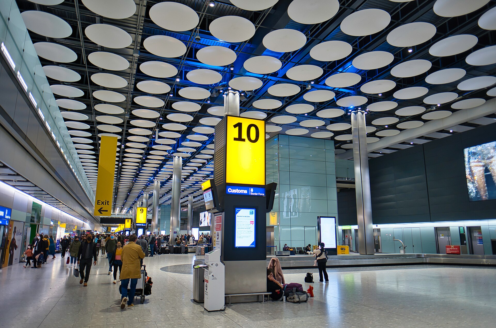
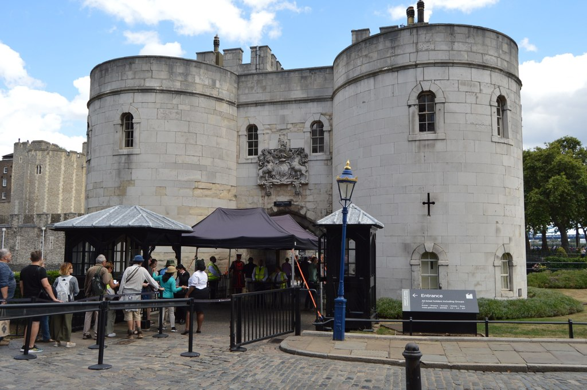

Nine London terminals have a staffed left-luggage desk, and four of the six airports do too. The Tower of London and the Houses of Parliament will turn a suitcase away at the door with nowhere on site to leave it. Below: where a bag goes, what it costs and who holds it.

> 💡 **The Short Version:** **King's Cross, Euston, Paddington, Liverpool Street, Victoria, Waterloo, London Bridge, Charing Cross and St Pancras** all have a staffed desk, mostly run by **Excess Baggage Company**, from **£10 for up to 3 hours** and **£40 for up to 72 hours** per item. **Heathrow, Gatwick, Stansted and Luton** have the same desks and the same tariff; **London City and Southend don't**. The **storage apps** — Stasher, Bounce, Radical Storage, LuggageHero and Nannybag — undercut every counter, from **£1.49 a bag a day**, booked online for a drop-off at a nearby shop or hotel. The **Tower of London** refuses a suitcase outright, and the **Houses of Parliament** caps a bag at 60cm x 40cm, both with no cloakroom.

## Stations: nine desks, one operator, one tariff (Victoria excepted)

**King's Cross, Euston, Paddington, Liverpool Street, Victoria, Waterloo, London Bridge, Charing Cross and St Pancras International** all have a staffed left-luggage desk on the main concourse. **Excess Baggage Company** runs eight of the nine; at London Bridge, Network Rail lists the station's own Left Luggage unit.

**The published tariff is identical at every desk except Victoria's**, per item:

| Time band | Standard tariff | Victoria |
| --- | --- | --- |
| Up to 3 hours (6 at Victoria) | £10.00 | £10.00 |
| Up to 24 hours | £15.00 | £15.00 |
| Up to 48 hours | £27.50 | £25.00 |
| Up to 72 hours | £40.00 | £35.00 |
| After 72 hours | £12.50/day | £10.00/day |
| After 7 days | £10.00/day | £10.00/day |

Excess Baggage Company gives a **20% discount on 15 or more items**, and its own FAQ caps its liability for loss, theft or damage at **£200 per transaction**. It publishes no maximum bag size, and won't cover damage to anything over **32kg**, the EU's recommended safety limit.

**Desks open 07:00–23:00.** Network Rail lists Liverpool Street, London Bridge and Charing Cross as **open every day**; for King's Cross, Euston, Paddington, Waterloo and Victoria it lists **weekday hours only**, so ring the desk before a weekend drop-off (each number is on the station's Network Rail page). St Pancras International's desk is in The Circle, on the ground floor.

Powered by <a target="_blank" rel="sponsored" href="https://www.getyourguide.com/london-l57/">GetYourGuide</a>

## Airports: four with a desk, two without

**Heathrow, Gatwick, Stansted and Luton** all have a left-luggage desk, and all four are run by **Excess Baggage Company** on the **same tariff as the stations** (£10 up to 3 hours, up to £40 for 72). **Heathrow has ten of them**, six in check-in and one in each terminal's arrivals hall. **Gatwick has no lockers**, and **London City and Southend have neither a desk nor a locker.**

*Heathrow arrivals.*

| Airport | Location | Hours |
| --- | --- | --- |
| Heathrow, check-in | T2 zones A and C, T3 zone E, T4, T5 zones B and F | 05:00–21:00 |
| Heathrow, arrivals | One desk in each of T2, T3, T4 and T5 | 06:00–22:00, except T3 at 05:00–21:00 |
| Gatwick North Terminal | Level 1, before security, next to Costa Coffee | 04:00–22:00 |
| Gatwick South Terminal | Level 2, before security, behind check-in zone E | 04:00–22:00 |
| Stansted | Arrivals Hall | 06:00–22:00 |
| Luton | Check-in area | Daily, 04:00–22:00 |
| London City | — | No left-luggage service |
| Southend | — | No left-luggage service |

**At London City and Southend, book a storage app instead**, with a shop or hotel near the airport or at your first stop in town. Southend's terminal only opens three hours before the day's first departure.

## The storage apps: cheaper than any counter

Five networks book a bag into a nearby shop, hotel or storage room: **Stasher, Bounce, Radical Storage, LuggageHero and Nannybag**. All five work the same way: pick a location and a date online, get a confirmation code, drop the bag, then collect it before closing with the same code. Most also take a walk-up booking on the day if a slot is free.

| App | London locations | Price | Cover included |
| --- | --- | --- | --- |
| [Stasher](https://stasher.com/luggage-storage/united-kingdom/london) | 620+ | From £1.49/bag/day | Up to £10,000 per booking |
| [Bounce](https://usebounce.com/city/london) | 612 | From £1.95/day (most shops £3.50–£4.50) | £10,000 bag protection |
| [Radical Storage](https://radicalstorage.com/luggage-storage/london) | 799 | From £1.90/day, + £1.99 per-bag fee | £10,000 guarantee |
| [LuggageHero](https://luggagehero.com/london/) | 250+ | From £1.49/hour or £4.90/day, + £1.80 fee/bag | £500 included; paid upgrades available |
| [Nannybag](https://www.nannybag.com/en/luggage-storage/london) | Not published separately | £3.40/day small bag, £4.90 regular, £6.90 odd-size | £10,000 included |

**Every figure here beats a station counter on price.** **Nannybag now runs inside the Bounce network**: partner shops manage bookings on Bounce, while Nannybag keeps its own branding and pricing.

## Hotels, and the day-room alternative

**Most hotels will hold bags for their own guests before check-in or after check-out**, usually free. It is a courtesy, not a guaranteed service, and it is for guests only.

**If the gap is long enough to want a bed**, a day-use hotel room starts at roughly £50 for a seven- or eight-hour window. Our [day rooms guide](/articles/day-rooms-london/) covers which hotels sell one, when the windows start, and the ones open early enough for a 6am landing.

## Where you can't take a bag in

Four big venues publish bag limits that turn a suitcase away at the door.

| Venue | Bag limit | If you're carrying one |
| --- | --- | --- |
| Tower of London | No suitcases, large bags or rolling luggage at all | No cloakroom on site; Historic Royal Palaces' own FAQ points visitors to Stasher |
| Houses of Parliament | Nothing larger than 60cm x 40cm | No cloakroom; airport-style security on entry |
| Wembley Stadium | One small bag per person, no bigger than A4 (297mm × 210mm × 210mm) | Folding a bigger bag down doesn't count; no storage on site |
| The O2 | One bag per person, A4 or a standard handbag | Paid bag store outside the main entrance, £10 (free for American Express cardholders) |

If you are carrying a case, book a storage app near the attraction, not a desk at the station you arrived at.

*The bag check at the Tower's entrance.*

Powered by <a target="_blank" rel="sponsored" href="https://www.getyourguide.com/london-l57/">GetYourGuide</a>

## Continue planning your London trip

- ✈️ **[Heathrow Airport to London](/articles/heathrow-airport-to-london/)**, **[Gatwick](/articles/gatwick-airport-to-london/)**, **[Stansted](/articles/stansted-airport-to-london/)**, **[Luton](/articles/luton-airport-to-london/)**, **[London City](/articles/london-city-airport-to-london/)** and **[Southend](/articles/southend-airport-to-london/)** — every airport's own transport options compared
- 🛏️ **[London Day Rooms](/articles/day-rooms-london/)** — booking a hotel room for a few hours, not the night
- 🎒 **[Best Hostels in London](/articles/best-hostels-london/)** — including which ones store bags for free
- 🏟️ **[Wembley Stadium Guide](/articles/wembley-stadium-arena-guide/)** and **[The O2 Travel Guide](/articles/the-o2-travel-guide/)** — full bag rules for an event day
- 🎪 **[ExCeL London Guide](/articles/excel-london-guide/)** — free cloakrooms, but bag policy is set by each show's own organiser, not the venue
- 🗓️ **[London Itineraries by Days and Interests](/articles/london-itineraries-by-days-and-interests/)** — planning what to see between a landing and a check-in

*Storage prices, locations and opening hours change; check the operator's own site before you travel.*
