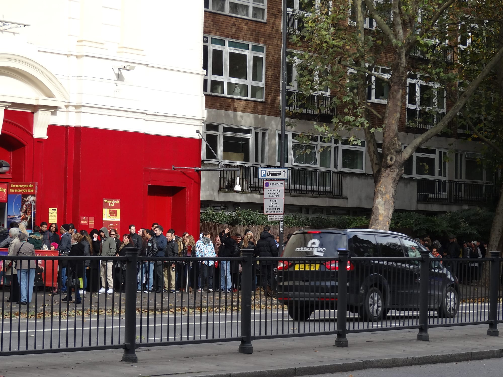
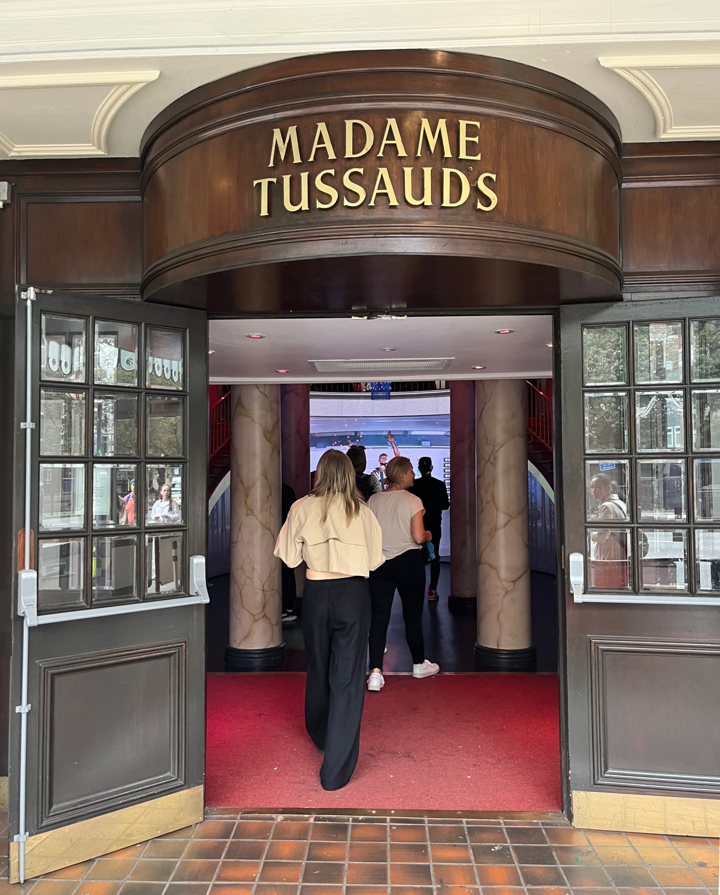
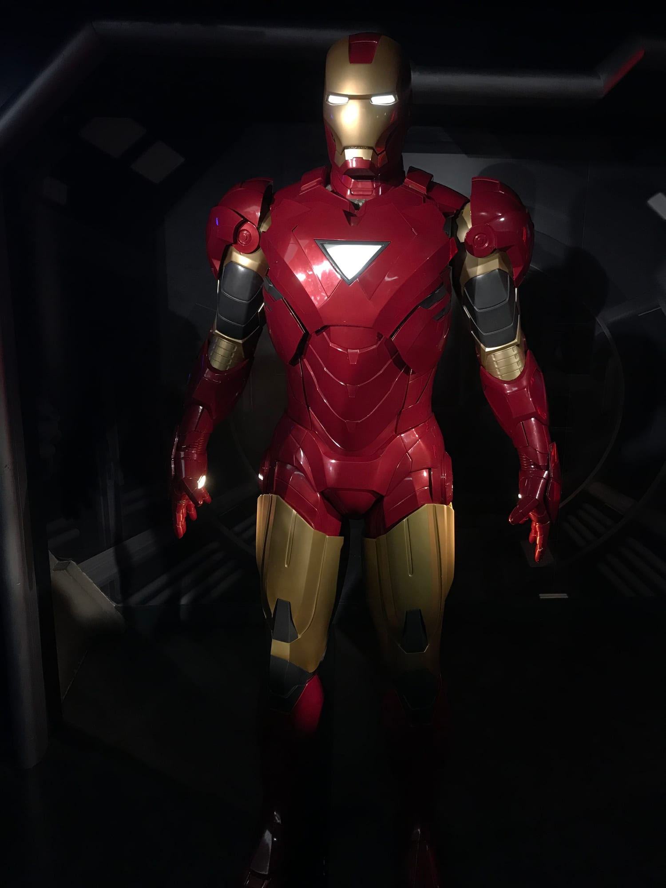
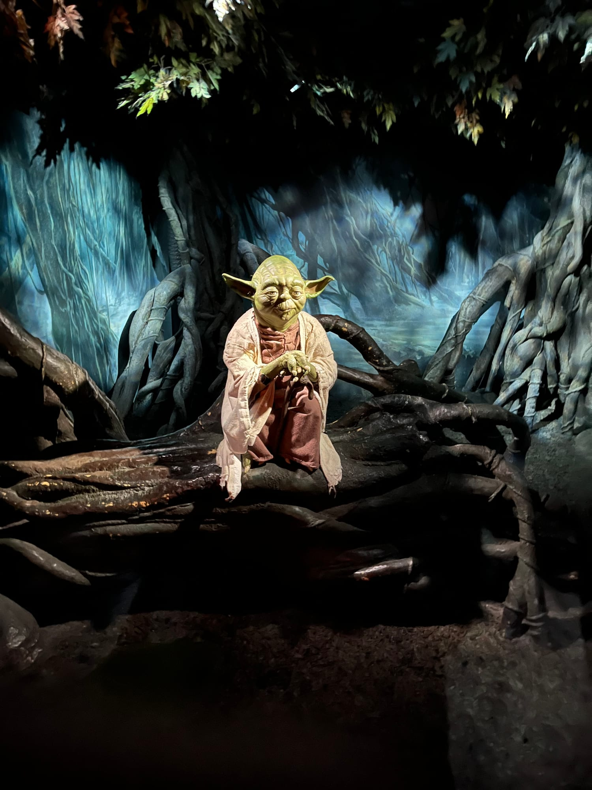

Madame Tussauds London is the original of the waxworks chain, on Marylebone Road since 1884, behind a green copper dome two minutes from Baker Street. Inside are more than 150 figures across eight themed zones, a black-cab dark ride through London's history and a 4D cinema.

> 💡 **The Short Version:**
> - **The price:** An adult ticket is **from £27 online** and **£39 at the door**; a child aged 2 to 15 is **from £24 online** and **£35 at the door**; under-2s go free (November 2026). Online prices rise with demand.
> - **Combos:** Tussauds plus the London Eye is **from £49**; all five Merlin London attractions (Tussauds, the Eye, SEA LIFE, the London Dungeon and Shrek's Adventure) are **from £59**. You get seven days to use the rest.
> - **Queues:** weekends and school holidays are busiest. Flexi Fast Track (**from £37 online**) has its own entrance; otherwise book an early-morning or late-afternoon slot.
> - **Allow two hours.** Last entry is two hours before closing: 16:00 on most days in November and December 2026.
> - **Leave the suitcase at the hotel.** Security refuses suitcases and large hand luggage, and the cloakroom will not take them. Pushchairs can't go in either, but are stored free.
> - **By train?** A National Rail ticket gets **one third off** through the Days Out Guide. It is not 2FOR1.

---

## Tickets and prices

Madame Tussauds is run by **Merlin Entertainments**, which also runs the London Eye, SEA LIFE, the London Dungeon and Shrek's Adventure. Prices are dynamic: the "from" figure is the cheapest online date, and busy days cost more. Every ticket below includes all eight zones, the Spirit of London ride, the Chamber of Horrors and the Jumanji 4D film.

| Ticket | Online | At the door | Details |
| :--- | :--- | :--- | :--- |
| **Standard, adult (16+)** | From £27 | £39 | A timed entry slot. |
| **Standard, child (2–15)** | From £24 | £35 | Under-2s free. |
| **Flexi Fast Track, adult** | From £37 | £49 | Any time on your chosen day, through the Fast Track entrance. |
| **1835 Champagne Bar Experience** | From £42 | — | Priority entry and a glass in the champagne bar. Limited numbers. |
| **Student** | From £16 | — | Online, for students registered with Student Beans. |
| **Groups of 10+** | £30 a head | — | Booked in advance. |
| **Carer** | Free | — | Booked with at least one full-price ticket; bring proof of eligibility. |

*Prices from [Madame Tussauds' tickets page](https://www.madametussauds.com/london/tickets-prices/), November 2026.*

The door is card only: Madame Tussauds and its cafés are cashless. Self-service machines at the ticket office sell same-day tickets, but entry is not guaranteed on busy days.

**Changing your date:** standard and multi-attraction tickets bought direct can be moved free up to three times, up to one hour before your slot, to a comparable date within seven days of the original. They are not refundable.

**Opening hours:** 10:00 to 18:00 with last entry at 16:00 on most days from mid-November to 23 December 2026; 09:00 to 18:00 on 24 December; 09:00 to 20:00, last entry 18:00, from 26 to 31 December. Closed on Christmas Day. The [opening hours page](https://www.madametussauds.com/london/plan-your-visit/before-you-visit/opening-hours/) has your date.

Dates, slots and prices through GetYourGuide:

Powered by <a target="_blank" rel="sponsored" href="https://www.getyourguide.com/london-l57/">GetYourGuide</a>

> ⚠️ **No suitcases, and no pushchairs inside.** Security turns away suitcases and large hand luggage, and the cloakroom will not store them, so come from the hotel, not the station. Pushchairs must go in the cloakroom by the exit (free); bags are £5, coats £2.

---

## Combination tickets, the Annual Pass and the rail discount

### Merlin's combination tickets

Bought on [Madame Tussauds' multi-attraction page](https://www.madametussauds.com/london/tickets-prices/ways-to-visit/multi-attraction-tickets/), the slot you choose is for Tussauds. You then have **seven days** to visit the others, booking a free timed slot for each through Merlin's booking portal. Each visit can be moved up to three times.

| Combination (adult) | Online from | Merlin's "bought separately" figure |
| :--- | :--- | :--- |
| Tussauds + London Eye | £49 | £78 |
| Tussauds + SEA LIFE | £49 | £78 |
| Tussauds + London Eye + SEA LIFE | £54 | £117 |
| Tussauds + London Eye + Big Bus | £64 | £127.99 |
| All five: Tussauds, the Eye, SEA LIFE, the London Dungeon, Shrek's Adventure | £59 | £184 |
| Tussauds, the Eye, SEA LIFE, Shrek's Adventure + Big Bus | £69 | £198.99 |
| Tussauds, the Eye, SEA LIFE, the Dungeon + Big Bus | £69 | £201.99 |

*Prices from Madame Tussauds' multi-attraction page, November 2026.*

Merlin's "separately" column uses door prices. Against the cheapest advance prices the five come to £132, so the five-attraction ticket still wins from the third attraction you would actually visit. The London Dungeon admits no under-5s, and anyone 15 or under needs an adult of 18 or over.

The other four are not next door: the London Eye, SEA LIFE, the Dungeon and Shrek's Adventure are together at County Hall on the South Bank, about 23 minutes away on the Bakerloo line from Baker Street to Waterloo. See our [London Eye guide](/articles/london-eye-guide/).

On GetYourGuide, the <a href="https://www.getyourguide.com/activity/-t432130?partner_id=WWP7I0R&amp;cmp=madame-tussauds-london-guide" target="_blank" rel="sponsored nofollow noopener" data-affiliate="gyg">London Eye and Madame Tussauds combo ticket</a> covers the most-bought pair.

### The Merlin Annual Pass

The pass covers Madame Tussauds, the London Eye, SEA LIFE, the London Dungeon and Shrek's Adventure, plus Merlin's theme parks: Alton Towers, Thorpe Park, Chessington, LEGOLAND Windsor and Warwick Castle among them. Passholders must still [pre-book a Tussauds slot](https://www.madametussauds.com/london/tickets-prices/other-options/annual-pass-pre-book/).

| Pass | Full price | Black Friday price, to 6 December 2026 | Exclusion dates |
| :--- | :--- | :--- | :--- |
| **Essential** | £139 | £99 | Up to 40 days a year, including 19 and 26–27 December 2026 |
| **Gold** | £239 | £169 | Alton Towers fireworks only |
| **Platinum** | £299 | £229 | None |

*Prices from [Madame Tussauds' annual passes page](https://www.madametussauds.com/london/tickets-prices/ways-to-visit/annual-passes/), November 2026.*

For a London trip alone, the five-attraction ticket at £59 is cheaper. The pass pays if you will also go to a theme park, or come back within the year.

### The London Pass

Madame Tussauds is on the London Pass from Go City, and the pass still needs a booked Tussauds slot. Whether a pass beats buying tickets depends on how many sights you fit in a day: our [London Pass guide](/articles/london-pass-guide/) does the arithmetic.

### One third off by train

Travel to London on a National Rail ticket and Madame Tussauds is **one third off** through the [Days Out Guide](https://www.daysoutguide.co.uk/madame-tussauds-london). It is not 2FOR1: the Merlin attractions run their own discount, not the two-for-one that covers the Tower of London or Kew. Our [National Rail 2FOR1 guide](/articles/national-rail-2for1-london-attractions/) explains the train ticket rules.

---

## Queues and the best time to go

*The queue along Marylebone Road. Photo: [Randomly London](https://commons.wikimedia.org/wiki/File:158_-_Tourists_Queue_Up_For_Madame_Tussauds.jpg), [CC BY-SA 2.0](https://creativecommons.org/licenses/by-sa/2.0/).*

Everyone needs a timed slot, and the queue outside is for security and ticket scanning. Madame Tussauds' own advice:

- **Busiest:** weekends and school holidays. Those dates are also the dearest online.
- **Quietest:** early morning or later in the afternoon. You can't go in before your slot.
- **Late?** Speak to staff at the door; they will try to fit you into a later slot.

**Fast Track** has a separate entrance and lets you arrive at any time on your day. Online it starts £10 above a standard ticket. Buy it for a weekend or school-holiday visit, or if you can't commit to a time; skip it on a term-time weekday morning.

**Quiet Sessions** run on selected dates with fewer tickets sold and sound and lighting turned down, for visitors with autism or sensory sensitivities. Dates are on the [Quiet Sessions page](https://www.madametussauds.com/london/tickets-prices/other-options/quiet-sessions/).

---

## What's inside

The building has six floors and 324 steps. Madame Tussauds puts the visit at about two hours.

*The entrance on Marylebone Road. Photo: [Benoît Prieur](https://commons.wikimedia.org/wiki/File:Madame_Tussauds_London,_October_2023.JPG), [CC0 1.0](https://creativecommons.org/publicdomain/zero/1.0/).*

### The eight zones

| Zone | What's in it |
| :--- | :--- |
| **Awards Party** | A red carpet of film and music stars. |
| **The Fashion Runway** | Models and designers on a catwalk set. |
| **Baker Street Studios** | Film sets: a life-sized TARDIS with the Doctor, Enola Holmes's detective agency, Paddington, E.T. and James Bond. |
| **Culture Capital** | British athletes, musicians and campaigners, from Emmeline Pankhurst to current England footballers. |
| **The Royal Palace** | The King and Queen and the royal family, inside a mock Buckingham Palace. |
| **Impossible Festival** | A festival stage of music stars living and dead. |
| **Marvel Hall of Heroes** | Iron Man, Captain America, Black Panther and a 4.5-metre Hulk, which Madame Tussauds says is the largest figure it has made. Spider-Man hangs from the ceiling of an upside-down office. |
| **Star Wars** | Sets rather than a line-up: Yoda's swamp on Dagobah, Jabba's throne room, Chewbacca at the controls of the Millennium Falcon and the Mandalorian with Grogu. |

*Iron Man in the Marvel Hall of Heroes. Photo: [Schweiz41](https://commons.wikimedia.org/wiki/File:Iron_Man_at_Madame_Tussauds_London_2019-07-17.jpg), public domain.*

### The rides and shows

- **Spirit of London:** a ride in a model black cab through the plague, the Great Fire, the Second World War and the swinging sixties. Strobe lighting; under-0.9m riders must share a cab with someone over 16.
- **Chamber of Horrors:** real London murder cases, including the Krays, Jack the Ripper and John Christie, with artefacts from the crime scenes. Recommended for 16 and over, and not for anyone with a heart condition or who is pregnant.
- **Jumanji Safari Tours 4D:** a 4D film with moving seats, new for 2026 and included in the ticket.

### Paid extras

The **1835 Champagne Bar** ticket (from £42) adds priority entry and a drink in the bar. The **Wax Hand** add-on dips your hand in warm wax to make a cast you take home.

*Yoda on Dagobah in the Star Wars zone. Photo: [Trny24](https://commons.wikimedia.org/wiki/File:Yoda_in_Madame_Tussauds.jpg), [CC BY-SA 4.0](https://creativecommons.org/licenses/by-sa/4.0/).*

Food and soft drinks you bring are allowed; alcohol isn't. Inside there are snack kiosks and a chocolate fondue stand, all card only.

---

## With children

- **Under-2s are free**, and child prices run to 15.
- **Pushchairs stay in the cloakroom**, free. A baby carrier is available to borrow for small babies, and there are baby-changing points along the route.
- **The Chamber of Horrors** is 16+ by recommendation; **Spirit of London** needs an adult in the cab for anyone under 0.9m, and has scenes the operator warns young children may find upsetting.
- **For a family day**, the zones children know best are Marvel, Star Wars and Baker Street Studios. Our [London with children guide](/articles/london-with-children/) covers what else pays for itself.

---

## Getting there

**Address:** Marylebone Road, London NW1 5LR.

- **Baker Street** (Bakerloo, Circle, Jubilee, Metropolitan, Hammersmith & City lines): two minutes' walk east along Marylebone Road.
- **Marylebone** (Chiltern Railways and the Bakerloo line): about ten minutes' walk.
- **Buses** 13, 18, 27, 74, 113, 139, 189, 205, 274 and 453 stop within five minutes.
- **No parking.** There are public car parks nearby; Marylebone Road is an extension of the A40.

Next door, the [Sherlock Holmes Museum](/articles/sherlock-holmes-london/) is at 221B Baker Street, and Regent's Park is across the road; our [Regent's Park and Marylebone walk](/articles/regents-park-marylebone-walk/) starts close by. For somewhere to stay, see [where to stay in Marylebone](/articles/where-to-stay-marylebone/).

---

## Accessibility

- **Wheelchair users must book a wheelchair slot at least 24 hours ahead**, separate from the entry ticket. Only three wheelchair users can be in the building at once and one per timeslot, so slots go early. Staff take you between floors by lift; the stairlifts take up to 300kg.
- **Three wheelchairs** are available to borrow on the day, first come, first served.
- **Spirit of London** is not open to anyone who can't walk unaided, for evacuation reasons; a virtual reality version is offered instead.
- **Assistance dogs** are welcome everywhere except the Spirit of London ride.
- **Carers** go free with proof such as a Blue Badge, PIP or DLA letter, or an Access Card.
- **Step-free travel:** Madame Tussauds points to Marylebone station, whose platforms are step-free from the street. Our [step-free London guide](/articles/step-free-london/) has the Tube stations with lifts.

*Prices and opening times as listed by Madame Tussauds London, November 2026.*

---

Powered by <a target="_blank" rel="sponsored" href="https://www.getyourguide.com/london-l57/">GetYourGuide</a>

## Continue planning your London trip

- 🎡 **[London Eye guide](/articles/london-eye-guide/)** — prices, Fast Track and the sunset slot, for the other half of the most popular combo.
- 🏘️ **[Marylebone area guide](/articles/marylebone-area-guide/)** — the streets, food and shops around Baker Street.
- 🔍 **[Sherlock Holmes London](/articles/sherlock-holmes-london/)** — 221B and the Baker Street sites a few minutes away.
- 🎟️ **[The London Pass guide](/articles/london-pass-guide/)** — when a sightseeing pass saves money.
- 🚆 **[National Rail 2FOR1](/articles/national-rail-2for1-london-attractions/)** — what a train ticket gets you at London attractions.
- ☔ **[London in the rain](/articles/london-in-the-rain/)** — more indoor days out.
- 🏨 **[Where to stay in Marylebone](/articles/where-to-stay-marylebone/)** — hotels near Baker Street.
