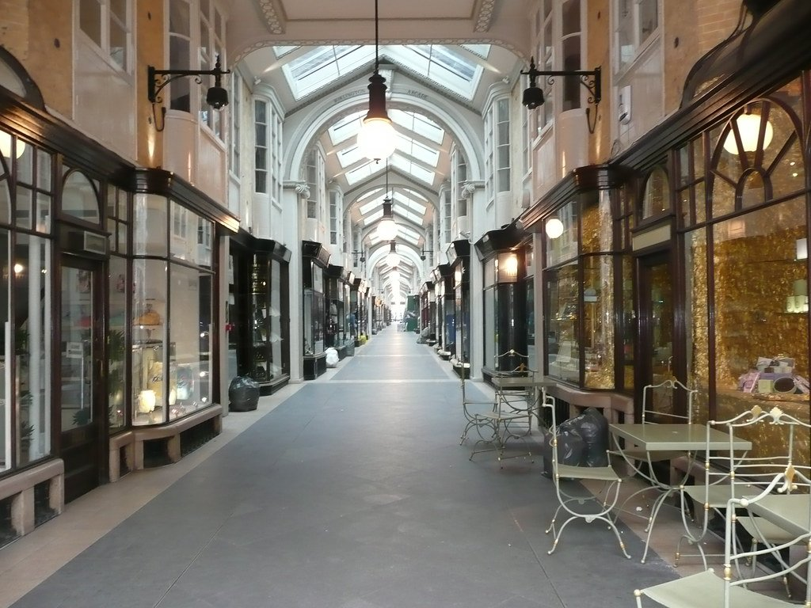
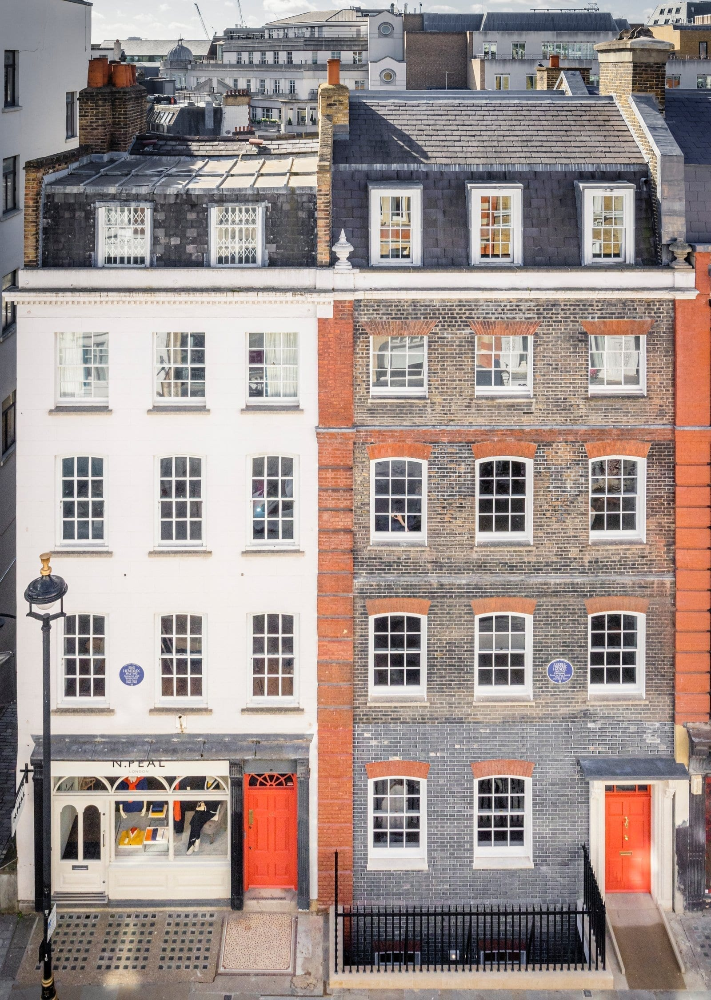

Mayfair is a Georgian grid laid out from the 1720s between [Oxford Street](/articles/shopping-in-london/#oxford-street-and-the-big-three), Regent Street, Piccadilly and Park Lane.

The Victorian arcades are public passages, the Royal Academy's courtyard is free, and the dozens of commercial art galleries on and around Cork Street let anyone walk in.

Mayfair has its own share of the commemorative plaques marking where notable people lived or worked - see them on our [interactive map](/plaques/?area=mayfair).

## Why visit — and who should skip it

**Come here if** you like architecture or art: a Georgian grid that survived largely intact, dozens of free commercial galleries, and four Victorian arcades you can walk through for nothing.

**Skip it if** you want to eat or drink cheaply. Menus are priced for the postcode. It is also quiet in the evening, because most of Mayfair is offices and embassies once the shops shut.

## Top sights and activities

1. **Burlington Arcade** — opened 1819 and still patrolled by uniformed **Beadles** enforcing the original rules: no running, whistling, singing or opening umbrellas.
2. **The Royal Academy** — in Burlington House. The courtyard and Fine Rooms are free; the exhibitions are ticketed. The **Summer Exhibition** has run every year since 1769.
3. **The Cork Street galleries** — commercial art dealers, nearly all free to enter, with no pressure to buy.
4. **Handel Hendrix House** — 23 and 25 Brook Street. Handel lived at 25 and wrote *Messiah* there; Hendrix rented the top floor of 23 in 1968. Now one ticketed museum, £14.50 for both houses, open Wednesday to Sunday 10am to 5pm.
5. **Shepherd Market** — narrow lanes and pubs in the middle of the district.
6. **The other arcades** — Piccadilly Arcade, Princes Arcade and the Royal Arcade, all free to walk through and all quieter than Burlington.
7. **Green Park and Berkeley Square** — Green Park to the south, and the plane trees of Berkeley Square, planted in 1789.

*Burlington Arcade. Photo: [Reading Tom](https://www.flickr.com/photos/16801915@N06/3282398164), [CC BY 2.0](https://creativecommons.org/licenses/by/2.0/).*

## Key streets and micro-districts

### Bond Street

Old Bond Street at the Piccadilly end, New Bond Street running north to Oxford Street, and one continuous run of flagship fashion shops and jewellers between them.

**Sotheby's at 34–35 New Bond Street is the free one.** Auction viewings are open to the public, no ticket and no appointment, in the days before a sale. Over the door is a black granite **Egyptian statue of Sekhmet, around 1320 BC**.

**Allies**, the bench sculpture of Roosevelt and Churchill mid-conversation, sits halfway along, and you can sit down between them.

**It is a weekday street.** The galleries and auction houses keep office hours and close at weekends, when only the shops are open. Bond Street station is at the north end, Green Park at the south.

### The arcades and Piccadilly

Four covered Victorian shopping arcades within a few hundred metres — **Burlington**, **Piccadilly**, **Princes** and **Royal** — plus the Royal Academy between them. All are free to walk through and roofed, so they suit a wet hour.

**Burlington Arcade opened in 1819** and is the oldest of the four. It is open Monday to Friday 8am to 7pm, Saturday 9am to 7pm and Sunday 11am to 6pm. **Beadles** in top hats and frock coats still patrol it and enforce the original rules: **no running, no whistling, no singing, and no opening an umbrella inside.** They will stop you, politely.

**The Royal Academy** is through the courtyard next door. It is **closed on Mondays**, open Tuesday to Thursday and Sunday 10am to 6pm, and Friday 10am to 9pm. Until 31 January 2027 it also opens until 9pm on Saturdays for *Painting the French Riviera*. The free Fine Rooms open 11am to 4pm (until 9pm on Fridays and Saturdays) until early 2027. The courtyard, the shop and parts of the building are free to enter; exhibitions are ticketed.

**Cecconi's at 5A Burlington Gardens** is the all-day Italian at the back of the arcade, and it takes bookings. Most of Mayfair at this end does not do walk-ins well.

### Cork Street and Savile Row

Two parallel streets, both free to walk down.

**Cork Street is commercial art galleries**, one after another, with no admission charge and no crowd. **You are allowed to walk in.** The price list is on the desk and looking without buying is normal. White Cube in Bermondsey works the same way, a few miles east.

**Savile Row is bespoke tailoring.** Huntsman is at number 11 and **Gieves & Hawkes** at number 1, where it has been since 1912.

**Come on a weekday.** Galleries typically run Tuesday to Saturday. Henry Poole opens Monday to Friday only and Huntsman shuts at 3pm on Saturdays, though Gieves & Hawkes at No. 1 opens every day. Green Park and Piccadilly Circus are each about five minutes.

### Shepherd Market

A pocket of narrow lanes and small squares between Curzon Street and Piccadilly, built on the site of the May Fair the district is named after. It has no chains or flagships: two-storey buildings and pavement tables where the surrounding streets are six floors of plate glass.

It is thirty seconds off Piccadilly through an easily-missed archway.

**The pubs are the draw.** Ye Grapes and the Shepherd's Tavern both put tables out, and the whole square fills with drinkers on a warm evening.

**Green Park is three minutes away** and Hyde Park Corner about five. Go in the early evening; at lunchtime it is quiet and at eleven it is shut.

### Mount Street and Berkeley Square

**Mount Street** is a run of pink terracotta and red-brick Victorian Gothic, built by the Grosvenor estate in the 1880s, and now the address for very expensive small shops.

**Berkeley Square's plane trees were planted in 1789.** The square is a public garden, free, open in daylight and locked overnight. **Annabel's**, the members' club at No. 46, opens its staircase and principal rooms to public tours on set days; our [members' clubs guide](/articles/private-members-clubs-london/) has the dates, the fees and the dress codes.

**Eat on Mount Street rather than around the square.** **Bacchanalia at 1–3** does Greek and southern Italian under a ceiling of classical sculpture; **The Guinea Grill at 30 Bruton Place**, in the mews behind, is a chophouse that has been there since the 1950s.

**Mount Street Gardens**, behind the street beside the Jesuit church, is a walled garden of benches and London planes, free, and almost never busy.

*Handel and Hendrix, next door. Photo: [HandelandHendrix](https://commons.wikimedia.org/w/index.php?curid=150507869), [CC BY-SA 4.0](https://creativecommons.org/licenses/by-sa/4.0/).*

## Where to eat and drink

| Spot | Style | Price | Why go |
| --- | --- | --- | --- |
| **The Guinea Grill** | Historic pub and grill | ££ | Bruton Place; a pub since 1423, famous for its pies |
| **Ye Grapes** | Pub | £ | Shepherd Market; a plain pub with pavement tables |
| **The Audley** | Pub | ££ | Mount Street; ornate Victorian interior |
| **Mercato Mayfair** | Food hall | ££ | Inside the Grade I-listed St Mark's Church on North Audley Street |
| **The Wolseley** | Grand cafe | £££ | Piccadilly, in a former car showroom; book for breakfast |
| **Sketch** | Modern European | ££££ | Conduit Street; the Gallery and the egg-pod toilets |

Bar des Prés on South Audley Street, the French chef Cyril Lignac's French-Japanese restaurant, is in our [fusion restaurants guide](/articles/best-fusion-restaurants-london/).

## Getting there

**By Tube.** **Green Park** (Piccadilly, Victoria, Jubilee) is best for the arcades and the Royal Academy. **Bond Street** (Elizabeth line, Central, Jubilee) is best for the north. Oxford Circus serves the north-east corner.

**Best exit.** From Green Park, take the **Piccadilly North** exit and Burlington Arcade is four minutes east along Piccadilly.

**On foot.** Ten minutes to Soho, twelve to Marylebone, twenty through Green Park to Buckingham Palace.

## How long to spend, and when to go

| If you have | Do this |
| --- | --- |
| **Two hours** | The arcades, the Royal Academy courtyard and Cork Street |
| **Half a day** | Add Shepherd Market, Mount Street and Berkeley Square |
| **A full day** | Add Handel Hendrix House and a Royal Academy exhibition |

**Best time:** Tuesday to Friday, in the daytime. The Royal Academy shuts on Mondays, the galleries mostly on Sundays, and Henry Poole opens on weekdays only.

**Note:** The Summer Exhibition runs roughly June to August.

Comparing neighbourhoods? [Best areas to visit in London](/articles/best-areas-to-visit-london/) sets them side by side by what each is best for, how long it takes and the best day to go.

Powered by <a target="_blank" rel="sponsored" href="https://www.getyourguide.com/london-l57/">GetYourGuide</a>

## Walking routes

**[A Walk from Fitzrovia to Mayfair →](/articles/fitzrovia-mayfair-walk/)**

Our full route comes down from Fitzroy Square through Savile Row, both arcades, Grosvenor Square, Mount Street and Shepherd Market to Green Park: **eleven numbered stops**, 5.6km, with a map and a Google Maps walking link. The Royal Academy is shut on Mondays; the arcades and Gieves & Hawkes open on Sundays.

### The short version, if you only have two hours

1. **Start:** Green Park station, **Piccadilly North** exit.
2. **Burlington Arcade:** East along Piccadilly, then through the arcade.
3. **Royal Academy:** Next door. The free courtyard and Fine Rooms.
4. **Cork Street:** North through the commercial galleries.
5. **Bond Street and Mount Street:** West and north past Sotheby's.
6. **Finish:** South to **Shepherd Market** for a pub, or Green Park.

Powered by <a target="_blank" rel="sponsored" href="https://www.getyourguide.com/london-l57/">GetYourGuide</a>

## Common mistakes to avoid

1. **Coming on a Sunday.** Galleries shut and the area empties.
2. **Eating on Bond Street.** Walk to Shepherd Market or Mercato Mayfair instead.
3. **Expecting evening life.** Soho is ten minutes east.

## Where to stay

Landmark hotels at landmark prices, and quiet at night.

- **Mayfair proper** — [Claridge's](hotel:claridges), [the Connaught](hotel:the-connaught), [the Ritz](hotel:the-ritz-london) on the Piccadilly edge.
- **Marylebone** — Twelve minutes north, better value, with the same Elizabeth line access at Bond Street.
- **Soho and Covent Garden** — East, cheaper, and far more open in the evening.

Our [Mayfair hotel guide](/articles/where-to-stay-mayfair/) compares the grand hotels and the cheaper beds.
