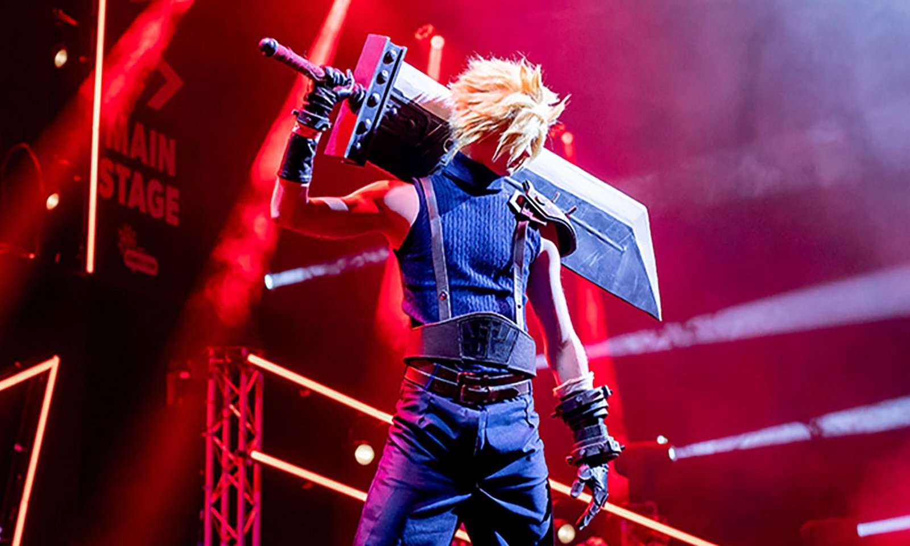
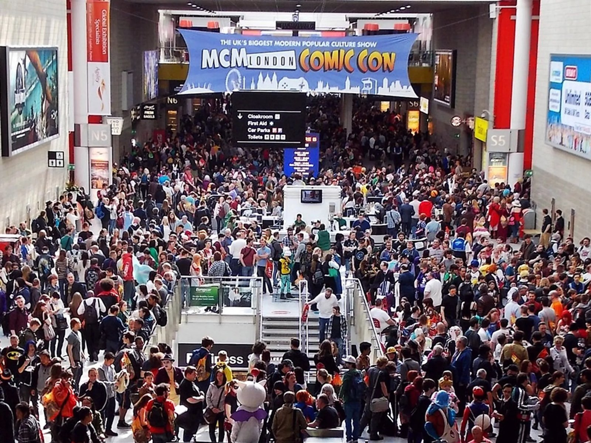

MCM Comic Con is at ExCeL London on **Friday 28 to Sunday 30 May 2027**: three days of cosplay, anime, comics, gaming and guest signings, run twice a year at the same venue. Tickets were released on **26 October 2026**; at the October 2026 show the Weekend ticket and both VIP tiers sold out.

> 💡 **The Short Version:** **28–30 May 2027, ExCeL London.** MCM lists a **£98 Weekend ticket**, **VIP at £230 and VIP Legend at £300**, and daily priority-entry tickets at **£39 Friday and Sunday, £48 Saturday**; a child ticket is **£7**. MCM does not reopen a ticket type once it sells out. **Cosplay props max out at 150cm** (180cm for a narrow staff), and metal blades, guns and functional bows are banned outright; every prop gun gets a fresh security marking each day. Autographs and photo ops are a **paid add-on on top of admission**, sold through MCM's partner Epic; bring cash for guest tables even though the venue itself is cashless. Use **Custom House** station and the **West Entrance** whichever side of ExCeL you arrive from. **Saturday is priced and timed as the busiest day**; Friday or Sunday are calmer.

---

> 🧭 **Plan the rest of it:** [Getting to and parking at ExCeL London](/articles/excel-london-guide/) · [Things to do in London in October](/articles/things-to-do-in-london-in-october/) · [The UK ETA](/articles/uk-eta-guide/) · [Luggage storage near the stations](/articles/luggage-storage-london/)

## Tickets: what each one costs

| Ticket | Price | What it gets you |
| --- | --- | --- |
| VIP Legend Pass | £300 | 3-day priority-hours entry, early access to autograph and photo-op booking, VIP lounge, fast-track queues, 15% off merch |
| VIP Pass | £230 | Same fast-track access as VIP Legend, but early panel bookings rather than early autograph/photo-op access |
| Weekend ticket | £98 | 3-day entry at priority-entry hours, no fast-track perks |
| Priority entry, Friday | £39 | Early access to the show floor |
| Priority entry, Saturday | £48 | Early access to the show floor |
| Priority entry, Sunday | £39 | Early access to the show floor |
| Child ticket, daily | £7 | Ages 5 and up; under-5s go free with a paying adult |

*Prices from [MCM's own ticket page](https://www.mcmcomiccon.com/london/en-us/tickets.html); they include VAT and service fees, but a posted physical badge adds its own delivery charge at checkout.*

A **Squad Bundle** buys five priority tickets at once for a group: £150 on Friday and £158 on Sunday.

- **No refunds, and MCM doesn't run its own resale.** A ticket bought anywhere other than MCM's own site can be cancelled at the door with no entry and no refund.
- **Order by 12 April 2027 and your badge is posted to your door** (UK orders), so you skip the pick-up queue; order after that and you show the QR code on your phone or a printout at registration instead.
- **Once a ticket type sells out, it isn't reopened.**

> ⚠️ **Book early.** At the October 2026 show the Weekend ticket and both VIP tiers sold out before the doors opened.

## Cosplay, weapons and props: the rules

What changes whether something gets confiscated at the door:

*On the Main Stage cosplay masquerade.*

- **Banned outright:** metal blades of any kind (swords, axes, knives), guns or gun-shaped items built from metal or hard wood, airsoft/BB/gel-blaster guns even unpowered, functional bows and crossbows, laser pointers, drones, and anything a police officer could reasonably call a weapon.
- **Every prop gun or blaster is marked by security at the door, every day.** The marking isn't permanent, so you queue for a fresh mark each morning.
- **Size limit: 150cm**, or 180cm for a narrow staff or spear. Anything bigger must dismantle by hand before you enter a crowded area. Scythes must always split into two pieces without tools, regardless of size.
- **Costumes max out at 2.5 metres** between any two points (fabric trains and folding parts excluded), and a bulky costume (full fur suit, armour, wings) needs a sighted guide walking with you.
- **Nudity and exposed prosthetic genitalia aren't allowed**, and extreme fetish or BDSM-style attire is judged unsuitable for the all-ages show; email MCM's cosplay team in advance if you're unsure.
- **Unrealistic toy guns are fine** (bright plastic, flashing lights, obvious sci-fi designs) up to the same 150cm limit, as are lightsabers, including metal-hilted ones.

If your prop is unusual, email MCM's cosplay team (MCMcosplay@reedpop.com) with photos before the show; they can't guarantee anything without seeing it in person.

## Guests, autographs and photo ops: how the money works

Meeting a guest is two separate purchases: your admission ticket gets you into the building, and the autograph or photo op is bought on top, through MCM's partner **Epic**.

*A guest panel on the Main Stage.*

- **Some guests sell pre-booked, timed slots online before the show**; others sell only at their table on the day, first come, first served.
- **The guest's own page on MCM's site says which**, and lists the price, since guests set their own autograph and photo-op rates.
- **Bring cash for table sales.** Some tables have card readers, but MCM recommends cash; Epic's own sales desk (for pre-purchased slots) takes cash or card.
- **A photo op gets you one professional 8x10 print**, taken at a backdrop and collected afterwards; extra prints or a digital copy cost more.
- **JSA, MCM's official autograph authentication partner, is on-site all weekend** to verify a signature, either at their booth or pre-booked.
- **No refunds if you miss your slot.** Pre-booked photo ops run to a fixed timeslot; turn up 5–15 minutes early, because there's no retake.

## Gaming: EGX is no longer a separate show

EGX, the console and PC gaming expo that used to be its own ticketed event at ExCeL, has folded into MCM: since the October 2025 show, its indie zone (the **Leftfield Collection**), competitive gaming arena and industry Career Fair run inside MCM on the same ticket. The October 2026 show also had a free-to-play tabletop zone, a card-game corner running Pokémon, Yu-Gi-Oh! and One Piece tournaments, an RPG zone for tabletop role-play, and LARP sessions and foam-sword tuition in the Forest Glade.

## Which day is quietest

MCM doesn't publish footfall by day. **Saturday costs more (£48 for priority entry against £39 on the other two days) and runs longer (9am to 7pm, against 10am to 6pm on Friday and 10am to 5pm on Sunday)**, which points to the biggest crowd of the weekend. For a calmer walk round the floor, pick Friday or Sunday.

## Early entry, the queue and getting through the door

Activate your entry badge in the **MCM app** before you travel; it's required for over-18s and unlocks scavenger hunts and exhibitor content inside.

*The concourse on a busy day.*

- **Security checks bags, cosplay weapons and props before you're through the Queue Hall.** Have them out and ready.
- **Priority and Weekend/VIP ticket holders enter up to two hours before General** each day; VIP badges also get a separate, faster queue for entry, autographs, photo ops and the Main Stage.
- **Re-entry stops 30 minutes to an hour before the show closes each day**, so be back inside an hour before closing.
- **An accessibility sticker unlocks separate queuing lanes with seating**, for entry, Main Stage panels and the autograph and photo-op lines; request one on your way in.

## Getting to ExCeL: the right entrance and station

MCM funnels everyone toward the **West Entrance**, whichever side of the building you arrive at.

- **Custom House**, on the Elizabeth line and DLR, is MCM's recommended station. Follow signage to the Queue Hall on the north lorryway.
- **If you come out at Prince Regent**, on the DLR only, on the east side, get back on the DLR one stop to Custom House rather than walk the length of the venue.
- **Driving:** use postcode **E16 1FR** for the car park, and book a space in advance; it fills up fast on show weekends. Disabled bays take vehicles up to 1.9m; email ExCeL directly if yours is taller.

Parking prices, cloakroom locations and which of ExCeL's two stations to use for a different hall are in our [ExCeL London travel guide](/articles/excel-london-guide/).

## Food

ExCeL's restaurants and food stalls are **cashless**, so bring a contactless card or phone wallet. The **Waterfront Street Kitchen & Bar** is ExCeL's sit-down option; beyond that, MCM points to a range of retail food units through the show. Guest autograph tables, by contrast, may only want cash.

## After the show

MCM's own **After Hours** party runs on Friday until 9pm and is included in any Friday ticket.

## Comic shops and gaming bars

Two places within an Elizabeth line ride of ExCeL, both open seven days a week.

| Place | Open | From ExCeL | What it is |
| --- | --- | --- | --- |
| **[Gosh! Comics](https://goshlondon.com/)**, 1 Berwick Street, Soho, W1F 0DR | 10.30am to 7pm, every day | Elizabeth line from Custom House to Tottenham Court Road (17 minutes), then an 11-minute walk | A graphic-novel shop with sections for manga, small press, European albums, superheroes and children's books, plus signed and bookplate editions of new releases. |
| **[The Arcanist's Tavern](https://arcaniststavern.uk/)**, 87–91 Hackney Road, Shoreditch, E2 8FE | Monday to Thursday 2pm to 10pm, Friday 2pm to 11pm, Saturday 10am to 11pm, Sunday 10am to 10pm | Elizabeth line to Whitechapel, Windrush line to Hoxton, then a six-minute walk: about 25 minutes | A tabletop gaming café built like a fantasy tavern, with booths for role-playing and wargaming and, in the Apothecary bar upstairs, a board-game library and cocktails. A three-hour Apothecary table is £14 for up to two players; [book on its site](https://arcaniststavern.uk/booking). |

## Where to stay

A handful of hotels sit within a few minutes' walk of ExCeL, all in the Royal Docks:

- **[Aloft London ExCeL](hotel:aloft-london-excel)** — about a minute's walk from the East Entrance, with an indoor pool; the queue hall is at the other end, one DLR stop away.
- **[Good Hotel London](hotel:good-hotel-london)** — a converted floating platform moored at the Western Gateway, under five minutes from Royal Victoria DLR.
- **[Sunborn London Yacht Hotel](hotelscom:463416)** — a superyacht moored on the dock, with 133 rooms and five suites, every one facing the river or the dock.

Rooms this close to ExCeL price against the show calendar, so a quiet week is cheap and an MCM weekend isn't. Our [hotels near ExCeL guide](/articles/where-to-stay-near-excel/) sorts the rest by how close they are to the west side, where the queue hall is, adds the cheapest chains a few DLR stops out, and gives the last train back after the evening events.

For a cheaper bed, the hostels around King's Cross, such as [Generator London King's Cross](hotel:generator-london), are about 45 minutes from ExCeL: Thameslink from St Pancras to Farringdon, then the Elizabeth line to Custom House. Our [guide to London's hostels](/articles/best-hostels-london/) compares them.

## Not to be confused with: London Comic Con Spring

**London Comic Con Spring** is a different show, run by Showmasters (not MCM/ReedPop) at **Olympia London**.
