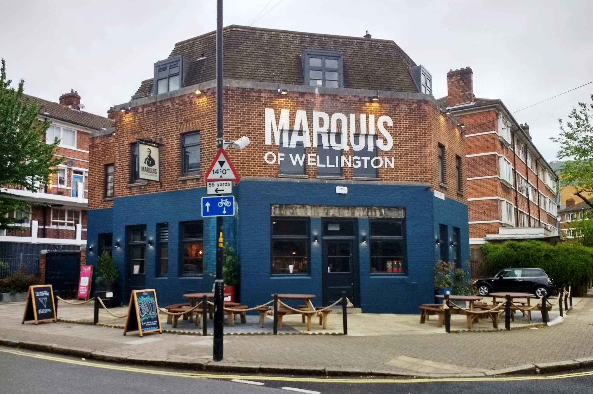
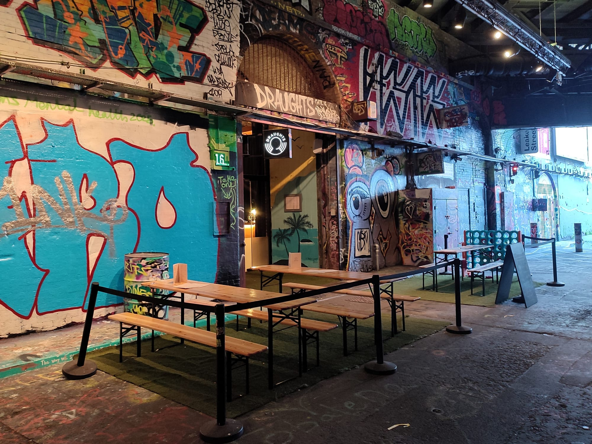
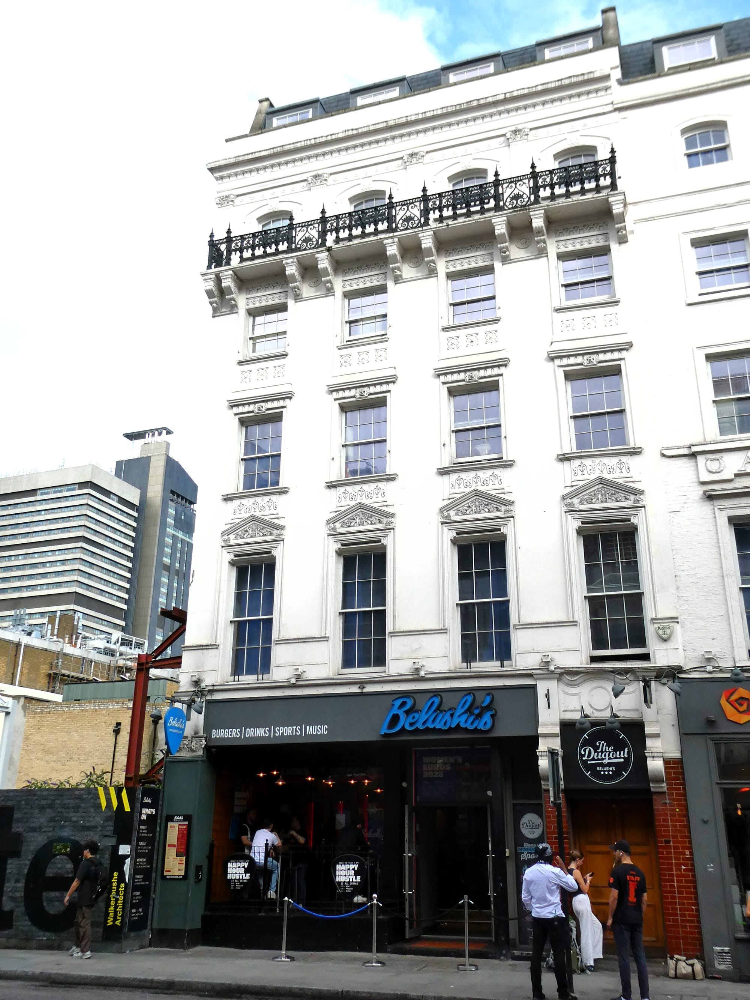

> 💡 **The Short Version:** The easiest way to meet people in London is to pick something that runs every week and is built for people who come alone. **Free:** [London City Runners](#london-city-runners-bermondsey) (Tuesday and Thursday 6.15pm, Bermondsey, a pub after), [London Social Runners](#london-social-runners-south-bank-and-kensington) (Wednesday 7pm, South Bank), [parkrun](#parkrun-every-saturday-at-9am) (Saturday 9am, everywhere) and the [Thursday quiz at Belushi's](#belushis-london-bridge-the-hostel-bar-anyone-can-use). **A few pounds:** a [£2 language exchange](#languages-in-london) and an [£8 board-game meetup](#draughts-waterloo-board-game-meetup). **Booked for you:** [Timeleft](#timeleft-dinners-drinks-and-walks-with-strangers) puts you at a dinner table with strangers. **A big night out:** the [London Pub Crawl](#london-pub-crawl-west-end) leaves Leicester Square at 8pm five nights a week, from £17.50.

*Days, times and prices are each organiser's own, as at 19 November 2026.*

## By day of the week

| Day | What | Where | Cost |
| --- | --- | --- | --- |
| **Monday** | [Board-game meetup](#draughts-waterloo-board-game-meetup) (every other week) | Draughts, Leake Street, Waterloo | £8 |
| **Monday** | [Beginners' bouldering](#london-bouldering-socials) | White City Bouldering | £14.95 |
| **Tuesday** | [London City Runners](#london-city-runners-bermondsey) | Marquis of Wellington, Bermondsey | Free |
| **Tuesday** | [Timeleft singles dinner](#timeleft-dinners-drinks-and-walks-with-strangers) | Shoreditch, Soho | Membership + your meal |
| **Wednesday** | [London Social Runners](#london-social-runners-south-bank-and-kensington) | National Theatre, South Bank | Free |
| **Wednesday** | [Timeleft dinner](#timeleft-dinners-drinks-and-walks-with-strangers) | Several areas | Membership + your meal |
| **Wednesday** | [Social bouldering](#london-bouldering-socials) | White City and Stratford | £9.50 |
| **Thursday** | [London City Runners](#london-city-runners-bermondsey) | Marquis of Wellington, Bermondsey | Free |
| **Thursday** | [Pub quiz](#belushis-london-bridge-the-hostel-bar-anyone-can-use) | Belushi's, London Bridge | Free |
| **Thursday** | [Timeleft drinks](#timeleft-dinners-drinks-and-walks-with-strangers) | Soho | Membership + your drinks |
| **Friday** | [Language exchange](#languages-in-london) | The Catherine Eddowes, Aldgate | £2 |
| **Saturday** | [parkrun](#parkrun-every-saturday-at-9am) | Parks across London | Free |
| **Saturday & Sunday** | [Day hikes](#outdooraholics-day-hikes-out-of-london) | Leave from London stations | £31 to £36 with train |
| **Sunday** | [London City Runners](#london-city-runners-bermondsey) | Marquis of Wellington, Bermondsey | Free |
| **Sun, Tue, Thu, Fri, Sat** | [Pub crawl](#london-pub-crawl-west-end) | Zoo Bar, Leicester Square | From £17.50 |

---

## Run clubs

A run club is the most reliable way in. They are free, they meet at a fixed time and place every week, and the run gives you something to talk about before the pub.

### London City Runners, Bermondsey

*Marquis of Wellington, 21 Druid Street, SE1 · Tuesday and Thursday 6.15pm, Sunday 10.30am · free*

**A run along the Thames from a pub on the Bermondsey Beer Mile, then back to the pub.** On Tuesday and Thursday evenings waves head west: over the Millennium Bridge and back is about 6.5km, and over Westminster Bridge about 11km. Tuesdays add an **easy riders group at 6.45pm** at 6.30 minutes per kilometre or the pace of the slowest runner. On Sundays the club runs east instead, to Greenland Pier and back (about 10km) or through the Greenwich foot tunnel (about 18km), and many people stay for coffee and drinks when the pub opens at noon.

**Make a profile on the [London City Runners site](https://www.londoncityrunners.com/river-runs) before you go**, then turn up. Tell someone when you arrive that you are new and they pair you with a runner at your pace who knows the route. There is no bag drop on Sundays.

*The Marquis of Wellington on Druid Street, where London City Runners meet. Photo: [Ewan Munro](https://commons.wikimedia.org/wiki/File:Marquis_of_Wellington,_Bermondsey_2017-05-04.jpg), [CC BY-SA 2.0](https://creativecommons.org/licenses/by-sa/2.0/), via Wikimedia Commons.*

### London Social Runners, South Bank and Kensington

*Wednesday 7pm from the National Theatre, SE1 · Saturday 10am from the Royal Garden Hotel, Kensington High Street · free*

**Two weekly runs on Meetup, each ending at a bar or a brunch table.** On Wednesday evenings the group runs beside the river from the National Theatre and then drinks at The Understudy, the bar in the theatre building. On Saturday mornings it meets outside the Royal Garden Hotel at 2–24 Kensington High Street, runs in the park and goes for brunch. The crowd is international and mixed in ability, but the Wednesday run asks for a pace of **at least 6 minutes per kilometre**.

RSVP on the [London Social Runners Meetup page](https://www.meetup.com/londonsocialrunners/). The National Theatre's cloakroom takes bags for anyone at £1.50 an item, but a space is not guaranteed.

### parkrun, every Saturday at 9am

*Dozens of London parks · Saturday 9am · free*

**A timed 5km that you can run, jog or walk, in parks across London every Saturday at 9am.** It is a free weekly event rather than a club, and each one has regulars who go for coffee afterwards. At **Hackney Marshes** runners gather at the café in the Hackney Marshes Centre, and some go on to La Mela Bistro on Marsh Hill for brunch. At **Finsbury Park** they meet at the Finsbury Park Café.

**[Register with parkrun](https://www.parkrun.org.uk/register/) once before your first run** and bring the barcode it gives you, printed or on your phone; without it you get no time. The [Hackney Marshes](https://www.parkrun.org.uk/hackneymarshes/) and [Finsbury Park](https://www.parkrun.org.uk/finsbury/) event pages list other parkruns nearby.

---

## Language exchange

### Languages in London

*Wednesday and Friday evenings from 7pm, mostly in Craft Beer Co pubs · £2*

**A language exchange in a pub, where you collect a badge with the languages you speak and want to practise, and start talking.** Its regular venues include The Catherine Eddowes at 29–31 Mitre Street near Aldgate, where the Friday social is on 20 and 27 November, and Craft Beer Co pubs in Clerkenwell, Covent Garden and Hammersmith. English, Spanish, French, Italian and Portuguese are among the languages on the badges. Organisers remove members who RSVP and do not show up.

**Show your Meetup confirmation on arrival and pay the £2 fee, which rises to £6 if you arrive after 8.30pm.** Drinks are on you at the bar. Dates and each night's venue are on the [Languages in London Meetup page](https://www.meetup.com/languages-in-london-exchange-social-events/).

---

## Games, quizzes and a hostel bar

### Draughts Waterloo board-game meetup

*Arch 16, Leake Street, SE1 7NN · every other Monday, 7pm to 11pm · £8*

**A board-game night for people who come alone or with one friend**, in a railway arch inside the Leake Street graffiti tunnel under Waterloo station. You sit down at a table, pick from a library of more than 1,000 games, and play with whoever sits next to you. Food and drink are ordered to the table. Over 18s only. The next one is on Monday 23 November 2026, and Draughts runs the same night at its Stratford branch in the Olympic Park.

**£8 covers four hours of games. [Book a place on DesignMyNight](https://www.designmynight.com/london/bars/waterloo/draughts-waterloo/boardgame-meetup-at-waterloo-1?t=tickets)**; Draughts says spaces fill.

*Draughts in Arch 16 of the Leake Street tunnel, Waterloo. Photo: [Ewan-M](https://commons.wikimedia.org/wiki/File:Draughts,_Waterloo,_SE1.jpg), [CC BY-SA 4.0](https://creativecommons.org/licenses/by-sa/4.0/), via Wikimedia Commons.*

### Belushi's London Bridge, the hostel bar anyone can use

*161–165 Borough High Street, SE1 1HR · quiz Thursday 7pm · free entry*

**The bar under St Christopher's Village hostel, open to everyone, not just guests.** On Thursdays from 7pm it hosts **Funky Bunch Trivia**, a free quiz with music, film and sport rounds and prizes, for teams of two to six. If you arrive alone, ask a table that is short of players. Monday is karaoke from 10pm, Saturday has live music from 7.30pm, and happy hour runs 4pm to 7pm Monday to Friday with most drinks at £5. Details are on [Belushi's London Bridge page](https://belushis.com/london-bridge/).

For a bed with a social bar attached, our [London hostels guide](/articles/best-hostels-london/) says which hostels are built for meeting people and which are quiet.

*Belushi's on Borough High Street, under St Christopher's Village hostel. Photo: [Ewan-M](https://commons.wikimedia.org/wiki/File:Belushi%27s,_Borough,_SE1.jpg), [CC BY-SA 4.0](https://creativecommons.org/licenses/by-sa/4.0/), via Wikimedia Commons.*

### London Pub Crawl, West End

*Zoo Bar, 13–17 Bear Street, WC2H 7AQ · Sunday, Tuesday, Thursday, Friday and Saturday, 8pm · from £17.50*

**A guided crawl through four bars and a club, with a free shot at each and drinks deals all night.** You meet the guides in orange lanyards at Zoo Bar near Leicester Square, and the night ends at a club, sometimes one as big as Heaven or Ministry of Sound. It is for people who want a loud night with a group straight away. The same company runs crawls in Shoreditch and Camden.

**Over 18s only, with a physical passport or driving licence; a photo on your phone is refused.** Dress is smart casual, with no sportswear or flip-flops. Tickets are cheapest [booked on the London Pub Crawl site](https://londonpubcrawl.co.uk/central-london-pub-crawl); a few are sold on the door at full price.

---

## Dinners with strangers

### Timeleft: dinners, drinks and walks with strangers

*Soho, Chelsea, Shoreditch, London Bridge and Clapham · membership, plus your own food and drink*

**An app that books you onto a table with strangers matched by personality**, after a short quiz. You pick the night; Timeleft picks the restaurant and the group, and the app shows the venue shortly before. London's schedule:

- **Dinners**, Wednesdays and Fridays at 7pm, with four to six others
- **Women-only dinners**, Mondays at 7pm, and **singles dinners**, Tuesdays at 7pm
- **Drinks**, Thursdays at 7pm in Soho, over 18s
- **Coffee**, Saturdays at 3pm, with a singles version at the same time
- **Walks**, Sundays at 3pm in Chelsea

**Booking needs a Timeleft membership**, a subscription that covers every event while it is active; the app shows the price before you pay, and you pay for your own meal. Upcoming dates are on [Timeleft's London page](https://timeleft.com/london/).

If you would rather eat alone and talk to the chef, our guide to [eating alone in London](/articles/eating-alone-london/) lists the counters that take one.

---

## Sport, climbing and hiking

### GO Mammoth social leagues

*Venues across London · seasons from £7 a week*

**Social sports leagues that take you on your own and put you in a team with others who signed up alone.** Volleyball, netball, football, dodgeball, touch rugby and more, at levels from beginner to competitive; mixed volleyball is six-a-side with at least two women on court. It suits someone staying for a couple of months or longer. **You pay for the whole season before it starts**, and GO Mammoth sends the fixtures a week ahead. Sign up on the [GO Mammoth volleyball page](https://www.gomammoth.co.uk/volleyball/london/) or through its other sports.

### London Bouldering Socials

*City Bouldering, White City and Stratford · from £9.50 including shoes*

**A Meetup group that climbs together several nights a week at a discounted rate.** Mondays at 7pm is a **beginners' club at White City Bouldering** on Ariel Way with an instructor (£14.95). Wednesdays at 7pm there is a beginners' session at **City Bouldering Stratford**, 234 High Street, E15, and a social climb for people who have bouldered before at White City (both £9.50, against a usual £17 plus £4.50 for shoes). Sundays at 6pm, **Routes & Roots** is a weekly social for Black and POC climbers at Stratford, also £9.50. **RSVP on the [group's Meetup page](https://www.meetup.com/london-climbing-meetup-group/) by 6.30pm on the day** to get the group rate.

### Outdooraholics day hikes out of London

*Saturdays and Sundays · £31 to £36, return train included*

**Guided group walks in the Chilterns, the Surrey Hills, Kent and along the coast**, with the return train from London included. Each listing gives the distance, climb and grade: a beginners' hike to Ivinghoe Beacon is 16km over about five hours. Most members are in their 20s to 40s and many come on their own. Book on the [Outdooraholics Meetup page](https://www.meetup.com/outdooraholics/).

---

## If you are moving to London

### InterNations London

*Monthly evening events in bars across central London*

**A network for people who have moved to a new country, with an official social every month.** The next is on Friday 27 November 2026 at 12th Knot, the rooftop bar on Upper Ground on the South Bank. Joining as a basic member is free; basic members buy a ticket for each event in advance, linked from the [InterNations London page](https://www.internations.org/london-expats).

### More ways in

- **Free walking tours** put you with a group for two hours; [the walking tours guide](/articles/best-walking-tours-london/) says which companies run tip-based walks, and [tours for solo travellers](/articles/solo-traveller-tours-london/) covers the small-group ones.
- **Community Sauna Baths** in Hackney Wick is a communal sauna where most people come alone or with one friend; prices and booking are in our [saunas guide](/articles/saunas-cold-plunge-london/).
- **Competitive socialising bars** are better with a group you have already met; see [competitive socialising in London](/articles/competitive-socialising-london/).
- **A comedy club** is an easy night alone: [London's comedy clubs](/articles/best-comedy-clubs-london/).

---

## Meeting strangers safely

Meet in the venue, not at someone's flat or in their car. Tell a friend where you are going, keep your drink in your hand, and get home on the Tube, Night Tube or a black cab or booked minicab, never a car that stops for you in the street.

## Keep going

The [solo travel in London](/articles/solo-travel-london/) hub covers where to stay and getting around on your own, and [things to do alone in London](/articles/things-to-do-alone-london/) has museum lates, single cinema seats and lidos for the evenings you want to yourself. For a bed near the action, see [London's hostels](/articles/best-hostels-london/), [pod hotels](/articles/pod-hotels-london/) and [budget hotels](/articles/best-budget-hotels-london/). For a quiet day with a laptop, try a [laptop-friendly café](/articles/laptop-friendly-cafes-london/).
