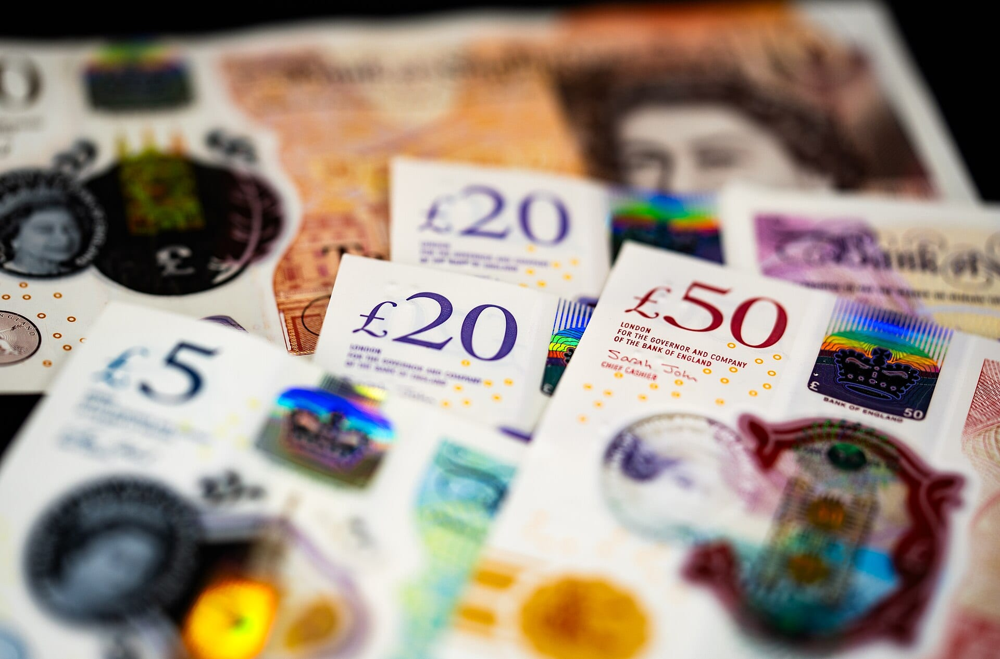
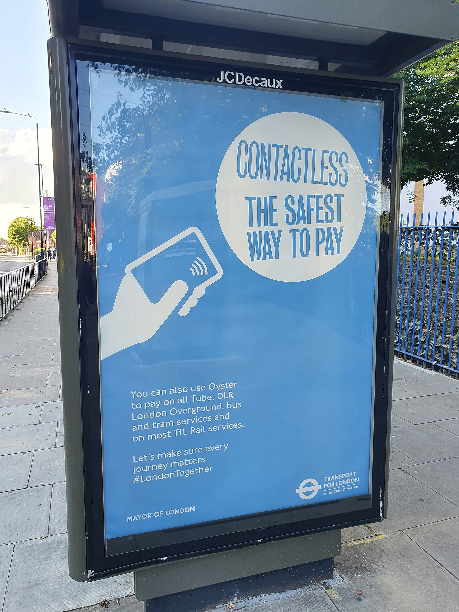
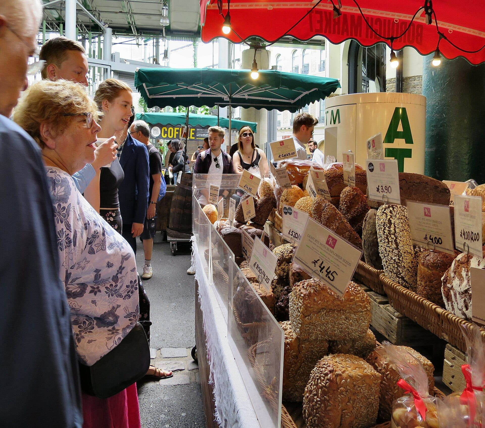
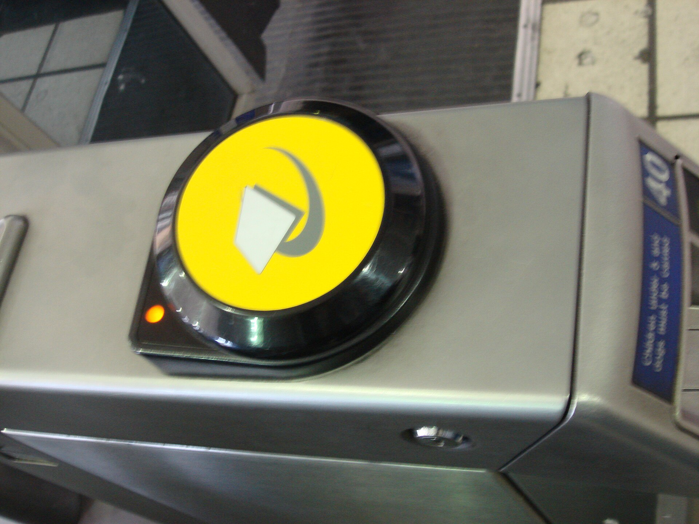

A card works almost everywhere in London, but not for everything: a bus that won't take your banknote, a museum café that's contactless-only, a tip that never reaches the waiter because it went through the machine.

> 💡 **The Short Version:** London runs on contactless: 67% of credit card and 76% of debit card transactions in the UK are contactless, per UK Finance. The **contactless limit is £100** at every major bank, even though the FCA lifted the official cap in March 2026. **TfL buses take no cash at all**, and Wembley, Tottenham Hotspur Stadium, The O2 and OVO Arena are fully cashless. Cash machines are **free about 95% of the time**, and any charge must be shown on screen before you accept it. Carry **£20–£40** for markets, buskers and small independents. **Always choose to pay in pounds**, never the "convert to your currency" option, at a card machine or a cash machine. A **12.5% service charge** is common at restaurants and goes to staff by law. There is **no VAT refund** on London shopping.

## The currency: what's actually in your wallet

British money is the **pound sterling (£)**, in notes of £5, £10, £20 and £50, and coins of 1p, 2p, 5p, 10p, 20p, 50p, £1 and £2.

**Two portraits share the currency.** The Bank of England began issuing notes with King Charles III's portrait on 5 June 2024, and notes with Queen Elizabeth II remain legal tender alongside them. King Charles III coins have been rolling out denomination by denomination since December 2022: the 50p first, then the £1, the 5p from October 2025 and the 10p from August 2026. Queen Elizabeth II coins keep working. Both spend exactly the same.

*Bank of England polymer banknotes.*

| Note | On the back | | Coin | Legal tender limit |
| --- | --- | --- | --- | --- |
| £5 | Winston Churchill | | 1p, 2p | Up to 20p |
| £10 | Jane Austen | | 5p, 10p | Up to £5 |
| £20 | J.M.W. Turner | | 20p, 50p | Up to £10 |
| £50 | Alan Turing | | £1, £2 | Unlimited |

### Paper notes stopped working in 2022

The paper **£20 and £50 (Series F)** ceased to be legal tender on 30 September 2022, so a shop will not take one. They keep their face value, and the Bank of England will exchange them **with no deadline**. The easiest routes:

* **Pay it into a UK bank account.** Barclays, Halifax, Lloyds, Nationwide, NatWest and Santander all accept old paper notes as ordinary deposits.
* **51 Post Office branches** will swap it on the spot if it's £300 or less, you have photo ID, and you don't need a bank account.
* **Post it to the Bank of England** (Dept NEX, Bank of England, Langston Road, Loughton, Essex IG10 3TN) or take it to the Bank's own counter on Threadneedle Street, open Monday to Friday, 9.30am to 3pm. Postal exchanges take up to 90 working days.

### Scottish and Northern Irish notes

Three Scottish banks (Bank of Scotland, Clydesdale Bank, Royal Bank of Scotland) and three Northern Irish banks (Bank of Ireland UK, Danske Bank and NatWest, trading as Ulster Bank) print their own sterling notes, backed pound-for-pound by the Bank of England.

> ⚠️ **A Scottish or Northern Irish note can be turned down anywhere in the UK, including in Scotland or Northern Ireland.** Only Bank of England notes are legal tender, and only in England and Wales. London shops and machines mostly accept them, but refusals of a Scottish £20 in an English shop are reported often enough to plan around. Spend Scottish notes before you cross, or change them at a bank.

### What "legal tender" doesn't mean

Legal tender is a narrow rule about settling a debt in court. A shop can choose what to accept, so a café that's gone card-only, a market stall that's cash-only, and a taxi that won't break a £50 for a £6 fare are all within their rights.

Powered by <a target="_blank" rel="sponsored" href="https://www.getyourguide.com/london-l57/">GetYourGuide</a>

## Cards: how far they actually go

UK Finance's most recent figures put contactless at **67% of credit card transactions and 76% of debit card transactions**, with an average tap worth just under £18. Chip-and-PIN still carries the bigger purchases, averaging £93 a transaction.

**The contactless limit is £100, by choice rather than by law.** The FCA removed the single regulatory cap in March 2026, letting banks with strong fraud controls set their own limit. Barclays, HSBC, Lloyds, Nationwide, NatWest, Santander and Monzo have all kept £100. Apple Pay and Google Pay verify you by face or fingerprint, so the £100 ceiling doesn't apply to them.

*A TfL contactless poster.*

**American Express** is accepted at most major stores, hotel chains and sit-down restaurants, but less often at small independents, market stalls and some pubs. Carry a Visa or Mastercard as backup.

**A signature-only card from abroad can be a problem.** A card with no chip, or one that relies on signature verification, will fail at most self-service checkouts and TfL's gates. Check with your bank before you travel.

**Foreign transaction fees and dynamic currency conversion are where visitors lose money.** A card issued outside the UK can attract a non-sterling transaction fee from your own bank. At the point of sale you may also be offered the choice to "pay in your home currency instead of pounds." Take that offer and the till or cash machine sets the exchange rate, and it is reliably worse. **When asked to choose a currency, pick pounds sterling.** Your own bank's network (Visa, Mastercard or similar) will convert it at a market rate that's almost always better.

## Where you can't pay with cash, and where it still helps

**TfL's entire bus network has taken no cash since 2014.** Pay by contactless, Oyster, or a valid Travelcard, or you can't board. The Tube, Overground, DLR and Elizabeth line still sell paper tickets from machines, but pay-as-you-go by card or [Oyster](/articles/oyster-card-guide-london/) is cheaper on almost every fare; see our [transport costs and fares guide](/articles/london-public-transport-costs-and-fares/) for the numbers.

**A minority of cafés, restaurants and pubs, mostly newer openings and counter-service places, are card-only.** Even [public toilets](/articles/public-toilets-london/) have joined the shift: all eight Royal Parks charge a flat 20p for theirs, card or contactless only.

**Cash still helps in a few places:**

* **Market stalls**, especially the smaller ones. Plenty take cards, but a float of coins covers the ones that don't.
* **Buskers and street performers**, including the licensed pitches on the [Underground and in Covent Garden](/articles/london-on-a-budget/).
* **Tips**, where cash reaches the person who served you directly (more on this below).
* **Small independents**, particularly older cafés and stalls that have never installed a card reader.

*Prices at a Borough Market stall.*

**London's biggest stadiums and arenas are fully cashless.** [Wembley Stadium](/articles/wembley-stadium-arena-guide/), the [Tottenham Hotspur Stadium](/articles/tottenham-hotspur-stadium-travel-guide/), [The O2 arena and indigo at The O2](/articles/the-o2-travel-guide/), and OVO Arena Wembley take contactless, mobile payment or a venue gift card only. [ExCeL London](/articles/excel-london-guide/) is the same: none of its food and drink outlets take cash.

## Cash machines: cashpoints, ATMs, same thing

**Cash machine**, **cashpoint** and **ATM** all mean the same thing in Britain. Here's how the charging works.

**Most cash machines are free, and the ones that aren't have to tell you first.** LINK, the scheme that connects nearly every UK cash machine, counted **33,699 free-to-use machines against 8,693 pay-to-use ones in 2025**, about 80% free by number. Because people use the free ones, LINK says **around 95% of cash withdrawals are free of charge**.

Pay-to-use machines are commonly run by independent operators in convenience stores, such as Euronet's YourCash machines in Nisa Local and Bargain Booze, rather than the free machines banks provide. A charging machine must show the exact fee on screen, get your acceptance before the withdrawal completes, let you cancel without being charged, and carry signage saying it charges.

Read the screen before you confirm, and if a fee appears, cancel and find a free machine. The [LINK Cash Locator](https://www.link.co.uk/) shows both, and bank branches and large supermarkets have free machines.

**Your own bank can also charge, separately from the machine.** That is a fee from your card issuer, and LINK's Cash Locator won't show it, so check with your bank before you travel. Withdrawal limits are also set by your bank, not the machine.

**How much to carry:** £20–£40 in notes and coins covers markets, a bus-fare mishap, tips and the odd cash-only counter, topped up as needed.

Powered by <a target="_blank" rel="sponsored" href="https://www.getyourguide.com/london-l57/">GetYourGuide</a>

## Changing money before or during the trip

**Airport bureaux de change are convenient, not cheap**, so compare the rate before you commit at arrivals. **The Post Office** sells over 60 currencies online for branch collection or home delivery at **"0% commission"**. High-street bureaux sit between the two. Check the rate they'll give you against the mid-market rate, because "0% commission" describes the fee, not the exchange rate, and a bureau can build its margin into the rate instead.

**Multicurrency cards are a fourth option.** Wise and Revolut let you hold pounds and spend them on a linked debit card. Fees, exchange rates and limits vary by plan, so check the provider's own site.

The currency rule from the cards section applies at a bureau's card machine or at a cash machine dispensing a foreign currency: if it asks whether you want to "guarantee" a rate in your home currency, decline and pay in pounds.

## Tipping and service charges

**Nothing is compulsory**, but a **discretionary service charge of around 12.5%** is common on London restaurant bills, usually printed on the menu and added to the total. You can ask for it to be removed if service was poor.

**Since 1 October 2024, employers must pass tips, gratuities and service charges on to staff** under the Employment (Allocation of Tips) Act 2023, and staff have the right to see their employer's tipping record.

* **Restaurants:** 10–15% if no service charge is already added; check the bill before adding twice.
* **Pubs and bars:** not expected for a drink at the bar; round up or leave a coin or two for table service.
* **Taxis, including black cabs:** round up rather than working to a fixed percentage.
* **Hotels:** £1–£2 for a porter carrying bags is normal; housekeeping tips are optional and less customary than in the US.

Restaurant discount schemes and set menus lower the bill before a tip is calculated; see our guide to [restaurant discount cards in London](/articles/restaurant-discount-cards-london/).

## Prices, VAT and the border

**Every price you see already has VAT in it.** VAT is 20%, and a trader must display the selling price **inclusive of VAT and all other taxes**. What's on the shelf, the menu or the till screen is what you pay; there's no tax added at the register as there is in the US.

**There's no VAT refund for visitors.** Tax-free shopping for overseas visitors ended across Great Britain on 1 January 2021. The one thing that still works is having a retailer ship a purchase directly to an address outside the UK, which zero-rates the sale at the till; our [tax-free shopping in London](/articles/tax-free-shopping-london/) guide covers which stores offer it.

**Carrying £10,000 or more in cash, in any currency or as a family group's combined total, must be declared to UK customs** when entering or leaving Great Britain. You can declare online up to 72 hours before travelling, or in person at the "goods to declare" channel on arrival. If you fail to declare, a Border Force officer can seize the cash, and you can be fined up to £5,000.

Powered by <a target="_blank" rel="sponsored" href="https://www.getyourguide.com/london-l57/">GetYourGuide</a>

## Card safety

**"Card clash" is a London-specific hazard.** Tap a wallet holding more than one contactless card, or a contactless card together with an Oyster card, against a Tube or bus reader, and it can charge the wrong card, charge two cards for one journey, or fail to read. Take the one card or phone you're using out of your wallet before you touch in; our [Oyster card guide](/articles/oyster-card-guide-london/) covers the daily-cap consequences.

*A ticket barrier's card reader.*

**Card skimming is rare.** The fraud that has grown is remote: UK Finance recorded **£215 million lost to remote purchase fraud in the first half of 2025 alone**. Treat any unexpected request for a banking code, by text, call or email, as suspicious, whoever it claims to be from.

**Every London black cab is required to take cards**, with a card reader fixed inside the passenger compartment.

*Rates, limits and bank policies change; check the figure at the point of payment.*

## Continue planning your London trip

- 🛡️ **[Is London Safe?](/articles/is-london-safe/)** — crime data, common scams, and who to call
- 💳 **[Oyster Card Guide](/articles/oyster-card-guide-london/)** — Oyster against contactless, and the card clash mistake that costs you twice
- 🚌 **[London Transport Costs and Fares](/articles/london-public-transport-costs-and-fares/)** — what pay-as-you-go actually costs, zone by zone
- 💷 **[London on a Budget](/articles/london-on-a-budget/)** — where the money really goes, and what's free
- 🛂 **[The UK ETA Guide](/articles/uk-eta-guide/)** — the £20 permit to sort before you fly, not after you land
- 📱 **[Travel SIM and eSIM Guide](/articles/travel-sim-esim-guide/)** — mobile data compared, so you're not paying roaming rates to check an exchange rate
- 🛍️ **[Tax-Free Shopping in London](/articles/tax-free-shopping-london/)** — why there's no VAT refund, and the one route that still works
- 🍽️ **[Restaurant Discount Cards](/articles/restaurant-discount-cards-london/)** — cutting the bill before the tip is even calculated
- 🚻 **[Public Toilets in London](/articles/public-toilets-london/)** — including the ones that still want a coin
- 🏟️ **[Wembley Stadium Guide](/articles/wembley-stadium-arena-guide/)**, **[Tottenham Hotspur Stadium Guide](/articles/tottenham-hotspur-stadium-travel-guide/)** and **[The O2 Travel Guide](/articles/the-o2-travel-guide/)** — all cashless, all covered in detail
- 📅 **[Best Time to Visit London](/articles/best-time-to-visit-london/)** — weather, crowds and cost, month by month
- 🏥 **[Healthcare in London for Visitors](/articles/healthcare-for-visitors-london/)** — what's free on the NHS, what visitors pay, and the current prescription charge
