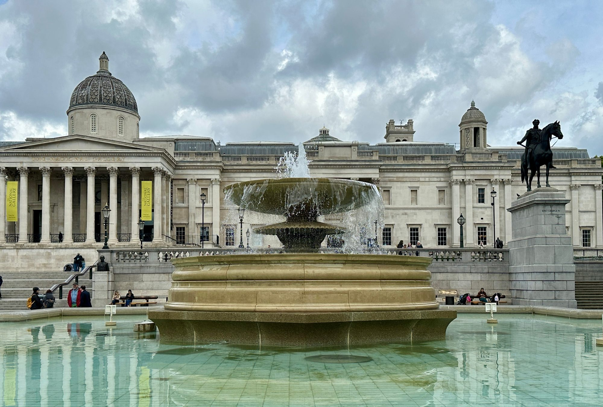
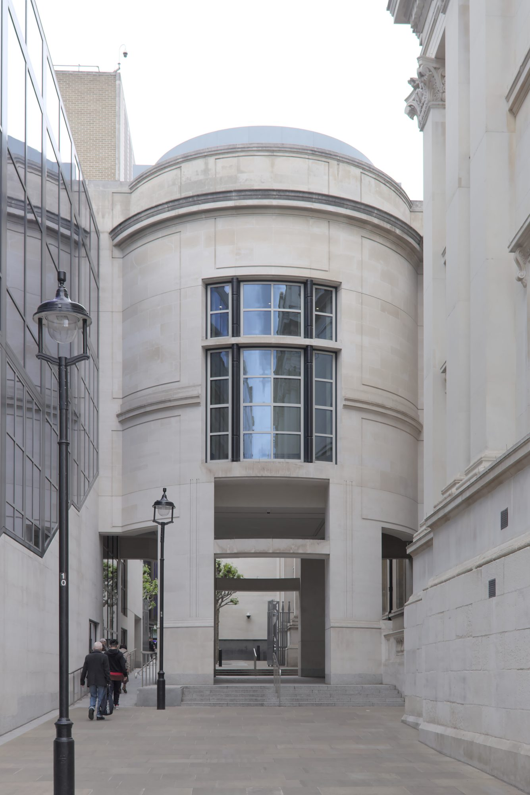
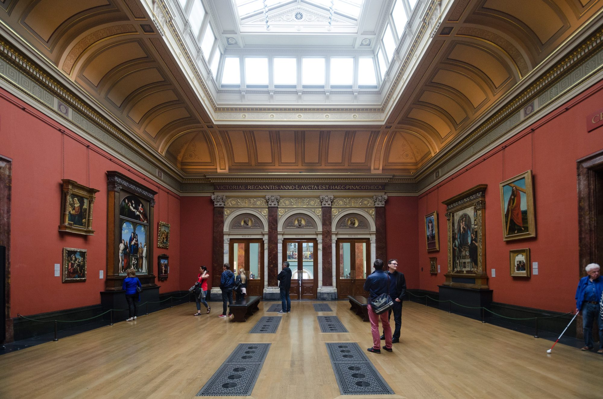
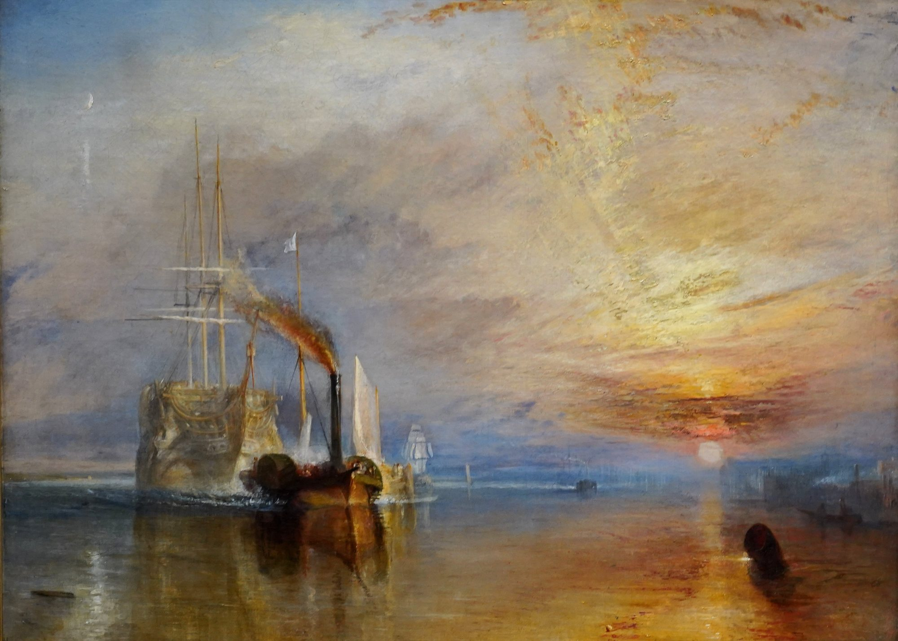
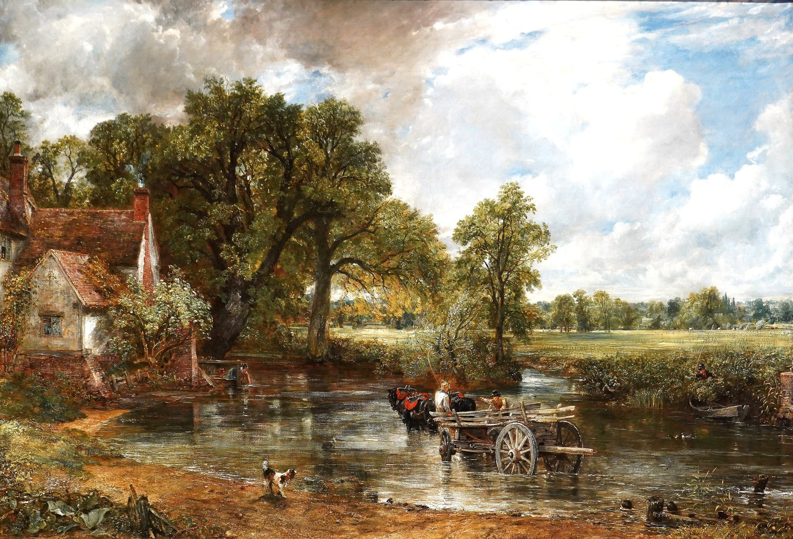
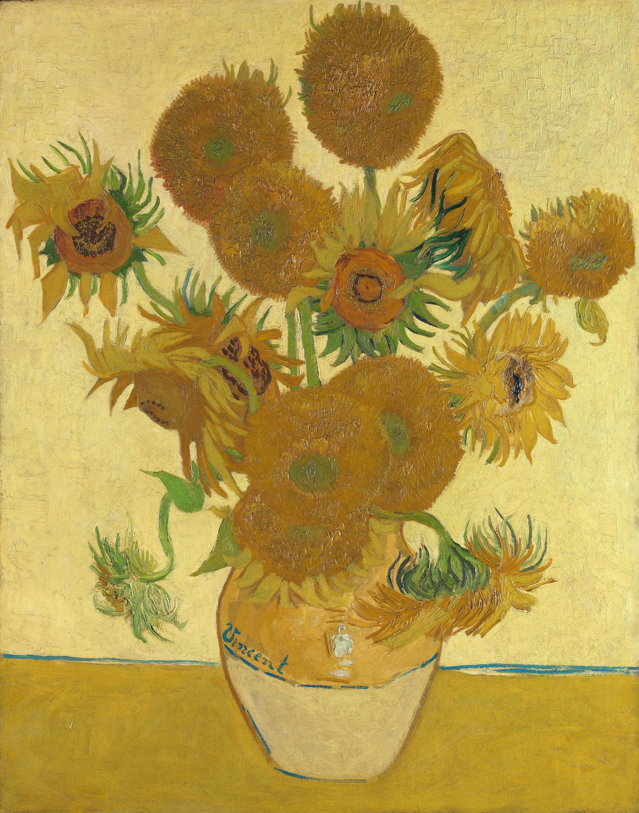

> 💡 **The Short Version:**
> - **Entry is free, daily 10:00 to 18:00, Fridays until 21:00** (closed 24 to 26 December and 1 January). A free ticket gets fast-track entry, and walk-ups are also taken. Enter through the Sainsbury Wing on Trafalgar Square.
> - **Two paid exhibitions are on.** *Renoir and Love* (to 31 January 2027) is £20 off-peak and £25 on Fridays and Saturdays. *Van Eyck: The Portraits* opens 21 November and runs to 11 April 2027 at £18. Under-18s and Members go free to both.
> - **Free on Friday evenings: pay what you wish for Renoir,** from £1, in slots from 17:30, until 15 January 2027.
> - **Free in Room 1:** *Yinka Shonibare and Thomas Gainsborough: A Conversation*, to 7 February 2027.
> - **Leave suitcases behind.** Wheeled luggage is not allowed; the cloakroom is £3 an item and takes bags up to 56 x 25 x 45 cm.
> - **Pick a room, not the building.** Sunflowers is in Room 43, Seurat in Room 44, Monet in Room 46, Turner and Constable in Room 40, Velázquez in Room 19.

> ⚠️ **Rooms 7, 8, 16, 17, 17a, 30 and 31 are closed for building work, and some paintings have moved.** Look up the painting you are crossing the building for on the gallery's site, which lists its current room, before you set off.

*Opening hours, prices and room numbers are as the gallery listed them on 15 November 2026.*

---

## Tickets and what's on

*The National Gallery from Trafalgar Square. Photo: [APK](https://commons.wikimedia.org/wiki/File:Admiral_Beatty_Memorial_Fountain_and_National_Gallery_-_1.jpg), [CC BY 4.0](https://creativecommons.org/licenses/by/4.0/).*

General admission is free, and the gallery asks for donations. [A free ticket](https://www.nationalgallery.org.uk/visiting/plan-your-visit) gets you fast-track entry and key information before your visit; walk-up entry is also available. Members get priority entry, a free cloakroom and discounts in the cafés and shops. An exhibition ticket also covers general admission that day.

| Exhibition | Dates | Where | Price |
| --- | --- | --- | --- |
| **Renoir and Love** | to 31 January 2027 | Sainsbury Wing | £20 off-peak (Sunday to Thursday), £25 Friday and Saturday, £15 quick visit (17:00 to 18:00, Sunday to Thursday). Under-18s and Members free |
| **Van Eyck: The Portraits** | 21 November 2026 to 11 April 2027 | Ground Floor Galleries | £18, including an audio guide. Under-18s and Members free |
| **Yinka Shonibare and Thomas Gainsborough: A Conversation** | to 7 February 2027 | Room 1 | Free |

### Renoir and Love

Forty paintings from collections around the world, covering Renoir in the 1860s to 1880s. The headline loan is *Bal au Moulin de la Galette* (1876) from the Musée d'Orsay, on display in the UK for the first time. It was organised with the Musée d'Orsay and the Museum of Fine Arts, Boston.

**Pay what you wish:** each Friday from 23 October 2026 to 15 January 2027, tickets for the 17:30 to 19:45 slots cost whatever you choose from £1. They are sold online in advance or on the day, walk-up. The audio tour is £5 per person, in English, French, British Sign Language and audio-described versions; bring your own phone and headphones.

### Van Eyck: The Portraits

All nine of Jan van Eyck's known painted portraits, brought together from across Europe, which the gallery says make up half his surviving works. The sitters are craftsmen, merchants and the artist's relatives rather than royalty. A free curator's introduction runs in the Pigott Theatre on Monday 8 February 2027.

The Arnolfini Portrait, the gallery's own Van Eyck, is listed in Gallery C.

### Yinka Shonibare and Thomas Gainsborough

Shonibare's *Mr and Mrs Andrews without their Heads* (1998), lent by the National Gallery of Canada, hangs with the Gainsborough portrait that inspired it, *Mr and Mrs Andrews* (about 1750). The show marks 300 years since Gainsborough's birth.

---

## Opening hours and getting in

- **Hours:** daily 10:00 to 18:00; Fridays until 21:00. Closed 24, 25 and 26 December and 1 January. On 17 November 2026 only, some east wing rooms and the Espresso Bar close at 16:00.
- **Main entrance:** the **Sainsbury Wing**, which faces Trafalgar Square at the corner of Pall Mall and Whitcomb Street. It is step-free.
- **Other entrances:** the Getty Entrance on Level 0 is step-free. The Roden Centre for Creative Learning on Orange Street, at the back, is for school groups and visitors to events there; at weekends it is also a way into the galleries.
- **Security:** every door has a walk-through metal detector, and staff inspect bags and rucksacks.

*The Sainsbury Wing. Photo: [Aethonatic](https://commons.wikimedia.org/wiki/File:National_Gallery_-_Sainsbury_Wing_%281%29_-_17_May_2026.jpg), [CC0](https://creativecommons.org/publicdomain/zero/1.0/).*

> ⚠️ **No wheeled luggage, including cabin bags and suitcases.** The cloakroom costs £3 an item (free for Members) and takes bags up to 56 x 25 x 45 cm. Baby buggies are welcome. Our [London luggage storage guide](/articles/luggage-storage-london/) covers left-luggage near Charing Cross.

**Fridays** run to 21:00, with Friday Lates adding talks, workshops and live performances across the galleries. Some are ticketed and some are free to drop into.

### Getting there

- **Tube and rail:** Charing Cross, about 200 metres away, for the Northern and Bakerloo lines and National Rail. Leicester Square and Embankment are the other stations within walking distance. The gallery's step-free Tube stations are Tottenham Court Road and Westminster, and Charing Cross National Rail is step-free.
- **Bus:** St Martin's Place (stop K), Trafalgar Square Charing Cross Station (stops C, D and G) and Leicester Square Station (stop L).
- **By bike:** Santander Cycles docking stations are on St Martin's Street, Craven Street, Pall Mall East, William IV Street, Charles II Street and Oxendon Street.
- **By car:** there is one Blue Badge space on Orange Street, booked 48 hours ahead on 020 7747 2885, and five more in St Martin's Street. Public car parks are in Leicester Square and Trafalgar Square.

---

## The paintings worth the walk

Over 1,000 paintings are on display, from the 13th century to the early 20th. Rooms carry themed titles rather than just dates, such as Room 10, *The Power of Venetian Colour*. The room numbers below are as the gallery lists each painting; they can change, and some are closed.

*The Central Hall. Photo: [xiquinhosilva](https://commons.wikimedia.org/wiki/File:Central_Hall,_National_Gallery.jpg), [CC BY 2.0](https://creativecommons.org/licenses/by/2.0/).*

### Rooms 40 to 46: Turner to Monet

*The Fighting Temeraire. Photo: [kitmasterbloke](https://commons.wikimedia.org/wiki/File:JMW_Turner_-_The_Fighting_Temeraire_-_1839.jpg), [CC BY 2.0](https://creativecommons.org/licenses/by/2.0/). The painting is public domain.*

- **Turner, *The Fighting Temeraire*, Room 40.** It shows the old warship being towed from Sheerness up the Thames to Rotherhithe to be broken up. The ship had fought at Trafalgar in 1805. Turner kept the painting until he died in 1851.
- **Constable, *The Hay Wain*, Room 40.** The view is the millpond at Flatford on the River Stour, in Suffolk. Flatford Mill, run by Constable's family, and the house on the left both survive.

*The Hay Wain. Photo: [kitmasterbloke](https://commons.wikimedia.org/wiki/File:John_Constable_-_The_Haywain_-_1821.jpg), [CC BY 2.0](https://creativecommons.org/licenses/by/2.0/). The painting is public domain.*

- **Van Gogh, *Sunflowers*, Room 43.** Van Gogh painted the series in 1888 to decorate his house in Arles before a visit from Gauguin. The gallery says this is one of five versions on public display, the others being in Amsterdam, Munich, Philadelphia and Tokyo.

*Sunflowers. Image: Vincent van Gogh, public domain, via [Wikimedia Commons](https://commons.wikimedia.org/wiki/File:Vincent_van_Gogh_-_Sunflowers_%281888,_National_Gallery_London%29.jpg).*

- **Seurat, *Bathers at Asnières*, Room 44.** His first major composition, painted before he turned 25 and rejected by the Salon in 1884. Men and boys sit on the bank of the Seine, with a railway bridge and the chimneys of Clichy behind them.
- **Monet, *Water-Lilies*, Room 46.** One of the large canvases Monet painted at Giverny after building a new studio in 1916. It has hung at the gallery since 1963.

### Earlier rooms

- **Holbein, *The Ambassadors*, Room 4.** Two French envoys at a table of objects, with a smeared shape across the floor that turns into a skull when seen from the right angle.
- **Velázquez, *The Toilet of Venus* ("The Rokeby Venus"), Room 19.** Venus reclines on a bed, her blurred face in a mirror held up by Cupid. The gallery calls it Velázquez's only surviving female nude.
- **Leonardo, *The Virgin of the Rocks*, Room 51.** The Virgin, the infant Christ, the young John the Baptist and an angel in a grotto, made for an altarpiece in Milan. The Wilton Diptych, a portable painted altarpiece made for Richard II, is in the same room.
- **Stubbs, *Whistlejacket*, Room 34.** A rearing chestnut Arabian stallion, riderless, against a plain pale-gold background.
- **Van Eyck, *The Arnolfini Portrait*, Gallery C.** A merchant and his wife in a Bruges interior, with a convex mirror on the back wall and the signature "Johannes de Eyck fuit hic. 1434" above it.

---

## Tours, talks and audio

- **Free guided tour:** Tuesdays, Wednesdays and Thursdays, 15:00 to 16:00, meeting in the Central Hall (not on public holidays). A 60-minute taster of the collection for individuals and groups of up to four, first come, first served. Donations welcome.
- **Free audio guide:** over 50 paintings, with a highlights route for visitors who only have an hour. It is on your own phone, in English, German, Spanish, French, Italian, Portuguese, Mandarin, Korean and Japanese, with audio-described and BSL versions.
- **Private tours:** the gallery takes bookings for expert-led private daytime tours; details are on its [group and private tours page](https://www.nationalgallery.org.uk/visiting/group-and-private-tours).
- **Events:** lunchtime talks, courses and Friday Lates are listed on the [events page](https://www.nationalgallery.org.uk/events); many are free, others are ticketed.

---

## What changed for the bicentenary

The gallery was founded in 1824, and marked 200 years with a programme called NG200. It included capital works, with an initial phase completed in 2025:

- **The Sainsbury Wing's ground floor was reconfigured** to give a new entrance and better visitor amenities, with changes to the public space outside on the north edge of Trafalgar Square. The wing is now the main entrance for everyone.
- **A Supporters' House** opened in the Wilkins Building, with spaces for Members and Supporters.
- **The Roden Centre for Creative Learning** was rebuilt on Orange Street.
- **A Research Centre** is due to open in 2028, with a library and event spaces open to the public. Some rooms are closed, and paintings moved, while that building work goes on.

Further ahead, **Project Domani** would extend the collection to paintings of the 20th and 21st centuries. The gallery says £375 million in philanthropic commitments has been secured for it.

---

## Food, children and access

### Food and drink

- **Ochre Brasserie,** Level 0 by the Getty Exit, 11:30 to 17:45 and until 21:00 on Fridays. Set lunch and pre-theatre menus from £24.50, afternoon tea and a cocktail bar. Reservations recommended.
- **Osteria Locatelli,** Sainsbury Wing, 11:30 to 17:45, later on Fridays (until 22:15) and Saturdays (until 20:15). Set menus daily 15:00 to 16:30: two courses £25, three £31.
- **Muriel's Kitchen,** Level 0 by the Getty Exit, counter service with salads, quiches and hot dishes, 10:00 to 17:45 and until 20:45 on Fridays.
- **Bar Giorgio,** Sainsbury Wing foyer, coffee and maritozzi buns, 10:00 to 17:45 and until 19:00 on Fridays.
- **Espresso Bar by Muriel's,** Annenberg Court, 10:00 to 17:45.

No food or drink in the galleries. You can bring your own, but you cannot eat it in the café and restaurant spaces; families can use the Social Space at the top of the Roden Centre. For a longer meal outside, see our guides to [Covent Garden](/articles/covent-garden-area-guide/) and [Soho](/articles/soho-area-guide/).

### With children

The Roden Centre's Welcome Space is free and needs no booking: Saturday and Sunday 10:00 to 18:00, school holidays, and Friday 18:00 to 21:00. It has self-guided activities inspired by the collection. *The Keeper of Paintings: Canvas Quest* is a free hide-and-seek game on a phone or tablet for ages 7 and over. Under-18s go free to Renoir and Van Eyck, and buggies are welcome. Our [London with children guide](/articles/london-with-children/) puts it in a day.

### Accessibility

Lifts serve the whole building. There are accessible and ambulant toilets near all entrances, and Changing Places toilets on the ground floor of the Sainsbury Wing and of the Roden Centre; you need a RADAR key, which the gallery can lend. Wheelchairs and a rollator can be booked ahead on 020 7747 2885, with a few on a first-come basis at the Sainsbury Wing and Getty entrances. Folding stools are available in the galleries, hearing loops are at every information desk, and access exhibition tickets come with a free companion ticket. Our [step-free London guide](/articles/step-free-london/) covers the rest of the area.

Photography is welcome for personal use unless a sign says otherwise, sketching is allowed, and there is free wifi.

---

## Nearby

The **National Portrait Gallery** is round the corner, free to enter. Our [best museums in London](/articles/best-museums-london/) and [best galleries in London](/articles/best-galleries-london/) cover both. Trafalgar Square is the end of our [Westminster walk](/articles/westminster-walk/), and Covent Garden and Soho are a short walk north.

---

## Continue planning your London trip

- 🖼️ **[London Exhibitions 2027](/articles/london-exhibitions-2027/)** — the year's big museum and gallery shows month by month, with prices and how each one books.
- 🏛️ **[Best Museums in London](/articles/best-museums-london/)** — the other free national museums and the small ones nearby.
- 🖼️ **[Best Galleries in London](/articles/best-galleries-london/)** — Tate Modern, Tate Britain and the Wallace Collection compared.
- 🏺 **[British Museum Guide](/articles/british-museum-guide/)** — the free museum a few minutes' walk north-east.
- 🚶 **[Westminster Walk](/articles/westminster-walk/)** — Westminster Bridge to Trafalgar Square on foot.
- 🏙️ **[Westminster Area Guide](/articles/westminster-area-guide/)** — what else is around the top of Whitehall.
- 🛏️ **[Where to Stay in Westminster](/articles/where-to-stay-westminster/)** — hotels near Charing Cross and Embankment.
- 💷 **[London on a Budget](/articles/london-on-a-budget/)** — free sights and booking tips across Zone 1.
- 🌧️ **[London in the Rain](/articles/london-in-the-rain/)** — the gallery as an indoor plan.
- 👨‍👩‍👧 **[London with Children](/articles/london-with-children/)** — the Welcome Space as part of a family day.
- ♿ **[Step-Free London](/articles/step-free-london/)** — the gallery's lifts and entrances alongside the other big sights.
- 🗓️ **[Things to Do in London in December](/articles/things-to-do-in-london-in-december/)** — Van Eyck and the Christmas closures.
- 🗓️ **[Things to Do in London in January](/articles/things-to-do-in-london-in-january/)** — Renoir's last weeks and the 1 January closure.
