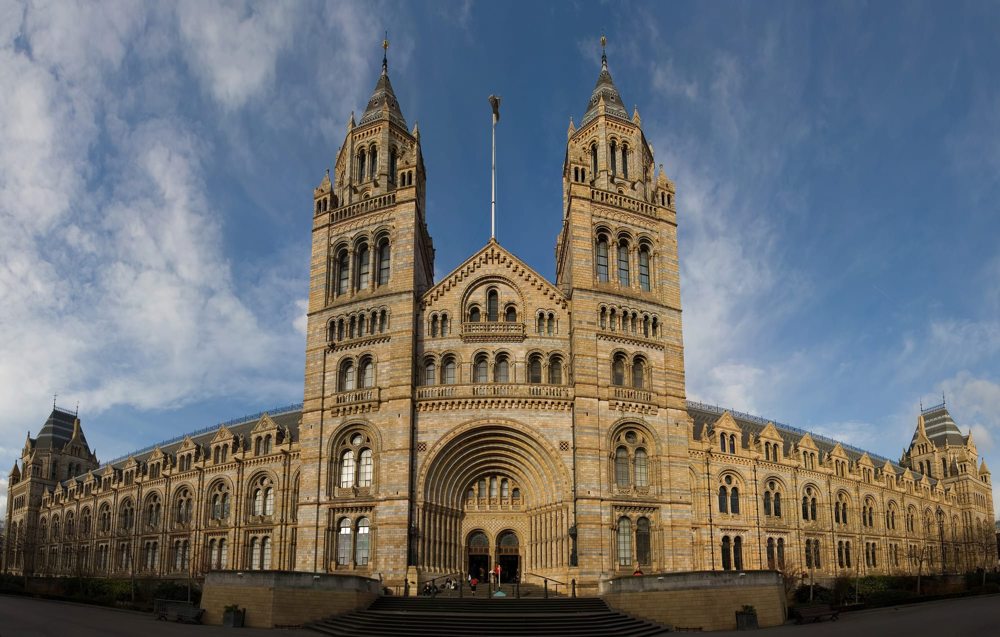

> 💡 **The Short Version:**
> - **Admission is free, daily 10:00 to 17:50** (last entry 17:30; the West Entrance closes at 17:00; closed 24–26 December). [Book a free entry ticket](https://ticketing.nhm.ac.uk/events/GENAD-ADM) to guarantee entry at weekends and in school holidays, when you may have to queue.
> - **Three entrances.** Cromwell Road opens into Hintze Hall under the blue whale skeleton, Exhibition Road into Earth Hall and the *Stegosaurus*, and Queen's Gate beside the Dinosaurs gallery. From South Kensington station, the subway tunnel leads to the Subway Gate, a step-free way into the Central Entrance.
> - **Start with the dinosaurs,** then Hintze Hall, then the escalator through the Earth sculpture to the earthquake simulator.
> - **Fern,** a full-size bronze *Diplodocus*, stands in the free gardens beside the museum.
> - **Two paid exhibitions.** **Wildlife Photographer of the Year** runs 16 October 2026 to 11 July 2027 (adults £17–£21). **Jurassic Oceans: Monsters of the Deep** runs to 3 January 2027 (adults £15–£17.50).
> - **Audio guides are free** on the museum's own site. If you would rather have reserved entry and an audio tour in one booking, <a href="https://www.getyourguide.com/activity/-t1396447?partner_id=WWP7I0R&amp;cmp=natural-history-museum-guide" target="_blank" rel="sponsored nofollow noopener" data-affiliate="gyg">GetYourGuide sells one</a>.

Alfred Waterhouse's terracotta building on Cromwell Road, opened in 1881, was the UK's most visited attraction in 2025, with 7,116,929 visits according to the [Association of Leading Visitor Attractions](https://www.alva.org.uk/details.cfm?p=423). It holds 80 million specimens.

*Prices and opening times as of October 2026.*

---

## Getting in and the three entrances

*The Cromwell Road front. Photo: [Diliff](https://commons.wikimedia.org/wiki/File:Natural_History_Museum_London_Jan_2006.jpg), [CC BY-SA 3.0](https://creativecommons.org/licenses/by-sa/3.0/).*

The galleries are free. Members and ticket holders skip the queue, and the free [entry ticket](https://ticketing.nhm.ac.uk/events/GENAD-ADM) is what guarantees you in. Your bags may be searched on arrival, and sharp objects such as knives and scissors can be confiscated.

South Kensington station is about a five-minute walk from the Central and East Entrances.

| Entrance | Where it lands | Access | Good for |
| --- | --- | --- | --- |
| **Cromwell Road (Central Entrance)** | **Hintze Hall**, beneath the blue whale skeleton | Steep ramp beside the steps; step-free from the station tunnel via the **Subway Gate** | The first view of Hintze Hall. The Central Entrance cloakroom takes large bags and suitcases only. |
| **Exhibition Road (East Entrance)** | **Earth Hall**, facing the *Stegosaurus* | Steps in the lobby, then a lift to the galleries. The museum may close this gate at busy times. | Arriving from the V&A or Science Museum. This cloakroom takes everything, coats included. |
| **Queen's Gate (West Entrance)** | Beside the **Dinosaurs gallery** and the Shake Bar | Open daily until 17:00 | Seven minutes' walk from Gloucester Road station, and next to the dinosaurs. |

> ⚠️ **South Kensington station has no step-free access to its platforms.** The subway tunnel is step-free into the museum, but getting from the train to the ticket hall involves stairs. Knightsbridge on the Piccadilly line is step-free; see our [step-free London guide](/articles/step-free-london/) for routes.

### Tours and audio guides

The museum's audio guides are free: 24 on SoundCloud, including an audio-described tour of Hintze Hall narrated by Sir David Attenborough. They are listed on the [museum's accessibility page](https://www.nhm.ac.uk/visit/access-at-south-kensington.html), and you can play them on your own device.

For a human guide, the museum runs two ticketed tours:

- **[Out of Hours Dino Tours](https://www.nhm.ac.uk/events/dinotours.html):** an hour in the Dinosaurs gallery before it opens, 09:00 to 10:00 on selected dates, meeting at the East Entrance at 08:45. £30 (£24 Members), recommended for ages 7 and over.
- **[Behind the Scenes Tour: Spirit Collection](https://www.nhm.ac.uk/events/behind-the-scenes-tour-the-spirit-collection.html):** 45 minutes through the Darwin Centre's collection of 22 million specimens preserved in spirit, including Archie, an 8.62-metre giant squid, and specimens collected by Charles Darwin. £35 (£28 Members), ages 10 and over, meeting at the Turbinaria coral bay in Hintze Hall. Bags are not allowed on the tour, and cloakroom use is included in the ticket.

If you would rather book reserved entry and an audio tour together, <a href="https://www.getyourguide.com/activity/-t1396447?partner_id=WWP7I0R&amp;cmp=natural-history-museum-guide" target="_blank" rel="sponsored nofollow noopener" data-affiliate="gyg">GetYourGuide sells that as one ticket</a>. Check live availability below:

Powered by <a target="_blank" rel="sponsored" href="https://www.getyourguide.com/london-l57/">GetYourGuide</a>

---

## A two-to-three-hour route

Weekends and school holidays can be busy, so see the popular galleries first. This route runs from the dinosaurs through Hintze Hall to Earth Hall, then out to the gardens.

### 1. Dinosaurs and the whale model

Go to the **Dinosaurs gallery** on the ground floor of the Central Building. The museum lists it among its most popular galleries. Highlights:

- Part of the first *Tyrannosaurus rex* skeleton ever discovered, and the roaring *T. rex* model.
- The skull of a *Triceratops*.
- The first *Iguanodon* skeleton known to science.
- The armoured dinosaur *Scolosaurus*.

The **Mammals Hall** is on the ground floor of the North Wing. A blue whale model hangs from its ceiling beside other whale skeletons and replicas, and mammoths and giant elk stand on the floor below. The skeleton you see in Hintze Hall is a different animal.

### 2. Hintze Hall and the upper floors

Hintze Hall is the main entrance hall.

*Hope in Hintze Hall.*

- **Hope:** a 25.2-metre blue whale skeleton weighing 4,500 kilograms, from a whale that stranded near Wexford in Ireland in March 1891. She was unveiled here on 13 July 2017, replacing Dippy the *Diplodocus* cast. The painted ceiling above her is easier to see from the balconies.
- **The balconies:** a cross-section of a 1,300-year-old sequoia on the upper balcony.
- **Also in the hall:** an American mastodon, a *Mantellisaurus* fossil and a 300-kilogramme *Turbinaria* coral.
- **Fossil Marine Reptiles** (ground floor): ichthyosaurs and plesiosaurs, including specimens collected by Mary Anning and her brother Joseph in the early 1800s, and an ichthyosaur fossil with six unborn young inside her.
- **Birds** (ground floor): a dodo, a Victorian hummingbird cabinet and framed prints from John James Audubon's *The Birds of America*.
- **Fixing Our Broken Planet** (ground floor, free): more than 200 specimens, from a Sumatran rhino to an ancient cow skull, on food, energy, materials and health.
- **Treasures in the Cadogan Gallery** (first floor): 22 objects including a Moon rock, a meteorite, Darwin's pigeons, Blaschka glass models and Guy the gorilla.
- **The Vault** and **Minerals Gallery** (first floor): the Aurora Pyramid of Hope, a collection of 296 coloured diamonds, the Devonshire Emerald and a piece of the Winchcombe meteorite in the Vault. The Minerals Gallery keeps its original 1881 oak cabinets, a 9,381-carat blue topaz and a 635-kilogramme iron meteorite that fell in Argentina in 1783. The Minerals Gallery is one of the museum's quieter spaces.
- **Nature and Us** (second floor, free): a gallery reopened on 16 September 2026 for the first time since 1943, once a working herbarium. It holds a miniature model of one of the Crystal Palace dinosaurs and the skeleton of a monk seal called Jenny.

The Creepy Crawlies gallery has closed and will reopen as a new family gallery.

### 3. Earth Hall, the Earth sculpture and Volcanoes and Earthquakes

Earth Hall is on the ground floor of the East Wing, inside the Exhibition Road entrance.

- **The *Stegosaurus*:** three metres tall and almost six metres long, one of the most complete *Stegosaurus* fossil skeletons on display in Europe.
- **Enigmacursor:** a dinosaur species new to science, on the Earth Hall mezzanine.
- **Volcanoes and Earthquakes:** on the second floor of the East Wing, reached by the escalator through the Earth sculpture. It has an earthquake simulator that recreates the 1995 Kobe earthquake, casts of victims of the AD 79 eruption of Mount Vesuvius, and the heat suits and field equipment of volcanologists.

### 4. The Darwin Centre and the gardens

- **The Darwin Centre's Cocoon:** hundreds of specimens, including beetles, butterflies, metre-high plants, tarantulas and historic herbaria, and the Centre for UK Nature in its atrium. The Cocoon is subject to last-minute closures, so ask a member of staff in the galleries.
- **The gardens:** five acres, free, with no ticket needed, opened on 18 July 2024 as part of the Urban Nature Project. The Evolution Garden is open daily 10:00 to 17:50. Its Evolution Timeline runs along ancient rocks from the oldest in the UK to the present day. **Fern**, a full-size bronze *Diplodocus* unveiled on 16 July 2024, stands among tree ferns and cycads, with a prowling *Hypsilophodon* nearby. The ponds hold newts, frogs and dragonflies.
- **Winter hours:** the Nature Discovery Garden has no lighting and is open in daylight only. It closes at 16:00 as of October 2026. The gardens may close at short notice when conditions are icy.

*The Waterhouse building.*

---

Powered by <a target="_blank" rel="sponsored" href="https://www.getyourguide.com/london-l57/">GetYourGuide</a>

## Paid exhibitions (2026–2027)

Temporary exhibitions need their own ticket, booked on the museum's [What's On page](https://www.nhm.ac.uk/whats-on.html). A ticket for either exhibition below includes museum entry, so you do not need a free entry ticket as well. Under-4s are free.

*Wildlife Photographer of the Year.*

| Exhibition | Dates | Adult | Child (4–17) | What it covers |
| --- | --- | ---: | ---: | --- |
| **[Wildlife Photographer of the Year](https://ticketing.nhm.ac.uk/events/EXH-WPY62)** (62nd) | 16 Oct 2026 – 11 Jul 2027 | £17 / £19 / £21 | £8.50 / £9.50 / £10.50 | 100 images from the competition, from polar landscapes to tropical rainforests. Off-peak (£17) is Tuesday to Thursday in term time; peak (£21) is weekends in school holidays; every other day is £19. Tickets are for a set date and cannot be refunded or exchanged. |
| **[Jurassic Oceans: Monsters of the Deep](https://ticketing.nhm.ac.uk/events/EXH-JUROC)** | 22 May 2026 – 3 Jan 2027 | £15 / £17.50 | £7.50 / £8.75 | Pliosaurs, ichthyosaurs and mosasaurs, with real fossils. You can touch a mosasaur tooth, shark's skin and fossil poo. Entry is 10:00 to 16:30 daily and the recommended age is 8 and over. Off-peak (£15) is Monday to Friday outside school and bank holidays; weekends, school holidays and bank holidays are £17.50. |

Jobseekers, students and disabled adults pay £13.60, £15.20 or £16.80 for Wildlife Photographer of the Year and £12 or £14 for Jurassic Oceans. A disabled visitor's companion is free, and the free companion ticket is booked in advance with the exhibition ticket. Members enter both exhibitions free.

---

## Practical information

### Cloakrooms and luggage

- **Suitcases:** large or wheeled suitcases cannot go round the galleries and must be left in a cloakroom. Space is limited, so the museum advises against bringing luggage. If you are on your way to or from Heathrow, see our [London luggage storage guide](/articles/luggage-storage-london/).
- **Two cloakrooms:** the **Central Entrance cloakroom** takes large bags and suitcases only. The **East Entrance cloakroom** takes everything, coats included.
- **Prices per item:** bag under 4 kg £5, bag over 4 kg £6, coat £4, umbrella £3, scooter £3, pushchair £5, folded bike £5. Members store for free.

### Food and the picnic area

All the cafés are run by the museum's catering partner Benugo, and Members get 10% off. The [museum's eating page](https://www.nhm.ac.uk/visit/eat-drink-and-shop.html) has menus.

- **T. rex Restaurant** (from 11:00): pizzas, salads, toasted sandwiches and desserts, with children's meals, just off Fossil Marine Reptiles near the Central Entrance.
- **Central Cafe** (from 10:00): sandwiches, salads, cakes and pastries, behind Hintze Hall.
- **Earth Hall Cafe** (from 10:00): hot meals, sandwiches, wraps and children's lunch packs, near the East Entrance.
- **Shake Bar** (from 10:00): milkshakes, sundaes and toasted sandwiches, next to the Dinosaurs gallery.
- **Garden Kitchen** (from 09:30): small plates and mains, including fish and chips and a Sri Lankan curry, in the gardens near *Fern*.
- **The Anning Rooms** are for Members and Patrons only.
- **Picnics:** bring your own food to the **Picnic Area** on the lower ground floor, or eat in the gardens. In term time the Picnic Area is reserved for school groups on weekdays from 11:00 to 14:00.

For a sit-down meal outside, see the restaurants in our [South Kensington area guide](/articles/south-kensington-area-guide/).

### Step-free access, wheelchairs and quiet spaces

- **Entrances:** use the Central Entrance (steep ramp) or the Subway Gate from the station tunnel. The East Entrance has steps in its lobby, then a lift to the galleries.
- **Lifts:** the building has lifts and step-free access to most areas, but some lifts are out of service. As of October 2026, a number of Darwin Centre lifts and the Mammals Hall lift are out of order. The lift status is in the maintenance works section of the [museum's facilities page](https://www.nhm.ac.uk/visit/facilities.html), and it is worth checking before you travel.
- **Wheelchairs and stools:** manual wheelchairs are free to borrow from the cloakrooms, first come, first served, and cannot be reserved. Folding stools are free from the cloakrooms too.
- **Fast-track entry:** staff can fast-track entry for anyone with access requirements. They do not ask for ID or proof of disability.
- **Changing Places:** a Changing Places toilet is on the ground floor. If it is out of order, the Hintze Hall information desk will give you access to a second one in the Nature Activity Centre.
- **Quiet spaces:** the Minerals Gallery, the Images of Nature gallery, the Contemplation Room and the Nature Discovery Garden have lower noise and fewer people than the rest of the museum.
- **Relaxed sessions:** Wildlife Photographer of the Year has a relaxed viewing for disabled and neurodiverse visitors from 10:00 to 11:00 on the first Saturday and Wednesday of each month. [Dawnosaurs](https://www.nhm.ac.uk/events/dawnosaurs.html) runs five early-morning sessions a year for neurodivergent children aged 5 to 15 and their families, before the museum opens, and asks for no proof of diagnosis.

More routes are in our [step-free London guide](/articles/step-free-london/).

---

Powered by <a target="_blank" rel="sponsored" href="https://www.getyourguide.com/london-l57/">GetYourGuide</a>

## Common mistakes

1. **Arriving at a weekend or in school holidays without an entry ticket.** You may have to queue; ticket holders and Members skip it. [Book the free ticket](https://ticketing.nhm.ac.uk/events/GENAD-ADM) first.
2. **Fitting the Natural History Museum, Science Museum and V&A into one day.** All three are free and a short walk apart, which makes it tempting. Pick one for the morning and one for the afternoon.
3. **Looking for Dippy in Hintze Hall.** The *Diplodocus* cast left when *Hope* arrived in 2017. For a *Diplodocus*, walk out to the gardens and see *Fern*, the bronze one.
4. **Taking *Hope* for the only whale.** *Hope* is the skeleton in Hintze Hall. The blue whale model hangs in the Mammals Hall.
5. **Looking for the ice rink.** The museum's ice rink ran for 16 years and has closed; the gardens now stand where it was. For skating, see our [ice skating guide](/articles/ice-skating-london/).

---

## Continue planning your London trip

- 🏛️ **[South Kensington Area Guide](/articles/south-kensington-area-guide/)**: the station tunnel, the V&A and Science Museum next door, and where to eat.
- 🛏️ **[Where to Stay in South Kensington](/articles/where-to-stay-south-kensington/)**: hotels within walking distance of the museum quarter.
- 🖼️ **[The Best Museums in London](/articles/best-museums-london/)**: how the Natural History Museum compares with the others.
- 👨‍👩‍👧 **[London with Children](/articles/london-with-children/)**: pairing South Kensington's museums with parks, boat rides and hands-on galleries by age group.
- ♿ **[Step-Free London](/articles/step-free-london/)**: accessible Tube stations, bus ramps and Changing Places toilets across central London.
- 🌧️ **[London in the Rain](/articles/london-in-the-rain/)**: indoor days, including the dry tunnel from the station to the museum.
- 💷 **[London on a Budget](/articles/london-on-a-budget/)** and **[The London Pass Guide](/articles/london-pass-guide/)**: free national museums alongside paid landmarks such as the [Tower of London](/articles/tower-of-london-guide/) and [Westminster Abbey](/articles/westminster-abbey-guide/).
- 🗺️ **[Three Days in London Itinerary](/articles/three-days-in-london-itinerary/)**: where South Kensington fits into a first Zone 1 trip.
