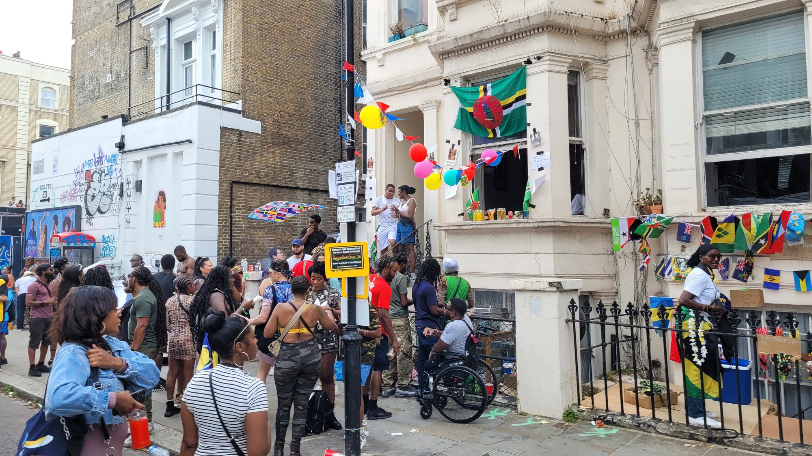
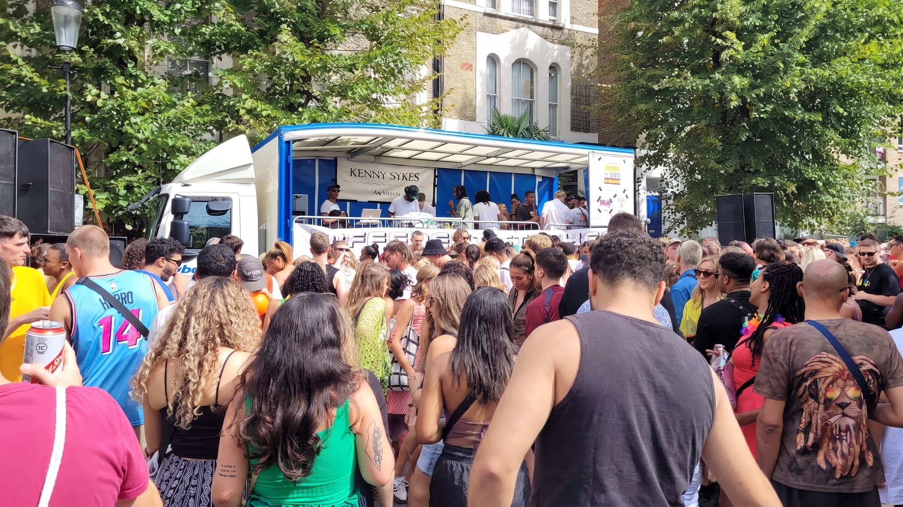
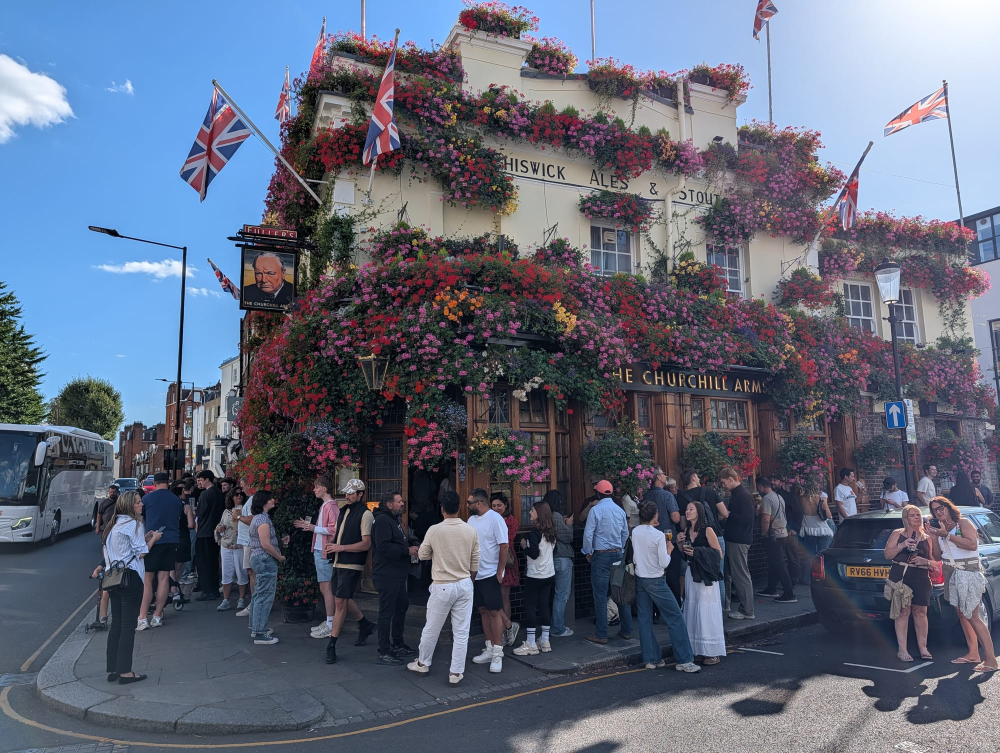
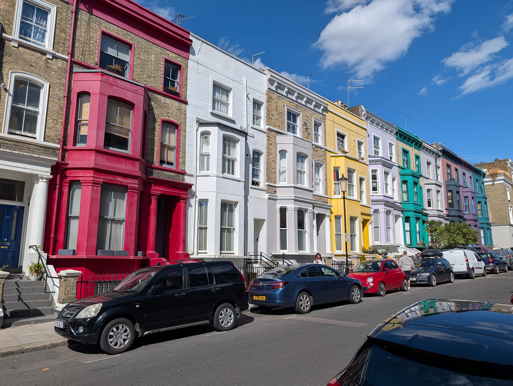
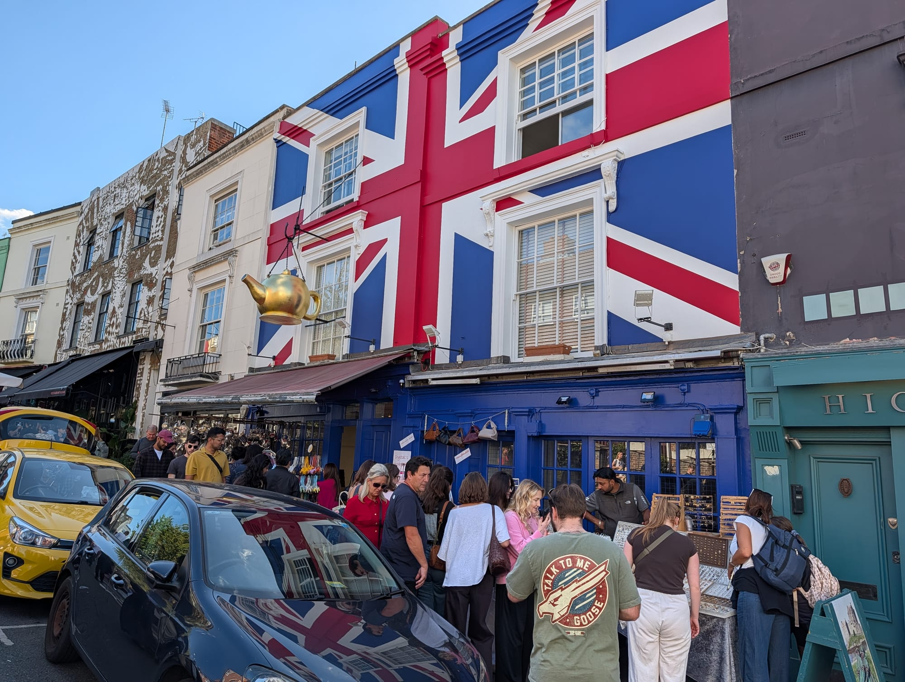
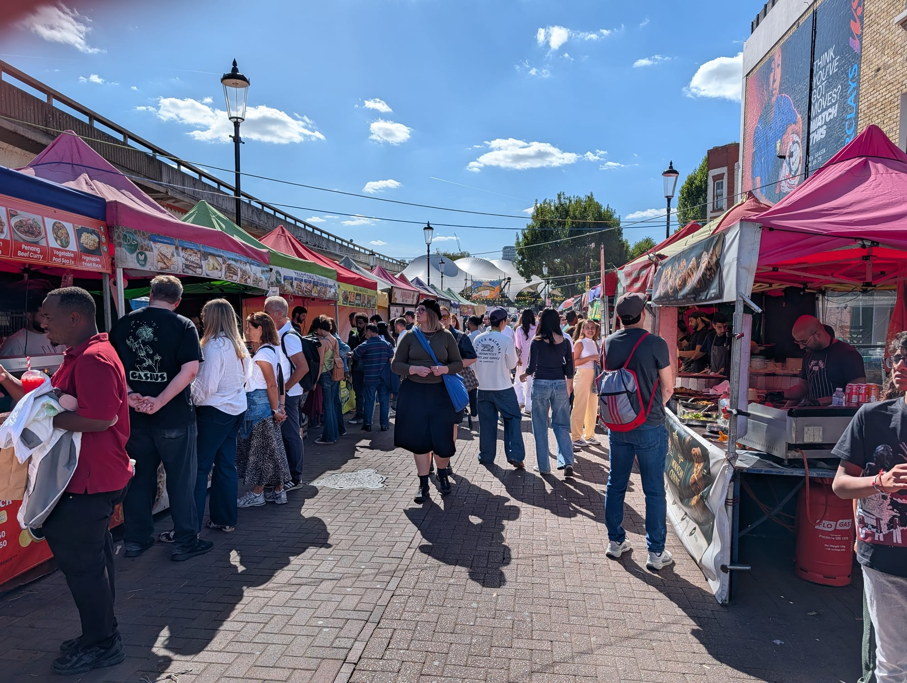
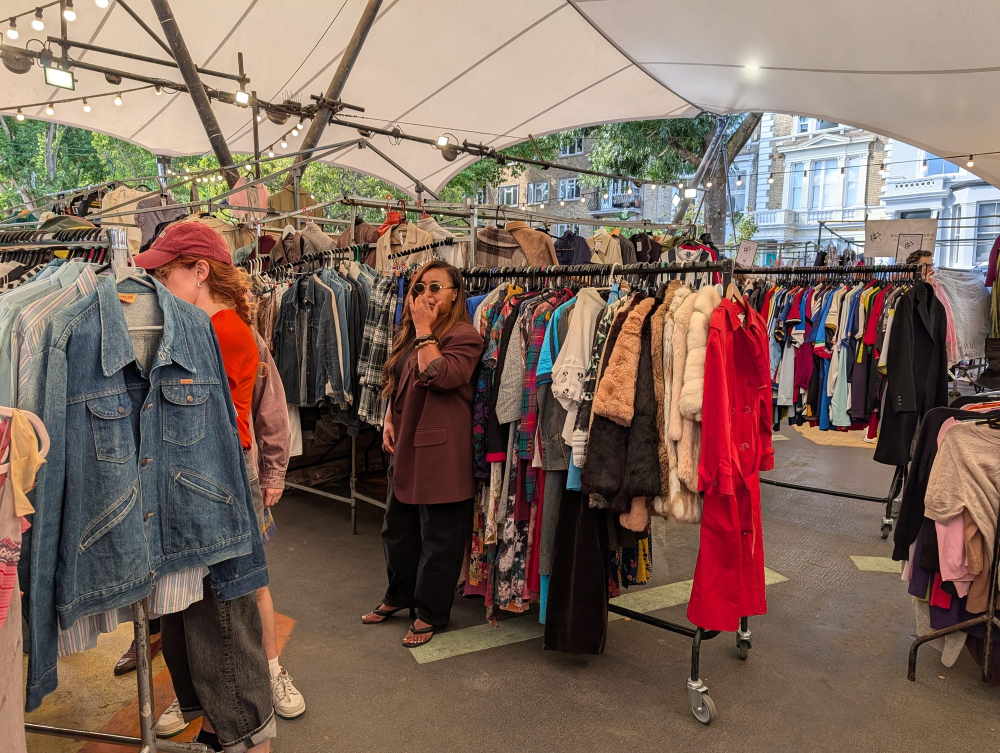
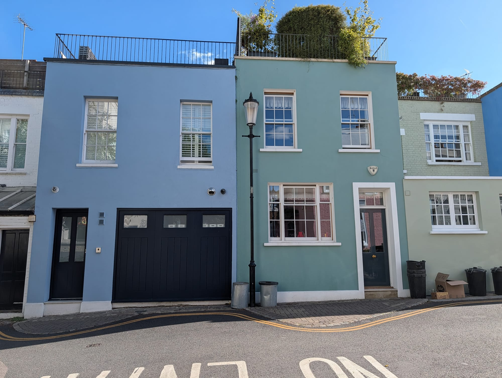
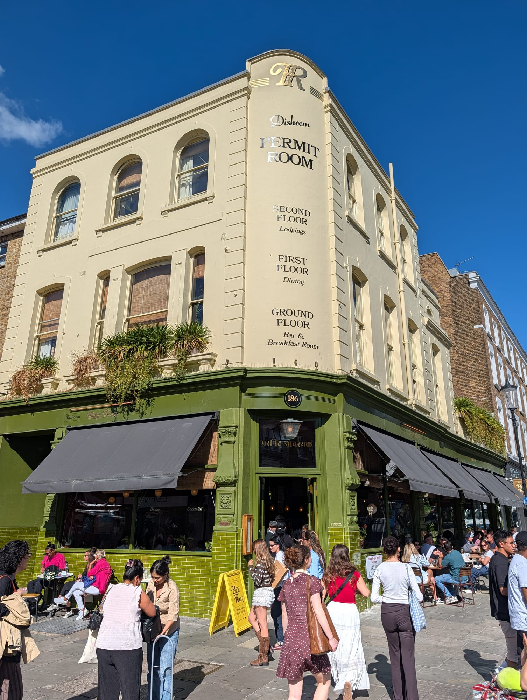

Notting Hill is a west London village of pastel terraces, antique arcades and a market that stretches for about a mile. This guide covers what is open when, which streets have the pastel houses, and the canal walk east to Little Venice.

Notting Hill has its own share of the commemorative plaques marking where notable people lived or worked - see them on our [interactive map](/plaques/?area=notting-hill).

## Why visit — and who should skip it

**Come here if** you like browsing more than ticking off landmarks. Notting Hill suits slow wandering: antique arcades, secondhand bookshops, independent boutiques on Westbourne Grove and pubs.

**Skip it if** you are on a short trip built around major sights: there is no museum, cathedral or palace here. On a three-day first visit, Westminster, the South Bank and the [British Museum](/articles/british-museum-guide/) come first.

**One warning:** the pastel houses are private homes. Residents on Lancaster Road and St Luke's Mews have photographers on their doorsteps daily, and some have put up signs asking people to stop. Photograph from the pavement, keep off the steps, and do not block front doors.

## Top sights and activities

1. **Portobello Road Market** — Stalls stretch for about a mile. The character changes as you walk north: antiques at the southern end near Notting Hill Gate, then fruit and veg, then vintage clothing under the Westway flyover, then Golborne Road's bric-a-brac and food.
2. **The antique arcades** — Most visitors walk straight past them. Admiral Vernon, Portobello Studios and Roger's Arcade are indoor warrens of dealer stalls selling silver, jewellery, maps and militaria. Open Saturdays only, most from 7am to about 4pm.
3. **The colourful houses** — Not on Portobello Road, which is where most people look for them. **Lancaster Road**, just north of Ladbroke Grove station, is the rainbow row from the postcards and the easiest to combine with the market. **Hillgate Village**, by Notting Hill Gate at the opposite end, is much quieter. Our [colourful houses walking route](/articles/notting-hill-colourful-houses/) covers all eleven streets.
4. **The Churchill Arms** — An 18th-century pub buried under thousands of flowers in summer and around 90 Christmas trees in December, serving Thai food in its back conservatory. Worth the detour on Kensington Church Street.
5. **Holland Park and the Kyoto Garden** — Fifteen minutes south. The Japanese garden has koi ponds, a waterfall and resident peacocks.
6. **Notting Hill Bookshop** — The Blenheim Crescent shop that inspired the film, and a working bookshop.
7. **Golborne Road** — The far northern end, past the flea market. Portuguese cafes, Moroccan grocers and far fewer visitors.
8. **Notting Hill Carnival** — A street carnival over the August bank holiday weekend, led by London's Caribbean communities since 1966, with sound systems, mas bands and steel pan through the streets of W11. Shops board up and stations near the route go exit-only or close entirely.

*One of Carnival's sound systems.*

*The Churchill Arms.*

## Key streets and micro-districts

*Lancaster Road, the postcard row.*

### Portobello Road (south) — antiques
From Chepstow Villas down to Elgin Crescent: permanent shops plus indoor arcades holding dozens of small dealers each, in silver, jewellery, prints and militaria.

**The arcades open on Saturdays only**, most from 7am to about 4pm, and the southern road has antiques stalls on Fridays too. The rest of the week the arcades are shut.

**Get there before 10am** if you want to look at anything. Free, and Notting Hill Gate station is five minutes from the top.

The Union Jack frontage about halfway down is the landmark for finding your way back to the arcades.

### Portobello Road (north) and the Westway — vintage

Past Lancaster Road and on under the **Westway flyover**, where the market changes character completely — vintage clothing, records and street food, not antiques, and a younger crowd.

The stalls under and beyond the flyover run on Friday, Saturday and Sunday, and Friday has more room than Saturday.

**On Saturday this stretch is shoulder to shoulder** between about noon and 4pm. Come Friday if you can.

### Westbourne Grove — boutiques and brunch
The east–west shopping street, with independent fashion, homeware and brunch cafés, and **the reliable answer on any day the market is not running**.

It crosses Portobello Road about halfway along, which makes it the natural pivot point for a walk around the area.

**Open all week, ordinary shop hours**, and considerably calmer than Portobello. Come on a Sunday or a Tuesday, when the market end is quiet.

### Golborne Road — the local end
North of the Westway, a Portuguese and Moroccan neighbourhood with pastelarias selling custard tarts and a handful of antique dealers, with far fewer visitors.

Fruit and veg and hot food stalls trade Monday to Thursday. The bric-a-brac and furniture stalls run Friday and Saturday, and Friday is Golborne's busiest day.

It is ten minutes north of the busy stretch. Westbourne Park is the nearest station.

### St Luke's Mews and Lancaster Road — the convenient colour
Two short residential streets that appear constantly on social media — **St Luke's Mews** for its pastel-painted cottages, one of which was the cue-card doorstep in *Love Actually*, and **Lancaster Road** for its run of brightly coloured terraces.

**These are the closest colourful streets to Portobello, not the best ones.** If you are walking the market you will pass within a couple of minutes of both.

**Hillgate Village**, four short streets four minutes from Notting Hill Gate station at the other end of the area, has the most concentrated pastel terraces and a fraction of the visitors. On one September afternoon there were two people photographing in Hillgate Village and about thirty on Lancaster Road.

**If the houses are why you came, do not plan your day around Portobello.** Our [Notting Hill colourful houses route](/articles/notting-hill-colourful-houses/) maps all eleven streets in walking order, from Notting Hill Gate to Ladbroke Grove — about two hours at a photographing pace.

## Where to eat and drink

| Spot | Style | Price | Why go |
| --- | --- | --- | --- |
| **The Churchill Arms** | Historic pub, Thai kitchen | ££ | Flower-covered exterior; book the conservatory at weekends |
| **[The Pelican](hotel:the-pelican-notting-hill)** | Refined pub dining | £££ | Sunday roast; reserve well ahead |
| **Granger & Co.** | Australian all-day cafe | ££ | Ricotta hotcakes; expect a queue after 10am at weekends |
| **Layla** | Bakery | £ | Pastries on Golborne Road, away from the crush |
| **Lisboa Patisserie** | Portuguese cafe | £ | Pastéis de nata on Golborne Road since 1985 |
| **Electric Diner** | American diner | ££ | Next to the Electric Cinema; good for a late lunch |

*The Distillery, Portobello Road.*

Los Mochis on Farmer Street pairs Mexican and Japanese food, and Fan on Chepstow Road serves a Japanese-Peruvian-Cantonese tasting menu. Both are in our [fusion restaurants guide](/articles/best-fusion-restaurants-london/).

Mazi and Suzi Tros share Hillgate Street, Zephyr is on Portobello Road, and Aphrodite Taverna has been on Hereford Road since 1988; all four are in our [Greek restaurants guide](/articles/best-greek-restaurants-london/).

## Getting there

**By Tube.** Notting Hill Gate sits on the Central, District and Circle lines. The Central line takes about eight minutes from Oxford Circus. For the northern end of the market, stay on to **Ladbroke Grove** (Circle and Hammersmith & City) instead and walk south down Portobello Road, which puts you at the vintage end first and lets the crowds thin as you go.

**Best exit.** From Notting Hill Gate, take **Exit 3** for Portobello Road and follow Pembridge Road north. The market entrance is a five-minute walk.

**From Heathrow.** Take the Elizabeth line or Heathrow Express to Paddington, then the Circle or Hammersmith & City line three stops to Ladbroke Grove. See the [Heathrow Airport transport guide](/articles/heathrow-airport-to-london/) for fares and terminal detail.

**On foot.** Twenty minutes from Kensington Gardens, twenty-five from Little Venice along the canal. See which lines serve the area in the [London Tube and Rail Lines Guide](/articles/london-tube-and-rail-lines-guide/).

## How long to spend, and when to go

| If you have | Do this |
| --- | --- |
| **Two hours** | Portobello Road from Notting Hill Gate to Lancaster Road, then back |
| **Half a day** | The full market walk to Golborne Road, lunch, and the pastel streets |
| **A full day** | Add Holland Park and the Kyoto Garden, or walk the canal to Little Venice |

**Best day:** Saturday for the complete market, Friday for antiques with room to browse.

**Best time:** Before 10am. Portobello Road on a Saturday afternoon is shoulder to shoulder, and the arcades become difficult to browse.

**Avoid:** Sunday outside summer and the weeks before Christmas, when there is no street market on Portobello or Golborne Roads. Also the August bank holiday weekend, unless you are coming for Carnival.

Comparing neighbourhoods? [Best areas to visit in London](/articles/best-areas-to-visit-london/) sets them side by side by what each is best for, how long it takes and the best day to go.

Powered by <a target="_blank" rel="sponsored" href="https://www.getyourguide.com/london-l57/">GetYourGuide</a>

## Walking routes

**[Notting Hill's Colourful Houses: the eleven streets that actually have them →](/articles/notting-hill-colourful-houses/)**

Our full route for this area: **eleven numbered streets** from Notting Hill Gate to Ladbroke Grove, about 3.5km and two hours at a photographing pace, with a Google Maps walking link for your phone. It also covers where the cherry blossom is, if you are here in spring.

### The short version, if you want the market too

1. **Start:** Ladbroke Grove station. Walk south to **Lancaster Road** for the pastel terraces in morning light.
2. **Portobello Road north:** Turn onto Portobello and walk under the **Westway** through the vintage stalls.
3. **Golborne Road detour** *(add 20 minutes)*: North for a pastel de nata at Lisboa before doubling back.
4. **The arcades:** South past Blenheim Crescent — stop at the **Notting Hill Bookshop** — and into **Admiral Vernon** arcade.
5. **Westbourne Grove:** East for boutiques and coffee.
6. **Finish:** The **Churchill Arms** on Kensington Church Street, or continue south to **Holland Park**.

Powered by <a target="_blank" rel="sponsored" href="https://www.getyourguide.com/london-l57/">GetYourGuide</a>

## Common mistakes to avoid

1. **Coming on a Sunday outside summer and December.** There is no street market on Portobello or Golborne Roads. Plan for Friday or Saturday.
2. **Starting at Notting Hill Gate on a Saturday.** You arrive at the busiest end and walk against the flow. Start at Ladbroke Grove and walk south instead.
3. **Missing the indoor arcades.** Most people walk the street and never step inside, where the antique dealers are.
4. **Treating residential streets as a film set.** Lancaster Road and St Luke's Mews are people's homes. Shoot from the pavement.
5. **Only walking the southern half.** Golborne Road is fifteen minutes further and far less touristed.
6. **Assuming Carnival is a normal visit.** Over the August bank holiday the area is closed to ordinary sightseeing.

## Where to stay

Notting Hill is a quiet, residential base with good Central line access, and prices reflect the postcode.

- **Portobello and Ladbroke Grove** — Small boutique hotels and townhouse conversions. Quiet at night, walkable to the market.
- **Bayswater and Queensway** — Ten minutes east, noticeably cheaper, and well connected via Paddington for Heathrow arrivals.
- **Holland Park** — Expensive and quiet, with good access south to Kensington's museums.

Our [Notting Hill and Bayswater hotel guide](/articles/where-to-stay-notting-hill/) compares the hotels, including Carnival weekend.

If you are arriving from Heathrow and want to avoid changing lines with luggage, stay near **Paddington** and travel in each day.
