**Notting Hill's colourful houses are on the residential streets around Portobello Road, not on it.** The best of them is a cluster of four streets (Hillgate Place, Farmer Street, Hillgate Street and Jameson Street) two to three minutes from Notting Hill Gate station. Most people walk Portobello Road's length, photograph some painted shopfronts and leave puzzled.

This guide is a route through the eleven streets that have the colour, in walking order, from Notting Hill Gate to Ladbroke Grove. It also covers where the cherry blossom is in spring. For the market, the antique arcades, Golborne Road and where to eat, see our [Notting Hill area guide](/articles/notting-hill-area-guide/); the two work on the same day.

> 💡 **The Short Version:** Start at **Hillgate Place**, two minutes from Notting Hill Gate and the prettiest street, with a fraction of the crowd. **Lancaster Road** has the strongest colours and the most photographers. **Lansdowne Road** and **Elgin Crescent** are the grand pale stucco version. **Portobello Road** itself is shopfronts, not houses: go there for [the market](/articles/best-london-markets/), not the colour.

## The route

  

    Map of the walk, numbered in walking order
  

  

    
Loading the map…

  

  

    <i class="route-map-marker" aria-hidden="true">1</i> On the route, in walking order
  

  <noscript>
    
The map needs JavaScript. Every street below is numbered in walking order.

  </noscript>

**[Open the whole route in Google Maps →](https://www.google.com/maps/dir/?api=1&origin=51.5081,-0.1963&destination=51.5178,-0.2028&waypoints=51.5086,-0.1971%7C51.5079,-0.1973%7C51.5078,-0.196%7C51.5085,-0.2094%7C51.513,-0.2077%7C51.5132,-0.2095%7C51.5123,-0.2044%7C51.5132,-0.2016%7C51.5177,-0.2054&travelmode=walking)** — all eleven streets in walking order, set to walking directions. Notting Hill Gate is two minutes from the first stop and Ladbroke Grove about eight minutes from the last. About 3.5km, or two hours at a photographing pace.

| # | Street | What to look for |
| --- | --- | --- |
| **1** | Hillgate Place | The best of the four, and the one to see first |
| **2** | Farmer Street | Blue, pink and cream in a row |
| **3** | Hillgate Street | Long view down the pastels |
| **4** | Jameson Street | Pink corner house |
| **5** | Portland Road | Painted shops and houses around Clarendon Cross |
| **6** | Lansdowne Road | Bigger, grander, softer colours |
| **7** | Elgin Crescent | Butter yellow and powder blue stucco |
| **8** | Stanley Crescent | The cherry blossom street, in spring |
| **9** | Denbigh Terrace | Pink, blue and cream in a tight row |
| **10** | Lancaster Road | The postcard row: the strongest colours of the lot |
| **11** | St Luke's Mews | Cobbled mews, and the Love Actually pink house |

## Start with the four streets nobody visits

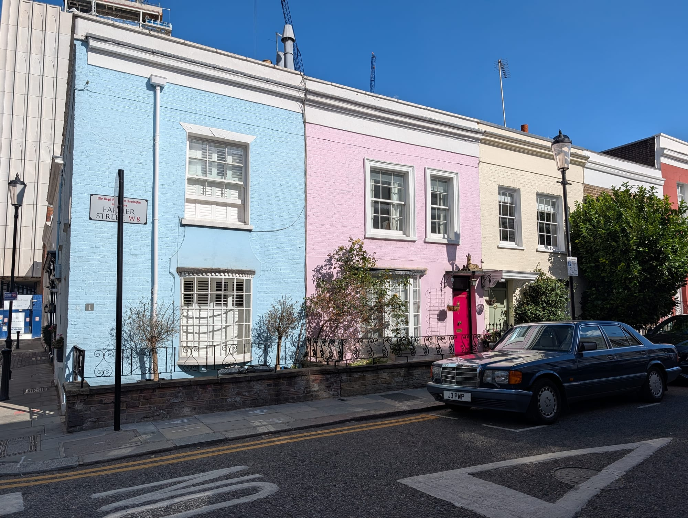

**Hillgate Village** is a pocket of four short streets (Hillgate Place, Farmer Street, Hillgate Street and Jameson Street) immediately south of Notting Hill Gate station. The houses are two and three storeys, painted in flat blocks of colour: pink, sage, butter, powder blue, a deep coral.

They are **two minutes from Notting Hill Gate station and almost empty**. Portobello Road is a fifteen-minute walk north and takes essentially all of the foot traffic. On a Friday afternoon in September there were two other people photographing here; the same afternoon on Lancaster Road there were about thirty.

### 1. Hillgate Place

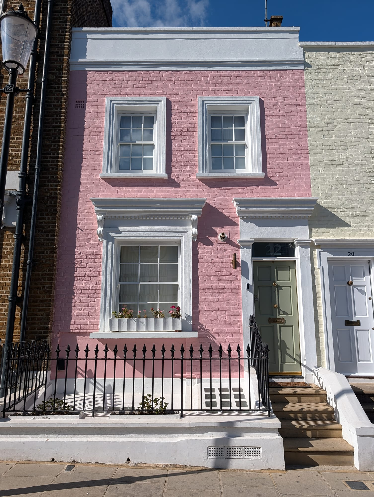

The best of the four, and the one to walk first. It bends, so the colours stack up in the view rather than running away from you in a straight line.

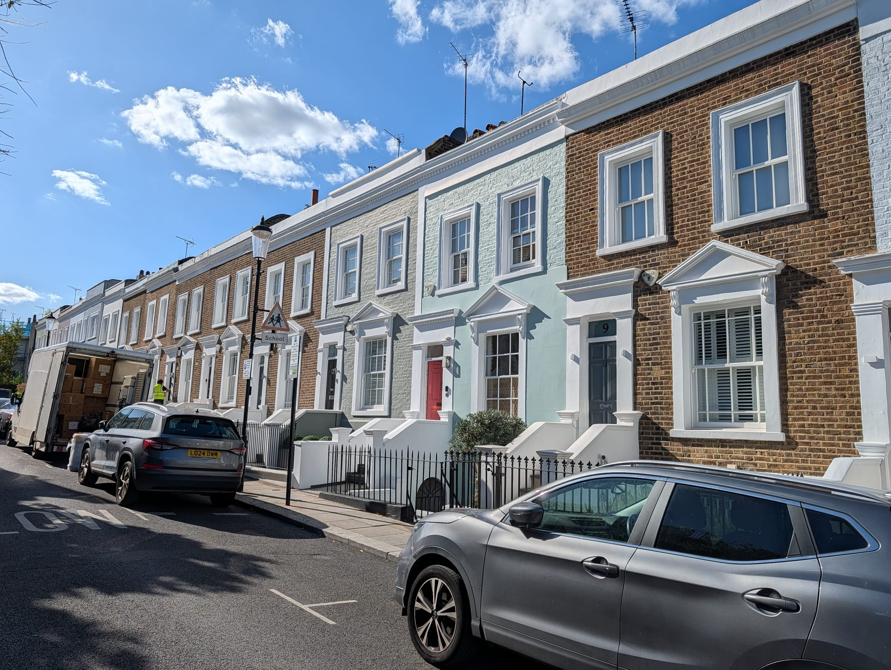

Walk it in both directions. The north and south sides are painted quite differently, and the corner where it meets Hillgate Street stacks four colours into one frame.

### 2. Farmer Street

The blue-pink-cream run near the top is the most photographed thing in Hillgate Village, helped along by classic cars parked outside it. One house is covered almost entirely in ivy, cut back around the windows.

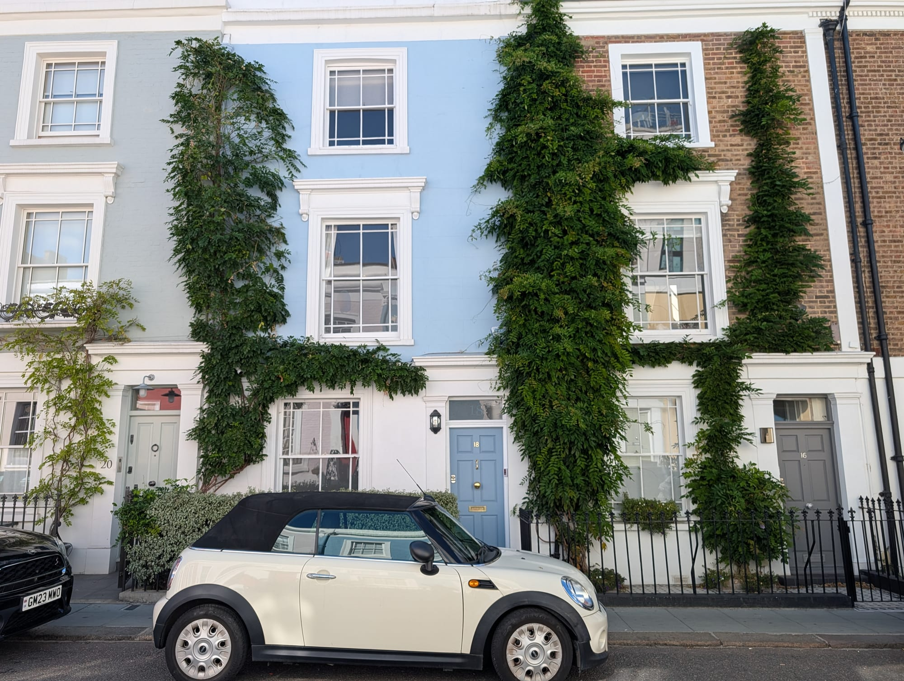

### 3. Hillgate Street

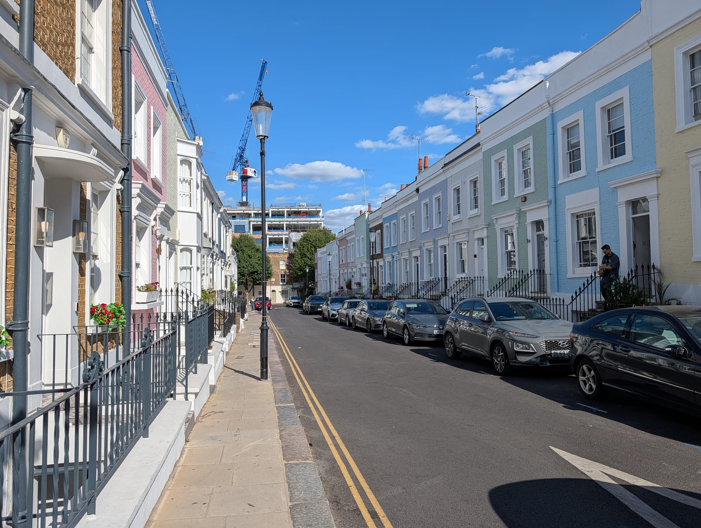

The long view. It runs downhill with the colours in sequence and gives you more houses in one frame than anywhere else in this guide. A construction crane sits on the skyline at the far end.

### 4. Jameson Street

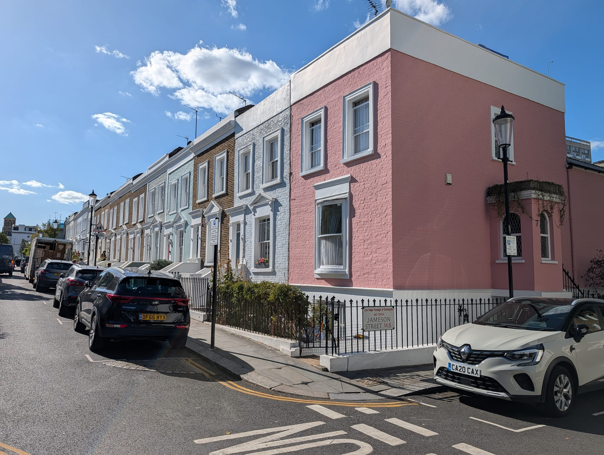

The shortest of the four. Its corner house is a strong flat pink against a grey terrace, and the street closes the loop back towards Notting Hill Gate.

### 5. Portland Road

Ten minutes west of Hillgate Village, **Portland Road** runs down to Clarendon Cross, where painted shopfronts and small houses sit around a junction with no through traffic and no market. Worth the detour mainly for somewhere to sit down: Clarendon Cross has a couple of cafes.

Powered by <a target="_blank" rel="sponsored" href="https://www.getyourguide.com/london-l57/">GetYourGuide</a>

## Then go north for the grand version

About ten minutes' walk north-west the houses get bigger and the paint paler.

### 6. Lansdowne Road

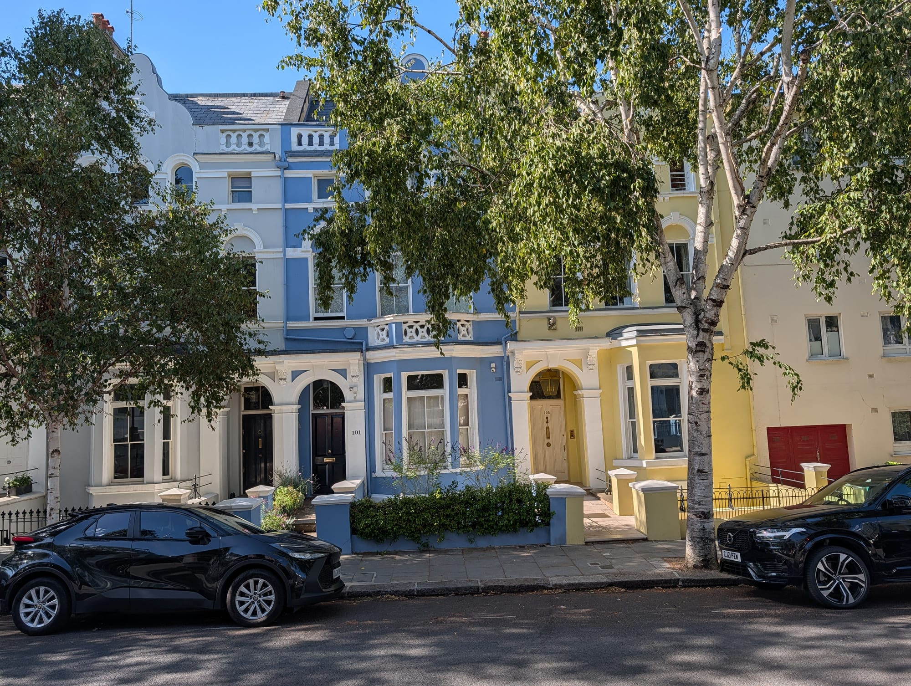

Wide and tree-lined. The houses are four and five storeys with porticos, painted in muted creams, yellows and blue-greys. Worth walking for the contrast with Hillgate Place more than for the colour.

### 7. Elgin Crescent

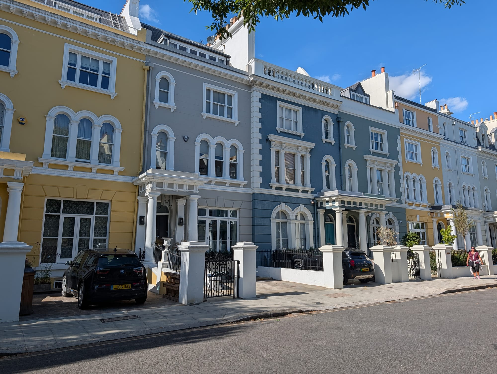

The best of the grand streets. The crescent curves, so the pale yellow and powder blue frontages come at you in a sweep, and the houses are tall enough to get colour and sky in the same frame. If you walk only one of the northern streets, walk this one.

### 8. Stanley Crescent

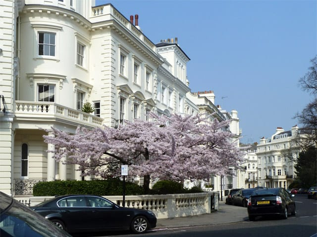

*Cherry blossom on Stanley Crescent. Photo: [Robin Webster](https://commons.wikimedia.org/wiki/File:Cherry_blossom_on_Stanley_Crescent_-_geograph.org.uk_-_4994280.jpg), [CC BY-SA 2.0](https://creativecommons.org/licenses/by-sa/2.0/).*

White stucco rather than paint, so for most of the year this is the least colourful street here. **For about two weeks in spring it is the most.** See the blossom section below.

### 9. Denbigh Terrace

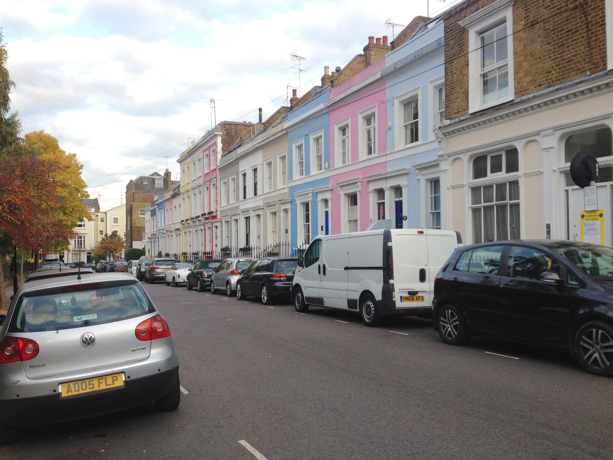

*Denbigh Terrace. Photo: [Chris Whippet](https://commons.wikimedia.org/wiki/File:Denbigh_Terrace,_Notting_Hill_-_geograph.org.uk_-_5188797.jpg), [CC BY-SA 2.0](https://creativecommons.org/licenses/by-sa/2.0/).*

A short run of three-storey houses in pink, powder blue, pale yellow and cream, a minute off Portobello Road. The colours stack vertically as well as along the row, so you get more of them in a frame than anywhere except Lancaster Road.

## Finish on the strongest colour, and a mews

### 10. Lancaster Road

The postcard row: a deep raspberry pink next to white, next to a mid blue, next to a green. It is the busiest spot on the walk by some distance, so expect other people in your photograph and a wait for a gap. Ladbroke Grove station is four minutes away, which makes this the natural end of the route.

### 11. St Luke's Mews

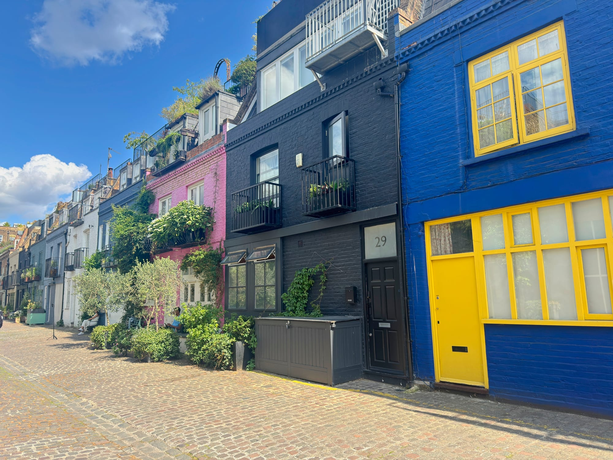

*St Luke's Mews. Photo: [Bex Walton](https://commons.wikimedia.org/wiki/File:St_Lukes_Mews_2025-06-14.jpg), [CC BY 4.0](https://creativecommons.org/licenses/by/4.0/).*

Three minutes east of Lancaster Road, off All Saints Road, and the only cobbled mews on the walk: cobalt blue with yellow window frames, a strong pink, a mint green.

**The pink house at number 27 is the *Love Actually* doorstep**, where Mark holds up the cue cards. It draws a steady trickle of visitors to a street with no pavement and no room to stand back.

## The etiquette

These are people's homes, and there has been real friction in Notting Hill over front steps used as seating, blocked doorways and whole terraces treated as a backdrop. Three rules cover almost all of it:

- **Photograph from the pavement.** Not from the steps, not from the porch, not leaning on the railings.
- **Do not block a front door.** If someone is trying to get in or out, move first and take the photo afterwards.
- **Keep the noise down**, especially early. The best light and the smallest crowds are both in the morning, when people are asleep behind those windows.

Some residents have painted their houses deliberately drab in response to the attention.

## If you come in spring: the cherry blossom

**Stanley Crescent** is the best known: a run of cherry trees in front of white stucco. In recent springs it has drawn crowds heavy enough that residents have gone to the press, with tripods set up for hours, pavements blocked and, in at least one reported case, people changing outfits in the street. **Go early on a weekday and stay on the pavement.** If there is a queue for a tree, walk to one of the others instead:

- **Lansdowne Road and Elgin Crescent** have blossom along their front gardens and far more room to stand.
- **Kensington Park Gardens**, which meets Stanley Crescent at its western end, has trees along the same terraces.
- **Ladbroke Square and the crescents off it** have mature trees, visible over the garden walls.

**Timing:** London's cherry blossom is usually at its best from late March to mid April, and the peak lasts one to two weeks. It moves by a fortnight either way depending on the winter. Magnolias come slightly earlier on these streets, and wisteria follows in late April and May.

For blossom with room to stand, the [parks and gardens guide](/articles/best-parks-gardens-london/) covers where else in London to find it.

Powered by <a target="_blank" rel="sponsored" href="https://www.getyourguide.com/london-l57/">GetYourGuide</a>

## Getting there and when to go

**Start at Notting Hill Gate** (Central, District and Circle lines) and finish at **Ladbroke Grove** (Circle and Hammersmith & City). Walking it the other way ends with the quietest streets.

**Weekday mornings are the quietest.** Saturday is Portobello Road's full market day and pushes crowds into the surrounding streets. Friday has some of the antiques dealers and is busy but manageable. Sunday is the quietest day of the weekend.

**Light:** on a clear early September afternoon the frontages on the Hillgate streets and Lancaster Road are lit from about two o'clock onwards. In midwinter the narrow streets are in shade for much of the day.

The whole route is free, outdoors and step-free on pavements throughout.

## What to do with the rest of the day

You finish at Ladbroke Grove, the top of Portobello Road, so the obvious continuation is to walk back down it.

- **[The Notting Hill area guide](/articles/notting-hill-area-guide/)** — the market, the antique arcades most visitors walk past, Golborne Road and the Churchill Arms.
- **[London's best markets](/articles/best-london-markets/)** — where Portobello sits among them, and which days each one actually runs.
- **[Free things to do in London](/free/)** — this walk is one of them.
- **[The best parks and gardens](/articles/best-parks-gardens-london/)** — Holland Park and the Kyoto Garden are fifteen minutes south of where you started.
- **[The best areas to visit in London](/articles/best-areas-to-visit-london/)** — the neighbourhoods compared by what each is best for, how long it takes and the best day to go.
