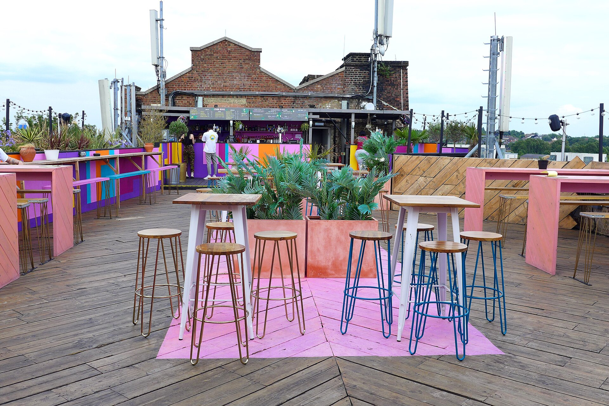
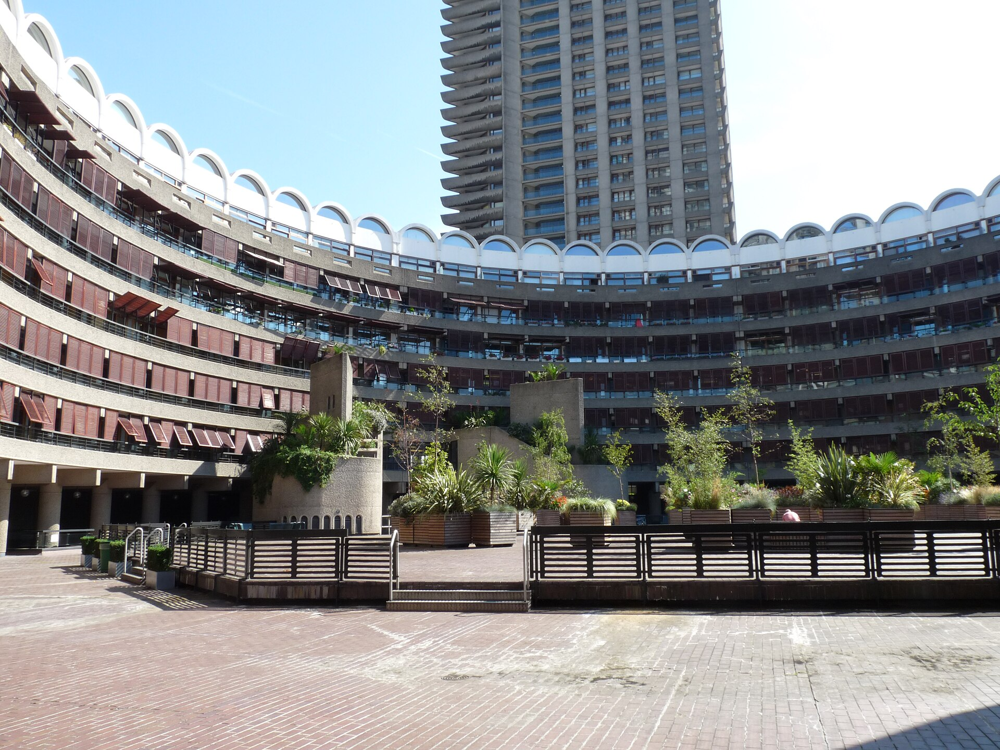

> 💡 **The Short Version:** Most of London's outdoor cinema runs from May to September. **This winter, two rooftops show Christmas films with dinner:** [JOIA](#joia-rooftop-battersea-power-station) at Battersea Power Station every night from 19 November to 24 December, and [Kitchen at Holmes](#kitchen-at-holmes-marylebone) in Marylebone from 26 November to 20 December, both from £75 a head. **In summer**, [Rooftop Cinema Club](#rooftop-cinema-club-peckham-and-stratford) is the regular one: deckchairs and wireless headphones on two roofs, from £14, adults only after 5pm. **The free screen** is [Everyman on the Canal](#everyman-on-the-canal-kings-cross) at King's Cross, late June to mid-August, on the steps down to the Regent's Canal. Rooftop Cinema Club says it returns in spring 2027.

*Dates, prices and policies are each operator's own, as at 16 November 2026. Summer dates are the 2026 season's; 2027 dates follow when each operator announces them.*

## Where they are

| If you are near… | Screen | When |
| --- | --- | --- |
| **Battersea** | JOIA rooftop, art'otel | Winter: 19 Nov to 24 Dec 2026 |
| **Marylebone & Baker Street** | Kitchen at Holmes rooftop | Winter: 26 Nov to 20 Dec 2026 |
| **Peckham** | Rooftop Cinema Club, Bussey Building | Spring to late summer |
| **Stratford** | Rooftop Cinema Club, Roof East | Spring to late summer |
| **King's Cross** | Everyman on the Canal, Granary Square (free) | Late June to mid-August |
| **The Barbican** | Barbican Outdoor Cinema, Sculpture Court | August |
| **Kew** | Adventure Cinema at Kew Gardens | June |
| **Vauxhall** | Vauxhall Summer Screens (free) | Tuesdays in July |
| **Waterloo** | Lower Marsh Lates (free) | Last Thursday of June, July and August |
| **Liverpool Street** | Devonshire Square Cinema Under the Stars (free) | June and July, weekdays |

---

## On this winter

Both are dinner-and-a-film packages on a hotel roof, booked by the evening, and the films are Christmas ones.

### JOIA Rooftop, Battersea Power Station

*art'otel London Battersea Power Station, 1 Electric Boulevard, SW11 8BJ · 19 November to 24 December 2026*

**A Christmas film every night of the run, on the roof above JOIA, the Portuguese restaurant from chef Henrique Sá Pessoa**, looking across at the Power Station's chimneys. You eat first: dinner in JOIA Monday to Saturday, or Sunday lunch, then go up for the film with popcorn and a blanket. The programme runs from *It's a Wonderful Life* to *National Lampoon's Christmas Vacation* and *The Grinch*. On a few dates dinner is in TOZI Pizzeria and Cicchetti Bar instead; the ticket says which.

**£75 a head on a chair and £95 a head on a sofa**, dinner included. [Book through DesignMyNight](https://www.designmynight.com/london/bars/battersea/joia/joia-rooftop-christmas-movie-pop-up-dinner-at-artotel-london-battersea-power-station-2?t=tickets), which adds a booking fee. The full film list is on [JOIA's site](https://www.joiabattersea.co.uk/event/joia-rooftop-christmas-movies/). For the rest of the estate, see the [Battersea guide](/articles/battersea-area-guide/).

### Kitchen at Holmes, Marylebone

*Holmes Hotel, Marylebone, near Baker Street station · Thursdays to Sundays, 26 November to 20 December 2026*

**A cheese fondue made with La Fromagerie, a mulled wine on arrival, then a Christmas film on the roof**, watched from rooftop huts that seat two. Evening screenings run Thursday to Saturday, with Sunday afternoon films (*Home Alone*, *Home Alone 2*, *Elf*, *The Polar Express*) that take one child per adult. *Love Actually* screens every Saturday; *Die Hard* is on 11 December.

**£75 a head, sold in pairs** because each hut takes two. Glühwein, Austrian beers and cocktails cost extra. [Book on DesignMyNight](https://www.designmynight.com/uk/whats-on/christmas-themed/holmes-rooftop-festive-cinema), which lists every date and film. The [Marylebone guide](/articles/marylebone-area-guide/) covers the streets around it.

---

## The summer seasons

> ⚠️ **Rooftop Cinema Club is adults only after 5pm.**
> Both roofs are strictly over-18 for evening screenings and turn away anyone without physical photo ID, whatever their age. Photos of IDs are not accepted.

### Rooftop Cinema Club, Peckham and Stratford

*Bussey Building, 133 Rye Lane, SE15 4ST · Roof East, 8th floor, Stratford Shopping Centre, E15 1XE*

**Deckchairs and two-person seats on two roofs, a wireless headset at every seat**, so the film is in your ears and the street below hears nothing. The programme is new releases, cult films and classics, plus drag nights and family events at Stratford. Doors open up to an hour before; seats are first come, first served within the type you booked, so arriving early gets you the better view.

- **Peckham** looks back across the south London skyline from the top of the Bussey Building, a two-minute walk from Peckham Rye station. The bar does cocktails, beer, wine and pizza, brought to your seat. Dogs are welcome. The lift is a service lift that staff run for you, and the toilets are not yet fully accessible, so email ahead if you need either.
- **Stratford** faces the ArcelorMittal Orbit, the Olympic Park and Canary Wharf, and is the step-free one, with accessible toilets. Food from the traders at Roof East can be taken into the cinema.

**From £14 for a single seat and £20 a head for a two-person seat** (2026 season). No outside food or drink, apart from a birthday cake. Tickets are non-refundable but can be moved to another screening up to the start time.

**In rain:** screenings carry on through light rain, with free ponchos. A storm or high winds cancels the show, with an email at least an hour before and a credit to rebook. Blankets are on sale, but bring a layer.

**For 2027:** both roofs have closed for the winter, and Rooftop Cinema Club says it will be back in spring 2027. [Rooftop Cinema Club's London page](https://rooftopcinemaclub.com/uk/london) carries the dates once they are set. The [Peckham](/articles/peckham-area-guide/) and [Stratford](/articles/stratford-area-guide/) guides cover where to eat beforehand.

*Bussey Rooftop Bar, on the Peckham roof the cinema shares. Photo: [Ewan-M](https://commons.wikimedia.org/wiki/File:Bussey_Rooftop_Bar,_Peckham,_SE15.jpg), [CC BY-SA 2.0](https://creativecommons.org/licenses/by-sa/2.0/).*

### Barbican Outdoor Cinema, the Sculpture Court

*Barbican Centre, level 3, outside the Art Gallery · 19 to 30 August 2026*

**Eleven nights of film in the Barbican's brutalist Sculpture Court, with the estate's towers above the screen.** The programme is repertory rather than new releases: 2026 ran from *Arrival* and the anime *Weathering with You* to *Beautiful Thing*, set on a Thamesmead estate, and David Byrne's *American Utopia*. Films start at 8.30pm and the sound comes through headphones you collect on arrival.

**£20, or £18 concessions, £12.50 for Young Barbican members and £10 for under-18s** (2026 season), plus a £1.50 booking fee per transaction online and none in person. The Barbican sets out chairs, first come, first served from an hour before; it doesn't provide blankets, so bring one and a cushion. Food stalls and bars are on site, and only drink bought there can be taken in.

**In rain:** bring a waterproof; there are biodegradable ponchos if you forget, and the headphones need keeping dry. There is no cloakroom, so travel light. The [Barbican Outdoor Cinema page](https://www.barbican.org.uk/whats-on/2026/series/outdoor-cinema) has the 2026 programme. Our [Barbican guide](/articles/barbican-centre-guide/) covers the rest of the centre.

*The Sculpture Court, where the Barbican's screen goes up in August. Photo: [Chris McKenna](https://commons.wikimedia.org/wiki/File:Barbican_Estate_-_Sculpture_Court,_Frobisher_Crescent_and_Cromwell_Tower_01.jpg), [CC BY-SA 4.0](https://creativecommons.org/licenses/by-sa/4.0/).*

### Adventure Cinema at Kew Gardens

*The lawn near the Pavilion Bar and Grill, Kew Gardens · 18 to 21 June 2026*

**A long weekend of screenings on the grass at Kew**, mixing sing-alongs and family films with evening classics: 2026 had *Mamma Mia! ExtrABBAganza* with an ABBA disco, *The Gruffalo* and *Stick Man*, *Pride and Prejudice* and *Jurassic Park*. Gates open about an hour and a half before the film. Evening audiences enter by one gate and leave by Pavilion Gate onto Kew Road, as the others are shut.

**Bring your own chair or blanket** unless you book Premium, which includes a deckchair in a prime spot, or Director's View, a front-row director's chair with a blanket and a treat bag. Tickets are sold online in advance only, and under-2s go free. Picnics and your own drinks are welcome but glass is not; there is hot food and a bar, and some traders take cash only.

**In rain:** the show goes on. Small umbrellas are allowed, parasols and big ones are not. Adventure Cinema says it hopes to return to Kew in 2027 and puts on-sale dates in its newsletter first; [its Kew page](https://adventurecinema.co.uk/venues/kew-gardens/) will carry them. The [Kew Gardens guide](/articles/kew-gardens-guide/) covers the gardens by day.

---

## Free screenings

All four are open-air and summer-only.

### Everyman on the Canal, King's Cross

*Granary Square steps, Regent's Canal · 29 June to 16 August 2026*

**Turfed steps down to the Regent's Canal facing a screen on the far bank**, so the water runs between you and the film. Wimbledon is shown in the daytime during the championships, with films in the evening, often two a night: *Jaws*, *Paddington*, *Moonrise Kingdom* and *Roman Holiday* were among the 2026 titles. An Everyman bar on the square sells drinks and snacks.

**Free, with no ticket**: seating is first come, first served and capacity is limited, so arrive well before a popular title. The steps close at 10pm. The steps are uncovered, so dress for the weather. King's Cross publishes the [2026 programme](https://www.kingscross.co.uk/media/KINGS-X-programme-2026-updated-w5-digital-posters-no-QR.pdf). Our [King's Cross guide](/articles/kings-cross-area-guide/) covers Granary Square and Coal Drops Yard around it.

### Vauxhall Summer Screens, Vauxhall Pleasure Gardens

*Vauxhall Pleasure Gardens, SE11 · Tuesdays in July, 7pm to 9pm*

**Four Tuesday-night films on the grass**, with street food on site. The 2026 run was *Zootropolis*, *Cool Runnings*, *Clueless* and *Mamma Mia! Here We Go Again*. Arrive from 6pm and bring a blanket. **Free, but register for a ticket** through [Vauxhall One](https://vauxhallone.co.uk/events/summer-screens-cool-runnings/), the local business district that runs it.

### Lower Marsh Lates, Waterloo

*Lower Marsh, behind Waterloo station · last Thursday of June, July and August, 6pm to 9pm*

**The old market street closes for an evening of film, live acts and food and drink deals from its own shops and bars.** 2026 had a 1990s theme: *Cool Runnings*, *Romeo + Juliet* and *Mrs. Doubtfire*. Deckchairs and seats are first come, first served. **Free, but register** through [We Are Waterloo](https://wearewaterloo.co.uk/what-we-do/placemaking/whats-happening/lower-marsh-lates-4/). The [South Bank guide](/articles/south-bank-area-guide/) covers the rest of Waterloo.

### Devonshire Square Cinema Under the Stars, Liverpool Street

*Devonshire Square's Central Courtyard, EC2M · weekdays, June and July*

**A big screen in a courtyard of lawns and trees near Liverpool Street**, up from 11 June to 16 July 2026 for sport, with a few early-evening films. The courtyard opens at 5pm with music and a pop-up bar, and the film starts at 5.45pm. You can order food and drink to your deckchair from the square's restaurants with the QR code on the seat. **Free tickets are limited**; [Devonshire Square's page](https://www.dsq.london/events/educational/nuveen-big-screen-returns-to-dsq-for-a-summer-of-sport-and-cinema/) explains how to reserve one. The [City of London guide](/articles/city-of-london-area-guide/) covers the area.

---

## How they compare

| Screen | Price (2026) | Seats | Food and drink | Weather |
| --- | --- | --- | --- | --- |
| **JOIA, Battersea** | £75–£95 with dinner | Chairs or sofas | Dinner in JOIA first, popcorn at the film | Blankets provided on the roof |
| **Kitchen at Holmes, Marylebone** | £75 with fondue, in pairs | Two-person huts | Cheese fondue and mulled wine included | Seated in two-person huts |
| **Rooftop Cinema Club** | From £14 | Deckchairs and two-person seats, headphones | Bar and snacks; no outside food | Light rain goes ahead, free ponchos; storms cancel with a rebooking credit |
| **Barbican** | £10–£20 | Chairs set out, first come; headphones | Food stalls and bars; only drink bought on site | Ponchos on hand; keep the headphones dry |
| **Adventure Cinema, Kew** | Varies by show | Bring your own, or book Premium or Director's View | Picnics and own drinks welcome, no glass | Goes ahead; small umbrellas only |
| **Everyman on the Canal** | Free, no ticket | Turfed steps, first come | Everyman bar on the square | No cover on the steps |
| **Vauxhall Summer Screens** | Free, register | Bring a blanket | Street food | Open park |
| **Lower Marsh Lates** | Free, register | Deckchairs, first come | Deals from the street's shops and bars | Open street |

---

## Before you go

**Book the winter rooftops by the evening**: each date is a separate ticket, and Kitchen at Holmes sells only in pairs.

**For summer**, Rooftop Cinema Club says it returns in spring 2027. In 2026, Adventure Cinema's Kew shows were on sale by March and the Barbican announced its programme in May.

**Whatever the screen, take a layer.** Rooftop Cinema Club and the Barbican both warn that it gets cold once the sun is down, even in August.

For indoor screens, our guide to [London's best independent cinemas](/articles/best-cinemas-london/) covers the Prince Charles, the Electric and the rest, and [London cinema deals](/articles/cinema-deals-london/) has the memberships and cheap days. For eating outdoors before a film, see [where to eat outside in London](/articles/eat-outside-london/). The [November](/articles/things-to-do-in-london-in-november/) and [December](/articles/things-to-do-in-london-in-december/) guides list what else is on this winter, and [London on a budget](/articles/london-on-a-budget/) has more free things to do.
