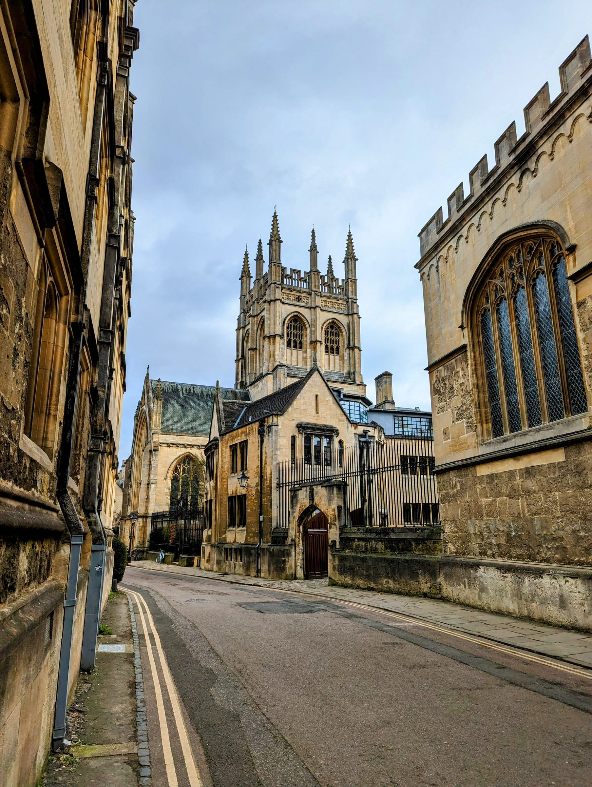
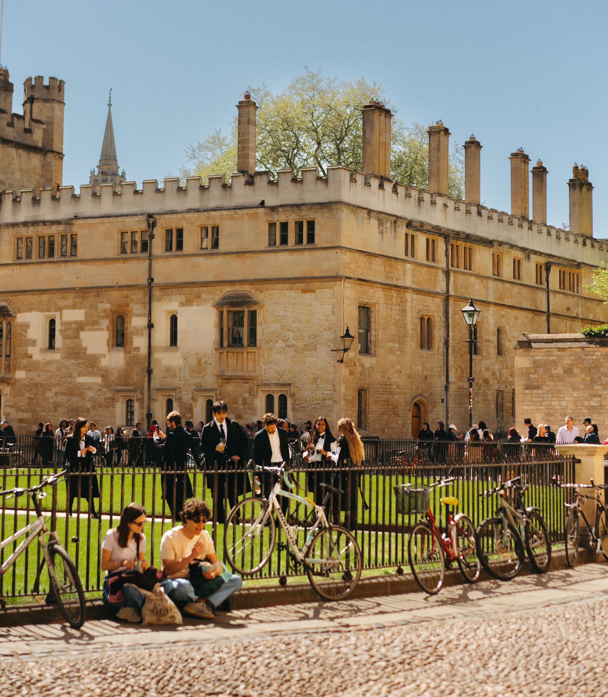
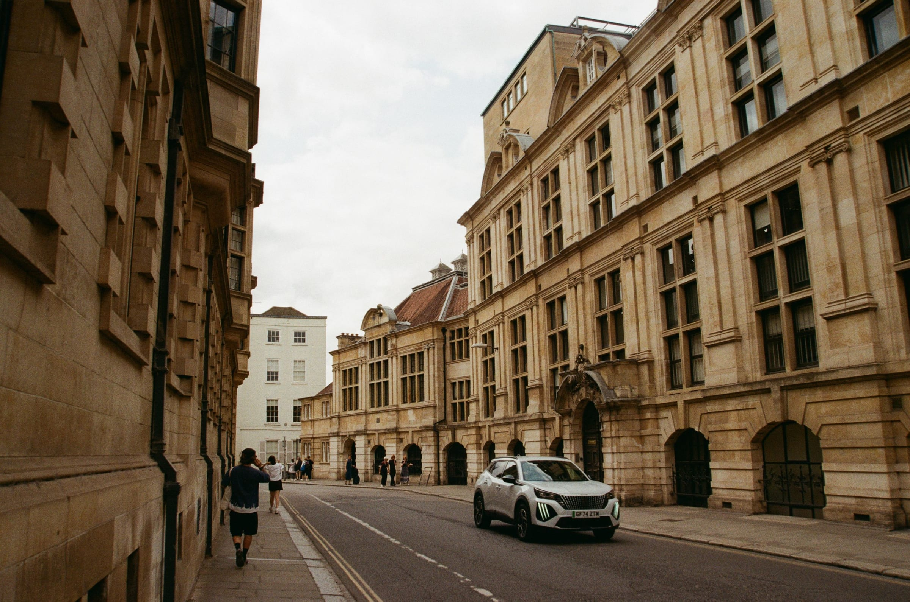
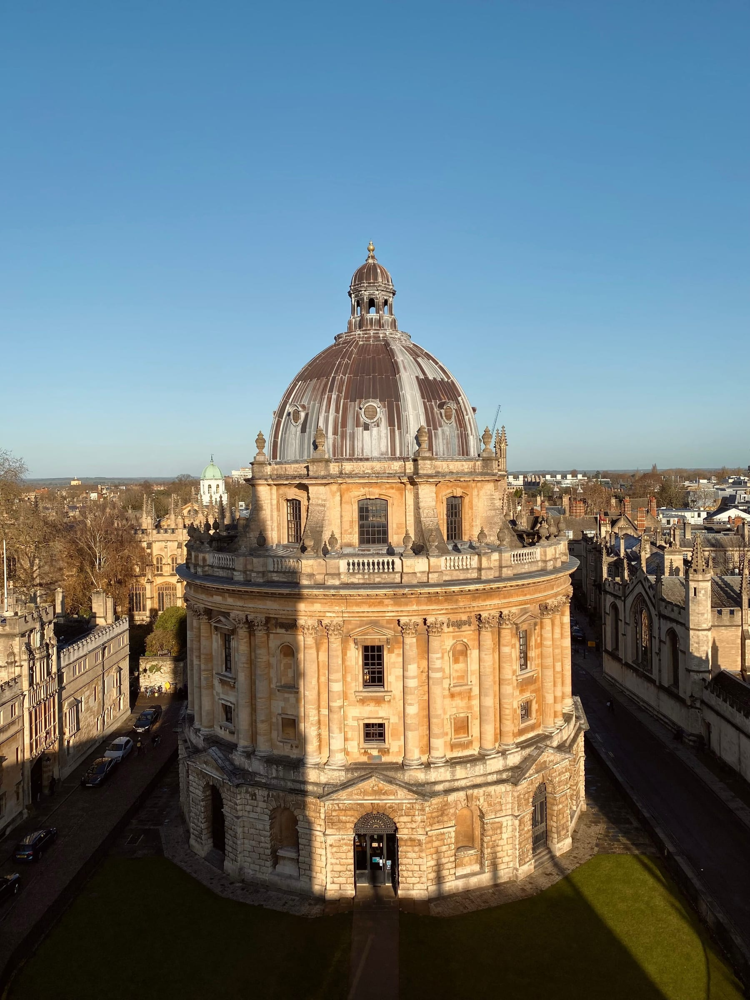
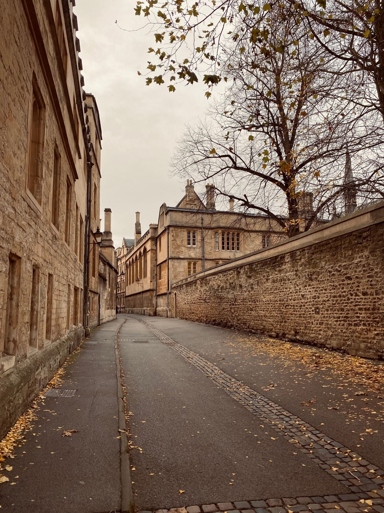

**An Off-Peak return from London to Oxford is £37.70, and the coach is £28 and never stops running.** Oxford's main museums are free; its best-known college charges £22.95.

Oxford is 55 minutes from Paddington and small enough to cross on foot in twenty minutes.

> 💡 **The Short Version:** **Train from Paddington, 55 minutes**, Off-Peak return **£37.70**, Advance singles from **£18**. **Oxford Tube coach from Victoria, £28 return**, every 10 minutes, **24 hours a day**. **Christ Church £22.95** on a term weekday (its Great Hall shuts 12–2pm for student lunch), **New College £12**, **Magdalen £10**, **Trinity £7**, **Merton £5**. **Lincoln, Keble and St John's are free**, all afternoons only. The **Ashmolean, Pitt Rivers and Natural History Museum are free**. **Punting is £25–£35 an hour**, or £50 per half hour with someone else doing the work. Driving means a **£5 congestion charge** — park and ride instead, **£3 for the car and up to five people**. **Or book a guide:** the <a href="https://www.getyourguide.com/activity/-t29999?partner_id=WWP7I0R&amp;cmp=oxford-day-trip" target="_blank" rel="sponsored nofollow noopener" data-affiliate="gyg">£27 walking tour</a> includes one college's entry.

> ⚠️ **Great Western trains cannot run to or from Paddington from Sunday 27 December 2026 to Sunday 3 January 2027, or on Saturday 28 and Sunday 29 November, for the Dolphin Junction upgrade.** Diverted Bristol and South Wales trains run to and from Euston and cannot be used at Oxford, Didcot Parkway or Reading; on 28 and 29 November, Chiltern Railways trains run between Marylebone and Oxford. Details on [National Rail](https://www.nationalrail.co.uk/dolphinjunction/) and [Network Rail](https://www.networkrailmediacentre.co.uk/news/most-of-britains-railway-open-for-christmas-with-passengers-advised-to-plan-ahead-around-engineering-work).

**Most coach days pair Oxford with places that have no station.** The Cotswolds is the clearest case: there is no railway between the villages and the buses largely stop on Sundays. [The Cotswolds from London](/articles/cotswolds-day-trip/) sets out which villages you can reach yourself, and one starts at this end: the X52 runs from Oxford through Witney to Burford and on to Cheltenham. [Cambridge](/articles/cambridge-day-trip/) needs no coach: an Off-Peak return from King's Cross is £32.40 and the fast train takes 49 minutes, so give it a day of its own.

## Getting there

*Photo: Quintin Sanders, Pexels.*

### Train from Paddington, which is the fast one

**Great Western Railway runs Paddington to Oxford in 55 minutes** direct. Trains with a change at Reading take about the same, 58 minutes.

| Fare | Price |
| --- | --- |
| **Off-Peak return**, either London terminus | **£37.70** |
| Off-Peak single from Paddington | £37.60 |
| Off-Peak single from Marylebone | £40.60 |
| **Advance single from Paddington** | **from £18.00** |
| **Advance single from Marylebone** | **from £15.00** |

**Buy the return, not two singles.** An Off-Peak single from Paddington is £37.60, ten pence less than the £37.70 return. The return covers any permitted route, so you can go out from Paddington and come back into Marylebone.

If your times are fixed, Advance singles are cheaper: from £18 from Paddington and £15 from Marylebone. Chiltern advertises Advance fares **from £5.40 one-way**.

### Train from Marylebone, which is the slow one

**Chiltern's direct trains from Marylebone take 1 hour 18 to 1 hour 22.** Oxford Parkway, the station north of the city, is 1 hour 11 minutes.

Marylebone has cheaper Advance fares and direct trains where Paddington's stopping services make you change. **Off-peak starts after 09:30 on weekdays.** A **PlusBus** add-on for unlimited Oxford buses is £4.50 adult, £2.50 child.

Oxford station is a **10-minute walk** from the colleges.

### The Oxford Tube, which is cheaper and runs all night

**Stagecoach's Oxford Tube runs 24 hours a day, 7 days a week, up to every 10 minutes, with no last coach.** There is no peak pricing and no need to pre-book.

| Oxford Tube ticket | Adult | Child | Concession |
| --- | --- | --- | --- |
| **Return** | **£28.00** | **£14.00** | £25.00 |
| Single | £18.50 | £9.00 | £16.50 |
| **Family return** | **£70.00** | — | — |

Concession covers students, young persons and seniors. A **Day ticket is £28** for an adult and also covers Stagecoach West local buses.

It picks up at **Victoria, Marble Arch, Notting Hill Gate, Shepherd's Bush, Acton Main Line and Hillingdon**, plus Baker Street on weekday morning express runs, and terminates at **Gloucester Green** in the middle of Oxford — closer to the colleges than the railway station.

> 💡 **Who should take which.** Two adults on fixed times: the train, on Advance singles, for £36 each way or less. A family, or anyone whose day might run long: the coach, because £70 covers the lot and there is no last one to miss. Anyone flying in: Oxford Bus Company's **airline** coach runs between Oxford and the Heathrow and Gatwick terminals, 24 hours a day, and skips London.

### Driving, and why not to

**Oxford's traffic filter trial replaced the £5 congestion charge on 28 September 2026.** Cars without a permit are fined £70 (£35 if paid within 21 days) for driving through one of the six filters; the first offence in the trial's first six months gets a warning notice instead. The filters run 7am to 7pm at St Clement's Street, St Cross, Hythe Bridge Street and Thames Street, and 7 to 9am and 3 to 6pm at Hollow Way and Marston Ferry Road. They apply to cars only, and with Botley Road open every part of the city can be reached without passing one.

**Park and ride costs £3.** A **£3 combined ticket** buys up to 16 hours' parking for one car plus return bus travel for **up to five people of any age**, at Redbridge, Pear Tree, Seacourt, Thornhill and Oxford Parkway. Buy it at the machine or on RingGo, choosing the Parking & Bus option, and show it to the driver both ways. It runs to 31 March 2027 and is not valid on the airline or the Oxford Tube.

Parking alone at Thornhill is free for the first hour and £2.50 up to 16 hours — so the combined ticket costs 50p more than parking and gets five people into town.

## Which day tours earn their place

**With a £28 coach and a £37.70 train on the table, a tour has to buy you something the trains cannot** — the Cotswold villages with no railway, Warwick Castle, Stratford, Blenheim. For Oxford itself a tour is buying a guide and a college door, not transport.

| What the day covers | Hours | From | Entry actually included |
| --- | --- | --- | --- |
| **Oxford only, with a student guide** | 10 | **£150** | **Christ Church, the Divinity School and one more college** |
| **Oxford and Stonehenge** | 11 | **£79** | **Stonehenge** |
| **Oxford and Windsor** | 9 | **£129** | **Windsor Castle** |
| Oxford and the Cotswold villages | 10 | £74 | Nothing — and nothing to pay for out there |
| Oxford, Stratford, the Cotswolds, Warwick Castle | 10–11 | £79 | Nothing as standard; the castle and Shakespeare's Birthplace are paid options |
| Oxford and Cambridge | 10 | £119 | Nothing; on the £99 version Christ Church and King's are options |
| Oxford and Bath | 10 | £99 | Nothing, and no guided time in either city |
| **Blenheim Palace, on its own** | 1 day | **£69** | **Palace, Park and Gardens** |
| **Harry Potter, on foot in Oxford** | 1.5 | **£35** | **New College and the Divinity School** |

### If you only want Oxford, don't buy a coach

**Travel yourself and buy the guide there.** <a href="https://www.getyourguide.com/activity/-t29999?partner_id=WWP7I0R&amp;cmp=oxford-day-trip" target="_blank" rel="sponsored nofollow noopener" data-affiliate="gyg">University and City Walking Tour with College entry</a> is **£27** for 90 minutes with one college's admission in the price, 4.6 from 2,832 reviews — though which college depends on what is open that day. For the two doors people actually want, <a href="https://www.getyourguide.com/activity/-t386138?partner_id=WWP7I0R&amp;cmp=oxford-day-trip" target="_blank" rel="sponsored nofollow noopener" data-affiliate="gyg">University Walking Tour with Christ Church Visit</a> is **£80** and its includes list carries Christ Church, the Bodleian, the Weston Library and two more colleges, none of them optional.

Powered by <a target="_blank" rel="sponsored" href="https://www.getyourguide.com/london-l57/">GetYourGuide</a>

**From London with the seat included**, <a href="https://www.getyourguide.com/activity/-t1071749?partner_id=WWP7I0R&amp;cmp=oxford-day-trip" target="_blank" rel="sponsored nofollow noopener" data-affiliate="gyg">Oxford Tour with Christ Church &amp; Bodleian Library</a> is **£150**, ten hours, a group of 16 and an Oxford student guide, with Christ Church, the Divinity School and a third college all included outright. Bought yourself that is £37.70 of train, £22.95 of Christ Church and £3 of Divinity School — about £64. The other £86 is the guide and the not-queuing.

### If you want the Cotswolds, take the coach

<a href="https://www.getyourguide.com/activity/-t173892?partner_id=WWP7I0R&amp;cmp=oxford-day-trip" target="_blank" rel="sponsored nofollow noopener" data-affiliate="gyg">Oxford and Cotswolds Villages Small Group Tour</a> is **£74** for ten hours, 4.6 from 1,949 reviews, and includes transport and a guide — which is everything the villages need, because they charge nothing. The most-booked Oxford product on the platform, <a href="https://www.getyourguide.com/activity/-t60796?partner_id=WWP7I0R&amp;cmp=oxford-day-trip" target="_blank" rel="sponsored nofollow noopener" data-affiliate="gyg">Cotswolds and Oxford Guided Day Trip</a> at **£79** and 4,445 reviews, is the same bargain — a guide and a coach seat, and no college entry of any kind.

Add Stratford and it costs money: <a href="https://www.getyourguide.com/activity/-t44382?partner_id=WWP7I0R&amp;cmp=oxford-day-trip" target="_blank" rel="sponsored nofollow noopener" data-affiliate="gyg">Small Group Oxford, Stratford and Cotswolds Day Tour</a> is the best-rated of the lot at 4.9, on a 16-seat minibus, but it is **£154** and it puts Shakespeare's Birthplace in its excludes list instead of hiding it in an option.

### The Harry Potter angle: Christ Church is the ticket

<a href="https://www.getyourguide.com/activity/-t331461?partner_id=WWP7I0R&amp;cmp=oxford-day-trip" target="_blank" rel="sponsored nofollow noopener" data-affiliate="gyg">Harry Potter Walking Tour Including New College</a> is **£35**, student-led, 4.7 from 1,764, and includes entry to New College and the Divinity School — the two locations on this page that are in the films, and £15 at the door between them. It does not include Christ Church; the £80 tour above does, and so does the £150 day from London.

### One more big stop

<a href="https://www.getyourguide.com/activity/-t234277?partner_id=WWP7I0R&amp;cmp=oxford-day-trip" target="_blank" rel="sponsored nofollow noopener" data-affiliate="gyg">Stonehenge and Oxford Day Tour With Admission</a> is **£79** with the Stonehenge ticket unconditionally in the price and a walking tour of Oxford — the cleanest two-stop day in the set. <a href="https://www.getyourguide.com/activity/-t1249245?partner_id=WWP7I0R&amp;cmp=oxford-day-trip" target="_blank" rel="sponsored nofollow noopener" data-affiliate="gyg">Windsor Castle &amp; Oxford Small Group Tour</a> is **£129** for nine hours and is the only Oxford-and-Windsor product whose castle ticket is not an option — it has 15 reviews, which is the trade-off. For Blenheim, <a href="https://www.getyourguide.com/activity/-t1116311?partner_id=WWP7I0R&amp;cmp=oxford-day-trip" target="_blank" rel="sponsored nofollow noopener" data-affiliate="gyg">Blenheim Palace Day Trip with Admission</a> is **£69** with the Palace, Park and Gardens ticket included, no guide, and no Oxford stop. And <a href="https://www.getyourguide.com/activity/-t2095?partner_id=WWP7I0R&amp;cmp=oxford-day-trip" target="_blank" rel="sponsored nofollow noopener" data-affiliate="gyg">Oxford and Cambridge Universities Tour</a>, **£119**, does both cities in ten hours with a walking tour in each and no college entry anywhere in its includes list — straight about it, but two trains would do the same for less.

> ⚠️ **An attraction in the title is often a paid extra.** The inclusions list is where it shows: <a href="https://www.getyourguide.com/activity/-t71373?partner_id=WWP7I0R&amp;cmp=oxford-day-trip" target="_blank" rel="sponsored nofollow noopener" data-affiliate="gyg">Windsor, Stonehenge and Oxford</a> has 5,879 reviews and reads "Entry to Windsor Castle (if option selected)" and "Entry to Stonehenge (if option selected)" — the £71 is a coach seat and a walking tour. <a href="https://www.getyourguide.com/activity/-t965?partner_id=WWP7I0R&amp;cmp=oxford-day-trip" target="_blank" rel="sponsored nofollow noopener" data-affiliate="gyg">Oxford, Stratford, Cotswolds and Warwick</a> does it with Warwick Castle and Shakespeare's Birthplace, <a href="https://www.getyourguide.com/activity/-t18407?partner_id=WWP7I0R&amp;cmp=oxford-day-trip" target="_blank" rel="sponsored nofollow noopener" data-affiliate="gyg">Oxford &amp; Cambridge Iconic Universities</a> with Christ Church and King's, and <a href="https://www.getyourguide.com/activity/-t2259?partner_id=WWP7I0R&amp;cmp=oxford-day-trip" target="_blank" rel="sponsored nofollow noopener" data-affiliate="gyg">The Cotswolds and Blenheim Palace</a> with the palace itself. Where you want the entry, choose the option named "with Entrance Fees" and check the price against the gate — £22.95 for Christ Church, £12 for New College.

Powered by <a target="_blank" rel="sponsored" href="https://www.getyourguide.com/london-l57/">GetYourGuide</a>

## The colleges: which charge, and what they shut

*Students in Oxford sub fusc. Photo: Amine Kubranur Cakiroglu, Pexels.*

Two patterns catch people out: **halls close over lunch**, and **free colleges open in the afternoon only**.

| College | Adult | Concession | Hours |
| --- | --- | --- | --- |
| **Christ Church** | **£22.95**–£26.95 | £17.50 child | Mon–Sat from 10:00, Sun from 14:00, exit by 17:00 |
| **New College** | **£12** | £11 | 10:00–17:00 to 31 Oct. From 1 Nov: closed Mon, 11:00–15:00 Tue–Fri and Sun, 10:00–16:30 Sat |
| **Magdalen** | **£10** | £9 | Daily 10:00 to dusk or 17:00 |
| **Trinity** | **£7** | £5 | 10:00–12:00 and 14:00–17:00 |
| **Balliol** | **£6** | £3 | 10:00–17:00 or dusk |
| **Merton** | **£5** | £3 | Mon–Fri 14:00–17:00, Sat 10:00–17:00, Sun 12:00–17:00 |
| **Lincoln** | **Free** | — | Generally 14:00–17:00 |
| **Keble** | **Free** | — | Daily 14:00–17:00 |
| **St John's** | **Free** | — | Daily 14:00–17:00, to 16:00 in winter |

### Christ Church, the expensive one

**A multimedia guide is required and included.** The price moves with the date:

| Christ Church, on the day | Weekday | Weekend |
| --- | --- | --- |
| **Adult, Michaelmas term** (4 Oct–12 Dec 2026) | **£22.95** | £24.95 |
| Adult, Christmas vacation (13–31 Dec 2026) | £24.95 | £26.95 |
| Senior or student, term | £20.50 | £22.50 |
| Child 5–17, term | £17.50 | £19.50 |

**Book ahead and take £2 off every ticket.** Under-5s are free but get no guide, and their tickets are collected on the day. Carers are free with proof of entitlement.

**Tickets are released each Friday at about 10am for the following week**. They are non-refundable, but you can reschedule free online up to two hours before if you made an account, or for £2 a ticket if you did not.

> ⚠️ **The Great Hall closes 12:00–14:00 Monday to Friday** and **10:30–14:00 on Saturdays in term**. On Sundays the Hall opens at 14:00. On Saturdays the Cathedral shuts at 16:45 for choir practice. Christ Church publishes a known-closures page and the booking system labels slots where the Hall or Cathedral is shut — which also cost less.

### The Harry Potter bit

**The staircase is real. The Great Hall is not.** Christ Church's notes say the Hall staircase in Bodley Tower, under its 1638 fan vaulting, has been used in *Lewis* and *Harry Potter*. The Hogwarts Great Hall is a set, and you can walk onto it at the [Warner Bros. Studio Tour](/articles/harry-potter-studio-tour/) instead.

The other genuine location is the Bodleian's **Divinity School**, which the library itself describes as the infirmary in the films, and **Duke Humfrey's Library**, which played the Hogwarts library.

### The other paying colleges

**Magdalen** is £10, with deer, a riverside walk and its tower over Magdalen Bridge. A **joint ticket with the Botanic Garden is £17** and stays valid for one entry at each within 12 months. It closes at 18:30 in July, August and September and at dusk otherwise, and the Hall may shut over lunch. It is closed 22–31 December.

**New College** is £12 for the cloisters and medieval hall. **The Hall is closed daily 11:45–14:00.** From 1 November to 8 March the college is closed on Mondays, open 11:00–15:00 Tuesday to Friday and Sunday (last entry 14:30), and 10:00–16:30 on Saturday. It is closed all day on Saturday 12 December and from 23 December to 4 January.

**Trinity** is £7 and splits its day around lunch — 10:00–12:00 then 14:00–17:00 in term, 13:00 in vacation. Its hours move for private events and it asks you to ring the lodge first.

**Merton** is £5 and keeps its Hall, Fellows' Garden and residential areas closed to everyone, alumni included, so you are paying for four quads and the chapel.

**Balliol** is £6, or £3 concession, and free if you are a prospective applicant. In term — weeks 0 to 9 — and through exams and the admissions period, **groups are capped at eight people including the guide**.

### The free ones, and the one that is not

**Lincoln, Keble and St John's let you in for nothing**, all in the afternoon. Lincoln asks you to ring the Porters' Lodge first and takes no large groups; St John's closes at 16:00 in winter, with the chapel shut on Wednesdays.

**Worcester takes no walk-in tourists.** Access is by official tours led by an Oxford Guild of Tour Guides member, or public events. Residents of OX1 and OX2, applicants and alumni still get in free, 12:30–16:00.

Powered by <a target="_blank" rel="sponsored" href="https://www.getyourguide.com/london-l57/">GetYourGuide</a>

## What is free, and it is a lot

*Photo: Vitalina, Pexels.*

| Free | Hours |
| --- | --- |
| **Ashmolean Museum** | 10:00–17:00, last entry 16:45 |
| **Pitt Rivers Museum** | Tue–Sun 10:00–17:00, Mon 12:00–17:00 |
| **Museum of Natural History** | Daily 10:00–17:00, last admission 16:45 |
| **Bodleian: Blackwell Hall and exhibitions** | Mon–Fri 9:00–17:00, weekends 10:00–17:00 |
| **Bodleian: Old Schools Quadrangle courtyard** | Whenever the gates are open |
| **University Church** (tower extra) | Mon–Sat 9:30–18:00, Sun 12:00–18:00 |
| **The Covered Market** | Mon–Wed 8:00–17:30, Thu–Sat to 22:00, Sun 10:00–17:00 |
| **Christ Church Meadow** | Daily, except 25 December |

**The Ashmolean** is free with no booking, on Beaumont Street. Its major exhibition, *Aphrodite: The Making of a Goddess*, runs from 8 October 2026 to 11 April 2027; it is ticketed and booking is recommended.

**The Pitt Rivers and the Museum of Natural History share a building** on Parks Road: dinosaurs and a dodo downstairs, 500,000 ethnographic objects up the back. The Pitt Rivers opens at noon on Mondays, so a Monday morning is a Natural History morning.

**The Covered Market** is where to eat without booking: over 50 independents.

### The Bodleian: free courtyard, paid interiors

**You can walk into the Old Schools Quadrangle for free** whenever the gates are open, and into Blackwell Hall in the Weston Library for the free exhibitions; *Wonder of Birds* runs to 3 January 2027.

Everything else is ticketed:

| Bodleian | Price |
| --- | --- |
| **Divinity School**, self-guided, 15 minutes | **£3** |
| Outdoor audio trail, 7 languages | from £5.50 |
| **30-minute library tour** (Duke Humfrey's Library) | **from £12.50** |
| 60-minute library tour | from £17.50 |
| City of Oxford walking tour | from £25 |
| **Radcliffe Camera and city walking tour** | **from £30**, Saturdays and Sundays |
| Children's Literature Tour | £7 child, £15 adult |

**The Divinity School is £3** and takes a quarter of an hour. **The Radcliffe Camera can only be entered on the weekend tour**; from Radcliffe Square the outside is free.

*The Radcliffe Camera. Photo: Jess Buckle, Pexels.*

**The University Church tower is £7** for 127 steps up a medieval turret staircase and the view down onto Radcliffe Square — minimum age 8, last admission 17:30. The church itself is free.

## Punting

| Punting | Price |
| --- | --- |
| **Magdalen Bridge Boathouse**, self-hire | **£35 per hour**, up to 5 people |
| **Magdalen Bridge Boathouse**, chauffeured | **£50 per 30 minutes**, up to 4 |
| **Cherwell Boathouse**, weekdays | **£25 per hour**, £125 a day |
| Cherwell Boathouse, weekends | £27 per hour, £135 a day |

**Magdalen Bridge Boathouse** is under Magdalen tower at the end of the High Street. Open 7 days a week from 1 February to 30 November, 9:30am to 9pm or an hour before sunset. Booking is not required but is advisable on a busy weekend. Return the boat late and you pay another 15 minutes.

**Cherwell Boathouse** is in north Oxford and has about 80 handmade boats; midweek availability is good, weekends less so. Its season is mid-March to mid-October, so it is closed over the winter. Punt upstream for half an hour and there is a pub, the Victoria Arms; downstream runs through the University Parks.

**Chauffeured suits a first go:** £50 buys half an hour with someone else punting, against £35 for an hour of doing it yourself.

## Does 2FOR1 cover anything here?

The scheme covers a few Oxford attractions, but **no college is in it**, and neither is the Bodleian.

- **2FOR1:** Oxford Castle and Prison, The Story Museum, Soldiers of Oxfordshire Museum.
- **15% off:** the four official Oxford tours — University and City, the Ghost Tour, the C.S. Lewis and J.R.R. Tolkien tour and the On Screen tour.
- **Listed but free anyway:** the Ashmolean and the History of Science Museum.

It needs a National Rail ticket and two people. [How National Rail 2FOR1 actually works](/articles/national-rail-2for1-london-attractions/) has the voucher process.

Powered by <a target="_blank" rel="sponsored" href="https://www.getyourguide.com/london-l57/">GetYourGuide</a>

## How long the day takes

*Photo: Jess Buckle, Pexels.*

**Seven hours in Oxford fits a normal day.** Take the 09:30-ish train out and something around 18:00 back, and you get a paying college, a free museum, lunch in the market and an hour on the river.

A working shape:

- **10:30** — arrive, walk up to Radcliffe Square, Divinity School for £3
- **11:15** — one paying college. Christ Church if you want the Hall, Magdalen if £10 and a river appeal
- **13:00** — Covered Market
- **14:00** — the free afternoon colleges open; Lincoln, Keble or St John's
- **15:00** — Pitt Rivers and Natural History, both free, both in one building
- **16:30** — punting, or the University Church tower before its 17:30 cut-off
- **18:00** — train

**Last departures back**, on a weekday: Oxford to Paddington at **23:06**, arriving 00:12, with a **00:10** service arriving 01:16. Oxford to Marylebone, last direct at **22:44**, arriving 00:16. **The Oxford Tube has no last coach**, so take it if you want dinner in Oxford.

> ⚠️ **Check the closures before you book a college.** Christ Church, Magdalen, New College and Merton each publish dated closure lists. Full-day closures ahead include Merton on Saturday 7 November, New College on Saturday 12 December and Christ Church on 25 December. Balliol caps groups at eight in term, and New College closes on Mondays from 1 November.

## Continue planning your trip

- ⚡ **[The Harry Potter Studio Tour](/articles/harry-potter-studio-tour/)** — where the Great Hall is, and what it costs.
- 🚶 **[The best walking tours in London](/articles/best-walking-tours-london/)** — the London equivalent.
- 🎟️ **[National Rail 2FOR1 explained](/articles/national-rail-2for1-london-attractions/)** — the voucher rules.
- 🏛️ **[The best museums in London](/articles/best-museums-london/)** — the free museums at home.
- 🗺️ **[Day trips from London](/articles/day-trips-from-london/)** — costs, journey times and closing days.
