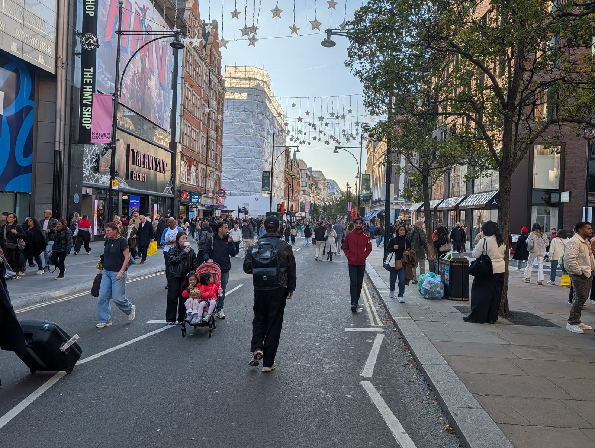
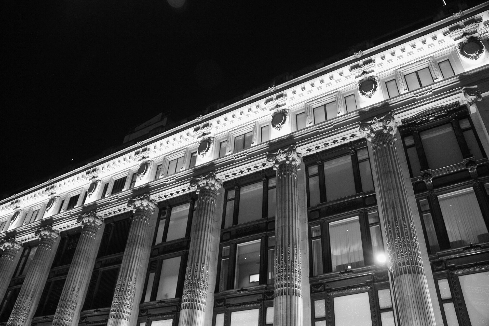
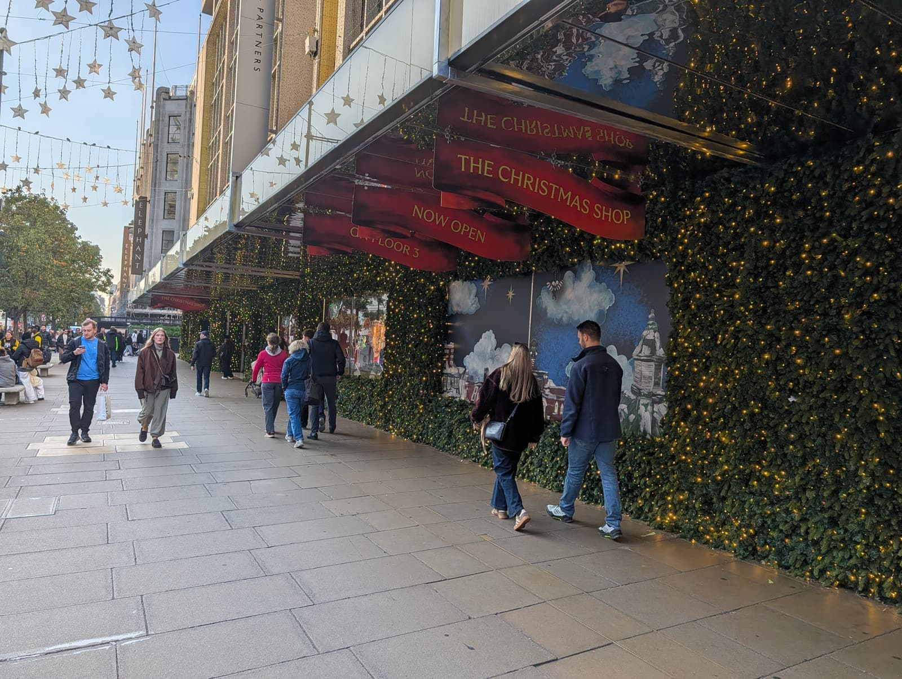
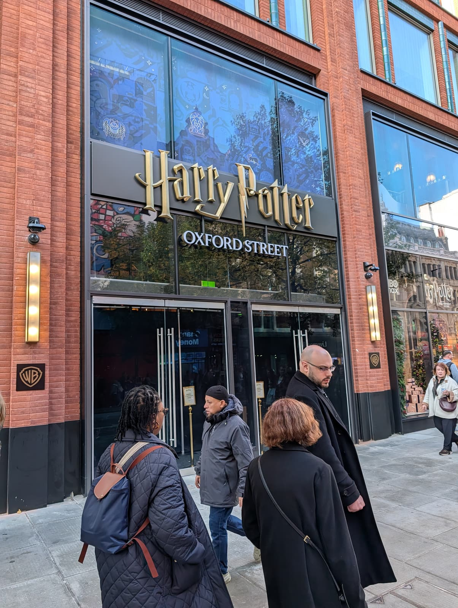
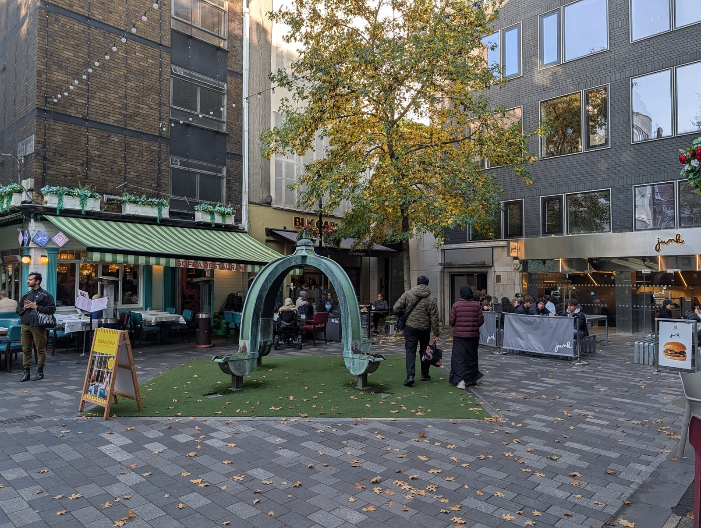
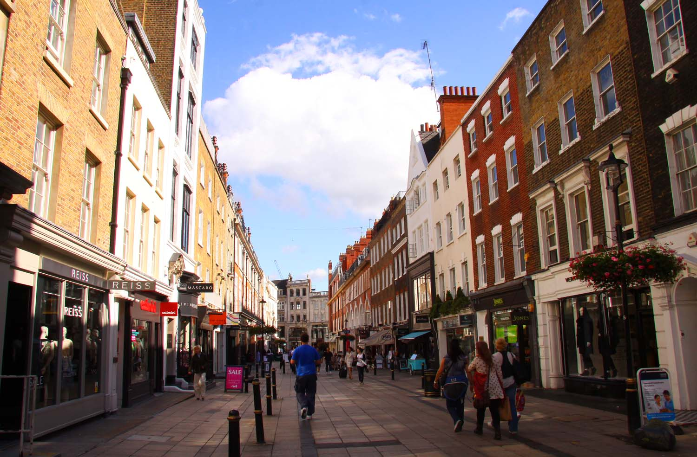
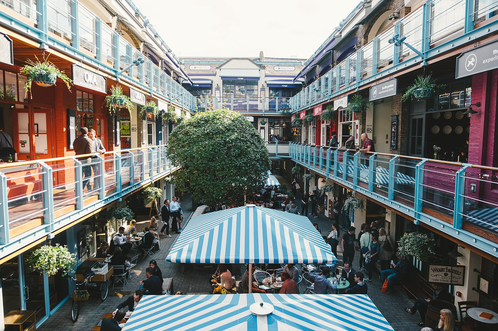

> 💡 **The Short Version:** Since **Monday 26 October 2026**, no cars, buses, taxis, bicycles, e-scooters or pedicabs are allowed on **Oxford Street from Orchard Street (Selfridges) to Great Portland Street**, nearly a kilometre. Come by Tube: **Bond Street** for Selfridges and John Lewis, **Oxford Circus** for the east end, **Tottenham Court Road** for the new **Harry Potter Shop**, which opens **Wednesday 4 November 2026**. Go on a weekday morning, and turn off the street for the lanes and squares either side of it.

*Closure, bus and shop details as of 31 October 2026.*

## What changed on 26 October 2026

Oxford Street is traffic-free between **Orchard Street**, beside Selfridges, and **Great Portland Street**, just east of Oxford Circus. The stretch takes in Selfridges, Bond Street station, John Lewis, Oxford Circus and IKEA. TfL, the highway authority, made the change on **Monday 26 October 2026**, and the closure is permanent. [TfL's page](https://tfl.gov.uk/travel-information/improvements-and-projects/oxford-street) has the rules.

*The traffic-free stretch, looking past the HMV shop.*

| | On the stretch |
| --- | --- |
| **Not allowed** | Cars, buses, taxis, private hire cars, bicycles, e-bikes, e-scooters, pedicabs |
| **Allowed** | People on foot, mobility scooters, emergency vehicles at any time |
| **Deliveries** | Freight and servicing vehicles, midnight to 7am, by approved routes only |

> ⚠️ **Traffic still crosses the stretch at seven junctions.** They are Orchard Street and North Audley Street, Duke Street, Stratford Place and Davies Street, Vere Street and New Bond Street, Holles Street and Harewood Place, Regent Street at Oxford Circus, and Great Portland Street. Look both ways at each.

**Buses.** None run along the stretch, and [TfL's area works page](https://tfl.gov.uk/status-updates/major-works-and-events/oxford-street-area-works) has the bus maps.

- Routes **7, N7, 94, N113 and N137** end at Marble Arch.
- Routes **98, 139, 390, N98 and N207** use Wigmore Street, Henrietta Place and Cavendish Place, with stops about 200 metres from the closure.
- Routes 2, 13, 73, 74, 113, 159, 189, 274, N2, N8, N15, N73, N74, N25, N109 and N136 keep their routes with minor changes, including some stop moves.

**Taxis.** Taxis and private hire cars cannot enter. TfL says there are ranks within 100 metres of the stretch, on Orchard Street, Duke Street and Great Portland Street among others.

**Cycling.** Bicycles, e-bikes, e-scooters and pedicabs are banned on the stretch. Mobility scooters are allowed.

**What comes next.** The layout in place is a temporary "transitional scheme", [according to the Oxford Street Development Corporation](https://www.oxfordstreetdc.org.uk/press/oxford-street-goes-traffic-free/). By the end of spring 2027 it expects more than 50 new trees, two public squares, over 100 seats and dining tables, new lighting and better signage. TfL plans to raise the road to pavement level, with the first two sections due in spring 2027. Building work over Christmas 2026 is limited.

## Which end to use

| Station | Lines | Nearest to |
| --- | --- | --- |
| **Marble Arch** | Central | Marks & Spencer, west of the closure. Selfridges is four minutes east. No lifts |
| **Bond Street** | Elizabeth line, Central, Jubilee | Selfridges, John Lewis, St Christopher's Place, South Molton Street, Marylebone Lane. Step-free |
| **Oxford Circus** | Central, Bakerloo, Victoria | The east end of the closure, IKEA, Carnaby Street, the Photographers' Gallery. No lifts |
| **Tottenham Court Road** | Elizabeth line, Central, Northern | The Harry Potter Shop, Soho Street, Rathbone Place. Step-free |

TfL names Bond Street and Tottenham Court Road as the step-free stations on its Oxford Street page. Its station data lists no lifts at Oxford Circus or Marble Arch. [Step-Free London](/articles/step-free-london/) covers the rest of the network, and the [transport guide](/articles/getting-around-london-transport-guide/) covers fares and the Elizabeth line.

## The shops worth the trip

Listed west to east, with each shop's own opening hours. HMV has said its flagship at 363 Oxford Street will [close in March 2027](https://www.bbc.co.uk/news/articles/cjzxl7ee4e9xo).

### Marks & Spencer, Marble Arch

458 Oxford Street, at the western end and outside the closure. Open **until 10pm Monday to Saturday** to 13 November 2026, and **12pm to 6pm on Sunday, with browsing from 11.30am**. Its [store page](https://www.marksandspencer.com/stores/marble-arch-770) lists toilets, a café and a bureau de change.

### Selfridges

400 Oxford Street, and the store the closure starts beside. It opened in March 1909 and is open **10am to 10pm Monday to Saturday and 11.30am to 6pm on Sunday**, according to its own [London store page](https://www.selfridges.com/GB/en/features/info/stores/london/). Its 2026 Christmas windows show scenes from Mexico City, Bangkok and Copenhagen, and the in-store Snow Show is Broadway-themed, as described on [Oxford Street's Christmas page](https://www.oxfordstreet.co.uk/christmas/). The windows now face a pedestrian street.

*Selfridges. Photo: Daniel X. O'Neil, [CC BY 2.0](https://creativecommons.org/licenses/by/2.0/), via [Wikimedia Commons](https://commons.wikimedia.org/wiki/File:Selfridges_Oxford_Street_at_Night,_London_2012-12-29.jpg).*

### John Lewis

300 Oxford Street. Open **10am to 8pm Monday, Tuesday, Wednesday, Friday and Saturday, 10am to 9pm Thursday and 11.30am to 6pm Sunday**; the [Christmas hours](#christmas-opening-hours) are below. John Lewis says the refurbished store has a new 300-seat restaurant and a sports department. The 1864 Rooftop Bar & Kitchen is on the roof, and its festive igloos take bookings for dinners and parties.

*The Christmas Shop signs on the front of John Lewis.*

### IKEA Oxford Street

214 Oxford Street, at the Oxford Circus end. The store stocks 3,500 smaller home items to take away, and the rest of the range is for delivery or collection, so bring a bag. Open **10am to 9pm Monday to Saturday and 12pm to 6pm on Sunday**; the bistro and Swedish food market keep slightly shorter hours, according to the [store page](https://www.ikea.com/gb/en/stores/oxford-street/).

### Harry Potter Shop

The Ribbon, 134-140 Oxford Street, **opening Wednesday 4 November 2026**, according to the [shop's own page](https://harrypottershop.co.uk/pages/harry-potter-shop-oxford-street). It is east of Great Portland Street, so outside the traffic-free stretch. Tottenham Court Road and Oxford Circus are the nearest stations. The operator calls it the UK's largest official Harry Potter shop, on two floors themed as Diagon Alley.

*The Harry Potter Shop at The Ribbon, on Oxford Street.*

It says the shop has:

- **The Leaky Cauldron**, a food and drink space serving Butterbeer, frozen and hot Butterbeer and Butterbeer ice cream.
- **A full-sized Knight Bus**, towards the rear of the shop.
- **A Ukrainian Ironbelly dragon** over the Gringotts area.
- **Shop exclusives**: a Diagon Alley wand, a Harry Potter Funko Pop!, MinaLima artwork inspired by the Knight Bus and Diagon Alley, and a Butterbeer label collection.

> ⚠️ **The Hogwarts Bear Ceremony needs a booking.** Reserve a free timeslot on the [shop's booking page](https://harrypottershop.co.uk/pages/hogwarts-bear-ceremony). Availability shows seven days ahead, and the £75 per bear is paid after the five-to-seven-minute ceremony, on the first floor opposite the Leaky Cauldron's exit.

It is a shop, not the Studio Tour: the Studio Tour's own shop needs a tour ticket, and our [Studio Tour guide](/articles/harry-potter-studio-tour/) covers tickets and transport. [Harry Potter in London](/articles/harry-potter-london/) compares the three official shops, and the [filming locations walk](/articles/harry-potter-filming-locations-walk/) passes the one at King's Cross. For VAT, see [tax-free shopping](/articles/tax-free-shopping-london/), and for the rest of the city's shopping, [shopping in London](/articles/shopping-in-london/).

## Where to eat

On the street and a few minutes off it, each with one thing that decides the visit.

### Brasserie of Light

*££££ · Mayfair · 3 min from Bond Street · book days ahead*

Inside Selfridges, under a 24ft, crystal-encrusted Damien Hirst sculpture of Pegasus. Order afternoon tea, served beneath the Pegasus wings, or the Saturday set menu. It opens at 8am Monday to Friday and 9am at weekends, and closes at 11.30pm Monday to Thursday, midnight Friday and Saturday and 10.30pm Sunday. The main restaurant and its toilets are reached by lift. [Reserve through its site](https://brasserie-of-light.co.uk/).

### Le Bab

*££ · Soho · 6 min from Piccadilly Circus · book days ahead*

On the top floor of Kingly Court, off Carnaby Street. Order the paneer kebab; kebabs run from £12 to £19. Open daily for lunch and dinner. [Reserve through its site](https://www.eatlebab.com/).

### More places near the street

| Place | Hours | Order |
| --- | --- | --- |
| **Market Halls Oxford Street**, 9 Holles Street | Each kitchen sets its own | One of nine street-food kitchens, among them Gopal's Corner (Malaysian), Krapow (northern Thai), Salt Shed (fire and barbecue) and Fresco (Neapolitan pizza). Upstairs, with two bars and a games hall. Walk in or [book](https://markethalls.co.uk/booking/) |
| **Khao So-i**, 9-10 Market Place, off the north side by Oxford Circus | 12pm to 10.30pm Monday to Saturday, 12pm to 4pm Sunday | The khao soi, the northern Thai coconut curry noodle the restaurant is named for |
| **Govinda's**, 9-10 Soho Street | 7.30am to 10pm Monday to Saturday, to 9pm Sunday | The thali, which changes. A vegetarian and vegan Indian canteen that calls itself London's oldest vegetarian restaurant, trading since 1979. Walk-ins are seated at the next free table |
| **Shree Krishna Vada Pav**, 38 Eastcastle Street | 11am to 10pm Monday to Thursday, 9am to 10pm Friday to Sunday | The vada pav, a Mumbai potato fritter in a soft roll, from a counter |

For a sit-down meal inside a department store, there is the Brasserie of Light above, the 1864 Rooftop Bar & Kitchen at John Lewis and, at IKEA, a bistro open 10am to 8.30pm Monday to Saturday and 12pm to 5.30pm Sunday. [Eat in London](/articles/eat-in-london-guide/) has the full list, and [cheap eats](/articles/cheap-eats-london/) covers the places under £15.

## The streets off it

Each of these is a minute or two from the street. Listed west to east.

| Street | Side | Station | For |
| --- | --- | --- | --- |
| **St Christopher's Place** | North | Bond Street | Smaller, pricier shops; pavement tables |
| **South Molton Street** | South | Bond Street | Fashion shops; the way to Claridge's |
| **Marylebone Lane** | North | Bond Street | A curving lane to Marylebone High Street |
| **Hanover Square** | South | Bond Street (Elizabeth line) | The Harry Potter Christmas tree |
| **Ramillies Street** | South | Oxford Circus | The Photographers' Gallery |
| **Carnaby Street and Kingly Court** | South | Oxford Circus | Shops, and three floors of food |
| **Rathbone Place and Berners Street** | North | Tottenham Court Road | Newer restaurants |

### St Christopher's Place

*The square at St Christopher's Place.*

A short pedestrian lane off the north side, with smaller and pricier shops than the chains on Oxford Street. Shops open **10am to 8pm daily**, and its cafés and restaurants **8am to 11pm**, according to [its own site](https://www.stchristophersplace.com/); individual units vary. It comes out on Wigmore Street, so it is the way into Marylebone, and our [Regent's Park to Marylebone walk](/articles/regents-park-marylebone-walk/) finishes here.

### South Molton Street

*South Molton Street. Photo: Steve Daniels, [CC BY-SA 2.0](https://creativecommons.org/licenses/by-sa/2.0/), via [Wikimedia Commons](https://commons.wikimedia.org/wiki/File:South_Molton_Street_-_geograph.org.uk_-_2191995.jpg).*

A pedestrian street of fashion shops running south from the Bond Street station end of Oxford Street to Brook Street. Claridge's is a hundred metres to the right at the bottom, and turning left then right leads into New Bond Street. It is stop two on our [Christmas lights walk](/articles/christmas-lights-walk-london/), and the [Mayfair guide](/articles/mayfair-area-guide/) covers what is beyond.

### Marylebone Lane

A curving lane that follows the buried River Tyburn, lined with small shops, pubs and cafés. It is two minutes end to end and leads to Marylebone High Street, where Daunt Books is. Take the Marylebone Lane exit at Bond Street station to start here and bypass Oxford Street. The [Marylebone guide](/articles/marylebone-area-guide/) has the High Street and the Sunday farmers' market.

### Hanover Square

Reached by Harewood Place from the south side, near John Lewis. The Elizabeth line's eastern entrance to Bond Street station comes up here. The square holds a Harry Potter Christmas tree, with a snow show every hour on the hour, according to [Oxford Street's Christmas page](https://www.oxfordstreet.co.uk/christmas/). Our [Fitzrovia to Mayfair walk](/articles/fitzrovia-mayfair-walk/) goes through the square.

### Ramillies Street

**The Photographers' Gallery**, at 16-18 Ramillies Street, is off the south side just east of Oxford Circus. Open **10.30am to 6pm Monday to Wednesday and Saturday, 10.30am to 8pm Thursday and Friday, and 11am to 6pm Sunday**. Admission is £14, or £12 booked online, and it is free after 5pm on the first Friday of the month: **6 November** and **4 December 2026**. Thursday evenings are its quieter time. It is closed from 24 December 2026 to 1 January 2027.

### Carnaby Street and Kingly Court

*Kingly Court. Photo: SisterLondon, [CC BY-SA 4.0](https://creativecommons.org/licenses/by-sa/4.0/), via [Wikimedia Commons](https://commons.wikimedia.org/wiki/File:Kingly_Court.jpg).*

South of Oxford Circus, about five minutes' walk. Carnaby Street is pedestrian shopping, and **Kingly Court** off it is three floors of restaurants around a courtyard, covered through the winter. The courtyard is busiest from 6pm to 8pm, and most of its restaurants take bookings. Carnaby's Christmas lights go on Wednesday 4 November 2026; the [Soho guide](/articles/soho-area-guide/) and the [Soho and Chinatown walk](/articles/soho-chinatown-walk/) cover the streets beyond.

### Rathbone Place and Berners Street

Both run north from the east end of Oxford Street. Rathbone Place is where Fitzrovia's newer restaurants open, with Tottenham Court Road station at the bottom. The [Fitzrovia guide](/articles/fitzrovia-area-guide/) has the restaurants and the streets behind.

## Quieter times

- **Weekday mornings.** Oxford Street's own advice is weekday mornings for a quieter visit, and late afternoon or evening for the Christmas lights. It says weekends and the last days before Christmas are busier.
- **Late-opening shops.** Selfridges is open to 10pm Monday to Saturday. John Lewis stays open until 9pm on Thursdays.
- **Evenings for the lights.** Our [Christmas lights walk](/articles/christmas-lights-walk-london/) has the dates and the quietest nights, and [Christmas in London](/articles/christmas-in-london/) has the other displays.
- **Oxford Circus on busy Saturdays.** TfL can close the station's entrances when crowds build; Bond Street and Tottenham Court Road are the alternatives.

## Christmas opening hours

John Lewis publishes its hours on its [store page](https://www.johnlewis.com/our-shops/oxford-street), and the Photographers' Gallery on its [visit page](https://thephotographersgallery.org.uk/visit).

| Date | John Lewis |
| --- | --- |
| Thursday 26 to Saturday 28 November 2026 | 10am to 9pm |
| Monday 7 to Wednesday 23 December | 10am to 9pm (Sundays 11.30am to 6pm) |
| Thursday 24 December | 10am to 6pm |
| Friday 25 and Saturday 26 December | Closed |
| Sunday 27 December | 11.30am to 6pm |
| Monday 28 to Wednesday 30 December | 10am to 9pm |
| Thursday 31 December | 10am to 6pm |
| Friday 1 January 2027 | Closed |

## Toilets

TfL's station data lists no toilets at Marble Arch, Bond Street or Oxford Circus. Marks & Spencer Marble Arch lists toilets on its store page, and Selfridges and John Lewis list theirs floor by floor. [Public toilets in London](/articles/public-toilets-london/) covers the free ones and the RADAR key.

## Where to stay

Oxford Street is the border between three areas. [Where to stay in Soho and the West End](/articles/where-to-stay-soho-west-end/) covers the south-east, [Marylebone](/articles/where-to-stay-marylebone/) the north-west with Marble Arch, and [Mayfair](/articles/where-to-stay-mayfair/) the south-west by Bond Street.

## Carry on

- **[Shopping in London](/articles/shopping-in-london/)**: Regent Street, Bond Street, the markets and the arcades.
- **[Christmas lights walk](/articles/christmas-lights-walk-london/)**: starts at Selfridges and finishes at Trafalgar Square.
- **[Best areas to visit in London](/articles/best-areas-to-visit-london/)**: the neighbourhoods compared by what each is for.
- **[London in November](/articles/things-to-do-in-london-in-november/)**: the lights switch-ons and the rest of the month.
