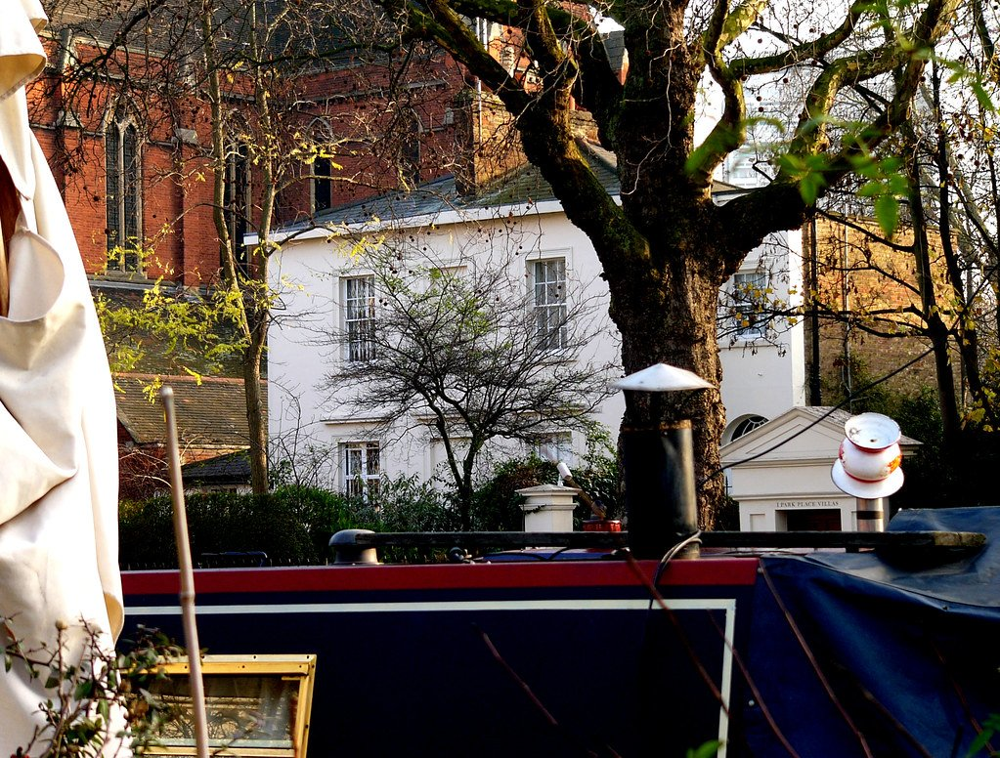
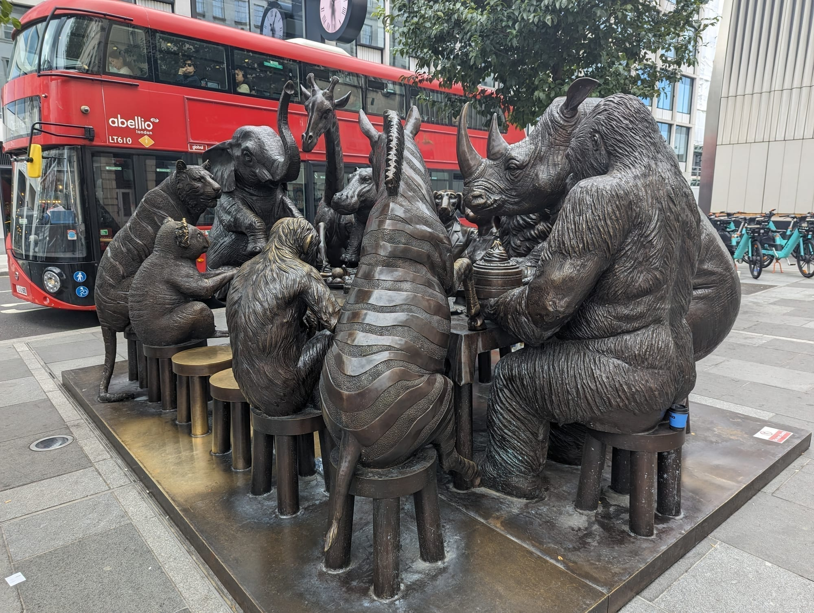
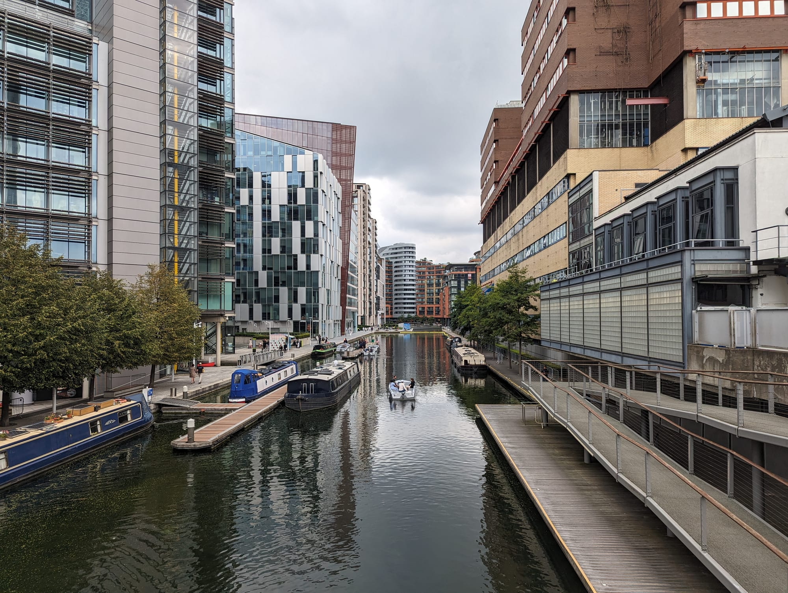

Paddington is where most visitors arrive rather than somewhere they set out to see. It is a transport hub: a Brunel trainshed, five Tube lines, the Elizabeth line and the Heathrow Express, which reaches the airport in 15 minutes.

Ten minutes north of the platforms the character changes. **Little Venice** is a canal basin lined with moored narrowboats, waterside pubs and floating cafes, and it is the start of the canal walk to Camden.

Paddington has its own share of the commemorative plaques marking where notable people lived or worked - see them on our [interactive map](/plaques/?area=paddington).

## Why visit — and who should skip it

**Come here if** you want a canal walk, a narrowboat trip to Camden, or a well-connected and comparatively affordable base for a first London trip.

**Skip it if** you are looking for sights. Paddington has no major attraction; it is a starting point for the canal, Notting Hill and Regent's Park.

## Top sights and activities

1. **Little Venice** — The basin where the Grand Union and Regent's Canals meet, lined with painted narrowboats. Waterside pubs, a floating cafe and a puppet theatre barge.
2. **The narrowboat waterbus to Camden** — About 45 minutes along Regent's Canal, from £17, through the Maida Hill tunnel and the grounds of London Zoo. It does not stop at the zoo.
3. **The canal towpath west** — Follow the Grand Union towards Westbourne Park and Notting Hill. Flat and almost entirely traffic-free.
4. **Paddington station itself** — Brunel's 1854 trainshed, and the Paddington Bear statue on the concourse. On the plaza outside, a bronze group of animals sits around a dining table.
5. **Paddington Basin** — The modern waterfront east of the station, with the Rolling and Fan Bridges and a run of canalside restaurants.
6. **St Mary's Hospital and the Fleming Museum** — The laboratory where penicillin was discovered in 1928. Free; open Monday to Thursday, 10am to 1pm.

*Little Venice. Photo: [Kathleen Tyler Conklin](https://www.flickr.com/photos/79865753@N00/2122563341), [CC BY 2.0](https://creativecommons.org/licenses/by/2.0/).*

## Key streets and micro-districts

### Little Venice and Blomfield Road

The junction where the Grand Union meets the Regent's Canal, lined with white stucco villas and permanently moored narrowboats. It is about ten minutes' walk from the station.

**Eat and drink on the water.** **The Waterway at 54 Formosa Street** has the big terrace over the moorings; **The Summerhouse on Blomfield Road** does seafood at the water's edge and needs booking in summer; **Kateh at 5 Warwick Place** is a very small Persian restaurant on a side street that fills every night.

**The Puppet Theatre Barge** is moored on Blomfield Road: a fifty-seat theatre inside a converted barge, running shows for children and, occasionally, adults. It books out, so check the programme before walking down.

**Waterbuses run from here to Camden Lock** through Regent's Park and the zoo, in about 45 minutes. You can also walk the towpath free in about an hour.

**Warwick Avenue is the nearest station**, two minutes away, on the Bakerloo line.

### Paddington Basin

East of the station, on the same water but a different place from Little Venice: glass offices, hard landscaping and a canal that dead-ends into the city.

**Two moving footbridges are the reason to walk down.** Thomas Heatherwick's **Rolling Bridge** curls up into an octagon, usually around midday on Fridays. The **Fan Bridge** opens in five segments and is scheduled to lift at 11.30am on Mondays, Wednesdays and Fridays, but is out of order as of 26 October 2026.

There is also a **Floating Pocket Park**, a moored island of trees and benches that rises and falls with the water.

**Eat at Sheldon Square**, the amphitheatre-shaped bit: **Pearl Liang at number 8** does Cantonese and dim sum, **Beany Green at 6C** does Australian all-day breakfast, and **The Cheese Barge at 25** is moored on the water.

**It is quiet at weekends.** This is an office district, so come on a weekday if you want the restaurants open and the bridges moving.

*The bronze animals outside Paddington station.*

### Praed Street and Craven Road

The hotel strip, running east and south from the station front: a long parade of budget and mid-range hotels, convenience shops and pharmacies, comparatively cheap for zone 1.

**This is where you stay for an early Heathrow train.** The Elizabeth line and the Heathrow Express both leave from Paddington, so a room here is fifteen minutes from the airport.

**St Mary's Hospital is on Praed Street**, and inside it the **Alexander Fleming Laboratory Museum**: the room where penicillin was discovered in 1928, preserved as it was. Entry is free, Monday to Thursday 10am to 1pm.

**Do not plan to eat here.** The strip is chain sandwich shops and hotel bars. Bayswater is five minutes south-west and Little Venice ten minutes north.

### Bayswater and Queensway

South-west of the station: a dense restaurant quarter serving the neighbourhood, with Cantonese, Lebanese, Persian, Greek and Malaysian places within a few streets of each other.

**Westbourne Grove is the good street**, running west from Queensway. **Al Waha at 75** is a Lebanese restaurant that takes bookings. Queensway itself is cheaper, busier and later-opening.

**Two stations serve it**, Bayswater and Queensway, on different lines about three minutes apart. **Kensington Gardens is at the southern end**, so this is also the walking route from Paddington to Hyde Park: about fifteen minutes to the Italian Gardens.

*Paddington Basin. Photo: [trolvag](https://commons.wikimedia.org/w/index.php?curid=56959884), [CC BY-SA 3.0](https://creativecommons.org/licenses/by-sa/3.0/).*

## Where to eat and drink

| Spot | Style | Price | Why go |
| --- | --- | --- | --- |
| **The Waterway** | Canal-side bistro | ££ | Terrace over the narrowboats in Little Venice |
| **The Summerhouse** | Seafood | £££ | Waterside tables on Blomfield Road; book in summer |
| **Pearl Liang** | Cantonese, dim sum | ££ | Sheldon Square, behind Paddington Basin |
| **Kateh** | Persian | ££ | Small Warwick Avenue restaurant; reserve ahead |
| **Beany Green** | Australian cafe | £ | Breakfast and brunch at 6C Sheldon Square |
| **Market Halls Paddington** | Food hall | ££ | Eight kitchens in 1 Paddington Square, a minute from the platforms; walk-in |

*Market Halls Paddington.*

Ayllu, beneath Smith's in Sheldon Square, is a Japanese-Peruvian restaurant with a £29 five-course weekday lunch. It is in our [fusion restaurants guide](/articles/best-fusion-restaurants-london/).

## Getting there

**By Tube and rail.** Paddington is served by the Circle, District, Bakerloo and Hammersmith & City lines, plus the Elizabeth line and National Rail services to the west of England and Wales. For Little Venice, **Warwick Avenue** on the Bakerloo line is closer than Paddington itself.

**From Heathrow.** The Elizabeth line takes about 30 minutes; Heathrow Express takes 15 minutes non-stop at a premium fare. Full comparison in the [Heathrow Airport transport guide](/articles/heathrow-airport-to-london/).

**Best exit.** Follow signs for **"Paddington Basin"** for the canal and modern waterfront, or leave via **Praed Street** for the hotels and Bayswater.

Powered by <a target="_blank" rel="sponsored" href="https://www.getyourguide.com/london-l57/">GetYourGuide</a>

## How long to spend, and when to go

| If you have | Do this |
| --- | --- |
| **One hour** | Little Venice basin and a drink on the water |
| **Two to three hours** | Canal walk west to Westbourne Park, lunch in Little Venice |
| **Half a day** | Add the waterbus to Camden, or walk on to Notting Hill |

**Best time:** Late morning. The waterside pubs fill up from midday at weekends.

**Note:** Waterbus services to Camden are much reduced outside summer. Check timetables before planning a trip around one.

Comparing neighbourhoods? [Best areas to visit in London](/articles/best-areas-to-visit-london/) sets them side by side by what each is best for, how long it takes and the best day to go.

## Common mistakes to avoid

1. **Getting lost in the station.** Know whether you want Praed Street or Paddington Basin before you leave the platform.
2. **Walking to Camden along the canal.** It is around 50 minutes and progressively less scenic. Take the waterbus.
3. **Paying walk-up Heathrow Express fares.** Advance tickets are far cheaper, and the Elizabeth line is cheaper still.
4. **Expecting Little Venice to be near the station.** It is a 10–12 minute walk north, or one stop on the Bakerloo line to Warwick Avenue.
5. **Judging the area by Praed Street.** The canal quarter a few minutes north is a different place.

Powered by <a target="_blank" rel="sponsored" href="https://www.getyourguide.com/london-l57/">GetYourGuide</a>

## Where to stay

Paddington's hotels are good value for central London, and the Heathrow connection suits arrival and departure days.

- **Praed Street and Sussex Gardens** — The most mid-range hotels. Convenient, noisy, unremarkable.
- **Little Venice and Warwick Avenue** — Quieter, a short walk or one stop from the station.
- **Bayswater and Queensway** — Better restaurants and lower prices, ten minutes south-west, with Kensington Gardens on the doorstep.

Our [Paddington hotel guide](/articles/where-to-stay-paddington/) compares the hotels, from the station to the Sussex Gardens townhouses.
