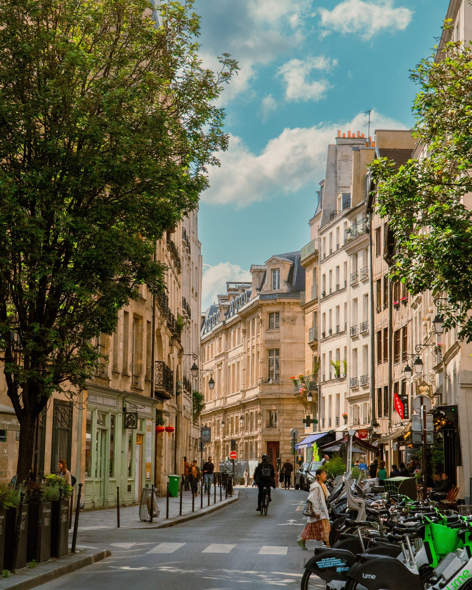
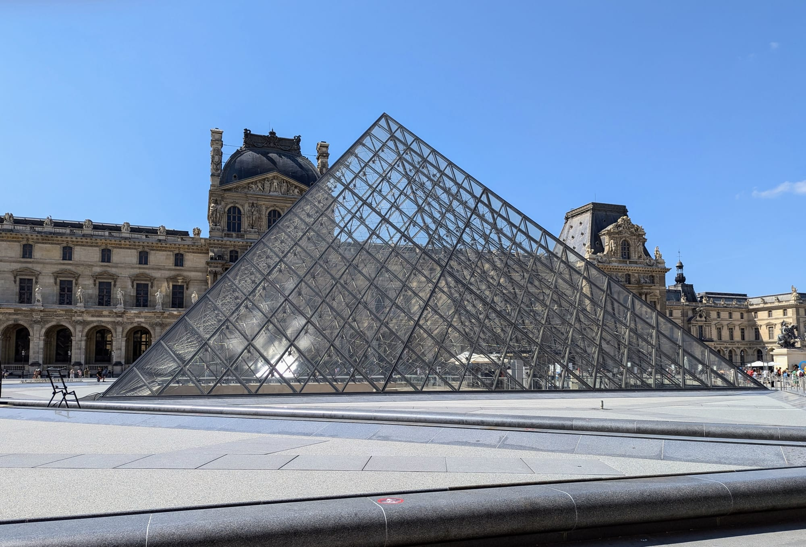
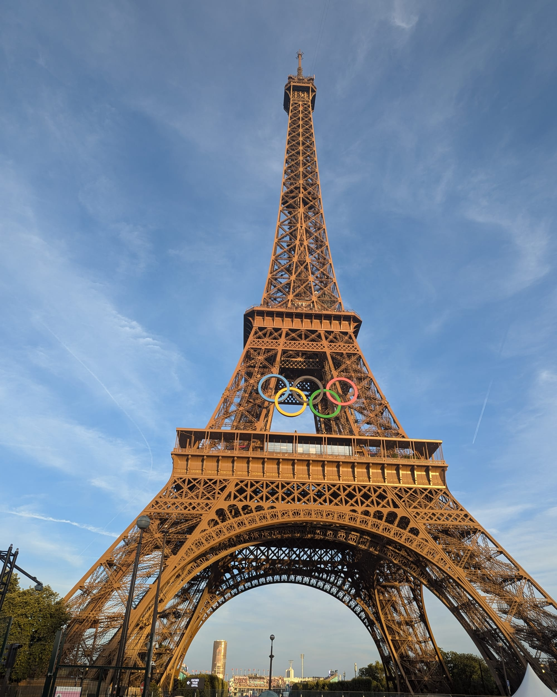
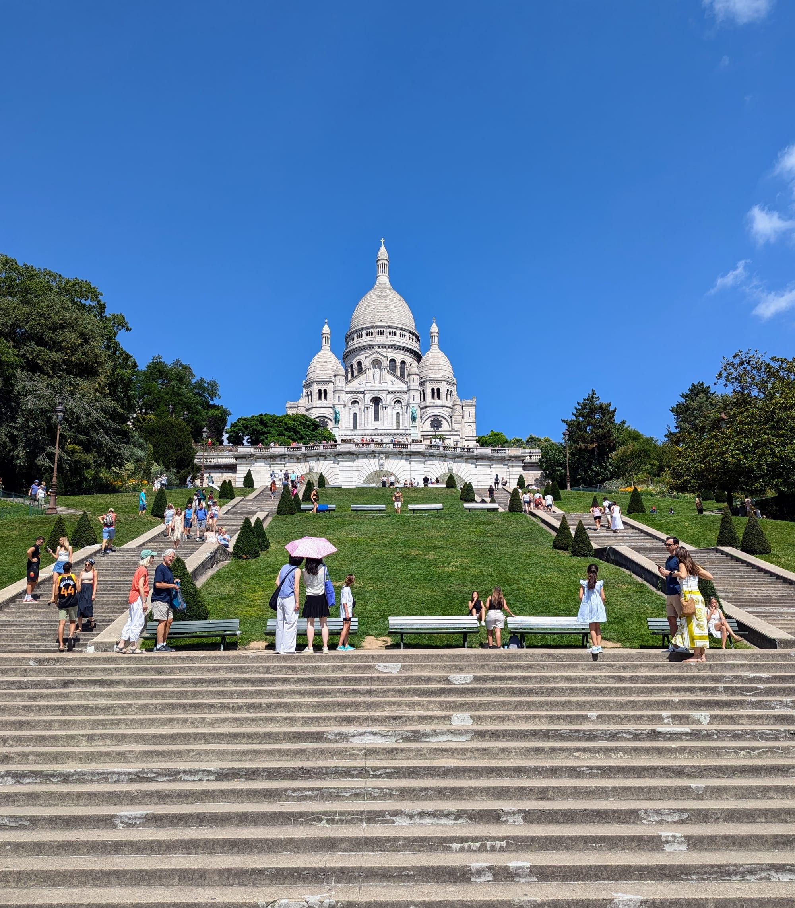

**St Pancras to Gare du Nord is as little as 2 hours 16 minutes on a direct Eurostar. The fare moves with demand: around £55 in Eurostar Standard booked two weeks out, and £220 or more for the same day.**

This is an international border, and Eurostar does the checks at St Pancras before you leave London: UK exit, French entry and EU biometric registration, not on arrival in Paris. Allow for that and the time in Paris is more generous than on the three-hour-each-way trips to Stonehenge or the Cotswolds.

> 💡 **The Short Version:** **St Pancras to Gare du Nord, from 2h16 direct.** Eurostar Standard around **£55** booked two weeks ahead, up to **£220+** booking on the day; **Eurostar Plus** roughly **£95–£300**; **Eurostar Premier** a flatter **£245–£361** whatever the date. **Arrive 75 minutes before departure** for Standard or Plus (45 for Premier) — UK exit, French entry and EU Entry/Exit System registration all happen at the station before you board. You need **a passport, not an ID card**, issued within **10 years** and valid **3 months** after you leave France — no ETA or visa required for a UK citizen heading out. **Luggage: 2 bags + 1 daypack** (3 for Premier), 85cm max. The earliest sensible train (07:01) and the last one with reliable seats (about 19:11) give you **roughly 7 hours in Paris** — nearer 8 if you take the 06:01. That's **two or three things**, not five rushed. **Or let someone else plan the day** — the <a href="https://www.getyourguide.com/activity/-t11108?partner_id=WWP7I0R&amp;cmp=paris-day-trip-eurostar-package" target="_blank" rel="sponsored nofollow noopener" data-affiliate="gyg">£289 escorted day trip</a> bundles the Eurostar, a Seine cruise and Eiffel Tower entry into one booking. **If you'd rather stay the night** — four hotels below, from a design hotel opposite Gare du Nord to a budget three-star in the Marais.

**Book a tour direct:**

- **From £289** — <a href="https://www.getyourguide.com/activity/-t11108?partner_id=WWP7I0R&amp;cmp=paris-day-trip-eurostar-package" target="_blank" rel="sponsored nofollow noopener" data-affiliate="gyg">Paris day trip with lunch on the Eiffel Tower, Eurostar travel included</a> — a coach tour, a Seine cruise and entry to the tower

Powered by <a target="_blank" rel="sponsored" href="https://www.getyourguide.com/london-l57/">GetYourGuide</a>

## Getting there: the Eurostar

| | London St Pancras → Paris Gare du Nord |
| --- | --- |
| **Operator** | Eurostar, direct |
| **Journey time** | **From 2h16** (many departures take 2h28–29) |
| Eurostar Standard | **£39–£220** one way depending on date and time |
| Eurostar Plus | £95–£300 |
| Eurostar Premier | **£245–£361**, barely moves with the time of day |
| Recommended arrival, St Pancras | **75 min** before (Standard/Plus), 45 min (Premier) |

Fares move by the hour as seats sell: treat the range as what to expect, not a quote.

### Eurostar Standard, Plus or Premier

**Eurostar Standard, Eurostar Plus and Eurostar Premier replace the old Standard, Standard Premier and Business Premier** on routes to and from London.

| | Eurostar Standard | Eurostar Plus | Eurostar Premier |
| --- | --- | --- | --- |
| **Exchange** | Free up to 1hr before | Free up to 1hr before | Free up to **48hrs after** departure |
| **Refund** | Up to 7 days before, £25 fee | Up to 7 days before, £25 fee | Free, up to 48hrs after departure |
| **Luggage** | 2 bags + 1 daypack | 2 bags + 1 daypack | **3 bags** + 1 daypack |
| **Seat** | Standard | Extra spacious | Extra spacious |
| **Food** | Buy on board | 2-course meal at your seat | Chef-designed menu (selected routes) |
| **Lounge** | — | — | St Pancras, Paris, Brussels |
| **Gate** | Standard queue | Standard queue | Priority (London routes) |

For a single day trip, book Standard: it can be refunded up to a week out for a £25 fee, and it is free to change right up to an hour before your train, so there is little reason to pay for Plus or Premier unless you want the lounge or the meal.

### Booking ahead is the whole game

Eurostar fares work like UK Advance tickets: the price moves with demand and how far out you book, and there is no walk-up fare to fall back on.

| Booking this far ahead | Example Eurostar Standard fare, one way |
| --- | --- |
| **Same day** | **£220** |
| 3 days | £110 |
| **1 week** | **£75** |
| **2 weeks** | **£55** |

A same-day seat costs three to six times a seat booked a few weeks out. Eurostar advertises one-way fares from £39 (on a mandatory return) for travel between 4 November 2026 and 14 February 2027. **Eurostar releases tickets 10 to 11 months ahead**, so for a specific date you have that whole window to watch for a drop.

Powered by <a target="_blank" rel="sponsored" href="https://www.getyourguide.com/london-l57/">GetYourGuide</a>

## Check-in and the border

Eurostar's recommended arrival times are longer than for a UK domestic train because the UK exit checks, French entry checks and EU border registration are all done at your departure station, before you board.

| Station | Class | Recommended arrival | Gate closes |
| --- | --- | --- | --- |
| **St Pancras** (outbound) | Standard / Plus | **75 min before** | 30 min before |
| St Pancras (outbound) | Premier | 45 min before | 15 min before |
| **Gare du Nord** (return) | Standard / Plus | **75–90 min before** | 30 min before |
| Gare du Nord (return) | Premier | 45–60 min before | 15 min before |

> ⚠️ **Do not apply the 20-minute advice Eurostar gives for its other European routes** (Paris, Brussels, Amsterdam, Cologne). A trip that starts or ends at St Pancras needs longer because of the passport checks.

**You need a passport, not an ID card.** Since Brexit, UK nationals are non-EU travellers on this route. Your passport must have been **issued less than 10 years before** the date you enter France and stay **valid for at least 3 months after** the day you leave — both rules apply, and a passport that fails either will be turned away at the gate. No ETA or visa is required for a UK citizen travelling out; the UK's Electronic Travel Authorisation only applies to foreign nationals entering Britain.

**EU Entry/Exit System (EES) registration** is the newer step: a passport scan, a facial photo and, on your first crossing, fingerprints, done at a self-service kiosk before the ticket gates. It is free and needs no advance application. Arrive at the recommended time with your passport; the kiosk tells you whether to go on to an ePassport gate or a border agent.

**Luggage:** one handbag or daypack plus two further items, none more than 85cm at their widest point, for Standard and Plus — three bags plus the daypack for Premier. There's no weight limit, but you carry and store it yourself on board.

## Is Paris actually doable as a day trip?

Yes. You get more time in Paris than on the Stonehenge or Cotswolds trips, where travel eats most of the day.

The **first train that doesn't mean checking in before 5am** is 07:01, arriving Gare du Nord at 10:29 local time. The first departure of the day is 06:01, arriving 09:29, but Standard and Plus passengers should check in 75 minutes ahead, which means being at St Pancras by around 04:45. The **last practical Paris–London train** is 19:11, arriving St Pancras at 20:30; a later 21:02 departure is on the timetable but tends to have no seats, so don't plan around it.

That gives you from **10:29 to about 17:45** in Paris before you need to be through the gates at Gare du Nord for the 75–90-minute check-in — call it **seven and a quarter hours**. Take the 06:01 instead and it stretches to about **eight hours and fifteen minutes**.

Allow for the walk to and from the Métro, queues and a buffer to get back to Gare du Nord, and the time for actually doing things is closer to **five or six hours**: two sights and a meal.

*A side street in central Paris. Photo: MuffinLand, Pexels.*

Powered by <a target="_blank" rel="sponsored" href="https://www.getyourguide.com/london-l57/">GetYourGuide</a>

## Getting into Paris: Métro and RER from Gare du Nord

Gare du Nord is itself a Métro and RER hub, so nothing central is far. A single ticket is **€2.55** on any Métro, RER or train within Paris (a day pass is €12.30, worth it only if you're making more than about five journeys). Times below are transit estimates from Gare du Nord.

| From Gare du Nord to | Time | Route |
| --- | --- | --- |
| **Notre-Dame** | **9–11 min** | Métro line 4, or RER B |
| **Louvre** | **13–17 min** | RER B/D, or Métro line 4 |
| **Montmartre / Sacré-Cœur** | **15 min** | Métro line 4 |
| **Eiffel Tower** | **28 min** | RER B, then RER C |

Louvre and Notre-Dame are also a **9-minute walk from each other** along the river, which is the natural pairing if you'd rather stay central than cross town to the Eiffel Tower.

## What to do with the day

Pick one of these rather than stringing them together.

**Central loop: Louvre, then Notre-Dame.** Closest to the station and closest to each other. With two to three hours, go in with a short list, such as the Mona Lisa and the Denon wing. It's **€22 for EEA residents, €32 for everyone else**, UK visitors included, and **closed every Tuesday**, open 9:00–18:00 Monday, Thursday, Saturday and Sunday, 9:00–21:00 Wednesday and Friday, last entry an hour before close. Notre-Dame, reopened in December 2024 after the 2019 fire, is **free to enter every day during opening hours**.

*The Louvre's glass pyramid.*

> ⚠️ **The Louvre is shut on Tuesdays.** Swap in the Musée d'Orsay or give Notre-Dame and the Left Bank more time.

**Eiffel Tower loop: the tower, then a Seine cruise.** Both start from the same spot. A ticket to the summit by lift is **€36.70**, to the second floor **€23.50**; entry is by timed online slot and same-day walk-up availability isn't guaranteed, so book ahead. Bateaux Parisiens run a one-hour cruise from the foot of the tower past the Musée d'Orsay, the Louvre and Notre-Dame. Large luggage isn't allowed inside the tower and there's no storage, so this loop needs a day bag only.

*The Eiffel Tower.*

**Montmartre**, 15 minutes from the station by Métro, is the option if you'd rather wander than queue: cobbled streets, the Place du Tertre, and the basilica free to enter.

*The Sacré-Cœur, Montmartre.*

Going with children? [Disneyland Paris](/articles/disneyland-paris-from-london/) is about an hour from Gare du Nord on the RER B and A, and the guide there works out what the day costs and how many hours it leaves you.

Prefer someone else to handle the tickets, the coach transfers in Paris and the Eurostar booking? The escorted day trip linked at the top of this guide covers a panoramic coach tour, lunch at the Eiffel Tower's Madame Brasserie, a Seine cruise and entry to the tower itself, with round-trip Eurostar included — useful if you'd rather not plan the logistics above yourself.

Powered by <a target="_blank" rel="sponsored" href="https://www.getyourguide.com/london-l57/">GetYourGuide</a>

## Where to stay

Near Gare du Nord you can walk to an early train home; in the old centre you get an evening in Paris but a trek back across town.

- **[25hours Hotel Terminus Nord](hotelscom:h15940)** — on Boulevard de Denain, directly opposite Gare du Nord's main entrance. A design hotel with a dark-wood cocktail bar downstairs. ££, and the one to book if the priority is walking to your train.
- **[Hôtel Thérèse](hotelscom:h53566)** — a quiet street by the Palais Royal gardens, a short walk from the Louvre. A wood-panelled library and book-lined rooms. £££.
- **[Relais Christine](hotelscom:h10369036)** — rue Christine in Saint-Germain-des-Prés, an easy walk across the river to Notre-Dame. A courtyard garden and a spa built into 13th-century vaults, breakfast included. £££.
- **[Hotel Jeanne d'Arc Le Marais](hotelscom:h11906978)** — a family-run three-star by Place des Vosges, walkable to both Notre-Dame and the Louvre. Breakfast included. £, the cheapest of the four.

## What people get wrong

- **Booking on the day instead of weeks ahead.** A same-day Standard seat can cost £220; a week out it is around £75.
- **Treating check-in like a UK domestic train.** Eurostar wants 75 minutes at St Pancras for Standard and Plus, not the 10 or 15 minutes a British train gets away with.
- **Not checking the passport's issue date.** A passport renewed early sometimes carries months added on from the old one, which can push it past the 10-year cutoff for entry even though it "isn't expired."
- **Planning around the very last train on the timetable.** Treat about 19:11 as the real last train, not 21:02.
- **Trying to fit in the Eiffel Tower, the Louvre, Notre-Dame and Montmartre in one day.** That's an itinerary for two days.

## Continue planning your trip

- 🗺️ **[Day trips from London](/articles/day-trips-from-london/)** — what the others cost, how long they take, and which days they are shut.
- 🛁 **[Bath day trip](/articles/bath-day-trip/)** — the other day trip here with a train over an hour each way, and how the maths compares.
- 🏰 **[Windsor from London](/articles/windsor-day-trip/)** — the shortest big day out, if a full day abroad isn't what you're after.
- 🚇 **[London transport costs and fares](/articles/london-public-transport-costs-and-fares/)** — how contactless and capping work on the London end of the trip.
- 🇧🇪 **[Brussels day trip](/articles/brussels-day-trip/)** — a shorter Eurostar than this one, and more hours in the city for the same early start.
- 🎢 **[Disneyland Paris from London](/articles/disneyland-paris-from-london/)** — the RER B and A from Gare du Nord, the through ticket via Lille, and whether a day works.
- 🍫 **[Bruges from London](/articles/bruges-day-trip/)** — another Eurostar day trip, with a change at Brussels-Midi onto a separate Belgian train.
- 🇳🇱 **[Amsterdam from London](/articles/amsterdam-from-london/)** — a longer Eurostar than this one, and the guide that makes the case for a night over a day trip.
