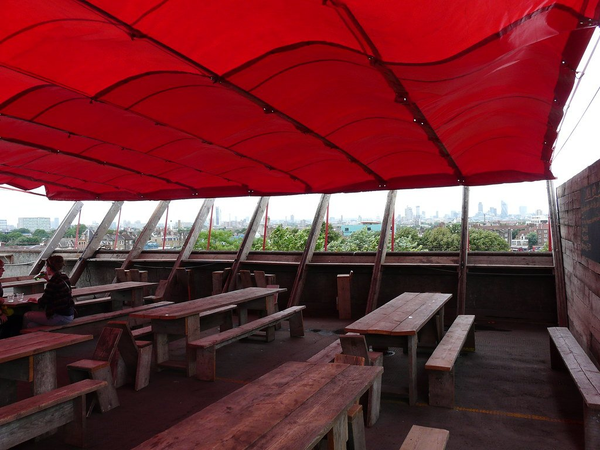
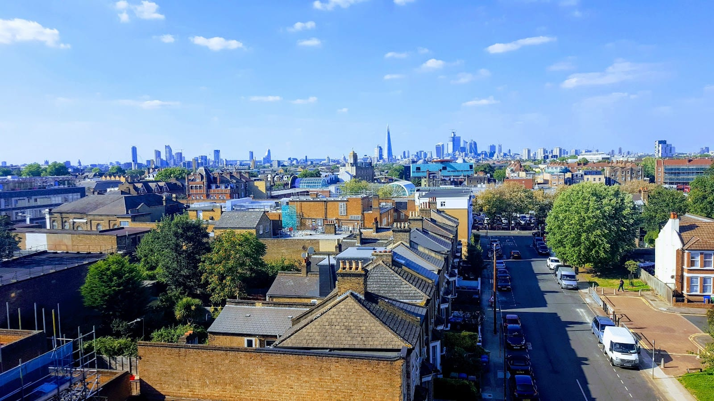
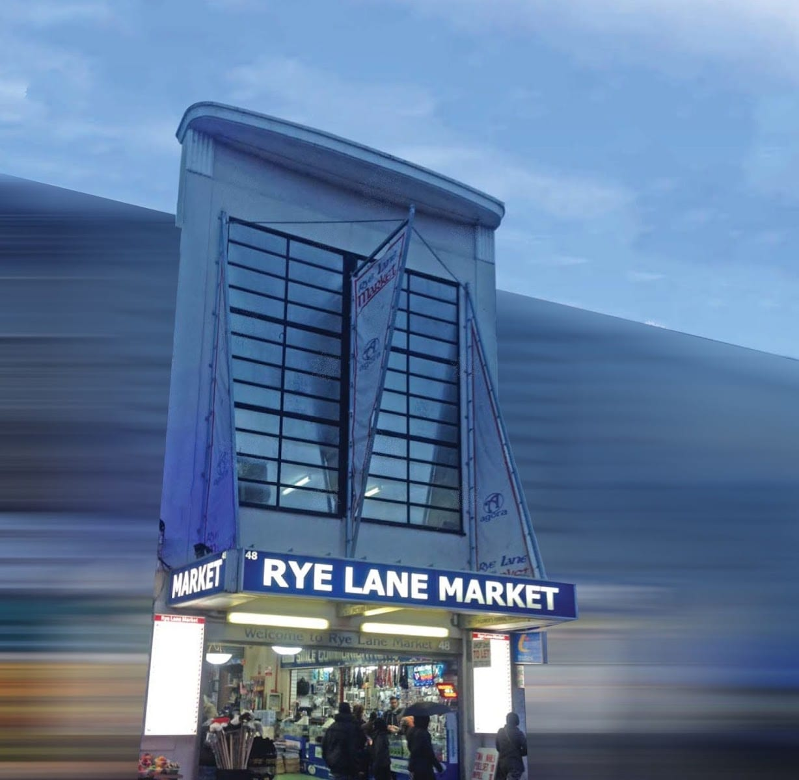
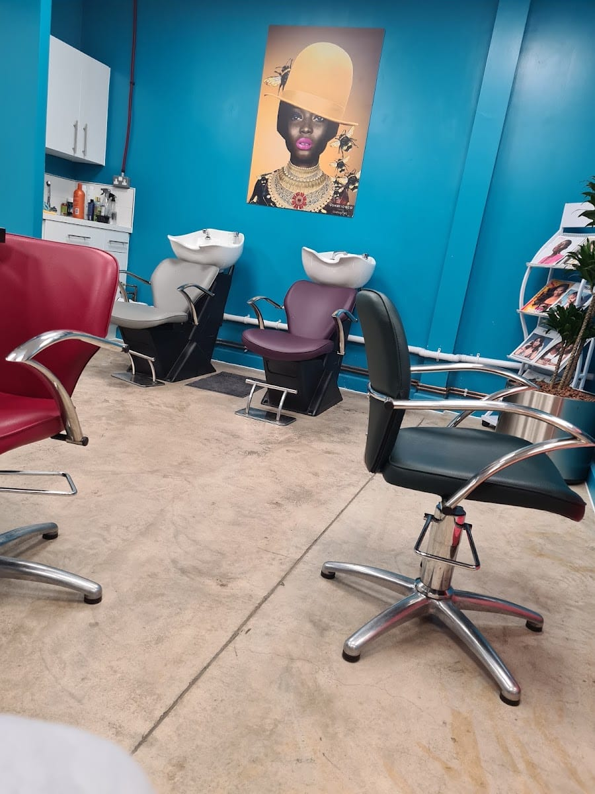
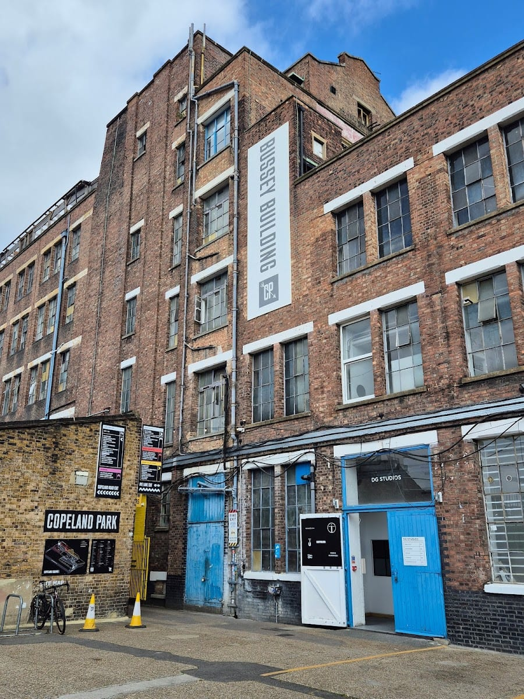
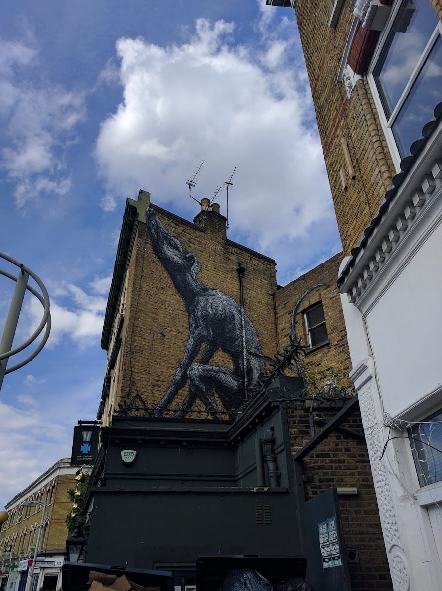
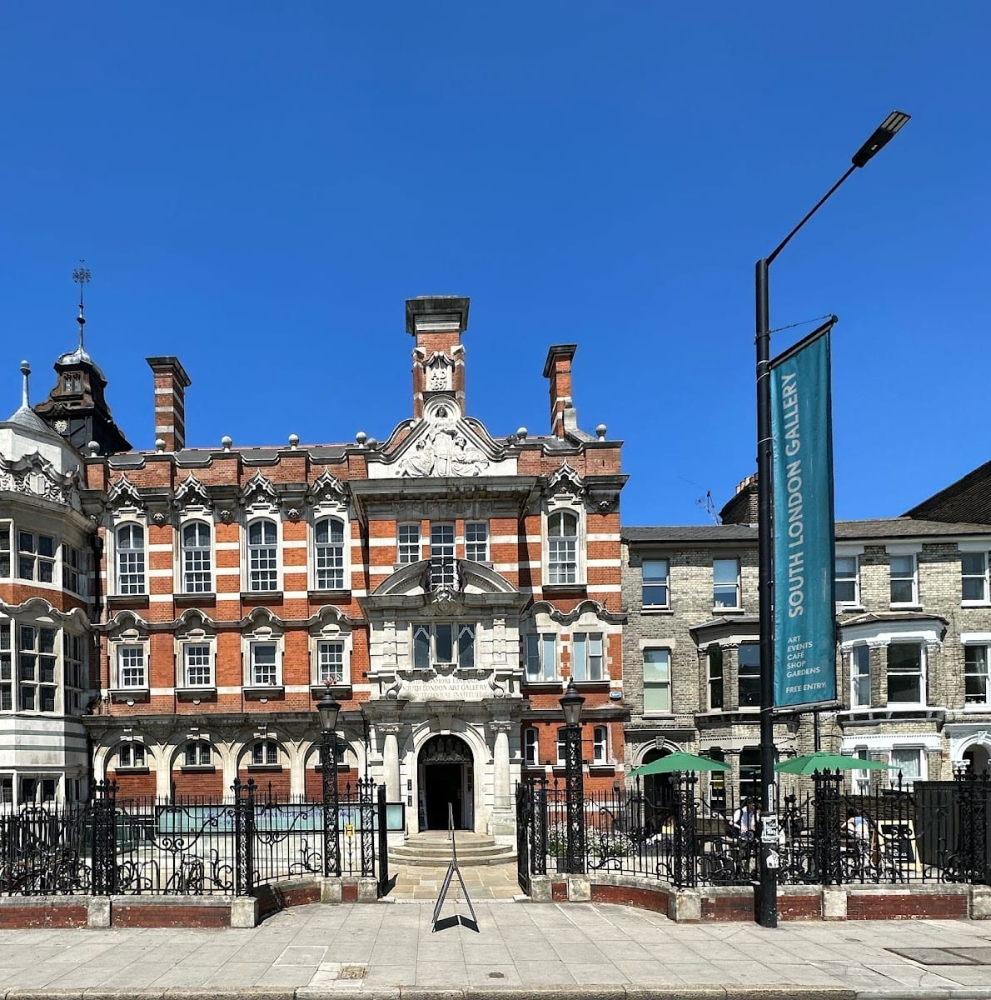
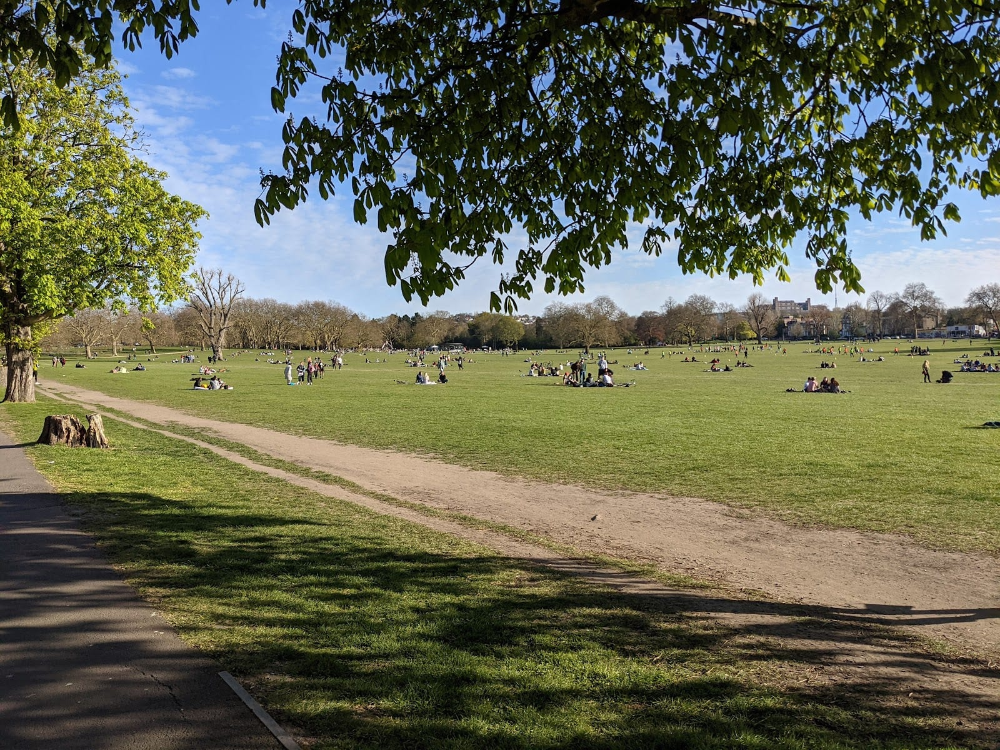
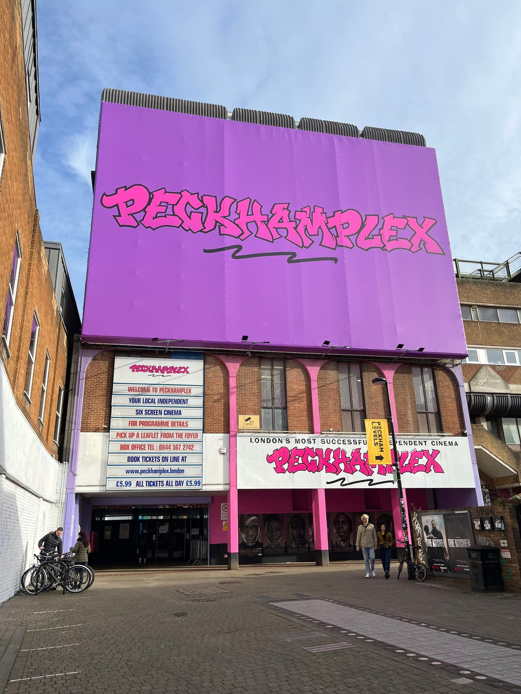
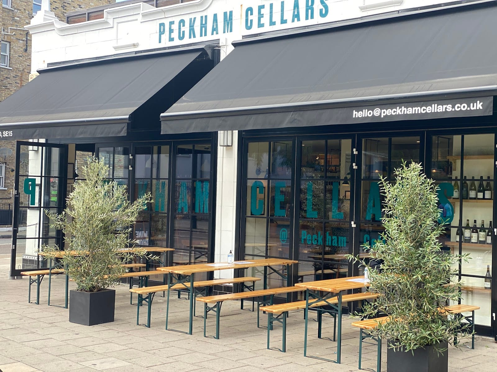

Rye Lane is a working high street of African grocers, fabric shops and phone repair kiosks; three floors above it, people are drinking cocktails on a car park roof looking back at St Paul's.

Peckham has its own share of the commemorative plaques marking where notable people lived or worked - see them on our [interactive map](/plaques/?area=peckham).

## Why visit — and who should skip it

**Come here if** you want to see how London eats and drinks outside the centre, and you want a view over the city that costs the price of a beer.

**Skip it if** you are on a short trip with museums to see. Peckham is thirty minutes from the middle and has no sights in the conventional sense. It rewards an evening, not a detour.

## Top sights and activities

1. **Rye Lane** — The high street, and the reason to come. African and Caribbean grocers, fabric shops, butchers and market stalls, busiest on a Saturday.
2. **Frank's Cafe** — A bar on the top deck of a multi-storey car park with an unobstructed view north to the City. **Free to walk up, no ticket**, and seasonal: roughly mid-May to mid-September, Wednesday to Sunday.
3. **The Bussey Building** — A former cricket bat factory turned arts and nightlife complex, off Rye Lane in Copeland Park. Bars, a rooftop and studios.
4. **Peckham Levels** — **The same car park**, on the floors below Frank's: studios, workspace and a bar. Open year round unlike Frank's, **Wednesday to Sunday**, and the old floor of independent food traders is gone.
5. **The South London Gallery** — A free contemporary art gallery on Peckham Road with a garden and a second site in a former fire station opposite.
6. **Peckham Rye Park and Common** — Large, local, and where the area goes at the weekend.
7. **Peckhamplex** — A cinema where every ticket is **£6.99** (£7.59 with the booking fee), in the same car park building.

*Frank's Cafe, on the car park roof. Photo: [Loz Flowers](https://www.flickr.com/photos/99245765@N00/4800919009), [CC BY-SA 2.0](https://creativecommons.org/licenses/by-sa/2.0/).*

*The view from Peckham Levels.*

## Key streets and micro-districts

### Rye Lane

The spine of Peckham. Loud and crowded: African and Caribbean grocers, fabric shops, butchers, hair and beauty, phone repair and shipping agents, with newer places threaded between them.

**Rye Lane Market** at number 48 is the indoor one: **over 60 units under one roof, open seven days**, roughly 9.30am to 8pm Monday to Saturday and 11am to 5pm on Sunday. The food inside is Mexican, Peruvian, Salvadoran, Honduran, Congolese, Guyanese, [Caribbean](/articles/best-caribbean-restaurants-london/) and West African, alongside tailors, herbalists, key cutters and a crystal stall. Street-market pitches also operate on the roads off Rye Lane: **Choumert Road, Atwell Road, Parkstone Road**.

*Rye Lane Market, at number 48.*

**Cornerhouse** at 133A is the newer end of the street in one building: Tonkotsu for ramen, **Forza Wine on the roof**, a basement club, a coffee shop and co-working above.

Just off it, **Peckham Palms** on Bournemouth Close is a hair and beauty hub built for Afro hair, with over thirty stylists and a café. It was built to rehouse the Black-owned businesses displaced by the station redevelopment.

*Inside Peckham Palms.*

### Copeland Park and the Bussey Building

Off the east side of Rye Lane through **Bussey Alley**, 150 metres from the station. The former **cricket bat factory** and the yards around it are full of independent galleries, bars, studios, record shops and a radio station.

*The Bussey Building.*

**The Bussey Rooftop Bar** runs **year round**, from 5pm on weekdays and midday at weekends, free to walk in, dogs welcome, under-18s until 7pm. There is shelter and there are heaters, so bookings go ahead in the rain, and the drinks come in reusable polycarbonate, not glass, because there are homes below. It is **not wheelchair accessible**.

Around it: **Jumbi**, a Black-owned HiFi rum bar; **Copeland Gallery** and **Bosse & Baum**; **Balamii** radio; a ceramics studio, a CrossFit gym and a vegan café in **Holdrons Arcade**; record shops, vintage dealers and the fashion designer Bianca Saunders. **Fitzcarraldo Editions**, the publisher, works out of the same yard.

The **CLF Art Café**, the club and live venue the Bussey Building was known for, has moved to Mountview on Peckham Hill Street. The nightlife here is bars and the rooftop.

### Bellenden Road

West of Rye Lane and a contrast: quiet, low-rise, Victorian, and where Peckham goes to sit down and eat.

*A mural on Bellenden Road.*

**Look at the bollards.** Southwark's street-improvement scheme here from 1997 used local artists: **Antony Gormley designed the bollards and street furniture**, and **Tom Phillips did the lampposts and mosaics**. There is no sign telling you.

The third artist of that group, **John Latham**, lived at number 210, and his house is now **Flat Time House**, a free public art space and archive. It opens Wednesday to Sunday afternoons when a show is on.

Eat at **Artusi** (Italian) or **The Begging Bowl** (Thai), or one of the cafés and delis. The street was settled by **Huguenots**; the Montpelier pub and Petitou café are what is left of its French Quarter name.

**Note the geography.** Kruk, Levan and Peckham Cellars are on Blenheim Grove and Queens Road, by the station, not on Bellenden Road.

### Peckham Road

North towards Camberwell. The addresses flip between SE15 and SE5 halfway along.

Walk up for the **South London Gallery**. It is **free** and **two buildings 120 metres apart**: the Victorian main gallery at 65–67 Peckham Road, and the **former fire station opposite at number 82**, which became a second set of galleries in 2018. Contemporary shows in both.

*The South London Gallery, on Peckham Road.*

**It is closed Mondays and Tuesdays.** Wednesday runs late to 9pm; Thursday to Sunday it is midday to 6pm. The **café is open more days than the galleries**, and the **Orozco Garden behind is weekends only, midday to 6pm**.

There is **no Tube nearby**. Peckham Rye station is a fourteen-minute walk; the 12, 36, 171, 343, 345 and 436 all stop outside.

### Peckham Rye

South towards the park, more residential. **Peckham Rye Park and Common is 113 acres** in two halves: 64 acres of open Common to the north, and 49 acres of Victorian park to the south.

*Peckham Rye Common, on a sunny weekend.*

The park half has a **community wildlife garden** with beehives and a pond, a restored **fernery**, a skate park, an outdoor gym and an adventure playground. **Opening is 7.30am to dusk**, which means 5pm in January and 9.30pm in July.

**The William Blake angel tree:** Blake is said to have seen a vision of angels filling a tree here as a boy in 1767. It happened **on the Common rather than in the Park**, and **the tree is gone**. There is no marker.

The street called **Peckham Rye**, facing the Common, has **Bà Ba**, the Nguyen family's southern Vietnamese restaurant, renamed from Bánh Bánh in 2026, and **Old Spike** for coffee.

*Peckhamplex. Photo: [Rhagfyr](https://commons.wikimedia.org/w/index.php?curid=144499998), [CC0](https://creativecommons.org/publicdomain/zero/1.0/).*

Powered by <a target="_blank" rel="sponsored" href="https://www.getyourguide.com/london-l57/">GetYourGuide</a>

## Where to eat and drink

This is a selection; see the [full restaurant list](/articles/eat-in-london-guide/) for more.

| Spot | Style | Price | Why go |
| --- | --- | --- | --- |
| **The Begging Bowl** | Northern Thai | £££ | Jane Alty trained under David Thompson; small plates across the table |
| **Kruk** | Thai | ££ | A Michelin Bib Gourmand — serious Thai at the value end |
| **Artusi** | Seasonal Italian | ££ | A Bellenden Road neighbourhood restaurant with a short changing menu |
| **Bà Ba** | Vietnamese | ££ | The Nguyen family's southern Vietnamese room on Peckham Rye, renamed from Bánh Bánh in 2026 |
| **Mr Bao** | Taiwanese | ££ | Gua bao and Taiwanese small plates |
| **Guacamoles** | Birria tacos | £ | Tortillas pressed to order and dipped in birria juice, in Rye Lane Market |
| **Old Spike** | Coffee | £ | Trains and employs people who have experienced homelessness; the Peckham Rye site is a cafe, the roastery has moved to Brixton |

**Two things on or near Rye Lane.** **Lai Rai** has the only Michelin Bib Gourmand for Vietnamese cooking in the UK and Ireland, awarded in February 2026, which makes [Vietnamese food in London](/articles/best-vietnamese-restaurants-london/) more than Kingsland Road. And **Peckham Cellars** on Queens Road is one of three [wine bars](/articles/best-wine-bars-london/) named by more independent sources than any other in the city, with a shop alongside the bar, so the same bottle is usually cheaper off the shelf than off the list.

*Lai Rai, on Rye Lane.*

*Peckham Cellars, on Queens Road.*

58th Street on Rye Lane is a 1930s speakeasy dinner show with three sets of live jazz. [Dinner and a Show in London](/articles/dinner-and-a-show-london/) has its prices and dress code.

## Suggested two-hour walking route

1. **Start:** Peckham Rye station. North up Rye Lane.
2. **Rye Lane:** The full length — the market, the grocers, the fabric shops.
3. **Copeland Park:** East off Rye Lane for the **Bussey Building** and the yard.
4. **Peckham Levels:** Up through the car park floors for the view.
5. **Frank's Cafe:** In season only, for the rooftop and the view back to the City.
6. **Bellenden Road:** West for the quiet end and the sit-down restaurants.
7. **Finish:** Dinner on Bellenden Road, or back to Rye Lane for tacos.

Powered by <a target="_blank" rel="sponsored" href="https://www.getyourguide.com/london-l57/">GetYourGuide</a>

Comparing neighbourhoods? [Best areas to visit in London](/articles/best-areas-to-visit-london/) sets them side by side by what each is best for, how long it takes and the best day to go.

## Common mistakes to avoid

1. **Turning up to Frank's Cafe in winter.** It is seasonal and on an open car park roof.
2. **Only walking Rye Lane.** Bellenden Road three minutes west holds most of the sit-down restaurants.
3. **Coming on a weekday afternoon.** Peckham is an evening and weekend place.
4. **Looking for a Tube station.** Peckham Rye is Overground and Thameslink.
5. **Walking into The Begging Bowl unbooked.** The good rooms here fill up like central ones do.

## Where to stay

Peckham is a place to spend an evening, not a base: there are few hotels and the transport is Overground, not Tube.

- **London Bridge** — Eight minutes by train and far better connected.
- **Bermondsey** — Twenty minutes, and the closest area with both hotels and its own night economy.
- **Camberwell and Denmark Hill** — Immediately north, cheaper, and walkable back to Peckham in twenty minutes.
