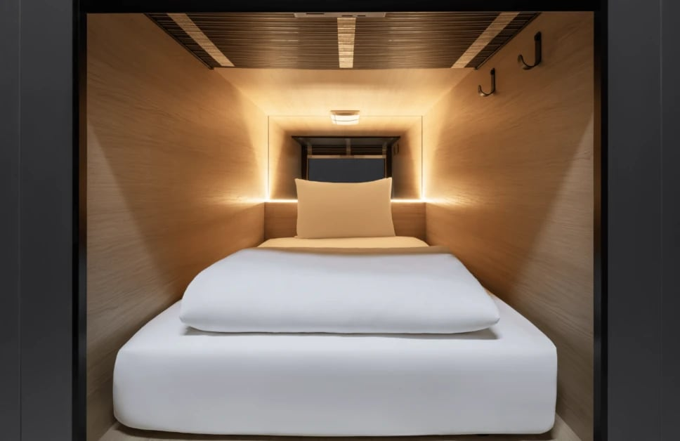
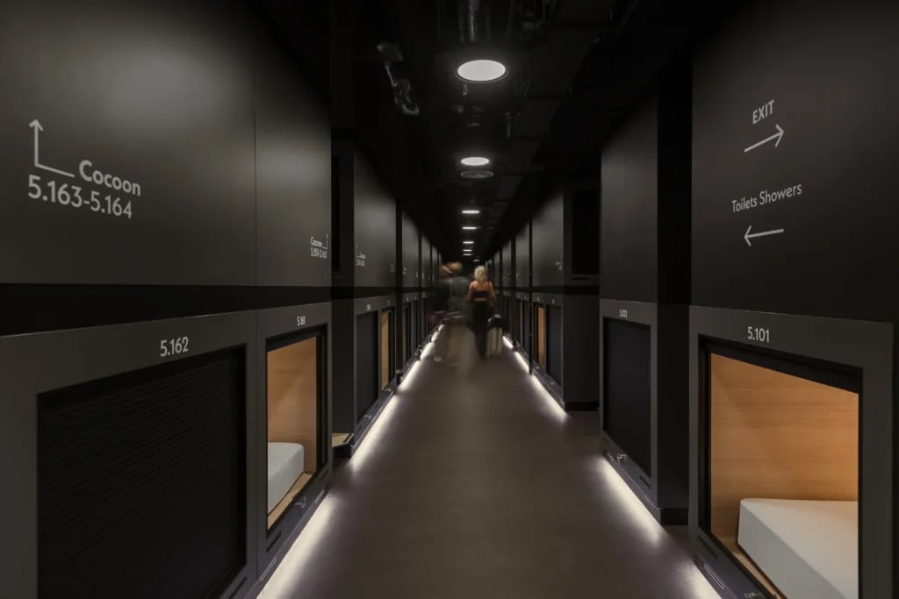
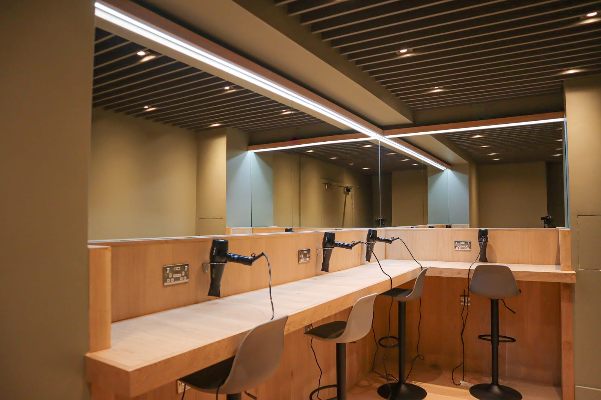
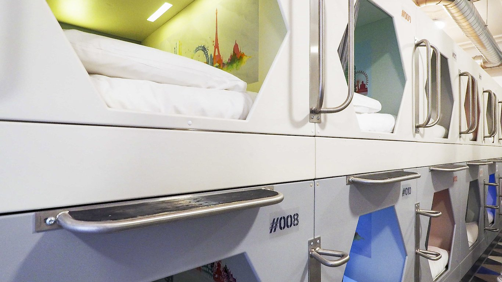
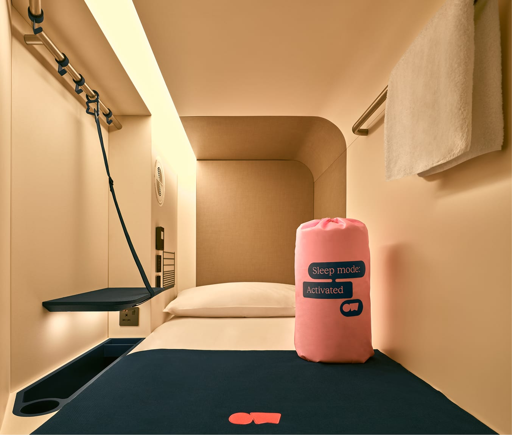

**A pod hotel in London means a capsule hotel, and London has five of them.** A capsule is a sealed berth roughly the size of a single bed, lined in oak, with a shutter you slide shut. You cannot stand up in it. It costs from about £33 a night one minute from Piccadilly Circus.

Ordinary hostels and small-room hotels such as YOTEL are not counted; the section on what gets miscalled a capsule hotel explains why.

> 💡 **The Short Version:** **[Zedwell Capsule Piccadilly Circus](hotel:zedwell-piccadilly-capsule)** is the one to book: over 1,000 berths one minute from the Tube, a 24-hour front desk and the lowest price of the five (£33–£68). **Zedwell Leicester Place** is the same product at a quieter address. **[St Christopher's Village](hotel:st-christophers-village)** (£53–£166 a double capsule) is the only one with a bar and a social side. **[Otherwander Soho](hotel:otherwander-soho)** (£62–£119, 563 pods) is nicer and roughly double the price. **The GreenHouse** in Bethnal Green is tiny and has almost no staff.

> 🛏️ **Want the kitchen and the bar instead?** That is a [hostel](/articles/best-hostels-london/), and our guide compares them: which dorms are en-suite, which have real female-only rooms, and the age limits that will refuse you at the desk. Beds start around £11.

## What a night in one is actually like

*Inside a capsule.*

**You check in and are given a floor and a berth number.** The capsules run in stacked pairs, upper and lower, down long corridors, and the floors are quiet by design.

Zedwell's are natural oak with a **solid sliding shutter**, not a curtain, so nobody can see in once it is closed. There is a Hypnos mattress with Egyptian cotton sheets, filtered air, a dimmable light, a socket and a shelf. Leicester Place puts the size at **1.2 sq m**.

**It locks from the inside with a catch.** Zedwell supplies no padlock for locking it from the outside (see the rules below). Otherwander uses a smart lock and The GreenHouse an access code.

**Everything else is down the corridor.** Bathrooms are shared floors of individual shower stalls, each with its own changing space; Zedwell's are rainfall showers with toiletries provided.

*The way to the showers.*

**The trade-off:** there is no desk, no chair, nowhere to put a suitcase and nowhere to sit up. If you want any daytime in the room, this is the wrong booking.

## The facilities, and what is shared

| | Zedwell Capsule (both) | St Christopher's Village | Otherwander Soho | The GreenHouse |
| --- | --- | --- | --- | --- |
| **Front desk** | 24 hours | 24 hours | **None** — smart lock | **None** — access code |
| **Bathrooms** | Shared, private stalls | Shared | Shared, private stalls | Shared |
| **Bar / events** | No | **Yes, most nights** | No | No |
| **Kitchen** | No | Yes | No | No |
| **Luggage storage** | £15 a piece, non-refundable | Lockers | — | — |
| **Locking up** | Catch inside; padlock for outside, £8 or bring 38mm | Pod door | Smart lock | Access code |
| **Women-only** | Piccadilly Circus floor | Oasis, own bathrooms | No | No |
| **Breakfast** | No | £3 | No | No |
| **Check-in / out** | 3pm / 10am | 3pm / **11am** | 3pm / 10am | 2pm / **11am** |
| **Age** | 18+ | 18+ | 18+ | 18+ |

**None of the four dedicated capsule hotels has a self-catering kitchen**; St Christopher's Village does because it is a hostel. Zedwell allows food deliveries, but they must be eaten in the common areas, never in the dormitories.

**Otherwander and The GreenHouse have no front desk.** You register online and a smart-lock code or access code arrives by email in the 24 hours before you arrive. Zedwell staffs reception around the clock.

Powered by <a target="_blank" rel="sponsored" href="https://www.getyourguide.com/london-l57/">GetYourGuide</a>

## The rules that catch people out

**Zedwell does not give you a lock.** The capsule closes with a catch on the inside, but to lock it while you are *out* you need your own **38mm padlock** or one **bought on site for £8** from a vending machine. Nothing is issued at check-in. Otherwander and The GreenHouse use a smart lock and an access code.

**Luggage does not go in the capsule.** Hooks for a small backpack, room for a slim bag beside the mattress, nothing more. Zedwell's luggage room is **£15 per piece and non-refundable** — on two nights with one case, about a quarter of what the bed costs.

**Check-out is early.** Zedwell and Otherwander go at 10am; St Christopher's Village and The GreenHouse at 11am. Only Zedwell has a published tariff for moving either end:

| | Check-in | Check-out | Early check-in | Late check-out |
| --- | --- | --- | --- | --- |
| **Zedwell Capsule** (both) | 3pm | **10am** | £20 before noon, £10 noon–3pm | £20 to noon, £30 to 2pm |
| **St Christopher's Village** | 3pm–**2am** | 11am | Not offered | Ask the hotel |
| **Otherwander Soho** | 3pm–midnight | **10am** | Charged; ask the price | Charged; ask the price |
| **The GreenHouse** | 2pm–midnight | 11am | Ask the hotel | Ask the hotel |

**Stay past 2pm at Zedwell and you are charged a full night.** Otherwander says early check-in and late check-out "can be arranged for an extra charge", so ask the price before you count on it.

**Late arrival is free everywhere.** Otherwander and The GreenHouse take arrivals until midnight and St Christopher's Village until 2am; Zedwell charges nothing for a late arrival. Check the cut-off against a late flight.

**You can ask for a bottom bunk**, and for a high or low floor, when you book. Both are free and neither is guaranteed.

**Everyone needs photo ID**, and all five are strictly 18 and over.

**Groups can book a whole dormitory.** Leicester Place's rooms run from 3 to 100 capsules.

## What it costs

Rates are the cheapest and dearest across five dates: a quiet Sunday, a February midweek, an October Saturday, the second Saturday of December and a Saturday in April.

| | Per night | What moves it |
| --- | --- | --- |
| **[Zedwell Capsule Piccadilly Circus](hotel:zedwell-piccadilly-capsule)** | **£33 – £68** | Cheapest of the five on every date |
| **Zedwell Capsule Piccadilly, female floor** | £40 – £75 | About £7 a night above the mixed floors |
| **[The GreenHouse Capsules](hotel:greenhouse-capsules)** | £42 – £53 | Barely moves all year |
| **[St Christopher's Village](hotel:st-christophers-village)** | £53 – £166 | A double capsule, so £27 a head for two |
| **[Otherwander Soho](hotel:otherwander-soho)** | £62 – £119 | Roughly double Zedwell throughout |
| **[Zedwell Leicester Place](hotel:zedwell-leicester-place-capsule)** | Book direct | Not sold through the booking sites |

**Capsules reprice less than hotel rooms.** A Zedwell berth roughly doubled between the cheapest and dearest night sampled; a windowless private room at the same address tripled. So a capsule saves you most in December and least on a quiet Sunday.

**The GreenHouse's price moves £11 across the year**, which makes it dearer than Zone 1 in October and cheaper in December.

Powered by <a target="_blank" rel="sponsored" href="https://www.getyourguide.com/london-l57/">GetYourGuide</a>

## The five, and which to book

### Zedwell Capsule Piccadilly Circus — book this one

*A capsule corridor at Zedwell.*

*£33–£68 · over 1,000 capsules · London Pavilion, W1J 0DA · Piccadilly Circus 1 min · [check prices](hotel:zedwell-piccadilly-capsule)*

Zedwell calls it the UK's largest capsule hotel, in the Grade II London Pavilion. **One minute from Piccadilly Circus station**, six from Leicester Square.

It is the **cheapest of the five on every date sampled**, with a 24-hour front desk and a women-only floor. The trade is atmosphere: over 1,000 berths in one building feels institutional.

### Zedwell Leicester Place — the same thing, calmer

*222 capsules · 7 Leicester Place, WC2H 7BY · Leicester Square 2 min · [book direct](hotel:zedwell-leicester-place-capsule)*

*The shared bathroom floor at Zedwell Leicester Place.*

The same product and policies at about a fifth of the size, **above the Prince Charles Cinema**. Dormitories run from 3 to 100 capsules, so it suits a group that wants a room of its own.

It is **not sold on Hotels.com or other booking sites**, so book direct. Expect a rate near Piccadilly's.

### St Christopher's Village — the only one with a bar

*£53–£166 a double capsule · 26 capsules in a 178-bed hostel · 161–165 Borough High Street, SE1 1HR · London Bridge 2 min*

*The capsules at St Christopher's Village.*

Twenty-six purpose-built capsules, each with mood lighting, a USB socket and a hinged door rather than a shutter, sit inside a 178-bed hostel two minutes from London Bridge and Borough Market. St Christopher's calls it the UK's first capsule hostel.

It has **Belushi's bar downstairs** with events most nights, a roof terrace, a kitchen, lockers and a 24-hour desk, plus **Oasis**, a female-only floor with its own bathrooms and keycard. Breakfast is £3.

**The capsule is a room type here.** Most beds are ordinary dorms and private rooms; the capsule bookable on the sampled dates was the **Private Double Capsule**, sleeping two, at £53 to £166. Check-out is **11am**, an hour later than Zedwell, and check-in runs to 2am.

**Book it if** you want a capsule and a social life.

### Otherwander Soho — the nicer one, at a Soho price

*£62–£119 · 563 pods over 6 floors · 92 Dean Street · Tottenham Court Road 3 min · [check prices](hotel:otherwander-soho)*

*An Otherwander single nest.*

Sold as **"nests"**, upper and lower, in singles and doubles; the double nest sleeps two. Air conditioning, lighting and a socket in every pod, three minutes from the Elizabeth line.

**There is no front desk.** You register online, a smart-lock code arrives before you travel, and a virtual desk handles anything else. Reviewers report hearing the corridor and neighbouring pods despite the soundproofing, and taller guests find the upper nests awkward.

At roughly double the Zedwell rate all year, a single nest can cost more than a private windowless room at Tottenham Court Road.

### The GreenHouse Capsules — small, east, and not the bargain it looks

*£42–£53 · 8 units · 93 Roman Road, E2 0QN · Bethnal Green 7 min · [check prices](hotel:greenhouse-capsules)*

A capsule hostel on the Roman Road market street, a short walk from Victoria Park and about ten minutes from Brick Lane. **Check-out is 11am**, an hour later than Zedwell and Otherwander.

Eight units, no front desk, entry by access code through a private entrance. Rated **7.3 out of 10 across 41 guest reviews**.

The catch is **£42 in Zone 2 against £33 in Zone 1** on a quiet night. It earns its place in December, when Zedwell climbs and this does not.

Powered by <a target="_blank" rel="sponsored" href="https://www.getyourguide.com/london-l57/">GetYourGuide</a>

## What gets miscalled a capsule hotel

Published lists of London capsule hotels run to ten or eleven by counting the following.

**Hostels with curtained bunks** (Clink261, Wombat's, Safestay, The Dictionary and most St Christopher's sites) are hostels. A curtained or panelled bunk in a six-bed dorm is a better bunk, not a capsule. They have kitchens, bars and events, which the dedicated capsule hotels do not.

**Clink261 is the closest near-miss.** Its **POD beds**, in a 14-bed mixed dorm, have ventilation, a reading light, USB and a socket, but close with a **curtain**, not a door or shutter. If it draws rather than latches, it is a bunk.

**St Christopher's *Village*** at London Bridge is the exception among the St Christopher's sites: it has 26 purpose-built capsules.

**Compact-room hotels** (YOTEL, Point A) are hotels: YOTEL's smallest London room is 10.5 sq m with its own rainfall shower.

**Some do not exist here.** Qbic no longer trades in London, CityHub has no London site, Snoozebox has closed, and the Australian pod chain LyLo has no UK location.

## Capsule, hostel or a windowless room?

| | Capsule | Hostel dorm | Windowless room |
| --- | --- | --- | --- |
| **Privacy** | Solid shutter, locks | Curtain at best | Own door |
| **Stand up?** | No | Yes | Yes |
| **Bathroom** | Shared, private stalls | Shared | En-suite |
| **Kitchen** | None | Usually | None |
| **Sociable?** | Deliberately not | Yes | No |
| **Children** | No, 18+ | Some | Yes |

**Book a capsule if** you are alone, you want a Zone 1 address for hostel money, and you only need somewhere to sleep. **Book a hostel if** you want a kitchen, a bar, or to meet people; our [best hostels in London guide](/articles/best-hostels-london/) compares them. **Book a windowless room if** there are two or more of you: the second guest adds about £5 a night.

For a long layover or a late flight, a [day room](/articles/day-rooms-london/) is cheaper than any of this and bookable for the afternoon. For more than a few nights, an [aparthotel](/articles/aparthotels-london/) with a kitchen beats both. For a private room with a window, [the best budget hotels in London](/articles/best-budget-hotels-london/) lists the hotels whose typical night came to £150 or less.

Zedwell calls both its capsule berths and its hotel rooms "Cocoons", so **"Capsule" in the property name** is what tells them apart. Our [windowless hotel rooms guide](/articles/windowless-hotel-rooms-london/) covers the rooms.

*Prices are Hotels.com rates for one adult across five dates, sampled on 7 September 2026. Rates change nightly, so check your own dates.*
